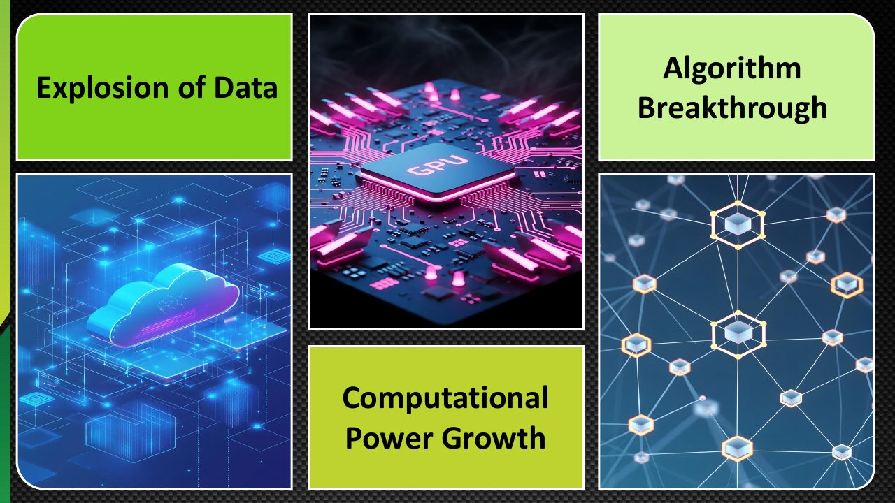
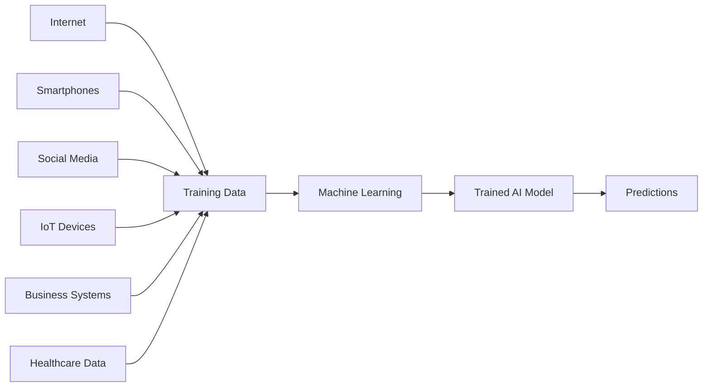
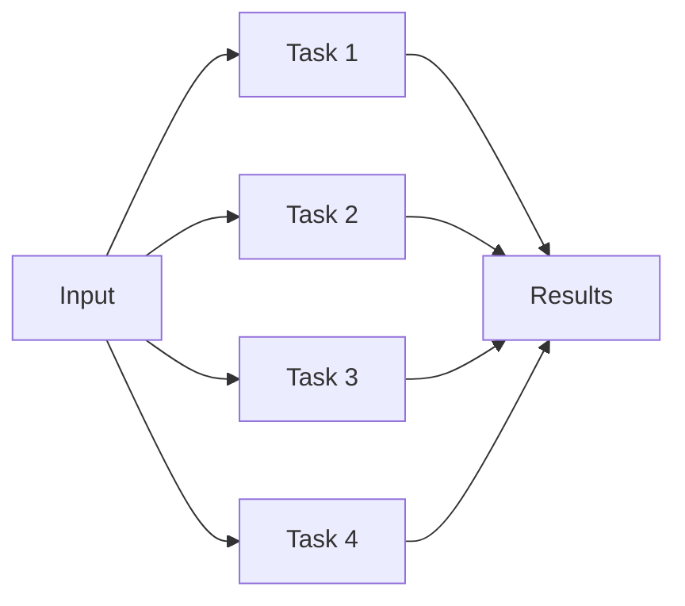
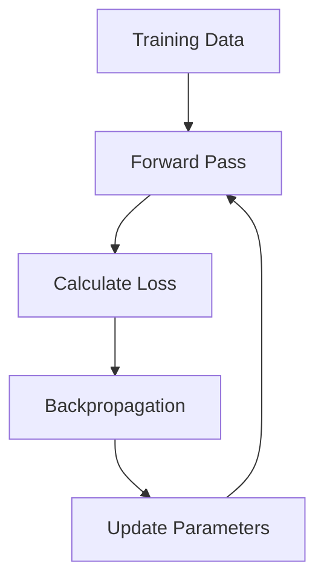
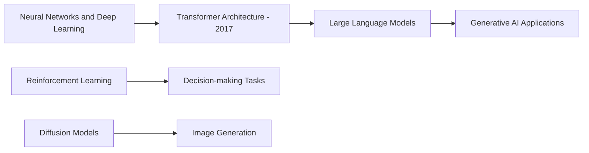
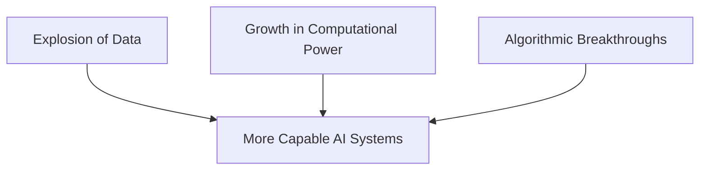

# Module 01 — AI Fundamentals: Drivers of AI Evolution

> Part I · AI Foundations and AI Infrastructure — Course Module 01 (AI, ML, DL Fundamentals and AI Adoption) — topic notes

## မြန်မာဘာသာ version

### 1. Why Has AI Become So Important?

ယနေ့ခေတ်မှာ Artificial Intelligence (AI) ဟာ Technology လောကရဲ့ အရေးအကြီးဆုံး နယ်ပယ်တွေထဲက တစ်ခုဖြစ်လာပါတယ်။
AI ကို Healthcare, Banking, Manufacturing, Automotive, Retail, Cybersecurity နဲ့ Software Development စတဲ့ နယ်ပယ်များစွာမှာ အသုံးပြုနေကြပါတယ်။

ဒါပေမဲ့ AI ဟာ တစ်ညတည်းနဲ့ ရုတ်တရက် တိုးတက်လာတာ မဟုတ်ပါဘူး။
AI တိုးတက်လာဖို့ အချက်အလက်များစွာ ပါဝင်ခဲ့ပါတယ်။ ဒီသင်ခန်းစာမှာတော့ အဓိက Drivers သုံးခုကို လေ့လာပါမယ်။

- **Explosion of Data** — Data အမြောက်အမြား ရရှိလာခြင်း
- **Growth in Computational Power** — Computing စွမ်းအား တိုးတက်လာခြင်း
- **Algorithmic Breakthroughs** — AI algorithms နဲ့ model architectures တွေမှာ တိုးတက်မှုများ ဖြစ်ပေါ်လာခြင်း

ဒီသုံးခုဟာ AI evolution ကို နားလည်ဖို့ အရေးကြီးတဲ့ အခြေခံအချက်တွေ ဖြစ်ပါတယ်။



**ပုံရှင်းလင်းချက် (သင်တန်းပုံ 1)** — ဒီသင်တန်းပုံက AI evolution ကို မောင်းနှင်ပေးတဲ့ driver သုံးခု — Data Explosion (digital data ပမာဏ အလွန်လျင်မြန်စွာ တိုးပွားလာခြင်း)၊ Compute Growth (computing power ကြီးထွားလာခြင်း) နဲ့ Algorithm Breakthrough (AI algorithms နဲ့ model architectures တွေမှာ တိုးတက်မှု ဖြစ်ပေါ်လာခြင်း) တို့ကို တစ်နေရာတည်းမှာ စုစည်းပြထားပါတယ်။ driver သုံးခု အတူတကွ တိုးတက်လာမှ ယနေ့ခေတ် AI စနစ်တွေ ပေါ်ထွက်လာတာဖြစ်ကြောင်း ဒီပုံက အကျဉ်းချုပ် မီးမောင်းထိုးပြပါတယ် — driver တစ်ခုချင်းစီကို အောက်ပိုင်း section တွေမှာ အသေးစိတ် ဆက်လက် လေ့လာပါမယ်။

*(Source: NVIDIA NCA-AIIO training deck — study material)*

### 2. Driver 1 — Explosion of Data

#### 2.1 What is an Explosion of Data?

Explosion of Data ဆိုတာ Digital data ပမာဏဟာ အလွန်လျင်မြန်စွာ တိုးပွားလာတာကို ဆိုလိုပါတယ်။
Internet, smartphones, social media, online transactions နဲ့ Internet of Things (IoT) devices တွေ တိုးတက်လာတာကြောင့် data အမြောက်အမြားကို နေ့စဉ် ထုတ်လုပ်လာကြပါတယ်။

ဥပမာ—

- **Internet:** Websites, articles, documents နဲ့ online content
- **Smartphones:** Photos, videos, voice recordings နဲ့ location-related data
- **Social Media:** Posts, comments, images နဲ့ videos
- **IoT Devices:** Sensors, temperature readings, machine telemetry နဲ့ device status
- **Business Systems:** Customer records, sales transactions နဲ့ inventory data
- **Healthcare:** Medical images, laboratory results နဲ့ clinical records

ဒီလို data တွေဟာ AI models တွေကို train လုပ်ဖို့ အသုံးပြုနိုင်တဲ့ အရင်းအမြစ်တွေ ဖြစ်လာပါတယ်။

**Figure 1 — Data အရင်းအမြစ်များမှ Training Data ဖြစ်လာပုံနှင့် AI model တစ်ခု သင်ယူပုံ**



**ပုံရှင်းလင်းချက် —** ဘယ်ဘက်က အစွန်းက Internet, Smartphones, Social Media, IoT Devices, Business Systems နဲ့ Healthcare ဆိုတဲ့ data အရင်းအမြစ် ၆ ခုကို အရင်ကြည့်ပါ။ မြားတွေက အဲဒီ data တွေအားလုံး အလယ်က Training Data ထဲ စုဝင်သွားတာကို ပြပါတယ်။ နောက်တစ်ဆင့်မှာ Machine Learning က ဒီ data ထဲက patterns တွေကို သင်ယူပြီး Trained AI Model ဖြစ်လာပါတယ်။ အဆုံးမှာ ဒီ model က မမြင်ဖူးသေးတဲ့ input အသစ်အတွက် Predictions ပေးနိုင်တာကို ညာဘက်ဆုံးမှာ တွေ့ရပါမယ်။

#### 2.2 Why Does AI Need Data?

Machine Learning (ML) model တွေဟာ training data ထဲက patterns နဲ့ relationships တွေကို သင်ယူပါတယ်။

ဥပမာ—ကားပုံတွေကို ခွဲခြားသိရှိနိုင်တဲ့ AI model တစ်ခုကို စဉ်းစားကြည့်ပါ။

```
Training Images
       │
       ├── Car
       ├── Bus
       ├── Truck
       ├── Motorcycle
       └── Bicycle
              │
              ▼
       Machine Learning
              │
              ▼
       Trained AI Model
              │
              ▼
    Predict an Unseen Image
```

Model ကို ကားပုံတွေ၊ ဘတ်စ်ကားပုံတွေ၊ ထရပ်ကားပုံတွေနဲ့ လုံလောက်စွာ train လုပ်ပေးရင် model က အဲဒီအမျိုးအစားတွေကြားက ကွာခြားချက်တွေကို သင်ယူနိုင်ပါတယ်။
နောက်ပိုင်းမှာ မမြင်ဖူးသေးတဲ့ ပုံတစ်ပုံကို ပေးလိုက်တဲ့အခါ ဘယ်အမျိုးအစား ဖြစ်နိုင်တယ်ဆိုတာ ခန့်မှန်းနိုင်ပါတယ်။

#### 2.3 Does More Data Always Mean Better AI?

အရေးကြီးတဲ့အချက်တစ်ခု ရှိပါတယ်။

**More data does not automatically mean better AI.**

Data ပိုများလာတာက အထောက်အကူပြုနိုင်ပေမဲ့ data ရဲ့ quality, relevance နဲ့ diversity တို့လည်း အရေးကြီးပါတယ်။

ဥပမာ—

- Data မှာ အမှားတွေများနေရင် model က မှားယွင်းတဲ့ patterns တွေကို သင်ယူနိုင်ပါတယ်။
- Data က အမျိုးအစားတစ်ခုတည်းကိုပဲ ကိုယ်စားပြုနေရင် အခြားအခြေအနေတွေမှာ performance ကျဆင်းနိုင်ပါတယ်။
- Data မှာ bias ရှိနေရင် model ရဲ့ predictions တွေမှာလည်း bias ပါဝင်နိုင်ပါတယ်။
- Data နဲ့ task မကိုက်ညီရင် data ပိုများနေလည်း ရလဒ်ကောင်းမရနိုင်ပါဘူး။

ဒါကြောင့် အကောင်းဆုံးရလဒ်ရဖို့ **large amounts of relevant, high-quality data** လိုအပ်ပါတယ်။

> **Exam Point — Driver 1: Explosion of Data**
>
> The rapid growth of digital data from the internet, smartphones, IoT devices, and business systems has provided more data for training AI models.

### 3. Driver 2 — Growth in Computational Power

#### 3.1 What is Computational Power?

Computational Power ဆိုတာ Computer system တစ်ခုက calculations နဲ့ data-processing tasks တွေကို ဘယ်လောက်မြန်မြန်၊ ဘယ်လောက်ထိရောက်စွာ လုပ်ဆောင်နိုင်သလဲဆိုတာနဲ့ သက်ဆိုင်ပါတယ်။

AI model တွေကို train လုပ်တဲ့အခါ mathematical calculations အများအပြား လုပ်ရပါတယ်။
အထူးသဖြင့် Deep Learning models တွေမှာ neural network parameters တွေကို update လုပ်ဖို့ ကြီးမားတဲ့ computational resources တွေ လိုအပ်နိုင်ပါတယ်။
Computing power တိုးတက်လာခြင်းက ဒီလို training tasks တွေကို ပိုမိုကြီးမားတဲ့ scale နဲ့ လုပ်ဆောင်နိုင်စေပါတယ်။

#### 3.2 CPU vs GPU

CPU နဲ့ GPU ကို အရင်နားလည်ထားရပါမယ်။

- **CPU** ဟာ computer ရဲ့ general-purpose processor ဖြစ်ပါတယ်။ Operating system, applications, system management နဲ့ အမျိုးမျိုးသော computing tasks တွေကို လုပ်ဆောင်ပေးပါတယ်။ *(မှတ်ရန် — General-purpose computing)*
- **GPU** ဟာ parallel computation အများအပြားကို လုပ်ဆောင်ဖို့ သင့်တော်တဲ့ processor ဖြစ်ပါတယ်။ Deep Learning မှာ အသုံးများတဲ့ matrix multiplication နဲ့ tensor operations တွေကို အရှိန်မြှင့်ပေးနိုင်ပါတယ်။ *(မှတ်ရန် — Parallel computation)*

GPU တွေကို မူလက graphics processing အတွက် အဓိကတီထွင်ခဲ့ပေမဲ့ ယနေ့ခေတ်မှာ AI training နဲ့ inference အတွက်လည်း အလွန်အရေးကြီးလာပါတယ်။

#### 3.3 What is Parallel Processing?

Parallel processing ဆိုတာ Computation တစ်ခုရဲ့ လုပ်ဆောင်ချက်များစွာကို တစ်ပြိုင်နက်တည်း လုပ်ဆောင်ခြင်း ဖြစ်ပါတယ်။

ဥပမာ—Data အများကြီးထဲက values တွေကို တွက်ချက်ရမယ်ဆိုပါစို့။

Sequential processing:

```
Task 1 → Task 2 → Task 3 → Task 4
```

Parallel processing:

```
          ┌── Task 1 ──┐
          ├── Task 2 ──┤
Input ────┼── Task 3 ──┼──── Results
          └── Task 4 ──┘
```

**Figure 2 — Sequential processing နှင့် Parallel processing ကွာခြားပုံ**



**ပုံရှင်းလင်းချက် —** ဘယ်ဘက်က Input တစ်ခုတည်းကနေ Task 1 ကနေ Task 4 အထိ မြားလေးခု တစ်ပြိုင်နက် ထွက်သွားတာကို ကြည့်ပါ။ အပေါ်က ASCII ပုံမှာ Task 1 → Task 2 → Task 3 → Task 4 လို တစ်ခုပြီးမှ တစ်ခု လုပ်ရပေမဲ့ ဒီပုံမှာ task လေးခုကို တစ်ပြိုင်နက် လုပ်နိုင်ပါတယ်။ ညာဘက်ဆုံးမှာ task တစ်ခုချင်းစီရဲ့ ရလဒ်တွေ Results ဆီ ပေါင်းသွားတာကို တွေ့ရပါမယ်။ ဒါကြောင့် GPU လို parallel computation ကောင်းတဲ့ hardware တွေက အချိန်ကို လျှော့ချပေးနိုင်တာ ဖြစ်ပါတယ်။

အလုပ်တွေက parallel လုပ်ဆောင်နိုင်တဲ့ပုံစံ ဖြစ်ပြီး hardware နဲ့ software က ထောက်ပံ့ပေးနိုင်ရင် အချိန်ကို လျှော့ချနိုင်ပါတယ်။
အလုပ်တိုင်းကို အပြည့်အဝ parallel လုပ်လို့ရတာတော့ မဟုတ်ပါဘူး။

#### 3.4 What is Cloud Computing's Role?

Cloud computing က computing resources တွေကို လိုအပ်သလို ရယူအသုံးပြုနိုင်စေပါတယ်။

ဥပမာ—AI training project တစ်ခုအတွက်—

- GPU-enabled virtual machines
- Multiple servers
- Distributed storage
- High-speed networking
- Managed AI infrastructure

စတာတွေကို cloud provider ဆီကနေ အသုံးပြုနိုင်ပါတယ်။
အရင်က organization တစ်ခုအနေနဲ့ ကိုယ်ပိုင် data center နဲ့ hardware အများကြီး တည်ဆောက်ဖို့ လိုအပ်နိုင်ပေမဲ့ cloud computing က infrastructure ကို ပိုမိုလွယ်ကူစွာ scale လုပ်နိုင်စေပါတယ်။

သို့သော် "one click နဲ့ server သန်းချီရနိုင်တယ်" ဆိုတာ သင်ခန်းစာထဲက ဥပမာဆန်တဲ့ ပြောဆိုချက်ပါ။ တကယ်တမ်းမှာ resource availability, quota, budget, networking နဲ့ capacity ကန့်သတ်ချက်တွေ ရှိပါတယ်။

#### 3.5 Why Does AI Need So Much Compute?

Large AI models တွေမှာ parameters အများအပြား ပါဝင်နိုင်ပါတယ်။ Training လုပ်တဲ့အခါ model က predictions တွေကို တွက်ချက်ပြီး errors တွေအပေါ် မူတည်ကာ parameters တွေကို ပြန်လည်ညှိနှိုင်းရပါတယ်။

Conceptually—

```
Training Data
      │
      ▼
Forward Pass
      │
      ▼
Calculate Loss
      │
      ▼
Backpropagation
      │
      ▼
Update Parameters
      │
      └──── Repeat
```

**Figure 3 — Model training အဆင့်များနှင့် ပြန်လည်လည်ပတ်ပုံ (Training loop)**



**ပုံရှင်းလင်းချက် —** အပေါ်ဆုံးက Training Data ကနေ စကြည့်ပါ။ Forward Pass မှာ model က prediction တွေ တွက်ပါတယ်။ Calculate Loss မှာ prediction နဲ့ အမှန်တန်ဖိုးကြားက အမှား (error) ကို တိုင်းတာပါ။ Backpropagation မှာ အဲဒီအမှားကို အခြေခံပြီး parameters တွေ ဘယ်လို ညှိရမလဲ တွက်ပါတယ်။ Update Parameters မှာ parameter တွေကို ပြင်ပြီးတဲ့အခါ အောက်က မြားက Forward Pass ဆီ ပြန်ညွှန်နေတာက အပေါ်က ASCII ပုံက "Repeat" လို့ ဆိုလိုတဲ့ ထပ်ခါထပ်ခါ လည်ပတ်မှုကို ပြတာ ဖြစ်ပါတယ်။

ဒီ process ကို data အများအပြားနဲ့ အကြိမ်များစွာ လုပ်ဆောင်ရနိုင်ပါတယ်။
Powerful GPUs, specialized AI accelerators နဲ့ distributed computing တွေက ဒီလို workload တွေကို ပိုမိုထိရောက်စွာ လုပ်ဆောင်နိုင်စေပါတယ်။

> **Exam Point — Driver 2: Growth in Computational Power**
>
> Advances in CPUs, GPUs, AI accelerators, and cloud computing have made it possible to train and deploy larger AI models more efficiently.

### 4. Driver 3 — Algorithmic Breakthroughs

#### 4.1 What Are Algorithmic Breakthroughs?

AI တိုးတက်လာရတဲ့ နောက်ထပ်အရေးကြီးတဲ့ အကြောင်းရင်းက Algorithms, model architectures နဲ့ training methods တွေမှာ တိုးတက်မှုများ ဖြစ်ပေါ်လာခြင်း ဖြစ်ပါတယ်။

Data တွေ အများကြီးရှိပြီး computing power ကောင်းနေရုံနဲ့ AI ကို အမြဲတမ်း ထိရောက်အောင် လုပ်လို့မရပါဘူး။
Data ကို ဘယ်လိုအသုံးပြုမလဲ၊ model ကို ဘယ်လို design လုပ်မလဲ၊ training ကို ဘယ်လိုလုပ်မလဲဆိုတာတွေလည်း အရေးကြီးပါတယ်။

#### 4.2 Important AI Breakthroughs

**A. Neural Networks and Deep Learning**

Neural networks တွေဟာ interconnected computational units တွေကို အသုံးပြုပြီး data ထဲက patterns တွေကို သင်ယူပါတယ်။
Deep Learning က multiple layers ပါဝင်တဲ့ neural networks တွေကို အသုံးပြုပြီး ပိုမိုရှုပ်ထွေးတဲ့ patterns တွေကို သင်ယူနိုင်စေပါတယ်။

အသုံးပြုနိုင်တဲ့ tasks ဥပမာများ—

- Image recognition
- Speech recognition
- Natural language processing
- Complex prediction tasks

**B. Transformer Architecture**

Transformer architecture ကို 2017 ခုနှစ်မှာ "Attention Is All You Need" ဆိုတဲ့ research paper မှာ မိတ်ဆက်ခဲ့ပါတယ်။
Transformer ရဲ့ အဓိကအချက်တစ်ခုက Attention mechanism ဖြစ်ပါတယ်။ ဒီ mechanism က sequence ထဲက tokens တွေအကြား ဆက်စပ်မှုတွေကို model က သင်ယူပြီး context ကို အသုံးချနိုင်စေပါတယ်။
Transformer-based models တွေဟာ modern Large Language Models (LLMs) နဲ့ Generative AI applications များစွာရဲ့ အခြေခံဖြစ်လာပါတယ်။

**C. Reinforcement Learning**

Reinforcement Learning (RL) ဆိုတာ Agent တစ်ခုက environment တစ်ခုအတွင်း actions တွေ လုပ်ဆောင်ပြီး rewards သို့မဟုတ် penalties တွေကနေ သင်ယူတဲ့ Machine Learning approach ဖြစ်ပါတယ်။

```
Agent
         │
         ▼
       Action
         │
         ▼
    Environment
         │
         ▼
  Reward / Feedback
         │
         └────→ Agent learns
```

ဥပမာ—

- Game-playing systems
- Robotics
- Sequential decision-making
- Control and optimization problems

Reinforcement Learning ဟာ AI training နဲ့ decision-making tasks အချို့မှာ အသုံးဝင်ပါတယ်။ ဒါပေမဲ့ AI model အားလုံးကို RL နဲ့ train လုပ်တာ မဟုတ်ပါဘူး။

**D. Diffusion Models**

Diffusion models တွေဟာ Generative AI မှာ အထူးသဖြင့် image generation အတွက် အသုံးများတဲ့ model family တစ်ခု ဖြစ်ပါတယ်။
အခြေခံသဘောတရားက training အတွင်း data ထဲကို noise ထည့်ထားတဲ့အခြေအနေတွေကို သင်ယူပြီး၊ generation အချိန်မှာ noise ကနေ သတ်မှတ်ထားတဲ့ content distribution နဲ့ ကိုက်ညီတဲ့ output ကို အဆင့်ဆင့် ဖန်တီးနိုင်ဖို့ ဖြစ်ပါတယ်။

ဥပမာ—

```
Text Prompt
     │
     ▼
Diffusion Model
     │
     ▼
Generated Image
```

Text-to-image model တစ်ခုကို "A red sports car on a mountain road" လို့ prompt ပေးရင် image တစ်ပုံ generate လုပ်နိုင်ပါတယ်။

**Figure 4 — Algorithmic Breakthroughs အဓိက တိုးတက်မှုများ**



**ပုံရှင်းလင်းချက် —** အပေါ်ဘက် မြားကြောင်းကို အရင်ကြည့်ပါ — Neural Networks and Deep Learning ကနေ စပြီး 2017 ခုနှစ်က မိတ်ဆက်ခဲ့တဲ့ Transformer Architecture ဆီ ရောက်၊ အဲဒီကနေ Large Language Models နဲ့ Generative AI Applications တွေအထိ ဆက်တိုးတက်လာပုံကို မြားတွေက ပြပါတယ်။ အောက်ဘက် လမ်းကြောင်းနှစ်ခုကတော့ Reinforcement Learning က decision-making tasks တွေမှာ အသုံးဝင်ပုံနဲ့ Diffusion Models က image generation အတွက် အသုံးများပုံကို သီးခြားပြတာ ဖြစ်ပါတယ်။

> **Exam Point — Driver 3: Algorithmic Breakthroughs**
>
> Improvements in neural networks, Deep Learning, Transformer architectures, reinforcement learning, and diffusion models have expanded AI capabilities and improved how models are trained and used.

### 5. How Do the Three Drivers Work Together?

AI evolution ကို အကောင်းဆုံး နားလည်ဖို့ ဒီ Drivers သုံးခုကို သီးခြားစီမဟုတ်ဘဲ အတူတကွ စဉ်းစားရပါမယ်။

ဥပမာ—Large Language Model တစ်ခု တည်ဆောက်တဲ့အခါ—

- **Data:** Text, code နဲ့ အခြား training data တွေ လိုအပ်ပါတယ်။
- **Compute:** Model ကို train လုပ်ဖို့ GPUs နဲ့ infrastructure လိုအပ်ပါတယ်။
- **Algorithms:** Transformer architecture နဲ့ training techniques တွေက model ကို ဘယ်လိုသင်ယူစေမလဲဆိုတာ သတ်မှတ်ပေးပါတယ်။

ဒီအချက်တွေ အတူတကွ တိုးတက်လာတာကြောင့် ယနေ့ခေတ်မှာ Large Language Models နဲ့ Generative AI systems တွေကို တည်ဆောက်နိုင်လာတာပါ။

```
Explosion of Data
        +
Growth in Computational Power
        +
Algorithmic Breakthroughs
        ↓
More Capable AI Systems
```

**Figure 5 — Drivers သုံးခု ပေါင်းစပ်ပြီး AI စနစ်များ ပိုမိုတိုးတက်လာပုံ**



**ပုံရှင်းလင်းချက် —** အပေါ်က ဘောက်သုံးခု — Explosion of Data, Growth in Computational Power နဲ့ Algorithmic Breakthroughs တို့ကို သီးခြားစီ မကြည့်ဘဲ မြားသုံးခု ဆုံလာရာ More Capable AI Systems ဆိုတဲ့ အောက်ဘက်ဘောက်ဆီ စုဝင်သွားတာကို ကြည့်ပါ။ Driver တစ်ခုတည်းနဲ့ မရဘဲ သုံးခုလုံး အတူတကွ တိုးတက်မှသာ LLM နဲ့ Generative AI လို စနစ်တွေ တည်ဆောက်နိုင်တာကို ဒီပုံက ရှင်းပြပါတယ်။

**သတိပြုရန်** — AI တိုးတက်မှုဟာ ဒီသုံးချက်တည်းကြောင့် မဟုတ်ပါဘူး။ Research investment, engineering improvements, data quality, infrastructure နဲ့ deployment techniques တွေကလည်း အရေးကြီးပါတယ်။ ဒီသင်ခန်းစာမှာတော့ အဓိက Drivers သုံးခုကို အာရုံစိုက်ထားတာ ဖြစ်ပါတယ်။

### 6. Exam Preparation — Must Remember

#### The Three Drivers of AI Evolution

| Driver | Meaning | Example |
|---|---|---|
| Explosion of Data | Digital data ပမာဏ တိုးပွားလာခြင်း | Internet, smartphones, IoT |
| Computational Power Growth | Computing စွမ်းအား တိုးတက်လာခြင်း | GPUs, AI accelerators, cloud computing |
| Algorithmic Breakthroughs | Model architectures နဲ့ training methods တိုးတက်လာခြင်း | Deep Learning, Transformers, RL, diffusion models |

#### Final Summary

| Driver | အဓိကစကားစု (Key phrase) |
|---|---|
| Explosion of Data | သင်ယူဖို့ data ပိုများလာခြင်း |
| Computational Power Growth | Computing စွမ်းအား ပိုများလာခြင်း |
| Algorithmic Breakthroughs | သင်ယူနည်းနဲ့ architectures ပိုကောင်းလာခြင်း |

မှတ်ထားရန် — **Data + Compute + Algorithms = AI evolution ရဲ့ အဓိက drivers သုံးခု။**

### Self-check questions — ကိုယ့်ကိုယ်ကို စစ်ဆေးရန် မေးခွန်းများ

**Q1: AI evolution ရဲ့ အဓိက drivers သုံးခုက ဘာတွေလဲ?**

Answer:
1. Explosion of Data
2. Growth in Computational Power
3. Algorithmic Breakthroughs

**Q2: AI evolution ကို data တစ်ခုတည်းနဲ့ ဘာကြောင့် မမောင်းနှင်နိုင်တာလဲ?**

Answer: Data က သင်ယူဖို့ ဥပမာတွေ ပေးပေမဲ့ လုပ်ငန်းကြီးတွေကို process လုပ်ဖို့ powerful computing resources လိုအပ်ပြီး အဲဒီ data ထဲက အသုံးဝင်တဲ့ patterns တွေကို သင်ယူဖို့ effective algorithms တွေလည်း လိုအပ်ပါတယ်။

**Q3: Organization တစ်ခုမှာ dataset ကြီးကြီးရှိပေမဲ့ သင့်တော်တဲ့အချိန်အတွင်း AI model ကို train မလုပ်နိုင်ဘူး။ ဘယ် driver က အဓိက ကန့်သတ်ချက်လဲ?**

Answer: Growth in Computational Power — computing resources မလုံလောက်တာက training speed ကို ကန့်သတ်နေခြင်း ဖြစ်ပါတယ်။

**Q4: Company တစ်ခုမှာ data များများနဲ့ powerful GPUs ရှိပေမဲ့ model architecture ရဲ့ performance ညံ့တယ်။ ဘယ် driver က သက်ဆိုင်သလဲ?**

Answer: Algorithmic Breakthroughs — model architectures နဲ့ training methods တွေကို ပိုကောင်းအောင် ပြုပြင်ခြင်းက အထောက်အကူပြုနိုင်ပါတယ်။

## English Version

### 1. Why Has AI Become So Important?

Today, Artificial Intelligence (AI) has become one of the most important areas in technology.
AI is used in many fields, including Healthcare, Banking, Manufacturing, Automotive, Retail, Cybersecurity, and Software Development.

However, AI did not improve overnight. Many factors contributed to its progress. This lesson focuses on three major drivers:

- **Explosion of Data** — the massive growth of available data
- **Growth in Computational Power** — advances in computing capability
- **Algorithmic Breakthroughs** — improvements in AI algorithms and model architectures

These three are the key foundations for understanding AI evolution.


**Slide walkthrough (Training Slide 1)** — This training slide brings the three drivers of AI evolution into a single view — the explosion of data (the massive growth of digital data), the growth in computational power, and algorithmic breakthroughs. It highlights that today's AI systems became possible because all three drivers advanced together; each driver is examined in detail in the sections below.

*(Source: NVIDIA NCA-AIIO training deck — study material)*

### 2. Driver 1 — Explosion of Data

#### 2.1 What Is an Explosion of Data?

The explosion of data refers to the extremely rapid growth in the volume of digital data.
Because of the growth of the internet, smartphones, social media, online transactions, and Internet of Things (IoT) devices, vast amounts of data are produced every day.

For example—

- **Internet:** Websites, articles, documents, and online content
- **Smartphones:** Photos, videos, voice recordings, and location-related data
- **Social Media:** Posts, comments, images, and videos
- **IoT Devices:** Sensors, temperature readings, machine telemetry, and device status
- **Business Systems:** Customer records, sales transactions, and inventory data
- **Healthcare:** Medical images, laboratory results, and clinical records

This data becomes a resource that can be used to train AI models.

**Figure 1 — How data sources become training data and a trained AI model**


**Figure walkthrough —** Start on the far left with the six data sources: Internet, Smartphones, Social Media, IoT Devices, Business Systems, and Healthcare. Follow the arrows to see all of this data gathering in Training Data in the middle. Next, Machine Learning learns patterns from that data and produces a Trained AI Model. At the far right, the model gives Predictions for new inputs it has never seen before.

#### 2.2 Why Does AI Need Data?

Machine Learning (ML) models learn patterns and relationships from training data.

For example, consider an AI model that can classify car images.

```
Training Images
       │
       ├── Car
       ├── Bus
       ├── Truck
       ├── Motorcycle
       └── Bicycle
              │
              ▼
       Machine Learning
              │
              ▼
       Trained AI Model
              │
              ▼
    Predict an Unseen Image
```

If the model is trained sufficiently on images of cars, buses, and trucks, it can learn the differences between those categories.
Later, when it is given an image it has never seen before, it can predict which category the image probably belongs to.

#### 2.3 Does More Data Always Mean Better AI?

There is one important point.

**More data does not automatically mean better AI.**

More data can help, but the quality, relevance, and diversity of the data also matter.

For example—

- If the data contains many errors, the model can learn wrong patterns.
- If the data represents only one type of situation, performance may drop under other conditions.
- If the data contains bias, the model's predictions can also be biased.
- If the data does not match the task, even more data will not produce good results.

Therefore, achieving the best results requires **large amounts of relevant, high-quality data**.

> **Exam Point — Driver 1: Explosion of Data**
>
> The rapid growth of digital data from the internet, smartphones, IoT devices, and business systems has provided more data for training AI models.

### 3. Driver 2 — Growth in Computational Power

#### 3.1 What Is Computational Power?

Computational power relates to how quickly and how efficiently a computer system can perform calculations and data-processing tasks.

Training AI models requires a large number of mathematical calculations.
Especially in Deep Learning models, updating neural network parameters can require large computational resources.
Advances in computing power make it possible to run these training tasks at a larger scale.

#### 3.2 CPU vs GPU

First, understand CPU and GPU.

- **CPU** is the computer's general-purpose processor. It runs the operating system, applications, system management, and a wide variety of computing tasks. *(Remember — General-purpose computing)*
- **GPU** is a processor suited to performing many computations in parallel. It can accelerate matrix multiplication and tensor operations, which are common in Deep Learning. *(Remember — Parallel computation)*

GPUs were originally designed mainly for graphics processing, but today they are also critically important for AI training and inference.

#### 3.3 What Is Parallel Processing?

Parallel processing means performing many parts of a computation at the same time.

For example, suppose you must calculate values from a large amount of data.

Sequential processing:

```
Task 1 → Task 2 → Task 3 → Task 4
```

Parallel processing:

```
          ┌── Task 1 ──┐
          ├── Task 2 ──┤
Input ────┼── Task 3 ──┼──── Results
          └── Task 4 ──┘
```

**Figure 2 — Sequential processing compared with parallel processing**


**Figure walkthrough —** Look at the left side: one Input feeds Task 1 through Task 4 at the same time, shown by four arrows leaving Input together. Compare this with the sequential ASCII diagram above, where Task 1 must finish before Task 2 starts. On the right side, the outputs of all four tasks merge into Results. This is why hardware with strong parallel computation, such as a GPU, can reduce the total time.

When the work can run in parallel and the hardware and software support it, the total time can be reduced.
Not every task can be fully parallelized.

#### 3.4 What Is Cloud Computing's Role?

Cloud computing lets you obtain computing resources on demand.

For example, for an AI training project you can use—

- GPU-enabled virtual machines
- Multiple servers
- Distributed storage
- High-speed networking
- Managed AI infrastructure

from a cloud provider.
Previously an organization might have needed to build its own data center and a large amount of hardware, but cloud computing makes infrastructure much easier to scale.

However, "millions of servers with one click" is an illustrative statement from the lesson. In practice there are limits such as resource availability, quota, budget, networking, and capacity.

#### 3.5 Why Does AI Need So Much Compute?

Large AI models can contain very many parameters. During training, the model computes predictions and then adjusts its parameters based on the errors.

Conceptually—

```
Training Data
      │
      ▼
Forward Pass
      │
      ▼
Calculate Loss
      │
      ▼
Backpropagation
      │
      ▼
Update Parameters
      │
      └──── Repeat
```

**Figure 3 — The model training steps and how the loop repeats**


**Figure walkthrough —** Start at the top with Training Data. In the Forward Pass the model computes its predictions. In Calculate Loss the model measures the error between its predictions and the correct values. In Backpropagation it works out how the parameters should be adjusted based on that error. In Update Parameters the parameters are changed, and the bottom arrow points back to the Forward Pass — this back arrow is the "Repeat" shown in the ASCII diagram above.

This process may be repeated many times over large amounts of data.
Powerful GPUs, specialized AI accelerators, and distributed computing help run these workloads more efficiently.

> **Exam Point — Driver 2: Growth in Computational Power**
>
> Advances in CPUs, GPUs, AI accelerators, and cloud computing have made it possible to train and deploy larger AI models more efficiently.

### 4. Driver 3 — Algorithmic Breakthroughs

#### 4.1 What Are Algorithmic Breakthroughs?

Another important reason AI has advanced is progress in algorithms, model architectures, and training methods.

Having lots of data and good computing power alone does not always make AI effective.
How the data is used, how the model is designed, and how training is performed also matter.

#### 4.2 Important AI Breakthroughs

**A. Neural Networks and Deep Learning**

Neural networks use interconnected computational units to learn patterns in data.
Deep Learning uses neural networks with multiple layers to learn more complex patterns.

Example tasks—

- Image recognition
- Speech recognition
- Natural language processing
- Complex prediction tasks

**B. Transformer Architecture**

The Transformer architecture was introduced in 2017 in the research paper "Attention Is All You Need".
One key element of the Transformer is the Attention mechanism. It lets the model learn relationships between tokens in a sequence and make use of context.
Transformer-based models have become the foundation of modern Large Language Models (LLMs) and many Generative AI applications.

**C. Reinforcement Learning**

Reinforcement Learning (RL) is a Machine Learning approach in which an agent takes actions inside an environment and learns from rewards or penalties.

```
Agent
         │
         ▼
       Action
         │
         ▼
    Environment
         │
         ▼
  Reward / Feedback
         │
         └────→ Agent learns
```

For example—

- Game-playing systems
- Robotics
- Sequential decision-making
- Control and optimization problems

Reinforcement Learning is useful in some AI training and decision-making tasks. However, not every AI model is trained with RL.

**D. Diffusion Models**

Diffusion models are a model family commonly used in Generative AI, especially for image generation.
The basic idea is to learn, during training, what noise-corrupted data looks like, and then, at generation time, to progressively create from noise an output that matches a defined content distribution.

For example—

```
Text Prompt
     │
     ▼
Diffusion Model
     │
     ▼
Generated Image
```

Given a text-to-image model the prompt "A red sports car on a mountain road", it can generate an image.

**Figure 4 — The major algorithmic breakthroughs**


**Figure walkthrough —** Follow the top chain first: it starts with Neural Networks and Deep Learning, moves to the Transformer Architecture introduced in 2017, and then continues to Large Language Models and Generative AI Applications. The two lower branches are separate lines of progress: Reinforcement Learning applied to decision-making tasks, and Diffusion Models used for image generation.

> **Exam Point — Driver 3: Algorithmic Breakthroughs**
>
> Improvements in neural networks, Deep Learning, Transformer architectures, reinforcement learning, and diffusion models have expanded AI capabilities and improved how models are trained and used.

### 5. How Do the Three Drivers Work Together?

To understand AI evolution best, consider the three drivers together rather than separately.

For example, when building a Large Language Model—

- **Data:** Text, code, and other training data are needed.
- **Compute:** GPUs and infrastructure are needed to train the model.
- **Algorithms:** The Transformer architecture and training techniques determine how the model learns.

Because these factors have advanced together, today's Large Language Models and Generative AI systems have become possible.

```
Explosion of Data
        +
Growth in Computational Power
        +
Algorithmic Breakthroughs
        ↓
More Capable AI Systems
```

**Figure 5 — How the three drivers combine to produce more capable AI systems**


**Figure walkthrough —** Look at the three boxes at the top — Explosion of Data, Growth in Computational Power, and Algorithmic Breakthroughs — and notice that the three arrows meet at the bottom box, More Capable AI Systems. The picture shows that no single driver is enough on its own: only when all three advance together can systems such as LLMs and Generative AI be built.

**Note** — AI progress is not due to these three factors alone. Research investment, engineering improvements, data quality, infrastructure, and deployment techniques also matter. This lesson focuses on the three major drivers.

### 6. Exam Preparation — Must Remember

#### The Three Drivers of AI Evolution

| Driver | Meaning | Example |
|---|---|---|
| Explosion of Data | The volume of digital data keeps growing | Internet, smartphones, IoT |
| Computational Power Growth | Computing capability keeps improving | GPUs, AI accelerators, cloud computing |
| Algorithmic Breakthroughs | Model architectures and training methods advance | Deep Learning, Transformers, RL, diffusion models |

#### Final Summary

| Driver | Key phrase |
|---|---|
| Explosion of Data | More data to learn from |
| Computational Power Growth | More computing capability |
| Algorithmic Breakthroughs | Better learning methods and architectures |

Remember: **Data + Compute + Algorithms = Three major drivers of AI evolution.**

### Self-check questions

**Q1: What are the three major drivers of AI evolution?**

Answer:
1. Explosion of Data
2. Growth in Computational Power
3. Algorithmic Breakthroughs

**Q2: Why is data alone not enough to drive AI evolution?**

Answer: Data provides examples for learning, but powerful computing resources are needed to process large workloads, and effective algorithms are needed to learn useful patterns from that data.

**Q3: An organization has a huge dataset but cannot train its AI model within a reasonable time. Which driver is a major limitation?**

Answer: Growth in Computational Power — specifically, insufficient computing resources may be limiting training speed.

**Q4: A company has plenty of data and powerful GPUs, but its model architecture performs poorly. Which driver is relevant?**

Answer: Algorithmic Breakthroughs — improvements to model architectures and training methods may help.

## Technical review notes

- Corrections made: normalized the file header to `# Module 01 — …` and the module blockquote to the course convention (`> Part I · AI Foundations and AI Infrastructure — Course Module 01 …`).
- Corrections made: unified section numbering (`### 1.`–`### 6.` with `#### x.y` subsections) across both language sections; all original Burmese body text, diagrams, tables, and Exam Point notes are preserved unchanged in meaning.
- Corrections made: expanded the English section to full parity with the Burmese section (faithful translation only — no new commands, specifications, URLs, or benchmark numbers) and moved the English-language self-check Q&A from the Burmese section into the English section, with a matching Burmese Q&A set added.
- Claims needing verification: none outstanding. The statement "millions of servers with one click" is retained as an explicitly illustrative example with its in-text caveat; this module contains no model-specific specs or benchmark figures.
- Figures added: numbered Mermaid figures (Figure 1–5) with figure walkthroughs (ပုံရှင်းလင်းချက်) were added inline in both language sections; all existing text, tables, and ASCII diagrams are preserved unchanged.
