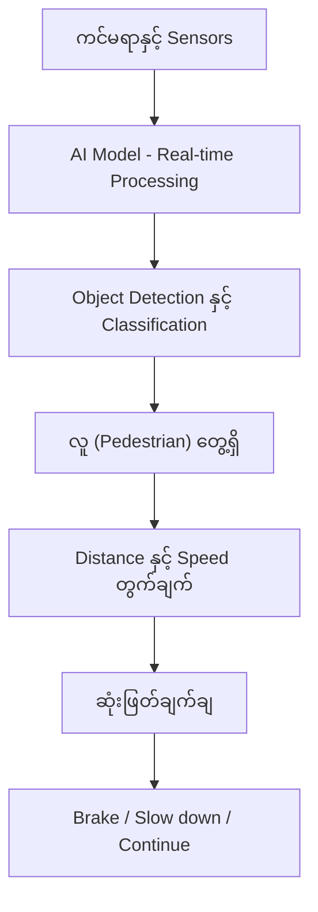
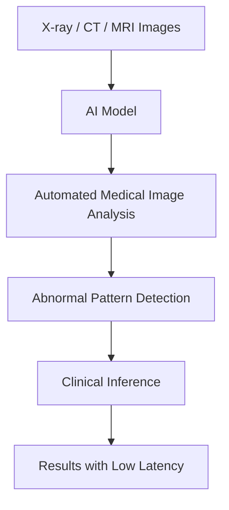
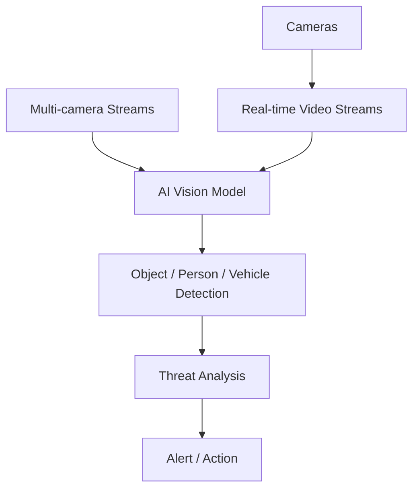
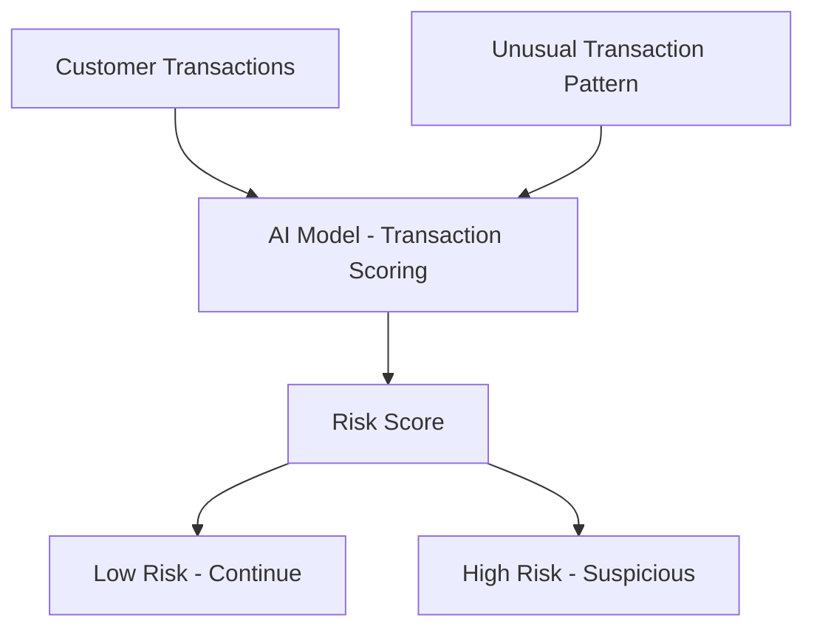
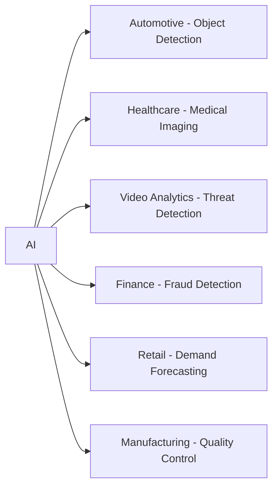
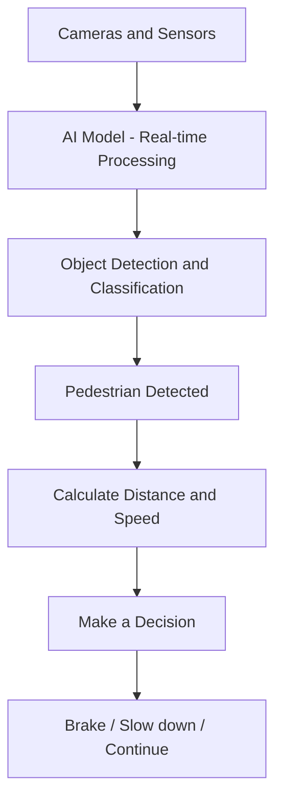

# Module 01 — AI Use Cases Across Industries

> Part I · AI Foundations and AI Infrastructure — Course Module 01 (AI, ML, DL Fundamentals and AI Adoption) — topic notes

## မြန်မာဘာသာ version

ဒီအပိုင်းက AI Use Cases Across Industries ဆိုတဲ့ topic ဖြစ်ပြီး exam အတွက်လည်း အရေးကြီးပါတယ်။ အဓိကမှတ်ရမှာက **AI ဟာ industry တစ်ခုတည်းအတွက်မဟုတ်ဘဲ industry အမျိုးအစားစုံမှာ different workloads အနေနဲ့ အသုံးပြုနေတယ်** ဆိုတာပါ။

AI technology တွေကို company တွေ၊ industries တွေမှာ ဘယ်လိုအသုံးချနေကြသလဲဆိုတာကို industry အလိုက်ကြည့်ရအောင်။

### 1. Automotive / Autonomous Vehicles

Automotive industry မှာ AI ကို self-driving / autonomous vehicle တွေအတွက် အများကြီးအသုံးပြုပါတယ်။

Real-time object detection and classification လုပ်နိုင်ပါတယ်။
ဥပမာ ကားက camera နဲ့ sensor တွေကနေ ရရှိတဲ့ data ကို AI model က real-time processing လုပ်ပြီး—

- လူ (Pedestrian)
- ကား (Vehicle)
- ဆိုင်ကယ် (Motorcycle)
- Traffic light
- Road sign
- အတားအဆီး (Obstacle)

စတာတွေကို identify/classify လုပ်နိုင်ပါတယ်။

ဒါ့အပြင် autonomous decision making လည်း လုပ်နိုင်ပါတယ်။

ဥပမာ—
ရှေ့မှာ လူတစ်ယောက်တွေ့ → detect လုပ် → distance/speed တွက် → brake လုပ်သင့်/မလုပ်သင့် ဆုံးဖြတ်

```
Pedestrian detected
       ↓
Calculate distance and speed
       ↓
Analyze the situation
       ↓
Make a decision
       ↓
Brake / Slow down / Continue
```

**Figure 1 — Autonomous vehicle တစ်စီးရဲ့ real-time decision making အဆင့်များ**



**ပုံရှင်းလင်းချက် —** အပေါ်ဆုံးက ကင်မရာနှင့် Sensors ကနေ ရရှိတဲ့ data ကို AI Model က real-time processing လုပ်ပုံကို အရင်ကြည့်ပါ။ ဒုတိယအဆင့်မှာ Object Detection နှင့် Classification က လူ၊ ကား၊ traffic light စတာတွေကို ခွဲခြားပါတယ်။ တတိယအဆင့်မှာ လူတစ်ယောက် တွေ့ရှိကြောင်း သိရပြီး၊ နောက်ဆက်တွဲအဆင့်နှစ်ခုမှာ Distance နှင့် Speed ကို တွက်ချက်ပြီး ဆုံးဖြတ်ချက်ချပါတယ်။ အောက်ဆုံးက Brake / Slow down / Continue ဆိုတဲ့ ရလဒ်သုံးခုထဲက တစ်ခုကို ရွေးတာကို တွေ့ရပါမယ်။

ဒီလို AI-based decision making ဖြစ်ပါတယ်။

နောက်ထပ် simulation ကို vehicle design နဲ့ testing အတွက်လည်း အသုံးပြုနိုင်ပါတယ်။ ကားထုတ်လုပ်သူတွေက တကယ့်လမ်းပေါ်မှာ မစမ်းသပ်ခင် driving conditions အမျိုးမျိုးကို simulation နဲ့ စမ်းသပ်နိုင်ပါတယ်။

> **Exam မှတ်ရန်:** Automotive → Object Detection + Classification + Autonomous Decision Making + Simulation

### 2. Healthcare

Healthcare industry မှာ AI ကို medical imaging, genomics, diagnosis support စတဲ့နေရာတွေမှာ အသုံးပြုပါတယ်။

ဥပမာ automated medical image analysis လုပ်နိုင်ပါတယ်။
X-ray, CT scan, MRI စတဲ့ medical images တွေကို AI model က analyze လုပ်ပြီး abnormal pattern တွေကို identify လုပ်နိုင်ပါတယ်။

Anomaly detection လည်း အရေးကြီးပါတယ်။
ဥပမာ—
Normal medical image နဲ့မတူတဲ့ abnormal area တစ်ခုကို AI က detect လုပ်ခြင်း

AI pipeline တွေကို automated လုပ်ထားနိုင်တဲ့အတွက် result တွေကို low latency နဲ့ ရရှိနိုင်ပါတယ်။
ဒါကို clinical inference လို့လည်း ပြောနိုင်ပါတယ်။

**Figure 2 — Medical image analysis pipeline တစ်ခု လုပ်ဆောင်ပုံ**



**ပုံရှင်းလင်းချက် —** ဘယ်ဘက်အစွန်းက X-ray, CT scan, MRI စတဲ့ medical images တွေကို အရင်ကြည့်ပါ။ အဲဒီ images တွေကို AI Model က လက်ခံပြီး Automated Medical Image Analysis လုပ်ပါတယ်။ နောက်တစ်ဆင့်မှာ ပုံမှန်နဲ့ မတူတဲ့ Abnormal Pattern တွေကို detect လုပ်ပါတယ်။ ပြီးရင် Clinical Inference အဆင့်က ရလဒ်ကို တွက်ချက်ပေးပြီး အောက်ဆုံးမှာ Low Latency နဲ့ ရလဒ်တွေ ရရှိနိုင်တာကို တွေ့ရပါမယ်။

> **Exam မှတ်ရန်:** Healthcare → Medical Imaging + Anomaly Detection + Genomics + Clinical Inference

### 3. Video Analytics / Surveillance

Security camera တွေ၊ surveillance system တွေမှာ AI ကို real-time video analytics အတွက် အသုံးပြုပါတယ်။

Camera ကနေ video stream ဝင်လာတဲ့အချိန်မှာ AI model က real-time processing လုပ်နိုင်ပါတယ်။

ဥပမာ—

- Object detection
- Person detection
- Vehicle detection
- Threat detection
- Suspicious activity detection

စတာတွေကို လုပ်နိုင်ပါတယ်။

```
Camera
   ↓
Real-time Video Stream
   ↓
AI Vision Model
   ↓
Object / Person Detection
   ↓
Threat Analysis
   ↓
Alert / Action
```

**Figure 3 — Real-time video analytics pipeline နှင့် multi-camera processing**



**ပုံရှင်းလင်းချက် —** ဘယ်ဘက်က Cameras တွေကနေ Real-time Video Streams တွေ ဝင်လာပုံကို အရင်ကြည့်ပါ။ ဘယ်ဘက်အောက်က Multi-camera Streams ဆိုတဲ့ node ကလည်း ကင်မရာ ၁၀၀ လို အများကြီးက လာတဲ့ video streams တွေ တစ်ပြိုင်နက် ဝင်နိုင်တာကို ပြပါတယ်။ ဒီ streams အားလုံးကို အလယ်က AI Vision Model က process လုပ်ပါတယ်။ ပြီးရင် Object / Person / Vehicle Detection က အရာဝတ္ထုတွေကို ရှာဖွေပြီး Threat Analysis က ခြိမ်းခြောက်မှု ရှိ/မရှိ စစ်ဆေး၊ အဆုံးမှာ Alert / Action ကို ထုတ်ပေးပါတယ်။

ပြီးတော့ camera တစ်လုံးတည်းမဟုတ်ဘဲ multi-camera stream processing လည်း လုပ်နိုင်ပါတယ်။
ဥပမာ shopping mall တစ်ခုမှာ camera 100 လုံးရှိရင် camera အားလုံးက video streams တွေကို AI system က တစ်ပြိုင်နက် process လုပ်နိုင်ပါတယ်။

> **Exam မှတ်ရန်:** Video Analytics → Real-time Video + Object Detection + Threat Detection + Multi-camera Processing

### 4. Finance and Banking

Finance နဲ့ Banking industry မှာ AI ကို real-time fraud detection အတွက် အလွန်အသုံးများပါတယ်။

ဥပမာ customer တစ်ယောက်က ပုံမှန်အားဖြင့် Singapore မှာ transaction လုပ်နေတယ်ဆိုပါစို့။
ရုတ်တရက်—

- Singapore → Europe → 5 minutes အတွင်း high-value transaction

လိုမျိုး unusual transaction ဖြစ်လာရင် AI system က suspicious ဖြစ်နိုင်တယ်လို့ detect လုပ်နိုင်ပါတယ်။

နောက်တစ်ခုက transaction scoring at scale ဖြစ်ပါတယ်။
Transaction သန်းနဲ့ချီလာရင် transaction တစ်ခုချင်းစီကို AI model နဲ့ risk score ပေးနိုင်ပါတယ်။

ဥပမာ—

```
Transaction
     ↓
AI Model
     ↓
Risk Score
     ↓
Low Risk / High Risk
```

**Figure 4 — Transaction scoring နှင့် fraud detection အဆင့်များ**



**ပုံရှင်းလင်းချက် —** ဘယ်ဘက်က Customer Transactions တွေ အမြဲဝင်နေပုံကို ကြည့်ပါ။ ဘယ်ဘက်အောက်က Unusual Transaction Pattern ဆိုတဲ့ node ကတော့ ဥပမာ Singapore ကနေ Europe ကို ၅ မိနစ်အတွင်း high-value transaction လုပ်တာလို ပုံမှန်မဟုတ်တဲ့ အပြုအမူကို ဆိုလိုပါတယ်။ ဒီ input တွေ အားလုံးကို အလယ်က AI Model က transaction တစ်ခုချင်းစီအတွက် Transaction Scoring လုပ်ပြီး Risk Score ပေးပါတယ်။ နောက်ဆုံးမှာ Low Risk ဆိုရင် ဆက်လက်ဆောင်ရွက်ပြီး High Risk ဆိုရင် suspicious အဖြစ် မှတ်သားပါတယ်။ ဒီအဆင့်အားလုံးကို ultra-low latency နဲ့ လုပ်နိုင်မှသာ transaction ဖြစ်နေစဉ်မှာတင် detect လုပ်နိုင်မှာ ဖြစ်ပါတယ်။

ဒါတွေအားလုံးကို ultra-low latency နဲ့လုပ်နိုင်ရင် transaction ဖြစ်ပြီးနောက်မှမဟုတ်ဘဲ transaction ဖြစ်နေတဲ့အချိန်မှာပဲ suspicious activity ကို detect လုပ်နိုင်ပါတယ်။

> **Exam မှတ်ရန်:** Finance → Fraud Detection + Transaction Scoring + Ultra-low Latency

### 5. Retail

Retail industry မှာ AI ကို customer demand နဲ့ supply chain ကို optimize လုပ်ဖို့ အသုံးပြုပါတယ်။

အဓိက use cases တွေက—

**Demand Forecasting**
ဘယ် product ကို ဘယ်အချိန်မှာ customer တွေ ပိုဝယ်မလဲဆိုတာ AI နဲ့ forecast လုပ်နိုင်ပါတယ်။

**Supply Chain Optimization**
ပစ္စည်းတွေကို ဘယ်နေရာကနေ ဘယ်နေရာကို ဘယ်အချိန်မှာ ပို့ရင် efficient ဖြစ်မလဲဆိုတာ optimize လုပ်နိုင်ပါတယ်။

**Inventory Management**
Stock ဘယ်လောက်ထားသင့်သလဲ၊ ဘယ် product က stock ပြတ်နိုင်သလဲဆိုတာ predict လုပ်နိုင်ပါတယ်။

- ဘယ် product တွေ stock ပြတ်သွားနိုင်သလဲ
- ဘယ်လောက် inventory ထားသင့်သလဲ
- ဘယ်အချိန်မှာ ထပ်မှာသင့်သလဲ

**Personalized Recommendation**
Customer တစ်ယောက်ရဲ့ previous behavior ကိုကြည့်ပြီး—"You may also like..." ဆိုပြီး customer တစ်ယောက်ချင်းစီအတွက် သင့်တော်တဲ့ product တွေကို recommend လုပ်နိုင်ပါတယ်။

> **Exam မှတ်ရန်:** Retail → Demand Forecasting + Supply Chain + Inventory + Recommendation

### 6. Manufacturing

Manufacturing industry မှာ AI ရဲ့ use cases တွေ အများကြီးရှိပါတယ်။
အထူးသဖြင့် Automated Quality Control က အရေးကြီးပါတယ်။

Factory production line မှာ ထုတ်လုပ်ပြီးတဲ့ product တွေကို camera နဲ့ AI model အသုံးပြုပြီး defect ရှိ/မရှိ စစ်နိုင်ပါတယ်။

ဥပမာ—

```
Product
   ↓
Camera
   ↓
AI Vision Model
   ↓
Defect Detection
   ↓
Pass / Fail
```

AI က—

- Scratch
- Crack
- Wrong assembly
- Missing component
- Shape defect

စတာတွေကို identify လုပ်နိုင်ပါတယ်။

နောက်တစ်ခုက Predictive Simulation ဖြစ်ပါတယ်။
Production process ကို simulation လုပ်ပြီး ဘယ်လိုအခြေအနေမှာ performance ပိုကောင်းမလဲဆိုတာ လေ့လာနိုင်ပါတယ်။

နောက်ပြီး Supply Chain and Logistics Optimization ကိုလည်း AI နဲ့ optimize လုပ်နိုင်ပါတယ်။
Transportation, production planning, delivery routes နဲ့ resource utilization တွေကို optimize လုပ်ရာမှာ အထောက်အကူပြုနိုင်ပါတယ်။

> **Exam မှတ်ရန်:** Manufacturing → Quality Control + Defect Detection + Predictive Simulation + Logistics Optimization

### Exam အတွက် အလွယ်မှတ်ရန်

Industry တစ်ခုချင်းစီကို ဒီလိုမှတ်ထားရင် အလွန်လွယ်ပါတယ်။

| Industry | Important AI Use Cases |
|---|---|
| 🚗 Automotive | Object Detection, Classification, Autonomous Decision Making, Simulation |
| 🏥 Healthcare | Medical Imaging, Anomaly Detection, Genomics, Clinical Inference |
| 📹 Video Analytics | Real-time Video, Object Detection, Threat Detection, Multi-camera Processing |
| 🏦 Finance & Banking | Fraud Detection, Transaction Scoring, Low Latency |
| 🛒 Retail | Demand Forecasting, Supply Chain, Inventory, Recommendation |
| 🏭 Manufacturing | Quality Control, Defect Detection, Simulation, Logistics Optimization |

### ⭐️ အဓိက Concept

ဒီအပိုင်းရဲ့ main point က—

> AI is not limited to one specific industry. It is being applied across many industries to automate decisions, detect patterns, predict future outcomes, optimize operations, and process large amounts of data in real time.

မြန်မာလိုဆိုရင်—
AI ဟာ industry တစ်ခုတည်းမှာပဲ အသုံးပြုတာမဟုတ်ပါဘူး။ Automotive, Healthcare, Finance, Retail, Manufacturing, Security စတဲ့ industry အမျိုးအစားစုံမှာ AI ကို အသုံးပြုပြီး decision making, detection, prediction, optimization နဲ့ real-time data processing တွေကို လုပ်ဆောင်နေကြပါတယ်။

ဒါကြောင့် exam မှာ "AI use cases across industries" လို့မေးရင် industry 4–6 ခုကိုရွေးပြီး industry + use case တွဲပြီးရေးနိုင်ရင် အဓိကအဖြေကို cover ဖြစ်ပါတယ်။

- Automotive → Autonomous driving and object detection
- Healthcare → Medical image analysis and anomaly detection
- Finance → Fraud detection and transaction scoring
- Retail → Demand forecasting and recommendations
- Manufacturing → Quality control and defect detection
- Surveillance → Real-time video and threat detection

အဓိကမှတ်ရမှာက ရှင်းလင်းချက်တစ်ခုလုံးကို မှတ်စရာမလိုဘဲ **Industry → AI Use Case** ဆိုတဲ့ အတွဲလိုက်ကို မှတ်ထားရုံပါပဲ။

**Figure 5 — Industry အမျိုးအစားစုံမှာ AI အသုံးပြုပုံ စုစည်းမြင်ကွင်း**



**ပုံရှင်းလင်းချက် —** ဘယ်ဘက်က AI ဆိုတဲ့ node တစ်ခုတည်းကနေ မြား ၆ ခု ထွက်သွားတာကို ကြည့်ပါ။ မြားတစ်ခုချင်းစီက industry တစ်ခုနဲ့ သူ့ရဲ့ အဓိက AI use case ကို တွဲပြထားပါတယ် — Automotive မှာ Object Detection၊ Healthcare မှာ Medical Imaging၊ Video Analytics မှာ Threat Detection၊ Finance မှာ Fraud Detection၊ Retail မှာ Demand Forecasting၊ Manufacturing မှာ Quality Control ဖြစ်ပါတယ်။ ဒီပုံဟာ AI ဟာ industry တစ်ခုတည်းအတွက် မဟုတ်ဘဲ industry အမျိုးအစားစုံမှာ အသုံးပြုနေတယ်ဆိုတဲ့ သင်ခန်းစာရဲ့ အဓိကအချက်ကို တစ်ပုံတည်းနဲ့ ပြတာ ဖြစ်ပါတယ်။

### Self-check questions — ကိုယ့်ကိုယ်ကို စစ်ဆေးရန် မေးခွန်းများ

**Q1: AI ကို industry အမျိုးအစားစုံမှာ ဘာတွေအတွက် အသုံးပြုကြသလဲ?**

Answer: Decision making အလိုအလျောက်လုပ်ခြင်း၊ patterns များ detect လုပ်ခြင်း၊ ရလဒ်များ predict လုပ်ခြင်း၊ operations များ optimize လုပ်ခြင်းနဲ့ data အများကြီးကို real-time မှာ process လုပ်ခြင်းတွေအတွက် အသုံးပြုကြပါတယ်။

**Q2: Autonomous vehicle တွေမှာ AI က ဘယ်လို use cases တွေ လုပ်ပေးသလဲ?**

Answer: Real-time object detection and classification (လူ၊ ကား၊ traffic light စသည်)၊ autonomous decision making (ဥပမာ brake လုပ်/မလုပ် ဆုံးဖြတ်ခြင်း) နဲ့ vehicle design/testing simulation တွေ ဖြစ်ပါတယ်။

**Q3: Finance industry မှာ fraud detection အတွက် AI ကို ဘယ်လိုအသုံးပြုသလဲ? ဘာကြောင့် latency အရေးကြီးရတာလဲ?**

Answer: Customer ရဲ့ ပုံမှန် transaction အပြုအမူနဲ့ မကိုက်ညီတဲ့ unusual transaction တွေကို detect လုပ်ပြီး transaction တစ်ခုချင်းစီကို risk score ပေးပါတယ်။ Ultra-low latency မလိုအပ်ရင် transaction ပြီးမှသာ သိရမှာဖြစ်လို့ suspicious activity ကို transaction ဖြစ်နေစဉ်မှာတင် detect လုပ်နိုင်ဖို့ latency အရေးကြီးပါတယ်။

**Q4: Exam မှာ "AI use cases across industries" လို့မေးရင် ဘယ်လိုဖြေရမလဲ?**

Answer: Industry 4–6 ခုကို ရွေးပြီး တစ်ခုချင်းစီအတွက် industry + use case ကို တွဲရေးပါ (ဥပမာ Automotive → Object Detection, Healthcare → Medical Imaging, Finance → Fraud Detection)။

## English Version

AI technologies are not limited to one specific industry. Companies across different industries are using AI to automate tasks, detect patterns, make decisions, predict future outcomes, optimize operations, and process large amounts of data in real time.

This topic is also important for exams, so it is useful to understand the major AI use cases in each industry.

### 1. Automotive / Autonomous Vehicles

The automotive industry uses AI extensively, especially for autonomous and self-driving vehicles.

One important use case is real-time object detection and classification.
For example, cameras and sensors on a vehicle can provide real-time data to an AI model. The model can identify and classify:

- Pedestrians
- Vehicles
- Motorcycles
- Traffic lights
- Road signs
- Obstacles

AI can also perform autonomous decision making.

For example:

```
Pedestrian detected
       ↓
Calculate distance and speed
       ↓
Analyze the situation
       ↓
Make a decision
       ↓
Brake / Slow down / Continue
```

**Figure 1 — The real-time decision steps of an autonomous vehicle**



**Figure walkthrough —** Start at the top: the data from cameras and sensors is processed in real time by the AI model. In the second step, object detection and classification identify pedestrians, vehicles, traffic lights, and more. The third step shows a pedestrian being detected. The next two steps calculate distance and speed, and then a decision is made. At the bottom, one of three outcomes is chosen: brake, slow down, or continue.

A person appears ahead → detected → distance/speed calculated → decide whether to brake. This is AI-based decision making.

AI is also used for simulation, design, and testing. Manufacturers can simulate different driving conditions before testing vehicles in the real world.

> **Exam Point** — Automotive → Object Detection + Classification + Autonomous Decision Making + Simulation

### 2. Healthcare

The healthcare industry benefits from AI in areas such as medical imaging, genomics, diagnosis support, and clinical analysis.

One major use case is automated medical image analysis.
AI models can analyze:

- X-rays
- CT scans
- MRI scans
- Other medical images

The AI can identify abnormal patterns or suspicious areas in these images.

Another important use case is anomaly detection.
For example, an AI model can compare medical data against normal patterns and identify something unusual that may require further investigation.

AI pipelines can also automate different stages of medical data processing.
Clinical inference can be performed with low latency, allowing healthcare professionals to receive results more quickly.

**Figure 2 — How a medical image analysis pipeline works**


**Figure walkthrough —** Start at the far left with the medical images: X-rays, CT scans, and MRI scans. The AI model receives these images and runs automated medical image analysis. In the next step it detects abnormal patterns that differ from normal images. Then clinical inference computes the result, and at the bottom you can see that results are delivered with low latency.

> **Exam Point** — Healthcare → Medical Imaging + Anomaly Detection + Genomics + Clinical Inference

### 3. Video Analytics / Surveillance

AI is widely used in video analytics and surveillance systems.
AI models can process video streams in real time and perform tasks such as:

- Object detection
- Person detection
- Vehicle detection
- Threat detection
- Suspicious activity detection

For example:

```
Camera
   ↓
Real-time Video Stream
   ↓
AI Vision Model
   ↓
Object / Person Detection
   ↓
Threat Analysis
   ↓
Alert / Action
```

**Figure 3 — A real-time video analytics pipeline with multi-camera processing**


**Figure walkthrough —** Start on the left: cameras produce real-time video streams. The lower-left node, multi-camera streams, shows that streams from many cameras — for example 100 cameras in a large facility — can enter at the same time. All of these streams are processed by the AI vision model in the middle. Next, object, person, and vehicle detection finds what is in the scene, threat analysis checks for danger, and at the end an alert or action is produced.

AI can also process multiple camera streams simultaneously.
For example, a large facility may have hundreds of cameras. AI systems can analyze these video streams continuously and detect important events.

> **Exam Point** — Video Analytics → Real-time Video + Object Detection + Threat Detection + Multi-camera Processing

### 4. Finance and Banking

AI is heavily used in the finance and banking industry, especially for detecting fraudulent transactions.

One major use case is real-time fraud detection.
For example, suppose a customer normally makes transactions in Singapore. If suddenly—

- Singapore → Europe → a high-value transaction within 5 minutes

—an unusual transaction like this occurs, the AI system can detect it as potentially suspicious.

Another use case is transaction scoring at scale.
Banks may process millions of transactions. AI models can analyze each transaction and assign a risk score.

For example:

```
Transaction
     ↓
AI Model
     ↓
Risk Score
     ↓
Low Risk / High Risk
```

**Figure 4 — The steps of transaction scoring and fraud detection**


**Figure walkthrough —** Look at the left side: customer transactions keep arriving. The lower-left node, unusual transaction pattern, represents behaviour that does not fit the norm — for example a high-value transaction from Singapore to Europe within 5 minutes. All of this input goes to the AI model in the middle, which performs transaction scoring and assigns a risk score to each transaction. At the end, a low-risk transaction continues normally, while a high-risk one is marked as suspicious. Because every step runs with ultra-low latency, suspicious activity can be detected while the transaction is still happening.

AI can perform these operations with ultra-low latency, which is important when decisions need to be made immediately — suspicious activity can be detected while the transaction is happening, not after it has already completed.

> **Exam Point** — Finance → Fraud Detection + Transaction Scoring + Ultra-low Latency

### 5. Retail

AI is widely used in the retail industry to understand customer demand and optimize business operations.

Important use cases include:

**Demand Forecasting**
AI can predict how much demand there will be for a particular product in the future.
For example: Which products will customers buy more next week or next month?

**Supply Chain Optimization**
AI can help determine how products should move through the supply chain more efficiently.

**Inventory Management**
AI can predict:

- Which products may run out of stock
- How much inventory should be maintained
- When additional products should be ordered

**Personalized Recommendations**
AI can analyze a customer's previous behavior and recommend products that are more relevant to that particular customer.
For example: "You may also like..."

> **Exam Point** — Retail → Demand Forecasting + Supply Chain Optimization + Inventory Management + Personalized Recommendation

### 6. Manufacturing

AI has many important applications in the manufacturing industry.
One of the most important use cases is automated quality control.
AI vision systems can inspect products during the manufacturing process and identify defects automatically.

For example:

```
Manufactured Product
        ↓
Camera
        ↓
AI Vision Model
        ↓
Defect Detection
        ↓
Pass / Fail
```

AI can detect problems such as:

- Scratches
- Cracks
- Incorrect assembly
- Missing components
- Shape or size defects

AI can also be used for predictive simulation, allowing manufacturers to simulate production processes and determine how to improve performance.

Another important application is supply chain and logistics optimization.
AI can help optimize transportation, production planning, delivery routes, and resource utilization.

> **Exam Point** — Manufacturing → Quality Control + Defect Detection + Predictive Simulation + Logistics Optimization

### Quick Exam Revision

| Industry | Important AI Use Cases |
|---|---|
| Automotive | Object Detection, Classification, Autonomous Decision Making, Simulation |
| Healthcare | Medical Imaging, Anomaly Detection, Genomics, Clinical Inference |
| Video Analytics | Real-time Video, Object Detection, Threat Detection, Multi-camera Processing |
| Finance & Banking | Fraud Detection, Transaction Scoring, Low Latency |
| Retail | Demand Forecasting, Supply Chain, Inventory, Recommendation |
| Manufacturing | Quality Control, Defect Detection, Simulation, Logistics Optimization |

### ⭐️ Key Concept for the Exam

> AI is not limited to one specific industry. It is being applied across many industries to automate decisions, detect patterns, predict future outcomes, optimize operations, and process large amounts of data in real time.

In other words, AI is a general-purpose technology that can be applied to many different business and industrial problems.

If the exam asks: "What are some AI use cases across industries?" — you can mention several industries and connect each one with its major use cases:

- Automotive → Autonomous driving and object detection
- Healthcare → Medical image analysis and anomaly detection
- Finance → Fraud detection and transaction scoring
- Retail → Demand forecasting and recommendations
- Manufacturing → Quality control and defect detection
- Surveillance → Real-time video and threat detection

The key is to remember **Industry → AI Use Case** rather than memorizing the entire explanation.

**Figure 5 — An overview of AI use cases across industries**


**Figure walkthrough —** Look at the single AI node on the left and the six arrows leaving it. Each arrow points to one industry together with its major AI use case: Automotive with object detection, Healthcare with medical imaging, Video Analytics with threat detection, Finance with fraud detection, Retail with demand forecasting, and Manufacturing with quality control. The whole picture shows the main point of this lesson: AI is not limited to one industry but is used across many industries.

### Self-check questions

**Q1: What is AI used for across industries?**

Answer: Automating decisions, detecting patterns, predicting future outcomes, optimizing operations, and processing large amounts of data in real time.

**Q2: What AI use cases exist in autonomous vehicles?**

Answer: Real-time object detection and classification (pedestrians, vehicles, traffic lights, etc.), autonomous decision making (for example, deciding whether to brake), and simulation for vehicle design and testing.

**Q3: How is AI used for fraud detection in finance, and why does latency matter?**

Answer: AI detects unusual transactions that do not match a customer's normal behavior and assigns a risk score to each transaction. With ultra-low latency, suspicious activity can be detected while the transaction is happening rather than after it completes.

**Q4: How should you answer an exam question about "AI use cases across industries"?**

Answer: Choose 4–6 industries and connect each one with its use cases (for example, Automotive → Object Detection, Healthcare → Medical Imaging, Finance → Fraud Detection).

## Technical review notes

- Corrections made: normalized the file header to `# Module 01 — …` and the module blockquote to the course convention (`> Part I · AI Foundations and AI Infrastructure — Course Module 01 …`).
- Corrections made: unified section numbering (`### 1.`–`### 6.` plus matching unnumbered closing sections) across both language sections; all original body text, tables, Exam Point notes, and diagrams are preserved unchanged in meaning.
- Corrections made: brought both language sections to parity by faithful translation only — the autonomous-driving decision diagram and video-analytics diagram were added to the Burmese section, the Singapore→Europe fraud example and logistics detail were added to the English section, and self-check Q&A sets were added to both sections. No commands, specs, URLs, or benchmarks were invented.
- Claims needing verification: the "shopping mall with 100 cameras" figure and the "5 minutes" fraud scenario are illustrative teaching examples, not measured data; no numeric performance claims are made in this module.
- Figures added: numbered Mermaid figures (Figure 1–5) with figure walkthroughs (ပုံရှင်းလင်းချက်) were added inline in both language sections; all existing text, tables, and ASCII diagrams are preserved unchanged.
