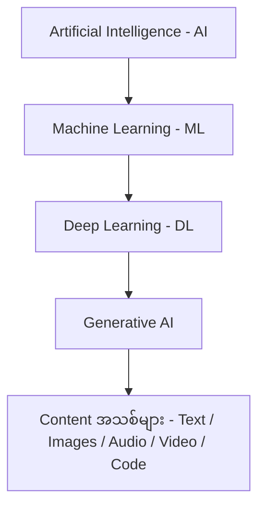
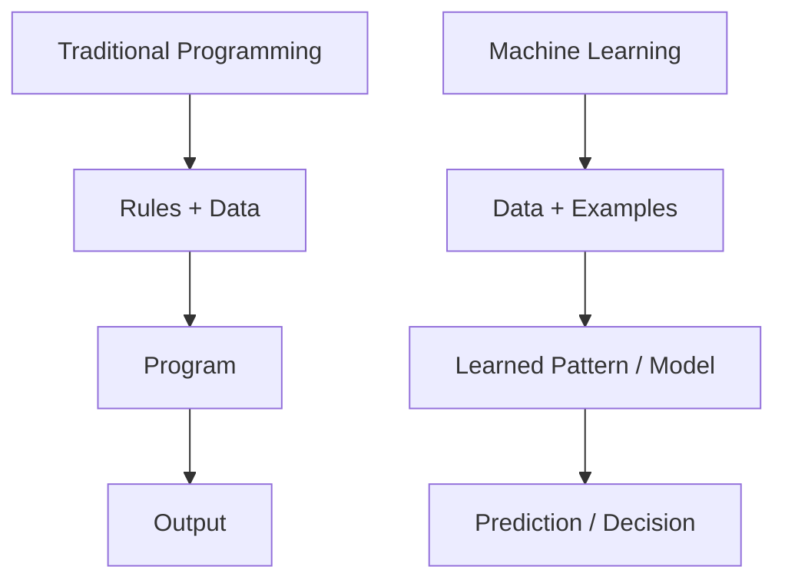
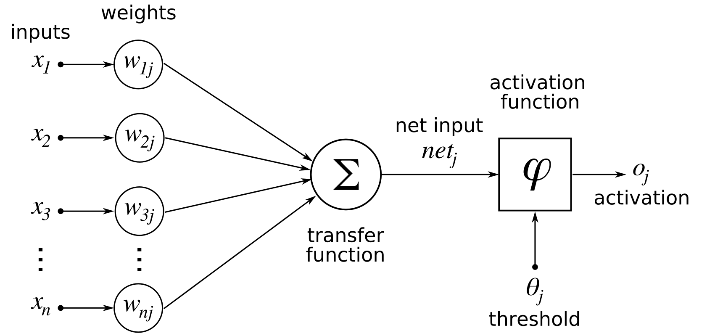
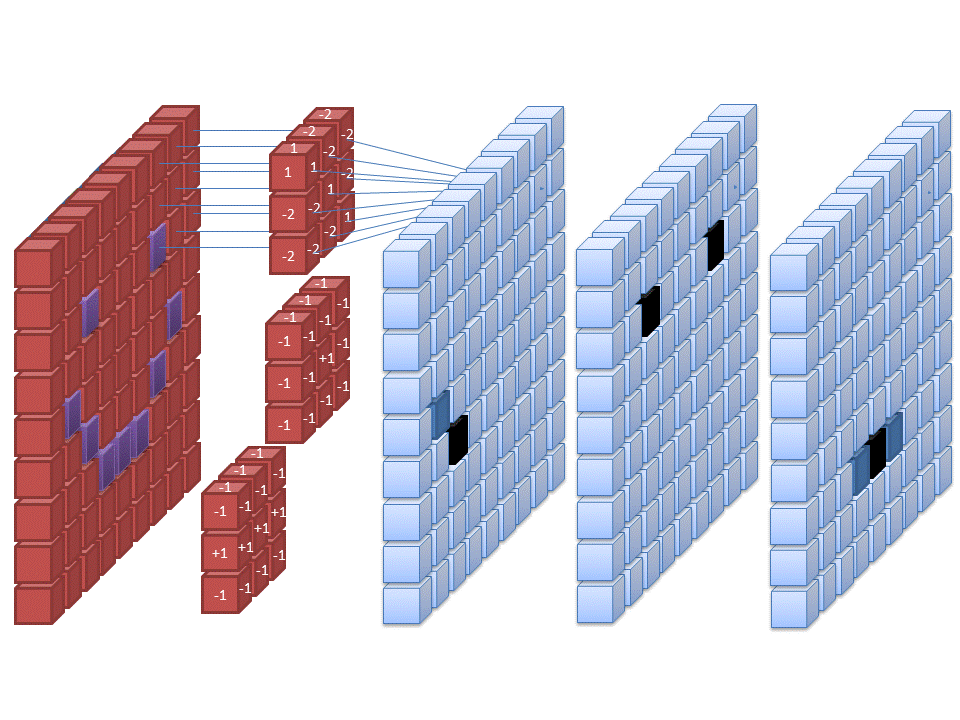
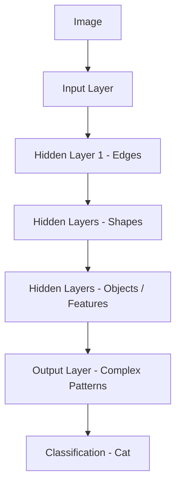
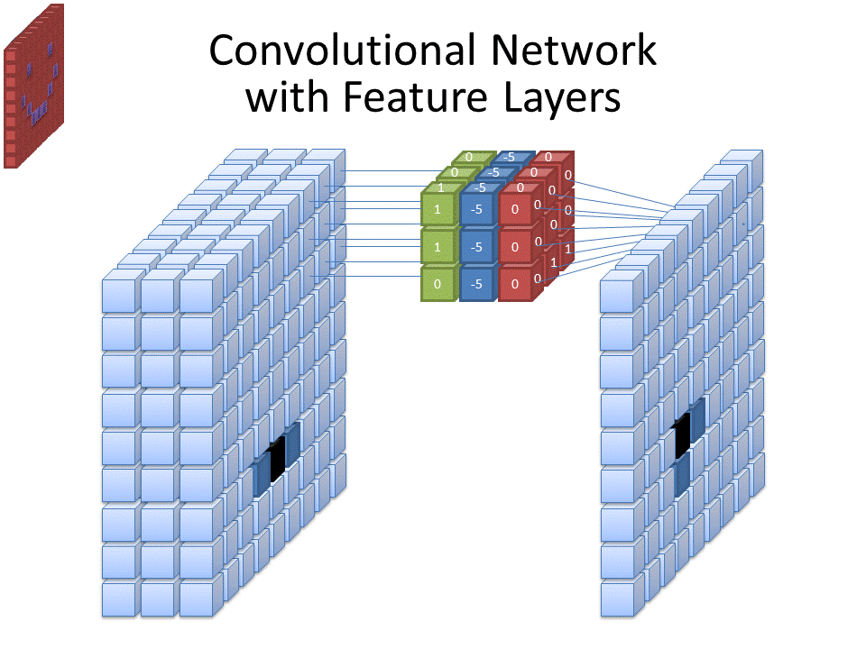
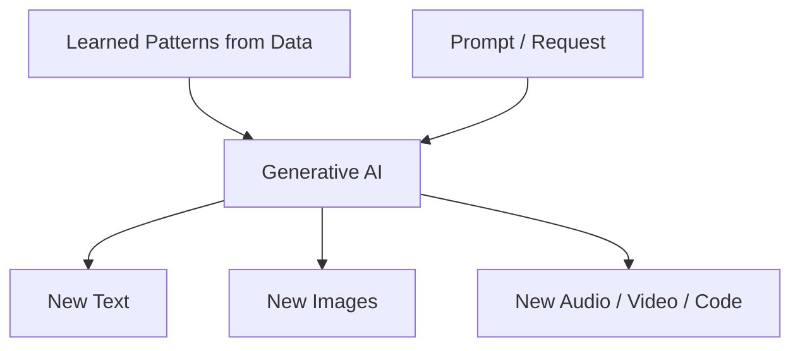
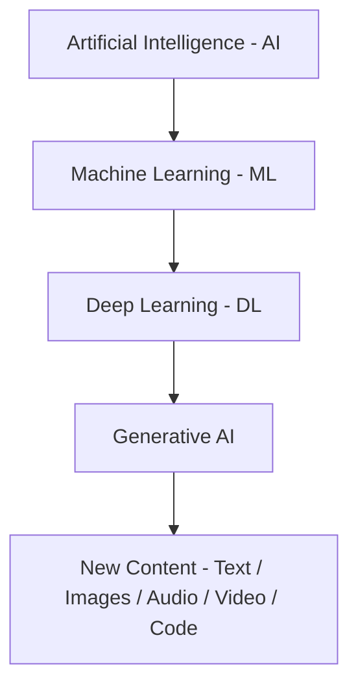

# Module 01 — AI, Machine Learning, Deep Learning and Generative AI

> Part I · AI Foundations and AI Infrastructure — Course Module 01 (AI, ML, DL Fundamentals and AI Adoption) — topic notes

## မြန်မာဘာသာ version

ဒီ topic က exam အတွက် အရေးကြီးတဲ့ topic တစ်ခု ဖြစ်ပါတယ်။ အဓိကအားဖြင့်—

- Artificial Intelligence (AI)
- Machine Learning (ML)
- Deep Learning (DL)
- Generative AI

ဒီလေးခုရဲ့ relationship ကို နားလည်ထားဖို့လိုပါတယ်။

အလွယ်ဆုံးမှတ်ရမယ်ဆိုရင်—

```
Artificial Intelligence (AI)
│
└── Machine Learning (ML)
      │
      └── Deep Learning (DL)
            │
            └── Generative AI
```

သို့သော် ဒီ diagram ကို strict hierarchy လို့မယူဘဲ concept ကို နားလည်လွယ်အောင် ပြထားတာလို့မှတ်ထားပါ။ Generative AI အားလုံးဟာ Deep Learning ကိုအသုံးပြုလေ့ရှိပေမယ့် Generative AI ကို DL ရဲ့ "subset တစ်ခုတည်း" လို့ သတ်မှတ်တာထက် DL ကိုအခြေခံပြီး content အသစ်တွေ generate လုပ်တဲ့ AI systems လို့နားလည်တာပိုမှန်ပါတယ်။

**Figure 1 — AI ၊ ML ၊ DL နှင့် Generative AI တို့ရဲ့ relationship**



**ပုံရှင်းလင်းချက် —** အပေါ်ဆုံးက Artificial Intelligence (AI) ဆိုတဲ့ အကျယ်ဆုံး concept ကနေ စကြည့်ပါ။ မြားကြောင်းက Machine Learning (ML) ဟာ AI ထဲက approach တစ်ခု ဖြစ်ကြောင်း ပြပါတယ်။ ဆက်လျှောက်ရင် Deep Learning (DL) ဟာ ML ထဲက neural network သုံးတဲ့ approach ဖြစ်ကြောင်း တွေ့ရပါမယ်။ နောက်ဆုံး node ဖြစ်တဲ့ Generative AI က DL ကို အခြေခံပြီး content အသစ်တွေ ဖန်တီးကြောင်းနဲ့ အောက်ဆုံးမှာ generate လုပ်နိုင်တဲ့ content အမျိုးအစားတွေ (Text, Images, Audio, Video, Code) ကို တွေ့ရပါမယ်။

### 1. Artificial Intelligence (AI)

AI = Artificial Intelligence

AI ဆိုတာ machine တွေက human intelligence ကို simulate လုပ်ပြီး intelligent tasks တွေကို လုပ်ဆောင်နိုင်အောင် ပြုလုပ်ထားတဲ့ technology / field ဖြစ်ပါတယ်။

လူတွေက—

- Information တွေကို စုဆောင်းတယ်
- Information ကို analyze လုပ်တယ်
- Situation ကိုနားလည်တယ်
- Decision ချတယ်
- Action လုပ်တယ်

AI systems တွေကလည်း ဒီလို intelligent behavior တွေကို machine နဲ့လုပ်ဆောင်နိုင်အောင် ကြိုးစားတာဖြစ်ပါတယ်။

ဥပမာ—

```
Input / Information
        ↓
AI System
        ↓
Analysis
        ↓
Decision
        ↓
Action
```

ဥပမာ autonomous car တစ်စီးမှာ—
Camera က pedestrian တစ်ယောက်ကို detect လုပ်တယ် → situation ကို analyze လုပ်တယ် → brake လုပ်ဖို့ decision ချတယ်။
ဒါဟာ AI ရဲ့ application တစ်ခုဖြစ်ပါတယ်။

> **မှတ်ရန်** — AI is the broader concept of machines performing tasks that normally require human intelligence.

### 2. Machine Learning (ML)

Machine Learning က AI ရဲ့ အရေးကြီးတဲ့ approach တစ်ခုဖြစ်ပါတယ်။

Traditional programming မှာ programmer က rules တွေကို တိတိကျကျရေးပေးရပါတယ်။

```
Rules + Data
     ↓
Program
     ↓
Output
```

Machine Learning မှာတော့ data နဲ့ examples တွေကနေ patterns ကို machine က learn လုပ်နိုင်အောင် လုပ်ပေးပါတယ်။

```
Data + Examples
       ↓
Machine Learning
       ↓
Learned Pattern / Model
       ↓
Prediction / Decision
```

**Figure 2 — Traditional Programming နှင့် Machine Learning ကွာခြားပုံ**



**ပုံရှင်းလင်းချက် —** ဘောက်နှစ်ခုကို အပေါ်အောက် နှိုင်းယှဉ်ကြည့်ပါ။ အပေါ်ဘက်မှာ Traditional Programming က programmer က ရေးပေးတဲ့ Rules + Data ကို Program ထဲ ထည့်ပြီး Output ရတဲ့အထိ မြားကြောင်းတစ်ကြောင်းတည်း သွားပါတယ်။ အောက်ဘက်မှာတော့ Machine Learning က Data + Examples တွေကို ပေးလိုက်ရုံနဲ့ machine ကိုယ်တိုင် Learned Pattern / Model ကို ရပြီး နောက်ဆုံးမှာ Prediction / Decision ပေးနိုင်ပါတယ်။ ဆိုလိုတာက rules အားလုံးကို လူက တစ်ခုချင်း မရေးရဘဲ data ကနေ သင်ယူတာ ဖြစ်ပါတယ်။

ဒါကြောင့် ML ကို—

> The ability of a machine to learn from data without being explicitly programmed for every possible situation.

လို့ နားလည်နိုင်ပါတယ်။

ဥပမာ spam email detection ဆိုပါစို့။
Email တစ်ခုချင်းစီအတွက်—"ဒီ email က spam ဖြစ်ရင် ဒီ rule ကိုသုံး" ဆိုပြီး rule အားလုံးကို manually ရေးဖို့မလိုပါဘူး။
Spam email နဲ့ normal email examples အများကြီးကို model ကို train လုပ်ပေးပြီး model က pattern ကို learn လုပ်နိုင်ပါတယ်။

### 3. Deep Learning (DL)

Deep Learning က Machine Learning ရဲ့ အရေးကြီးတဲ့ approach တစ်ခုဖြစ်ပါတယ်။

Deep Learning မှာ Artificial Neural Networks ကို အသုံးပြုပါတယ်။
Artificial Neural Network က human brain ရဲ့ neurons တွေက information ကို process လုပ်တဲ့ concept ကို inspiration ယူထားတာပါ။



**ပုံရှင်းလင်းချက် (Diagram walkthrough) —** ဘယ်ဘက်ကနေ ညာဘက်ကို လိုက်ကြည့်ပါ — ဘယ်ဘက်မှာ input signal တွေ (x1, x2, ... xn) ဝင်လာပြီး တစ်ခုချင်းစီမှာ weight (w1, w2, ... wn) တွေ ပါပါတယ်။ အဲဒီ input တွေကို weight တွေနဲ့ မြှောက်ပြီး အလယ်က cell body ထဲ ပေါင်းဝင်သွားပါတယ်။ Cell body ထဲမှာ weighted sum ကို bias (b) နဲ့ ပေါင်းပြီး activation function တစ်ခုက ဖြတ်သွားပါတယ်။ နောက်ဆုံး ညာဘက်မှာ output (y) တစ်ခု ထွက်လာတာကို တွေ့ရပါမယ်။ ဒီ neuron တစ်လုံးချင်းစီကို layers အများကြီးနဲ့ ချိတ်ဆက်လိုက်တာ neural network ဖြစ်လာပြီး Deep Learning ရဲ့ အခြေခံ အဆောက်အအုံ ဖြစ်ပါတယ်။

*(Diagram: Chrislb, CC BY-SA 3.0, via Wikimedia Commons)*

အလွယ်ပြောရရင်—

> Deep Learning uses multi-layer neural networks to learn complex patterns from data.

ဥပမာ image recognition မှာ—

```
Image
  ↓
Input Layer
  ↓
Hidden Layers
  ↓
More Hidden Layers
  ↓
Output Layer
  ↓
"Cat"
```

Neural network ရဲ့ layers များလာပြီး complex patterns တွေကို learn လုပ်နိုင်တဲ့အတွက် Deep Learning လို့ခေါ်ပါတယ်။

```
Input Data
    ↓
Input Layer
    ↓
Hidden Layer
    ↓
Hidden Layer
    ↓
Hidden Layer
    ↓
Output Layer
    ↓
Prediction
```

ဥပမာ AI system တစ်ခုက လူတစ်ယောက်ရဲ့ face ကို recognize လုပ်ရင်—

- edges
- shapes
- eyes
- nose
- mouth
- facial structure

စတဲ့ features တွေကို layers အဆင့်ဆင့်နဲ့ learn လုပ်နိုင်ပါတယ်။

```
Image
 ↓
Edges
 ↓
Shapes
 ↓
Objects / Features
 ↓
Complex Patterns
 ↓
Classification
```



**ပုံရှင်းလင်းချက် (Diagram walkthrough) —** ဒီ animation မှာ image တစ်ပုံကို convolutional neural network ရဲ့ ပထမ layer က filter (kernel) သုံးခုနဲ့ ဘယ်လို ဖတ်သလဲဆိုတာ ပြထားပါတယ်။ မူရင်း image ကို အရင်ကြည့်ပြီး filter တစ်ခုချင်းစီ ပုံပေါ် ဖြတ်သွားတာနဲ့အတူ သူ့ရဲ့ feature map ထွက်လာပုံကို လိုက်ကြည့်ပါ — filter တစ်ခုစီက ပုံပေါ်က feature တစ်မျိုးစီ (edge မျိုးစုံ စသည်) ကို ရှာထုတ်ပေးတာ ဖြစ်ပါတယ်။ filter သုံးခုသာ ပြထားပေမယ့် ပုံရဲ့ မှတ်ချက်အတိုင်း တကယ့် network တွေမှာ filter အများကြီး သုံးပါတယ်။

*(Diagram: Cecbur, CC BY-SA 4.0, via Wikimedia Commons)*

**Figure 3 — Deep Learning layers အဆင့်ဆင့်က features တွေ သင်ယူပုံ**



**ပုံရှင်းလင်းချက် —** အပေါ်ဆုံးက Image ကနေ စပြီး အောက်ကို တစ်ဆင့်ချင်း လိုက်ကြည့်ပါ။ Input Layer က ပုံကို လက်ခံပြီး ပထမဆုံး hidden layer မှာ edges လို ရိုးရှင်းတဲ့ features တွေ၊ နောက် hidden layers တွေမှာ shapes တွေ၊ ပြီးရင် objects / features တွေကို အဆင့်ဆင့် သင်ယူပါတယ်။ Output Layer မှာ ဒီ features အားလုံး ပေါင်းပြီး complex patterns ဖြစ်လာကာ နောက်ဆုံး node မှာ "Cat" လို့ classification ရလဒ် ထွက်လာပါတယ်။ Layers များလေလေ ပိုရှုပ်ထွေးတဲ့ patterns တွေ သင်ယူနိုင်လေလေ ဖြစ်တာကြောင့် Deep Learning လို့ ခေါ်တာ ဖြစ်ပါတယ်။



**ပုံရှင်းလင်းချက် (Diagram walkthrough) —** ဒီ animation က filter တစ်ခုချင်းစီ ဘယ်လို အလုပ်လုပ်လဲဆိုတာ ပြပါတယ်။ အောက် layer က filter သုံးခု ထုတ်ပေးတဲ့ feature သုံးခု (feature map သုံးခု) ဟာ ပုံထဲက filter ရဲ့ input အဖြစ် သုံးထပ် ပေါင်းဝင်လာပုံကို ကြည့်ပါ — အောက် layer က ရိုးရှင်းတဲ့ feature တွေက အပေါ် layer အတွက် ပစ္စည်း ဖြစ်လာပါတယ်။ ဒါကြောင့် layers အဆင့်ဆင့် တက်လာလေလေ ပိုရှုပ်ထွေးတဲ့ feature တွေ ဖြစ်လာလေလေ ဖြစ်ပြီး အပေါ်က Edges → Shapes → Objects ဆိုတဲ့ စီးကြောင်းနဲ့ ကိုက်ညီပါတယ်။

*(Diagram: Cecbur, CC BY-SA 4.0, via Wikimedia Commons)*

> **မှတ်ရန်** — Deep Learning is a Machine Learning approach that uses neural networks with multiple layers to learn complex patterns.

### 4. Generative AI

> ⚠️ ဒီနေရာမှာ source ထဲက "Chennai" ဆိုတဲ့စကားလုံးက typo ဖြစ်ပြီး Generative AI ကို ဆိုလိုတာဖြစ်ပါတယ်။

Generative AI ဆိုတာ learned data နဲ့ patterns တွေကို အသုံးပြုပြီး new and original content တွေကို generate လုပ်နိုင်တဲ့ AI ဖြစ်ပါတယ်။

Generate လုပ်နိုင်တဲ့ content တွေက—

- Text
- Images
- Audio
- Video
- Code
- 3D content

စတာတွေ ဖြစ်နိုင်ပါတယ်။

ဥပမာ Shakespeare ရဲ့ writing style နဲ့ works တွေကို model က learn လုပ်ထားတယ်ဆိုပါစို့။ အဲဒီ learned patterns တွေကို အသုံးပြုပြီး "Create a new dramatic story." လို့ request လုပ်နိုင်ပါတယ်။

Model က training data ထဲက စာကို simply copy/paste လုပ်တာမဟုတ်ဘဲ learned patterns ကိုအသုံးပြုပြီး new output တစ်ခု generate လုပ်ပါတယ်။

နောက်ထပ် example တစ်ခုက chemistry ဖြစ်ပါတယ်။
Chemical compounds တွေအကြောင်း patterns တွေကို model က learn လုပ်ထားရင်၊ သတ်မှတ်ထားတဲ့ properties တွေအပေါ်မူတည်ပြီး candidate compounds အသစ်တွေကို generate လုပ်နိုင်ပါတယ်။

အရေးကြီးတဲ့ concept ကတော့ Generative AI ဟာ ရှိပြီးသား category ကို classify သို့မဟုတ် predict လုပ်တာမဟုတ်ဘဲ new output တွေကို ထုတ်လုပ်ဖို့ design လုပ်ထားတာ ဖြစ်ပါတယ်။

**Figure 4 — Generative AI က content အသစ်တွေ generate လုပ်ပုံ**



**ပုံရှင်းလင်းချက် —** ဘယ်ဘက်က input နှစ်ခုကို အရင်ကြည့်ပါ — အပေါ်က ဒေတာကနေ သင်ယူထားတဲ့ Learned Patterns တွေ၊ အောက်က အသုံးပြုသူပေးတဲ့ Prompt / Request (ဥပမာ "Create a new dramatic story.") ဖြစ်ပါတယ်။ input နှစ်ခုလုံး အလယ်က Generative AI node မှာ ဆုံပြီး ညာဘက်ကို မြားသုံးခု ခွဲထွက်သွားတာက ထုတ်လုပ်နိုင်တဲ့ content အမျိုးအစားတွေ — New Text, New Images နှင့် New Audio / Video / Code တို့ ဖြစ်ပါတယ်။ ဒီပုံမှာ ရှိပြီးသား category ကို classify လုပ်တာ မဟုတ်ဘဲ output အသစ်တွေ ဖန်တီးတာကို တွေ့ရပါမယ်။

> **မှတ်ရန်** — Generative AI is AI that can generate new content such as text, images, audio, video, or code based on learned patterns.

### 5. AI → ML → DL → Generative AI ကို အလွယ်နားလည်ရန်

ဒီလို analogy နဲ့မှတ်ရင် ပိုလွယ်ပါတယ်။

**AI = Intelligence**
AI က အကြီးဆုံး concept ဖြစ်ပါတယ်။ "Machine ကို intelligent task တွေ လုပ်ခိုင်းနိုင်မလား?"

**ML = Learning**
ML က—"Machine ကို data ကနေ learn လုပ်ခိုင်းနိုင်မလား?" ဆိုတာကို focus လုပ်ပါတယ်။

**DL = Neural Network Learning**
DL က—"Machine ကို deep neural networks အသုံးပြုပြီး complex patterns တွေ learn လုပ်ခိုင်းနိုင်မလား?" ဆိုတာကို focus လုပ်ပါတယ်။

**Generative AI = Creating**
Generative AI က—"Machine က learn ထားတဲ့ patterns တွေကို အသုံးပြုပြီး content အသစ်ကို generate လုပ်နိုင်မလား?" ဆိုတာကို focus လုပ်ပါတယ်။

### 6. Exam မှတ်ရန်

```
AI
│
│  Machines perform intelligent tasks
│
└── ML
    │
    │  Machines learn patterns from data
    │
    └── DL
        │
        │  Neural Networks learn complex patterns
        │
        └── Generative AI
            │
            │  Generate new content
            │
            ├── Text
            ├── Images
            ├── Audio
            ├── Video
            └── Code
```

#### One-line definitions

| | |
|---|---|
| **AI** | Machines performing tasks that normally require human intelligence. |
| **ML** | Machines learning patterns from data without being explicitly programmed for every situation. |
| **DL** | A Machine Learning approach that uses multi-layer neural networks to learn complex patterns. |
| **Generative AI** | AI that generates new content such as text, images, audio, video, or code based on learned patterns. |

### 7. ⭐️ အဓိက Exam Concept

ဒီလေးခုရဲ့ difference ကို ဒီလိုမှတ်ပါ—

- **AI → Intelligence**
- **ML → Learning from Data**
- **DL → Learning with Neural Networks**
- **Generative AI → Generating New Content**

ဒီ four keywords ကိုမှတ်ထားရင် exam မှာ definition question တွေအတွက် အလွန်အသုံးဝင်ပါတယ်။

```
                 Artificial Intelligence
                         AI
                          │
                          ▼
                  Machine Learning
                         ML
                          │
                          ▼
                   Deep Learning
                         DL
                          │
                          ▼
                  Generative AI
```

အဓိက idea ကတော့— **AI က ကျယ်ပြန့်တဲ့ concept ဖြစ်ပါတယ်။ ML က machine တွေ data ကနေ သင်ယူနိုင်အောင် လုပ်ပေးတဲ့ approach ဖြစ်ပါတယ်။ DL က deep neural networks အပေါ်အခြေခံတဲ့ ML approach ဖြစ်ပါတယ်။ Generative AI က learned patterns တွေကို အသုံးပြုပြီး content အသစ်တွေ ဖန်တီးပါတယ်။**

### Self-check questions — ကိုယ့်ကိုယ်ကို စစ်ဆေးရန် မေးခွန်းများ

**Q1: AI, ML, DL နဲ့ Generative AI တို့ရဲ့ relationship က ဘယ်လိုလဲ?**

Answer: AI က အကျယ်ဆုံး concept ဖြစ်ပြီး ML က AI ရဲ့ approach တစ်ခု၊ DL က ML ရဲ့ neural network-based approach တစ်ခု၊ Generative AI က DL ကိုအခြေခံပြီး content အသစ်တွေ generate လုပ်တဲ့ AI systems တွေ ဖြစ်ပါတယ်။

**Q2: Traditional programming နဲ့ Machine Learning ရဲ့ ကွာခြားချက်က ဘာလဲ?**

Answer: Traditional programming မှာ programmer က rules တွေကို တိတိကျကျ ရေးပေးရပြီး ML မှာတော့ data နဲ့ examples တွေပေးကာ machine က patterns တွေကို ကိုယ်တိုင် learn လုပ်ပါတယ်။

**Q3: "Deep" Learning လို့ ဘာကြောင့်ခေါ်တာလဲ?**

Answer: Neural network မှာ multiple layers (input, hidden, output layers) တွေ ပါဝင်ပြီး layers အဆင့်ဆင့်ကနေ ပိုရှုပ်ထွေးတဲ့ patterns တွေကို learn လုပ်နိုင်လို့ ဖြစ်ပါတယ်။

**Q4: Generative AI က ဘာတွေ generate လုပ်နိုင်သလဲ? classify/predict လုပ်တာနဲ့ ဘယ်လိုကွာသလဲ?**

Answer: Text, images, audio, video, code စတဲ့ content အသစ်တွေကို generate လုပ်နိုင်ပါတယ်။ Classify/predict လုပ်တာက ရှိပြီးသား category ကို ခန့်မှန်းတာဖြစ်ပြီး Generative AI က learned patterns တွေကနေ output အသစ်တွေ ဖန်တီးတာ ဖြစ်ပါတယ်။

## English Version

Understanding AI, Machine Learning (ML), Deep Learning (DL), and Generative AI is an important exam topic.

The easiest way to understand the relationship is:

```
Artificial Intelligence (AI)
│
└── Machine Learning (ML)
      │
      └── Deep Learning (DL)
            │
            └── Generative AI
```

This diagram is mainly for understanding the relationship between the concepts. More precisely, Generative AI is not simply a single subset of Deep Learning; rather, modern Generative AI systems are commonly built using Deep Learning techniques to generate new content.

**Figure 1 — The relationship between AI, ML, DL, and Generative AI**



**Figure walkthrough —** Start at the top with Artificial Intelligence (AI), the broadest concept. The arrow down to Machine Learning (ML) shows that ML is one approach within AI. Continue down to Deep Learning (DL), the ML approach that uses neural networks. The last node, Generative AI, builds on DL to create new content, and the bottom node lists the content types it can generate: text, images, audio, video, and code.

### 1. Artificial Intelligence (AI)

AI stands for Artificial Intelligence.
AI is the broader field of building machines or systems that can perform tasks that normally require human intelligence.

Humans collect information, understand situations, analyze information, make decisions, and take actions.
AI systems attempt to perform similar intelligent tasks using machines.

For example, an autonomous vehicle can:

- Collect information from cameras and sensors
- Analyze the surrounding environment
- Detect objects
- Understand the situation
- Make a decision
- Take an action

For example:

```
Input / Information
        ↓
AI System
        ↓
Analysis
        ↓
Decision
        ↓
Action
```

In an autonomous car, for example, a camera detects a pedestrian → the situation is analyzed → a decision is made to brake. This is an application of AI.

> **Exam Definition** — AI is the broader concept of machines performing tasks that normally require human intelligence.

### 2. Machine Learning (ML)

Machine Learning is an important approach within AI.
In traditional programming, programmers explicitly define rules for the computer.

For example:

```
Rules + Data
     ↓
Program
     ↓
Output
```

With Machine Learning, we provide data and examples, and the machine learns patterns from that data.

```
Data + Examples
       ↓
Machine Learning
       ↓
Learned Model
       ↓
Prediction / Decision
```

**Figure 2 — The difference between traditional programming and Machine Learning**


**Figure walkthrough —** Compare the two boxes from top to bottom. In the upper path, traditional programming takes the rules and data written by a programmer, runs the program, and produces the output along a single straight arrow. In the lower path, Machine Learning takes data and examples, the machine learns a pattern or model by itself, and that model produces a prediction or decision. In other words, nobody has to write every rule by hand — the machine learns from data.

This means we do not have to explicitly program every possible situation.

For example, consider spam email detection. Instead of manually writing thousands of rules for every possible spam email, we can provide the ML model with many examples of:

- Spam emails
- Normal emails

The model learns patterns from these examples and can then predict whether a new email is likely to be spam.

> **Exam Definition** — Machine Learning is the ability of machines to learn patterns from data without being explicitly programmed for every possible situation.

### 3. Deep Learning (DL)

Deep Learning is a Machine Learning approach that uses Artificial Neural Networks.
Artificial Neural Networks are inspired by the way biological neural systems process information.


**Diagram walkthrough —** Look from left to right: input signals (x1, x2, ... xn) enter on the left, and each one carries its own weight (w1, w2, ... wn). Each input is multiplied by its weight and the signals meet inside the cell body in the middle. There the weighted sum is combined with a bias (b) and passed through an activation function. Finally a single output (y) leaves the neuron on the right. Connecting many of these neurons together in layers is what builds a neural network — the basic building block of Deep Learning.

*(Diagram: Chrislb, CC BY-SA 3.0, via Wikimedia Commons)*

A Deep Learning model can contain multiple layers of neurons.

For example, in image recognition:

```
Image
  ↓
Input Layer
  ↓
Hidden Layers
  ↓
More Hidden Layers
  ↓
Output Layer
  ↓
"Cat"
```

Because the network can have many layers and learn increasingly complex representations, it is called Deep Learning.

```
Input Data
    ↓
Input Layer
    ↓
Hidden Layer
    ↓
Hidden Layer
    ↓
Hidden Layer
    ↓
Output Layer
    ↓
Prediction
```

For example, when an AI system recognizes a person's face, it can learn features such as—

- edges
- shapes
- eyes
- nose
- mouth
- facial structure

step by step through the layers:

```
Image
 ↓
Edges
 ↓
Shapes
 ↓
Objects / Features
 ↓
Complex Patterns
 ↓
Classification
```


**Diagram walkthrough —** This animation shows how the first layer of a convolutional neural network reads an image with three filters (kernels). Start from the original image, then follow each filter as it sweeps over the picture and produces its own feature map — each filter picks up one kind of feature (for example, different kinds of edges). Only three filters are shown here; as the note in the diagram says, a real network uses many more.

*(Diagram: Cecbur, CC BY-SA 4.0, via Wikimedia Commons)*

**Figure 3 — How Deep Learning layers learn features step by step**


**Figure walkthrough —** Start at the top with the image and follow the arrows downward one step at a time. The input layer receives the image. The first hidden layer picks up simple features such as edges; the next hidden layers learn shapes, and then objects and features. At the output layer these features combine into complex patterns, and the final node shows the classification result: "Cat". Because the network has many layers and can learn increasingly complex patterns, it is called Deep Learning.

A model trained for image recognition may eventually learn to distinguish between different objects based on these learned patterns.


**Diagram walkthrough —** This animation zooms into how a single filter works. The three feature maps produced by three filters in the layer below stack up and become the three-feature-thick input of the filter shown here — simple features found below become the raw material for the layer above. That is the idea of feature layers: the higher you go, the more complex the features become, exactly matching the Edges → Shapes → Objects progression shown earlier.

*(Diagram: Cecbur, CC BY-SA 4.0, via Wikimedia Commons)*

> **Exam Definition** — Deep Learning is a Machine Learning approach that uses multi-layer neural networks to learn complex patterns from data.

### 4. Generative AI

> ⚠️ The word "Chennai" in the original material is clearly a transcription error. The intended term is Generative AI.

Generative AI refers to AI systems that can generate new content based on patterns learned from data.

It can generate:

- Text
- Images
- Audio
- Video
- Code
- Other types of content (such as 3D content)

For example, suppose a model has learned the writing style and works of Shakespeare. We can ask it: "Create a new dramatic story." The model can generate a new piece of text.

The model is not simply copy/pasting text from its training data — it uses learned patterns to generate a new output.

Similarly, if a model has learned patterns from many chemical compounds, it can potentially generate candidate compounds that satisfy particular requirements.

The important concept is that Generative AI is designed to produce new outputs, rather than simply classify or predict an existing category.

**Figure 4 — How Generative AI produces new content**


**Figure walkthrough —** Look at the two inputs on the left first: at the top, the learned patterns taken from training data, and below it, the prompt or request given by the user (for example, "Create a new dramatic story."). Both inputs meet at the middle Generative AI node, and three arrows split off to the right showing the kinds of content it can produce: new text, new images, and new audio, video, or code. Notice that the picture shows the creation of new outputs, not classifying into an existing category.

> **Exam Definition** — Generative AI is AI that generates new content such as text, images, audio, video, or code based on learned patterns.

### 5. Understanding the Difference (AI → ML → DL → Generative AI)

This analogy makes the differences easy to remember.

**AI = Intelligence** — AI asks: Can a machine perform tasks that normally require human intelligence?

**ML = Learning** — Machine Learning asks: Can a machine learn patterns from data?

**DL = Neural Network Learning** — Deep Learning asks: Can a machine use deep neural networks to learn complex patterns?

**Generative AI = Creating** — Generative AI asks: Can a machine use learned patterns to generate new content?

### 6. Exam Revision

```
AI
│
│  Machines perform intelligent tasks
│
└── ML
    │
    │  Machines learn patterns from data
    │
    └── DL
        │
        │  Neural Networks learn complex patterns
        │
        └── Generative AI
            │
            │  Generate new content
            │
            ├── Text
            ├── Images
            ├── Audio
            ├── Video
            └── Code
```

#### One-line definitions

| | |
|---|---|
| **AI** | Machines performing tasks that normally require human intelligence. |
| **ML** | Machines learning patterns from data without being explicitly programmed for every situation. |
| **DL** | A Machine Learning approach that uses multi-layer neural networks to learn complex patterns. |
| **Generative AI** | AI that generates new content such as text, images, audio, video, or code based on learned patterns. |

### 7. ⭐️ Most Important Exam Concept

Remember the difference between the four like this:

- **AI → Intelligence**
- **ML → Learning from Data**
- **DL → Learning with Neural Networks**
- **Generative AI → Generating New Content**

These four keywords are extremely useful for definition questions in the exam.

```
                 Artificial Intelligence
                         AI
                          │
                          ▼
                  Machine Learning
                         ML
                          │
                          ▼
                   Deep Learning
                         DL
                          │
                          ▼
                  Generative AI
```

The key idea is: **AI is the broad concept. ML is an approach for enabling machines to learn from data. DL is an ML approach based on deep neural networks. Generative AI uses learned patterns to create new content.**

### Self-check questions

**Q1: What is the relationship between AI, ML, DL, and Generative AI?**

Answer: AI is the broadest concept. ML is an approach within AI. DL is a neural-network-based ML approach. Generative AI systems are AI systems built on Deep Learning that generate new content.

**Q2: What is the difference between traditional programming and Machine Learning?**

Answer: In traditional programming, programmers explicitly write the rules; in ML, you provide data and examples and the machine learns the patterns itself.

**Q3: Why is it called "Deep" Learning?**

Answer: Because the neural network contains multiple layers (input, hidden, and output layers), and increasingly complex patterns can be learned through those layers.

**Q4: What can Generative AI generate, and how does it differ from classification/prediction?**

Answer: It can generate new content such as text, images, audio, video, and code. Classification/prediction guesses an existing category, while Generative AI creates new outputs from learned patterns.

## Technical review notes

- Corrections made: normalized the file header to `# Module 01 — …` and the module blockquote to the course convention (`> Part I · AI Foundations and AI Infrastructure — Course Module 01 …`); unified section numbering (`### 1.`–`### 7.`) across both language sections.
- Corrections made: the "Chennai" transcription error in the source material is corrected to Generative AI in both language sections (the in-text notes are retained); the original diagrams (relationship tree, layer diagrams, one-line definition table) are preserved unchanged.
- Corrections made: brought both language sections to parity by faithful translation only (e.g., the face-recognition feature list and image-classification flow were added to the English section; the "generates new outputs rather than classifying" note and the Simple Relationship diagram were added to the Burmese section) and added self-check Q&A sets to both sections. No commands, specs, URLs, or benchmarks were invented.
- Claims needing verification: none outstanding — this module contains only conceptual definitions and illustrative examples, with no model-specific specifications or benchmark figures.
- Figures added: numbered Mermaid figures (Figure 1–4) with figure walkthroughs (ပုံရှင်းလင်းချက်) were added inline in both language sections; all existing text, tables, and ASCII diagrams are preserved unchanged.
