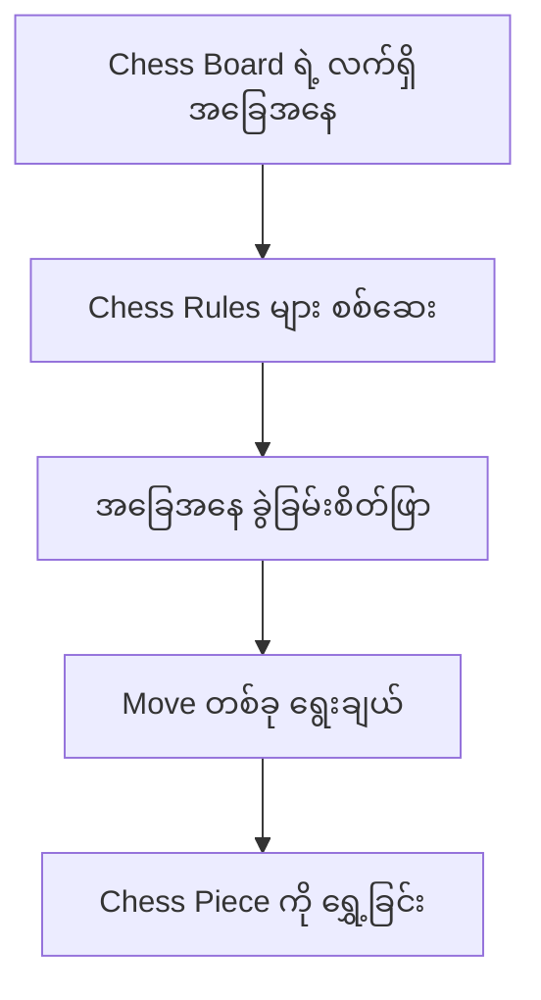
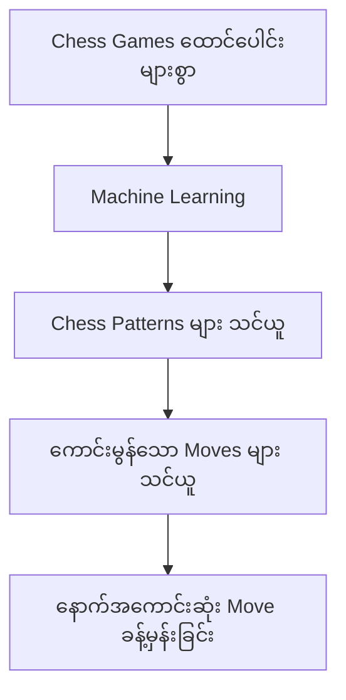
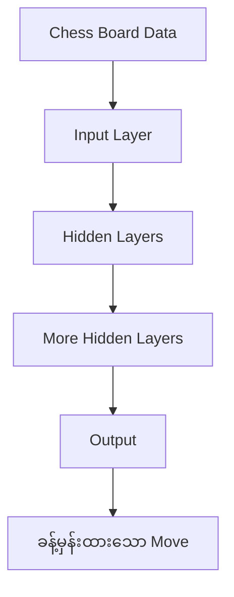
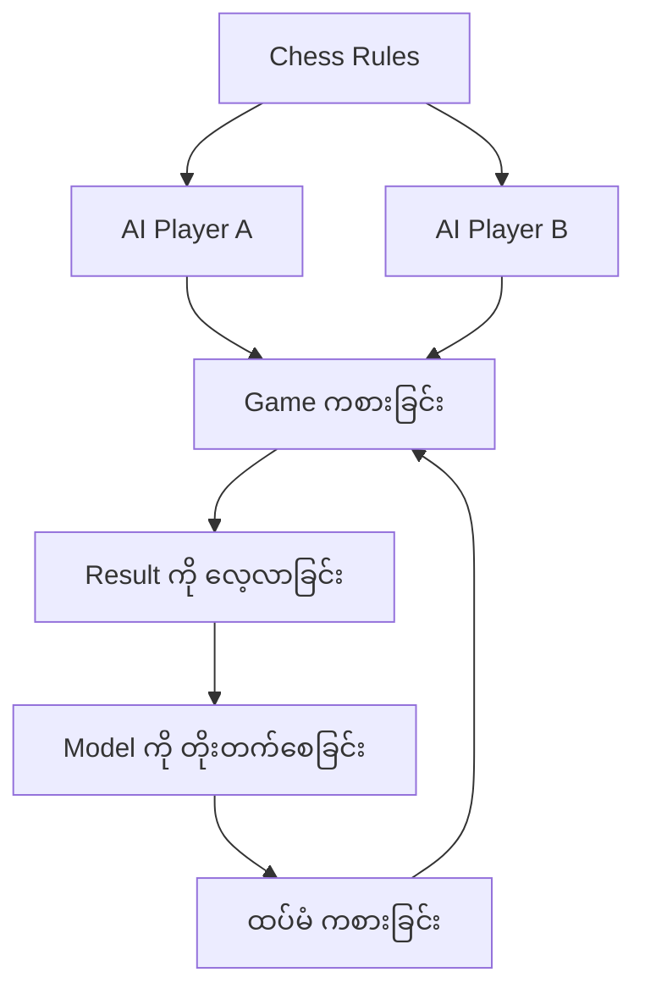
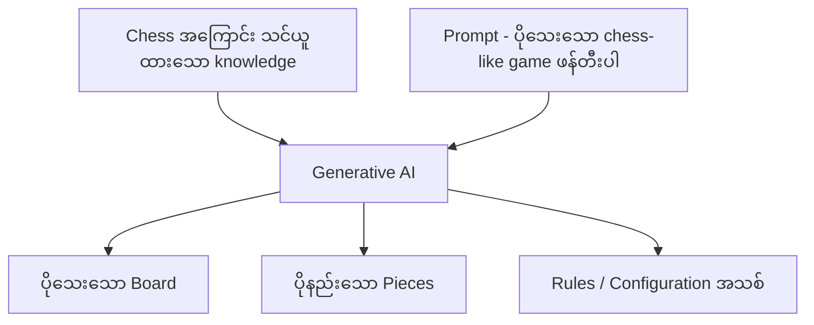
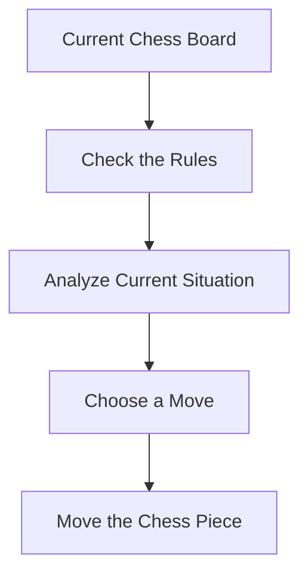
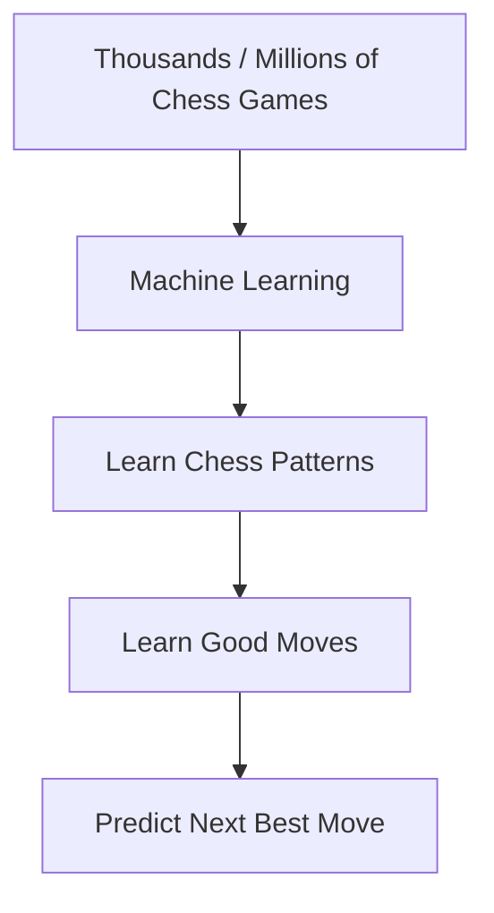
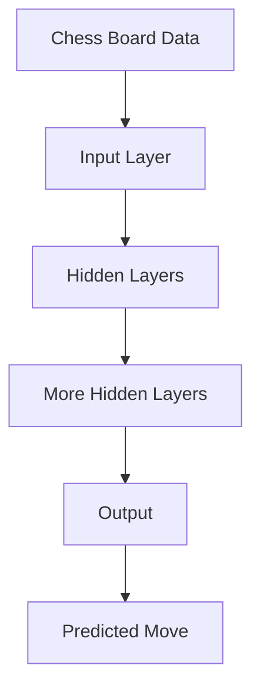
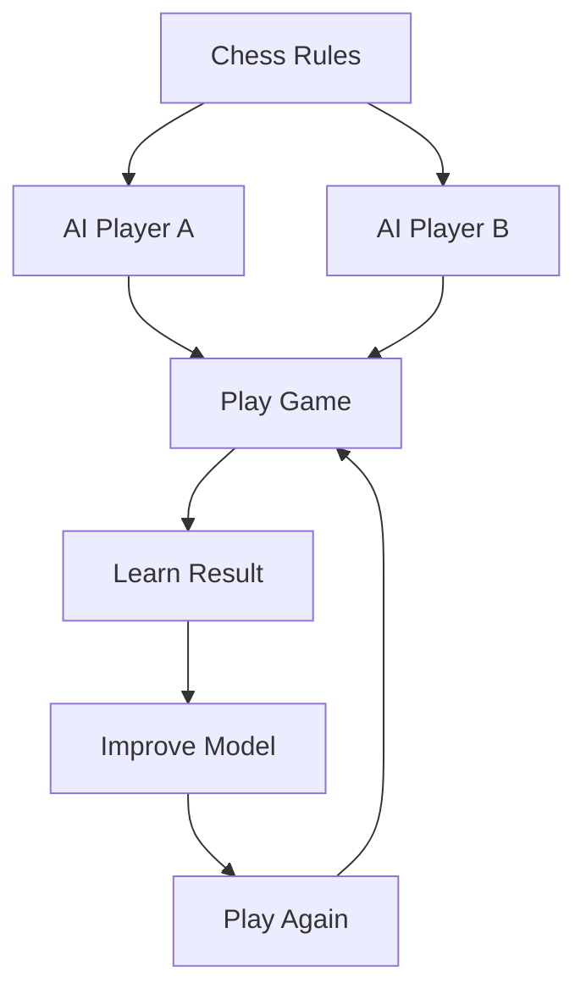
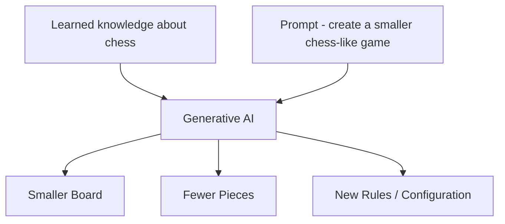

# Module 01 — AI, ML, DL and Generative AI: Chess Analogy

> Part I · AI Foundations and AI Infrastructure — Course Module 01 (AI, ML, DL Fundamentals and AI Adoption) — topic notes

## မြန်မာဘာသာ version — AI, ML, DL နှင့် Generative AI ကို Chess Analogy ဖြင့် နားလည်ခြင်း

AI, ML, DL နဲ့ Generative AI တို့ရဲ့ relationship ကို အလွယ်တကူမှတ်မိဖို့ Chess Game analogy ကို အသုံးပြုနိုင်ပါတယ်။
ဒီ analogy က concept တွေကို ကြာကြာမှတ်မိစေပြီး အခြားသူတစ်ယောက်ကိုလည်း ရှင်းပြတဲ့အခါ လွယ်ကူစေပါတယ်။

## 1. Artificial Intelligence (AI) — Machine Can Play Chess

ပထမဆုံး Artificial Intelligence ကို စဉ်းစားကြည့်ပါ။
Chess က muscle power ထက် thinking, reasoning, decision making ပိုလိုအပ်တဲ့ game တစ်ခုပါ။
Machine တစ်လုံးကို Chess ကစားနိုင်အောင် program လုပ်ထားတယ်ဆိုပါစို့။

Machine က—

- Chess board ရဲ့ လက်ရှိအခြေအနေကို ကြည့်တယ်
- Player ရဲ့ နောက်ဆုံး move ကို သိတယ်
- Chess rules တွေကို အသုံးပြုတယ်
- နောက်ထပ် ဘာ move လုပ်သင့်လဲဆိုတာ ဆုံးဖြတ်တယ်

ဥပမာ—

```
Current Chess Board
        ↓
Check the Rules
        ↓
Analyze Current Situation
        ↓
Choose a Move
        ↓
Move the Chess Piece
```

**Figure 1 — AI သုံးပြီး chess move တစ်ခု ဆုံးဖြတ်ပုံ**



**ပုံရှင်းလင်းချက် —** အပေါ်ဆုံးက Chess Board ရဲ့ လက်ရှိအခြေအနေ ကြည့်ရာကနေ စပါ။ ဒုတိယအဆင့်မှာ ကစားသမားက လုပ်ခဲ့တဲ့ move နဲ့ Chess Rules တွေကို စစ်ဆေးပါတယ်။ တတိယအဆင့်မှာ လက်ရှိအခြေအနေကို ခွဲခြမ်းစိတ်ဖြာပြီး စတုတ္ထအဆင့်မှာ ဘယ် move လုပ်မလဲ ရွေးချယ်ပါတယ်။ အောက်ဆုံးမှာတော့ Chess Piece ကို ရွှေ့တဲ့အဆင့် ဖြစ်ပါတယ်။ ဒီအဆင့်တွေအားလုံးကို machine က လုပ်ဆောင်နိုင်တာဟာ AI ရဲ့ ဥပမာ ဖြစ်ပါတယ်။

ဒီလို machine က intelligent decision making လုပ်နိုင်တာကို AI ရဲ့ example တစ်ခုအနေနဲ့ နားလည်နိုင်ပါတယ်။

**အရေးကြီးတဲ့ Concept** — ဒီနေရာမှာ machine ကို chess rules တွေကို explicitly program လုပ်ထားနိုင်ပါတယ်။
ဥပမာ—"ဒီအခြေအနေမှာ ဒီလို move လုပ်ရမယ်" ဆိုတဲ့ rules တွေကို programmer က သတ်မှတ်ပေးနိုင်ပါတယ်။

ဒါကြောင့်—
**AI = Machine က intelligent tasks တွေကို လုပ်ဆောင်နိုင်ပြီး decision တွေ ချနိုင်ခြင်း** ဖြစ်ပါတယ်။

## 2. Machine Learning (ML) — Machine Learns from Past Games

အခု Machine Learning ကို စဉ်းစားကြည့်ပါ။
Machine ကို chess game ရဲ့ move အားလုံးကို manually program လုပ်ပေးမယ့်အစား past chess games တွေကို ပေးလိုက်မယ်။

ဥပမာ—

```
Thousands / Millions of Chess Games
              ↓
        Machine Learning
              ↓
      Learn Chess Patterns
              ↓
       Learn Good Moves
              ↓
     Predict Next Best Move
```

**Figure 2 — Past chess games များမှ Machine Learning သင်ယူပုံ**



**ပုံရှင်းလင်းချက် —** အပေါ်ဆုံးက Chess Games ထောင်ပေါင်းများစွာ (expert players တွေ ကစားခဲ့တဲ့ games၊ နိုင်/ရှုံး games နဲ့ game outcomes တွေ) ကို အရင်ကြည့်ပါ။ ဒီ data တွေကို Machine Learning က လက်ခံပြီး Chess Patterns တွေကို သင်ယူပါတယ်။ ဆက်လျှောက်ရင် ကောင်းမွန်သော Moves တွေကို သင်ယူပြီး နောက်ဆုံးမှာ position အသစ်တစ်ခု ရောက်လာရင် နောက်အကောင်းဆုံး Move ကို ခန့်မှန်းပေးနိုင်ပါတယ်။ ဒါဟာ rules တွေကို တစ်ခုချင်း မရေးဘဲ data ကနေ သင်ယူတဲ့ ML concept ဖြစ်ပါတယ်။

Machine ကို—

- Expert players တွေ ကစားခဲ့တဲ့ games တွေ
- နိုင်တဲ့ games တွေ
- ရှုံးတဲ့ games တွေ
- အမျိုးမျိုးသော chess positions တွေ
- အမျိုးမျိုးသော moves တွေ
- Game outcomes (ရလဒ်) တွေ

စတဲ့ data တွေ ပေးနိုင်ပါတယ်။

Machine က အဲဒီ data တွေထဲက patterns တွေကို learn လုပ်ပြီး နောက်ပိုင်းမှာ chess position အသစ်တစ်ခုရောက်လာရင်—"ဒီလိုအခြေအနေမျိုးမှာ ဘယ် move ကောင်းနိုင်မလဲ?" ဆိုတာ predict လုပ်နိုင်ပါတယ်။
ဒါဟာ Machine Learning concept ဖြစ်ပါတယ်။

**အဓိက Difference**

- AI example မှာ—Programmer က rules တွေကို explicitly define လုပ်ပေးတယ်။
- ML example မှာ—Machine ကို data နဲ့ examples ပေးပြီး patterns တွေကို learn လုပ်ခိုင်းတယ်။

> **Exam မှတ်ရန်** — ML = past data နဲ့ examples တွေကနေ သင်ယူခြင်း (Learning from past data and examples)။

## 3. Deep Learning (DL) — Learning with Neural Networks

အခု Deep Learning ကိုကြည့်ပါ။
Deep Learning ဟာ Machine Learning ရဲ့ approach တစ်ခုဖြစ်ပြီး Artificial Neural Networks ကို အသုံးပြုပါတယ်။

Chess analogy မှာ machine ကို chess games အများကြီးပေးပြီး neural network က—

- Chess board positions
- Possible moves
- Previous outcomes
- Patterns
- Relationships

တွေကို learn လုပ်နိုင်ပါတယ်။
ဒီလို neural network က complex patterns တွေကို learn လုပ်ပြီး next move ကို predict လုပ်နိုင်ပါတယ်။

ဥပမာ—

```
Chess Board Data
      ↓
Input Layer
      ↓
Hidden Layers
      ↓
More Hidden Layers
      ↓
Output
      ↓
Predicted Move
```

**Figure 3 — Neural Network အလွှာများက chess move ခန့်မှန်းပုံ**



**ပုံရှင်းလင်းချက် —** အပေါ်ဆုံးက Chess Board Data (positions, possible moves, outcomes) ကို Input Layer က လက်ခံပုံ ကြည့်ပါ။ အလယ်က Hidden Layers နှစ်ဆင့်မှာ board positions နဲ့ moves ကြားက ရှုပ်ထွေးတဲ့ patterns နဲ့ relationships တွေကို ဆင့်တက် သင်ယူပါတယ်။ Output node က ဒီ patterns တွေကို အသုံးချပြီး အောက်ဆုံးမှာ ခန့်မှန်းထားသော Move ကို ပေးပါတယ်။ Layers ပိုများလေလေ ပိုရှုပ်ထွေးတဲ့ patterns တွေ သင်ယူနိုင်လေလေ ဖြစ်ပါတယ်။

Neural network က ပိုပြီး complex ဖြစ်တဲ့ patterns တွေကို သင်ယူပြီး အဲဒီ patterns တွေကို အသုံးပြုကာ possible moves တွေကို predict / evaluate လုပ်နိုင်ပါတယ်။

### Self-Play Example

Deep Learning ကို နားလည်ဖို့ self-play example ကိုလည်း အသုံးပြုနိုင်ပါတယ်။
Machine တစ်လုံးက သူ့ကိုယ်သူ opponent အဖြစ်သတ်မှတ်ပြီး chess ကို ထပ်ခါထပ်ခါ ကစားတယ်ဆိုပါစို့။

```
             Chess Rules
                  ↓
          ┌───────┴───────┐
          ↓               ↓
      AI Player A     AI Player B
          │               │
          └───────┬───────┘
                  ↓
              Play Game
                  ↓
             Learn Result
                  ↓
             Improve Model
                  ↓
              Play Again
```

**Figure 4 — Self-play ဖြင့် model ကို လေ့ကျင့်ပုံ (interaction loop)**



**ပုံရှင်းလင်းချက် —** အပေါ်ဆုံးက Chess Rules ကနေ AI Player A နဲ့ AI Player B ဆိုပြီး ခွဲထွက်သွားတာကို ကြည့်ပါ — ဒါက machine တစ်လုံးက သူ့ကိုယ်သူ opponent အဖြစ် ကစားတာ ဖြစ်ပါတယ်။ ကစားသမားနှစ်ယောက် Game ကစားခြင်း node မှာ ဆုံပြီး game ပြီးတဲ့အခါ Result ကို လေ့လာပါတယ်။ ပြီးရင် Model ကို တိုးတက်စေပြီး အောက်က ထပ်မံ ကစားခြင်း node က မြားက Game ကစားခြင်း node ဆီ ပြန်ညွှန်နေတာကြောင့် ဒီလုပ်ငန်းစဉ်က ထပ်ခါထပ်ခါ လည်ပတ်ကြောင်း တွေ့ရပါမယ်။ ဒါပေမဲ့ self-play ဆိုတာ Deep Learning ရဲ့ definition မဟုတ်ဘဲ training strategy တစ်ခုသာ ဖြစ်ကြောင်း မမေ့ပါနဲ့။

Game တစ်ပွဲပြီးတိုင်း result ကို analyze လုပ်ပြီး model ကို improve လုပ်နိုင်ပါတယ်။
ဒီလို self-play ကို Deep Learning system တချို့မှာ အသုံးပြုနိုင်ပါတယ်။

ဒါပေမယ့် အရေးကြီးတာက—

> **Self-play ဆိုတာ Deep Learning ရဲ့ definition မဟုတ်ပါဘူး။**

Deep Learning ရဲ့ အဓိက definition က—"Deep neural networks တွေကို အသုံးပြုပြီး data ထဲက complex patterns တွေကို သင်ယူခြင်း" ဖြစ်ပါတယ်။
Self-play ကတော့ Deep Learning model ကို train လုပ်နိုင်တဲ့ **one possible training strategy** ဖြစ်ပါတယ်။

## 4. Generative AI — Generate a New Chess Game

အခု Generative AI ကို စဉ်းစားကြည့်ပါ။
Machine က chess အကြောင်းကို learn လုပ်ထားပြီးသားဖြစ်ပါတယ်။
အခု machine ကို prompt တစ်ခု ပေးမယ်။

ဥပမာ—"Create a new chess-like game using some of the concepts of chess, but use fewer pieces and a smaller board."

ဆိုရင် machine က instruction အတိုင်း new content / new game concept တစ်ခုကို generate လုပ်နိုင်ပါတယ်။

ဥပမာ—

```
Original Chess:
8 × 8 Board
64 Squares
16 Pieces per Player

Prompt:
Create a smaller chess-like game
with fewer pieces and a smaller board.
```

Generative AI က learned knowledge နဲ့ given prompt ကိုအသုံးပြုပြီး—

```
New Game
   ↓
Smaller Board
   ↓
Fewer Pieces
   ↓
New Rules / Configuration
```

လိုမျိုး output အသစ်တစ်ခုကို generate လုပ်နိုင်ပါတယ်။

ဆိုလိုတာက အောက်ပါအတိုင်း ပါဝင်နိုင်ပါတယ်—

- ပိုသေးတဲ့ board
- ပိုနည်းတဲ့ pieces
- ကွဲပြားတဲ့ configurations
- ပြင်ဆင်ထားတဲ့ rules

ဒါကြောင့်—
**Generative AI = learned patterns တွေနဲ့ given prompt ကို အသုံးပြုပြီး new content အသစ် generate လုပ်ခြင်း** ဖြစ်ပါတယ်။

**Figure 5 — Generative AI က chess-like game အသစ် ဖန်တီးပုံ**



**ပုံရှင်းလင်းချက် —** ဘယ်ဘက်က input နှစ်ခုကို အရင်ကြည့်ပါ — အပေါ်က chess အကြောင်း သင်ယူထားတဲ့ knowledge (8×8 board, 64 squares, တစ်ဖက်ကို pieces ၁၆ ခု) နဲ့ အောက်က ပေးလိုက်တဲ့ Prompt ဖြစ်ပါတယ်။ input နှစ်ခုလုံး အလယ်က Generative AI node မှာ ပေါင်းပြီး ညာဘက်ကို မြားသုံးခု ခွဲထွက်သွားတာက ထုတ်လုပ်လိုက်တဲ့ game concept အသစ်ရဲ့ အစိတ်အပိုင်းတွေ — ပိုသေးသော board၊ ပိုနည်းသော pieces နဲ့ rules / configuration အသစ်တွေ ဖြစ်ပါတယ်။ ဒါဟာ ရှိပြီးသား chess ကို ပြန်ပြောတာ မဟုတ်ဘဲ learned patterns နဲ့ prompt ကို ပေါင်းပြီး content အသစ် ဖန်တီးတာ ဖြစ်ပါတယ်။

## 5. 🧠 Chess Analogy ကို တစ်ခါတည်းမှတ်ရန်

ဒီလိုမှတ်ထားရင် အရမ်းလွယ်ပါတယ်။

**AI** — Machine က chess ကစားနိုင်ပြီး အခြေအနေနဲ့ rules တွေပေါ် မူတည်ပြီး decision တွေ ချနိုင်ပါတယ်။
*Keyword → Intelligence / Decision Making*

**ML** — Machine က past chess games အများကြီးကနေ chess ကစားပုံကို သင်ယူပါတယ်။
*Keyword → Learning from Data*

**DL** — Machine က Deep Neural Networks ကို သုံးပြီး complex chess patterns တွေကို သင်ယူပါတယ်။ Self-play လို training methods တွေကိုလည်း အသုံးပြုနိုင်ပါတယ်။
*Keyword → Neural Networks*

**Generative AI** — Machine က သင်ယူထားတဲ့အရာတွေနဲ့ prompt ကို ပေါင်းပြီး chess-like game အသစ် (သို့) content အသစ်တွေကို generate လုပ်ပါတယ်။
*Keyword → Generate New Content*

## 6. ⭐️ Exam Focus

ဒီ topic မှာ exam အတွက် အရေးကြီးဆုံးက AI, ML, DL ရဲ့ relationship ဖြစ်ပါတယ်။

```
Artificial Intelligence
          AI
           │
           │ broader concept
           ↓
    Machine Learning
          ML
           │
           │ specific approach
           ↓
     Deep Learning
          DL
           │
           │ uses
           ↓
   Deep Neural Networks
```

အလွယ်ဆုံးမှတ်ရရင်—

- AI က ပိုကျယ်ဝန်းတဲ့ term ဖြစ်ပါတယ်။
- ML က AI ထဲက approach တစ်ခုဖြစ်ပြီး machine တွေကို data ကနေ သင်ယူနိုင်စေပါတယ်။
- DL က ML ထဲက approach တစ်ခုဖြစ်ပြီး deep neural networks တွေကို အသုံးပြုပြီး complex patterns တွေကို သင်ယူပါတယ်။
- Generative AI က learned patterns တွေကို အသုံးပြုပြီး new content တွေကို generate လုပ်ပါတယ်။

## 7. 🎯 Four Keywords

| | |
|---|---|
| AI | → Intelligence |
| ML | → Learning |
| DL | → Neural Networks |
| GenAI | → Generation |

ဒီ four keywords ကိုမှတ်ထားရင် concept ကို exam မှာ ရှင်းပြဖို့ အလွန်လွယ်ပါတယ်။

## 8. ကိုယ်တိုင်စစ်ဆေးရန် မေးခွန်းများ (Self-Check Questions)

**မေးခွန်း ၁ — AI နဲ့ ML ရဲ့ အဓိကကွာခြားချက်က ဘာလဲ?**

အဖြေ — AI example မှာ programmer က rules တွေကို explicitly သတ်မှတ်ပေးပြီး machine က rule အတိုင်း decision ချတာဖြစ်ပါတယ်။ ML example မှာတော့ machine ကို data နဲ့ examples တွေပေးပြီး patterns တွေကို သင်ယူခိုင်းတာဖြစ်ပါတယ်။

**မေးခွန်း ၂ — Self-play က Deep Learning ရဲ့ definition ဟုတ်လား?**

အဖြေ — မဟုတ်ပါဘူး။ Deep Learning ရဲ့ definition က deep neural networks တွေကို အသုံးပြုပြီး data ထဲက complex patterns တွေကို သင်ယူခြင်းဖြစ်ပြီး၊ self-play ကတော့ model ကို train လုပ်နိုင်တဲ့ training strategy တစ်ခုသာ ဖြစ်ပါတယ်။

**မေးခွန်း ၃ — Generative AI က content အသစ်တွေကို ဘယ်လို generate လုပ်သလဲ?**

အဖြေ — သင်ယူထားတဲ့ patterns တွေ (learned patterns) နဲ့ ပေးထားတဲ့ prompt ကို ပေါင်းပြီး instruction အတိုင်း content / game concept အသစ်တွေကို generate လုပ်ပါတယ်။

**မေးခွန်း ၄ — AI, ML, DL တို့ရဲ့ relationship ကို ရှင်းပြပါ။**

အဖြေ — AI က အကျယ်ဆုံး term ဖြစ်ပါတယ်။ ML က AI ထဲမှာ ပါဝင်တဲ့ approach တစ်ခုဖြစ်ပြီး data ကနေ သင်ယူနိုင်စေပါတယ်။ DL က ML ထဲမှာ ပါဝင်တဲ့ approach တစ်ခုဖြစ်ပြီး deep neural networks တွေကို အသုံးပြုပါတယ်။ Generative AI ကတော့ သင်ယူထားတဲ့ patterns တွေကို အသုံးပြုပြီး new content တွေ ထုတ်လုပ်ပါတယ်။

---

## English Version — AI, ML, Deep Learning and Generative AI: Chess Analogy

An analogy is a very useful way to remember the relationship between AI, Machine Learning, Deep Learning, and Generative AI. The chess example makes the differences easier to understand and also makes it easier to explain the concepts to someone else.

## 1. Artificial Intelligence (AI) — A Machine Can Play Chess

First, consider Artificial Intelligence. Chess is a game that requires a lot of reasoning, thinking, and decision making rather than physical strength.

Suppose we build a machine that can play chess. The machine can:

- Understand the current state of the chess board
- Understand the opponent's move
- Apply the rules of chess
- Analyze the current situation
- Decide what move to make next

For example:

```
Current Chess Board
        ↓
Check the Rules
        ↓
Analyze Current Situation
        ↓
Choose a Move
        ↓
Move the Chess Piece
```

**Figure 1 — How AI decides on a chess move**



**Figure walkthrough —** Start at the top by looking at the current state of the chess board. In the second step the machine checks the opponent's move against the rules of chess. In the third step it analyzes the current situation, and in the fourth step it chooses which move to make. At the bottom, the chess piece is actually moved. The machine performing all of these steps is an example of AI.

The machine is performing an intelligent task and making decisions based on the current situation. This is an example that can help us understand AI.

**Key Concept** — The machine could be explicitly programmed with the rules of chess. For example: "If this situation occurs, consider making this type of move."

Therefore: **AI = A machine performing intelligent tasks and making decisions.**

## 2. Machine Learning (ML) — Learning from Past Chess Games

Now let's introduce Machine Learning. Instead of explicitly programming every possible chess move, we provide the machine with a large amount of past chess game data.

For example:

- Games played by expert players
- Winning games
- Losing games
- Different board positions
- Different moves
- Game outcomes

The machine analyzes this data and learns patterns.

```
Thousands / Millions of Chess Games
              ↓
        Machine Learning
              ↓
      Learn Chess Patterns
              ↓
       Learn Good Moves
              ↓
     Predict Next Best Move
```

**Figure 2 — How Machine Learning learns from past chess games**



**Figure walkthrough —** Start at the top with the thousands or millions of past chess games — games played by experts, winning games, losing games, and game outcomes. Machine Learning takes all of this data and learns chess patterns. Next it learns which moves tend to be good ones, and at the bottom, when a new position appears, it predicts the next best move. This is the ML concept: learning from data instead of writing every rule by hand.

When the machine encounters a new chess position, it can use what it learned from previous games to predict which move might be a good choice. This illustrates the concept of Machine Learning.

**Key Difference** — With a traditional AI approach: We explicitly define the rules and logic. With Machine Learning: We provide data and examples, and the machine learns patterns from them.

> **Exam Keyword** — ML = Learning from Data

## 3. Deep Learning (DL) — Learning with Neural Networks

Now let's look at Deep Learning. Deep Learning is a Machine Learning approach that uses Artificial Neural Networks, particularly networks with multiple layers.

In our chess example, the neural network can learn complex relationships between:

- Chess board positions
- Possible moves
- Previous game outcomes
- Different strategies
- Patterns in gameplay

For example:

```
Chess Board Data
      ↓
Input Layer
      ↓
Hidden Layers
      ↓
More Hidden Layers
      ↓
Output
      ↓
Predicted Move
```

**Figure 3 — How neural network layers predict a chess move**



**Figure walkthrough —** Start at the top: the input layer receives the chess board data, such as positions, possible moves, and previous outcomes. In the two hidden-layer steps in the middle, the network learns the complex patterns and relationships between positions and moves, layer by layer. The output node uses those patterns and, at the bottom, produces the predicted move. The more layers the network has, the more complex the patterns it can learn.

The neural network can learn increasingly complex patterns and use those patterns to predict or evaluate possible moves.

**Self-Play Example** — We can also use self-play as an example of how a Deep Learning system can be trained. Imagine that a machine plays chess against itself.

```
             Chess Rules
                  ↓
          ┌───────┴───────┐
          ↓               ↓
      AI Player A     AI Player B
          │               │
          └───────┬───────┘
                  ↓
              Play Game
                  ↓
             Learn Result
                  ↓
             Improve Model
                  ↓
              Play Again
```

**Figure 4 — Training a model with self-play (an interaction loop)**



**Figure walkthrough —** At the top, chess rules feed two players, AI Player A and AI Player B — this is one machine playing against itself. Both players meet at the Play Game node, and after the game the system learns from the result. It then improves the model, and the Play Again node points its arrow back to Play Game, so you can see the whole process repeating over and over. Remember, though, self-play is not the definition of Deep Learning — it is only one possible training strategy.

The system can play many games, analyze the results, and improve its model over time.

However, there is an important point for the exam: **Self-play is not the definition of Deep Learning.** Self-play is a training strategy that can be used with Deep Learning systems.

The actual definition of Deep Learning is: **Deep Learning uses multi-layer neural networks to learn complex patterns from data.**

## 4. Generative AI — Generate a New Chess Game

Now let's consider Generative AI. Suppose the machine has already learned a lot about chess. We can then give it a prompt such as: "Create a new chess-like game using some concepts of chess, but use fewer pieces and a smaller board."

The Generative AI system can use its learned patterns together with the prompt to generate a new output.

For example, traditional chess has:

```
8 × 8 Board
64 Squares
16 Pieces per Player
```

Now we provide a prompt:

```
Create a smaller chess-like game
with fewer pieces and a smaller board.
```

The system could generate a new game concept with:

- A smaller board
- Fewer pieces
- Different configurations
- Modified rules

The important concept is that the system is generating new content based on learned patterns and instructions.

Therefore: **Generative AI = Generating new content using learned patterns and a given prompt.**

**Figure 5 — How Generative AI creates a new chess-like game**



**Figure walkthrough —** Look at the two inputs on the left first: at the top, the learned knowledge about chess (an 8×8 board, 64 squares, 16 pieces per player), and below it, the prompt asking for a smaller chess-like game. Both inputs combine at the middle Generative AI node, and three arrows split off to the right showing the parts of the newly generated game concept: a smaller board, fewer pieces, and new rules or configuration. This is not repeating existing chess — it is creating new content from learned patterns plus the prompt.

## 5. 🧠 Remember the Chess Analogy

**AI** — A machine can play chess and make decisions based on the situation and rules. *Keyword → Intelligence / Decision Making*

**ML** — A machine learns how to play chess from many previous chess games. *Keyword → Learning from Data*

**DL** — A machine uses Deep Neural Networks to learn complex chess patterns. Self-play can be one of the training strategies used by such a system. *Keyword → Neural Networks*

**Generative AI** — A machine uses what it has learned, together with a prompt, to generate a new chess-like game or other new content. *Keyword → Generate New Content*

## 6. ⭐️ Exam Focus

The most important part of this topic is understanding the relationship between AI, ML, and DL.

```
Artificial Intelligence
          AI
           │
           │ Broader Concept
           ↓
    Machine Learning
          ML
           │
           │ Approach within AI
           ↓
     Deep Learning
          DL
           │
           │ Uses
           ↓
   Deep Neural Networks
```

The simplest way to remember it is:

- AI is the broader term.
- ML is an approach within AI that allows machines to learn from data.
- DL is an approach within ML that uses deep neural networks to learn complex patterns.
- Generative AI uses learned patterns to generate new content.

## 7. 🎯 Four Keywords to Remember

| | |
|---|---|
| AI | → Intelligence |
| ML | → Learning |
| DL | → Neural Networks |
| GenAI | → Generation |

If you remember these four keywords, you can reconstruct the explanation during the exam instead of memorizing the entire paragraph.

## 8. Self-Check Questions

**Question 1 — What is the main difference between AI and ML?**

Answer — In the AI example, the programmer explicitly defines the rules and the machine makes decisions according to those rules. In the ML example, the machine is given data and examples and learns patterns from them.

**Question 2 — Is self-play the definition of Deep Learning?**

Answer — No. Deep Learning is defined as using deep neural networks to learn complex patterns from data. Self-play is only one possible training strategy for such a model.

**Question 3 — How does Generative AI generate new content?**

Answer — It combines the patterns it has learned with a given prompt and generates new content or a new game concept according to the instruction.

**Question 4 — Explain the relationship between AI, ML, and DL.**

Answer — AI is the broadest term. ML is an approach within AI that allows machines to learn from data. DL is an approach within ML that uses deep neural networks. Generative AI uses learned patterns to produce new content.

## Technical review notes

- File restructured to the current bilingual convention: `# Module 01` header, the Part I / Course Module 01 blockquote, a `## မြန်မာဘာသာ version` section and an `## English Version` section with matching section numbering (1–8 in both).
- Mixed-language sentences inside each body were rendered fully in that section's language: the one-line definitions ("AI = Machine can perform intelligent tasks and make decisions.", "Generative AI = Generate new content based on learned patterns and a given prompt."), the "Exam မှတ်ရန်" blockquote, the self-play definition note, and the summary bullets. Original English wording is preserved in the English section; the Burmese section carries a faithful translation. Technical terms (AI, ML, DL, Generative AI, prompt, neural network, self-play, training strategy) stay in English in both versions.
- The neural-network layer diagram (Chess Board Data → Input Layer → Hidden Layers → Output → Predicted Move) previously existed only in the English section; it now appears in both. The generated-game characteristics list (smaller board, fewer pieces, different configurations, modified rules) previously existed only in the English section and is now also in the Burmese section; the "Game outcomes" data item previously existed only in the English section and is now also in the Burmese section.
- Self-check questions with concise answers added at the end of each language section per WRITING_RULES.md.
- Claims needing verification: none. The note that self-play is a training strategy rather than the definition of Deep Learning is preserved as a correction to a common misconception; no commands, benchmarks, or numeric model specifications are claimed.
- Figures added: numbered Mermaid figures (Figure 1–5) with figure walkthroughs (ပုံရှင်းလင်းချက်) were added inline in both language sections; all existing text, tables, and ASCII diagrams are preserved unchanged.
