# Module 01 — Transformer Model

> Part I · AI Foundations and AI Infrastructure — Course Module 01 (AI, ML, DL Fundamentals and AI Adoption) — topic notes

## မြန်မာဘာသာ version

## 1. Transformer Model ဆိုတာဘာလဲ?

Transformer ဆိုတာ Modern AI နဲ့ အထူးသဖြင့် Generative AI / Large Language Models (LLMs) တွေမှာ အလွန်အရေးကြီးတဲ့ Deep Learning architecture တစ်ခုဖြစ်ပါတယ်။

Transformer architecture ရဲ့ အခြေခံအယူအဆကို 2017 ခုနှစ်မှာ Google researchers တွေထုတ်ဝေခဲ့တဲ့ research paper ဖြစ်တဲ့ **"Attention Is All You Need"** ဆိုတဲ့ paper မှာ မိတ်ဆက်ခဲ့ပါတယ်။

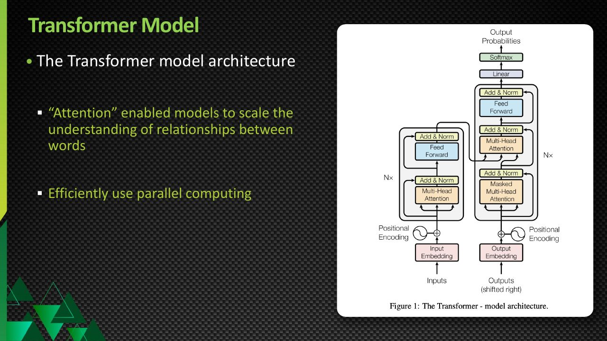

**ပုံရှင်းလင်းချက် (သင်တန်းပုံ 1)** — ဒီသင်တန်းပုံက Transformer model ကို သင်တန်း deck မှာ မိတ်ဆက်ထားတဲ့ မြင်ကွင်း ဖြစ်ပါတယ်။ Transformer ဟာ modern AI — အထူးသဖြင့် Generative AI နဲ့ Large Language Models (LLMs) တွေရဲ့ အခြေခံ deep learning architecture ဖြစ်ကြောင်း ဒီပုံက အကျဉ်းချုပ် ပြသပါတယ်။ အောက်က ရုပ်ပုံ 1 (architecture diagram) မှာတော့ ၎င်းရဲ့ အစိတ်အပိုင်းတွေကို အသေးစိတ် ဆက်လက် လေ့လာနိုင်ပါတယ်။

*(Source: NVIDIA NCA-AIIO training deck — study material)*

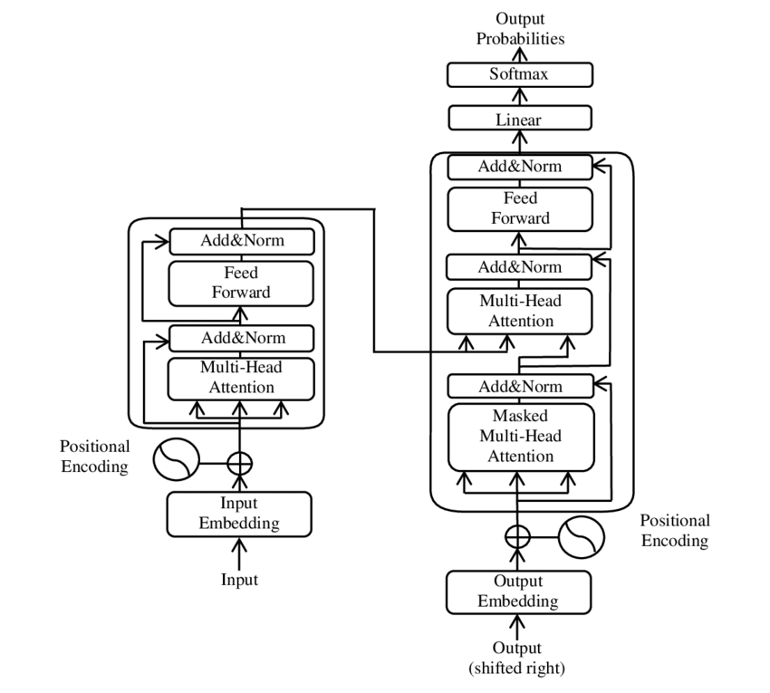

**ပုံရှင်းလင်းချက် (Diagram walkthrough) —** ဒီပုံက Transformer တစ်ခုလုံးရဲ့ architecture ကို ဘေးချင်းကပ် ပြထားပါတယ် — ဘယ်ဘက်တစ်ဝက်က encoder ဖြစ်ပြီး ညာဘက်တစ်ဝက်က decoder ဖြစ်ပါတယ်။ ဘယ်ဘက်အောက်ခြေက Input Embedding က စာသားကို vector တွေအဖြစ် ပြောင်းပေးပြီး Positional Encoding က စကားလုံးတွေရဲ့ အစဉ်အလိုက် နေရာ အချက်အလက် ထည့်ပေးပါတယ်။ အဲဒီကနေ Multi-Head Attention → Add & Norm → Feed Forward → Add & Norm ဆိုတဲ့ ဘောက်တွေ အထက်ကို တက်သွားပြီး ဒီအဆင့်ကို N ကြိမ် ထပ်လုပ်ပါတယ်။ ညာဘက် decoder မှာတော့ Output Embedding ကနေ စပြီး နောက် token တွေကို မမြင်ရအောင် ကာထားတဲ့ Masked Multi-Head Attention၊ encoder ရဲ့ output ကို ထပ်လက်ခံတဲ့ Multi-Head Attention၊ Feed Forward တွေ အဆင့်ဆင့် ဖြတ်သွားပါတယ်။ အပေါ်ဆုံးမှာ Linear နဲ့ Softmax က output probabilities တွေ ထုတ်ပေးပြီး နောက် token ကို ရွေးချယ်နိုင်ပါတယ်။

*(Diagram: Yuening Jia, CC BY-SA 3.0, via Wikimedia Commons)*

Transformer ရဲ့ အရေးကြီးဆုံး concept တစ်ခုကတော့ **Attention mechanism** ဖြစ်ပါတယ်။

## 2. Attention ဆိုတာဘာလဲ?

Attention ရဲ့ အဓိကအလုပ်က—Sentence တစ်ခုထဲမှာ ရှိတဲ့ words တွေအကြား relationship နဲ့ context ကို model က ဘယ်လိုနားလည်ရမလဲ? ဆိုတာကို ကူညီပေးတာပါ။

ဥပမာ—

> The dog chased the cat because it was fast.

ဒီမှာ "it" ဆိုတာ ဘယ်သူ့ကို ရည်ညွှန်းတာလဲ? dog လား? cat လား?
Model က sentence တစ်ခုလုံးထဲက words တွေရဲ့ relationship ကိုကြည့်ပြီး context ကိုနားလည်ဖို့လိုပါတယ်။
Attention mechanism က ဒီလို relationship တွေကို model က လေ့လာနိုင်အောင် ကူညီပေးပါတယ်။

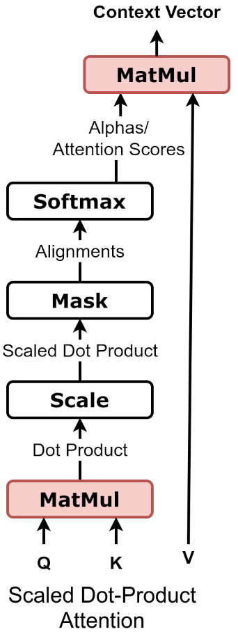

**ပုံရှင်းလင်းချက် (Diagram walkthrough) —** ဒီပုံက attention တစ်ခုရဲ့ အတွင်းပိုင်း လုပ်ဆောင်ပုံကို အဆင့်ဆင့် ပြထားပါတယ်။ အပေါ်ဆုံးက input ကို ယူပြီး query (q)၊ key (k)၊ value (v) ဆိုတဲ့ အခန်းကဏ္ဍ သုံးမျိုးခွဲ ထုတ်ယူပါတယ်။ ပြီးရင် q နဲ့ k ကို ပေါင်းပြီး token တွေအကြား ဆက်စပ်မှု ဘယ်လောက်ရှိသလဲဆိုတဲ့ attention scores တွေ တွက်ထုတ်ပါတယ်။ Softmax က ဒီ scores တွေကို စုစုပေါင်း ၁ (၁၀၀%) ဖြစ်အောင် weights တွေအဖြစ် ပြောင်းပေးပြီး အဲဒီ weights တွေနဲ့ v တွေကို ပေါင်းလိုက်တာက attention ရဲ့ output ဖြစ်လာပါတယ်။ ဆိုလိုတာက 'ဘယ် token က ဘယ် token ကို ဘယ်လောက် အာရုံစိုက်သင့်သလဲ' ဆိုတာ ကိုယ်တိုင် တွက်ချက်ပြီး context ပါတဲ့ ရလဒ် ပြန်ထုတ်ပေးတာ ဖြစ်ပါတယ်။

*(Diagram: dvgodoy, CC BY 4.0, via Wikimedia Commons)*

Simple idea

```
The → dog → chased → the → cat
             ↓
        relationships
             ↓
          context
```

**Figure 1 — Attention mechanism က context ကို နားလည်စေပုံ**

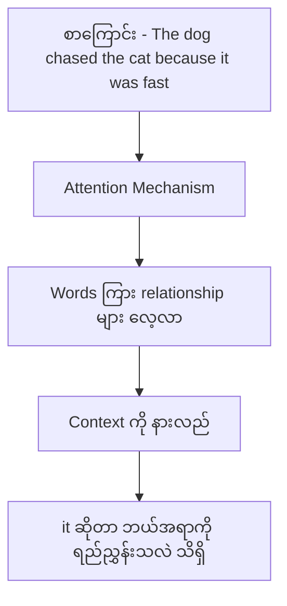

**ပုံရှင်းလင်းချက် —** အပေါ်ဆုံးက စာကြောင်းတစ်ကြောင်းလုံး (The dog chased the cat because it was fast) ကို input အဖြစ် ဝင်လာပုံ ကြည့်ပါ။ ဒုတိယ node ဖြစ်တဲ့ Attention Mechanism က စာကြောင်းထဲက words တွေကို တစ်လုံးချင်း သီးခြား မကြည့်ဘဲ ကြားခံ node မှာ words ကြား relationship တွေကို လေ့လာပါတယ်။ ဆက်လျှောက်ရင် context ကို နားလည်ပြီး အောက်ဆုံး node မှာ it ဆိုတဲ့ word က ဘယ်အရာကို ရည်ညွှန်းတယ်ဆိုတာ သိရှိနိုင်ပုံကို တွေ့ရပါမယ်။

Transformer က word တစ်လုံးတည်းကို သီးခြားကြည့်တာထက် အခြား words တွေနဲ့ ဆက်စပ်မှုကိုပါ ကြည့်နိုင်ပါတယ်။

## 3. Transformer နဲ့ Generative AI ဘာကြောင့် အရေးကြီးတာလဲ?

Transformer architecture က language data တွေကို efficiently process လုပ်နိုင်တဲ့အတွက် large-scale AI models တွေအတွက် အလွန်အသုံးဝင်လာပါတယ်။

အထူးသဖြင့် Transformer-based models တွေက—

- Text understanding
- Context understanding
- Next-token prediction
- Text generation
- Question answering
- Translation
- Summarization
- Code generation

စတဲ့ tasks တွေမှာ အသုံးများပါတယ်။
ဒါကြောင့် ဒီ architecture က modern Generative AI ecosystem ကို အလွန်အရေးကြီးစွာ ပြောင်းလဲစေခဲ့ပါတယ်။

## 4. Transformer ရဲ့ Basic Example — Next Word Prediction

Transformer ကို beginner level နဲ့ နားလည်ဖို့ အလွယ်ဆုံး example တစ်ခုက next-token prediction ဖြစ်ပါတယ်။

ဥပမာ—

> The quick brown fox jumps over the lazy ______

Model ရဲ့ task က blank နေရာမှာ ဘာလာနိုင်မလဲဆိုတာ ခန့်မှန်းဖို့ပါ။
Model က—person, rabbit, dog, cat, ... စတဲ့ candidate words တွေကို probability အနေနဲ့ စဉ်းစားနိုင်ပါတယ်။

ဥပမာ conceptual အနေနဲ့—

```
person  → 10%
rabbit  → 35%
dog     → 80%
cat     → 5%
```

ဒီ numbers တွေဟာ ဥပမာအနေနဲ့ပဲ ဖြစ်ပါတယ်။ Actual model probability မဟုတ်ပါဘူး။

Model က probability အမြင့်ဆုံး candidate ကို ရွေးနိုင်ပါတယ်။

> The quick brown fox jumps over the lazy dog.

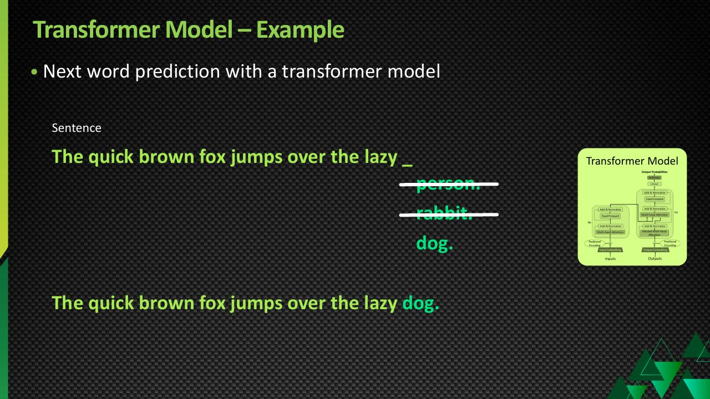

**ပုံရှင်းလင်းချက် (သင်တန်းပုံ 2)** — ဒီသင်တန်းပုံက Transformer ရဲ့ အလုပ်လုပ်ပုံကို next word prediction ဥပမာနဲ့ သရုပ်ပြထားပါတယ် — ပေးထားတဲ့ စာကြောင်းရဲ့ နောက်မှာ ဘာစကားလုံး လာသင့်လဲဆိုတာကို model က candidate words တွေထဲကနေ ခန့်မှန်း ရွေးချယ်ပုံ ဖြစ်ပါတယ်။ အပေါ်က "The quick brown fox..." ဥပမာနဲ့ အခြေခံတူညီပြီး ဒီ mechanism ကို စကားလုံးတစ်လုံးချင်း ဆက်လုပ်ရင်း စာကြောင်း၊ စာပိုဒ်တွေအထိ တည်ဆောက်နိုင်တာ ဖြစ်ပါတယ်။

*(Source: NVIDIA NCA-AIIO training deck — study material)*

## 5. Model က ဘာကြောင့် "dog" ကို ရွေးနိုင်တာလဲ?

ဒါက Transformer ရဲ့ အရေးကြီးတဲ့ concept ကို နားလည်ဖို့ ကောင်းတဲ့ example ဖြစ်ပါတယ်။
Model က training လုပ်နေစဉ်အတွင်း text အများကြီးကို process လုပ်ထားပါတယ်။

ဥပမာ—"The quick brown fox jumps over the lazy dog." ဆိုတဲ့ sentence ကို training data ထဲမှာ အကြိမ်များစွာ တွေ့ခဲ့နိုင်ပါတယ်။

အဲ့ဒီလို training data ကနေ model က—

```
quick → brown
brown → fox
fox → jumps
jumps → over
over → the
the → lazy
lazy → dog
```

လို statistical patterns / relationships တွေကို learn လုပ်ပါတယ်။

ဒါကြောင့် inference အချိန်မှာ "The quick brown fox jumps over the lazy" လို့ input ရလာရင် model က နောက်ထပ်လာနိုင်တဲ့ token တွေကို probability အနေနဲ့ တွက်ပြီး prediction လုပ်ပါတယ်။

## 6. "Person" ဘာကြောင့် မဖြစ်နိုင်သလောက် ဖြစ်သွားတာလဲ?

ဥပမာ—"The quick brown fox jumps over the lazy person." ဆိုတာ grammatical အရ မမှားပါဘူး။
အဲ့ဒါကြောင့် model အနေနဲ့ person ကို လုံးဝမဖြစ်နိုင်ဘူး လို့ မပြောနိုင်ပါဘူး။

ဒါပေမယ့် "lazy dog" ဆိုတဲ့ phrase က English language မှာ ပို common ဖြစ်နိုင်ပါတယ်။
ဒါကြောင့် model ရဲ့ learned statistical patterns အရ—**dog > person** ဖြစ်နိုင်ပါတယ်။

အရေးကြီးတာက Transformer က—"ဒီ sentence ကို မှတ်ထားလို့ dog လို့ ပြန်ဖြေတယ်" ဆိုတာထက် ပိုပြီး complex ဖြစ်ပါတယ်။
Training ကနေ learned representations, token relationships, context နဲ့ probability distribution တွေကို အသုံးပြုပြီး next token ကို predict လုပ်တာပါ။

## 7. Vector Space ဆိုတာဘာလဲ?

Source ထဲမှာ vector dimension / space အကြောင်းပြောထားပါတယ်။
AI model တွေမှာ words/tokens တွေကို raw text အနေနဲ့ တိုက်ရိုက်မသိမ်းဘဲ numerical representations အဖြစ် represent လုပ်ပါတယ်။

ဥပမာ conceptually—

```
Dog      → [0.21, -0.34, 0.82, ...]
Fox      → [0.19, -0.30, 0.79, ...]
Rabbit   → [0.15, -0.25, 0.70, ...]
Person   → [-0.42, 0.67, -0.12, ...]
```

ဒါတွေက illustrative numbers ပဲ ဖြစ်ပါတယ်။ တကယ့် model တွေမှာ vector dimensions အများကြီးရှိနိုင်ပါတယ်။

ဒီ representations တွေကြောင့် model က semantic relationships နဲ့ contextual relationships တွေကို mathematical form နဲ့ process လုပ်နိုင်ပါတယ်။

Simple idea

```
                 Animal-related space

        Fox ●
             \
              \
        Dog ●   ● Rabbit

                 Human-related concepts

                    ● Person
```

ဒါပေမယ့် "dog, fox, rabbit = animal" ဆိုတဲ့ simple 2D map တစ်ခုလို တကယ်တမ်း model ထဲမှာ မရှိပါဘူး။
Real neural-network representations တွေဟာ high-dimensional ဖြစ်ပြီး context အပေါ်မူတည်ပြီး representation တွေလည်း ပြောင်းလဲနိုင်ပါတယ်။

## 8. Transformer က Pattern ကို ဘယ်လိုအသုံးချသလဲ?

Conceptually—

```
Input:

The quick brown fox jumps over the lazy
                         │
                         ▼
                  Transformer
                         │
             Context + learned patterns
                         │
                         ▼
              Probability distribution
                         │
       ┌─────────────────┼────────────────┐
       ▼                 ▼                ▼
    person            rabbit             dog
     10%                35%              80%
                                           │
                                           ▼
                                          dog
```

**Figure 2 — Transformer က next token ကို ရွေးချယ်ပုံ**

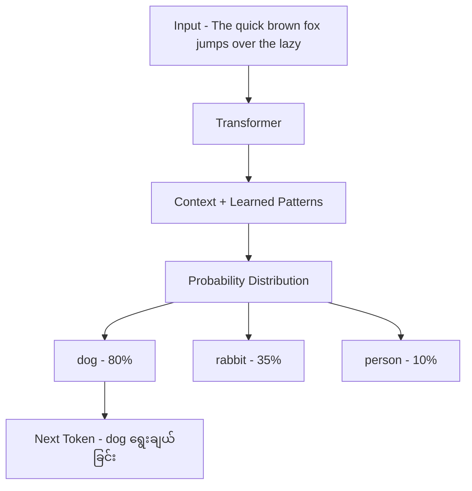

**ပုံရှင်းလင်းချက် —** အပေါ်က input စာကြောင်း (The quick brown fox jumps over the lazy) ကို အရင်ကြည့်ပါ။ ဒုတိယ node က Transformer က ဒီ input ကို လက်ခံပြီး တတိယ node မှာ context နဲ့ learned patterns တွေကို ပေါင်းစပ်ပါတယ်။ စတုတ္ထ node မှာ probability distribution ရလာပြီး အောက်က candidate သုံးခု — dog 80%, rabbit 35%, person 10% — ကို ဥပမာနှုန်းတွေနဲ့ ခွဲပြထားပါတယ်။ နောက်ဆုံးမှာ probability အမြင့်ဆုံးဖြစ်တဲ့ dog ကို next token အဖြစ် ရွေးချယ်တာကို တွေ့ရပါမယ်။

ပြီးတော့—"The quick brown fox jumps over the lazy dog." ဖြစ်လာပါတယ်။

## 9. Transformer က Sentence တစ်ကြောင်းတည်းပဲ Generate လုပ်တာလား?

မဟုတ်ပါဘူး။ Transformer-based language model တစ်ခုက တစ်ကြိမ်မှာ token တစ်ခုစီကို predict လုပ်ပြီး ဆက်တိုက် generate လုပ်နိုင်ပါတယ်။

ဥပမာ—

```
Input:
The quick brown fox

↓ Predict

jumps

↓ Predict

over

↓ Predict

the

↓ Predict

lazy

↓ Predict

dog
```

နောက်ဆုံး—"The quick brown fox jumps over the lazy dog." ဖြစ်လာပါတယ်။

## 10. Sentence → Paragraph → Page → Story

ဒီ mechanism ကို ဆက်တိုက်လုပ်သွားရင်—

```
Token
  ↓
Word / Token sequence
  ↓
Sentence
  ↓
Paragraph
  ↓
Page
  ↓
Story
  ↓
Long-form document
```

လို generate လုပ်နိုင်ပါတယ်။
ဒါကြောင့် Generative AI က—**Learned patterns + context + next-token prediction** ကို အသုံးပြုပြီး content အသစ်တွေ generate လုပ်နိုင်ပါတယ်။

**Figure 3 — Token တစ်ခုချင်း ခန့်မှန်းပြီး စာရှည် ထုတ်လုပ်ပုံ**

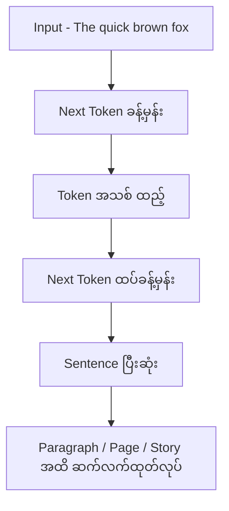

**ပုံရှင်းလင်းချက် —** ဘယ်ဘက်အပေါ်က input စာကြောင်း အစိတ်အပိုင်း (The quick brown fox) ကို အရင်ကြည့်ပါ။ ဒုတိယ node မှာ model က နောက် token တစ်ခုကို ခန့်မှန်းပြီး တတိယ node မှာ အဲဒီ token ကို စာကြောင်းထဲ ပြန်ထည့်ပါတယ်။ စတုတ္ထ node မှာ ထပ်ခါထပ်ခါ ခန့်မှန်းပြီး ပဉ္စမ node မှာ sentence တစ်ကြောင်း ပြီးဆုံးပါတယ်။ အောက်ဆုံး node က ဒီလုပ်ငန်းစဉ်ကို ဆက်လုပ်သွားရင် paragraph, page, story ကနေ long-form document အထိ တိုးချဲ့ ထုတ်လုပ်နိုင်တာကို ပြပါတယ်။

## 11. Important Correction — "Transformer predicts the next word"

Source မှာ "next word" လို့ ရှင်းပြထားပေမယ့် modern LLMs အတွက် ပိုမှန်တဲ့ terminology က **Next-token prediction** ဖြစ်ပါတယ်။

Token တစ်ခုဟာ word တစ်ခုတည်း ဖြစ်နိုင်သလို word ရဲ့ အစိတ်အပိုင်းတစ်ခုလည်း ဖြစ်နိုင်ပါတယ်။

ဥပမာ conceptually—"unbelievable" ကို tokenization လုပ်တဲ့အခါ—

```
un
believ
able
```

လိုမျိုး token အများကြီးအဖြစ် ခွဲနိုင်ပါတယ်။

ဒါကြောင့်—

- Next Word Prediction ❌
- Next-Token Prediction ✅

လို့ မှတ်ထားတာ ပိုကောင်းပါတယ်။

## 12. Transformer ရဲ့ အရေးကြီးဆုံး Concept — Attention

Transformer ကို exam အတွက် မှတ်ရင် Attention ကို မမေ့သင့်ပါဘူး။
Attention က model ကို—Input sequence ထဲမှာ ဘယ် token တွေက တစ်ခုနဲ့တစ်ခု ဘယ်လောက်ဆက်စပ်နေသလဲဆိုတာကို သင်ယူပြီး context ကို effectively အသုံးချနိုင်စေတဲ့ mechanism အဖြစ် နားလည်နိုင်ပါတယ်။

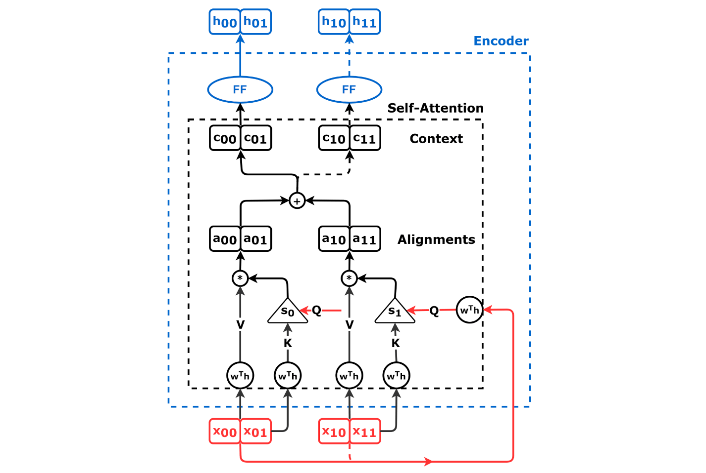

**ပုံရှင်းလင်းချက် (Diagram walkthrough) —** ဒီပုံက encoder ရဲ့ self-attention ကို အသေးစိတ် ချဲ့ပြထားပါတယ်။ စာကြောင်းထဲက token တစ်ခုချင်းစီကို query (q)၊ key (k)၊ value (v) သုံးမျိုးစီ ခွဲထုတ်ထားတာ တွေ့ရပါမယ်။ ပြီးရင် token တစ်ခုချင်းစီရဲ့ q ကို စာကြောင်းထဲက token အားလုံး (ကိုယ့်ကိုယ်ကိုပါ အပါအဝင်) ရဲ့ k တွေနဲ့ တစ်ခုချင်း ယှဉ်တွက်တဲ့အတွက် attention score ဇယား (matrix) တစ်ခု ဖြစ်လာပါတယ် — self-attention ဆိုတာ token တိုင်းက token အားလုံးကို ကြည့်တာ ဖြစ်ပါတယ်။ Softmax က ဇယားရဲ့ တစ်ကြောင်းချင်းစီကို ပမာဏ ၁ ဖြစ်အောင် ညှိပေးပြီး အဲဒီ weights တွေနဲ့ v တွေကို ပေါင်းလိုက်တာကြောင့် token တစ်ခုချင်းစီအတွက် context ပါပြီးသား representation အသစ်တွေ ရရှိပါတယ်။

*(Diagram: dvgodoy, CC BY 4.0, via Wikimedia Commons)*

ဥပမာ—

> The animal didn't cross the road because it was tired.

Model က "it" ကို နားလည်ဖို့ အနီးအနား words တွေတင်မကဘဲ sentence context ကိုလည်း အသုံးချရပါတယ်။
Attention က ဒီလို contextual relationships တွေကို model က process လုပ်နိုင်ဖို့ အရေးကြီးပါတယ်။

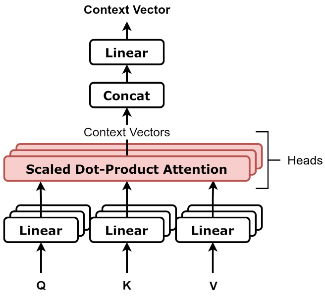

**ပုံရှင်းလင်းချက် (Diagram walkthrough) —** ဒီပုံက attention ကို တစ်ကြိမ်တည်း တွက်တာထက် head အမျိုးမျိုး ခွဲပြီး တစ်ပြိုင်နက် တွက်ပုံ (multi-head attention) ကို ပြထားပါတယ်။ input တစ်ခုတည်းကို head တစ်ခုချင်းစီဆီ ပို့ပြီး head တစ်ခုချင်းစီက သူ့ဘာသာ attention သီးခြား တွက်ပါတယ် — ဒါကြောင့် head တစ်ခုစီက မတူညီတဲ့ ဆက်စပ်မှု အမျိုးအစား (ဥပမာ စကားလုံး အဓိပ္ပာယ် ဆက်စပ်မှုနဲ့ ဝါကျ ဖွဲ့စည်းပုံ ဆက်စပ်မှု) တွေကို တစ်ပြိုင်နက် လေ့လာနိုင်ပါတယ်။ head အားလုံးရဲ့ ရလဒ်တွေကို ပေါင်း (concatenate) လိုက်ပြီး နောက်ဆုံး linear layer တစ်ခု ဖြတ်ကာ output တစ်ခု ဖြစ်လာပါတယ်။

*(Diagram: dvgodoy, CC BY 4.0, via Wikimedia Commons)*

## 13. Parallel Computing ဘာကြောင့် အရေးကြီးတာလဲ?

Source မှာ Transformer က parallel computing ကို efficiently အသုံးချနိုင်တယ်လို့ ပြောထားပါတယ်။
ဒါက Transformer architecture ရဲ့ အရေးကြီးတဲ့ advantage တစ်ခုပါ။

Traditional recurrent architectures တွေမှာ sequence ကို အစဉ်လိုက် process လုပ်ရတဲ့ dependency တွေ ပိုများပါတယ်။
Transformer architecture က training အချိန်မှာ sequence ရဲ့ token representations တွေကို parallel hardware ပေါ်မှာ efficiently process လုပ်နိုင်အောင် design လုပ်ထားပါတယ်။

ဒါကြောင့်—

```
Large Dataset
     +
Large Neural Network
     +
GPU / Accelerator
     +
Parallel Computation
     ↓
Large-scale Training
```

လုပ်နိုင်လာပါတယ်။
ဒီ scalability က modern LLM development အတွက် အလွန်အရေးကြီးပါတယ်။

## 14. Transformer Model ကို Simple Architecture အနေနဲ့ မှတ်ရန်

Beginner level မှာ ဒီလို မှတ်နိုင်ပါတယ်—

```
Input Text
                    │
                    ▼
               Tokenization
                    │
                    ▼
              Token Embeddings
                    │
                    ▼
          ┌─────────────────────┐
          │     Transformer     │
          │                     │
          │  Self-Attention     │
          │        +            │
          │  Neural Network     │
          └─────────────────────┘
                    │
                    ▼
             Output Probabilities
                    │
                    ▼
              Next Token
                    │
                    ▼
          Generated Text
```

**Figure 4 — Transformer model ရဲ့ simple architecture အဆင့်များ**

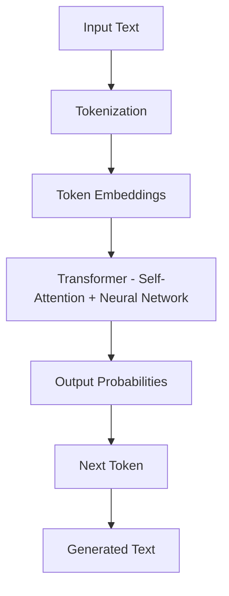

**ပုံရှင်းလင်းချက် —** အပေါ်ဆုံးက Input Text ကနေ အောက်ကို တစ်ဆင့်ချင်း လိုက်ကြည့်ပါ။ ပထမဆုံး Tokenization က စာသားကို token တွေအဖြစ် ခွဲပြီး ဒုတိယအဆင့်မှာ Token Embeddings က token တွေကို numerical representation အဖြစ် ပြောင်းပေးပါတယ်။ အလယ်က ဘောက်ကြီးက Transformer ဖြစ်ပြီး အထဲမှာ Self-Attention နဲ့ Neural Network ပါဝင်ကြောင်း ပြထားပါတယ်။ အဲဒီကနေ Output Probabilities ထွက်လာပြီး Next Token ကို ရွေးချယ်ကာ နောက်ဆုံးမှာ Generated Text ဖြစ်လာပါတယ်။

## 15. "Attention Is All You Need"

Transformer ကို လေ့လာမယ်ဆိုရင် ဒီ paper name ကို သိထားသင့်ပါတယ်။

> Paper: **Attention Is All You Need**
> Published in 2017, this paper introduced the Transformer architecture.

Exam / interview မှာ—

Q: What architecture was introduced in "Attention Is All You Need"?
A: Transformer architecture.

## 16. Transformer → Generative AI Relationship

ဒီ relationship ကို အောက်ပါအတိုင်း မှတ်ထားပါ။

```
Artificial Intelligence
        │
        ▼
Machine Learning
        │
        ▼
Deep Learning
        │
        ▼
Neural Network Architectures
        │
        ▼
Transformer
        │
        ▼
Large Language Models
        │
        ▼
Generative AI
```

**Figure 5 — Transformer မှ Generative AI အထိ ဆက်စပ်ပုံ**

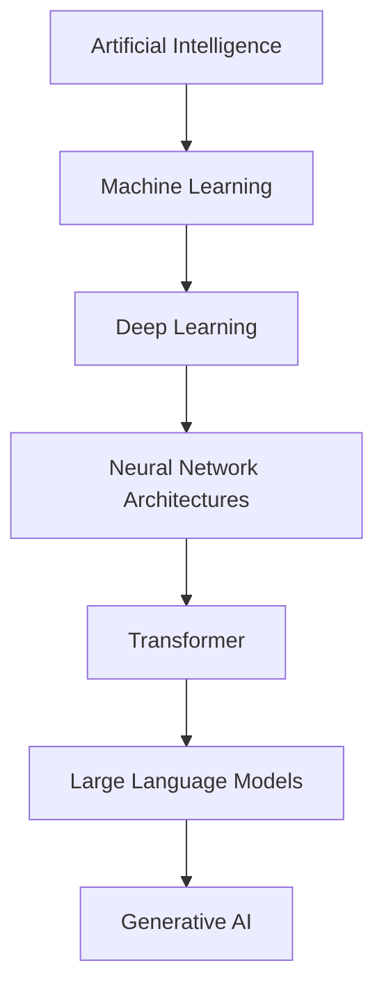

**ပုံရှင်းလင်းချက် —** အပေါ်ဆုံးက Artificial Intelligence ဆိုတဲ့ အကျယ်ဆုံး နယ်ပယ်ကနေ စပြီး အောက်ကို တစ်ဆင့်ချင်း လိုက်ကြည့်ပါ — Machine Learning က AI ထဲက approach တစ်ခု၊ Deep Learning က neural network သုံးတဲ့ ML approach၊ Neural Network Architectures ကြားမှာ Transformer ရှိပြီး Transformer ကို အခြေခံတည်ဆောက်ထားတာက Large Language Models ဖြစ်ပါတယ်။ အောက်ဆုံး node မှာတော့ ဒီအဆင့်တွေအပေါ် အခြေခံထားတဲ့ Generative AI ကို တွေ့ရပါမယ်။ ဒီပုံဟာ သင်ကြားရေးအတွက် ပြထားတဲ့ learning aid ဖြစ်ပြီး strict hierarchy တစ်ခုတည်း မဟုတ်ပါဘူး။

ဒါက learning aid အနေနဲ့ ကြည့်တာပါ။ တကယ့် AI taxonomy ကို ဒီလို strict hierarchy တစ်ခုတည်းနဲ့ သတ်မှတ်လို့မရပါဘူး။

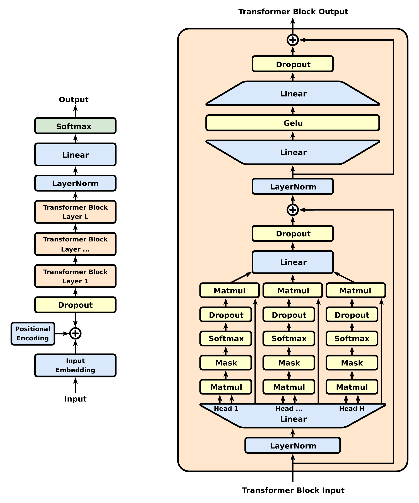

**ပုံရှင်းလင်းချက် (Diagram walkthrough) —** ဒီပုံက Generative Pre-trained Transformer (GPT) တစ်ခုလုံးရဲ့ architecture ဖြစ်ပါတယ်။ အောက်ခြေမှာ token တွေကို vector တွေအဖြစ် ပြောင်းတဲ့ token embedding နဲ့ စကားလုံး အစဉ်အလိုက် နေရာ အချက်အလက် ပေးတဲ့ positional embedding ကို ပေါင်းထည့်ပါတယ်။ အဲဒီကနေ transformer block တွေ — Masked Multi-Head Self-Attention နဲ့ Feed Forward အဆင့်တွေ (residual connection နဲ့ layer normalization ပါ) — ကို အထပ်လိုက် အကြိမ်များစွာ ဖြတ်သွားပါတယ်။ 'Masked' ဆိုတာ နောက်က token တွေကို မမြင်ရအောင် ကာထားတာ ဖြစ်လို့ GPT ဟာ decoder ပုံစံ ဖြစ်ပြီး စာသား ထုတ်လုပ်ရာမှာ သုံးပါတယ်။ အပေါ်ဆုံးမှာ vocabulary တစ်ခုလုံးအပေါ် probability တွေ ထွက်လာပြီး probability အမြင့်ဆုံး next token ကို ရွေးကာ ဒီအဆင့်ကို တစ်ကြိမ်ပြီးတစ်ကြိမ် ပြန်လုပ်ခြင်းဖြင့် စာသား တစ်ဆင့်ချင်း ထုတ်လုပ်ပါတယ်။

*(Diagram: Original: Marxav, Vectorization: Mrmw, CC0, via Wikimedia Commons)*

## 17. Exam မှတ်ရန် — Transformer

> **Transformer** = attention mechanisms တွေကို အသုံးပြုပြီး sequences တွေကို process လုပ်ဖို့ design လုပ်ထားတဲ့ Deep Learning architecture ဖြစ်ပြီး token တွေအကြား relationship တွေကို efficiently သင်ယူနိုင်စေပါတယ်။

### Key Concepts

```
Transformer
     ↓
Attention
     ↓
Context / Relationships
     ↓
Learned Patterns
     ↓
Next-Token Prediction
     ↓
Text Generation
```

### 4 Keywords

| Concept | မှတ်ရန် |
|---|---|
| AI | Intelligence |
| ML | Learning from Data |
| DL | Neural Networks |
| Transformer | Attention |
| GenAI | Generate New Content |

**အရေးကြီးဆုံး Exam Shortcut:**
Transformer → Attention → Context → Next-Token Prediction → Generation

> **အထူးမှတ်ရန်:** Transformer ရဲ့ definition က "next word prediction" မဟုတ်ပါဘူး။ Attention-based architecture ဖြစ်တာက core idea ဖြစ်ပြီး၊ modern language models တွေမှာ next-token prediction ကို training/objective အဖြစ် အသုံးပြုပြီး text generation လုပ်တာပါ။

## 18. ကိုယ်တိုင်စစ်ဆေးရန် မေးခွန်းများ (Self-Check Questions)

**မေးခွန်း ၁ — Transformer architecture ကို ဘယ် research paper မှာ မိတ်ဆက်ခဲ့သလဲ?**

အဖြေ — 2017 ခုနှစ်က Google researchers တွေရဲ့ **"Attention Is All You Need"** paper မှာ မိတ်ဆက်ခဲ့ပါတယ်။

**မေးခွန်း ၂ — Attention mechanism ရဲ့ အဓိကအလုပ်က ဘာလဲ?**

အဖြေ — Sentence / input sequence ထဲက token တွေအကြား relationship နဲ့ context ကို model က နားလည်ပြီး အသုံးချနိုင်အောင် ကူညီပေးတာဖြစ်ပါတယ်။

**မေးခွန်း ၃ — "Next word prediction" နဲ့ "Next-token prediction" ဘာကွာသလဲ?**

အဖြေ — Modern LLMs အတွက် ပိုမှန်တဲ့ term က next-token prediction ဖြစ်ပါတယ်။ Token တစ်ခုဟာ word တစ်ခုတည်း မဟုတ်ဘဲ word ရဲ့ အစိတ်အပိုင်းတွေလည်း ဖြစ်နိုင်တဲ့အတွက် ဖြစ်ပါတယ်။

**မေးခွန်း ၄ — Transformer က parallel computing ကို ဘာကြောင့် အသုံးချနိုင်တာလဲ?**

အဖြေ — Transformer architecture က training အချိန်မှာ sequence ထဲက token representations တွေကို parallel hardware (GPU / accelerator) ပေါ်မှာ efficiently process လုပ်နိုင်အောင် design လုပ်ထားတဲ့အတွက် ဖြစ်ပါတယ်။ ဒါကြောင့် large-scale training ကို လုပ်နိုင်လာပါတယ်။

---

## English Version

## 1. What Is a Transformer Model?

A Transformer is a Deep Learning architecture that is extremely important for modern AI, and especially for Generative AI and Large Language Models (LLMs).

The basic idea of the Transformer architecture was introduced in the 2017 research paper **"Attention Is All You Need"**, published by Google researchers.


**Slide walkthrough (Training Slide 1)** — This training slide is the deck's introductory view of the Transformer model. It presents the Transformer as the core deep learning architecture behind modern AI, especially Generative AI and Large Language Models (LLMs). The architecture diagram below (Diagram 1) then breaks the model down into its detailed components.

*(Source: NVIDIA NCA-AIIO training deck — study material)*


**Diagram walkthrough —** This picture shows the whole Transformer architecture side by side: the left half is the encoder and the right half is the decoder. On the lower left, Input Embedding turns the text into vectors and Positional Encoding adds word-order information; from there the data moves up through Multi-Head Attention → Add & Norm → Feed Forward → Add & Norm, a block that is repeated N times. The decoder on the right starts at Output Embedding, passes through Masked Multi-Head Attention (which hides later tokens so the model cannot peek ahead), a Multi-Head Attention step that also receives the encoder output, and Feed Forward blocks. At the very top, Linear and Softmax produce output probabilities from which the next token is selected.

*(Diagram: Yuening Jia, CC BY-SA 3.0, via Wikimedia Commons)*

One of the most important concepts in a Transformer is the **Attention mechanism**.

## 2. What Is Attention?

The main job of Attention is to help the model understand the relationships and context between the words in a sentence.

For example:

> The dog chased the cat because it was fast.

Here, what does "it" refer to — the dog or the cat?
The model needs to look at the relationships between the words in the whole sentence to understand the context.
The Attention mechanism helps the model learn these kinds of relationships.


**Diagram walkthrough —** This diagram breaks one attention block into steps. The input at the top is split into three roles: a query (q), a key (k), and a value (v). The query and key are combined to compute attention scores — how strongly each token should relate to the others. A softmax turns those scores into weights that add up to 1 (100%), and those weights are applied to the values and summed to form the output. In short, the block works out by itself how much each token should attend to the others and returns a context-aware result.

*(Diagram: dvgodoy, CC BY 4.0, via Wikimedia Commons)*

Simple idea:

```
The → dog → chased → the → cat
             ↓
        relationships
             ↓
          context
```

**Figure 1 — How the Attention mechanism builds context**

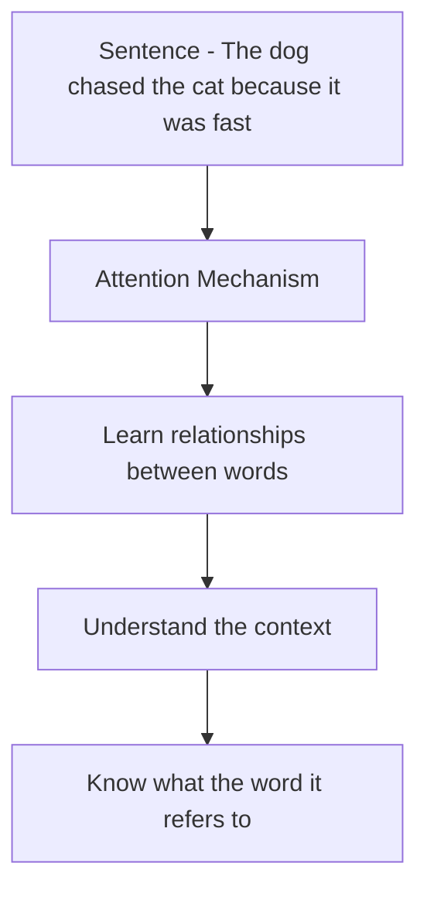

**Figure walkthrough —** At the top, the whole sentence (The dog chased the cat because it was fast) enters as input. In the second node, the Attention mechanism does not look at each word in isolation; in the middle node it learns the relationships between the words. Next it understands the context, and the bottom node shows the result: knowing what the word "it" refers to in the sentence.

Instead of looking at a single word in isolation, a Transformer can also look at how that word relates to the other words.

## 3. Why Is the Transformer Important for Generative AI?

Because the Transformer architecture can process language data efficiently, it has become extremely useful for large-scale AI models.

Transformer-based models are widely used for tasks such as:

- Text understanding
- Context understanding
- Next-token prediction
- Text generation
- Question answering
- Translation
- Summarization
- Code generation

That is why this architecture has profoundly changed the modern Generative AI ecosystem.

## 4. Basic Example — Next Word Prediction

The easiest example for understanding a Transformer at beginner level is next-token prediction.

For example:

> The quick brown fox jumps over the lazy ______

The model's task is to predict what could come in the blank.
The model can consider candidate words — person, rabbit, dog, cat, ... — as probabilities.

Conceptually:

```
person  → 10%
rabbit  → 35%
dog     → 80%
cat     → 5%
```

These numbers are illustrative only. They are not actual model probabilities.

The model can select the candidate with the highest probability:

> The quick brown fox jumps over the lazy dog.


**Slide walkthrough (Training Slide 2)** — This training slide demonstrates how a Transformer works through a next-word-prediction example: given a sentence, the model predicts which word should come next, choosing among candidate words. It is the same idea as the "The quick brown fox..." example above, and repeating this mechanism one word at a time is how a Transformer builds sentences, paragraphs, and longer text.

*(Source: NVIDIA NCA-AIIO training deck — study material)*

## 5. Why Does the Model Choose "dog"?

This is a good example for understanding an important Transformer concept.
During training, the model processes a huge amount of text.

For example, it may encounter the sentence "The quick brown fox jumps over the lazy dog." many times in its training data.

From such training data, the model learns statistical patterns and relationships such as:

```
quick → brown
brown → fox
fox → jumps
jumps → over
over → the
the → lazy
lazy → dog
```

Therefore, at inference time, when the input "The quick brown fox jumps over the lazy" arrives, the model computes probabilities for the tokens that could come next and makes a prediction.

## 6. Why Is "Person" Almost Impossible?

For example, "The quick brown fox jumps over the lazy person." is not grammatically wrong.
So the model cannot say that "person" is completely impossible.

However, the phrase "lazy dog" may be much more common in the English language.
Therefore, according to the model's learned statistical patterns, **dog > person**.

The important point is that a Transformer is more than "it stored this sentence and answered 'dog'".
It uses learned representations, token relationships, context, and probability distributions from training to predict the next token.

## 7. What Is a Vector Space?

Words and tokens are not stored as raw text inside AI models; they are represented as numerical representations.

For example, conceptually:

```
Dog      → [0.21, -0.34, 0.82, ...]
Fox      → [0.19, -0.30, 0.79, ...]
Rabbit   → [0.15, -0.25, 0.70, ...]
Person   → [-0.42, 0.67, -0.12, ...]
```

These are illustrative numbers only. Real models can have many vector dimensions.

These representations allow the model to process semantic relationships and contextual relationships in mathematical form.

Simple idea:

```
                 Animal-related space

        Fox ●
             \
              \
        Dog ●   ● Rabbit

                 Human-related concepts

                    ● Person
```

However, a simple 2D map like "dog, fox, rabbit = animal" does not actually exist inside the model.
Real neural-network representations are high-dimensional, and the representations can also change depending on context.

## 8. How Does a Transformer Use Patterns?

Conceptually:

```
Input:

The quick brown fox jumps over the lazy
                         │
                         ▼
                  Transformer
                         │
             Context + learned patterns
                         │
                         ▼
              Probability distribution
                         │
       ┌─────────────────┼────────────────┐
       ▼                 ▼                ▼
    person            rabbit             dog
     10%                35%              80%
                                           │
                                           ▼
                                          dog
```

**Figure 2 — How a Transformer selects the next token**

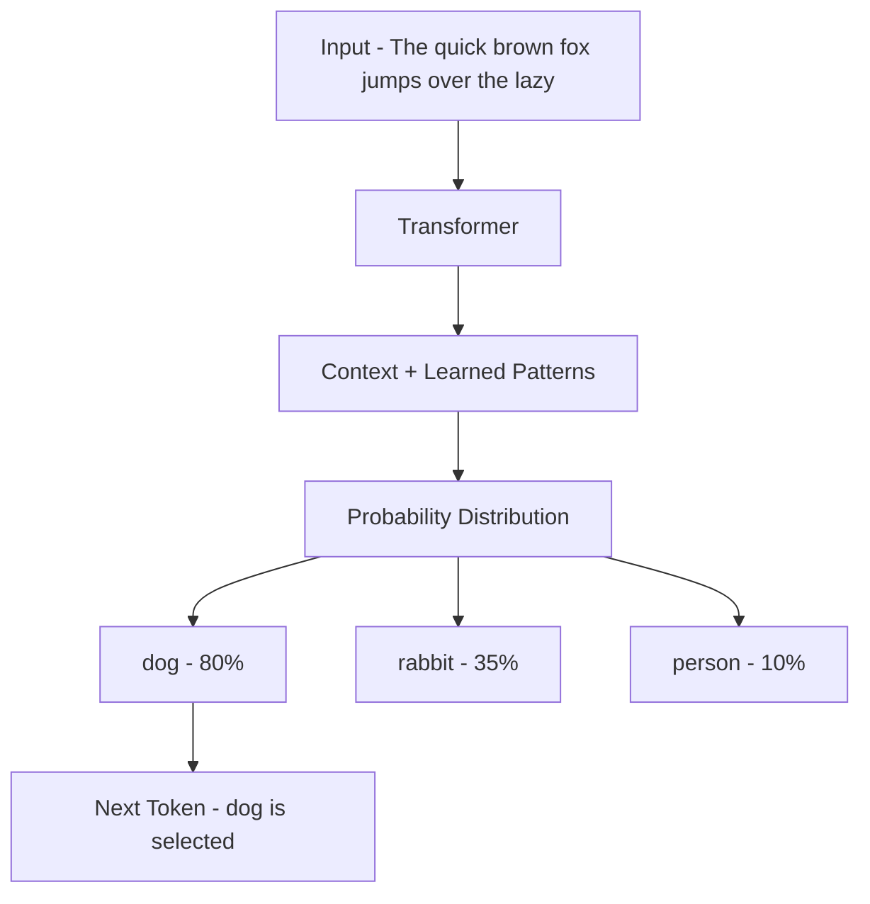

**Figure walkthrough —** Start at the top with the input sentence (The quick brown fox jumps over the lazy). In the second node the Transformer receives this input, and in the third node it combines the context with its learned patterns. The fourth node shows the probability distribution, and below it the three candidates are listed with illustrative numbers: dog 80%, rabbit 35%, and person 10%. At the end, the candidate with the highest probability, dog, is selected as the next token.

Then the result is: "The quick brown fox jumps over the lazy dog."

## 9. Does a Transformer Generate Only One Sentence?

No. A Transformer-based language model predicts one token at a time and can generate continuously.

For example:

```
Input:
The quick brown fox

↓ Predict

jumps

↓ Predict

over

↓ Predict

the

↓ Predict

lazy

↓ Predict

dog
```

In the end: "The quick brown fox jumps over the lazy dog."

## 10. Sentence → Paragraph → Page → Story

If this mechanism continues repeatedly—

```
Token
  ↓
Word / Token sequence
  ↓
Sentence
  ↓
Paragraph
  ↓
Page
  ↓
Story
  ↓
Long-form document
```

—content can be generated at increasing length.
That is how Generative AI uses **learned patterns + context + next-token prediction** to generate new content.

**Figure 3 — Generating longer text one token at a time**

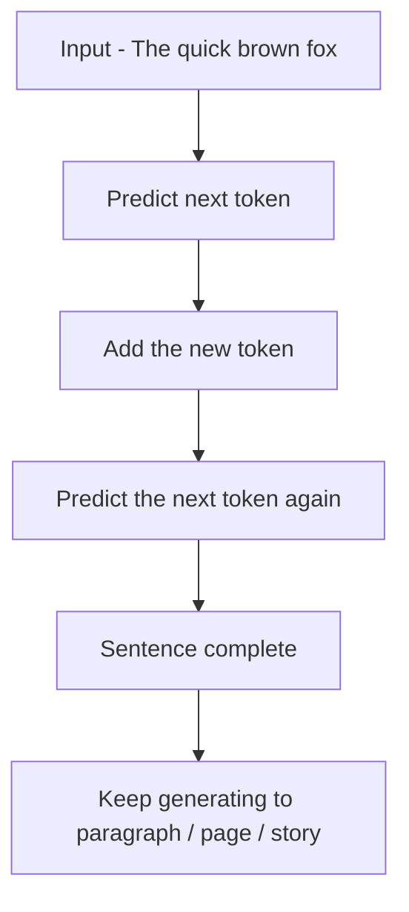

**Figure walkthrough —** Start at the top left with part of the input sentence (The quick brown fox). In the second node the model predicts the next token, and in the third node that token is added back into the sentence. The fourth node repeats the prediction again and again, and the fifth node shows the sentence becoming complete. The bottom node shows that if this keeps going, generation extends from a sentence to a paragraph, a page, a story, and finally a long-form document.

## 11. Important Correction — "Transformer predicts the next word"

The source explains this as "next word", but for modern LLMs the more accurate terminology is **Next-token prediction**.

A token can be a whole word, or it can be part of a word.

For example, conceptually, when tokenizing "unbelievable":

```
un
believ
able
```

—it can be split into many tokens.

Therefore, remember:

- Next Word Prediction ❌
- Next-Token Prediction ✅

## 12. The Most Important Concept — Attention

When you study Transformers for the exam, do not forget Attention.
Attention can be understood as the mechanism that lets the model learn how strongly tokens in the input sequence relate to one another and use context effectively.


**Diagram walkthrough —** This diagram zooms into encoder self-attention in detail. Each token in the sentence is split into three roles: a query (q), a key (k), and a value (v). Each token's query is then compared with the keys of every token in the sentence, including itself, filling in a grid of attention scores — this is exactly what 'self-attention' means: every token looks at all the others. Softmax normalizes each row of the grid to a total of 1, those weights are applied to the values, and the result is a new, context-aware representation for each token.

*(Diagram: dvgodoy, CC BY 4.0, via Wikimedia Commons)*

For example:

> The animal didn't cross the road because it was tired.

To understand "it", the model must use not only the nearby words but also the sentence context.
Attention is important for the model to process these kinds of contextual relationships.


**Diagram walkthrough —** This diagram shows multi-head attention: instead of computing attention just once, the model splits the work into several heads running in parallel. The same input goes into every head, and each head computes its own attention — so different heads can pick up different kinds of relationships (for example, word meaning versus sentence structure) at the same time. The outputs of all the heads are joined together (concatenated) and passed through a final linear layer to produce the output.

*(Diagram: dvgodoy, CC BY 4.0, via Wikimedia Commons)*

## 13. Why Is Parallel Computing Important?

The source states that a Transformer can use parallel computing efficiently.
This is an important advantage of the Transformer architecture.

Traditional recurrent architectures have more dependencies that require sequential processing of the sequence.
The Transformer architecture is designed so that, during training, the token representations of a sequence can be processed efficiently on parallel hardware.

Therefore:

```
Large Dataset
     +
Large Neural Network
     +
GPU / Accelerator
     +
Parallel Computation
     ↓
Large-scale Training
```

becomes possible.
This scalability is extremely important for modern LLM development.

## 14. Remembering the Transformer as a Simple Architecture

At beginner level, you can remember it like this:

```
Input Text
                    │
                    ▼
               Tokenization
                    │
                    ▼
              Token Embeddings
                    │
                    ▼
          ┌─────────────────────┐
          │     Transformer     │
          │                     │
          │  Self-Attention     │
          │        +            │
          │  Neural Network     │
          └─────────────────────┘
                    │
                    ▼
             Output Probabilities
                    │
                    ▼
              Next Token
                    │
                    ▼
          Generated Text
```

**Figure 4 — The simple architecture of a Transformer model**


**Figure walkthrough —** Start at the top with the input text and follow the arrows downward one step at a time. First, tokenization splits the text into tokens; in the second step token embeddings turn those tokens into numerical representations. The big middle box is the Transformer itself, containing self-attention and the neural network. From there output probabilities come out, the next token is selected, and at the bottom the generated text is formed.

## 15. "Attention Is All You Need"

If you study Transformers, you should know this paper name.

> Paper: **Attention Is All You Need**
> Published in 2017, this paper introduced the Transformer architecture.

In an exam / interview:

Q: What architecture was introduced in "Attention Is All You Need"?
A: Transformer architecture.

## 16. Transformer → Generative AI Relationship

Remember this relationship as follows:

```
Artificial Intelligence
        │
        ▼
Machine Learning
        │
        ▼
Deep Learning
        │
        ▼
Neural Network Architectures
        │
        ▼
Transformer
        │
        ▼
Large Language Models
        │
        ▼
Generative AI
```

**Figure 5 — How the Transformer connects up to Generative AI**


**Figure walkthrough —** Start at the top with Artificial Intelligence, the broadest field, and move downward one step at a time: Machine Learning is an approach within AI, and Deep Learning is the ML approach that uses neural networks. Among neural network architectures sits the Transformer, and large language models are built on the Transformer. At the bottom node you reach Generative AI, which rests on all of these steps. Remember this picture is a learning aid, not a strict hierarchy.

This is a learning aid. The real AI taxonomy cannot be defined by a single strict hierarchy like this.


**Diagram walkthrough —** This picture shows the full architecture of a Generative Pre-trained Transformer (GPT) model. At the bottom, tokens are turned into vectors (token embeddings) and word-order information is added (positional embeddings). From there the data goes up through stacked transformer blocks — each with a Masked Multi-Head Self-Attention step and a Feed Forward step (with residual connections and layer normalization). 'Masked' means later tokens are hidden from the model, which makes GPT a decoder-style stack built for generation. At the top the model produces probabilities over its whole vocabulary, picks the highest-probability next token, and repeating this step one token at a time is how GPT generates text.

*(Diagram: Original: Marxav, Vectorization: Mrmw, CC0, via Wikimedia Commons)*

## 17. Exam Summary — Transformer

> **Transformer** = A Deep Learning architecture designed to process sequences using attention mechanisms, enabling models to learn relationships between tokens efficiently.

### Key Concepts

```
Transformer
     ↓
Attention
     ↓
Context / Relationships
     ↓
Learned Patterns
     ↓
Next-Token Prediction
     ↓
Text Generation
```

### Keywords

| Concept | Remember |
|---|---|
| AI | Intelligence |
| ML | Learning from Data |
| DL | Neural Networks |
| Transformer | Attention |
| GenAI | Generate New Content |

**Most important keywords:**

| | |
|---|---|
| Transformer | → Attention |
| Attention | → Context / Relationships |
| LLM | → Language Understanding & Generation |
| Generation | → Next-Token Prediction |
| Generative AI | → New Content |

**Most important exam shortcut:**
Transformer → Attention → Context → Next-Token Prediction → Generation

> **Note:** The definition of a Transformer is not "next word prediction". Its core idea is being an attention-based architecture, and modern language models use next-token prediction as the training objective to generate text.

## 18. Self-Check Questions

**Question 1 — In which research paper was the Transformer architecture introduced?**

Answer — In the 2017 paper **"Attention Is All You Need"** by Google researchers.

**Question 2 — What is the main job of the Attention mechanism?**

Answer — It helps the model understand and use the relationships and context between tokens in a sentence or input sequence.

**Question 3 — What is the difference between "next word prediction" and "next-token prediction"?**

Answer — For modern LLMs, the more accurate term is next-token prediction. A token is not necessarily one whole word — it can also be part of a word.

**Question 4 — Why can a Transformer use parallel computing?**

Answer — The Transformer architecture is designed so that, during training, the token representations of a sequence can be processed efficiently on parallel hardware (GPU / accelerator), which makes large-scale training possible.

## Technical review notes

- File restructured to the current bilingual convention: `# Module 01` header, the Part I / Course Module 01 blockquote, a `## မြန်မာဘာသာ version` section and an `## English Version` section with matching section numbering (1–18 in both).
- Mixed-language content was resolved per section: the English definition blockquote in the Burmese exam-summary section ("Transformer = A Deep Learning architecture designed to process sequences using attention mechanisms…") is rendered in Burmese, with the original English wording preserved in English §17. The closing Burmese note ("အထူးမှတ်ရန်: Transformer ရဲ့ definition က \"next word prediction\" မဟုတ်ပါဘူး…") previously sat at the end of the English section; it now closes the Burmese section and an English rendering closes the English section.
- The English section was reorganized to mirror the Burmese section numbering; material that previously existed in only one language (the "it" reference example and simple-idea diagram in §2, the task list in §3, the "lazy person" example in §6, the 2D vector-map diagram and its high-dimensional caveat in §7, the probability-distribution diagram in §8, the token-by-token generation example in §9, the tokenization example "unbelievable → un / believ / able" in §11, the "The animal didn't cross the road…" example in §12, the simple architecture diagram in §14, the paper Q&A in §15, and the AI→…→Generative AI relationship diagram in §16) now appears in both language sections as a faithful translation. Diagrams and code blocks are kept unchanged in both.
- The correction "next word → next-token prediction" is preserved from the source as a correction to simplified terminology; the illustrative probability numbers (10/35/80/5%) and vector values are labeled illustrative in both versions and are not claimed as measured data.
- Claims needing verification: none outstanding. The "Attention Is All You Need" (2017) attribution is standard; the AI→ML→DL→Transformer→LLM→Generative AI diagram is explicitly presented as a learning aid, not a strict taxonomy, in both versions.
- Figures added: numbered Mermaid figures (Figure 1–5) with figure walkthroughs (ပုံရှင်းလင်းချက်) were added inline in both language sections; all existing text, tables, and ASCII diagrams are preserved unchanged.
