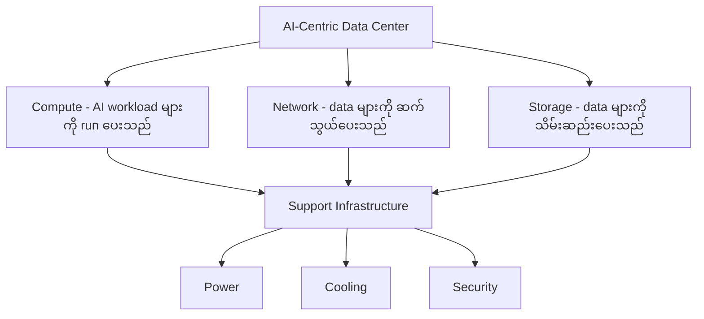
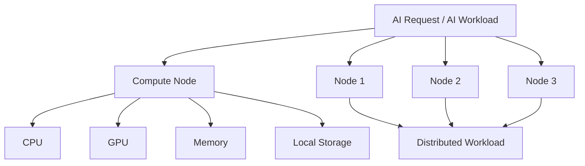
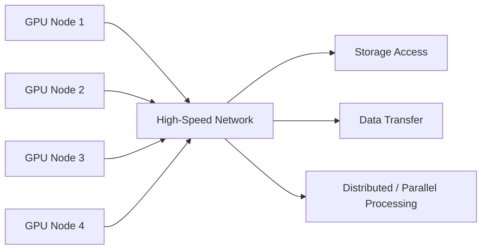
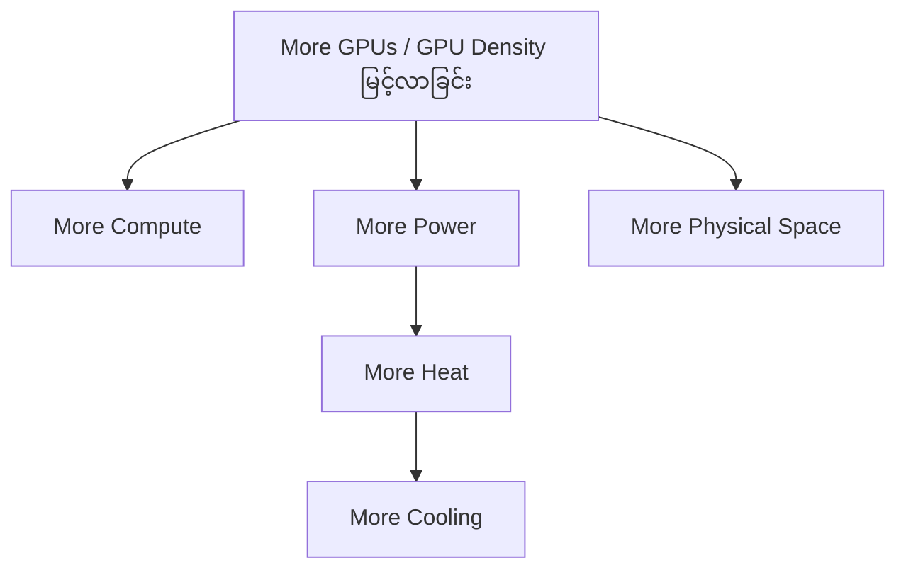
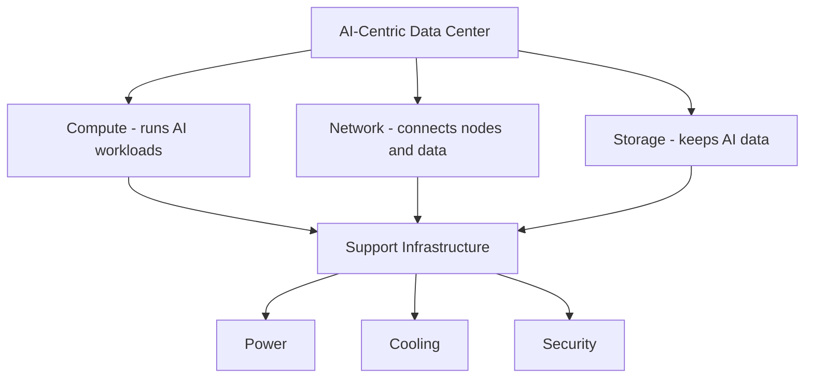
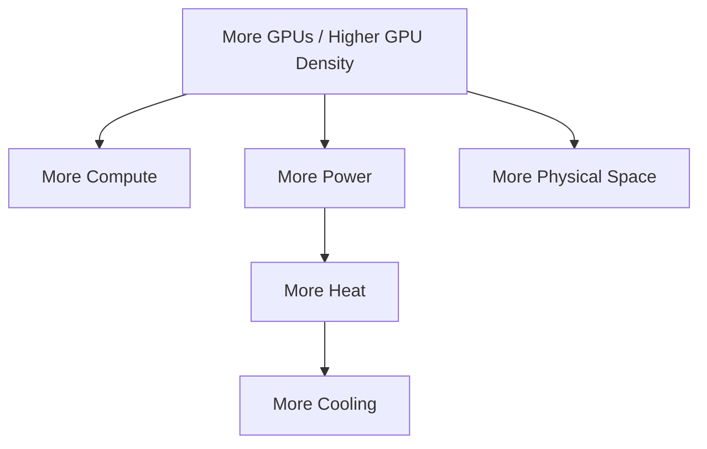

# Module 02 — Inside an AI-Centric Data Center

> Part I · AI Foundations and AI Infrastructure — Course Module 02 (AI Data Centers, Energy Consumption and PUE) — topic notes

## မြန်မာဘာသာ version

## 1. AI-Centric Data Center ဆိုတာဘာလဲ?

AI application တွေ၊ VR workloads တွေ၊ AI-based data processing တွေကို အဓိကလုပ်ဆောင်ဖို့ တည်ဆောက်ထားတဲ့ Data Center ကို AI-centric Data Center လို့ ခေါ်နိုင်ပါတယ်။

အခြေခံအားဖြင့် Traditional Data Center နဲ့ AI-centric Data Center တို့ဟာ လုံးဝမတူတဲ့ infrastructure နှစ်ခု မဟုတ်ပါဘူး။

**AI-centric Data Center = Traditional Data Center အခြေခံ + AI workload အတွက် ပိုမိုအထူးပြုထားသော infrastructure**

ဒါကြောင့် "AI Data Center က Traditional Data Center နဲ့ လုံးဝမတူဘူး" လို့ မယူဆသင့်ပါဘူး။

အဓိကကတော့ AI workload တွေမှာ—

- Compute demand ပိုမြင့်တတ်တယ်
- GPU workload တွေ များတတ်တယ်
- Server တစ်လုံးထက် multiple compute nodes လိုအပ်တတ်တယ်
- Nodes တွေအကြား high-speed communication လိုအပ်တတ်တယ်
- Storage throughput နဲ့ capacity လိုအပ်ချက် မြင့်တတ်တယ်
- Power consumption ပိုများတတ်တယ်
- Heat generation ပိုများတတ်တယ်
- Rack density ပိုမြင့်တတ်တယ်

ဒါကြောင့် Traditional Data Center ထက် Power, Cooling, Networking, Physical Space စတဲ့ infrastructure တွေကို ပိုပြီးဂရုစိုက်ရပါတယ်။

## 2. AI-Centric Data Center ရဲ့ Fundamental Building Blocks

AI-centric Data Center ထဲမှာ အခြေခံအားဖြင့် ၄ ခု ရှိတယ်လို့ စဉ်းစားနိုင်ပါတယ်။

```
                 AI-CENTRIC DATA CENTER
                         │
        ┌────────────────┼────────────────┐
        │                │                │
        ▼                ▼                ▼
     COMPUTE           NETWORK          STORAGE
        │                │                │
        └────────────────┼────────────────┘
                         ▼
              SUPPORT INFRASTRUCTURE
             Power / Cooling / Security
```

**Fundamental 4 Blocks:** Compute · Network · Storage · Support Infrastructure

> **Figure 1 — AI-Centric Data Center ရဲ့ Fundamental Building Blocks များ**



**ပုံရှင်းလင်းချက်** — အပေါ်ဆုံး node ကနေ စကြည့်ပါ။ AI-Centric Data Center တစ်ခုကို အဓိက block သုံးခု — Compute၊ Network၊ Storage — အဖြစ် ခွဲထားတာကို မြင်ရပါမယ်။ ဒီသုံးခုကနေ မျဉ်းတွေဆင်းသွားပြီး Support Infrastructure မှာ ဆုံပါတယ်။ အောက်ဆုံး node သုံးခု — Power၊ Cooling၊ Security — က IT equipment တွေ အလုပ်လုပ်နိုင်အောင် ထောက်ပံ့ပေးတဲ့ facility infrastructure တွေ ဖြစ်ကြောင်း ပြသပါတယ်။

## 3. Compute

AI-centric Data Center မှာ ပထမဆုံးလိုအပ်တာက Compute ဖြစ်ပါတယ်။
Compute က Data Center ထဲကို request ဝင်လာတဲ့အခါ—

- AI inference ကို process လုပ်ပေးနိုင်ဖို့
- Model training လုပ်နိုင်ဖို့
- Data processing လုပ်နိုင်ဖို့
- AI workload တွေကို execute လုပ်နိုင်ဖို့

လိုအပ်ပါတယ်။

**Compute Node ဆိုတာဘာလဲ?**
Compute node ဆိုတာ workload တွေကို run လုပ်ပေးတဲ့ server/resource တစ်ခုလို့ ရိုးရိုးရှင်းရှင်း နားလည်နိုင်ပါတယ်။

ဥပမာ—

```
AI Request
    │
    ▼
Compute Node
    │
    ├── CPU
    ├── GPU
    ├── Memory
    └── Local Storage
```

AI workload ကြီးလာတဲ့အခါ server တစ်လုံးတည်းနဲ့ မလုံလောက်နိုင်ပါဘူး။ ဒါကြောင့်—

```
        AI Workload
             │
     ┌───────┼───────┐
     ▼       ▼       ▼
  Node 1   Node 2   Node 3
     │       │       │
     └───────┼───────┘
             ▼
      Distributed Workload
```

လိုမျိုး multiple compute nodes အသုံးပြုနိုင်ပါတယ်။

> **Figure 2 — Compute Node တစ်ခုနှင့် Distributed Workload**



**ပုံရှင်းလင်းချက်** — ဘယ်ဘက်အပေါ်က AI Request / AI Workload ကနေ စပါတယ်။ အလယ်က Compute Node တစ်ခုထဲမှာ CPU၊ GPU၊ Memory၊ Local Storage ဆိုပြီး component လေးခု ပါဝင်တာ မြင်ရပါမယ်။ အောက်ဘက်မှာတော့ workload ကြီးလာရင် Node 1၊ Node 2၊ Node 3 ဆိုပြီး ခွဲဝေပေးပြီး၊ နောက်ဆုံးမှာ Distributed Workload အဖြစ် ပေါင်းစည်းဆောင်ရွက်တာကို တွေ့ရပါမယ်။

> **မှတ်ရန်** — Compute = AI workload ကို run/process လုပ်ပေးတဲ့ resources

## 4. Network

Compute nodes အများကြီးရှိလာတဲ့အခါ nodes တွေအကြား communication လုပ်ဖို့ Network လိုပါတယ်။
အထူးသဖြင့် AI training workload တွေမှာ compute nodes တွေက တစ်ခုနဲ့တစ်ခု data နဲ့ computation results တွေ exchange လုပ်ရနိုင်ပါတယ်။

```
GPU Node 1 ───────┐
                  │
GPU Node 2 ───────┼──── High-Speed Network
                  │
GPU Node 3 ───────┤
                  │
GPU Node 4 ───────┘
```

Network က—

- Compute nodes အကြား communication
- Storage access
- Data transfer
- Distributed AI workloads
- Parallel processing

တို့အတွက် အရေးကြီးပါတယ်။

AI infrastructure မှာ compute performance မြင့်ပေမယ့် network မကောင်းရင် nodes တွေ data စောင့်နေရပြီး overall performance ကျနိုင်ပါတယ်။

> **Figure 3 — High-Speed Network ဖြင့် GPU Nodes များ ချိတ်ဆက်ပုံ**



**ပုံရှင်းလင်းချက်** — ဘယ်ဘက်မှာ GPU Node လေးခုက High-Speed Network ကြီးတစ်ခုဆီ ချိတ်ဆက်ထားတာ မြင်ရပါမယ်။ Network က node တွေအကြား communication သာမက Storage Access နဲ့ Data Transfer ကိုလည်း ပေးပါတယ်။ ညာဘက်အဆုံးက Distributed / Parallel Processing က node တွေ ပူးပေါင်းဆောင်ရွက်တဲ့ အဆင့်ကို ဖော်ပြပါတယ်။

> **မှတ်ရန်** — Network = Compute nodes, storage နှင့် infrastructure အကြား data ကို ဆက်သွယ်ပေးသော layer

## 5. Storage

AI workload အတွက် data အများကြီးလိုအပ်ပါတယ်။
Data က—

- Training data
- Existing business data
- Generated data
- Model files
- Checkpoints
- Logs
- AI-generated content

စသဖြင့် အမျိုးမျိုးရှိနိုင်ပါတယ်။
ဒါကြောင့် Data Center ထဲမှာ Storage လိုအပ်ပါတယ်။

```
             AI Data
                │
      ┌─────────┼─────────┐
      ▼         ▼         ▼
 Training     Model      Generated
   Data       Files        Data
      │         │           │
      └─────────┼───────────┘
                ▼
             Storage
```

AI workload တွေမှာ storage capacity တင်မကဘဲ storage performance / throughput လည်း အရေးကြီးနိုင်ပါတယ်။
ဥပမာ training data အများကြီးကို GPU nodes တွေဆီ ပေးပို့ရတဲ့အခါ storage system နှေးနေရင် compute resources တွေ idle ဖြစ်နိုင်ပါတယ်။

> **မှတ်ရန်** — Storage = AI data, models, checkpoints နှင့် generated data များကို သိမ်းဆည်းပေးသော infrastructure

## 6. Support Infrastructure

Compute, Network, Storage တို့ကို တစ်ခုတည်းနဲ့ run လို့မရပါဘူး။
အဲဒီ infrastructure တွေကို support လုပ်ပေးဖို့ Support Infrastructure လိုပါတယ်။

အဓိကအားဖြင့်—

- Power
- Cooling
- Physical infrastructure
- Security
- Monitoring
- Facility management

စတာတွေ ပါဝင်နိုင်ပါတယ်။

```
                 DATA CENTER
                      │
       ┌──────────────┼──────────────┐
       ▼              ▼              ▼
    Compute         Network        Storage
       │              │              │
       └──────────────┼──────────────┘
                      ▼
           Support Infrastructure
                      │
             ┌────────┼────────┐
             ▼        ▼        ▼
           Power    Cooling  Security
```

> **မှတ်ရန်** — Support Infrastructure = IT infrastructure တွေကို run နိုင်အောင် ထောက်ပံ့ပေးတဲ့ facility infrastructure

## 7. High-Density GPU Workload

AI-centric Data Center အကြောင်းပြောတဲ့အခါ အရေးကြီးတဲ့ term တစ်ခုက—**High-Density GPU Workload** ဖြစ်ပါတယ်။

GPU ဆိုတာ—**GPU = Graphics Processing Unit** ဖြစ်ပါတယ်။
GPU တွေဟာ parallel computation အတွက် အလွန်သင့်တော်တဲ့ processor ဖြစ်တာကြောင့် modern AI workloads တွေမှာ အရေးကြီးပါတယ်။

ဥပမာ AI training server တစ်ခုမှာ GPU အများကြီး ထည့်ထားနိုင်ပါတယ်။

```
        AI Server
   ┌───────────────────┐
   │ GPU │ GPU │ GPU │ GPU │
   └───────────────────┘
          High Density
```

GPU အများကြီးကို rack အတွင်းမှာ ထည့်သွင်းလာတဲ့အခါ—

- Power consumption တိုးလာမယ်
- Heat generation တိုးလာမယ်
- Cooling requirement တိုးလာမယ်
- Rack space လိုအပ်ချက်ရှိမယ်
- Network requirement မြင့်လာနိုင်မယ်

ဒါကြောင့် AI Data Center design မှာ high-density GPU workload ကို အထူးစဉ်းစားရပါတယ်။

## 8. Key Constraints of AI-Centric Data Center

AI workload အတွက် Data Center တည်ဆောက်တဲ့အခါ အဓိက constraint သုံးခုကို အထူးစဉ်းစားရပါတယ်။

```
       HIGH-DENSITY AI WORKLOAD
                  │
       ┌──────────┼──────────┐
       ▼          ▼          ▼
     POWER      COOLING     SPACE
```

**Three Key Constraints:** Power · Cooling · Physical Space

## 9. Constraint 1 — Power

AI Data Center အတွက် ပထမဆုံးအရေးကြီးတဲ့ constraint က Power ဖြစ်ပါတယ်။
Data Center မှာ rack အများကြီးရှိနိုင်ပါတယ်။ ဒါပေမယ့် rack တစ်ခုချင်းစီကို unlimited electricity ပေးလို့မရပါဘူး။

```
Data Center
│
├── Rack 1 → Limited Power Capacity
├── Rack 2 → Limited Power Capacity
├── Rack 3 → Limited Power Capacity
└── Rack 4 → Limited Power Capacity
```

အထူးသဖြင့် GPU workload တွေဟာ high and consistent power လိုအပ်နိုင်ပါတယ်။

ဒါကြောင့် AI Data Center တည်ဆောက်တဲ့အခါ—

- Rack တစ်ခုကို power ဘယ်လောက်ပေးနိုင်လဲ?
- Data Center တစ်ခုလုံးရဲ့ power capacity ဘယ်လောက်လဲ?
- GPU servers တွေကို power လုံလောက်စွာပေးနိုင်လား?
- Power distribution infrastructure လုံလောက်လား?

စတာတွေကို စဉ်းစားရပါတယ်။

> **Exam Point** — Power constraint = high-density AI/GPU racks တွေအတွက် ရနိုင်တဲ့ electrical capacity က အကန့်အသတ်ရှိခြင်းဖြစ်ပါတယ်။

## 10. Constraint 2 — Cooling

AI workload မှာ GPU အများကြီးအသုံးပြုတဲ့အတွက် heat generation လည်း မြင့်လာနိုင်ပါတယ်။

```
GPU Workload
     │
     ▼
High Power Consumption
     │
     ▼
High Heat Generation
     │
     ▼
Higher Cooling Requirement
```

Traditional Data Center တချို့မှာ conventional cooling system တွေကို အသုံးပြုထားနိုင်ပါတယ်။ ဒါပေမယ့် high-density GPU cluster တွေအတွက် cooling capacity မလုံလောက်ရင် bottleneck ဖြစ်နိုင်ပါတယ်။

Cooling ကို—Rack level · Room level · Data Center level အဆင့်တွေမှာ စဉ်းစားရပါတယ်။

AI infrastructure design မှာ workload ကို run နိုင်ဖို့ power လုံလောက်ရုံနဲ့ မပြီးပါဘူး — အဲဒီ power ကနေ ဖြစ်လာတဲ့ heat ကိုလည်း ဖယ်ရှားနိုင်ရပါမယ်။

> **Exam Point** — Cooling constraint = high-density GPU workloads တွေက significant heat ထုတ်လုပ်တဲ့အတွက် လုံလောက်တဲ့ cooling capacity လိုအပ်ခြင်းဖြစ်ပါတယ်။

## 11. Constraint 3 — Physical Space

တတိယ constraint က Physical Space ဖြစ်ပါတယ်။
AI infrastructure တိုးချဲ့ချင်တဲ့အခါ—

- Compute nodes ပိုလိုနိုင်တယ်
- GPU servers ပိုလိုနိုင်တယ်
- Racks ပိုလိုနိုင်တယ်
- Network equipment ပိုလိုနိုင်တယ်
- Storage systems ပိုလိုနိုင်တယ်

ဒါပေမယ့် Data Center floor space က unlimited မဟုတ်ပါဘူး။

```
Available Floor Space
        │
        ▼
   ┌───────────────┐
   │ Rack │ Rack   │
   │ Rack │ Rack   │
   │ Rack │ Rack   │
   └───────────────┘
        │
        ▼
    Physical Limit
```

နေရာမရှိတော့ရင် infrastructure ကို အလွယ်တကူ ထပ်ချဲ့လို့မရတော့ပါဘူး။
ဒါကြောင့် AI Data Center design မှာ floor space နဲ့ rack placement ကိုလည်း စဉ်းစားရပါတယ်။

> **Exam Point** — Physical Space constraint = အကန့်အသတ်ရှိတဲ့ floor space ကြောင့် ထည့်သွင်းနိုင်တဲ့ racks နဲ့ physical infrastructure အရေအတွက် ကန့်သတ်ခံရခြင်းဖြစ်ပါတယ်။

## 12. Power + Cooling + Space Relationship

ဒီသုံးခုက သီးခြားစီပဲ မဟုတ်ဘဲ တစ်ခုနဲ့တစ်ခု ဆက်စပ်နေပါတယ်။

```
             More GPUs
                 │
       ┌─────────┼─────────┐
       ▼         ▼         ▼
     More       More      More
    Compute     Power     Physical
                          Space
       │
       ▼
   More Heat
       │
       ▼
  More Cooling
```

တစ်နည်းအားဖြင့်—**More GPU Density → More Power → More Heat → More Cooling**
ပြီးတော့ GPU servers နဲ့ supporting infrastructure ပိုများလာတာနဲ့အမျှ Physical Space လည်း လိုအပ်လာပါတယ်။

> **Figure 4 — GPU Density, Power, Heat, Cooling နှင့် Physical Space ဆက်စပ်ပုံ**



**ပုံရှင်းလင်းချက်** — အပေါ်ဆုံးက GPU ပိုများလာခြင်းကနေ စပါတယ်။ ဒီကနေ လမ်းကြောင်းသုံးခု ခွဲထွက်သွားပါတယ် — Compute ပိုလိုခြင်း၊ Power ပိုလိုခြင်း၊ Physical Space ပိုလိုခြင်း။ ပြီးရင် Power ကနေ Heat ပိုများလာပြီး၊ Heat ကြောင့် Cooling ပိုလိုလာတဲ့ အဆင့်ဆင့် ဆက်စပ်မှုကို အောက်ဘက်မျဉ်းကြောင်းတစ်လျှောက် လိုက်ကြည့်နိုင်ပါတယ်။

## 13. Complete AI-Centric Data Center View

```
                     AI-CENTRIC DATA CENTER
                              │
       ┌──────────────────────┼──────────────────────┐
       │                      │                      │
       ▼                      ▼                      ▼
    COMPUTE                NETWORK                STORAGE
       │                      │                      │
   CPU / GPU             Node-to-Node          Training Data
   Memory                Communication         Model Files
   Servers               Data Transfer         Checkpoints
       │                      │                      │
       └──────────────────────┼──────────────────────┘
                              │
                              ▼
                  SUPPORT INFRASTRUCTURE
                              │
             ┌────────────────┼────────────────┐
             ▼                ▼                ▼
           POWER            COOLING          SECURITY
             │                │
             └────────┬───────┘
                      ▼
              AI WORKLOAD
                      │
         ┌────────────┴────────────┐
         ▼                         ▼
      Training                  Inference
```

## 14. Traditional Data Center vs AI-Centric Data Center

AI-centric Data Center က Traditional Data Center နဲ့ fundamental building blocks အရ များစွာဆင်တူပါတယ်။

| Area | Traditional Data Center | AI-Centric Data Center |
|---|---|---|
| Compute | CPU-based servers | CPU + high-density GPU/accelerator servers |
| Network | Standard data networking | Higher-performance networking may be required |
| Storage | General storage | Large/high-throughput storage may be required |
| Power | Standard rack power | Higher rack power requirements can occur |
| Cooling | Conventional cooling may be sufficient | Higher-capacity cooling may be required |
| Space | Standard rack density | High-density rack planning becomes important |
| Workload | General applications | AI training, inference, data processing |
| Main challenge | General infrastructure | Power + Cooling + Density + Scale |

အရေးကြီးတာက AI Data Center ဟာ completely different architecture မဟုတ်ပါဘူး။ ဒါပေမယ့် AI workload ရဲ့ characteristics ကြောင့် density, power, cooling, networking, storage performance တို့ကို ပိုမိုအထူးအာရုံစိုက်ရပါတယ်။

## 15. Exam Preparation

**Q1. AI-centric data center ရဲ့ fundamental blocks လေးခုက ဘာတွေလဲ?**
အဖြေ — Compute · Network · Storage · Support Infrastructure

**Q2. Multiple compute nodes တွေ ဘာကြောင့် လိုအပ်တာလဲ?**
AI workloads တွေမှာ processing requirement အလွန်မြင့်နိုင်တဲ့အတွက် server တစ်လုံးတည်းနဲ့ မလုံလောက်နိုင်ပါဘူး။ Multiple compute nodes တွေကို အသုံးပြုပြီး workload ကို distributed / parallel processing လုပ်နိုင်ပါတယ်။

**Q3. AI data center မှာ networking က ဘာကြောင့် အရေးကြီးတာလဲ?**
Multiple compute nodes တွေအကြား data နဲ့ computation information တွေကို ဆက်သွယ်ပေးဖို့ Network လိုအပ်ပါတယ်။

**Q4. High-density AI workloads အတွက် အဓိက constraint သုံးခုက ဘာတွေလဲ?**
Power + Cooling + Physical Space

**Q5. Power က ဘာကြောင့် constraint ဖြစ်ရတာလဲ?**
GPU-heavy workloads တွေမှာ electrical power requirement မြင့်နိုင်ပြီး rack တစ်ခုချင်းစီမှာ power capacity က အကန့်အသတ်ရှိတာကြောင့် ဖြစ်ပါတယ်။

**Q6. Cooling က ဘာကြောင့် constraint ဖြစ်ရတာလဲ?**
High-density GPU workloads တွေဟာ power အများကြီးအသုံးပြုနိုင်ပြီး heat အများကြီး generate လုပ်နိုင်တာကြောင့် cooling capacity လုံလောက်ဖို့လိုပါတယ်။

**Q7. Physical space က ဘာကြောင့် constraint ဖြစ်ရတာလဲ?**
AI infrastructure ကို scale လုပ်တဲ့အခါ GPU servers, racks, networking, storage နဲ့ supporting infrastructure တွေအတွက် floor space လိုအပ်ပါတယ်။ Floor space က unlimited မဟုတ်တဲ့အတွက် physical constraint ဖြစ်ပါတယ်။

**Exam Shortcut**

- AI Data Center = 4 Fundamental Blocks: **Compute + Network + Storage + Support Infrastructure**
- High-Density AI Workload = 3 Major Constraints: **Power + Cooling + Space**

**တစ်ကြောင်းတည်း အကျဉ်းချုပ်**
AI-centric data center ကို compute, network, storage နဲ့ support infrastructure တွေကို အခြေခံပြီး တည်ဆောက်ထားပြီး၊ high-density GPU workloads တွေကြောင့် ဖြစ်လာတဲ့ power, cooling နဲ့ physical space constraints တွေကို အထူးဂရုစိုက်ရပါတယ်။

## 16. ကိုယ်တိုင်စစ်ဆေးရန် မေးခွန်းများ (Self-Check Questions)

**မေးခွန်း ၁ — AI-centric data center နဲ့ traditional data center ရဲ့ ဆင်တူချက်နဲ့ ကွာခြားချက်က ဘာလဲ?**

အဖြေ — Fundamental building blocks (Compute, Network, Storage, Support Infrastructure) အရ ဆင်တူပါတယ်။ ဒါပေမယ့် AI workload ရဲ့ characteristics ကြောင့် density, power, cooling, networking နဲ့ storage performance တွေကို ပိုပြီး အထူးစဉ်းစားရပါတယ်။

**မေးခွန်း ၂ — Storage system နှေးရင် ဘာဖြစ်နိုင်လဲ?**

အဖြေ — Training data အများကြီးကို GPU nodes တွေဆီ အချိန်မီ မပေးနိုင်တဲ့အတွက် compute resources တွေ idle ဖြစ်ပြီး overall performance ကျနိုင်ပါတယ်။

**မေးခွန်း ၃ — Power, Cooling နဲ့ Physical Space သုံးခု ဘယ်လိုဆက်စပ်နေသလဲ?**

အဖြေ — GPU density များလာရင် power ပိုလိုပြီး heat ပိုများလာတဲ့အတွက် cooling ပိုလိုပါတယ် (More GPU Density → More Power → More Heat → More Cooling)။ GPU servers နဲ့ supporting infrastructure များလာတာနဲ့အမျှ physical space လည်း ပိုလိုလာပါတယ်။

**မေးခွန်း ၄ — Support Infrastructure ထဲမှာ ဘာတွေ ပါဝင်နိုင်လဲ?**

အဖြေ — Power, Cooling, Physical infrastructure, Security, Monitoring နဲ့ Facility management စတာတွေ ပါဝင်နိုင်ပါတယ်။

---

## English Version

## 1. What Is Inside an AI-Centric Data Center?

An AI-centric data center is a data center designed to support AI applications, AI-based data processing, and other demanding workloads such as VR.

Is it fundamentally different from a traditional data center?
Yes — but not drastically.
An AI-centric data center still uses the same fundamental building blocks found in a traditional data center. However, AI workloads introduce some specific requirements.

AI workloads can require:

- Higher compute capacity
- High-density GPU servers
- Multiple compute nodes
- High-performance communication between nodes
- High storage capacity and throughput
- Higher power capacity
- Greater cooling capacity
- Higher rack density

Therefore, an AI-centric data center requires more careful planning around compute, networking, storage, power, cooling, and physical space.

## 2. Four Fundamental Building Blocks

An AI-centric data center can be generalized into four fundamental blocks:

- Compute
- Network
- Storage
- Support Infrastructure

```
                 AI-CENTRIC DATA CENTER
                         │
        ┌────────────────┼────────────────┐
        │                │                │
        ▼                ▼                ▼
     COMPUTE           NETWORK          STORAGE
        │                │                │
        └────────────────┼────────────────┘
                         ▼
              SUPPORT INFRASTRUCTURE
             Power / Cooling / Security
```

> **Figure 1 — The Four Fundamental Building Blocks of an AI-Centric Data Center**



**Figure walkthrough** — Start at the top node. An AI-centric data center is split into three main blocks — Compute, Network, and Storage. The lines from all three meet at Support Infrastructure. The bottom three nodes — Power, Cooling, and Security — are the facility infrastructure that keeps the IT equipment running.

## 3. Compute

The first fundamental component is Compute.
Compute provides the resources required to process incoming requests and run AI workloads.

It supports activities such as:

- AI inference
- Model training
- Data processing
- AI application execution

A compute node can be thought of as a server or compute resource containing components such as:

```
AI Request
    │
    ▼
Compute Node
    │
    ├── CPU
    ├── GPU
    ├── Memory
    └── Local Storage
```

For small workloads, one server may be sufficient. However, large AI workloads can require multiple compute nodes:

```
        AI Workload
             │
     ┌───────┼───────┐
     ▼       ▼       ▼
  Node 1   Node 2   Node 3
     │       │       │
     └───────┼───────┘
             ▼
      Distributed Workload
```

> **Figure 2 — A Compute Node and a Distributed Workload**


**Figure walkthrough** — Start at the top left with the AI request. The middle shows what one compute node contains: CPU, GPU, Memory, and Local Storage. The lower part shows a large workload being split across Node 1, Node 2, and Node 3, which then combine into one distributed workload.

**Key Point** — Compute = The resources used to execute and process AI workloads.

## 4. Network

When multiple compute nodes are used, they need to communicate with each other. Therefore, Network is a fundamental component of an AI-centric data center.

```
GPU Node 1 ───────┐
                  │
GPU Node 2 ───────┼──── High-Speed Network
                  │
GPU Node 3 ───────┤
                  │
GPU Node 4 ───────┘
```

Networking supports:

- Communication between compute nodes
- Data transfer
- Storage access
- Distributed AI workloads
- Parallel processing

If compute performance is very high but the network cannot move data fast enough, the compute resources may spend time waiting for data.

> **Figure 3 — GPU Nodes Connected by a High-Speed Network**


**Figure walkthrough** — On the left, four GPU nodes connect into one high-speed network. The network does more than node-to-node communication: it also provides storage access and data transfer. On the right, distributed / parallel processing is the step where the nodes work together.

**Key Point** — Network = The communication layer connecting compute nodes, storage, and other infrastructure.

## 5. Storage

AI workloads require large amounts of data. This data may include:

- Training data
- Existing business data
- Newly generated data
- Model files
- Checkpoints
- Logs
- AI-generated content

Therefore, an AI-centric data center requires Storage.

```
             AI Data
                │
      ┌─────────┼─────────┐
      ▼         ▼         ▼
 Training     Model      Generated
   Data       Files        Data
      │         │           │
      └─────────┼───────────┘
                ▼
             Storage
```

For AI workloads, storage capacity is important, but storage performance and throughput can also be critical.
For example, if a large training dataset cannot be delivered quickly enough to GPU nodes, the GPUs may become underutilized.

**Key Point** — Storage = Infrastructure used to store AI data, models, checkpoints, and generated data.

## 6. Support Infrastructure

Compute, network, and storage cannot operate by themselves. They require supporting infrastructure such as:

- Power
- Cooling
- Physical infrastructure
- Security
- Monitoring
- Facility management

```
DATA CENTER
                      │
       ┌──────────────┼──────────────┐
       ▼              ▼              ▼
    Compute         Network        Storage
       │              │              │
       └──────────────┼──────────────┘
                      ▼
           Support Infrastructure
                      │
             ┌────────┼────────┐
             ▼        ▼        ▼
           Power    Cooling  Security
```

**Key Point** — Support Infrastructure = The facility infrastructure required to keep the IT infrastructure operating.

## 7. High-Density GPU Workloads

One of the important terms when discussing AI-centric data centers is: **High-Density GPU Workload**.

GPU stands for: Graphics Processing Unit.

GPUs are highly suitable for parallel computation and are therefore widely used for modern AI workloads. An AI server may contain multiple GPUs:

```
        AI Server
   ┌───────────────────┐
   │ GPU │ GPU │ GPU │ GPU │
   └───────────────────┘
          High Density
```

As GPU density increases:

- Power consumption can increase
- Heat generation can increase
- Cooling requirements increase
- Rack density becomes more important
- Network requirements may increase

Therefore, high-density GPU workloads require special consideration during data center design.

## 8. Key Constraints of an AI-Centric Data Center

When deploying high-density AI workloads, three major constraints are especially important:

```
       HIGH-DENSITY AI WORKLOAD
                  │
       ┌──────────┼──────────┐
       ▼          ▼          ▼
     POWER      COOLING     SPACE
```

The three key constraints are: Power · Cooling · Physical Space.

## 9. Constraint 1 — Power

The first major constraint is Power. A data center can contain many racks, but the amount of electricity available to each rack is limited.

```
Data Center
│
├── Rack 1 → Limited Power Capacity
├── Rack 2 → Limited Power Capacity
├── Rack 3 → Limited Power Capacity
└── Rack 4 → Limited Power Capacity
```

GPU-heavy workloads can require high and consistent power. Therefore, when designing an AI data center, we need to consider:

- How much power can be delivered to each rack?
- What is the total power capacity of the data center?
- Can the GPU servers receive sufficient power?
- Is the power distribution infrastructure sufficient?

> **Exam Point** — Power constraint = Limited electrical capacity available for high-density AI/GPU racks.

## 10. Constraint 2 — Cooling

High-density GPU workloads can generate significant amounts of heat. The relationship can be summarized as:

```
GPU Workload
     │
     ▼
High Power Consumption
     │
     ▼
High Heat Generation
     │
     ▼
Higher Cooling Requirement
```

Some traditional data centers may have conventional cooling systems that are sufficient for their original workloads. However, high-density GPU clusters can require significantly more cooling capacity.

Cooling must be considered at different levels, including: Rack level · Room level · Data center level.

The important principle is: Having sufficient power is not enough. The data center must also be able to remove the heat generated by that power consumption.

> **Exam Point** — Cooling constraint = High-density GPU workloads generate significant heat, requiring sufficient cooling capacity.

## 11. Constraint 3 — Physical Space

The third major constraint is Physical Space. As an AI infrastructure environment grows, it may require:

- More compute nodes
- More GPU servers
- More racks
- More networking equipment
- More storage systems
- Additional supporting infrastructure

However, data center floor space is limited.

```
Available Floor Space
        │
        ▼
   ┌───────────────┐
   │ Rack │ Rack   │
   │ Rack │ Rack   │
   │ Rack │ Rack   │
   └───────────────┘
        │
        ▼
    Physical Limit
```

If there is no available physical space, the infrastructure cannot simply be expanded by adding more racks. Therefore, floor space and rack placement must be considered during AI data center design.

> **Exam Point** — Physical Space constraint = Limited floor space restricts the number of racks and physical infrastructure that can be deployed.

## 12. Relationship Between Power, Cooling, and Space

These three constraints are interconnected.

```
             More GPUs
                 │
       ┌─────────┼─────────┐
       ▼         ▼         ▼
     More       More      More
    Compute     Power     Physical
                          Space
       │
       ▼
   More Heat
       │
       ▼
  More Cooling
```

A simplified relationship is: **More GPU Density → More Power → More Heat → More Cooling**
At the same time, adding more GPU servers and supporting infrastructure increases the requirement for Physical Space.

> **Figure 4 — How GPU Density, Power, Heat, Cooling, and Space Connect**



**Figure walkthrough** — Start at the top with more GPUs. Three branches follow: more compute, more power, and more physical space. Then follow the lower chain: more power produces more heat, and more heat requires more cooling.

## 13. Complete AI-Centric Data Center View

```
                     AI-CENTRIC DATA CENTER
                              │
       ┌──────────────────────┼──────────────────────┐
       │                      │                      │
       ▼                      ▼                      ▼
    COMPUTE                NETWORK                STORAGE
       │                      │                      │
   CPU / GPU             Node-to-Node          Training Data
   Memory                Communication         Model Files
   Servers               Data Transfer         Checkpoints
       │                      │                      │
       └──────────────────────┼──────────────────────┘
                              │
                              ▼
                  SUPPORT INFRASTRUCTURE
                              │
             ┌────────────────┼────────────────┐
             ▼                ▼                ▼
           POWER            COOLING          SECURITY
             │                │
             └────────┬───────┘
                      ▼
              AI WORKLOAD
                      │
         ┌────────────┴────────────┐
         ▼                         ▼
      Training                  Inference
```

## 14. Traditional Data Center vs AI-Centric Data Center

An AI-centric data center still shares the same fundamental building blocks with a traditional data center.

| Area | Traditional Data Center | AI-Centric Data Center |
|---|---|---|
| Compute | CPU-based servers | CPU + high-density GPU/accelerator servers |
| Network | Standard data networking | Higher-performance networking may be required |
| Storage | General storage | Large/high-throughput storage may be required |
| Power | Standard rack power | Higher rack power requirements can occur |
| Cooling | Conventional cooling may be sufficient | Higher-capacity cooling may be required |
| Space | Standard rack density | High-density rack planning becomes important |
| Workload | General applications | AI training, inference, data processing |
| Main challenge | General infrastructure | Power + Cooling + Density + Scale |

The key idea is: An AI data center is not a completely different type of data center. Instead, AI workloads create additional requirements and constraints around: **Density + Power + Cooling + Networking + Storage Performance**.

## 15. Exam Preparation

**Q1. What are the four fundamental blocks of an AI-centric data center?**
Answer: Compute · Network · Storage · Support Infrastructure

**Q2. Why do we need multiple compute nodes?**
Large AI workloads can require more processing capacity than a single server can provide. Multiple compute nodes can be used to distribute and parallelize workloads.

**Q3. Why is networking important in an AI data center?**
Networking enables communication and data transfer between multiple compute nodes and other infrastructure such as storage.

**Q4. What are the three key constraints for high-density AI workloads?**
Power + Cooling + Physical Space

**Q5. Why is power a constraint?**
GPU-heavy workloads can require significant electrical power, while each rack and the overall data center have limited power capacity.

**Q6. Why is cooling a constraint?**
High-density GPU workloads can consume significant power and generate substantial heat, requiring sufficient cooling capacity.

**Q7. Why is physical space a constraint?**
Scaling AI infrastructure requires additional GPU servers, racks, networking, storage, and supporting infrastructure. Data center floor space is limited.

**Exam Shortcut**

- AI Data Center = 4 Fundamental Blocks: **Compute + Network + Storage + Support Infrastructure**
- High-Density AI Workload = 3 Major Constraints: **Power + Cooling + Space**

**One-Line Summary**
An AI-centric data center is built around compute, network, storage, and support infrastructure, with particular attention to the power, cooling, and physical-space constraints created by high-density GPU workloads.

## 16. Self-Check Questions

**Question 1 — What do an AI-centric data center and a traditional data center have in common, and how do they differ?**

Answer — They share the same fundamental building blocks (Compute, Network, Storage, Support Infrastructure). However, AI workload characteristics require more attention to density, power, cooling, networking, and storage performance.

**Question 2 — What can happen if the storage system is slow?**

Answer — Large training datasets cannot be delivered to GPU nodes in time, so compute resources can sit idle and overall performance can drop.

**Question 3 — How are Power, Cooling, and Physical Space related?**

Answer — Higher GPU density means more power and more heat, so more cooling is needed (More GPU Density → More Power → More Heat → More Cooling). More GPU servers and supporting infrastructure also increase the need for physical space.

**Question 4 — What can be included in Support Infrastructure?**

Answer — Power, Cooling, Physical infrastructure, Security, Monitoring, and Facility management.

## Technical review notes

- File restructured to the current bilingual convention: `# Module 02` header, the Part I / Course Module 02 blockquote, a `## မြန်မာဘာသာ version` section and an `## English Version` section with matching section numbering (1–16 in both).
- Mixed-language content was resolved per section: the Burmese-section Exam Preparation Q&A (§15) previously used English questions and partly English answers; the questions and the one-line summary are now rendered in Burmese with technical terms (Compute, Network, Storage, Support Infrastructure, Power, Cooling, Physical Space, GPU, rack, workload) kept in English, and the original English wording is preserved in English §15. The "Exam Point" blockquotes in the Burmese sections 9–11 are now in Burmese; their English wording is preserved in the English section.
- All original paragraphs, lists, tables, and ASCII diagrams are preserved unchanged in meaning in both sections. The comparison table keeps its source hedging ("may be required", "can occur") — no absolute performance or capacity claims were introduced.
- Self-check questions with concise answers added at the end of each language section (§16) per WRITING_RULES.md; the source's seven Exam Preparation Q&As are preserved in full.
- Claims needing verification: none. The file makes no numeric power, cooling, or PUE claims; the four building blocks and three key constraints are conceptual groupings preserved from the source.
- Mermaid figures (Figure 1–4) with figure walkthroughs were added inline in both the Myanmar and English sections; figure numbering and structure match across both sections. All existing text and ASCII diagrams are unchanged.
