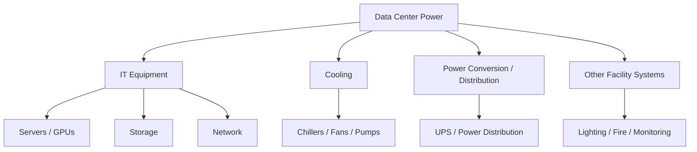
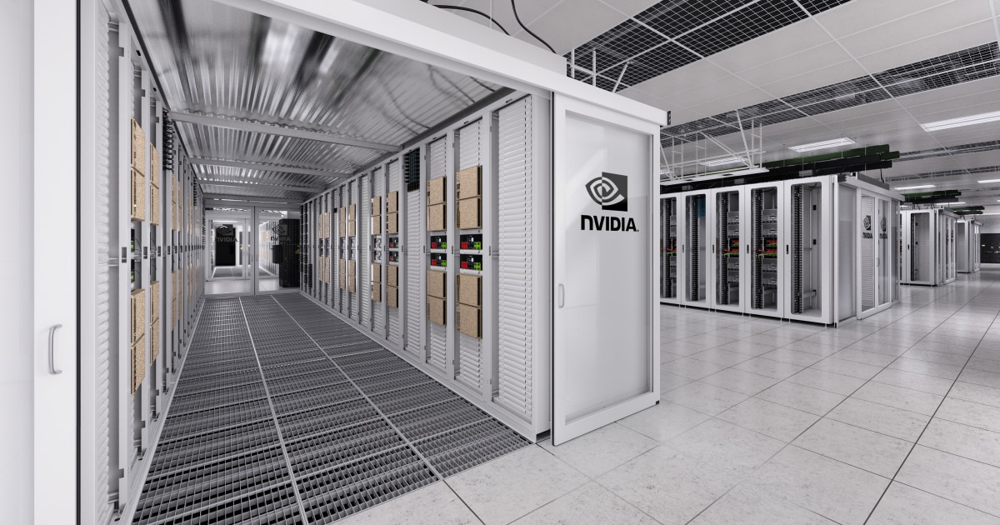
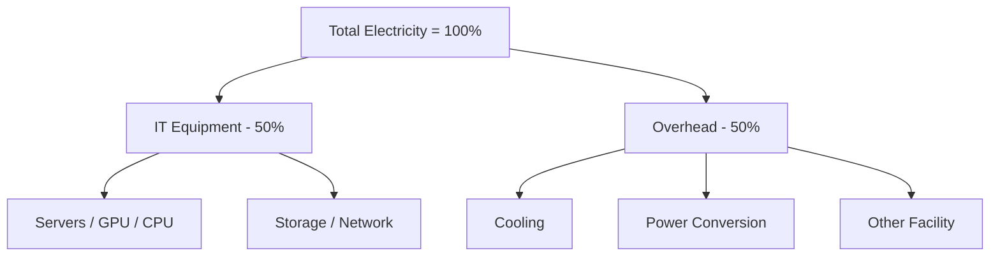
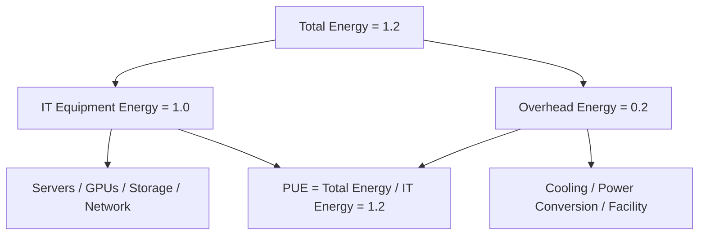
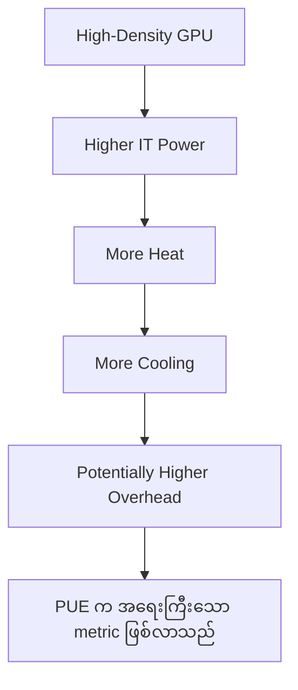
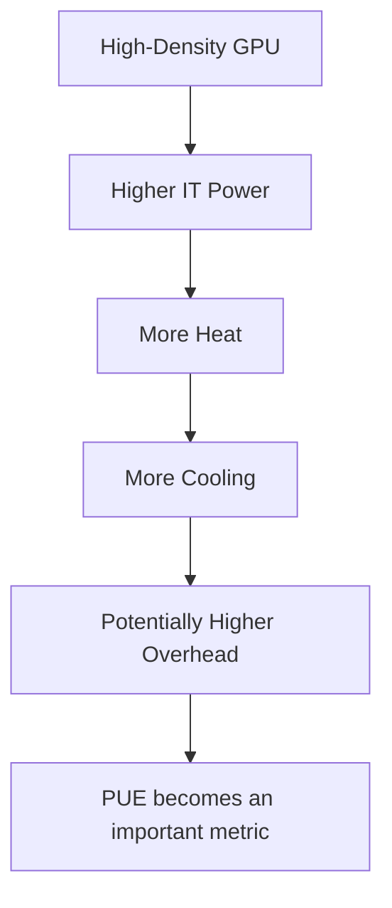

# Module 02 — Data Center Energy Consumption and PUE

> Part I · AI Foundations and AI Infrastructure — Course Module 02 (AI Data Centers, Energy Consumption and PUE) — topic notes

## မြန်မာဘာသာ version

### 1. AI Workload နှင့် Electricity Consumption

AI workload တွေကို run လုပ်တဲ့အခါ electricity အများကြီးလိုအပ်နိုင်ပါတယ်။
အထူးသဖြင့်—

- AI Training
- Large-scale AI Inference
- High-density GPU workloads
- Large GPU clusters

တွေမှာ power consumption က အရေးကြီးတဲ့ consideration တစ်ခုဖြစ်လာပါတယ်။
ဒါကြောင့် AI infrastructure ကို design လုပ်တဲ့အခါ performance တစ်ခုတည်းကိုပဲ မကြည့်ဘဲ energy efficiency ကိုပါ ကြည့်ဖို့လိုပါတယ်။

အကြောင်းကတော့ electricity consumption မြင့်လာတာနဲ့အမျှ—

- Operating cost တိုးလာနိုင်တယ်
- Power infrastructure requirement တိုးလာတယ်
- Cooling requirement တိုးလာတယ်
- Environmental impact တိုးလာနိုင်တယ်

### 2. Data Center တစ်ခုမှာ Electricity ကို ဘယ်မှာသုံးသလဲ?

Data Center တစ်ခုမှာ electricity အားလုံးကို IT equipment တစ်ခုတည်းအတွက် မသုံးပါဘူး။
အဓိကအားဖြင့်—

```
                 DATA CENTER POWER
                        │
       ┌────────────────┼────────────────┐
       ▼                ▼                ▼
   IT Equipment       Cooling       Other/Facility
       │                │                │
   Servers            Chillers        Lighting
   GPUs               Fans            Fire Systems
   Storage            Pumps           Monitoring
   Network             etc.           etc.
```

**Power Consumption Areas**

1. **IT Equipment** — Servers, CPUs, GPUs, Storage, Networking equipment
2. **Cooling** — Chillers, Fans, Pumps, Cooling systems
3. **Power Conversion and Distribution** — UPS, Power distribution, Power conversion equipment
4. **Other Facility Systems** — Lighting, Fire suppression systems, Monitoring systems, Indicators, Other building/facility equipment

> **Figure 1 — Data Center တစ်ခုတွင် Electricity သုံးစွဲရာ နေရာများ**



**ပုံရှင်းလင်းချက်** — အပေါ်ဆုံးက Data Center Power ကနေ စပါတယ်။ ဒီ power ကို အဓိက လေးစုခွဲသုံးပါတယ် — IT Equipment၊ Cooling၊ Power Conversion / Distribution နဲ့ Other Facility Systems။ အောက်ဆုံးအဆင့်မှာ တစ်စုချင်းစီရဲ့ ဥပမာပစ္စည်းတွေ — Servers / GPUs / Storage / Network၊ Chillers / Fans / Pumps၊ UPS / Power Distribution၊ Lighting / Fire / Monitoring — ကို တွေ့ရပါမယ်။ IT equipment အတွက် သုံးတဲ့ power နဲ့ ကျန် overhead power ကွာခြားပုံကို နားလည်ဖို့ ဒီပုံက အခြေခံပါတယ်။



**ပုံရှင်းလင်းချက် (ဓာတ်ပုံ 1)** — ဒီဓာတ်ပုံမှာ မြင်ရတဲ့ rack တစ်ခုချင်းစီထဲက server တွေ၊ GPU တွေ၊ storage နဲ့ network equipment တွေဟာ ဒီ section မှာ ပြောခဲ့တဲ့ IT Equipment power consumption ရဲ့ အဓိက ပစ္စည်းတွေ ဖြစ်ပါတယ်။ rack တွေ ဘယ်လောက် စုပြုံနေလဲ၊ တစ် rack ထဲမှာ ပစ္စည်း ဘယ်လောက် ထူထပ်လဲ ဆိုတာက power နဲ့ cooling ဘယ်လောက် လိုအပ်မလဲ ဆိုတာကို တိုက်ရိုက် သက်ရောက်စေပါတယ်။

*(Image: NVIDIA official product image)*

### 3. Traditional Data Center တွေရဲ့ Power Distribution

မူရင်းသင်ခန်းစာမှာ traditional/older data center တစ်ခုရဲ့ power distribution ကို ဥပမာအနေနဲ့—
**50% → IT Equipment, 50% → Cooling + Power Conversion + Other** လို့ရှင်းပြထားပါတယ်။

```
Traditional / Older Data Center

Total Electricity = 100%
┌────────────────────────────────────┐
│                                    │
│ IT Equipment       │ Other         │
│                    │               │
│       50%          │      50%      │
│                    │               │
│ Servers            │ Cooling       │
│ GPU/CPU            │ Power         │
│ Storage            │ Conversion    │
│ Network            │ Other         │
│                    │               │
└────────────────────────────────────┘
```

ဒီလိုဆိုရင် Data Center ထဲကို ပေးလိုက်တဲ့ electricity ရဲ့ တစ်ဝက်ခန့်ကိုပဲ actual IT equipment က အသုံးပြုပြီး ကျန်တစ်ဝက်က supporting systems တွေမှာ သုံးနေရတာဖြစ်ပါတယ်။

> **Figure 2 — Traditional Data Center ၏ Power Distribution ဥပမာ (50/50)**



**ပုံရှင်းလင်းချက်** — အပေါ်ဆုံးက Total Electricity 100% ကို ဘယ်ဘက်က IT Equipment 50% နဲ့ ညာဘက်က Overhead 50% ဆိုပြီး နှစ်စု ခွဲထားတာ မြင်ရပါမယ်။ ဘယ်ဘက်အောက်မှာ Servers / GPU / CPU နဲ့ Storage / Network ဆိုပြီး actual IT workload ကို run ပေးတဲ့ ပစ္စည်းတွေ ပါပါတယ်။ ညာဘက်အောက်မှာတော့ Cooling၊ Power Conversion နဲ့ Other Facility ဆိုပြီး supporting systems တွေ ပါပါတယ်။ ဒီပုံက ဥပမာသက်သက်ဖြစ်ပြီး data center တိုင်းရဲ့ တိကျတဲ့ ရာခိုင်နှုန်း မဟုတ်ပါဘူး။

**အရေးကြီးတဲ့ Concept**

- IT equipment power = Actual IT workload ကို run ဖို့အသုံးပြုတဲ့ power
- Overhead power = IT equipment ကို run နိုင်အောင် supporting infrastructure တွေမှာသုံးတဲ့ power

### 4. Modern Data Center ရဲ့ ရည်မှန်းချက်

Modern Data Center တွေက—**More processing power per watt** ရရှိဖို့ ရည်မှန်းကြပါတယ်။
အဓိကအားဖြင့်—

- Efficient hardware
- Efficient cooling
- Better power distribution
- Improved facility design
- Better control mechanisms

တွေကို အသုံးပြုပြီး overhead power ကို လျှော့ချဖို့ ကြိုးစားပါတယ်။
မူရင်းသင်ခန်းစာရဲ့ ဥပမာအရ modern data center တစ်ခုမှာ—**90% → IT Equipment, 10% → Cooling + Power Conversion + Other** လောက်အထိ ရောက်နိုင်တယ်လို့ ရှင်းပြထားပါတယ်။

```
Modern Data Center

Total Electricity = 100%
┌────────────────────────────────────┐
│                                    │
│ IT Equipment          │ Overhead   │
│                       │            │
│         90%           │    10%     │
│                       │            │
│ Servers               │ Cooling    │
│ GPU/CPU               │ Power      │
│ Storage               │ Conversion │
│ Network               │ Other      │
│                       │            │
└────────────────────────────────────┘
```

> ⚠️ **သတိပြုရန်**: 50/50 နဲ့ 90/10 က ဒီသင်ခန်းစာထဲမှာ illustrative examples အဖြစ် သုံးထားတဲ့အချက်တွေပါ။ Data center တိုင်းမှာ အတိအကျ ဒီရာခိုင်နှုန်းတွေဖြစ်မယ်လို့ မယူဆသင့်ပါဘူး။

### 5. Energy Efficiency ဘာကြောင့် အရေးကြီးသလဲ?

Data Center တစ်ခုရဲ့ efficiency ကို နားလည်ဖို့—**Power Usage Effectiveness (PUE)** ဆိုတဲ့ metric ကို အသုံးပြုပါတယ်။
PUE က Data Center တစ်ခုမှာ အသုံးပြုတဲ့ total energy နဲ့ actual IT equipment က အသုံးပြုတဲ့ energy ကို နှိုင်းယှဉ်ပေးတဲ့ metric ဖြစ်ပါတယ်။

### 6. PUE ဆိုတာ ဘာလဲ?

**PUE = Power Usage Effectiveness**

PUE ကို ဒီလိုသတ်မှတ်နိုင်ပါတယ်—

> PUE ဆိုတာ Data Center တစ်ခု သုံးစွဲတဲ့ total energy နဲ့ ၎င်းရဲ့ IT equipment သုံးစွဲတဲ့ energy ကို နှိုင်းယှဉ်ပေးတဲ့ metric ဖြစ်ပါတယ်။

IT equipment ထဲမှာ—Servers, Storage, Networking, GPUs, Other IT equipment တွေ ပါဝင်နိုင်ပါတယ်။

**Formula**

```
             Total Data Center Energy
PUE = ───────────────────────────────────
                 IT Equipment Energy
```

သို့မဟုတ်—`PUE = Total Facility Energy ÷ IT Equipment Energy`

### 7. PUE ကို ဘာကြောင့်သုံးသလဲ?

PUE က Data Center ရဲ့ energy efficiency ကို တိုင်းတာဖို့ အသုံးပြုပါတယ်။
အထူးသဖြင့်—Cooling efficiency, Power distribution efficiency, Facility design, Infrastructure overhead, Energy optimization တွေကို နားလည်ဖို့ အထောက်အကူပြုပါတယ်။

**အဓိက Principle** — PUE နိမ့်လေလေ Data Center က energy-efficient ပိုဖြစ်လေလေ။

### 8. PUE Example — 1.2

PUE = 1.2 ဆိုတာကို နားလည်ဖို့—Total Data Center Energy = 1.2, IT Equipment Energy = 1.0 ဖြစ်တယ်လို့ ယူဆပါ။

```
PUE = Total Energy / IT Energy

1.2 = 1.2 / 1.0
```

အဓိပ္ပါယ်က IT equipment က 1 unit energy သုံးတဲ့အခါ Data Center တစ်ခုလုံးအတွက် total energy 1.2 units လောက်သုံးနေရတယ်ဆိုတဲ့သဘောပါ။
ဒါကြောင့်—

```
IT Energy       = 1.0
Overhead Energy = 0.2
Total Energy    = 1.2
```

**Overhead**

```
Overhead = Total Energy - IT Energy
         = 1.2 - 1.0
         = 0.2
```

ဒါကြောင့် PUE 1.2 ဆိုတာ IT equipment energy ထက် overhead energy က 20% ဖြစ်တယ် လို့ နားလည်နိုင်ပါတယ်။

> **Figure 3 — PUE = 1.2 အတွက် Energy ခွဲဝေသုံးစွဲပုံ**



**ပုံရှင်းလင်းချက်** — အပေါ်ဆုံးက Total Energy = 1.2 ကို ဘယ်ဘက်က IT Equipment Energy = 1.0 နဲ့ ညာဘက်က Overhead Energy = 0.2 ဆိုပြီး ခွဲပြထားပါတယ်။ IT energy က servers, GPUs, storage, network တွေဆီ ရောက်သွားပြီး၊ overhead energy က cooling, power conversion, facility system တွေဆီ ရောက်သွားပါတယ်။ အောက်ဆုံး node ကတော့ ဒီနှစ်ခုကို နှိုင်းယှဉ်တဲ့အခါ PUE = 1.2 ရတဲ့သဘောကို ပြန်ပြခြင်း ဖြစ်ပါတယ်။

### 9. PUE = 2.0 ဆိုရင်?

PUE = 2.0 ဆိုရင်—IT Equipment Energy = 1.0, Total Energy = 2.0, Overhead = 1.0 ဖြစ်ပါတယ်။

```
PUE = Total Energy / IT Energy

2.0 = 2.0 / 1.0
```

ဆိုလိုတာက IT equipment က 1 unit energy သုံးတဲ့အခါ Data Center တစ်ခုလုံးမှာ 2 units energy သုံးနေရတာဖြစ်ပါတယ်။

```
PUE = 2.0

IT Equipment       1.0
Overhead            1.0
------------------------
Total               2.0
```

ဒါကြောင့် PUE 2.0 ဟာ PUE 1.2 ထက် energy efficiency ပိုနည်းပါတယ်။

### 10. PUE = 1.0 ဘာကြောင့် မဖြစ်နိုင်သလဲ?

Theoretically—PUE = 1.0 ဆိုရင် Total Data Center Energy = IT Equipment Energy ဖြစ်ပါတယ်။
အဓိပ္ပါယ်က—Data Center မှာ IT equipment ကလွဲပြီး ဘာ overhead energy မှ မရှိတော့ဘူး ဆိုတဲ့သဘောပါ။

လက်တွေ့ Data Center မှာတော့—Cooling, Power distribution, UPS, Lighting, Security, Monitoring, Facility systems စတာတွေ လိုအပ်တာကြောင့် PUE 1.0 ကို practical real-world target အဖြစ် ရရှိဖို့ မဖြစ်နိုင်ပါဘူး။
ဒါကြောင့် PUE က 1.0 နဲ့ ပိုနီးလေလေ ပို efficient ဖြစ်လေလေ ဆိုတဲ့ principle ကို မှတ်ထားပါ။

### 11. PUE Scale ကို နားလည်ခြင်း

Conceptually—

```
PUE
 │
 │  2.0+       → Less Efficient
 │
 │  1.5        → Better
 │
 │  1.2        → Highly Efficient
 │
 │  1.0        → Theoretical Ideal
 ▼
```

> **မှတ်ရန်** — Lower PUE = Better Energy Efficiency

### 12. PUE နှင့် AI Data Centers

AI-centric Data Center တွေအတွက် PUE က ပိုအရေးကြီးလာပါတယ်။
အကြောင်းက AI workloads တွေမှာ—GPU density မြင့်နိုင်တယ်, Power consumption မြင့်နိုင်တယ်, Cooling requirement မြင့်နိုင်တယ်။

```
High-Density GPU
       │
       ▼
Higher IT Power
       │
       ▼
More Heat
       │
       ▼
More Cooling
       │
       ▼
Potentially Higher Overhead
       │
       ▼
PUE becomes an important metric
```

> **Figure 4 — High-Density GPU ကြောင့် PUE အရေးကြီးလာပုံ**



**ပုံရှင်းလင်းချက်** — အပေါ်ဆုံးက High-Density GPU ကနေ အောက်ကို တစ်ဆင့်ချင်း လိုက်ကြည့်ပါ။ GPU density မြင့်လာရင် IT power ပိုသုံးရပြီး၊ အပူပိုထွက်လာပါတယ်။ အပူပိုများလေ ပိုအေးအောင် လုပ်ရလေ (Cooling) ဖြစ်တဲ့အတွက် overhead လည်း ပိုများနိုင်လာပါတယ်။ ဒါကြောင့် အောက်ဆုံး node အတိုင်း PUE ဟာ AI data center အတွက် အရေးကြီးတဲ့ metric ဖြစ်လာပါတယ်။

ဒါကြောင့် AI Data Center design မှာ—**Compute Efficiency + Power Efficiency + Cooling Efficiency** တို့ကို အတူတူ စဉ်းစားဖို့လိုပါတယ်။

### 13. PUE နှင့် Environmental Impact

AI workloads တွေဟာ electricity အများကြီးအသုံးပြုနိုင်တာကြောင့် energy efficiency က environmental consideration တစ်ခုလည်း ဖြစ်ပါတယ်။
PUE နိမ့်လာရင်—

- Same IT workload အတွက် total facility energy လျော့နိုင်တယ်
- Cooling overhead လျော့နိုင်တယ်
- Power infrastructure overhead လျော့နိုင်တယ်
- Operating cost လျော့နိုင်တယ်
- Energy efficiency တိုးလာနိုင်တယ်

ဒါကြောင့် PUE ဟာ Data Center energy efficiency ကို ဆွေးနွေးတဲ့အခါ အရေးကြီးတဲ့ metric ဖြစ်ပါတယ်။

### 14. အရေးကြီးတဲ့ ပြင်ဆင်ချက် — PUE က Efficiency Percentage မဟုတ်ပါ

PUE ကို percentage လို့ မယူဆသင့်ပါဘူး။
ဥပမာ—PUE = 1.2 ဆိုတာ "Data Center က 120% efficient" လို့ မဆိုလိုပါဘူး။
PUE ဟာ ratio ဖြစ်ပါတယ်။

`PUE = Total Facility Energy / IT Equipment Energy`

PUE 1.2 ဆိုရင်—IT energy 1 unit သုံးတိုင်း total facility energy 1.2 units စီ သုံးစွဲတယ်ဆိုတဲ့ သဘောဖြစ်ပါတယ်။

### Self-Check Questions (အဖြေများပါဝင်သည်)

**Q1. PUE ဆိုတာ ဘာလဲ။ Formula က ဘာလဲ?**
Answer: PUE = Power Usage Effectiveness ဖြစ်ပြီး Data Center တစ်ခု သုံးစွဲတဲ့ total energy နဲ့ IT equipment သုံးစွဲတဲ့ energy ကို နှိုင်းယှဉ်ပေးတဲ့ metric ဖြစ်ပါတယ်။ `PUE = Total Data Center Energy ÷ IT Equipment Energy`

**Q2. PUE နိမ့်ရင် ဘာကို ညွှန်းသလဲ?**
Answer: PUE နိမ့်လေလေ non-IT overhead energy နည်းလေလေဖြစ်တဲ့အတွက် Data Center ရဲ့ energy efficiency ပိုကောင်းတယ်လို့ ယေဘုယျအားဖြင့် ညွှန်းပါတယ်။

**Q3. PUE = 1.2 ဆိုတာ ဘာကိုဆိုလိုသလဲ?**
Answer: IT equipment က energy 1 unit သုံးတိုင်း Data Center တစ်ခုလုံးက total energy 1.2 units သုံးပါတယ်။ IT Energy = 1.0, Overhead = 0.2 (IT energy ရဲ့ 20%), Total Energy = 1.2 ဖြစ်ပါတယ်။

**Q4. PUE = 2.0 ဆိုတာ ဘာကိုဆိုလိုသလဲ?**
Answer: IT energy 1 unit အတွက် total facility က 2 units သုံးပါတယ်။ IT Energy = 1.0, Overhead = 1.0, Total Energy = 2.0 ဖြစ်ပြီး PUE 1.2 ထက် energy efficiency ပိုနည်းပါတယ်။

**Q5. လက်တွေ့ Data Center မှာ PUE = 1.0 ရနိုင်သလား?**
Answer: မရနိုင်ပါဘူး။ PUE 1.0 က theoretical ideal ဖြစ်ပြီး Data Center တွေမှာ cooling, power distribution, UPS, lighting, security, monitoring စတဲ့ facility systems အတွက် ထပ်ဆောင်း energy လိုအပ်ပါတယ်။

**Exam Shortcut**

- PUE = Power Usage Effectiveness
- Formula: `PUE = Total Data Center Energy ÷ IT Equipment Energy`
- မှတ်ရန် — PUE နိမ့်လေလေ = Energy Efficiency ပိုကောင်းလေလေ
- PUE 1.2 → Highly Efficient · PUE 2.0 → Overhead ပိုများ · PUE 1.0 → Theoretical Ideal

**One-line Exam Answer**
PUE ဟာ total facility energy consumption နဲ့ IT equipment energy consumption ကို နှိုင်းယှဉ်ပြီး Data Center ရဲ့ energy efficiency ကို တိုင်းတာပါတယ်။

## English Version

### 1. AI Workloads and Electricity Consumption

AI workloads can require significant amounts of electricity. This is particularly important for:

- AI training
- Large-scale AI inference
- High-density GPU workloads
- Large GPU clusters

Therefore, when designing AI infrastructure, we should consider not only performance but also energy efficiency.

Higher electricity consumption can lead to:

- Higher operating costs
- Greater power infrastructure requirements
- Higher cooling requirements
- Potentially greater environmental impact

### 2. Where Is Power Consumed in a Data Center?

The electricity consumed by a data center is not used only by IT equipment. It can be broadly divided into:

```
                 DATA CENTER POWER
                        │
       ┌────────────────┼────────────────┐
       ▼                ▼                ▼
   IT Equipment       Cooling       Other/Facility
       │                │                │
   Servers            Chillers        Lighting
   GPUs               Fans            Fire Systems
   Storage            Pumps           Monitoring
   Network             etc.           etc.
```

**Main Power Consumption Areas**

1. **IT Equipment** — Servers, CPUs, GPUs, Storage, Networking equipment
2. **Cooling** — Chillers, Fans, Pumps, Cooling systems
3. **Power Conversion and Distribution** — UPS systems, Power distribution, Power conversion equipment
4. **Other Facility Systems** — Lighting, Fire suppression, Monitoring systems, Indicators, Other facility equipment

> **Figure 1 — Where a Data Center Uses Electricity**


**Figure walkthrough** — Start at the top node, Data Center Power. It is divided into four main areas: IT Equipment, Cooling, Power Conversion / Distribution, and Other Facility Systems. At the bottom, each area shows example equipment — Servers / GPUs / Storage / Network, Chillers / Fans / Pumps, UPS / Power Distribution, and Lighting / Fire / Monitoring. This figure is the basis for understanding the difference between power used by IT equipment and the remaining overhead power.


**Photo walkthrough (Photo 1)** — The servers, GPUs, storage, and networking equipment inside each rack shown in this photo are exactly the "IT Equipment" whose power use is described above. How densely racks are packed directly affects how much power and cooling the facility needs.

*(Image: NVIDIA official product image)*

### 3. Traditional Data Center Power Distribution

The source material gives an illustrative example of an older/traditional data center: 50% → IT Equipment, 50% → Cooling + Power Conversion + Other.

```
Traditional / Older Data Center

Total Electricity = 100%
┌────────────────────────────────────┐
│                                    │
│ IT Equipment       │ Other         │
│                    │               │
│       50%          │      50%      │
│                    │               │
│ Servers            │ Cooling       │
│ GPU/CPU            │ Power         │
│ Storage            │ Conversion    │
│ Network            │ Other         │
│                    │               │
└────────────────────────────────────┘
```

This means that approximately half of the electricity in this illustrative example is used by the actual IT equipment, while the remaining half is used by supporting infrastructure.

> **Figure 2 — Power Distribution in a Traditional Data Center (50/50 Example)**


**Figure walkthrough** — At the top, Total Electricity 100% is split into two halves: IT Equipment 50% on the left and Overhead 50% on the right. Under the left branch, Servers / GPU / CPU and Storage / Network are the equipment that runs the actual IT workload. Under the right branch, Cooling, Power Conversion, and Other Facility are the supporting systems. This figure is illustrative only — it is not an exact percentage for every data center.

**Important Concept**

- IT equipment power = Power used to run the actual IT workload.
- Overhead power = Power used by supporting infrastructure required to operate the IT equipment.

### 4. What Do Modern Data Centers Aim For?

Modern data centers aim to achieve: **More processing power per watt**.

This can be achieved through: More efficient hardware · More efficient cooling · Improved power distribution · Better facility design · Improved control mechanisms.

The source material gives another illustrative example: 90% → IT Equipment, 10% → Cooling + Power Conversion + Other.

```
Modern Data Center

Total Electricity = 100%
┌────────────────────────────────────┐
│                                    │
│ IT Equipment          │ Overhead   │
│                       │            │
│         90%           │    10%     │
│                       │            │
│ Servers               │ Cooling    │
│ GPU/CPU               │ Power      │
│ Storage               │ Conversion │
│ Network               │ Other      │
│                       │            │
└────────────────────────────────────┘
```

> ⚠️ **Important:** The 50/50 and 90/10 distributions in the source are illustrative examples, not universal values for every data center.

### 5. Why Does Energy Efficiency Matter?

To measure data center energy efficiency, we use a metric called: **PUE = Power Usage Effectiveness**. PUE compares the total energy consumed by a data center with the energy consumed by its IT equipment.

### 6. What Is PUE?

**PUE = Power Usage Effectiveness**

Definition: PUE is a metric that compares the total energy consumed by a data center with the energy consumed by its IT equipment.

The IT equipment can include: Servers, GPUs, Storage, Networking equipment, Other IT equipment.

**Formula**

```
             Total Data Center Energy
PUE = ───────────────────────────────────
                 IT Equipment Energy
```

Or: `PUE = Total Facility Energy ÷ IT Equipment Energy`

### 7. Why Does PUE Matter?

PUE helps us measure data center energy efficiency. It can also help guide decisions related to: Cooling efficiency · Power distribution · Facility design · Energy optimization · Infrastructure overhead.

**Key Principle** — Lower PUE generally means better energy efficiency.

### 8. PUE Example — 1.2

Suppose: Total Data Center Energy = 1.2, IT Equipment Energy = 1.0. Then:

```
PUE = 1.2 / 1.0
    = 1.2
```

This means that for every 1 unit of energy used by IT equipment, the data center consumes 1.2 units of total energy. Therefore:

```
IT Energy       = 1.0
Overhead Energy = 0.2
Total Energy    = 1.2
```

The overhead is: 1.2 − 1.0 = 0.2. So the overhead is 20% of the IT energy consumption.

> **Figure 3 — Energy Split for PUE = 1.2**


**Figure walkthrough** — At the top, Total Energy = 1.2 is split into IT Equipment Energy = 1.0 on the left and Overhead Energy = 0.2 on the right. The IT energy goes to servers, GPUs, storage, and networking; the overhead energy goes to cooling, power conversion, and facility systems. The bottom node shows that comparing these two amounts is what gives PUE = 1.2.

### 9. What If PUE = 2.0?

If PUE = 2.0 and IT equipment consumes 1 unit: IT Equipment Energy = 1.0, Total Energy = 2.0. Therefore:

```
Overhead = 2.0 - 1.0
         = 1.0
```

```
PUE = 2.0

IT Equipment       1.0
Overhead            1.0
------------------------
Total               2.0
```

This means that for every 1 unit of energy consumed by IT equipment, another 1 unit is consumed by non-IT overhead. Therefore, PUE 2.0 is less energy-efficient than PUE 1.2.

### 10. Why Can't PUE Be 1.0?

Theoretically, PUE = 1.0 would mean: Total Data Center Energy = IT Equipment Energy. There would be no additional overhead energy.

In a real data center, however, energy is required for: Cooling, UPS, Power distribution, Lighting, Security, Monitoring, Other facility systems. Therefore, PUE 1.0 is a theoretical ideal rather than a practical real-world value. The closer PUE gets to 1.0, the lower the overhead becomes.

### 11. Understanding the PUE Scale

```
PUE
 │
 │  2.0+       → Less Efficient
 │
 │  1.5        → Better
 │
 │  1.2        → Highly Efficient
 │
 │  1.0        → Theoretical Ideal
 ▼
```

**Remember** — Lower PUE = Better Energy Efficiency

### 12. PUE and AI Data Centers

PUE is particularly relevant when discussing AI-centric data centers. AI workloads can involve: High GPU density, High IT power consumption, High heat generation, High cooling requirements.

```
High-Density GPU
       │
       ▼
Higher IT Power
       │
       ▼
More Heat
       │
       ▼
More Cooling
       │
       ▼
Potentially Higher Overhead
       │
       ▼
PUE becomes an important metric
```

> **Figure 4 — Why PUE Matters for High-Density GPUs**



**Figure walkthrough** — Start at the top with high-density GPUs and follow the chain downward. Higher GPU density uses more IT power, which produces more heat. More heat requires more cooling, and that can mean higher overhead. The final node shows why PUE becomes an important metric for AI data centers.

Therefore, AI data center design should consider: Compute Efficiency + Power Efficiency + Cooling Efficiency.

### 13. PUE and Environmental Impact

AI workloads can consume significant amounts of electricity, making energy efficiency an important environmental consideration. A lower PUE can mean:

- Less total facility energy for the same IT workload
- Lower cooling overhead
- Lower power infrastructure overhead
- Potentially lower operating costs
- Better energy efficiency

Therefore, PUE is an important metric when discussing data center sustainability and energy efficiency.

### 14. Important Correction — PUE Is Not a Percentage

PUE should not be interpreted as a percentage. For example, PUE = 1.2 does not mean "The data center is 120% efficient." PUE is a ratio.

`PUE = Total Facility Energy / IT Equipment Energy`

A PUE of 1.2 means: For every 1 unit of IT energy, the facility consumes 1.2 units of total energy.

### Self-Check Questions (with answers)

**Q1. What is PUE, and what is its formula?**
Answer: PUE = Power Usage Effectiveness. It is a metric that compares the total energy consumed by a data center with the energy consumed by its IT equipment. `PUE = Total Data Center Energy ÷ IT Equipment Energy`

**Q2. What does a lower PUE indicate?**
Answer: A lower PUE generally indicates better data center energy efficiency because less energy is being used for non-IT overhead.

**Q3. What does PUE = 1.2 mean?**
Answer: For every 1 unit of energy consumed by IT equipment, the data center consumes 1.2 units of total energy. IT Energy = 1.0, Overhead = 0.2 (20% of the IT energy), Total Energy = 1.2.

**Q4. What does PUE = 2.0 mean?**
Answer: For every 1 unit of IT energy, the total facility consumes 2 units: IT Energy = 1.0, Overhead = 1.0, Total Energy = 2.0. PUE 2.0 is less energy-efficient than PUE 1.2.

**Q5. Can a real data center have PUE = 1.0?**
Answer: No. PUE 1.0 is a theoretical ideal. Real data centers require energy for cooling, power distribution, UPS, lighting, security, monitoring, and other facility systems.

**Exam Shortcut**

- PUE = Power Usage Effectiveness
- Formula: `PUE = Total Data Center Energy ÷ IT Equipment Energy`
- Remember: Lower PUE = Better Energy Efficiency
- PUE 1.2 → Highly Efficient · PUE 2.0 → Much More Overhead · PUE 1.0 → Theoretical Ideal

**One-Line Exam Answer**
PUE measures data center energy efficiency by comparing total facility energy consumption with IT equipment energy consumption.

---

## Technical review notes

- Corrections made: English-language headings and full English sentences that had been left inside the Burmese body (the PUE definition quote in section 6, the PUE 1.2 explanation in section 14, and English section headings in sections 3, 5, 6, 12, 13, 14) were rendered in Burmese with technical terms kept in English; meaning unchanged.
- Correction made: the original per-language "Exam Preparation" blocks (6 questions on the Burmese side, 7 on the English side) were consolidated into 5 self-check questions per WRITING_RULES; all facts from the original answers are preserved in the merged answers, and the Exam Shortcut / one-line answer blocks are kept intact.
- Needs verification: the 50/50 (traditional) and 90/10 (modern) power-distribution splits are illustrative course figures, not measured universal values — flagged inline in both versions; do not cite them as benchmarks without facility-specific data.
- Needs verification: the PUE 1.2 / 2.0 / 1.0 scale labels ("Highly Efficient", "Less Efficient", "Theoretical Ideal") are pedagogical simplifications of the lower-is-better principle, not certification thresholds.
- Mermaid figures (Figure 1–4) with figure walkthroughs were added inline in both the Myanmar and English sections; figure numbering and structure match across both sections. All existing text and ASCII diagrams are unchanged.
