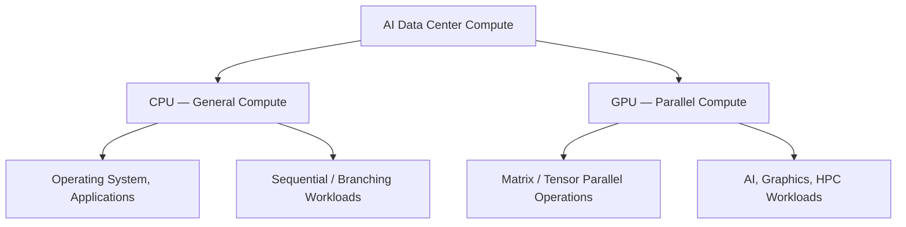
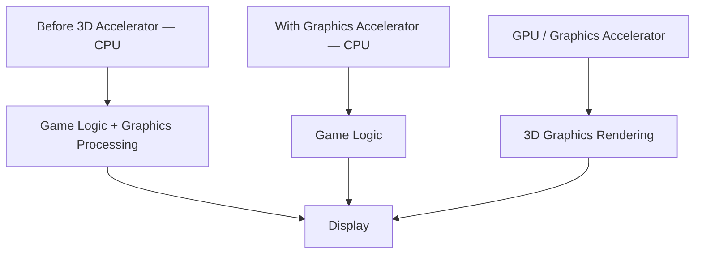
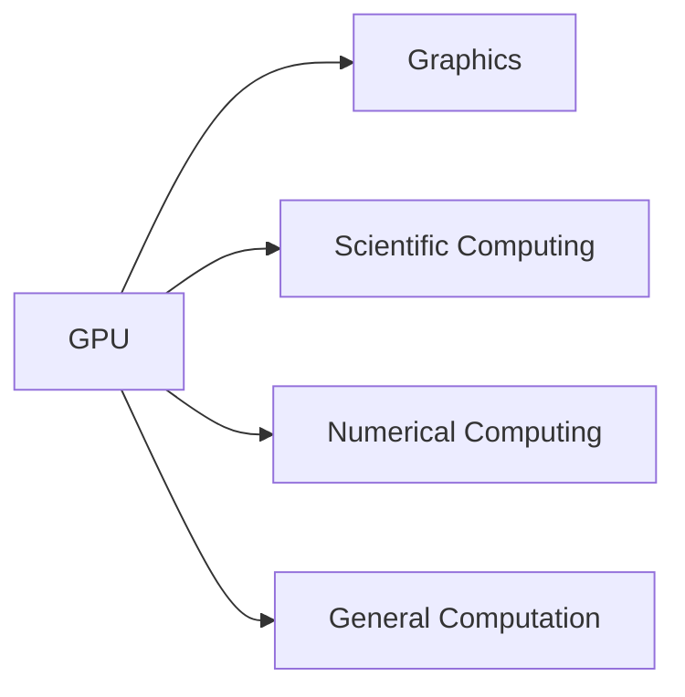
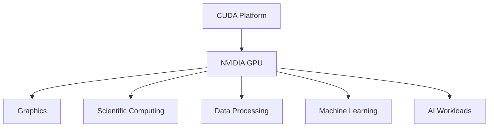
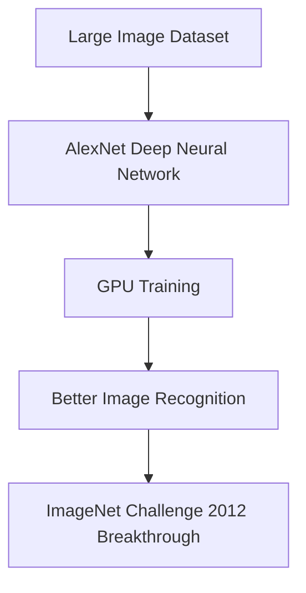
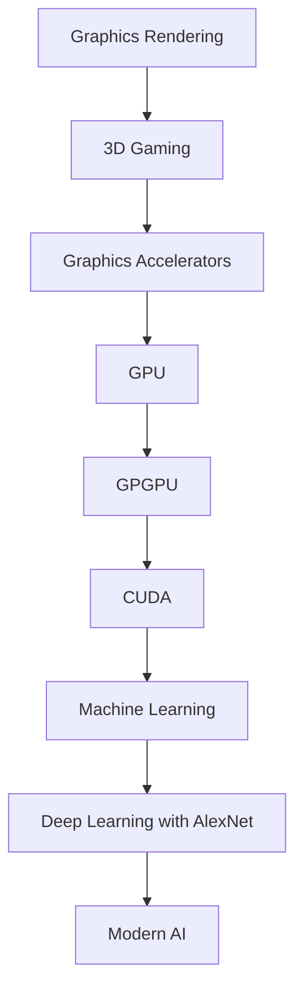

# Module 03 — AI-Centric Data Center Compute: CPU, GPU, CUDA and the Evolution of GPU Computing

> Part I · AI Foundations and AI Infrastructure — Course Module 03 (CPU vs GPU and Parallel Computing) — topic notes

## မြန်မာဘာသာ version

### 1. AI-Centric Data Center မှာ Compute

AI-centric Data Center ရဲ့ components တွေကို လေ့လာတဲ့အခါ ပထမဆုံး Compute ကနေ စတင်လေ့လာနိုင်ပါတယ်။
နောက်ပိုင်းမှာ—

- Network
- Storage

တို့ကို ဆက်လက်လေ့လာနိုင်ပါတယ်။

**Compute ဆိုတာဘာလဲ?**

ရိုးရိုးရှင်းရှင်းပြောရရင်—

`Compute = Processing Power`

ဖြစ်ပါတယ်။
Data Center ထဲမှာ Compute က workload တွေကို process လုပ်ပေးတဲ့ processing resources တွေကို ဆိုလိုပါတယ်။

### 2. CPU — Traditional Compute

အများစုက Compute လို့ပြောရင် CPU ကို အရင်ဆုံးစဉ်းစားကြပါတယ်။
CPU ဆိုတာ—

`CPU = Central Processing Unit`

ဖြစ်ပါတယ်။
CPU ဟာ computer system ရဲ့ general-purpose processing အတွက် အဓိကအသုံးပြုတဲ့ processor ဖြစ်ပါတယ်။

```
              COMPUTE
                 │
                 ▼
                CPU
                 │
       ┌─────────┼─────────┐
       ▼         ▼         ▼
    Logic     Control    Processing
```

CPU က—

- Operating system
- Applications
- General-purpose computation
- System control
- Sequential / branching workloads

စတာတွေကို run လုပ်နိုင်ပါတယ်။
ဒါကြောင့် Traditional Data Center တွေမှာ CPU ဟာ အဓိက compute component တစ်ခုဖြစ်ပါတယ်။

### 3. AI အတွက် GPU ဘာကြောင့် လိုအပ်သလဲ?

AI-centric Data Center ကို ပြောတဲ့အခါ CPU တစ်ခုတည်းနဲ့ မပြီးတော့ပါဘူး။
နောက်ထပ် အရေးကြီးတဲ့ compute component တစ်ခုက—

`GPU = Graphics Processing Unit`

ဖြစ်ပါတယ်။

```
             AI DATA CENTER COMPUTE
                       │
              ┌────────┴────────┐
              ▼                 ▼
             CPU               GPU
       General Compute    Parallel Compute
```

Modern AI workloads တွေမှာ GPU ဟာ အလွန်အရေးကြီးတဲ့ role တစ်ခု ရှိလာပါတယ်။

အောက်ပါ **Figure 1** မှာ AI data center compute ထဲက CPU နဲ့ GPU ရဲ့ အခန်းကဏ္ဍကွဲပြားပုံကို ပုံနဲ့ ကြည့်နိုင်ပါတယ်။

**Figure 1: AI Data Center Compute ထဲမှာ CPU နဲ့ GPU ရဲ့ အခန်းကဏ္ဍ**



**ပုံရှင်းလင်းချက် (Figure 1)**

- အပေါ်ဆုံး node က AI data center ရဲ့ compute အားလုံးကို ကိုယ်စားပြုပါတယ်။
- ဘယ်ဘက်ခွဲက CPU ကို general compute အဖြစ်လည်းကောင်း၊ ညာဘက်ခွဲက GPU ကို parallel compute အဖြစ်လည်းကောင်း ပြပါတယ်။
- CPU အောက်က node တွေက operating system, applications နဲ့ sequential / branching workload တွေကို ဆိုလိုပါတယ်။
- GPU အောက်က node တွေက matrix / tensor parallel operation တွေနဲ့ AI, graphics, HPC workload တွေကို ဆိုလိုပါတယ်။

### 4. GPU ကို ဘာကြောင့် တီထွင်ခဲ့တာလဲ?

GPU ရဲ့ အစောပိုင်းရည်ရွယ်ချက်က AI မဟုတ်ပါဘူး။
GPU technology ရဲ့အစောပိုင်း development ဟာ—

**Computer Graphics and Video Games**

အတွက် ဖြစ်ပါတယ်။

Video game တွေမှာ—

- 3D environments
- Animation
- Images
- Lighting
- Visual effects

စတာတွေကို real-time နီးပါးနဲ့ render လုပ်ဖို့ processing power အများကြီးလိုပါတယ်။
ဒါကြောင့် graphics processing ကို အထူးပြုလုပ်ပေးနိုင်တဲ့ hardware တွေ တဖြည်းဖြည်း ဖွံ့ဖြိုးလာခဲ့ပါတယ်။

### 5. အစောပိုင်း 3D Graphics — Quake နှင့် 3D Accelerators

Source material မှာ **Quake** ကို early 3D gaming example အဖြစ် ပြောထားပါတယ်။
1990s ကာလမှာ 3D games တွေဟာ ပိုပြီး realistic ဖြစ်လာပြီး 3D rendering workload လည်း ပိုမိုကြီးလာပါတယ်။

အဲဒီအချိန်မှာ—

**3dfx Voodoo**

လို graphics accelerator တွေကို PC ထဲမှာ ထည့်သွင်းပြီး 3D game performance ကို မြှင့်တင်နိုင်ခဲ့ပါတယ်။
Conceptually—

```
Before 3D Accelerator

CPU
 │
 └── Game + Graphics Processing
             │
             ▼
          Display

With Graphics Accelerator

CPU
 │
 └── Game Logic

GPU / Graphics Accelerator
 │
 └── 3D Graphics Rendering
             │
             ▼
          Display
```

ဒီကနေ specialized parallel processing ရဲ့ အရေးပါမှုကို မြင်နိုင်ပါတယ်။

အောက်ပါ **Figure 2** မှာ 3D accelerator မတိုင်ခင်နဲ့ ပါဝင်လာချိန် အလုပ်ခွဲဝေပုံကို နှိုင်းယှဉ် ကြည့်နိုင်ပါတယ်။

**Figure 2: 3D Accelerator မတိုင်ခင်နှင့် ပါဝင်လာချိန် အလုပ်ခွဲဝေပုံ**



**ပုံရှင်းလင်းချက် (Figure 2)**

- ဘယ်ဘက်လမ်းကြောင်းက 3D accelerator မတိုင်ခင် — CPU တစ်ခုတည်းက game logic ရော graphics processing ပါ လုပ်ရတာကို ပြပါတယ်။
- ညာဘက်လမ်းကြောင်းက graphics accelerator ပါလာချိန် — CPU က game logic ပဲ လုပ်ပြီး accelerator က 3D rendering ကို ယူတာကို ပြပါတယ်။
- နှစ်ခုလုံး နောက်ဆုံးမှာ display ဆီ ရောက်သွားပြီး အလုပ်ခွဲလိုက်လို့ specialized parallel processing ရဲ့ အရေးပါမှုကို မြင်ရပါတယ်။

### 6. Gaming မှတစ်ဆင့် GPU Evolution

Gaming industry တိုးတက်လာတာနဲ့အမျှ graphics processing requirement တွေလည်း တိုးလာပါတယ်။
ဥပမာ—

- Quake
- Unreal Tournament
- Quake III Arena
- Doom

လို games တွေမှာ ပိုပြီး realistic graphics နဲ့ real-time rendering လိုအပ်လာပါတယ်။
ဒီလို graphics workload တွေကို handle လုပ်ဖို့ GPU technology တွေကလည်း ပိုမိုတိုးတက်လာပါတယ်။

### 7. NVIDIA GeForce 256

1999 ခုနှစ်မှာ NVIDIA က—

**GeForce 256**

ကို ထုတ်လုပ်ခဲ့ပြီး NVIDIA က ၎င်းကို "the world's first GPU" လို့ market လုပ်ခဲ့ပါတယ်။

ဒီနေရာမှာ source transcript ရဲ့ အရေးကြီးတဲ့ concept က—

GPU ဆိုတဲ့ term ကို NVIDIA က popularize လုပ်ခဲ့ပြီး graphics processing ကို dedicated hardware နဲ့ ပိုမိုလုပ်ဆောင်နိုင်လာခြင်း

ဖြစ်ပါတယ်။

### 8. Graphics မှ General-Purpose Computing သို့

GPU development ရဲ့ အရေးကြီးဆုံး turning point တစ်ခုက—

GPU ကို Graphics အတွက်ပဲ မသုံးဘဲ General-Purpose Computing အတွက် အသုံးပြုနိုင်မလား?

ဆိုတဲ့ idea ဖြစ်ပါတယ်။
Researchers တွေက ဒီလိုစဉ်းစားလာကြပါတယ်—

- GPU ထဲမှာ အလွန်များတဲ့ processing capability ရှိနေတယ်။
- Graphics rendering အတွက်ပဲ သုံးရမလား?
- အခြား computational workloads တွေအတွက်ပါ အသုံးပြုလို့မရဘူးလား?

ဒီ concept ကို—

`GPGPU = General-Purpose computing on Graphics Processing Units`

လို့ ခေါ်ပါတယ်။

### 9. Ian Buck နှင့် Brook

Source transcript ထဲမှာ **"Ian Beck"** လို့ ပါလာပေမယ့် technical context အရ—

**Ian Buck**

ကို ရည်ညွှန်းတာဖြစ်နိုင်ပါတယ်။ (မူရင်းတွင် "Ian Beck" ဟု ပါရှိ — technical correction: Ian Buck)

Ian Buck ဟာ GPU ကို graphics အပြင် general-purpose computing အတွက် အသုံးပြုနိုင်ရေးမှာ အရေးကြီးတဲ့ researcher/developer တစ်ဦးဖြစ်ပါတယ်။
သူနဲ့ team က **Brook** ဆိုတဲ့ early GPU programming system/language ကို develop လုပ်ခဲ့ပါတယ်။
Brook ဟာ GPU ကို general-purpose computation အတွက် အသုံးပြုဖို့ စမ်းသပ်တဲ့ early approach တစ်ခုဖြစ်ပါတယ်။

အဓိက idea က—

```
Traditional

GPU → Graphics

GPGPU Idea

GPU → Graphics
     → Scientific Computing
     → Numerical Computing
     → General Computation
```

ဖြစ်ပါတယ်။

အောက်ပါ **Figure 3** မှာ GPGPU idea ကြောင့် GPU ရဲ့ အသုံးပြုနိုင်တဲ့ နယ်ပယ် ချဲ့လာပုံကို ကြည့်နိုင်ပါတယ်။

**Figure 3: GPGPU Idea — GPU ကို Graphics အပြင် အခြား Computation များအတွက် အသုံးပြုခြင်း**



**ပုံရှင်းလင်းချက် (Figure 3)**

- ဘယ်ဘက်က GPU node တစ်ခုတည်းကနေ လမ်းကြောင်းလေးခု ခွဲထွက်သွားတာကို ကြည့်ပါ။
- အပေါ်ဆုံးက graphics ကို မူလအတိုင်း ဆက်လုပ်နိုင်သေးတယ်ဆိုတာ ပြပါတယ်။
- ကျန်သုံးကြောင်းက scientific computing, numerical computing နဲ့ general computation တွေ — GPGPU idea အသစ်ကို ကိုယ်စားပြုပါတယ်။

### 10. CUDA — အဓိက Turning Point

2006 ခုနှစ်မှာ NVIDIA က—

`CUDA = Compute Unified Device Architecture`

ကို မိတ်ဆက်ခဲ့ပါတယ်။

CUDA က GPU ကို graphics အတွက်သာမက general-purpose computing အတွက် programmer တွေ အသုံးပြုနိုင်အောင် programming platform / ecosystem တစ်ခုကို ပေးခဲ့ပါတယ်။
ဒီဟာက GPU computing evolution မှာ အလွန်အရေးကြီးတဲ့ turning point ဖြစ်ပါတယ်။

```
Before CUDA

GPU
 │
 └── Mainly Graphics

With CUDA

GPU
 │
 ├── Graphics
 ├── Scientific Computing
 ├── Data Processing
 ├── Machine Learning
 └── AI Workloads
```

အောက်ပါ **Figure 4** မှာ CUDA က GPU အတွက် အသုံးပြုနိုင်တဲ့ နယ်ပယ်တွေကို ဘယ်လို ချဲ့ပေးလဲဆိုတာ ကြည့်နိုင်ပါတယ်။

**Figure 4: CUDA က GPU အသုံးပြုနိုင်သော နယ်ပယ်များကို ချဲ့ပေးပုံ**



**ပုံရှင်းလင်းချက် (Figure 4)**

- အပေါ်ဆုံးက CUDA platform ကနေ NVIDIA GPU ဆီ လမ်းကြောင်းပြထားပါတယ်။
- GPU အောက်က node ငါးခုက CUDA ကြောင့် အသုံးပြုနိုင်လာတဲ့ နယ်ပယ်တွေဖြစ်ပြီး graphics ကနေ scientific computing, data processing, machine learning နဲ့ AI workload တွေအထိ ပါပါတယ်။
- အပေါ်က "Before CUDA / With CUDA" ASCII ပုံနဲ့ ယှဉ်ကြည့်ရင် CUDA ကြောင့် နယ်ပယ်တွေ ချဲ့လာတာကို ပိုရှင်းရှင်း မြင်ရပါမယ်။

### 11. AI အတွက် CUDA ဘာကြောင့် အရေးကြီးခဲ့သလဲ?

CUDA ရဲ့အရေးကြီးမှုက—

**Developers တွေက NVIDIA GPUs တွေကို general-purpose computation အတွက် အသုံးပြုနိုင်ခဲ့တယ်။**

ဆိုတာပါ။

AI နဲ့ Machine Learning workloads တွေမှာ matrix operations, vector operations, tensor operations စတဲ့ parallel mathematical computations အများကြီးလိုအပ်ပါတယ်။
GPU architecture က ဒီလို parallel computation တွေအတွက် သင့်တော်တာကြောင့် GPU ကို Machine Learning အတွက် အသုံးပြုနိုင်ဖို့ CUDA ecosystem က အရေးကြီးတဲ့ foundation ဖြစ်လာပါတယ်။

### 12. AlexNet — GPU နှင့် Deep Learning Breakthrough

GPU computing နဲ့ Machine Learning သမိုင်းမှာ အရေးကြီးတဲ့ breakthrough တစ်ခုက—

**AlexNet**

ဖြစ်ပါတယ်။

2012 ခုနှစ်မှာ AlexNet က large-scale image recognition competition ဖြစ်တဲ့ **ImageNet challenge** မှာ ထူးခြားတဲ့ performance ပြသခဲ့ပါတယ်။
အရေးကြီးတာက AlexNet ဟာ GPUs ကို အသုံးပြုပြီး Deep Neural Network ကို train လုပ်ခဲ့တာ ဖြစ်ပါတယ်။

```
Large Image Dataset
        │
        ▼
     AlexNet
        │
   GPU Training
        │
        ▼
Better Image Recognition
```

ဒါဟာ GPU တွေဟာ gaming နဲ့ graphics အတွက်ပဲ အသုံးဝင်တာမဟုတ်ဘဲ Deep Learning training အတွက်လည်း အလွန်အစွမ်းထက်တယ် ဆိုတာကို လက်တွေ့အနေနဲ့ ပြသခဲ့တဲ့ အရေးကြီးတဲ့ milestone တစ်ခုဖြစ်ပါတယ်။

အောက်ပါ **Figure 5** မှာ AlexNet ရဲ့ GPU training လမ်းကြောင်းကို တစ်ဆင့်ချင်း ကြည့်နိုင်ပါတယ်။

**Figure 5: AlexNet — GPU ဖြင့် Deep Learning Train လုပ်ပြီး ImageNet မှာ Breakthrough ရရှိပုံ**



**ပုံရှင်းလင်းချက် (Figure 5)**

- ဘယ်ကနေ ညာဘက်ကို တစ်ဆင့်ချင်း ဖတ်ပါ — large image dataset, AlexNet, GPU training, better image recognition။
- အဓိကအဆင့်က GPU training — GPU တွေပေါ်မှာ deep neural network ကို train လုပ်ခဲ့ခြင်း ဖြစ်ပါတယ်။
- နောက်ဆုံး node က 2012 ImageNet challenge မှာ ရရှိခဲ့တဲ့ breakthrough ကို ကိုယ်စားပြုပါတယ်။

### 13. GPU Evolution — အနှစ်ချုပ် (Big Picture)

GPU ရဲ့ evolution ကို ဒီလိုမှတ်နိုင်ပါတယ်—

```
Graphics Rendering
       │
       ▼
3D Gaming
       │
       ▼
Graphics Accelerators
       │
       ▼
GPU
       │
       ▼
GPGPU
       │
       ▼
CUDA
       │
       ▼
Machine Learning
       │
       ▼
Deep Learning
       │
       ▼
Modern AI
```

ဒါဟာ AI-centric Data Center တွေမှာ GPU ဘာကြောင့် အရေးကြီးလာသလဲဆိုတာကို နားလည်ဖို့ အလွန်အရေးကြီးတဲ့ history ဖြစ်ပါတယ်။

အောက်ပါ **Figure 6** မှာ GPU evolution တစ်ခုလုံးကို အပေါ်ကနေ အောက်ကို ကြည့်နိုင်ပါတယ်။

**Figure 6: GPU Evolution — Graphics မှ Modern AI အထိ**



**ပုံရှင်းလင်းချက် (Figure 6)**

- အပေါ်ကနေ အောက်ကို တစ်ဆင့်ချင်း ဖတ်ပါ — graphics rendering ကနေ modern AI အထိ။
- အလယ်က GPU → GPGPU → CUDA အဆင့်တွေက graphics hardware က general-purpose computing ဘက် ရောက်လာတာကို ပြပါတယ်။
- အောက်ဆုံးက machine learning, deep learning (AlexNet) ကတစ်ဆင့် modern AI အထိ ဆက်သွယ်သွားတာကို မှတ်ပါ။

### 14. CPU vs GPU — အခြေခံသဘောတရား

CPU နဲ့ GPU ကို ရိုးရိုးရှင်းရှင်း ဒီလိုမှတ်နိုင်ပါတယ်။

| Feature | CPU | GPU |
|---|---|---|
| Full Name | Central Processing Unit | Graphics Processing Unit |
| Original Focus | General-purpose computing | Graphics processing |
| Architecture | Fewer powerful cores | Many parallel processing units |
| Strength | General-purpose / control / branching | Parallel computation |
| AI Role | General compute / orchestration | Accelerated AI computation |
| Modern Use | OS, applications, control | AI, graphics, HPC, parallel workloads |

> **သတိပြုရန်**: CPU vs GPU ကို "CPU = sequential, GPU = parallel" လို့ အလွန်အကျွံ ရိုးရှင်းအောင် မမှတ်သင့်ပါဘူး။ CPU တွေလည်း parallelism support လုပ်နိုင်ပြီး GPU တွေလည်း sequential/control operations လုပ်နိုင်ပါတယ်။ အဓိကက GPU architecture က highly parallel workloads အတွက် အထူးသင့်တော်တာ ဖြစ်ပါတယ်။

### 15. AI အတွက် GPU ဘာကြောင့် စွမ်းအားကြီးသလဲ?

AI training မှာ အောက်ပါ operations တွေ အများကြီးလုပ်ရပါတယ်—

- Matrix multiplication
- Vector operations
- Tensor operations
- Neural network computation
- Forward pass
- Backpropagation

ဒီ operations တွေမှာ parallel computation အများကြီး အသုံးပြုနိုင်ပါတယ်။
Conceptually—

```
AI Model
   │
   ▼
Large Mathematical Operations
   │
   ├── Matrix Operations
   ├── Vector Operations
   └── Tensor Operations
           │
           ▼
     Parallel Processing
           │
           ▼
           GPU
```

ဒါကြောင့် modern AI infrastructure မှာ GPU ဟာ အဓိက compute accelerator ဖြစ်လာပါတယ်။

### 16. မှတ်သားထားရမည့် အဓိက ဇာတ်လမ်း

ဒီ lesson ရဲ့ main story ကို—

**GPU ကို အစကတည်းက AI အတွက် ဖန်တီးခဲ့တာ မဟုတ်ပါဘူး။**

လို့ စမှတ်ပါ။
ပြီးရင်—

```
Gaming
   ↓
Graphics
   ↓
GPU
   ↓
General-Purpose GPU Computing
   ↓
CUDA
   ↓
Machine Learning
   ↓
AlexNet
   ↓
Deep Learning
   ↓
Modern AI
```

ဆိုတဲ့ evolution ကို မှတ်ထားပါ။

### Self-Check Questions (အဖြေများပါဝင်သည်)

**Q1. Compute ဆိုတာ ဘာလဲ။ CPU နဲ့ GPU က ဘာတွေလဲ?**
Answer: Compute = workload တွေကို execute လုပ်ဖို့ အသုံးပြုတဲ့ processing resources / processing power ဖြစ်ပါတယ်။ CPU = Central Processing Unit — computing tasks အမျိုးမျိုးကို လုပ်ဆောင်ဖို့ design လုပ်ထားတဲ့ general-purpose processor ဖြစ်ပါတယ်။ GPU = Graphics Processing Unit — မူလက graphics processing အတွက် ဖွံ့ဖြိုးခဲ့ပြီး massively parallel computation အတွက် အလွန်သင့်တော်ပါတယ်။

**Q2. GPUs တွေက AI အတွက် ဘာကြောင့် အသုံးဝင်သလဲ။ GPU တွေရဲ့ မူလ ရည်ရွယ်ချက်က ဘာလဲ?**
Answer: AI နဲ့ Deep Learning workloads တွေမှာ matrix နဲ့ tensor operations စတဲ့ highly parallel mathematical operations အများကြီး ပါဝင်ပါတယ်။ GPU technology ရဲ့ မူလရည်ရွယ်ချက်က graphic processing — အထူးသဖြင့် 3D graphics နဲ့ gaming ဖြစ်ပါတယ်။

**Q3. GPGPU ဆိုတာ ဘာလဲ?**
Answer: GPGPU = General-Purpose computing on Graphics Processing Units — GPU တွေကို graphics အပြင် အထွေထွေ computational workloads တွေအတွက် အသုံးပြုခြင်း ဖြစ်ပါတယ်။

**Q4. CUDA ဆိုတာ ဘာလဲ။ ဘာကြောင့် အရေးကြီးခဲ့သလဲ?**
Answer: CUDA = Compute Unified Device Architecture — NVIDIA GPUs တွေကို general-purpose computing အတွက် အသုံးပြုနိုင်ဖို့ NVIDIA ရဲ့ platform / programming ecosystem ဖြစ်ပါတယ်။ CUDA က GPU computing ကို graphics workload တွေအပြင် developers တွေအတွက် ပိုမိုလွယ်ကူစေပြီး scientific computing, Machine Learning နဲ့ AI အတွက် GPU acceleration ကို ဖြစ်နိုင်စေခဲ့ပါတယ်။

**Q5. AlexNet ရဲ့ အရေးပါမှုက ဘာလဲ?**
Answer: 2012 ခုနှစ်မှာ AlexNet က GPUs တွေပေါ်မှာ deep neural network ကို train လုပ်ပြီး ImageNet image recognition မှာ ကြီးမားတဲ့ breakthrough ရရှိခဲ့ခြင်းအားဖြင့် GPU-accelerated Deep Learning ရဲ့ ထိရောက်မှုကို သရုပ်ပြခဲ့ပါတယ်။

**Exam Shortcut**

```
Compute
Compute = Processing Power

CPU
CPU → General-Purpose Computing

GPU
GPU → Highly Parallel Computation

CUDA
CUDA → NVIDIA GPUs တွေကို General-Purpose Computing အတွက် အသုံးပြုခြင်း

AlexNet
AlexNet → GPU-Accelerated Deep Learning Breakthrough
```

**One-Line Evolution**
Gaming → Graphics → GPU → GPGPU → CUDA → Machine Learning → AlexNet → Deep Learning → Modern AI

## English Version

### 1. Compute in an AI-Centric Data Center

When studying the components of an AI-centric data center, we can start with Compute. Later we can continue with Network and Storage.

What is Compute?

Simply put:

`Compute = Processing Power`

In a data center, Compute refers to the processing resources that process workloads.

### 2. CPU — Traditional Compute

When most people think of Compute, they first think of the CPU.

`CPU = Central Processing Unit`

The CPU is the main processor used for general-purpose processing in a computer system.

```
              COMPUTE
                 │
                 ▼
                CPU
                 │
       ┌─────────┼─────────┐
       ▼         ▼         ▼
    Logic     Control    Processing
```

A CPU can run:

- Operating systems
- Applications
- General-purpose computation
- System control
- Sequential / branching workloads

Therefore, in traditional data centers, the CPU is a primary compute component.

### 3. Why Does AI Need a GPU?

When discussing an AI-centric data center, the CPU alone is not enough. Another important compute component is:

`GPU = Graphics Processing Unit`

```
             AI DATA CENTER COMPUTE
                       │
              ┌────────┴────────┐
              ▼                 ▼
             CPU               GPU
       General Compute    Parallel Compute
```

In modern AI workloads, the GPU plays an extremely important role.

See **Figure 1** below for a picture of how the CPU and the GPU divide the compute roles in an AI data center.

**Figure 1: Roles of the CPU and GPU in AI Data Center Compute**


**Figure walkthrough (Figure 1)**

- The top node represents all the compute of an AI data center.
- The left branch shows the CPU as general compute; the right branch shows the GPU as parallel compute.
- The nodes under the CPU mean operating systems, applications, and sequential / branching workloads.
- The nodes under the GPU mean matrix / tensor parallel operations and AI, graphics, and HPC workloads.

### 4. Why Was the GPU Invented?

The early purpose of the GPU was not AI. Early GPU technology development was for:

**Computer Graphics and Video Games**

Video games require large amounts of processing power to render, nearly in real time:

- 3D environments
- Animation
- Images
- Lighting
- Visual effects

Therefore, hardware specialized for graphics processing gradually developed.

### 5. Early 3D Graphics — Quake and 3D Accelerators

The source material mentions **Quake** as an early 3D gaming example. In the 1990s, 3D games became more realistic and 3D rendering workloads grew larger.

At that time, graphics accelerators such as the **3dfx Voodoo** were installed in PCs to improve 3D game performance. Conceptually:

```
Before 3D Accelerator

CPU
 │
 └── Game + Graphics Processing
             │
             ▼
          Display

With Graphics Accelerator

CPU
 │
 └── Game Logic

GPU / Graphics Accelerator
 │
 └── 3D Graphics Rendering
             │
             ▼
          Display
```

From this, we can see the importance of specialized parallel processing.

**Figure 2** compares the work split before and after a graphics accelerator is added.

**Figure 2: Work Split Before and With a 3D Accelerator**


**Figure walkthrough (Figure 2)**

- The left path shows the case before 3D accelerators: one CPU does both game logic and graphics processing.
- The right path shows the case with a graphics accelerator: the CPU does only game logic while the accelerator takes over 3D rendering.
- Both paths end at the display, showing how splitting the work is the key idea behind specialized parallel processing.

### 6. GPU Evolution Through Gaming

As the gaming industry advanced, graphics processing requirements also increased. For example, games such as:

- Quake
- Unreal Tournament
- Quake III Arena
- Doom

required more realistic graphics and real-time rendering. To handle these graphics workloads, GPU technology also improved.

### 7. NVIDIA GeForce 256

In 1999, NVIDIA released the **GeForce 256** and marketed it as "the world's first GPU."

The important concept from the source transcript is:

NVIDIA popularized the term GPU and enabled graphics processing to be performed with dedicated hardware.

### 8. From Graphics to General-Purpose Computing

One of the most important turning points in GPU development was the idea:

What if GPUs could be used not just for graphics, but for General-Purpose Computing?

Researchers began thinking:

- GPUs contain enormous processing capability.
- Should it only be used for graphics rendering?
- Can it not be used for other computational workloads as well?

This concept is called:

`GPGPU = General-Purpose computing on Graphics Processing Units`

### 9. Ian Buck and Brook

The transcript says "Ian Beck," but the technical context points to **Ian Buck**.

Ian Buck was an important researcher in the development of GPU general-purpose computing. He and his collaborators developed **Brook**, an early system/programming approach for using GPUs for general-purpose computation.

The important idea was:

```
Traditional

GPU → Graphics

GPGPU Idea

GPU → Graphics
     → Scientific Computing
     → Numerical Computing
     → General Computation
```

This was an important conceptual step toward modern GPU computing.

**Figure 3** shows how the GPGPU idea widened the use of the GPU.

**Figure 3: The GPGPU Idea — Using the GPU Beyond Graphics**


**Figure walkthrough (Figure 3)**

- Look at the single GPU node on the left splitting into four paths.
- The top path shows that graphics work still continues as before.
- The other three paths — scientific computing, numerical computing, and general computation — are the new GPGPU idea.

### 10. CUDA — A Major Turning Point

In 2006, NVIDIA introduced:

`CUDA = Compute Unified Device Architecture`

CUDA provided a platform and programming ecosystem that allowed developers to use NVIDIA GPUs for general-purpose computing. This was a major turning point in GPU computing.

```
Before CUDA

GPU
 │
 └── Mainly Graphics

With CUDA

GPU
 │
 ├── Graphics
 ├── Scientific Computing
 ├── Data Processing
 ├── Machine Learning
 └── AI Workloads
```

**Figure 4** shows how CUDA widened the range of work a GPU can do.

**Figure 4: How CUDA Expands the Uses of the GPU**


**Figure walkthrough (Figure 4)**

- The top shows the path from the CUDA platform to the NVIDIA GPU.
- The five nodes under the GPU are the areas that opened up with CUDA: graphics, scientific computing, data processing, machine learning, and AI workloads.
- Compare this with the "Before CUDA / With CUDA" ASCII diagram above to see how the range of use expanded.

### 11. Why Was CUDA Important for AI?

CUDA made it much easier for developers to use NVIDIA GPUs for workloads beyond graphics.

AI and Machine Learning involve many mathematical operations, including:

- Matrix multiplication
- Vector operations
- Tensor operations
- Neural network computation

These operations can contain large amounts of parallelism. Therefore, GPU acceleration became highly useful for Machine Learning and Deep Learning.

### 12. AlexNet — GPU and Deep Learning Breakthrough

A major milestone in the history of GPU computing and Machine Learning was:

**AlexNet**

In 2012, AlexNet achieved a major breakthrough in image recognition on the ImageNet challenge. An important aspect was that AlexNet used GPUs to train a Deep Neural Network.

```
Large Image Dataset
        │
        ▼
     AlexNet
        │
   GPU Training
        │
        ▼
Better Image Recognition
```

This demonstrated in practice that GPUs could be extremely effective for Deep Learning workloads. It helped accelerate the adoption of GPUs as important computing platforms for Machine Learning and Deep Learning.

**Figure 5** shows the GPU training path of AlexNet step by step.

**Figure 5: AlexNet — GPU Training and the ImageNet Breakthrough**


**Figure walkthrough (Figure 5)**

- Read from left to right, one step at a time: large image dataset, AlexNet, GPU training, better image recognition.
- The central step is GPU training — the deep neural network was trained on GPUs.
- The last node represents the breakthrough achieved in the 2012 ImageNet challenge.

### 13. GPU Evolution — Big Picture

The overall evolution can be remembered as:

```
Graphics Rendering
       │
       ▼
3D Gaming
       │
       ▼
Graphics Accelerators
       │
       ▼
GPU
       │
       ▼
GPGPU
       │
       ▼
CUDA
       │
       ▼
Machine Learning
       │
       ▼
Deep Learning
       │
       ▼
Modern AI
```

This evolution helps explain why GPUs have become fundamental components of modern AI-centric data centers.

**Figure 6** shows the whole GPU evolution from top to bottom.

**Figure 6: GPU Evolution — From Graphics to Modern AI**


**Figure walkthrough (Figure 6)**

- Read from top to bottom, one step at a time — from graphics rendering to modern AI.
- The middle steps (GPU → GPGPU → CUDA) show graphics hardware moving into general-purpose computing.
- Remember the final stretch: machine learning, deep learning with AlexNet, and then modern AI.

### 14. CPU vs GPU — Basic Concept

| Feature | CPU | GPU |
|---|---|---|
| Full Name | Central Processing Unit | Graphics Processing Unit |
| Original Focus | General-purpose computing | Graphics processing |
| Architecture | Fewer powerful cores | Many parallel processing units |
| Strength | General-purpose, control, branching | Parallel computation |
| AI Role | General compute / orchestration | Accelerated AI computation |
| Modern Use | OS, applications, control | AI, graphics, HPC, parallel workloads |

**Important:** It is an oversimplification to say "CPU = sequential" and "GPU = parallel." CPUs also support parallelism, and GPUs can perform sequential/control operations. The key distinction is that GPU architectures are particularly well suited to highly parallel workloads.

### 15. Why Are GPUs Powerful for AI?

AI training involves many mathematical operations, including:

- Matrix multiplication
- Vector operations
- Tensor operations
- Neural network computation
- Forward propagation
- Backpropagation

Many of these operations can be performed in parallel.

```
AI Model
   │
   ▼
Large Mathematical Operations
   │
   ├── Matrix Operations
   ├── Vector Operations
   └── Tensor Operations
           │
           ▼
     Parallel Processing
           │
           ▼
           GPU
```

This is one of the fundamental reasons GPUs became important for modern AI infrastructure.

### 16. The Key Story to Remember

The most important point is:

**GPU technology was not originally created for AI.**

The evolution can be summarized as:

```
Gaming
   ↓
Graphics
   ↓
GPU
   ↓
General-Purpose GPU Computing
   ↓
CUDA
   ↓
Machine Learning
   ↓
AlexNet
   ↓
Deep Learning
   ↓
Modern AI
```

This history explains how a processor originally designed for graphics became one of the most important components of modern AI-centric data centers.

### Self-Check Questions (with answers)

**Q1. What is Compute, and what are the CPU and the GPU?**
Answer: Compute refers to the processing resources or processing power used to execute workloads. CPU = Central Processing Unit, a general-purpose processor designed to execute a wide range of computing tasks. GPU = Graphics Processing Unit, originally developed for graphics processing and highly suitable for massively parallel computation.

**Q2. Why are GPUs useful for AI, and what was the original purpose of GPUs?**
Answer: Many AI and Deep Learning workloads involve highly parallel mathematical operations, including matrix and tensor operations. The original purpose of GPU technology was primarily graphics processing, especially 3D graphics and gaming.

**Q3. What is GPGPU?**
Answer: GPGPU = General-Purpose computing on Graphics Processing Units. It refers to using GPUs for general computational workloads beyond graphics.

**Q4. What is CUDA, and why was it important?**
Answer: CUDA = Compute Unified Device Architecture, NVIDIA's platform and programming ecosystem for using NVIDIA GPUs for general-purpose computing. CUDA made GPU computing accessible to a broader range of developers and enabled GPU acceleration for scientific computing, Machine Learning, and AI workloads.

**Q5. What was the significance of AlexNet?**
Answer: AlexNet demonstrated the effectiveness of GPU-accelerated Deep Learning by training a deep neural network on GPUs and achieving a major breakthrough in ImageNet image recognition in 2012.

**Exam Shortcut**

```
Compute
Compute → Processing Power

CPU
CPU → General-Purpose Computing

GPU
GPU → Highly Parallel Computation

CUDA
CUDA → NVIDIA GPU General-Purpose Computing

AlexNet
AlexNet → GPU-Accelerated Deep Learning Breakthrough
```

**One-Line Evolution**
Gaming → Graphics → GPU → GPGPU → CUDA → Machine Learning → AlexNet → Deep Learning → Modern AI

---

## Technical review notes

- Correction made (from source): the source transcript says "Ian Beck"; the technical context points to **Ian Buck** (Brook GPU programming language). The correction is noted inline in both language sections, and the original wording is preserved in the Burmese section note.
- Correction made: English-language headings and full English sentences inside the Burmese body were rendered in Burmese with technical terms kept in English; meaning unchanged.
- Correction made: the original nine-question "Exam Preparation" blocks were consolidated into 5 self-check questions per WRITING_RULES; all facts from the original answers are preserved in the merged answers, and the Exam Shortcut / one-line evolution blocks are kept intact.
- Needs verification: game titles and the 3dfx Voodoo reference (Quake, Unreal Tournament, Quake III Arena, Doom) are retained exactly as listed in the source; exact release-era details were not independently verified.
- Needs verification: dates retained from the source (GeForce 256 — 1999, CUDA — 2006, AlexNet / ImageNet — 2012) are consistent with widely documented industry history but were not re-verified against primary NVIDIA or academic documentation in this pass.
- The phrase "the world's first GPU" is kept as NVIDIA's marketing wording for the GeForce 256 (a quoted vendor claim), not as an independently established fact.
- Figures added in this pass: Mermaid figures (Figure 1–6) with captions and figure walkthroughs (ပုံရှင်းလင်းချက်) were inserted inline in both language sections with matching numbering; no existing text or ASCII diagrams were changed.
