# Module 03 — CPU vs GPU: Private Jet vs Commercial Flight

> Part I · AI Foundations and AI Infrastructure — Course Module 03 (CPU vs GPU and Parallel Computing) — topic notes

## မြန်မာဘာသာ version

### 1. အကြမ်းဖျဉ်း

AI-Centric Data Center မှာ အဓိက Compute Device နှစ်ခုက အတူတကွ အလုပ်လုပ်ပါတယ်—

- CPU — Central Processing Unit
- GPU — Graphics Processing Unit

နှစ်ခုလုံးက Data ကို Process လုပ်ပေမယ့် Architecture နဲ့ အားသာချက်တွေက မတူကြပါဘူး။
နားလည်လွယ်အောင် နှိုင်းယှဉ်ချက် နှစ်ခုနဲ့ ရှင်းပြပါမယ်—

- CPU → Private Jet
- GPU → Commercial Flight

### 2. CPU — Private Jet နှိုင်းယှဉ်ချက်

- GPU → Commercial Flight

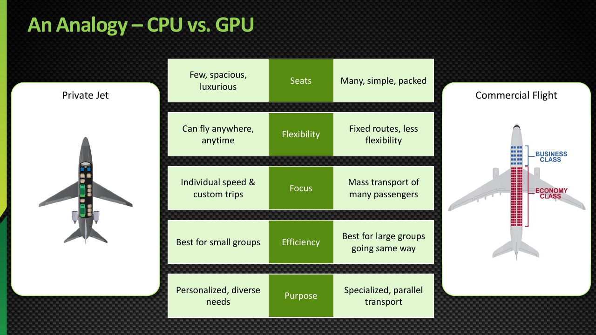

**ပုံရှင်းလင်းချက် (သင်တန်းပုံ 1)** — ဒီသင်တန်းပုံမှာ CPU ကို Private Jet နဲ့ GPU ကို Commercial Flight နဲ့ နှိုင်းယှဉ်ထားပါတယ်။ Private Jet က ခရီးသည် အနည်းငယ်ပဲ သယ်နိုင်ပေမယ့် မြန်ပြီး လိုက်လျောနိုင်သလို CPU က task နည်းနည်းကို low latency နဲ့ flexible ကိုင်တွယ်နိုင်ပါတယ်။ Commercial Flight က ခရီးသည် ရာပေါင်းများစွာကို တပြိုင်နက် သယ်ဆောင်သလို GPU က operation ထောင်ပေါင်းများစွာကို parallel လုပ်ပြီး high throughput ရယူပါတယ်။ ဒီနှိုင်းယှဉ်ချက်ဟာ အောက်ပိုင်း section တွေမှာ ဆက်ရှင်းမယ့် CPU နဲ့ GPU ရဲ့ ဒီဇိုင်းကွာခြားချက်ကို အစပြုပါတယ်။

*(Source: NVIDIA NCA-AIIO training deck — study material)*

### 2. CPU — Private Jet နှိုင်းယှဉ်ချက်

Private Jet က မြန်ပါတယ်၊ Powerful ဖြစ်ပါတယ်၊ ဒါပေမယ့် ခရီးသည် အနည်းငယ်ပဲ သယ်နိုင်ပါတယ်။

CPU ကလည်း ဒီလိုပါပဲ—

```
        CPU = Private Jet
               │
    ┌──────────┴──────────┐
    │                     │
 ခရီးသည်နည်း        အလွန်မြန်
    │                     │
 Task နည်း          Latency နည်း
    │                     │
 လိုက်လျောညီထွေ     Flexible
```

- ခရီးသည် အနည်းငယ်ပဲ သယ်နိုင် — Task နည်းနည်းပဲ လုပ်နိုင်
- နေရာတိုင်းကို သွားနိုင် — Flexible execution
- အလွန်တုံ့ပြန်မှုမြန် — Low latency
- တစ်နေရာချင်းစီ ဈေးကြီး — Powerful individual cores

အောက်ပါ **Figure 1** မှာ CPU ကို Private Jet နဲ့ နှိုင်းယှဉ်ထားတဲ့ အချက်တွေကို စုပြီး ကြည့်နိုင်ပါတယ်။

**Figure 1: CPU ကို Private Jet နှင့် နှိုင်းယှဉ်ပုံ**

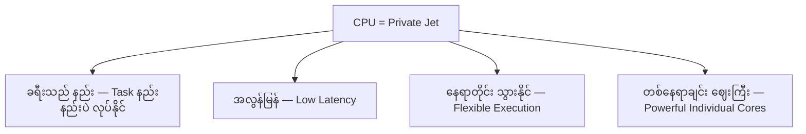

**ပုံရှင်းလင်းချက် (Figure 1)**

- အပေါ်ဆုံးက CPU ကို private jet အဖြစ် ထားပြီး အောက်က node လေးခုက နှိုင်းယှဉ်ချက်ရဲ့ အဓိကအချက်တွေကို ပြပါတယ်။
- ခရီးသည် နည်းတာက CPU ဟာ task နည်းနည်းပဲ ကိုင်တွယ်နိုင်ခြင်းကို ဆိုလိုပါတယ်။
- အလွန်မြန် / low latency နဲ့ flexible ဖြစ်တာက တစ်ခုချင်း operation တွေကို မြန်မြန် တုံ့ပြန်နိုင်ခြင်းကို ပြပါတယ်။
- တစ်နေရာချင်း ဈေးကြီးတာက powerful individual cores ကို ရည်ညွှန်းပါတယ်။

### 3. GPU — Commercial Flight နှိုင်းယှဉ်ချက်

Commercial Flight က ခရီးသည် ရာပေါင်းများစွာကို တပြိုင်နက် သယ်ဆောင်ဖို့ ဒီဇိုင်းထုတ်ထားပါတယ်။

GPU ကလည်း ဒီလိုပါပဲ—

```
        GPU = Commercial Flight
               │
    ┌──────────┴──────────┐
    │                     │
ခရီးသည်များစွာ      အလွန်ထိရောက်
    │                     │
 Task များစွာ        Throughput ကို ဦးစားပေး
    │                     │
 Parallel           Scalable
```

- ခရီးသည် များစွာကို တပြိုင်နက် သယ်နိုင် — Parallel task များစွာ
- လူအုပ်ကြီးကို ရွှေ့ဖို့ optimize လုပ်ထား — High throughput
- ပြည့်နေရင် အထိရောက်ဆုံး — Parallel utilization
- တစ်နေရာချင်းစီက Private Jet လောက် မထူးခြား — Simpler cores

အောက်ပါ **Figure 2** မှာ GPU ကို Commercial Flight နဲ့ နှိုင်းယှဉ်ထားတဲ့ အချက်တွေကို စုပြီး ကြည့်နိုင်ပါတယ်။

**Figure 2: GPU ကို Commercial Flight နှင့် နှိုင်းယှဉ်ပုံ**

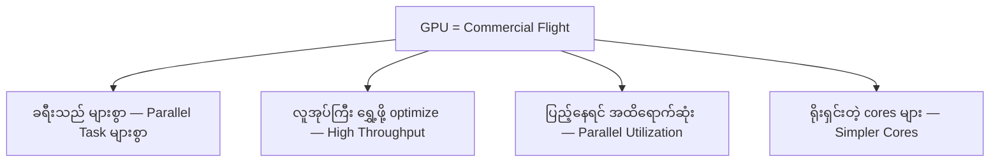

**ပုံရှင်းလင်းချက် (Figure 2)**

- အပေါ်ဆုံးက GPU ကို commercial flight အဖြစ် ထားပြီး အောက်က node လေးခုက နှိုင်းယှဉ်ချက်ရဲ့ အဓိကအချက်တွေကို ပြပါတယ်။
- ခရီးသည် များစွာ သယ်နိုင်တာက GPU ရဲ့ parallel task များစွာ တပြိုင်နက် လုပ်နိုင်ခြင်းကို ဆိုလိုပါတယ်။
- High throughput နဲ့ parallel utilization က လူအုပ်ကြီးကို ထိရောက်စွာ ရွှေ့နိုင်ခြင်းနဲ့ တူပါတယ်။
- Simpler cores က တစ်နေရာချင်းစီ private jet လောက် မထူးခြားပေမယ့် အရေအတွက်နဲ့ အနိုင်ယူတာကို ပြပါတယ်။

### 4. Computing မှာ "ခရီးသည်" ဆိုတာ ဘာကိုဆိုလိုတာလဲ?

ဒီနှိုင်းယှဉ်ချက်မှာ—

- ခရီးသည် → Task / Operation
- လေဆိပ် → Input Data
- ခရီးဆုံး → Output / Result

CPU က Task နည်းနည်းကို မြန်မြန် ကိုင်တွယ်ပါတယ်။
GPU က Operation ထောင်ပေါင်းများစွာ သို့မဟုတ် သန်းပေါင်းများစွာကို တပြိုင်နက် Process လုပ်ပါတယ်။

### 5. ရိုးရှင်းသော ဥပမာ

အလွန်ရှည်လျားသော ခြံစည်းရိုးတစ်ခုကို ဆေးသုတ်ရမယ်ဆိုပါစို့။

**ကျွမ်းကျင်သော ဆေးသမား တစ်ယောက်တည်း (CPU)**

```
ဆေးသမား 1 ──► ခြံစည်းရိုး တစ်ခုလုံးကို တစ်ယောက်တည်း ဆေးသုတ်

အလွန်ကျွမ်းကျင်
တစ်ကွက်ချင်းစီ အလွန်မြန်
ဒါပေမယ့် ဆေးသမား တစ်ယောက်တည်း
```

**ဆေးသမား များစွာ (GPU)**

```
ဆေးသမား 1  ──► အပိုင်း 1
ဆေးသမား 2  ──► အပိုင်း 2
ဆေးသမား 3  ──► အပိုင်း 3
ဆေးသမား 4  ──► အပိုင်း 4
    ...           ...
ဆေးသမား N  ──► အပိုင်း N

လုပ်သား များစွာ
တစ်ယောက်ချင်းစီ တစ်ကွက်စီ ဆေးသုတ်
ခြံစည်းရိုး တစ်ခုလုံး အတူပြီးသွား
```

ခြံစည်းရိုးဆေးသုတ်တာက တစ်လျှောက်လုံး အလုပ်တူတူ ထပ်ခါထပ်ခါ လုပ်ရတာ — သဘာဝအတိုင်း parallel ဖြစ်တဲ့ workload ပါ။ GPU က ဒီလိုအလုပ်မျိုးမှာ အကောင်းဆုံး ဖြစ်ပါတယ်။

အောက်ပါ **Figure 3** မှာ ဆေးသမား တစ်ယောက်တည်း နည်းလမ်းနဲ့ ဆေးသမား များစွာ နည်းလမ်းကို နှိုင်းယှဉ် ကြည့်နိုင်ပါတယ်။

**Figure 3: ခြံစည်းရိုး ဆေးသုတ်ဥပမာ — Sequential နှင့် Parallel နည်းလမ်း**

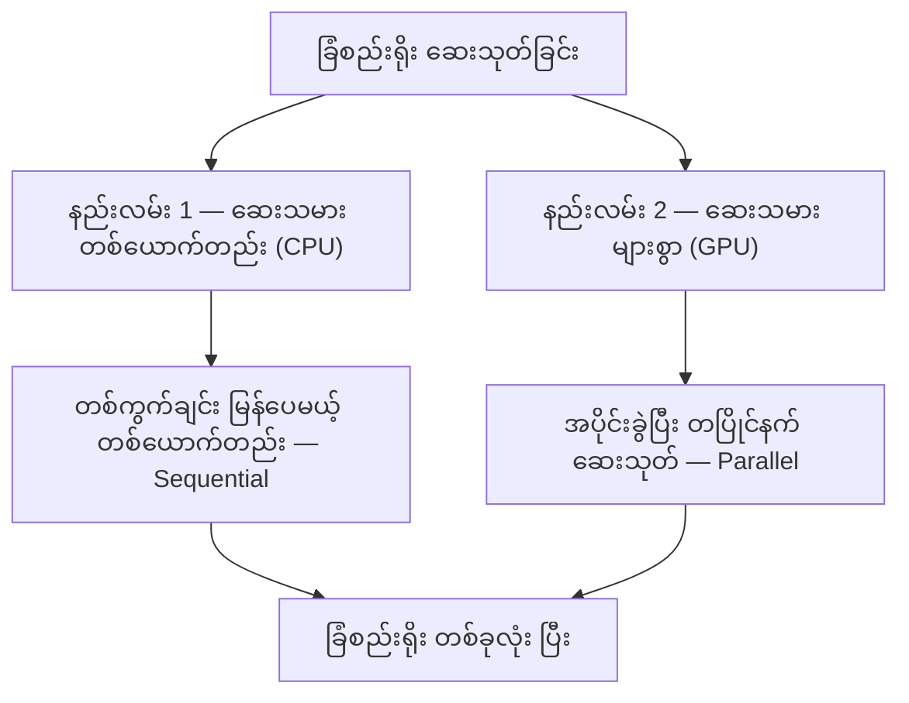

**ပုံရှင်းလင်းချက် (Figure 3)**

- ဘယ်ဘက် နည်းလမ်း 1 က sequential — ဆေးသမား တစ်ယောက်တည်းက တစ်ကွက်ချင်း မြန်ပေမယ့် ခြံစည်းရိုး တစ်ခုလုံးကို တစ်ယောက်တည်း ဆေးသုတ်ရပါတယ်။
- ညာဘက် နည်းလမ်း 2 က parallel — ဆေးသမား များစွာက ခြံစည်းရိုးကို အပိုင်းခွဲပြီး တပြိုင်နက် ဆေးသုတ်ပါတယ်။
- အောက်ဆုံးမှာ နှစ်ခုလုံး ခြံစည်းရိုး ပြီးသွားပေမယ့် parallel ဖြစ်တဲ့ workload အတွက် နည်းလမ်း 2 က ပိုသင့်တော်တာကို တွေ့ရပါမယ်။

### 6. CPU ရဲ့ အားသာချက် — Sequential နှင့် ရှုပ်ထွေးသော အလုပ်များ

CPU က အောက်ပါလိုအပ်တဲ့ အလုပ်တွေအတွက် optimize လုပ်ထားပါတယ်—

- ရှုပ်ထွေးသော ဆုံးဖြတ်ချက်ချခြင်း
- Branching logic
- Operating system task များ
- Application control flow
- Latency နည်းသော တစ်ခုချင်း operation များ

ဥပမာများ—

```
Operating System စီမံခန့်ခွဲမှု
Application Logic
Database Transaction
Control Flow / ဆုံးဖြတ်ချက်ချခြင်း
General-Purpose Computing
```

နှိုင်းယှဉ်ချက်အရ — private jet က လမ်းကြောင်း မြန်မြန်ပြောင်းနိုင်၊ လေဆိပ်ငယ်တွေဆင်းနိုင်၊ ရှုပ်ထွေးတဲ့ ခရီးစဉ်တွေကို လိုက်လျောနိုင်ပါတယ်။

### 7. GPU ရဲ့ အားသာချက် — Parallel အလုပ်များ

GPU က ဆင်တူတဲ့ operation များစွာ ပါဝင်တဲ့ အလုပ်တွေအတွက် optimize လုပ်ထားပါတယ်—

- Matrix multiplication
- Vector operation များ
- Image processing
- AI training
- AI inference
- Scientific simulation

```
   ┌────────────────────────────────┐
   │  Data အမျိုးမျိုးပေါ်မှာ      │
   │  operation တူတူ ထပ်ခါထပ်ခါ   │
   │                                │
   │  Matrix · Vector · Tensor      │
   │  Pixel · Neuron · Simulation   │
   └────────────────────────────────┘
```

နှိုင်းယှဉ်ချက်အရ — commercial flight က ခရီးသည် ရာပေါင်းများစွာကို လမ်းကြောင်းတစ်ခုတည်းပေါ်မှာ တပြိုင်နက် ပို့ဆောင်ပါတယ်။

### 8. CPU က ဘယ်အခါ ပိုကောင်းသလဲ?

Workload မှာ အောက်ပါတွေ ပါဝင်ရင် CPU ကို သုံးပါ—

- Sequential processing
- ရှုပ်ထွေးသော branching
- Operating system နှင့် application control
- Latency နည်းသော တစ်ခုချင်း operation များ
- General-purpose computing

ဥပမာ—

```
User Request
     │
     ▼
Application Logic
     │
     ▼
Database Query
     │
     ▼
Response
```

ဒီလို workflow က တစ်ဆင့်ချင်းစီ ဆုံးဖြတ်ချက်ချရတာကို မူတည်ပါတယ် — CPU ရဲ့ အားသာချက်ပါ။

### 9. GPU က ဘယ်အခါ ပိုကောင်းသလဲ?

Workload မှာ အောက်ပါတွေ ပါဝင်ရင် GPU ကို သုံးပါ—

- Data အများကြီး
- ထပ်ခါထပ်ခါ လုပ်ရတဲ့ operation များ
- Matrix / vector computation
- Parallel processing
- AI workload များ

ဥပမာ—

```
Dataset ကြီး
     │
     ▼
ဆင်တူသော Operation ထောင်ပေါင်းများစွာ
     │
     ▼
GPU က Parallel Process လုပ်
     │
     ▼
Result
```

### 10. CPU vs GPU — Parallel Processing

**CPU**

```
Task 1 ──► Core 1 ──────────────────► Result 1
Task 2 ──► Core 2 ──────────────────► Result 2
Task 3 ──► Core 3 ──────────────────► Result 3

Core နည်းနည်း ဒါပေမယ့် Powerful
တစ်ခုချင်းစီက Task ရှုပ်ထွေးတစ်ခုစီကို ကိုင်တွယ်
```

**GPU**

```
Task 1  ──► Core 1   ──► R1
Task 2  ──► Core 2   ──► R2
Task 3  ──► Core 3   ──► R3
...
Task N  ──► Core N   ──► RN

Core များစွာ (ရိုးရှင်း)
အားလုံး တပြိုင်နက် လုပ်ဆောင်
```

အောက်ပါ **Figure 4** မှာ CPU နဲ့ GPU ရဲ့ parallel processing ပုံစံ မတူတာကို နှိုင်းယှဉ် ကြည့်နိုင်ပါတယ်။

**Figure 4: CPU vs GPU — Parallel Processing ပုံစံ ကွာခြားပုံ**

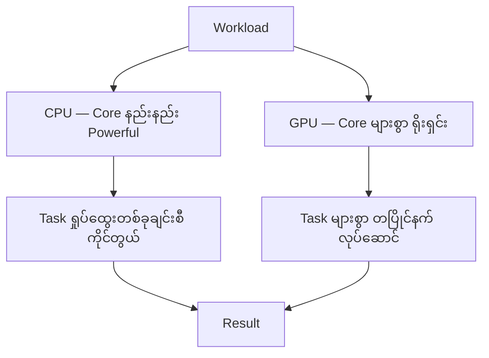

**ပုံရှင်းလင်းချက် (Figure 4)**

- အပေါ်ဆုံးက workload ကနေ CPU နဲ့ GPU ဆီ ခွဲသွားတာကို ကြည့်ပါ။
- CPU ဘက်က core နည်းနည်းနဲ့ task ရှုပ်ထွေးတစ်ခုချင်းစီ ကိုင်တွယ်ပုံ၊ GPU ဘက်က core များစွာနဲ့ task များစွာ တပြိုင်နက် လုပ်ဆောင်ပုံကို နှိုင်းယှဉ် မြင်ရပါမယ်။
- အောက်ဆုံးမှာ နှစ်ခုလုံး result ရပေမယ့် ရောက်တဲ့ပုံစံ မတူတာကို ပြပါတယ်။

### 11. AI အတွက် GPU ဘာကြောင့် လိုအပ်ရတာလဲ?

AI workload တွေမှာ သင်္ချာ operation အများကြီး ပါဝင်ပါတယ်—

```
AI Model Training
      │
      ▼
Matrix Multiplication
      │
      ▼
Operation သန်းပေါင်း / ဘီလီယံပေါင်းများစွာ
      │
      ▼
Parallel Processing လိုအပ်
      │
      ▼
GPU Acceleration
```

ဒါကြောင့် GPU တွေက modern AI ရဲ့ အဓိက compute engine တွေ ဖြစ်လာပါတယ်။

### 12. CPU နှင့် GPU အတူတကွ အလုပ်လုပ်ခြင်း

AI-Centric Data Center မှာ CPU နဲ့ GPU က ပြိုင်ဘက်မဟုတ်ဘဲ ပူးပေါင်းဆောင်ရွက်ပါတယ်—

```
             AI Application
                   │
         ┌─────────┴─────────┐
         │                   │
     CPU Role            GPU Role
         │                   │
  Application Logic    Parallel Computing
  Data Preparation     AI Training
  System Management    AI Inference
  Control Flow         Matrix / Tensor Operations
```

CPU က ဘာလုပ်ရမလဲ ဆုံးဖြတ်ပါတယ်။ GPU က လေးလံတဲ့ parallel computation ကို ဆောင်ရွက်ပါတယ်။

အောက်ပါ **Figure 5** မှာ CPU နဲ့ GPU နှစ်ခု ဘယ်လို တာဝန်ခွဲပြီး အတူအလုပ်လုပ်သလဲ ဆိုတာ ကြည့်နိုင်ပါတယ်။

**Figure 5: AI-Centric Data Center မှာ CPU နှင့် GPU အတူတကွ အလုပ်လုပ်ပုံ**

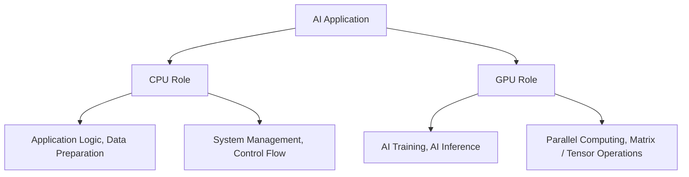

**ပုံရှင်းလင်းချက် (Figure 5)**

- အပေါ်ဆုံးက AI application ကနေ CPU role နဲ့ GPU role ဆီ ခွဲသွားတာကို ကြည့်ပါ။
- CPU ဘက်က application logic, data preparation, system management, control flow တွေကို ကိုင်တွယ်ပါတယ်။
- GPU ဘက်က AI training, AI inference, parallel computing, matrix / tensor operation တွေကို ဆောင်ရွက်ပါတယ်။
- CPU က ဘာလုပ်ရမလဲ ဆုံးဖြတ်ပြီး GPU က လေးလံတဲ့ parallel computation ကို ယူတဲ့ ပူးပေါင်းဆောင်ရွက်မှု ဖြစ်ပါတယ်။

### 13. အဓိက နှိုင်းယှဉ်ချက်

| Aspect | CPU (Private Jet) | GPU (Commercial Flight) |
|---|---|---|
| Design | Core နည်းနည်း Powerful | Core များစွာ Parallel |
| အကောင်းဆုံး | ရှုပ်ထွေးသော sequential task | ရိုးရှင်းသော parallel task |
| Latency | Task တစ်ခုချင်း အလွန်နည်း | Task တစ်ခုချင်း ပိုမြင့်၊ throughput ပိုမြင့် |
| Throughput | နိမ့် | အလွန်မြင့် |
| Flexibility | အလွန်မြင့် | Parallel workload ပေါ် အာရုံစိုက် |
| AI Training | သိပ်မသင့် | အလွန်သင့်တော် |
| AI Inference | လုပ်နိုင်ပေမယ့် ပိုနှေး | အလွန်သင့်တော် |
| နှိုင်းယှဉ်ချက် | Private Jet | Commercial Flight |

### 14. Exam အတွက် မှတ်သားရန် အချက်များ

```
CPU = Core နည်းနည်း Powerful = Sequential / ရှုပ်ထွေးသောအလုပ် = Private Jet
GPU = Core များစွာ Parallel = ထပ်ခါထပ်ခါ parallel အလုပ် = Commercial Flight
```

တစ်ကြောင်းတည်း အကျဉ်းချုပ် — CPU က ခရီးသည် အနည်းငယ်အတွက် မြန်ပြီး လိုက်လျောနိုင်တဲ့ private jet၊ GPU က ခရီးသည် များစွာကို တပြိုင်နက် ထိရောက်စွာ ပို့ဆောင်နိုင်တဲ့ commercial flight ဖြစ်ပါတယ်။

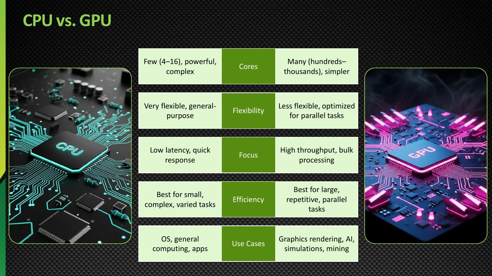

**ပုံရှင်းလင်းချက် (သင်တန်းပုံ 2)** — ဒီသင်တန်းပုံမှာ CPU နဲ့ GPU ကို ဇယားနဲ့ ခြုံငုံ နှိုင်းယှဉ်ပြထားပါတယ် — core ဒီဇိုင်း၊ ဘယ်အလုပ်မှာ အကောင်းဆုံးဖြစ်သလဲ၊ latency နဲ့ throughput ဘယ်လိုကွာသလဲ၊ AI training / inference အတွက် ဘယ်ဟာ ပိုသင့်သလဲ ဆိုတာတွေ ပါဝင်ပါတယ်။ အပေါ်က ဇယားနဲ့ ယှဉ်ကြည့်ရင် CPU က ရှုပ်ထွေးတဲ့ sequential task တွေအတွက်၊ GPU က ရိုးရှင်းတဲ့ parallel task တွေအတွက် သင့်တော်ကြောင်း မြင်ရပါမယ်။

*(Source: NVIDIA NCA-AIIO training deck — study material)*

### Self-Check Questions (အဖြေများပါဝင်သည်)

**Q1. CPU နဲ့ GPU အတွက် ဘယ်နှိုင်းယှဉ်ချက် နှစ်ခုကို သုံးထားသလဲ?**
Answer: CPU → Private Jet (ခရီးသည်နည်း၊ မြန်၊ flexible၊ low latency)၊ GPU → Commercial Flight (ခရီးသည်များစွာ၊ high throughput၊ ပြည့်မှ အထိရောက်ဆုံး) ဖြစ်ပါတယ်။

**Q2. ဒီနှိုင်းယှဉ်ချက်မှာ "ခရီးသည်"၊ "လေဆိပ်"၊ "ခရီးဆုံး" တွေက ဘာတွေကို ကိုယ်စားပြုသလဲ?**
Answer: ခရီးသည် → Task / Operation၊ လေဆိပ် → Input Data၊ ခရီးဆုံး → Output / Result ဖြစ်ပါတယ်။

**Q3. CPU က ဘယ်အခါ ပိုကောင်းသလဲ?**
Answer: Sequential processing၊ ရှုပ်ထွေးသော branching၊ operating system နှင့် application control၊ latency နည်းသော တစ်ခုချင်း operation များ၊ general-purpose computing ပါဝင်တဲ့ workload တွေမှာ ပိုကောင်းပါတယ်။

**Q4. GPU က ဘယ်အခါ ပိုကောင်းသလဲ?**
Answer: Data အများကြီး၊ ထပ်ခါထပ်ခါ ဆင်တူလုပ်ရတဲ့ operation များ၊ matrix / vector computation၊ parallel processing၊ AI workload များ ပါဝင်တဲ့အခါ ပိုကောင်းပါတယ်။

**Q5. AI-Centric Data Center မှာ CPU နဲ့ GPU က ဘယ်လို အတူတကွ အလုပ်လုပ်သလဲ?**
Answer: CPU က application logic, data preparation, system management, control flow တွေကို ကိုင်တွယ်ပြီး GPU က parallel computing, AI training, AI inference, matrix / tensor operations တွေကို ဆောင်ရွက်ပါတယ်။ CPU က ဘာလုပ်ရမလဲ ဆုံးဖြတ်ပြီး GPU က လေးလံတဲ့ parallel computation ကို လုပ်ပါတယ်။

## English Version

### 1. Introduction

In an AI-Centric Data Center, two major compute devices work together:

- CPU — Central Processing Unit
- GPU — Graphics Processing Unit

Both process data, but their architecture and strengths are fundamentally different.

To make this easier to understand, we use two simple analogies:

- CPU → Private Jet
- GPU → Commercial Flight

### 2. CPU — The Private Jet Analogy

- GPU → Commercial Flight


**Slide walkthrough (Training Slide 1)** — This training slide compares the CPU to a private jet and the GPU to a commercial flight. A private jet carries few passengers but is fast and flexible, just as a CPU handles a small number of tasks with low latency. A commercial flight is built to move hundreds of passengers at once, just as a GPU processes thousands of operations in parallel for high throughput. This analogy sets up the design differences explained in the sections below.

*(Source: NVIDIA NCA-AIIO training deck — study material)*

### 2. CPU — The Private Jet Analogy

A private jet is fast, powerful, and designed for a small number of passengers.

A CPU is similar:

```
        CPU = Private Jet
               │
    ┌──────────┴──────────┐
    │                     │
 Few Passengers        Very Fast
    │                     │
 Few Tasks             Low Latency
    │                     │
 Specialized            Flexible
```

- It can carry only a few passengers — fewer tasks
- It can go almost anywhere — flexible execution
- It is highly responsive — low latency
- Each seat is expensive — powerful individual cores

See **Figure 1** for the private jet comparison gathered into one picture.

**Figure 1: The CPU as a Private Jet**

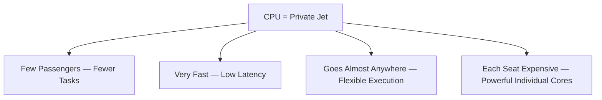

**Figure walkthrough (Figure 1)**

- The top node treats the CPU as a private jet; the four nodes below are the main points of the comparison.
- Few passengers means the CPU handles only a small number of tasks.
- Very fast / low latency and flexible mean quick responses for individual operations.
- An expensive seat per passenger refers to powerful individual cores.

### 3. GPU — The Commercial Flight Analogy

A commercial flight is designed to carry hundreds of passengers at once.

A GPU is similar:

```
        GPU = Commercial Flight
               │
    ┌──────────┴──────────┐
    │                     │
Many Passengers        Highly Efficient
    │                     │
 Many Tasks           Throughput Focused
    │                     │
 Parallel              Scalable
```

- It carries many passengers simultaneously — many parallel tasks
- It is optimized for moving large groups — high throughput
- It is most efficient when fully loaded — parallel utilization
- Individual seats are less specialized than a private jet — simpler cores

See **Figure 2** for the commercial flight comparison gathered into one picture.

**Figure 2: The GPU as a Commercial Flight**

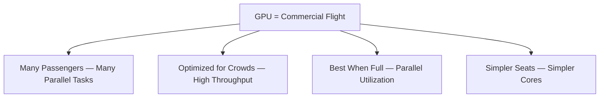

**Figure walkthrough (Figure 2)**

- The top node treats the GPU as a commercial flight; the four nodes below are the main points of the comparison.
- Many passengers means many parallel tasks running at the same time.
- High throughput and parallel utilization match the idea of moving large crowds efficiently.
- Simpler cores show that individual units are less specialized, but the large count wins.

### 4. What Does "Passenger" Mean in Computing?

In this analogy:

- Passenger → Task / Operation
- Airport → Input Data
- Destination → Output / Result

A CPU handles a small number of complex tasks quickly. A GPU handles thousands or millions of simple operations simultaneously.

### 5. A Simple Example

Imagine you need to paint a very long fence.

**One expert painter (CPU)**

```
Painter 1 ──► Paint entire fence alone

Very skilled
Very fast per section
But only one painter
```

**Many painters (GPU)**

```
Painter 1  ──► Section 1
Painter 2  ──► Section 2
Painter 3  ──► Section 3
Painter 4  ──► Section 4
    ...          ...
Painter N  ──► Section N

Many workers
Each paints one section
The whole fence is finished together
```

Painting a fence requires the same repetitive work along its entire length — a naturally parallel workload. This is exactly the type of work a GPU excels at.

**Figure 3** compares the single-painter approach with the many-painter approach.

**Figure 3: The Fence-Painting Example — Sequential vs Parallel**

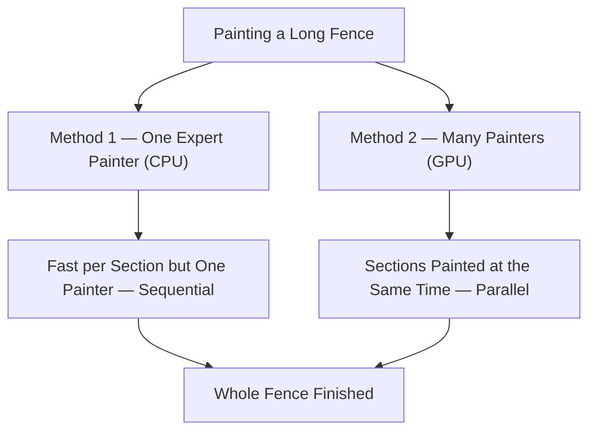

**Figure walkthrough (Figure 3)**

- The left method is sequential: one painter is fast per section but paints the whole fence alone.
- The right method is parallel: many painters split the fence into sections and paint at the same time.
- Both reach the finished fence at the bottom, but the parallel method fits naturally parallel workloads better.

### 6. CPU Strengths — Sequential and Complex Work

A CPU is optimized for work that requires:

- Complex decision-making
- Branching logic
- Operating system tasks
- Application control flow
- Low-latency individual operations

Examples:

```
Operating System Management
Application Logic
Database Transactions
Control Flow / Decision Making
General-Purpose Computing
```

In the analogy: the private jet can change routes quickly, land at small airports, and adapt to complex itineraries.

### 7. GPU Strengths — Parallel Work

A GPU is optimized for work that contains many similar operations:

- Matrix multiplication
- Vector operations
- Image processing
- AI training
- AI inference
- Scientific simulation

```
   ┌────────────────────────────────┐
   │  Same operation repeated many  │
   │  times on different data       │
   │                                │
   │  Matrix · Vector · Tensor      │
   │  Pixel · Neuron · Simulation   │
   └────────────────────────────────┘
```

In the analogy: the commercial flight moves hundreds of passengers along the same route at once.

### 8. When Is the CPU Better?

Use a CPU when the workload involves:

- Sequential processing
- Complex branching
- Operating system and application control
- Low-latency single operations
- General-purpose computing

Example:

```
User Request
     │
     ▼
Application Logic
     │
     ▼
Database Query
     │
     ▼
Response
```

This kind of workflow depends on decision-making step by step — the CPU's strength.

### 9. When Is the GPU Better?

Use a GPU when the workload involves:

- Large amounts of data
- Repetitive operations
- Matrix / vector computation
- Parallel processing
- AI workloads

Example:

```
Large Dataset
     │
     ▼
Thousands of Similar Operations
     │
     ▼
GPU Processes in Parallel
     │
     ▼
Result
```

### 10. CPU vs GPU — Parallel Processing

**CPU**

```
Task 1 ──► Core 1 ──────────────────► Result 1
Task 2 ──► Core 2 ──────────────────► Result 2
Task 3 ──► Core 3 ──────────────────► Result 3

Few powerful cores
Each handles one complex task
```

**GPU**

```
Task 1  ──► Core 1   ──► R1
Task 2  ──► Core 2   ──► R2
Task 3  ──► Core 3   ──► R3
...
Task N  ──► Core N   ──► RN

Many simpler cores
All work simultaneously
```

**Figure 4** compares how the CPU and the GPU handle parallel processing.

**Figure 4: CPU vs GPU — Different Parallel Processing Styles**

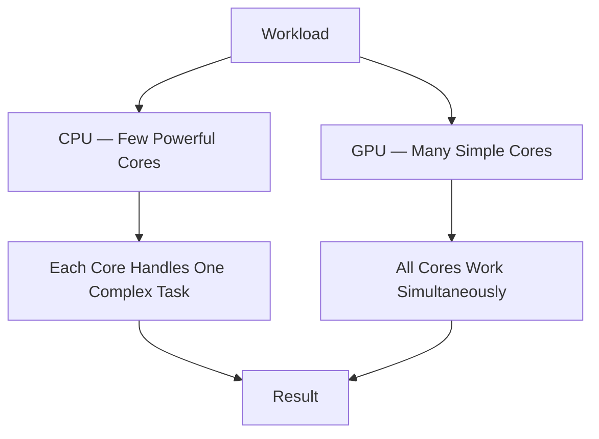

**Figure walkthrough (Figure 4)**

- The workload at the top splits toward the CPU and the GPU.
- On the CPU side, few powerful cores handle complex tasks one by one; on the GPU side, many simple cores work simultaneously.
- Both sides end at a result, but the way they get there is different.

### 11. Why AI Needs GPUs

AI workloads contain enormous numbers of mathematical operations:

```
AI Model Training
      │
      ▼
Matrix Multiplication
      │
      ▼
Millions / Billions of Operations
      │
      ▼
Parallel Processing Required
      │
      ▼
GPU Acceleration
```

This is why GPUs are the primary compute engines of modern AI.

### 12. CPU and GPU Work Together

In an AI-Centric Data Center, the CPU and GPU do not compete — they cooperate.

```
             AI Application
                   │
         ┌─────────┴─────────┐
         │                   │
     CPU Role            GPU Role
         │                   │
  Application Logic    Parallel Computing
  Data Preparation     AI Training
  System Management    AI Inference
  Control Flow         Matrix / Tensor Operations
```

The CPU decides what to do. The GPU performs the heavy parallel computation.

**Figure 5** shows how the CPU and the GPU divide responsibilities and cooperate.

**Figure 5: CPU and GPU Working Together in an AI-Centric Data Center**


**Figure walkthrough (Figure 5)**

- The AI application at the top splits into a CPU role and a GPU role.
- The CPU side handles application logic, data preparation, system management, and control flow.
- The GPU side handles AI training, AI inference, parallel computing, and matrix / tensor operations.
- This is cooperation: the CPU decides what to do while the GPU takes the heavy parallel computation.

### 13. Key Comparison

| Aspect | CPU (Private Jet) | GPU (Commercial Flight) |
|---|---|---|
| Design | Few powerful cores | Many parallel cores |
| Best at | Complex sequential tasks | Simple parallel tasks |
| Latency | Very low per task | Higher per task, higher throughput |
| Throughput | Lower | Very high |
| Flexibility | Very high | Focused on parallel workloads |
| AI Training | Less suitable | Highly suitable |
| AI Inference | Possible but slower | Highly suitable |
| Analogy | Private Jet | Commercial Flight |

### 14. Exam Memory Points

```
CPU = Few powerful cores = Sequential / complex work = Private Jet
GPU = Many parallel cores = Repetitive parallel work = Commercial Flight
```

One-line summary: The CPU is a private jet — fast and flexible for a few passengers; the GPU is a commercial flight — efficient at moving many passengers at once.


**Slide walkthrough (Training Slide 2)** — This training slide summarizes the CPU vs GPU comparison in a table — core design, what each is best at, how latency and throughput differ, and which one suits AI training and inference. Read it alongside the table above: the CPU fits complex sequential tasks while the GPU fits simple parallel tasks.

*(Source: NVIDIA NCA-AIIO training deck — study material)*

### Self-Check Questions (with answers)

**Q1. Which two analogies are used for the CPU and the GPU?**
Answer: CPU → Private Jet (few passengers, very fast, flexible, low latency); GPU → Commercial Flight (many passengers, high throughput, most efficient when fully loaded).

**Q2. In this analogy, what do "passenger," "airport," and "destination" represent?**
Answer: Passenger → Task / Operation; Airport → Input Data; Destination → Output / Result.

**Q3. When is a CPU the better choice?**
Answer: When the workload involves sequential processing, complex branching, operating system and application control, low-latency single operations, or general-purpose computing.

**Q4. When is a GPU the better choice?**
Answer: When the workload involves large amounts of data, repetitive similar operations, matrix / vector computation, parallel processing, or AI workloads.

**Q5. How do the CPU and GPU work together in an AI-centric data center?**
Answer: The CPU handles application logic, data preparation, system management, and control flow; the GPU handles parallel computing, AI training, AI inference, and matrix / tensor operations. The CPU decides what to do; the GPU performs the heavy parallel computation.

---

## Technical review notes

- Corrections made: the file previously listed the English version before the Burmese version and labeled the Burmese block "မြန်မာဘာသာ — …" instead of the standard section names; the order and labels now follow the bilingual skeleton (Burmese section first, then English). Body content is unchanged in meaning, and the Burmese "Exam Memory Points" heading was rendered in Burmese.
- Corrections made: self-check questions with answers were added to both language sections (5 per side, drawn only from the material in this file), as required by WRITING_RULES.
- Needs verification: the comparison table's latency/throughput/flexibility rows are qualitative trade-off descriptions (private jet vs commercial flight), not benchmark figures — do not cite them as measured performance claims.
- The fence-painting and aviation comparisons are pedagogical analogies, not claims about actual hardware behavior; no technical specifications or benchmark numbers are asserted in this module.
- Figures added in this pass: Mermaid figures (Figure 1–5) with captions and figure walkthroughs (ပုံရှင်းလင်းချက်) were inserted inline in both language sections with matching numbering; no existing text or ASCII diagrams were changed.
