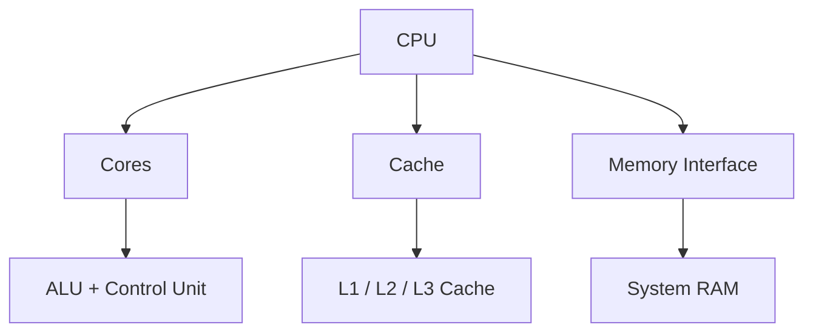
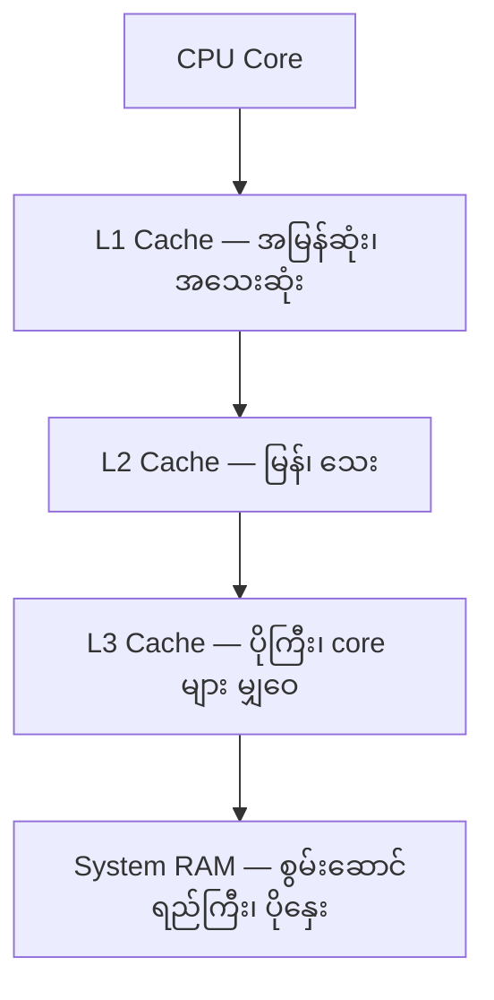
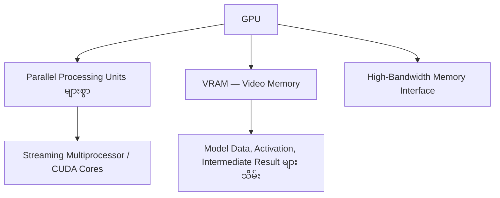
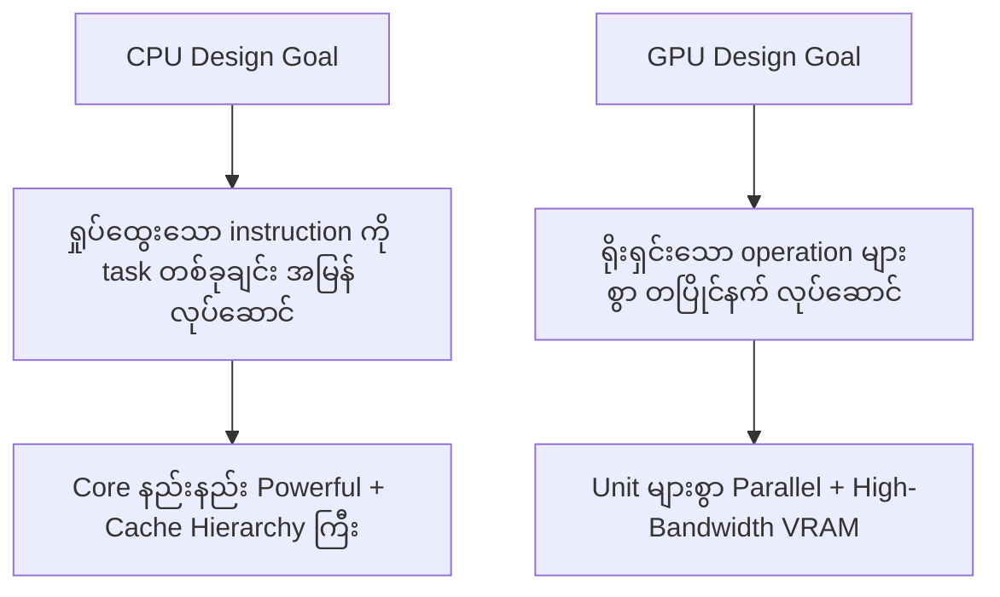
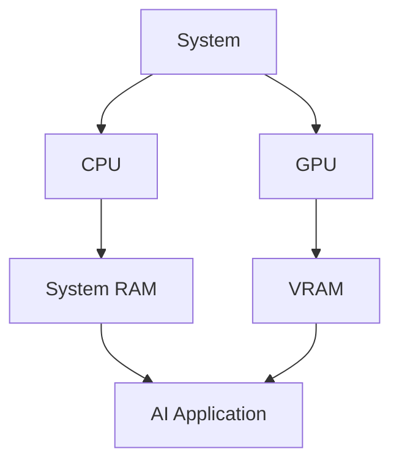
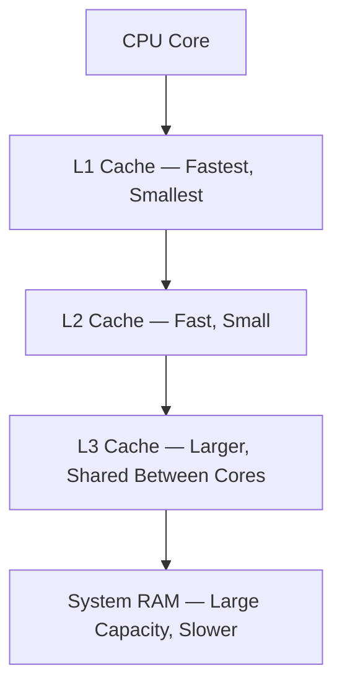
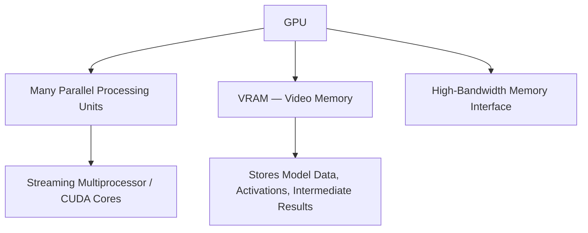
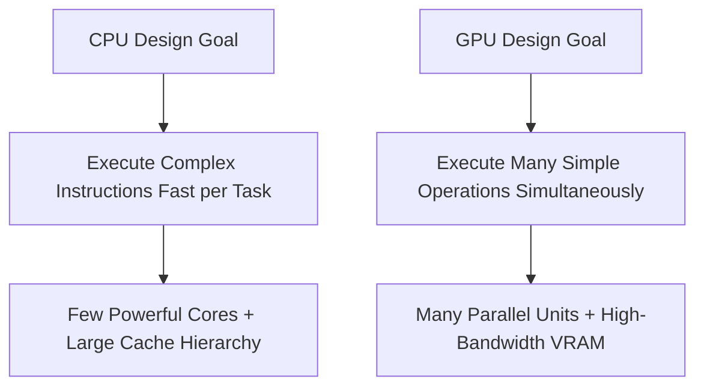

# Module 03 — CPU vs GPU: High-Level Architecture

> Part I · AI Foundations and AI Infrastructure — Course Module 03 (CPU vs GPU and Parallel Computing) — topic notes

## မြန်မာဘာသာ version


## 1. အကြမ်းဖျဉ်း

ယခင်က CPU နဲ့ GPU ကို နှိုင်းယှဉ်ချက်များနဲ့ နှိုင်းယှဉ်ခဲ့ပါတယ်။ ယခုတော့ စက်နှစ်ခုရဲ့ အတွင်းပိုင်း architecture ကို ကြည့်ပါမယ်။

ဒီ structure တွေကို နားလည်ခြင်းက CPU နဲ့ GPU ဘာကြောင့် အားသာချက်မတူကြရတာလဲဆိုတာ ရှင်းပြပါတယ်။

## 2. CPU High-Level Architecture

CPU ထဲမှာ အဓိကပါဝင်တာတွေက—

```
              CPU
               │
   ┌───────────┼───────────┐
   │           │           │
  Cores       Cache       Memory Interface
   │           │           │
  ALU         L1 / L2     RAM နှင့်
  Control     / L3        ချိတ်ဆက်မှု
  Unit
```

- **CPU Cores** — instruction များ လုပ်ဆောင်ရာနေရာ
- **Cache** — core နားမှာရှိတဲ့ အလွန်မြန်သော memory ငယ် (L1, L2, L3)
- **Memory Interface** — CPU ကို system memory (RAM) နှင့် ချိတ်ဆက်ပေးသည်

အောက်ပါ **Figure 1** မှာ CPU ရဲ့ အဓိက အစိတ်အပိုင်း သုံးခုကို ပုံနဲ့ ကြည့်နိုင်ပါတယ်။

**Figure 1: CPU High-Level Architecture — အဓိက အစိတ်အပိုင်း သုံးခု**



**ပုံရှင်းလင်းချက် (Figure 1)**

- အပေါ်ဆုံးက CPU ကနေ အဓိက အစိတ်အပိုင်း သုံးခု ခွဲထွက်သွားတာကို ကြည့်ပါ — cores, cache, memory interface။
- Cores အောက်က ALU နဲ့ Control Unit က instruction တွေကို လုပ်ဆောင်ပေးပါတယ်။
- Cache အောက်က L1 / L2 / L3 က core နားမှာရှိတဲ့ မြန်တဲ့ memory ငယ်တွေ ဖြစ်ပါတယ်။
- Memory interface က CPU ကို system RAM နဲ့ ချိတ်ဆက်ပေးပါတယ်။

## 3. CPU Cores

Modern CPU မှာ core အနည်းငယ် ဒါပေမယ့် တစ်ခုချင်းစီ powerful ဖြစ်ပါတယ်။

```
            CPU
    ┌────────┼────────┐
    │        │        │
  Core 1  Core 2  Core 3  Core 4
    │        │        │       │
  ALU      ALU      ALU     ALU
  Ctrl     Ctrl     Ctrl    Ctrl
```

Core တစ်ခုချင်းစီက instruction အစဉ်ရှုပ်ထွေးတွေကို single-thread performance ကောင်းကောင်းနဲ့ လုပ်ဆောင်နိုင်ပါတယ်။

## 4. CPU Cache — L1, L2, L3

Cache ဆိုတာ CPU core နားမှာရှိတဲ့ memory ငယ်ဖြစ်ပြီး ပုံမှန် RAM ထက် အများကြီး မြန်ပါတယ်။

```
 Core
   │
   ▼
  L1 Cache  ──► အမြန်ဆုံး၊ အသေးဆုံး၊ core တစ်ခုချင်းအတွက်
   │
   ▼
  L2 Cache  ──► မြန်၊ သေး၊ ပုံမှန် core တစ်ခုချင်းစီအတွက်
   │
   ▼
  L3 Cache  ──► ပိုကြီး၊ core များကြား မျှဝေသုံး
   │
   ▼
  System RAM ──► စွမ်းဆောင်ရည်ကြီး၊ cache ထက် နှေး
```

Cache ရဲ့ ရည်ရွယ်ချက်—

- မကြာခဏသုံးတဲ့ data ကို core နားမှာ ထားပေးခြင်း
- Memory access စောင့်ရတဲ့အချိန် လျှော့ချခြင်း
- တစ်စက္ကန့်အတွင်း လုပ်ဆောင်နိုင်တဲ့ instruction အရေအတွက် တိုးစေခြင်း

အောက်ပါ **Figure 2** မှာ cache အဆင့်တွေကို အမြန်ဆုံးမှ အနှေးဆုံးအထိ အပေါ်ကနေ အောက်ကို ကြည့်နိုင်ပါတယ်။

**Figure 2: CPU Cache Hierarchy — L1 မှ System RAM အထိ**



**ပုံရှင်းလင်းချက် (Figure 2)**

- အပေါ်ဆုံးက CPU core ကနေ စပြီး အောက်ကို တစ်ဆင့်ချင်း ဆင်းကြည့်ပါ။
- L1 cache က အမြန်ဆုံး၊ အသေးဆုံး၊ core တစ်ခုချင်းအတွက် သီးသန့် ဖြစ်ပါတယ်။
- L2 က ပိုကြီးလာပြီး L3 က core များကြား မျှဝေသုံးတဲ့ ပိုကြီးတဲ့ cache ဖြစ်ပါတယ်။
- အောက်ဆုံးက system RAM — စွမ်းဆောင်ရည် အကြီးဆုံးပေမယ့် cache ထက် နှေးပါတယ်။

## 5. ALU — Arithmetic Logic Unit

ALU က သင်္ချာနှင့် logic operation များကို လုပ်ဆောင်ပါတယ်။

```
  Input A ──►┌─────────┐
             │   ALU   │──► Result
  Input B ──►└─────────┘
                │
           ပေါင်းခြင်း
           နုတ်ခြင်း
           မြှောက်ခြင်း
           နှိုင်းယှဉ်ခြင်း
           Logical operation
```

ဥပမာ—`A + B`, `A × B`, `A > B`, `A AND B`။

## 6. Control Unit

Control Unit က processor ရဲ့ လုပ်ဆောင်မှုကို ညွှန်ကြားပါတယ်။

```
Instruction
    │
    ▼
┌──────────────┐
│ Control Unit │
└──────────────┘
    │
    ├─► Instruction ယူခြင်း (Fetch)
    ├─► Instruction ဖော်ထုတ်ခြင်း (Decode)
    ├─► ALU ကို ညွှန်ကြားခြင်း
    ├─► Memory access ကို ညွှန်ကြားခြင်း
    └─► Result ရေးသားခြင်း
```

ALU က calculation လုပ်ပြီး Control Unit က ဘာလုပ်ရမလဲ၊ ဘယ်အစဉ်အတိုင်းလုပ်ရမလဲ ဆုံးဖြတ်ပါတယ်။

## 7. CPU Execution Style

CPU core က instruction တွေကို တစ်ဆင့်ချင်းစီ အမြန် လုပ်ဆောင်ပါတယ်။

```
Instruction 1 ──► Instruction 2 ──► Instruction 3 ──► ...
     │                 │                 │
   Fetch            ALU ဖြင့်          ALU ဖြင့်
   Decode           လုပ်ဆောင်          လုပ်ဆောင်
```

CPU က task ကြား မြန်မြန် ပြောင်းနိုင် (context switching) တဲ့အတွက် control flow နှင့် ရှုပ်ထွေးသော logic အတွက် အကောင်းဆုံးဖြစ်ပါတယ်။

## 8. GPU High-Level Architecture

GPU ထဲမှာ အဓိကပါဝင်တာတွေက—

```
               GPU
                │
   ┌────────────┼────────────┐
   │            │            │
 Parallel     Video      High-Bandwidth
 Processing   Memory       Memory
 Units        (VRAM)      Interface
```

- **Parallel processing unit များစွာ** (NVIDIA GPU များတွင် Streaming Multiprocessor နှင့် CUDA core များ)
- **VRAM (Video Memory)** — သီးသန့် high-bandwidth memory
- **Memory Interface** — processing unit များကို VRAM နှင့် ချိတ်ဆက်ပေးသည်


**ပုံရှင်းလင်းချက် (ဓာတ်ပုံ 1)** — ဓာတ်ပုံမှာ NVIDIA A100 GPU တစ်လုံး (GPU board/module) ကို မြင်ရပါမယ် — GPU chip ကို ဖုံးအုပ်ထားတဲ့ ကြီးမားတဲ့ heatsink နဲ့ cooling assembly နဲ့ ၎င်းဝန်းကျင်မှာ တပ်ဆင်ထားတဲ့ GPU memory (VRAM) တွေ ပါဝင်ပါတယ်။ အပေါ်မှာ ပြောခဲ့တဲ့ parallel processing units၊ VRAM နဲ့ memory interface ဆိုတဲ့ အစိတ်အပိုင်း သုံးခုလုံးဟာ ဒီ hardware တစ်ခုလုံးထဲမှာ ပါဝင်နေတာ ဖြစ်ပါတယ်။

*(Image: NVIDIA official product image)*

အောက်ပါ **Figure 3** မှာ GPU ရဲ့ အဓိက အစိတ်အပိုင်း သုံးခုကို ပုံနဲ့ ကြည့်နိုင်ပါတယ်။

**Figure 3: GPU High-Level Architecture — Parallel Units, VRAM နှင့် Memory Interface**



**ပုံရှင်းလင်းချက် (Figure 3)**

- အပေါ်ဆုံးက GPU ကနေ အဓိက အစိတ်အပိုင်း သုံးခု ခွဲထွက်ပါတယ် — parallel processing units, VRAM, memory interface။
- Parallel processing units အောက်က NVIDIA GPU တွေမှာ ပါတဲ့ Streaming Multiprocessor / CUDA cores တွေကို ရည်ညွှန်းပါတယ်။
- VRAM က သီးသန့် high-bandwidth memory ဖြစ်ပြီး model data, activation, intermediate result တွေကို သိမ်းပါတယ်။
- Memory interface က processing unit တွေကို VRAM နဲ့ ချိတ်ဆက်ပေးပါတယ်။

## 9. GPU Processing Units

GPU မှာ ရိုးရှင်းတဲ့ processing unit များစွာက တပြိုင်နက် အလုပ်လုပ်ပါတယ်။

```
               GPU
   ┌──────┬──────┬──────┬──────┐
   │      │      │      │      │
  PU 1   PU 2   PU 3  ...   PU N
   │      │      │      │      │
 tiny    tiny   tiny        tiny
 ALUs    ALUs   ALUs        ALUs
   │      │      │      │      │
  └──────┴──────┴──────┴──────┘
         Parallel execution
```

Unit တစ်ခုချင်းစီက CPU core ထက် ရိုးရှင်းပေမယ့် အရေအတွက်က ထောင်ပေါင်းများစွာ ရှိပါတယ်။

## 10. GPU Memory — VRAM

GPU က VRAM — Video Random Access Memory ဆိုတဲ့ သီးသန့် memory ကို အသုံးပြုပါတယ်။

```
  GPU Processing Units
          │
          ▼
   ┌─────────────┐
   │    VRAM     │
   │ (သီးသန့်)   │
   └─────────────┘
          │
          ▼
   High Bandwidth
   Model data, activation,
   intermediate result များ သိမ်းသည်
```

မှတ်ရန်—

- VRAM က CPU သုံး system RAM နှင့် သီးခြားဖြစ်ပါတယ်။
- VRAM ကို bandwidth အလွန်မြင့် data access အတွက် ဒီဇိုင်းထုတ်ထားပါတယ်။
- AI model ကြီးများအတွက် VRAM အများကြီး လိုအပ်ပါတယ်။

## 11. RAM vs VRAM

| Feature | System RAM | VRAM |
|---|---|---|
| အသုံးပြုသူ | CPU | GPU |
| နေရာ | Motherboard / system | GPU ဘုတ်ပေါ် |
| စွမ်းဆောင်ရည် | ပုံမှန် ပိုကြီး | ပိုငယ်ပေမယ့် ကြီးလာနေ |
| Bandwidth | အလယ်အလတ် | အလွန်မြင့် |
| ရည်ရွယ်ချက် | ယေဘုယျ system data | Graphics / AI parallel workload |

## 12. Architecture ဘာကြောင့် ကွာရတာလဲ?

```
CPU Design Goal              GPU Design Goal
      │                            │
      ▼                            ▼
ရှုပ်ထွေးသော instruction   ရိုးရှင်းသော operation
ကို task တစ်ခုချင်းစီ     အများကြီးကို တပြိုင်နက်
အမြန် လုပ်ဆောင်ရန်      လုပ်ဆောင်ရန်
      │                            │
      ▼                            ▼
Core နည်းနည်း Powerful    Unit များစွာ Parallel
Cache hierarchy ကြီး       High-bandwidth VRAM
```

အောက်ပါ **Figure 4** မှာ CPU နဲ့ GPU ရဲ့ design goal မတူရတဲ့ အကြောင်းရင်းကို နှိုင်းယှဉ် ကြည့်နိုင်ပါတယ်။

**Figure 4: CPU နှင့် GPU Design Goal မတူရခြင်း အကြောင်းရင်း**



**ပုံရှင်းလင်းချက် (Figure 4)**

- ဘယ်ဘက်လမ်းက CPU ရဲ့ design goal — ရှုပ်ထွေးတဲ့ instruction တွေကို task တစ်ခုချင်းအတွက် အမြန်ဆုံး လုပ်ဆောင်ဖို့ ဖြစ်ပါတယ်။
- ညာဘက်လမ်းက GPU ရဲ့ design goal — ရိုးရှင်းတဲ့ operation အများကြီးကို တပြိုင်နက် လုပ်ဆောင်ဖို့ ဖြစ်ပါတယ်။
- အောက်ဆုံး node တွေက ဒီ goal တွေကြောင့် ဖြစ်လာတဲ့ hardware ပုံစံတွေ — CPU မှာ core နည်းနည်း powerful နဲ့ cache ကြီး၊ GPU မှာ unit များစွာနဲ့ high-bandwidth VRAM ဖြစ်ပါတယ်။

## 13. CPU vs GPU Architecture နှိုင်းယှဉ်ချက်

| Feature | CPU | GPU |
|---|---|---|
| Cores | Core နည်းနည်း Powerful | Unit ထောင်ပေါင်းများစွာ ငယ် |
| Execution | Single-thread ကောင်း | Massive parallelism |
| Cache | L1/L2/L3 hierarchy ကြီး | Cache ငယ်၊ bandwidth များ |
| Memory | System RAM | Dedicated VRAM |
| အကောင်းဆုံး | Control flow, logic, OS | Matrix, vector, tensor operation |
| Latency | Latency နည်းအောင် optimize | Throughput အတွက် optimize |

## 14. အတူတကွ ဘယ်လိုအလုပ်လုပ်သလဲ?

```
      System
        │
   ┌────┴────┐
   │         │
  CPU       GPU
   │         │
  RAM       VRAM
   │         │
   └────┬────┘
        │
   AI Application
```

- CPU က data ပြင်ဆင်ပြီး workflow ကို ထိန်းချုပ်ပါတယ်။
- GPU က အလုပ်လုပ်မယ့် data ကို VRAM ထဲ သိမ်းပြီး parallel process လုပ်ပါတယ်။

အောက်ပါ **Figure 5** မှာ CPU / RAM နဲ့ GPU / VRAM တို့ စနစ်တစ်ခုအတွင်း ဘယ်လို ပေါင်းလုပ်သလဲ ကြည့်နိုင်ပါတယ်။

**Figure 5: CPU / System RAM နှင့် GPU / VRAM အတူတကွ အလုပ်လုပ်ပုံ**



**ပုံရှင်းလင်းချက် (Figure 5)**

- အပေါ်ဆုံးက system ကနေ CPU နဲ့ GPU ဆီ ခွဲသွားတာကို ကြည့်ပါ။
- CPU က system RAM နဲ့ အလုပ်လုပ်ပြီး GPU က သီးသန့် VRAM နဲ့ အလုပ်လုပ်ပါတယ်။
- အောက်ဆုံးမှာ နှစ်ခုလုံး AI application အတွက် ပေါင်းလုပ်ဆောင်ပေးပါတယ် — CPU က data ပြင်ဆင်ပြီး workflow ထိန်းချုပ်၊ GPU က VRAM ထဲ data သိမ်းပြီး parallel process လုပ်ပါတယ်။

## 15. Exam Memory Points

```
CPU = core နည်းနည်း powerful + L1/L2/L3 cache + ALU + Control Unit + system RAM
GPU = parallel processing unit များစွာ + VRAM + high bandwidth
```

တစ်ကြောင်းတည်း အကျဉ်းချုပ် — CPU က sequential execution မြန်ဖို့ cache ကြီးများဖြင့် တည်ဆောက်ထားပြီး၊ GPU က high-bandwidth memory ဖြင့် massive parallel execution အတွက် တည်ဆောက်ထားပါတယ်။

## 16. စစ်ဆေးရန် မေးခွန်းများနှင့် အဖြေများ (Self-Check Questions and Answers)

**မေးခွန်း ၁။** CPU တစ်ခုရဲ့ အဓိက အစိတ်အပိုင်း သုံးခုက ဘာတွေလဲ။

**အဖြေ။** CPU Cores (instruction များ လုပ်ဆောင်ရာနေရာ)၊ Cache (L1/L2/L3) နှင့် Memory Interface (system RAM နှင့် ချိတ်ဆက်မှု) တို့ ဖြစ်ပါတယ်။

**မေးခွန်း ၂။** Cache အဆင့်များကို အမြန်ဆုံးမှ အနှေးဆုံးသို့ စီကြည့်ပါ။

**အဖြေ။** L1 Cache (အမြန်ဆုံး၊ အသေးဆုံး၊ core တစ်ခုချင်းအတွက်) → L2 Cache → L3 Cache (ပိုကြီး၊ core များကြား မျှဝေသုံး) → System RAM (စွမ်းဆောင်ရည်ကြီး၊ cache ထက် နှေး) ဖြစ်ပါတယ်။

**မေးခွန်း ၃။** ALU နှင့် Control Unit တို့ရဲ့ တာဝန် ဘယ်လို ကွာခြားသလဲ။

**အဖြေ။** ALU က သင်္ချာနှင့် logic operation များ (ပေါင်းခြင်း၊ နုတ်ခြင်း၊ နှိုင်းယှဉ်ခြင်း) ကို လုပ်ဆောင်ပြီး Control Unit က instruction ယူခြင်း (Fetch)၊ ဖော်ထုတ်ခြင်း (Decode)၊ ALU နှင့် memory access ကို ညွှန်ကြားခြင်း၊ result ရေးသားခြင်းတို့ကို ညွှန်ကြားပါတယ်။

**မေးခွန်း ၄။** System RAM နှင့် VRAM တို့ရဲ့ အဓိက ကွာခြားချက် သုံးချက် ပြောပြပါ။

**အဖြေ။** RAM က CPU သုံး system memory ဖြစ်ပြီး VRAM က GPU အတွက် သီးသန့် memory ဖြစ်ပါတယ်။ RAM က capacity ပိုကြီးလေ့ရှိပြီး bandwidth အလယ်အလတ်ဖြစ်ကာ VRAM က bandwidth အလွန်မြင့်ပြီး graphics / AI parallel workload အတွက် ဒီဇိုင်းထုတ်ထားပါတယ်။

**မေးခွန်း ၅။** CPU နှင့် GPU architecture တို့ ဘာကြောင့် မတူကြရတာလဲ။

**အဖြေ။** CPU က task တစ်ခုချင်းစီအတွက် instruction ရှုပ်ထွေးတွေကို latency နည်းနည်းဖြင့် အမြန် လုပ်ဆောင်ရန် core နည်းနည်း powerful နှင့် cache hierarchy ကြီးဖြင့် တည်ဆောက်ထားပြီး၊ GPU က simple operation အများကြီးကို တပြိုင်နက် လုပ်ဆောင်ရန် parallel unit များစွာနှင့် high-bandwidth VRAM ဖြင့် တည်ဆောက်ထားပါတယ်။

---

## English Version

## 1. Introduction

Previously we compared the CPU and GPU using analogies. Now we look at the high-level architecture inside both devices.

Understanding these structures helps explain why the CPU and the GPU have different strengths.

## 2. High-Level CPU Architecture

At a high level, a CPU contains:

```
              CPU
               │
   ┌───────────┼───────────┐
   │           │           │
  Cores       Cache       Memory Interface
   │           │           │
  ALU         L1 / L2     Connection to
  Control     / L3        System Memory
  Unit
```

The main parts are:

- **CPU Cores** — where instructions are executed
- **Cache** — small, extremely fast memory close to the cores (L1, L2, L3)
- **Memory Interface** — connects the CPU to system memory (RAM)

See **Figure 1** for a picture of the three main parts of a CPU.

**Figure 1: High-Level CPU Architecture — The Three Main Parts**


**Figure walkthrough (Figure 1)**

- Look at the top: the CPU splits into its three main parts — cores, cache, and the memory interface.
- Under the cores, the ALU and the Control Unit execute instructions.
- Under the cache, L1 / L2 / L3 are the fast small memories close to the cores.
- The memory interface connects the CPU to system RAM.

## 3. CPU Cores

A modern CPU has a small number of powerful cores.

Conceptually:

```
            CPU
    ┌────────┼────────┐
    │        │        │
  Core 1  Core 2  Core 3  Core 4
    │        │        │       │
  ALU      ALU      ALU     ALU
  Ctrl     Ctrl     Ctrl    Ctrl
```

Each core can execute complex instruction sequences with strong single-thread performance.

## 4. CPU Cache — L1, L2, L3

Cache is small memory located close to the CPU cores. It is much faster than normal RAM.

```
 Core
   │
   ▼
  L1 Cache  ──► Fastest, smallest, private per core
   │
   ▼
  L2 Cache  ──► Fast, small, usually per core
   │
   ▼
  L3 Cache  ──► Larger, shared between cores
   │
   ▼
  System RAM ──► Large capacity, slower than cache
```

Purpose of cache:

- Keep frequently used data close to the core
- Reduce waiting time for memory access
- Increase instructions executed per second

**Figure 2** shows the cache levels from the fastest at the top to the slowest at the bottom.

**Figure 2: CPU Cache Hierarchy — From L1 to System RAM**



**Figure walkthrough (Figure 2)**

- Start at the CPU core at the top and move down one step at a time.
- L1 cache is the fastest and smallest, private to each core.
- L2 is larger, and L3 is even larger and shared between the cores.
- At the bottom is system RAM — the largest capacity, but slower than cache.

## 5. ALU — Arithmetic Logic Unit

ALU stands for Arithmetic Logic Unit. It performs arithmetic and logic operations.

```
  Input A ──►┌─────────┐
             │   ALU   │──► Result
  Input B ──►└─────────┘
                │
           Addition
           Subtraction
           Multiplication
           Comparison
           Logical operations
```

Examples of ALU work: `A + B`, `A × B`, `A > B`, `A AND B`.

## 6. Control Unit

The Control Unit directs the operation of the processor.

```
Instruction
    │
    ▼
┌──────────────┐
│ Control Unit │
└──────────────┘
    │
    ├─► Fetch instruction
    ├─► Decode instruction
    ├─► Coordinate ALU
    ├─► Coordinate memory access
    └─► Write result
```

The ALU performs the calculations; the Control Unit decides what happens and in which order.

## 7. CPU Execution Style

A CPU core executes instructions mostly one step at a time, quickly:

```
Instruction 1 ──► Instruction 2 ──► Instruction 3 ──► ...
     │                 │                 │
   Fetch            Execute           Execute
   Decode           with ALU          with ALU
```

A CPU can switch between tasks quickly (context switching), which makes it excellent for control flow and complex logic.

## 8. High-Level GPU Architecture

At a high level, a GPU contains:

```
               GPU
                │
   ┌────────────┼────────────┐
   │            │            │
 Many small   Video      High-Bandwidth
  parallel    Memory       Memory
  processing  (VRAM)      Interface
  units
```

The main parts are:

- **Many small parallel processing units** (e.g., Streaming Multiprocessors and CUDA cores in NVIDIA GPUs)
- **VRAM (Video Memory)** — dedicated high-bandwidth memory
- **Memory Interface** — connects processing units to VRAM


**Photo walkthrough (Photo 1)** — The photo shows an NVIDIA A100 GPU: a board carrying the GPU chip under a large heatsink and cooling assembly, with GPU memory (VRAM) mounted around it. The three parts described above — parallel processing units, VRAM, and the memory interface — all live inside this single piece of hardware.

*(Image: NVIDIA official product image)*

See **Figure 3** for a picture of the three main parts of a GPU.

**Figure 3: High-Level GPU Architecture — Parallel Units, VRAM, and Memory Interface**



**Figure walkthrough (Figure 3)**

- At the top, the GPU splits into its three main parts: parallel processing units, VRAM, and the memory interface.
- Under the parallel units, NVIDIA GPUs use Streaming Multiprocessors / CUDA cores.
- VRAM is dedicated high-bandwidth memory that stores model data, activations, and intermediate results.
- The memory interface connects the processing units to VRAM.

## 9. GPU Processing Units

A GPU contains many simpler processing units working at the same time.

```
               GPU
   ┌──────┬──────┬──────┬──────┐
   │      │      │      │      │
  PU 1   PU 2   PU 3  ...   PU N
   │      │      │      │      │
  tiny   tiny   tiny        tiny
  ALUs   ALUs   ALUs        ALUs
   │      │      │      │      │
  └──────┴──────┴──────┴──────┘
         Parallel execution
```

Each unit is simpler than a CPU core, but there are thousands of them.

## 10. GPU Memory — VRAM

GPU uses its own dedicated memory called VRAM — Video Random Access Memory.

```
  GPU Processing Units
          │
          ▼
   ┌─────────────┐
   │    VRAM     │
   │ (dedicated) │
   └─────────────┘
          │
          ▼
   High Bandwidth
   Stores model data, activations,
   intermediate results
```

Notes:

- VRAM is separate from the system RAM used by the CPU.
- VRAM is designed for very high bandwidth data access.
- Large AI models require large amounts of VRAM.

## 11. RAM vs VRAM

| Feature | System RAM | VRAM |
|---|---|---|
| Used by | CPU | GPU |
| Location | Motherboard / system | GPU board |
| Capacity | Usually larger | Usually smaller but growing |
| Bandwidth | Moderate | Very high |
| Purpose | General system data | Graphics / AI parallel workloads |

## 12. Why the Architectures Differ

```
CPU Design Goal              GPU Design Goal
      │                            │
      ▼                            ▼
Execute complex            Execute massive numbers
instructions fast          of simple operations
per task                   simultaneously
      │                            │
      ▼                            ▼
Few powerful cores         Many parallel units
Large cache hierarchy      High-bandwidth VRAM
```

**Figure 4** compares why the CPU and the GPU have different design goals.

**Figure 4: Why the CPU and GPU Design Goals Differ**



**Figure walkthrough (Figure 4)**

- The left path is the CPU design goal: run complex instructions fast for each task.
- The right path is the GPU design goal: run massive numbers of simple operations at the same time.
- The bottom nodes are the hardware shapes that follow from those goals — few powerful cores with large caches in the CPU, many parallel units with high-bandwidth VRAM in the GPU.

## 13. CPU vs GPU Architecture Comparison

| Feature | CPU | GPU |
|---|---|---|
| Cores | Few powerful cores | Thousands of smaller units |
| Execution | Strong single-thread | Massive parallelism |
| Cache | Large L1/L2/L3 hierarchy | Smaller caches, more bandwidth |
| Memory | System RAM | Dedicated VRAM |
| Best for | Control flow, logic, OS | Matrix, vector, tensor operations |
| Latency | Optimized for low latency | Optimized for throughput |

## 14. How They Work Together

```
      System
        │
   ┌────┴────┐
   │         │
  CPU       GPU
   │         │
  RAM       VRAM
   │         │
   └────┬────┘
        │
   AI Application
```

- The CPU prepares data and controls the workflow.
- The GPU stores working data in VRAM and processes it in parallel.

**Figure 5** shows how the CPU / RAM side and the GPU / VRAM side cooperate inside one system.

**Figure 5: CPU / System RAM and GPU / VRAM Working Together**


**Figure walkthrough (Figure 5)**

- At the top, the system splits into the CPU and the GPU.
- The CPU works with system RAM; the GPU works with its own dedicated VRAM.
- At the bottom, both feed the AI application — the CPU prepares data and controls the workflow, while the GPU stores working data in VRAM and processes it in parallel.

## 15. Exam Memory Points

```
CPU = few powerful cores + L1/L2/L3 cache + ALU + Control Unit + system RAM
GPU = many parallel processing units + VRAM + high bandwidth
```

One-line summary: The CPU is built for fast sequential execution with large caches; the GPU is built for massive parallel execution with high-bandwidth memory.

## 16. Self-Check Questions and Answers

**Q1.** What are the three main parts of a CPU?

**A1.** CPU cores (where instructions execute), cache (L1/L2/L3), and the memory interface (the connection to system RAM).

**Q2.** List the cache levels from fastest to slowest.

**A2.** L1 cache (fastest, smallest, private per core) → L2 cache → L3 cache (larger, shared between cores) → system RAM (large capacity, slower than cache).

**Q3.** How do the ALU and the Control Unit differ in responsibility?

**A3.** The ALU performs arithmetic and logic operations (addition, subtraction, comparison); the Control Unit fetches and decodes instructions, coordinates the ALU and memory access, and writes results.

**Q4.** State three main differences between system RAM and VRAM.

**A4.** RAM is the CPU's system memory; VRAM is the GPU's dedicated memory. RAM is usually larger with moderate bandwidth, while VRAM has very high bandwidth and is designed for graphics / AI parallel workloads.

**Q5.** Why do the CPU and GPU architectures differ?

**A5.** The CPU is built for fast, low-latency execution of complex instructions per task (few powerful cores, large cache hierarchy), while the GPU is built to run massive numbers of simple operations simultaneously (many parallel units, high-bandwidth VRAM).

---

## Technical review notes

- Structure normalized to the course convention: a single top-of-file header and blockquote, `## မြန်မာဘာသာ version` placed before `## English Version`, and identical `## N.` section numbering (1–16) in both language sections. All existing paragraphs, ASCII diagrams, lists, and tables are preserved unchanged in meaning.
- Correction: English section 6 previously began with a Burmese sentence followed by the same sentence in parentheses; it is now the plain English sentence "The ALU performs the calculations; the Control Unit decides what happens and in which order." The Burmese equivalent remains in the Burmese section 6.
- The five self-check questions per language were written strictly from this module's own content; no specifications, commands, URLs, or benchmark numbers were added.
- Claims needing verification: none material. Statements such as "thousands of" GPU processing units and the RAM-vs-VRAM capacity/bandwidth comparisons are qualitative architectural characterizations from the source, not model-specific specifications, and are kept as such.
- Figures added in this pass: Mermaid figures (Figure 1–5) with captions and figure walkthroughs (ပုံရှင်းလင်းချက်) were inserted inline in both language sections with matching numbering; no existing text or ASCII diagrams were changed.
