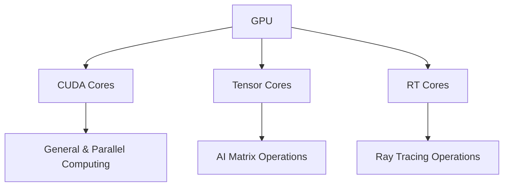
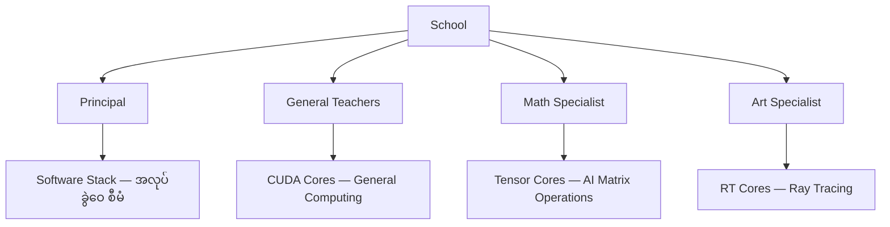
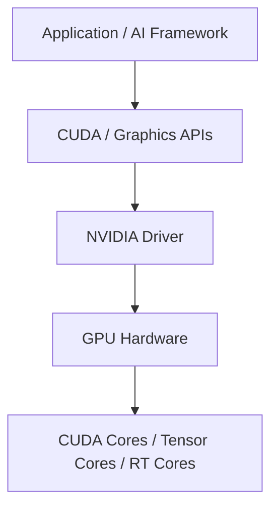
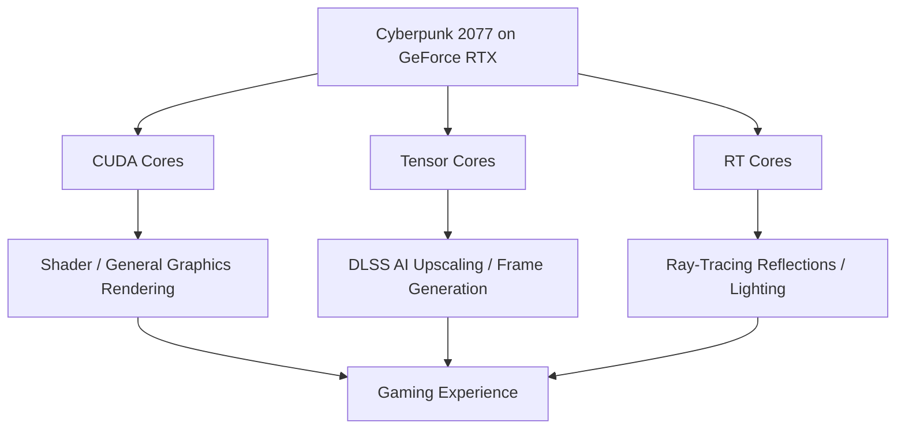
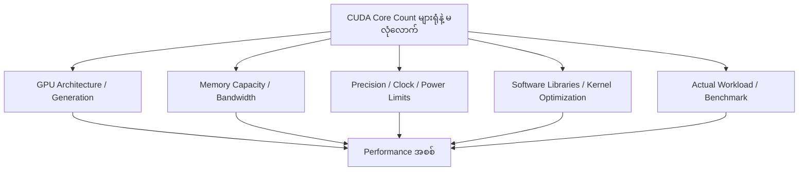
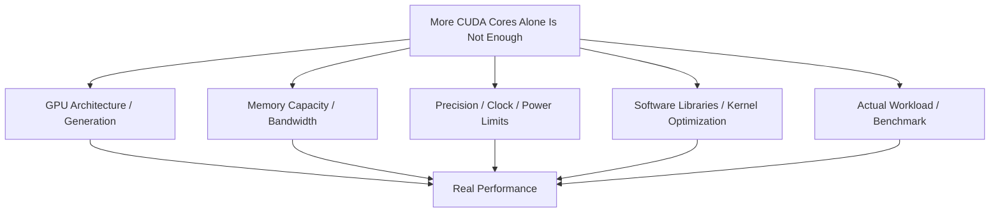

# Module — Understanding GPU Cores: CUDA Cores vs Tensor Cores vs RT Cores

> Part I · Course Module 03 (CPU vs GPU and Parallel Computing) — topic notes

## မြန်မာဘာသာ version

## 1. ပြဿနာ — GPU တစ်လုံးထဲမှာ ဘာတွေ ရှိသလဲ?

GPU တစ်လုံးကို ဝယ်တဲ့အခါ "CUDA Cores ဘယ်နှစ်ခုပါသလဲ" ဆိုတာကိုသာ ကြည့်ပြီး ဘယ် GPU က ပိုမြန်သလဲ ဆုံးဖြတ်လို့ မရပါဘူး။ GPU အတွင်းမှာ အလုပ်အမျိုးမျိုးအတွက် ရည်ရွယ်ထားတဲ့ processing hardware အမျိုးအစား အမျိုးမျိုး ရှိပါတယ် — CUDA Cores, Tensor Cores, RT Cores။ ဒီ core အမျိုးအစားတွေ ဘာကွာသလဲ၊ ဘယ် workload မှာ ဘယ်ဟာ အသုံးဝင်သလဲ ဆိုတာ နားလည်မှ AI infrastructure အတွက် GPU မှန်မှန်ကန်ကန် ရွေးချယ်နိုင်ပါမယ်။

## 2. GPU ဟာ Processing Unit တစ်ခုတည်း မဟုတ်ပါဘူး

GPU (Graphics Processing Unit) ကို အပြင်ကကြည့်ရင် Hardware Unit တစ်ခုတည်းလို မြင်ရပါတယ်။ ဒါပေမဲ့ GPU အတွင်းမှာ မတူညီတဲ့ Processing Tasks တွေကို ဆောင်ရွက်ပေးနိုင်တဲ့ Hardware Components များစွာ ပါဝင်ပါတယ်။ ဥပမာ —

- **CUDA Cores** — General-purpose parallel computations တွေအတွက် အသုံးဝင်တယ်။
- **Tensor Cores** — AI နဲ့ Deep Learning မှာ အသုံးများတဲ့ Matrix နှင့် Tensor operations တွေကို အရှိန်မြှင့်ပေးတယ်။
- **RT Cores** — Supported NVIDIA GPU architectures တွေမှာ Ray Tracing ကို အရှိန်မြှင့်ပေးတယ်။

ဒီ Core အမျိုးအစားတွေဟာ အလုပ်တူတူကို နည်းလမ်းတူတူနဲ့ လုပ်ဆောင်တာမဟုတ်ပါဘူး။ တစ်ခုချင်းစီမှာ ကိုယ်ပိုင်ရည်ရွယ်ချက်နဲ့ အားသာချက်တွေ ရှိပါတယ်။

Conceptual Diagram —

```
                  GPU
                   |
       +-----------+-----------+
       |           |           |
   CUDA Cores  Tensor Cores  RT Cores
       |           |           |
   General &      AI Matrix    Ray Tracing
   Parallel       Operations   Operations
   Computing
```

ဒီ Diagram က သဘောတရားကို နားလည်ဖို့ ရေးထားတာဖြစ်ပြီး GPU အားလုံးမှာ Core အမျိုးအစားသုံးမျိုးလုံး ပါဝင်တယ်လို့ မဆိုလိုပါဘူး။ အမှန်တကယ် ပါဝင်တဲ့ Hardware Units တွေဟာ GPU Model နဲ့ Architecture အလိုက် ကွာခြားနိုင်ပါတယ်။

အောက်ပါ **Figure 1** မှာ GPU အတွင်းက core အမျိုးအစား သုံးမျိုးရဲ့ အဓိက အလုပ်တွေကို ပုံနဲ့ ကြည့်နိုင်ပါတယ်။

**Figure 1: GPU အတွင်းက Core အမျိုးအစား သုံးမျိုးရဲ့ အဓိက အလုပ်**



**ပုံရှင်းလင်းချက် (Figure 1)**

- အပေါ်ဆုံးက GPU တစ်လုံးကနေ core အမျိုးအစား သုံးမျိုး ခွဲထွက်သွားတာကို ကြည့်ပါ။
- CUDA Cores က general & parallel computing အတွက် အသုံးဝင်ပါတယ်။
- Tensor Cores က AI matrix operation တွေကို အရှိန်မြှင့်ပေးပါတယ်။
- RT Cores က ray tracing operation တွေကို အရှိန်မြှင့်ပေးပါတယ်။ (GPU အားလုံး သုံးမျိုးလုံး ပါဝင်တယ်လို့ မဆိုလိုပါဘူး — GPU model နဲ့ architecture ပေါ် မူတည်ပါတယ်။)

## 3. Human Brain နဲ့ နှိုင်းယှဉ်ကြည့်ခြင်း

လူ့ဦးနှောက်ကို Unit တစ်ခုတည်းအဖြစ် မြင်နိုင်ပေမဲ့ အတွင်းမှာ မတူညီတဲ့ လုပ်ဆောင်ချက်တွေနဲ့ ဆက်စပ်နေတဲ့ Brain Regions တွေ ရှိပါတယ်။

- Frontal lobe — Planning, decision-making, behavior နဲ့ voluntary movement စတဲ့ လုပ်ဆောင်ချက်များနဲ့ ဆက်စပ်တယ်။
- Occipital lobe — Visual information ကို process လုပ်ရာမှာ အဓိကပါဝင်တယ်။

ဒီဥပမာရဲ့ အဓိကအယူအဆကတော့ Unit တစ်ခုတည်းအတွင်းမှာပဲ အထူးပြုလုပ်ဆောင်ချက် မတူညီတဲ့ အစိတ်အပိုင်းတွေ ရှိနိုင်တယ်ဆိုတာပါ။ GPU မှာလည်း အလားတူအားဖြင့် General-purpose computations နဲ့ Specialized computations တွေကို သင့်တော်တဲ့ Hardware Units တွေက ဆောင်ရွက်ပေးနိုင်ပါတယ်။

မှတ်ရန်: Human Brain နဲ့ GPU ကို နှိုင်းယှဉ်ခြင်းဟာ Concept ကို နားလည်လွယ်စေဖို့ အသုံးပြုတဲ့ Analogy သာဖြစ်ပါတယ်။ Brain Regions နဲ့ GPU Cores တွေဟာ အလုပ်လုပ်ပုံအရ တိုက်ရိုက်တူညီတာ မဟုတ်ပါဘူး။

## 4. School နဲ့ Teachers ဥပမာ

GPU Cores တွေကို ပိုနားလည်လွယ်ဖို့ ကျောင်းတစ်ကျောင်းနဲ့ နှိုင်းယှဉ်ကြည့်ရအောင်။ ကျောင်းတစ်ကျောင်းမှာ Principal, General Teachers နဲ့ Specialist Teachers တွေ ရှိတယ်လို့ ယူဆပါ။

အောက်ပါ **Figure 2** မှာ ဒီ school ဥပမာကို ပုံနဲ့ ကြည့်နိုင်ပါတယ်။

**Figure 2: School ဥပမာ — GPU Core အမျိုးအစားများကို ဆရာများနှင့် နှိုင်းယှဉ်ပုံ**



**ပုံရှင်းလင်းချက် (Figure 2)**

- ကျောင်းတစ်ကျောင်းကို principal, general teachers, math specialist, art specialist ဆိုပြီး ခွဲထားတာကို ကြည့်ပါ။
- General teachers တွေက CUDA Cores နဲ့ တူပြီး ဘာသာရပ်မျိုးစုံ သင်နိုင်သလို general computing အမျိုးမျိုး လုပ်နိုင်ပါတယ်။
- Math specialist က Tensor Cores နဲ့ တူပြီး AI matrix operation တွေမှာ အထူးကျွမ်းကျင်ပါတယ်။
- Art specialist က RT Cores နဲ့ တူပြီး ray tracing အတွက် အထူးပြုပါတယ်။ Principal ကတော့ software stack ကတစ်ဆင့် အလုပ်ခွဲဝေ စီမံပေးပါတယ်။

### 4.1 General Teachers — CUDA Cores

General Teachers တွေဟာ Mathematics, History, Science စတဲ့ ဘာသာရပ်မျိုးစုံကို သင်ကြားပေးနိုင်ပါတယ်။ သူတို့ရဲ့ အားသာချက်က အလုပ်အမျိုးမျိုးကို လုပ်ဆောင်နိုင်ခြင်းပါ။

CUDA Cores တွေကိုလည်း အလားတူ General-purpose computations နဲ့ Parallel Processing tasks များစွာအတွက် အသုံးပြုနိုင်ပါတယ်။ ဥပမာ —

- Mathematical calculations
- Vector operations
- Parallel data processing
- Graphics နှင့် AI workloads အချို့အတွက် အသုံးပြုသော computations

သို့သော် CUDA Cores တွေဟာ အလုပ်တိုင်းမှာ အမြန်ဆုံးဖြစ်တယ်လို့ မဆိုလိုပါဘူး။ သီးခြား AI Matrix Operations အချို့အတွက် Tensor Cores တွေက ပိုမိုသင့်တော်ပါတယ်။

### 4.2 Math Specialists — Tensor Cores

ကျောင်းတစ်ကျောင်းက Mathematics Olympiad ဝင်ပြိုင်ဖို့ ပြင်ဆင်နေတယ်ဆိုပါစို့။ အဲဒီအခါ Mathematics ကို အထူးကျွမ်းကျင်တဲ့ ဆရာတစ်ဦးကို ခန့်ထားနိုင်ပါတယ်။ အဲဒီဆရာက သင်္ချာဆိုင်ရာ အထူးပြုလုပ်ငန်းတွေကို ပိုမိုထိရောက်စွာ သင်ကြားပေးနိုင်ပါတယ်။

GPU မှာလည်း Tensor Cores တွေဟာ AI နဲ့ Deep Learning မှာ အရေးပါတဲ့ Matrix Multiplication နှင့် ဆက်စပ်သော operations များကို အရှိန်မြှင့်ဖို့ ဒီဇိုင်းထုတ်ထားပါတယ်။ ဥပမာ —

- Neural network training
- Neural network inference
- Matrix multiplication
- Supported data types တွေအတွက် AI tensor operations

Deep Learning Model တစ်ခုမှာ Matrix Operations များစွာ ပါဝင်နိုင်တဲ့အတွက် Tensor Cores တွေဟာ AI Workloads တွေမှာ အလွန်အသုံးဝင်ပါတယ်။

**အရေးကြီးချက်** — Tensor Cores တွေက CUDA Cores တွေကို လုံးဝအစားထိုးတာ မဟုတ်ပါဘူး။ GPU ရဲ့ Architecture နဲ့ Software က ပံ့ပိုးထားတဲ့အပေါ် မူတည်ပြီး နှစ်မျိုးစလုံးဟာ အလုပ်တစ်ခုရဲ့ မတူညီတဲ့ အစိတ်အပိုင်းတွေမှာ ပါဝင်နိုင်ပါတယ်။

### 4.3 Art Specialists — RT Cores

ကျောင်းတစ်ကျောင်းမှာ Art Fair အတွက် အထူးပြင်ဆင်ပေးမယ့် Art Specialist တစ်ဦးလည်း လိုအပ်နိုင်ပါတယ်။ GPU မှာ RT Cores (Ray Tracing Cores) တွေဟာ Supported NVIDIA GPU Architectures တွေမှာ Ray Tracing ဆိုင်ရာ လုပ်ဆောင်ချက်တွေကို အရှိန်မြှင့်ပေးဖို့ ရည်ရွယ်ထားပါတယ်။ Ray Tracing ကို အသုံးပြုပြီး Graphics ထဲမှာ —

- Light နဲ့ Surface တွေ အပြန်အလှန်သက်ရောက်ပုံ
- Reflection — အလင်းပြန်ဟပ်မှု
- Shadow — အရိပ်
- Realistic Lighting — လက်တွေ့ဆန်တဲ့ အလင်းရောင်

စတဲ့ Visual Effects တွေကို ပိုမိုလက်တွေ့ဆန်အောင် ဖန်တီးနိုင်ပါတယ်။ RT Cores တွေဟာ AI Mathematics အတွက် အဓိကအထူးပြုထားတာ မဟုတ်ဘဲ Ray Tracing workloads တွေအတွက် အထူးပြုထားတာဖြစ်ပါတယ်။

## 5. Principal နဲ့ NVIDIA Software Stack

ကျောင်းမှာ Principal က ဘယ်ဆရာက ဘယ်အလုပ်ကို တာဝန်ယူရမယ်ဆိုတာ စီမံခန့်ခွဲပေးပါတယ်။ GPU မှာလည်း Application, Framework, Libraries, APIs နဲ့ NVIDIA Driver တွေက Hardware ကို အသုံးပြုဖို့ လိုအပ်တဲ့ Software Path ကို ပံ့ပိုးပေးပါတယ်။ ဥပမာ —

- **NVIDIA Driver** — Operating System နဲ့ GPU Hardware ကြား ဆက်သွယ်လုပ်ဆောင်မှုကို ပံ့ပိုးတယ်။
- **CUDA** — NVIDIA GPU Computing အတွက် Programming Platform နဲ့ Software Ecosystem ဖြစ်တယ်။
- **AI Frameworks** — PyTorch လို Framework တွေက Model Operations တွေကို သတ်မှတ်ပြီး Supported Hardware နဲ့ Software Libraries တွေကတစ်ဆင့် လုပ်ဆောင်စေတယ်။
- **Graphics APIs** — Graphics Applications တွေက GPU ကို အသုံးပြုနိုင်ဖို့ Interface ပေးတယ်။

အောက်ပါ **Figure 3** မှာ application ကနေ GPU hardware အထိ software path ကို တစ်ဆင့်ချင်း ကြည့်နိုင်ပါတယ်။

**Figure 3: NVIDIA Software Stack — Hardware ကို အသုံးပြုဖို့ Software Path**



**ပုံရှင်းလင်းချက် (Figure 3)**

- အပေါ်ဆုံးက application / AI framework ကနေ စပြီး အောက်ကို တစ်ဆင့်ချင်း ကြည့်ပါ။
- CUDA programming platform နဲ့ graphics APIs တွေက GPU ကို အသုံးပြုနိုင်ဖို့ interface ပေးပါတယ်။
- NVIDIA driver က operating system နဲ့ GPU hardware ကြား ဆက်သွယ်မှုကို ပံ့ပိုးပါတယ်။
- အောက်ဆုံးမှာ GPU hardware ထဲက core အမျိုးအစားတွေ အလုပ်လုပ်ပါတယ်။ (ဒါက software path ကို အကြမ်းပြတာဖြစ်ပြီး driver တစ်ခုတည်းက core တစ်ခုချင်းကို ကိုယ်တိုင်ရွေးမပေးပါဘူး။)

**သတိပြုရန်** — Principal ဥပမာဟာ Software Stack ရဲ့ အခန်းကဏ္ဍကို အကြမ်းဖျဉ်း နားလည်စေဖို့သာ ဖြစ်ပါတယ်။ Driver တစ်ခုတည်းက Core တစ်ခုချင်းစီကို ကိုယ်တိုင်ရွေးချယ်စီမံပေးတာ မဟုတ်ပါဘူး။ အမှန်တကယ် အလုပ်ဖြန့်ဝေမှုမှာ GPU Hardware Scheduler, Compiler, Runtime, Libraries နဲ့ Application တို့ရဲ့ အခန်းကဏ္ဍတွေ ပါဝင်ပါတယ်။

## 6. GPU Core အမျိုးအစားများ အမြန်နှိုင်းယှဉ်ခြင်း

| Feature | CUDA Cores | Tensor Cores | RT Cores |
|---|---|---|---|
| Main purpose | General-purpose parallel computing | AI and matrix/tensor acceleration | Ray-tracing acceleration |
| Common workloads | Compute, graphics shaders, simulations | AI training, AI inference, DLSS AI features | Lighting, reflections, shadows |
| Main benefit | Flexibility across many parallel tasks | High throughput for supported AI operations | More efficient ray-tracing calculations |
| Common example | General GPU computation | Neural networks and AI-enhanced graphics | Realistic lighting in games |
| School analogy | General teacher | Math specialist | Art specialist |

အလွယ်ဆုံးမှတ်ရန် —

- CUDA Cores: General computing
- Tensor Cores: Specialized matrix/tensor operations, especially useful in AI
- RT Cores: Specialized ray-tracing operations

ဒါတွေဟာ supported GPU architectures တွေအတွင်းက မတူညီတဲ့ hardware resources တွေဖြစ်ပြီး တစ်ခုကိုတစ်ခု အစားထိုးတာမဟုတ်ဘဲ အတူတကွ အလုပ်လုပ်ပါတယ်။

## 7. Use Case 1 — CUDA Cores

CUDA Cores တွေကို parallel computation အမျိုးမျိုးအတွက် အသုံးပြုနိုင်ပါတယ်။ ဥပမာ —

- Graphics shader workloads
- Mathematical and scientific computations
- Parallel data processing
- Parts of simulations and AI workloads

**အားသာချက်** — Flexibility။ CUDA-based applications တွေက GPU parallelism ကို လုပ်ငန်းအမျိုးမျိုးအတွက် အသုံးပြုနိုင်ပါတယ်။ သို့သော် CUDA Cores တွေဟာ operation တိုင်းအတွက် အကောင်းဆုံး-performing units တွေ မဟုတ်ပါဘူး။ Supported matrix operations တွေအတွက် Tensor Cores တွေက ပိုမြင့်တဲ့ throughput ပေးနိုင်ပါတယ်။

## 8. Use Case 2 — Tensor Cores

Tensor Cores တွေက neural networks တွေမှာ မကြာခဏ ကြုံတွေ့ရတဲ့ matrix multiplication နဲ့ ဆက်စပ် tensor operations တွေကို အရှိန်မြှင့်ပေးပါတယ်။

- **Training** — Forward passes, gradients, weight updates တွေကို တွက်ချက်ခြင်း။
- **Inference** — Trained model ကို run ပြီး predictions ထုတ်ခြင်း / responses generate လုပ်ခြင်း။
- **DLSS** — Image upscaling ကဲ့သို့ AI-based graphics features များ၊ supported hardware/software ပေါ်မူတည်ပြီး frame generation။

**Benchmark caveat** — မူရင်းသင်ခန်းစာမှာ AI-specific workloads တွေအတွက် 10× အထိ ပိုကောင်းတယ်လို့ ဖော်ပြထားပေမယ့် ဒါဟာ workload ပေါ်မူတည်တဲ့ ဥပမာသာဖြစ်ပြီး universal guarantee မဟုတ်ပါဘူး။ တကယ့် speedup က GPU generation, precision, software, baseline comparison နဲ့ workload ပေါ် မူတည်ပါတယ်။ NVIDIA ရဲ့ A100 ပစ္စည်းများမှာလည်း သီးခြား AI operations/configurations အတွက် သိသာတဲ့ performance gains တွေကို ဖော်ပြထားပါတယ် — performance claims တွေကို specific benchmark တစ်ခုချင်းစီနဲ့ ချိတ်ဆက်ကြည့်ရပါမယ်။

## 9. Use Case 3 — RT Cores

RT ဆိုတာ Ray Tracing ဖြစ်ပါတယ်။ Ray tracing က light က objects နဲ့ surfaces တွေနဲ့ ဘယ်လို အပြန်အလှန်သက်ရောက်သလဲဆိုတာကို model လုပ်ပြီး လက်တွေ့ဆန်တဲ့ visual effects တွေ ဖန်တီးပေးပါတယ် —

- Glass နဲ့ စိုတဲ့လမ်းတွေပေါ်က reflections တွေ
- Buildings နဲ့ vehicles တွေရဲ့ shadows တွေ
- Neon signs နဲ့ အခြားအလင်းရင်းမြစ်တွေက lighting
- Light နဲ့ surfaces ကြား ပိုလက်တွေ့ဆန်တဲ့ အပြန်အလှန်သက်ရောက်မှုများ

**အားသာချက်** — RT Cores တွေက သတ်မှတ်ထားတဲ့ ray-tracing calculations တွေကို အရှိန်မြှင့်ပေးပြီး supported graphics applications တွေ ဒီ effects တွေကို ပိုထိရောက်စွာ render လုပ်နိုင်စေပါတယ်။ Graphics workload တိုင်းအတွက် မလိုအပ်သလို game တိုင်းကိုယ်တိုင်က အလိုအလျောက် ray tracing သုံးတယ်လို့လည်း မဆိုလိုပါဘူး။ Application, settings, driver နဲ့ GPU support အားလုံး အရေးပါပါတယ်။

## 10. ဥပမာ — Cyberpunk 2077

Ray tracing နဲ့ DLSS ဖွင့်ထားတဲ့ compatible GeForce RTX GPU ပေါ်မှာ Cyberpunk 2077 ကစားတယ်လို့ မြင်ကြည့်ပါ —

- **CUDA Cores** — Buildings, characters, vehicles, surfaces တွေကို render လုပ်ရာမှာ ပါဝင်တဲ့ shader operations အပါအဝင် general graphics နဲ့ parallel-processing အလုပ်တွေကို ဆောင်ရွက်ပေးပါတယ်။
- **Tensor Cores** — DLSS အတွက် supported AI operations တွေကို image reconstruct/upscale လုပ်ရာမှာ အသုံးပြုပါတယ်။ DLSS Frame Generation က AI နဲ့ အခြား GPU hardware features တွေကို အသုံးပြုပြီး ထပ်ဆောင်း frames တွေ ထုတ်ပေးနိုင်ပါတယ် (implementation ပေါ် မူတည်)။
- **RT Cores** — Ray tracing enabled ဖြစ်တဲ့အခါ reflections နဲ့ lighting ကဲ့သို့ effects တွေအတွက် သက်ဆိုင်ရာ ray-tracing calculations တွေကို အရှိန်မြှင့်ပေးပါတယ်။

အောက်ပါ **Figure 4** မှာ Cyberpunk 2077 ကစားချိန် core သုံးမျိုး ဘယ်လို ပေါင်းပါဝင်သလဲ ကြည့်နိုင်ပါတယ်။

**Figure 4: Cyberpunk 2077 ဥပမာ — Core သုံးမျိုး ပေါင်းပါဝင်ပုံ**



**ပုံရှင်းလင်းချက် (Figure 4)**

- အပေါ်ဆုံးက game workload ကနေ core သုံးမျိုးဆီ ခွဲသွားတာကို ကြည့်ပါ။
- CUDA Cores က shader operations အပါအဝင် general graphics rendering ကို ဆောင်ရွက်ပါတယ်။
- Tensor Cores က DLSS AI upscaling / frame generation အတွက် supported AI operations တွေကို အရှိန်မြှင့်ပေးပါတယ်။
- RT Cores က ray tracing ဖွင့်ထားချိန် reflections / lighting အတွက် ray-tracing calculations တွေကို အရှိန်မြှင့်ပေးပြီး သုံးခုပေါင်း gaming experience တစ်ခုတည်းကို ဖန်တီးပေးပါတယ်။

အဓိကအချက်က — ဒီ components တွေဟာ gaming experience တစ်ခုတည်းအတွက် အတူပါဝင်ကူညီကြတာဖြစ်ပါတယ်။ Game တိုင်းမှာ အလုပ်ကို သီးခြားအဆင့်သုံးဆင့်အဖြစ် ခွဲဝေထားတာ မဟုတ်ပါဘူး — တကယ့် execution က rendering engine နဲ့ graphics pipeline ပေါ် မူတည်ပါတယ်။ NVIDIA ရဲ့ RTX 4090 specifications မှာ CUDA Cores, fourth-generation Tensor Cores, third-generation RT Cores နဲ့ DLSS features support တွေကို ဖော်ပြထားပါတယ်။

## 11. GPU Families တွေမှာ ဒီ Cores တွေ ရှိသလား?

| GPU family or example | CUDA Cores | Tensor Cores | RT Cores |
|---|---|---|---|
| Older GeForce GTX generations | Yes | Generally no | No dedicated RT Cores |
| GeForce RTX 4090 | Yes | Yes | Yes |
| NVIDIA A100 | Yes | Yes | No |
| NVIDIA H100 | Yes | Yes | No dedicated RT Cores for its primary data-center design |
| NVIDIA Jetson | Depends on model | Depends on model | Depends on model and generation |

**အရေးကြီးချက်** — ဒီဇယားဟာ high-level comparison သာဖြစ်ပြီး family တစ်ခုထဲက product တိုင်းရဲ့ specification မဟုတ်ပါဘူး။ အထူးသဖြင့် Jetson devices တွေဟာ generation နဲ့ model အလိုက် ကွာခြားတဲ့အတွက် ဘယ် core တွေပါသလဲ မယူဆခင် အတိအကျ module ရဲ့ specifications ကို စစ်ဆေးပါ။

## 12. Example GPU Specifications

**GeForce RTX 4090**

- 16,384 CUDA Cores
- Fourth-generation Tensor Cores
- Third-generation RT Cores
- 24 GB GDDR6X memory

NVIDIA specification page က CUDA Core count နဲ့ Tensor/RT Core generations တွေကို အတည်ပြုထားပါတယ်။ (https://www.nvidia.com/en-sg/geforce/graphics-cards/40-series/rtx-4090/)

**NVIDIA A100**

- Standard A100 implementation မှာ 6,912 FP32 CUDA Cores
- 432 third-generation Tensor Cores
- Dedicated RT Core block မပါဝင်ပါ
- Data-center AI, analytics နဲ့ HPC workloads တွေအတွက် ဒီဇိုင်းထုတ်ထားခြင်း

ဒီ counts တွေက NVIDIA က documentation ပြုထားတဲ့ standard A100 implementation ကို ရည်ညွှန်းတာဖြစ်ပြီး SKU နဲ့ form-factor details တွေက ဆက်လက်အရေးပါပါသေးတယ်။

## 13. Core Count များရုံနဲ့ Performance ပိုကောင်းတယ် မဆိုနိုင်ပါ

GPU တစ်လုံံးမှာ CUDA Cores ပိုများတယ်ဆိုတာတစ်ခုတည်းနဲ့ AI model ကို ပိုမြန်မြန် run နိုင်တယ်လို့ သက်သေမပြနိုင်ပါဘူး။ Performance က အောက်ပါအချက်တွေပေါ် မူတည်ပါတယ် —

- GPU architecture နဲ့ generation
- Processing units တွေရဲ့ အမျိုးအစားနဲ့ အရေအတွက်
- Supported numerical precision
- Clock speed နဲ့ power limits
- Memory capacity နဲ့ bandwidth
- Software libraries နဲ့ kernel optimizations
- တကယ့် workload နဲ့ benchmark

အောက်ပါ **Figure 5** မှာ core count တစ်ခုတည်းနဲ့ performance မခန့်မှန်းနိုင်ရတဲ့ အကြောင်းရင်းတွေကို ကြည့်နိုင်ပါတယ်။

**Figure 5: Core Count တစ်ခုတည်းနဲ့ Performance မခန့်မှန်းနိုင်ခြင်း**



**ပုံရှင်းလင်းချက် (Figure 5)**

- အပေါ်ဆုံးက core count များရုံနဲ့ မလုံလောက်ဘူးဆိုတဲ့ အဓိကအချက်ကို ထားပါတယ်။
- အောက်က factor ငါးခု — GPU architecture / generation, memory capacity / bandwidth, precision / clock / power limits, software libraries / kernel optimization, actual workload / benchmark — အားလုံးကို ထည့်စဉ်းစားရပါမယ်။
- အောက်ဆုံးက performance အစစ်ကို ဒီ factor အားလုံး ပေါင်းပြီးမှ အကဲဖြတ်နိုင်တာကို ပြပါတယ်။

ဥပမာ — RTX 4090 ကို consumer graphics, gaming နဲ့ creator workloads တွေအတွက် ဒီဇိုင်းထုတ်ထားပြီး A100 ကို data-center AI နဲ့ HPC အတွက် ဒီဇိုင်းထုတ်ထားပါတယ်။ သူတို့ရဲ့ CUDA Core counts တွေကိုသာ နှိုင်းယှဉ်မယ်ဆိုရင် architecture နဲ့ workload ကွာခြားချက်ကြီးတွေကို လွဲချော်သွားပါလိမ့်မယ်။ GPU family တစ်ခုတည်းအတွင်းမှာတောင် core count က performance ရဲ့ ပြည့်စုံတဲ့ ခန့်မှန်းချက် မဟုတ်ပါဘူး။

## 14. Exam Notes နဲ့ Misconception Fix

**Exam clarification: "CUDA Core = Tensor Core = RT Core" လို့ မမှတ်ပါနဲ့။** သူတို့ဟာ GPU architecture ထဲမှာ မတူညီတဲ့ roles ရှိတဲ့ processing resources တွေ ဖြစ်ပါတယ် —

- **CUDA Core** = parallel computation အတွက် processing element
- **Tensor Core** = AI / matrix / tensor operations အတွက် specialized accelerator
- **RT Core** = Ray Tracing acceleration အတွက် specialized hardware

နောက်ထပ် တိကျစေချင်ရင် — "shaders ကို cores လို့ စဉ်းစားနိုင်တယ်" ဆိုတဲ့ basic explanation ထက် ပိုတိကျအောင် **Shader ≠ CUDA Core ≠ Tensor Core ≠ RT Core** လို့ မှတ်ထားတာ ပိုကောင်းပါတယ်။ သူတို့အားလုံးဟာ GPU architecture ထဲက processing capability တွေနဲ့ ဆက်စပ်ပေမယ့် specialized roles မတူကြပါဘူး။

**CUDA နဲ့ CUDA Core မရောထွေးပါနဲ့** — CUDA (Compute Unified Device Architecture) က NVIDIA GPU ကို programmable general-purpose computing အတွက် အသုံးပြုနိုင်စေတဲ့ platform/ecosystem ဖြစ်ပြီး CUDA Core က GPU ထဲက processing element ဖြစ်ပါတယ်။

အမြန်မှတ်ရန် —

- CUDA Cores: General-purpose parallel computing
- Tensor Cores: Specialized acceleration for matrix/tensor operations used heavily in AI
- RT Cores: Specialized acceleration for ray tracing
- RTX GPUs: CUDA, Tensor, RT Cores သုံးမျိုးလုံး ပေါင်းစပ်အသုံးပြုနိုင်
- A100/H100: Data-center GPUs — Tensor Cores ပါပေမယ့် GeForce RTX gaming GPUs လို dedicated RT Core blocks မပါ
- Performance: Architecture, memory, precision, software နဲ့ workload ဖြင့် အကဲဖြတ်ပါ — core count တစ်ခုတည်းနဲ့ မဟုတ်ပါ
- Memory aid: **CUDA = general computing; Tensor = AI math; RT = ray tracing**

## 15. Self-Check Questions (Exam Preparation)

**Q1. CUDA Core, Tensor Core, RT Core တို့ရဲ့ အဓိကအလုပ် ဘာတွေလဲ?**
Answer: CUDA Core = general-purpose parallel computing၊ Tensor Core = AI matrix/tensor operations acceleration၊ RT Core = ray-tracing acceleration ဖြစ်ပါတယ်။ သုံးခုစလုံး မတူညီတဲ့ roles ရှိတဲ့ processing resources တွေဖြစ်လို့ "CUDA Core = Tensor Core = RT Core" လို့ မမှတ်ရပါ။

**Q2. School analogy အရ ဒီ core သုံးမျိုးက ဘယ်ဆရာတွေနဲ့ တူသလဲ?**
Answer: CUDA Cores = general teachers (ဘာသာရပ်မျိုးစုံ သင်နိုင်)၊ Tensor Cores = mathematics specialists (Math Olympiad အတွက် အထူးကျွမ်းကျင်)၊ RT Cores = art specialists (Art Fair အတွက် အထူးပြင်ဆင်) ဖြစ်ပါတယ်။

**Q3. Cyberpunk 2077 ကစားရင် core သုံးမျိုးစလုံး ဘယ်လို ပါဝင်သလဲ?**
Answer: CUDA Cores က shader operations အပါအဝင် general graphics work တွေ၊ Tensor Cores က DLSS AI upscaling/frame generation အတွက် supported AI operations တွေ၊ RT Cores က ray tracing enabled ဖြစ်ရင် reflections/lighting အတွက် ray-tracing calculations တွေကို အရှိန်မြှင့်ပေးပါတယ်။ ဒါပေမယ့် အလုပ်ကို သီးခြားအဆင့်သုံးဆင့်အဖြစ် အမြဲခွဲထားတာ မဟုတ်ပါဘူး။

**Q4. RTX 4090 နဲ့ A100 မှာ ဘယ် core အမျိုးအစားတွေ ပါသလဲ?**
Answer: RTX 4090 = 16,384 CUDA Cores + 4th-gen Tensor Cores + 3rd-gen RT Cores + 24 GB GDDR6X။ A100 = 6,912 FP32 CUDA Cores (standard implementation) + 432 3rd-gen Tensor Cores၊ dedicated RT Core block မပါပါဘူး။

**Q5. CUDA Core များတဲ့ GPU က အမြဲပိုမြန်သလား? 10× Tensor Core speedup က guarantee လား?**
Answer: မမှန်ပါဘူး။ Performance က architecture, precision, memory bandwidth, clock/power limits, software နဲ့ workload ပေါ် မူတည်ပါတယ်။ 10× figure ဟာ workload-dependent example သာဖြစ်ပြီး universal guarantee မဟုတ်ပါဘူး — GPU generation, precision, software, baseline နဲ့ workload ပေါ် မူတည်ပါတယ်။

---

## English Version

## 1. The Problem — What Is Inside a GPU?

When buying a GPU, you cannot decide which GPU is faster by looking only at "how many CUDA Cores" it has. Inside a GPU there are several kinds of processing hardware aimed at different work — CUDA Cores, Tensor Cores, and RT Cores. Only by understanding how these core types differ, and which workloads each one helps, can you choose the right GPU for AI infrastructure.

## 2. A GPU Is More Than a Single Processing Unit

A GPU (Graphics Processing Unit) may look like one hardware device, but internally it contains different processing components designed to support different types of workloads. Three important NVIDIA GPU component categories are:

- **CUDA Cores** — General-purpose parallel computation.
- **Tensor Cores** — Specialized acceleration for matrix and tensor operations used heavily in AI and deep learning.
- **RT Cores** — Specialized acceleration for ray-tracing operations on supported GPU architectures.

These components have different purposes and should not be treated as interchangeable.

Conceptual Diagram:

```
                  GPU
                   |
       +-----------+-----------+
       |           |           |
   CUDA Cores  Tensor Cores  RT Cores
       |           |           |
   General &      AI Matrix    Ray Tracing
   Parallel       Operations   Operations
   Computing
```

This diagram illustrates the concept only. Not every GPU contains all three types of cores; the available components depend on the model and architecture.

See **Figure 1** for a picture of the main jobs of the three core types inside a GPU.

**Figure 1: The Three Core Types Inside a GPU and Their Main Jobs**


**Figure walkthrough (Figure 1)**

- Look at the top: one GPU splits into three core types.
- CUDA Cores are useful for general and parallel computing.
- Tensor Cores accelerate AI matrix operations.
- RT Cores accelerate ray-tracing operations. (Not every GPU includes all three — it depends on the GPU model and architecture.)

## 3. Human Brain Analogy

The human brain has different regions associated with different functions. For example, the frontal lobe is involved in planning, decision-making, behavior, and voluntary movement, while the occipital lobe plays a major role in visual processing.

Similarly, a GPU contains different hardware components that contribute to different processing tasks. This is a conceptual analogy, not a claim that GPU cores work in the same way as brain regions.

## 4. School Analogy

Imagine a school with a principal, general teachers, and specialist teachers.

**Figure 2** shows this school analogy as a picture.

**Figure 2: The School Analogy — GPU Core Types Compared to Teachers**


**Figure walkthrough (Figure 2)**

- The school is split into a principal, general teachers, a math specialist, and an art specialist.
- General teachers match CUDA Cores: they can teach many subjects, just as CUDA Cores handle many kinds of general computing.
- The math specialist matches Tensor Cores, specialized in AI matrix operations.
- The art specialist matches RT Cores, specialized for ray tracing. The principal represents the software stack assigning the work.

### 4.1 CUDA Cores — General Teachers

General teachers can teach a range of subjects. Their strength is versatility rather than specialization in one particular subject. CUDA Cores support many general-purpose parallel computations, including:

- Mathematical calculations
- Vector operations
- Parallel data processing
- Graphics and AI workloads

However, CUDA Cores are not necessarily the fastest option for every operation. Certain matrix operations used in AI can benefit from specialized Tensor Cores.

### 4.2 Tensor Cores — Mathematics Specialists

Suppose the school wants to prepare students for a Mathematics Olympiad. A mathematics specialist can focus on the particular skills required for that competition. Tensor Cores serve a comparable role in GPU computing — they are designed to accelerate matrix multiplication and related tensor operations important in neural-network training and inference, such as:

- Neural network training
- Neural network inference
- Matrix multiplication
- AI tensor operations for supported data types

Deep learning models involve many matrix operations, which is why Tensor Cores are extremely useful in AI workloads.

**Important** — Tensor Cores do not replace CUDA Cores. Depending on what the GPU architecture and software support, both can participate in different parts of a workload.

### 4.3 RT Cores — Art Specialists

An art specialist helps students prepare for an art fair. In the GPU analogy, RT Cores are the specialists. RT Cores (Ray Tracing Cores) are designed to accelerate ray-tracing operations on supported NVIDIA GPU architectures. With ray tracing, graphics can produce:

- How light interacts with surfaces
- Reflections
- Shadows
- Realistic lighting

RT Cores are not specialized for AI mathematics; they are specialized for ray-tracing workloads.

## 5. The Principal — NVIDIA Software Stack

A school principal assigns responsibilities based on each teacher's role. In a GPU system, applications, frameworks, libraries, APIs, and the NVIDIA driver provide the software path needed to use the hardware:

- **NVIDIA Driver** — Supports communication between the operating system and the GPU hardware.
- **CUDA** — The programming platform and software ecosystem for NVIDIA GPU computing.
- **AI Frameworks** — Frameworks such as PyTorch express model operations and execute them through supported hardware and software libraries.
- **Graphics APIs** — Provide interfaces through which graphics applications use the GPU.

**Figure 3** shows the software path from the application down to the GPU hardware.

**Figure 3: The NVIDIA Software Stack — The Software Path to the Hardware**


**Figure walkthrough (Figure 3)**

- Start at the top with the application / AI framework and move down one step at a time.
- The CUDA programming platform and graphics APIs provide the interfaces for using the GPU.
- The NVIDIA driver supports communication between the operating system and the GPU hardware.
- At the bottom, the core types inside the GPU hardware do the work. (This shows the software path in general; the driver does not individually assign every operation to one core.)

**Caution** — The principal analogy is simplified. The driver does not independently assign every operation to an individual core. Actual execution and scheduling involve the GPU hardware scheduler, compiler, runtime, libraries, and the application.

## 6. Quick Comparison of GPU Core Types

| Feature | CUDA Cores | Tensor Cores | RT Cores |
|---|---|---|---|
| Main purpose | General-purpose parallel computing | AI and matrix/tensor acceleration | Ray-tracing acceleration |
| Common workloads | Compute, graphics shaders, simulations | AI training, AI inference, DLSS AI features | Lighting, reflections, shadows |
| Main benefit | Flexibility across many parallel tasks | High throughput for supported AI operations | More efficient ray-tracing calculations |
| Common example | General GPU computation | Neural networks and AI-enhanced graphics | Realistic lighting in games |
| School analogy | General teacher | Math specialist | Art specialist |

The simplest way to remember:

- CUDA Cores: General computing.
- Tensor Cores: Specialized matrix/tensor operations, especially useful in AI.
- RT Cores: Specialized ray-tracing operations.

These are different hardware resources within supported GPU architectures. They work together rather than necessarily replacing one another.

## 7. Use Case 1 — CUDA Cores

CUDA Cores are used for many types of parallel computation. Examples include:

- Graphics shader workloads.
- Mathematical and scientific computations.
- Parallel data processing.
- Parts of simulations and AI workloads.

**Benefit:** Flexibility. CUDA-based applications can use GPU parallelism for a wide range of tasks. However, CUDA Cores are not necessarily the best-performing units for every operation. For supported matrix operations, Tensor Cores may provide much higher throughput.

## 8. Use Case 2 — Tensor Cores

Tensor Cores accelerate matrix multiplication and related tensor operations that appear frequently in neural networks. Common workloads include:

- **Training:** Computing forward passes, gradients, and weight updates.
- **Inference:** Running a trained model to produce predictions or generate responses.
- **DLSS:** AI-based graphics features such as image upscaling and, on supported hardware and software, frame generation.

**Benchmark caveat** — The source lesson mentions up to 10× better performance for AI-specific workloads. Treat that as a workload-dependent example, not a universal guarantee. The actual speedup depends on the GPU generation, precision, software, baseline comparison, and workload. NVIDIA's official A100 material describes substantial performance gains for particular AI operations and configurations, illustrating why performance claims must be tied to a specific benchmark.

## 9. Use Case 3 — RT Cores

RT stands for Ray Tracing. Ray tracing models how light interacts with objects and surfaces. It can help produce realistic visual effects, including:

- Reflections on glass and wet streets.
- Shadows cast by buildings and vehicles.
- Lighting from neon signs and other light sources.
- More realistic interactions between light and surfaces.

**Benefit:** RT Cores accelerate specific ray-tracing calculations, helping supported graphics applications render these effects more efficiently. They are not required for every graphics workload, and their presence does not mean every game will use ray tracing automatically. The application, settings, driver, and GPU support all matter.

## 10. Example — Cyberpunk 2077

Imagine playing Cyberpunk 2077 on a compatible GeForce RTX GPU with ray tracing and DLSS enabled.

- **CUDA Cores** execute general graphics and parallel-processing work, including shader operations used to render buildings, characters, vehicles, and surfaces.
- **Tensor Cores** accelerate supported DLSS AI operations to reconstruct or upscale an image. DLSS Frame Generation can also generate additional frames using AI and other GPU hardware features, depending on the supported implementation.
- **RT Cores** accelerate relevant ray-tracing calculations for effects such as reflections and lighting when ray tracing is enabled on supported hardware.

**Figure 4** shows how all three core types contribute when playing Cyberpunk 2077.

**Figure 4: The Cyberpunk 2077 Example — All Three Core Types Contributing**


**Figure walkthrough (Figure 4)**

- At the top, the game workload splits toward the three core types.
- CUDA Cores handle general graphics rendering, including shader operations.
- Tensor Cores accelerate supported DLSS AI operations for upscaling / frame generation.
- RT Cores accelerate ray-tracing calculations for reflections and lighting when ray tracing is enabled; together, the three shape one gaming experience.

The key point is that these components can contribute to the same overall gaming experience. The work is not divided into three completely independent stages in every game; the actual execution depends on the rendering engine and graphics pipeline. NVIDIA's RTX 4090 specifications list CUDA Cores, fourth-generation Tensor Cores, and third-generation RT Cores, along with support for DLSS features.

## 11. Which GPU Families Have These Cores?

| GPU family or example | CUDA Cores | Tensor Cores | RT Cores |
|---|---|---|---|
| Older GeForce GTX generations | Yes | Generally no | No dedicated RT Cores |
| GeForce RTX 4090 | Yes | Yes | Yes |
| NVIDIA A100 | Yes | Yes | No |
| NVIDIA H100 | Yes | Yes | No dedicated RT Cores for its primary data-center design |
| NVIDIA Jetson | Depends on model | Depends on model | Depends on model and generation |

**Important:** The table is a high-level comparison, not a specification for every product in a family. In particular, Jetson devices vary by generation and model, so check the exact module's specifications before assuming which cores it has.

## 12. Example GPU Specifications

**GeForce RTX 4090**

- 16,384 CUDA Cores
- Fourth-generation Tensor Cores
- Third-generation RT Cores
- 24 GB GDDR6X memory

The NVIDIA specification page confirms the CUDA Core count and the Tensor/RT Core generations. (https://www.nvidia.com/en-sg/geforce/graphics-cards/40-series/rtx-4090/)

**NVIDIA A100**

- 6,912 FP32 CUDA Cores in the standard A100 implementation
- 432 third-generation Tensor Cores
- No dedicated RT Core block
- Designed for data-center AI, analytics, and HPC workloads

These counts describe the standard A100 implementation documented by NVIDIA; SKU and form-factor details still matter.

## 13. Why More Cores Does Not Always Mean More Performance

Suppose one GPU has more CUDA Cores than another. That fact alone does not prove that it will run an AI model faster. Performance depends on several factors:

- GPU architecture and generation.
- Type and number of processing units.
- Supported numerical precision.
- Clock speed and power limits.
- Memory capacity and bandwidth.
- Software libraries and kernel optimizations.
- The actual workload and benchmark.

**Figure 5** shows why a core count alone cannot predict performance.

**Figure 5: Why Core Count Alone Cannot Predict Performance**



**Figure walkthrough (Figure 5)**

- The top node holds the main point: a larger core count alone is not enough.
- The five factors below — GPU architecture / generation, memory capacity / bandwidth, precision / clock / power limits, software libraries / kernel optimization, and the actual workload / benchmark — must all be considered.
- The bottom node shows that real performance can only be judged by combining all of these factors.

For example, the RTX 4090 is designed for consumer graphics, gaming, and creator workloads, while the A100 is designed for data-center AI and HPC. Comparing only their CUDA Core counts would miss the major architectural and workload differences. Even within the same GPU family, a larger core count is not a complete performance prediction; configuration and workload still matter.

## 14. Exam Notes and Misconception Fix

**Exam clarification: do not memorize "CUDA Core = Tensor Core = RT Core."** They are processing resources with different roles inside a GPU architecture:

- **CUDA Core** = processing element for parallel computation
- **Tensor Core** = specialized accelerator for AI / matrix / tensor operations
- **RT Core** = specialized hardware for ray-tracing acceleration

For more precision than the basic "you can think of shaders like cores" explanation, remember: **Shader ≠ CUDA Core ≠ Tensor Core ≠ RT Core.** They all relate to processing capabilities in a GPU architecture, but their specialized roles differ.

**Do not confuse CUDA with CUDA Core** — CUDA (Compute Unified Device Architecture) is the platform/ecosystem that lets you program an NVIDIA GPU for general-purpose computing; a CUDA Core is a processing element inside the GPU.

Quick notes:

- CUDA Cores: General-purpose parallel computing.
- Tensor Cores: Specialized acceleration for matrix/tensor operations used heavily in AI.
- RT Cores: Specialized acceleration for ray tracing.
- RTX GPUs can combine all three types of processing resources.
- Data-center GPUs such as A100 and H100 emphasize AI/HPC and have Tensor Cores, but do not include dedicated RT Core blocks like GeForce RTX gaming GPUs.
- GPU performance must be evaluated using architecture, memory, precision, software, and workload — not core count alone.
- Memory aid: **CUDA = general computing; Tensor = AI math; RT = ray tracing.**

## 15. Self-Check Questions (Exam Preparation)

**Q1. What are the main jobs of CUDA Cores, Tensor Cores, and RT Cores?**
Answer: CUDA Cores = general-purpose parallel computing; Tensor Cores = acceleration of AI matrix/tensor operations; RT Cores = ray-tracing acceleration. They are different processing resources — never memorize "CUDA Core = Tensor Core = RT Core."

**Q2. In the school analogy, which teachers do the three core types correspond to?**
Answer: CUDA Cores = general teachers (many subjects), Tensor Cores = mathematics specialists (Math Olympiad), RT Cores = art specialists (art fair).

**Q3. How do all three core types participate when playing Cyberpunk 2077?**
Answer: CUDA Cores handle general graphics work including shader operations; Tensor Cores accelerate supported DLSS AI operations (upscaling/frame generation); RT Cores accelerate ray-tracing calculations for reflections and lighting when ray tracing is enabled. The work is not always split into three separate sequential stages.

**Q4. Which cores do the RTX 4090 and A100 have?**
Answer: RTX 4090 = 16,384 CUDA Cores + 4th-gen Tensor Cores + 3rd-gen RT Cores + 24 GB GDDR6X. A100 = 6,912 FP32 CUDA Cores (standard implementation) + 432 3rd-gen Tensor Cores, with no dedicated RT Core block.

**Q5. Is a GPU with more CUDA Cores always faster? Is the 10× Tensor Core speedup a guarantee?**
Answer: No to both. Performance depends on architecture, precision, memory bandwidth, clock/power limits, software, and workload. The 10× figure is a workload-dependent example, not a universal guarantee — actual speedup depends on GPU generation, precision, software, baseline, and workload.

---

## Technical review notes

- Misconception fix preserved from the source exam clarification: "CUDA Core = Tensor Core = RT Core" must not be memorized; additionally "Shader ≠ CUDA Core ≠ Tensor Core ≠ RT Core" and CUDA (platform) ≠ CUDA Core (processing element).
- The "up to 10× better performance" Tensor Core figure is kept explicitly as a workload-dependent example, NOT a universal guarantee (per source caveat); actual speedup depends on GPU generation, precision, software, baseline comparison, and workload.
- Example specs kept exactly as sourced: RTX 4090 = 16,384 CUDA Cores, 4th-gen Tensor Cores, 3rd-gen RT Cores, 24 GB GDDR6X; A100 = 6,912 FP32 CUDA Cores (standard implementation), 432 3rd-gen Tensor Cores, no dedicated RT Core block. The A100 counts refer to NVIDIA's documented standard implementation; SKU/form-factor details still matter (per source).
- The GPU-family table is a high-level comparison only; Jetson entries are model- and generation-dependent and must be checked per module (per source caveat).
- H100 row wording ("no dedicated RT Cores for its primary data-center design") is kept as stated in the source rather than being simplified.
- Conceptual diagram caveat preserved: not every GPU contains all three core types; availability depends on model and architecture.
- Human-brain and school analogies are kept flagged as conceptual aids, not claims about actual hardware operation (per source).
- Figures added in this pass: Mermaid figures (Figure 1–5) with captions and figure walkthroughs (ပုံရှင်းလင်းချက်) were inserted inline in both language sections with matching numbering; no existing text or ASCII diagrams were changed.
