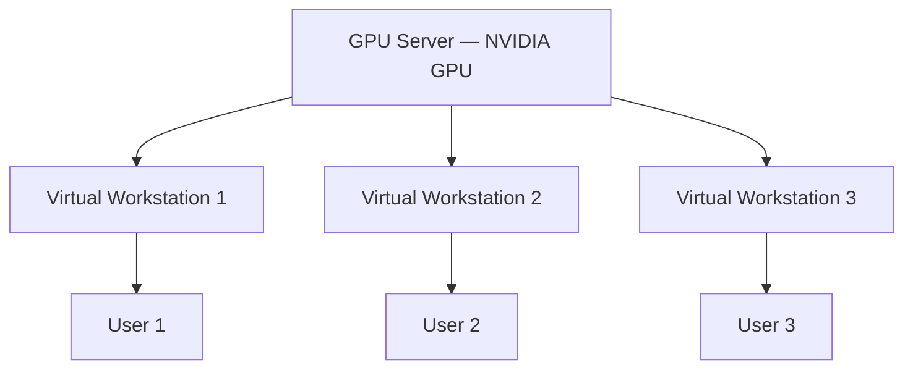
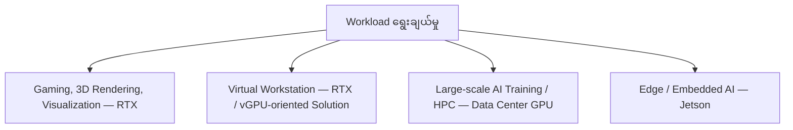
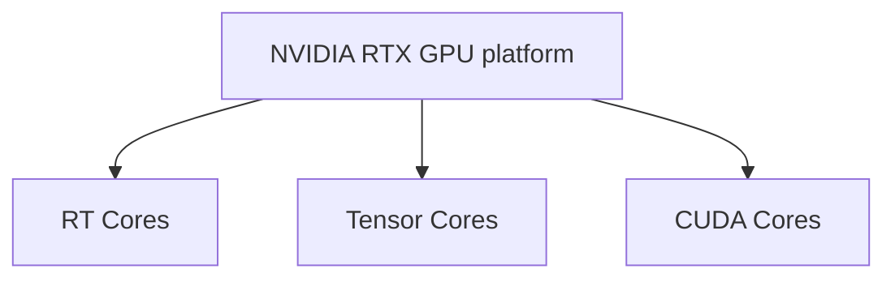
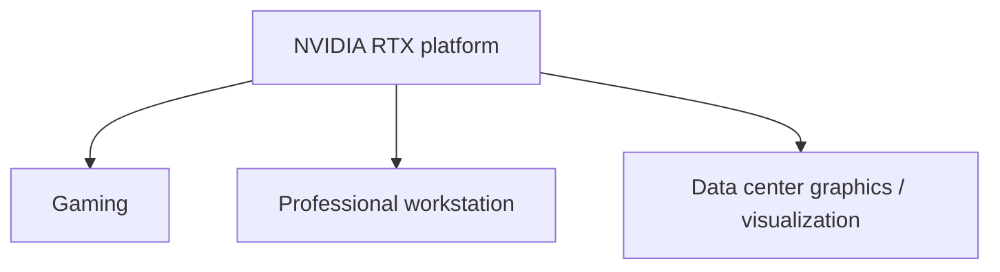
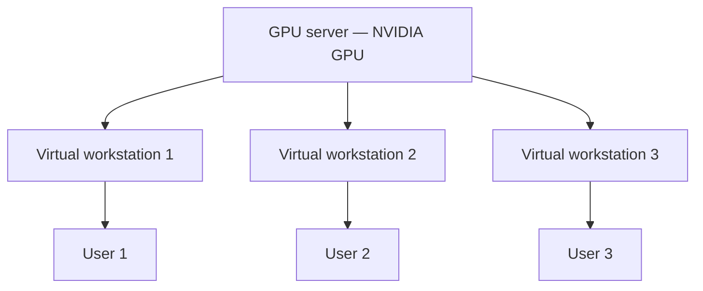
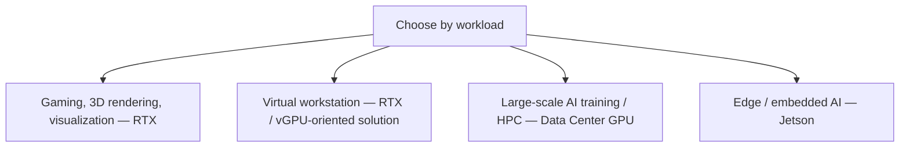

# Module — NVIDIA Physical Layer: RTX Series

> Part I · Course Module 06 (NVIDIA AI Infrastructure and DGX Systems) — topic notes

## မြန်မာဘာသာ version

## 1. Introduction — Physical Layer ကို စတင်လေ့လာခြင်း

အရင် module မှာ NVIDIA Technology Stack ကို Six-Layer Architecture အနေနဲ့ လေ့လာခဲ့ပါတယ်။
အခုကနေစပြီး အောက်ဆုံး layer ဖြစ်တဲ့ Physical Layer ကို အသေးစိတ်စတင်လေ့လာပါမယ်။
Physical Layer မှာ NVIDIA technology stack အတွက် အသုံးပြုနိုင်တဲ့ physical components အမျိုးမျိုးရှိပါတယ်။
ဒီ components တွေကို လေ့လာတဲ့အခါ product name ကိုပဲ မှတ်တာထက် အောက်ပါအချက်တွေကို နားလည်ဖို့ ပိုအရေးကြီးပါတယ်။

- ဒီ component က ဘာလဲ?
- ဘာအတွက်အသုံးပြုသလဲ?
- ဘယ် workload အတွက် သင့်တော်သလဲ?
- ဘယ် workload အတွက် မသင့်တော်သလဲ?
- ဘယ်အခြေအနေမှာ ဒီ component ကို အခြား component ထက် ရွေးချယ်သင့်သလဲ?

ဒါဟာ real-world infrastructure design အတွက်သာမက NVIDIA certification အတွက်လည်း အရေးကြီးပါတယ်။

## 2. NVIDIA RTX Series

Physical Layer ကို စတင်လေ့လာတဲ့အခါ ပထမဆုံးအနေနဲ့ NVIDIA RTX Series ကို ကြည့်ပါမယ်။
RTX ဆိုတာဘာလဲ?
RTX ဟာ NVIDIA ရဲ့ Ray Tracing technology နဲ့ ဆက်စပ်တဲ့ technology/product branding ဖြစ်ပါတယ်။
Ray tracing ဆိုတာ graphics rendering နဲ့ သက်ဆိုင်တဲ့ technique တစ်ခုဖြစ်ပြီး ဒီ lesson မှာ GPU cores ကို လေ့လာတဲ့အခါ ပိုမိုအသေးစိတ်ရှင်းပြသွားမှာ ဖြစ်ပါတယ်။
ဒီအဆင့်မှာ အဓိကမှတ်ထားရမှာက—

- RTX = NVIDIA GPU platform/family associated with Ray Tracing and accelerated graphics capabilities.

## 3. RTX Architecture

RTX family ကို NVIDIA ရဲ့ GPU architectures တွေထဲမှာ—

- RT Cores
- Tensor Cores
- CUDA Cores

စတဲ့ specialized processing elements တွေနဲ့ ဆက်စပ်ပြီး နားလည်နိုင်ပါတယ်။
အခုချိန်မှာ ဒီ cores တွေ ဘာလုပ်သလဲဆိုတာ အလွန်အသေးစိတ် မသွားသေးပါဘူး။
နောက်လာမယ့် GPU architecture section မှာ သီးခြားလေ့လာပါမယ်။
အခုအဆင့်မှာ—

```
RTX
 │
 ├── RT Cores
 ├── Tensor Cores
 └── CUDA Cores
```

ဆိုတာကို သိထားရင် လုံလောက်ပါတယ်။

**Figure 1 — RTX architecture ထဲက specialized cores သုံးမျိုး**


**ပုံရှင်းလင်းချက် (Figure walkthrough):**
- အပေါ်ဆုံးက NVIDIA RTX platform ကို ဗဟိုပြုပြီး အောက်က cores သုံးမျိုးကို ကြည့်ပါ။
- RT Cores၊ Tensor Cores နဲ့ CUDA Cores ဆိုတာ RTX GPU တွေမှာ ပါဝင်တဲ့ specialized processing elements တွေ ဖြစ်ပါတယ်။
- ဒီ cores တွေရဲ့ အသေးစိတ် လုပ်ဆောင်ချက်တွေကို နောက်လာမယ့် GPU architecture section မှာ ဆက်လေ့လာပါမယ်။

## 4. RTX — One Platform, Multiple Target Markets

RTX ဟာ gaming တစ်ခုတည်းအတွက်ပဲ မဟုတ်ပါဘူး။
RTX technology ကို target market အလိုက် optimize လုပ်ထားတဲ့ products တွေမှာ တွေ့နိုင်ပါတယ်။
အဓိကအားဖြင့်—

```
                 NVIDIA RTX
                     │
        ┌────────────┼────────────┐
        ▼            ▼            ▼
      Gaming     Professional   Data Center
                  Workstation
```

ဒါကြောင့် RTX ဆိုတာကို—

- Gaming + Professional Workstation + Certain Data Center Graphics/Visualization Workloads

ဆိုတဲ့ context နဲ့ နားလည်နိုင်ပါတယ်။

**Figure 2 — RTX: platform တစ်ခုတည်း၊ target markets အမျိုးမျိုး**


**ပုံရှင်းလင်းချက် (Figure walkthrough):**
- အပေါ်က RTX platform တစ်ခုတည်းကနေ အောက်ကို သုံးခု ခွဲကြည့်ပါ။
- Gaming၊ Professional Workstation နဲ့ Data Center graphics/visualization ဆိုပြီး target market သုံးမျိုးအတွက် ထုတ်ကုန်တွေ ရှိပါတယ်။
- ဒါကြောင့် RTX ကို gaming အတွက်ပဲလို့ မမှတ်ဘဲ graphics-oriented market တွေအတွက် ပူးပေါင်းအသုံးပြုနိုင်တဲ့ platform အဖြစ် နားလည်ပါ။

## 5. NVIDIA L40

RTX family ရဲ့ data-center-oriented example တစ်ခုအနေနဲ့ NVIDIA L40 ကို စဉ်းစားနိုင်ပါတယ်။
L40 ဟာ data-center GPU ဖြစ်ပြီး professional visualization နဲ့ graphics-intensive workloads တွေအတွက် အသုံးပြုနိုင်ပါတယ်။
ဒီလို GPU တွေကို server ထဲမှာ physical GPU card အနေနဲ့ တပ်ဆင်အသုံးပြုနိုင်ပါတယ်။

```
             Server
        ┌───────────────┐
        │     CPU       │
        │               │
        │   RAM         │
        │               │
        │   ┌───────┐   │
        │   │ L40   │   │
        │   │ GPU   │   │
        │   └───────┘   │
        │               │
        └───────────────┘
```

## 6. RTX / L40 — Real-Time Collaboration and Rendering

Transcript အရ ဒီလို RTX-oriented data-center GPUs တွေကို—

- Real-time collaboration
- 3D design
- 3D visualization
- Rendering
- Graphics-intensive workflows

တွေအတွက် အသုံးပြုနိုင်ပါတယ်။
ဥပမာ architecture company တစ်ခုမှာ architect တွေက 3D building model တစ်ခုကို ဖန်တီးနေတယ်ဆိုပါစို့။
သူတို့လိုအပ်တာက—

```
3D Model
    │
    ▼
GPU Acceleration
    │
    ▼
Real-Time Rendering
    │
    ▼
Visualization
```

ဖြစ်ပါတယ်။
ဒီလို workload တွေမှာ RTX GPU က သင့်တော်ပါတယ်။

## 7. Virtual Workstation

RTX ရဲ့ အရေးကြီးတဲ့ use case တစ်ခုက Virtual Workstation ဖြစ်ပါတယ်။
Traditional model မှာ—

- User 1 → Powerful Workstation
- User 2 → Powerful Workstation
- User 3 → Powerful Workstation
- User 4 → Powerful Workstation

ဆိုပြီး user တစ်ယောက်ချင်းစီအတွက် powerful workstation တစ်ခုစီ ပေးရနိုင်ပါတယ်။
ဒါပေမယ့် centralized GPU server ကို အသုံးပြုပြီး virtual workstation တွေကို provision လုပ်နိုင်ပါတယ်။

```
                GPU Server
            ┌───────────────┐
            │   NVIDIA GPU  │
            └───────┬───────┘
                    │
         ┌──────────┼──────────┐
         ▼          ▼          ▼
    Virtual WS  Virtual WS  Virtual WS
         │          │          │
         ▼          ▼          ▼
       User 1      User 2     User 3
```

ဒီလို architecture နဲ့ users တွေက powerful GPU system ကို remote/virtual environment ကနေ access လုပ်နိုင်ပါတယ်။
ဒါကြောင့် physical workstation အများကြီး ဝယ်ပေးရမယ့် requirement ကို လျှော့ချနိုင်တဲ့ architecture ဖြစ်ပါတယ်။

**Figure 3 — Centralized GPU server မှ virtual workstations များဖြင့် users များကို ဝန်ဆောင်မှုပေးပုံ**



**ပုံရှင်းလင်းချက် (Figure walkthrough):**
- အပေါ်ဆုံးက GPU Server တစ်ခုတည်းမှာ NVIDIA GPU resources ကို စုစည်းထားပါတယ်။
- အလယ်အဆင့်မှာ အဲဒီ resources ကို virtual workstations သုံးခုအဖြစ် ခွဲဝေပေးပါတယ်။
- အောက်ဆုံးက User 1 မှ User 3 တွေဟာ မိမိတို့ virtual workstation ကတစ်ဆင့် remote ကနေ အသုံးပြုနိုင်ပြီး user တစ်ယောက်ချင်းစီအတွက် physical workstation သီးခြားဝယ်စရာ မလိုတော့ပါဘူး။

## 8. NVIDIA Virtual Workstation

Transcript မှာ NVIDIA Virtual Workstation (vWS) ကို ဒီ use case နဲ့ ဆက်စပ်ပြီး ဖော်ပြထားပါတယ်။
အဓိက concept က—

- Centralized NVIDIA GPU resources ကို virtual workstations အဖြစ် users အများအပြားက အသုံးပြုနိုင်ခြင်း

ဖြစ်ပါတယ်။
ဒါဟာ အထူးသဖြင့် graphics-intensive teams တွေအတွက် အသုံးဝင်ပါတယ်။

## 9. Who Is RTX Suitable For?

RTX-based solutions တွေဟာ အောက်ပါ teams / workloads တွေအတွက် သင့်တော်ပါတယ်။

### 9.1 Design Studios

3D design, visualization, rendering စတာတွေလိုအပ်တဲ့ design studios တွေမှာ အသုံးဝင်ပါတယ်။

### 9.2 Architects

Architects တွေဟာ building designs နဲ့ 3D models တွေကို real-time visualization လုပ်ဖို့ GPU acceleration လိုအပ်နိုင်ပါတယ်။

### 9.3 Engineering Teams

Engineering teams တွေမှာ—

- CAD
- 3D visualization
- Simulation visualization
- Rendering

လို graphics-intensive workloads တွေရှိနိုင်ပါတယ်။

### 9.4 Remote Collaboration

Enterprise တစ်ခုမှာ centralized GPU infrastructure ထားပြီး users တွေကို remote virtual workstation environment ပေးနိုင်ပါတယ်။

## 10. RTX — What It Is Good At

RTX ကို အဓိကအားဖြင့်—

```
RTX
 │
 ├── Gaming
 ├── Graphics
 ├── 3D Rendering
 ├── Visualization
 ├── Professional Workstation
 └── Virtual Workstation
```

စတဲ့ workloads တွေနဲ့ ဆက်စပ်ပြီး မှတ်နိုင်ပါတယ်။
အထူးသဖြင့် graphics-intensive workloads တွေအတွက် အရေးကြီးပါတယ်။

## 11. What RTX Is NOT Primarily Designed For

Certification နဲ့ real-world decision-making အတွက် ဒီအချက်က အရေးကြီးပါတယ်။
RTX ကို—

**Large-Scale AI Training** အတွက် primary choice အဖြစ် မစဉ်းစားသင့်ပါဘူး။
Large-scale AI training မှာ specialized Data Center GPU platforms တွေက ပိုသင့်တော်ပါတယ်။

**Large-Scale HPC** — High Performance Computing workload ကြီးတွေမှာလည်း dedicated data-center/HPC GPU solutions တွေကို စဉ်းစားရပါတယ်။

**Edge / Embedded AI** — Remote location တွေမှာ run နေတဲ့ small edge systems တွေအတွက်လည်း RTX ကို အဓိက solution အဖြစ် မစဉ်းစားသင့်ပါဘူး။
ဥပမာ—

```
Remote Factory
      │
      ▼
    Sensor
      │
      ▼
Edge Device
      │
      ▼
Local AI Processing
      │
      ▼
Backend
```

ဒီလို edge/embedded use case တွေအတွက် NVIDIA မှာ Jetson family လို dedicated platform တွေ ရှိပါတယ်။
ဒါကြောင့်—

- RTX ≠ Universal GPU for every AI workload

ဆိုတာကို မှတ်ထားဖို့လိုပါတယ်။

## 12. RTX vs Other NVIDIA GPU Platforms

High-level decision-making အတွက် ဒီလိုစဉ်းစားနိုင်ပါတယ်။

| Workload | Suitable Direction |
|---|---|
| Gaming | RTX |
| 3D Rendering | RTX |
| Professional Visualization | RTX / Professional GPU |
| Virtual Workstation | RTX / vGPU-oriented solution |
| Large-scale AI Training | Data Center GPU |
| Large-scale HPC | Data Center / HPC GPU |
| Edge / Embedded AI | Jetson |
| General Graphics-intensive Workload | RTX |

ဒီ table ရဲ့ ရည်ရွယ်ချက်က product တစ်ခုချင်းစီရဲ့ exact specification ကို မှတ်ခိုင်းတာမဟုတ်ပါဘူး။
Workload → Appropriate GPU Platform ဆိုတဲ့ decision-making skill ကို တည်ဆောက်ပေးဖို့ ဖြစ်ပါတယ်။

## 13. Important Concept — RTX Is a Platform / Family

RTX ကို GPU model တစ်ခုတည်းအနေနဲ့ မမြင်သင့်ပါဘူး။
RTX ဟာ NVIDIA ရဲ့ broader graphics/GPU platform family တစ်ခုဖြစ်ပါတယ်။
အဲဒီ family အတွင်းမှာ target market အလိုက် products တွေကွဲနိုင်ပါတယ်။

```
                    RTX
                     │
        ┌────────────┼────────────┐
        ▼            ▼            ▼
      Gaming     Professional   Data Center
        │         Workstation       │
        ▼             ▼             ▼
     Gaming        Design /       Graphics /
     Graphics      Visualization  Visualization
```

ဒါကြောင့် RTX ကို—

- A common NVIDIA GPU technology/platform foundation adapted for different graphics-oriented markets

လို့ နားလည်နိုင်ပါတယ်။

## 14. Certification Focus

NVIDIA certification အတွက် product name တစ်ခုကိုတွေ့တာနဲ့—

- “ဒီဟာ GPU ဖြစ်တယ်”

လောက်နဲ့ မပြီးပါဘူး။
အဓိကက—

**Question 1 — What is it?**

- RTX = NVIDIA GPU family/platform associated with ray tracing and accelerated graphics.

**Question 2 — Where is it used?**

- Gaming
- Professional visualization
- 3D rendering
- Virtual workstation
- Graphics-intensive workloads

**Question 3 — Where is it NOT the primary choice?**

- Large-scale AI training
- Large-scale HPC
- Edge/embedded AI

**Question 4 — What should you consider instead?**

- Data Center GPUs → AI/HPC
- Jetson → Edge/Embedded AI

## 15. Exam Shortcut

ဒီအပိုင်းကို အောက်ပါအတိုင်း မှတ်ထားပါ။

- RTX = Graphics + Visualization + Workstation + Gaming

ပြီးတော့—

- Large-scale AI/HPC → Data Center GPU
- Edge/Embedded AI → Jetson

ဒီလို workload-based mapping ကို မှတ်ထားရင် certification questions တွေမှာ product name ကိုကြည့်ပြီး use case ကို ခွဲခြားရတာ ပိုလွယ်လာပါလိမ့်မယ်။

**Figure 4 — Workload အလိုက် GPU platform ရွေးချယ်မှု map**



**ပုံရှင်းလင်းချက် (Figure walkthrough):**
- အပေါ်က workload ကစပြီး မိမိ workload နဲ့ ကိုက်ညီတဲ့ လမ်းကြောင်းကို အောက်ကနေ ရွေးပါ။
- Gaming၊ 3D rendering၊ visualization နဲ့ virtual workstation တွေအတွက် RTX ဘက်ကို ကြည့်ပါ။
- Large-scale AI training နဲ့ HPC အတွက် Data Center GPU ကို ရွေးပြီး edge/embedded AI အတွက်ကတော့ Jetson ကို စဉ်းစားပါ။

## 16. Final Mental Model

```
                    NVIDIA GPU Platforms
                            │
          ┌─────────────────┼─────────────────┐
          ▼                 ▼                 ▼
        RTX            Data Center          Jetson
          │                GPU                 │
          │                 │                  │
          ▼                 ▼                  ▼
   Gaming / Graphics     AI / HPC        Edge / Embedded
   Visualization
   Workstations
   Rendering
```

**One-Line Summary**

RTX is primarily associated with graphics, gaming, professional visualization, rendering, and virtual workstation workloads; specialized NVIDIA Data Center GPUs are better suited for large-scale AI/HPC, while Jetson targets edge and embedded AI.

ဒီအချက်ကို နားလည်ထားရင် Physical Layer ထဲက နောက်ထပ် NVIDIA GPU families တွေကို လေ့လာတဲ့အခါ “ဘယ် GPU က ဘယ် workload အတွက်လဲ?” ဆိုတဲ့ decision-making approach နဲ့ ဆက်လေ့လာနိုင်ပါလိမ့်မယ်။

## 17. ကိုယ့်ကိုယ်ကို စစ်ဆေးရန် မေးခွန်းများ (Self-Check Questions)

**မေးခွန်း ၁ —** RTX ဆိုတာ ဘာနဲ့ ဆက်စပ်တဲ့ NVIDIA GPU platform လဲ?
**အဖြေ —** RTX = Ray Tracing နဲ့ accelerated graphics capabilities တွေနဲ့ ဆက်စပ်တဲ့ NVIDIA GPU platform/family ဖြစ်ပါတယ်။

**မေးခွန်း ၂ —** RTX architecture မှာ ပါတဲ့ specialized processing elements သုံးခုက ဘာတွေလဲ?
**အဖြေ —** RT Cores၊ Tensor Cores၊ CUDA Cores တို့ ဖြစ်ပါတယ်။

**မေးခွန်း ၃ —** Large-scale AI training အတွက် RTX အစား ဘာကို စဉ်းစားသင့်သလဲ?
**အဖြေ —** Specialized Data Center GPU platforms ကို စဉ်းစားသင့်ပါတယ်။ (Edge/embedded AI အတွက်ကတော့ Jetson ဖြစ်ပါတယ်။)

**မေးခွန်း ၄ —** Virtual Workstation concept ရဲ့ အဓိကအကျိုးကျေးဇူးက ဘာလဲ?
**အဖြေ —** Centralized NVIDIA GPU resources ကို virtual workstations အဖြစ် users အများအပြား မျှဝေအသုံးပြုနိုင်ပြီး user တစ်ယောက်ချင်းစီအတွက် powerful physical workstation တွေ သီးခြားဝယ်ပေးရမယ့် requirement ကို လျှော့ချနိုင်ပါတယ်။

**မေးခွန်း ၅ —** NVIDIA L40 ကို ဘယ်လို workload တွေအတွက် အသုံးပြုနိုင်သလဲ?
**အဖြေ —** L40 ဟာ data-center GPU ဖြစ်ပြီး professional visualization၊ 3D design/visualization၊ rendering စတဲ့ graphics-intensive workloads တွေအတွက် အသုံးပြုနိုင်ပါတယ်။

---

## English Version — NVIDIA Physical Layer: RTX Series

## 1. Introduction — Understanding the Physical Layer

In the previous module, we introduced the six-layer NVIDIA Technology Stack.
We will now begin studying the bottom layer in more detail:

- The Physical Layer

The physical layer contains many different components that can be used to build NVIDIA-based systems.
When studying these components, it is important not only to know what each component is, but also to understand:

- What is it?
- What is it used for?
- What workloads is it suitable for?
- What workloads is it not suitable for?
- When should you choose it over another component?

This is important both for real-world infrastructure design and for NVIDIA certification.

## 2. NVIDIA RTX Series

We will start the physical-layer discussion with the NVIDIA RTX Series.
What does RTX mean?
RTX is NVIDIA's technology/product branding associated with ray tracing and accelerated graphics.
Ray tracing is a graphics-rendering technique. We will explain the details of ray tracing later when we study GPU cores and architecture.
For now, remember:

- RTX = NVIDIA GPU platform/family associated with Ray Tracing and accelerated graphics capabilities.

## 3. RTX Architecture

RTX GPUs are associated with specialized processing elements such as:

- RT Cores
- Tensor Cores
- CUDA Cores

We will explain these components in detail in the upcoming GPU architecture section.
For now, the basic model is:

```
RTX
 │
 ├── RT Cores
 ├── Tensor Cores
 └── CUDA Cores
```

**Figure 1 — The three specialized cores in the RTX architecture model**



**Figure walkthrough (ပုံရှင်းလင်းချက်):**
- Look at the top box, the NVIDIA RTX platform, then follow the three arrows down.
- RT Cores, Tensor Cores, and CUDA Cores are the specialized processing elements inside RTX GPUs.
- What each core does in detail is covered later in the GPU architecture section.

## 4. RTX — One Platform, Multiple Target Markets

RTX is not limited to gaming.
The RTX technology family appears across products designed for different markets.
At a high level:

```
                 NVIDIA RTX
                     │
        ┌────────────┼────────────┐
        ▼            ▼            ▼
      Gaming     Professional   Data Center
                  Workstation
```

Therefore, RTX can be understood in the context of:

- Gaming + Professional Workstation + Certain Data Center Graphics/Visualization Workloads

**Figure 2 — RTX: one platform, multiple target markets**



**Figure walkthrough (ပုံရှင်းလင်းချက်):**
- Start from the single RTX platform box at the top and split downward into three markets.
- Products exist for gaming, professional workstations, and data-center graphics/visualization.
- So RTX is not only for gaming — it is one graphics-oriented platform adapted for several markets.

## 5. NVIDIA L40

The NVIDIA L40 is an example of an NVIDIA data-center GPU designed for professional visualization and graphics-intensive workloads.
These GPUs can be installed as physical GPU cards inside servers.
Conceptually:

```
             Server
        ┌───────────────┐
        │     CPU       │
        │               │
        │   RAM         │
        │               │
        │   ┌───────┐   │
        │   │ L40   │   │
        │   │ GPU   │   │
        │   └───────┘   │
        │               │
        └───────────────┘
```

## 6. RTX / L40 — Real-Time Collaboration and Rendering

The transcript identifies several graphics-oriented workloads for these types of GPUs:

- Real-time collaboration
- 3D design
- 3D visualization
- Rendering
- Graphics-intensive workflows

For example, imagine an architecture company creating a 3D building model.
They may need:

```
3D Model
    │
    ▼
GPU Acceleration
    │
    ▼
Real-Time Rendering
    │
    ▼
Visualization
```

This is a strong example of a graphics-intensive workload.

## 7. Virtual Workstation

Another important RTX use case is the Virtual Workstation.
Traditionally, an organization might provide a powerful workstation to each user:

- User 1 → Powerful Workstation
- User 2 → Powerful Workstation
- User 3 → Powerful Workstation
- User 4 → Powerful Workstation

An alternative approach is to centralize the GPU resources and provide users with virtual workstations.

```
                GPU Server
            ┌───────────────┐
            │   NVIDIA GPU  │
            └───────┬───────┘
                    │
         ┌──────────┼──────────┐
         ▼          ▼          ▼
    Virtual WS  Virtual WS  Virtual WS
         │          │          │
         ▼          ▼          ▼
       User 1      User 2     User 3
```

Users can remotely access the centralized NVIDIA GPU resources through virtual workstations.
This can reduce the need to provide a dedicated high-end physical workstation to every individual user.

**Figure 3 — Serving many users with virtual workstations on a centralized GPU server**



**Figure walkthrough (ပုံရှင်းလင်းချက်):**
- The top box is one GPU server holding the centralized NVIDIA GPU resources.
- The middle level splits those resources into three virtual workstations.
- At the bottom, User 1 to User 3 connect remotely through their own virtual workstation — no separate physical workstation per user is needed.

## 8. NVIDIA Virtual Workstation

The transcript refers to NVIDIA Virtual Workstation (vWS) in this context.
The basic idea is:

- Centralized NVIDIA GPU resources can be provided to multiple users through virtual workstation environments.

This is especially useful for graphics-intensive teams that need access to powerful GPU resources.

## 9. Who Is RTX Suitable For?

RTX-oriented solutions are suitable for workloads and teams such as:

### 9.1 Design Studios

Design studios can use GPU acceleration for:

- 3D design
- Visualization
- Rendering

### 9.2 Architects

Architects may need real-time visualization of building models and other 3D designs.

### 9.3 Engineering Teams

Engineering teams may use GPU acceleration for:

- CAD
- 3D visualization
- Simulation visualization
- Rendering

### 9.4 Remote Collaboration

Enterprises can centralize GPU resources and provide remote users with virtual workstation environments.

## 10. What RTX Is Good At

A useful high-level mapping is:

```
RTX
 │
 ├── Gaming
 ├── Graphics
 ├── 3D Rendering
 ├── Visualization
 ├── Professional Workstation
 └── Virtual Workstation
```

The key theme is:

- Graphics-intensive workloads

## 11. What RTX Is NOT Primarily Designed For

This distinction is important for both certification and real-world design.

**Large-Scale AI Training** — RTX should not automatically be considered the primary platform for large-scale AI training.
Large-scale AI training is generally associated with specialized Data Center GPU platforms.

**Large-Scale HPC** — For large High Performance Computing workloads, dedicated data-center/HPC GPU solutions should be considered.

**Edge / Embedded AI** — RTX is also not the primary platform for small edge or embedded systems.
For example:

```
Remote Factory
      │
      ▼
    Sensor
      │
      ▼
Edge Device
      │
      ▼
Local AI Processing
      │
      ▼
Backend
```

For this type of edge/embedded use case, NVIDIA has dedicated platforms such as Jetson.
Therefore:

- RTX is not a universal NVIDIA GPU platform for every AI workload.

## 12. RTX vs Other NVIDIA GPU Platforms

For high-level decision-making:

| Workload | Suitable Direction |
|---|---|
| Gaming | RTX |
| 3D Rendering | RTX |
| Professional Visualization | RTX / Professional GPU |
| Virtual Workstation | RTX / vGPU-oriented solution |
| Large-scale AI Training | Data Center GPU |
| Large-scale HPC | Data Center / HPC GPU |
| Edge / Embedded AI | Jetson |
| General Graphics-intensive Workload | RTX |

The purpose of this table is not to memorize every product specification.
The goal is to develop the ability to map:

- Workload → Appropriate GPU Platform

## 13. Important Concept — RTX Is a Platform / Family

RTX should not be thought of as one specific GPU model.
It is a broader NVIDIA GPU technology/product family associated strongly with graphics and accelerated visualization.
Different products can target different markets.

```
                    RTX
                     │
        ┌────────────┼────────────┐
        ▼            ▼            ▼
      Gaming     Professional   Data Center
        │         Workstation       │
        ▼             ▼             ▼
     Gaming        Design /       Graphics /
     Graphics      Visualization  Visualization
```

Therefore:

- RTX is a common NVIDIA GPU technology/platform foundation adapted for different graphics-oriented markets.

## 14. Certification Focus

For NVIDIA certification, simply recognizing that RTX is a GPU is not enough.
The important questions are:

**Question 1 — What is it?**

- RTX is an NVIDIA GPU family/platform associated with ray tracing and accelerated graphics.

**Question 2 — Where is it used?**

Typical areas include:

- Gaming
- Professional visualization
- 3D rendering
- Virtual workstation
- Graphics-intensive workloads

**Question 3 — Where is it NOT the primary choice?**

Examples include:

- Large-scale AI training
- Large-scale HPC
- Edge/embedded AI

**Question 4 — What should you consider instead?**

- Data Center GPUs → AI/HPC
- Jetson → Edge/Embedded AI

## 15. Exam Shortcut

Remember:

- RTX = Graphics + Visualization + Workstation + Gaming

Then:

- Large-scale AI/HPC → Data Center GPU
- Edge/Embedded AI → Jetson

This workload-based mapping is more useful for certification questions than simply memorizing product names.

**Figure 4 — Workload-to-GPU-platform selection map**



**Figure walkthrough (ပုံရှင်းလင်းချက်):**
- Start at the top box and pick the branch that matches your workload.
- For gaming, 3D rendering, visualization, and virtual workstations, look at the RTX branch.
- For large-scale AI training and HPC choose Data Center GPUs; for edge/embedded AI consider Jetson.

## 16. Final Mental Model

```
                    NVIDIA GPU Platforms
                            │
          ┌─────────────────┼─────────────────┐
          ▼                 ▼                 ▼
        RTX            Data Center          Jetson
          │                GPU                 │
          │                 │                  │
          ▼                 ▼                  ▼
   Gaming / Graphics     AI / HPC        Edge / Embedded
   Visualization
   Workstations
   Rendering
```

**One-Line Summary**

RTX is primarily associated with graphics, gaming, professional visualization, rendering, and virtual workstation workloads; specialized NVIDIA Data Center GPUs are better suited for large-scale AI/HPC, while Jetson targets edge and embedded AI.

Once you understand this distinction, you can approach the next physical-layer components using the same question:

- “Which NVIDIA GPU platform is appropriate for this workload, and why?”

## 17. Self-Check Questions

**Q1 —** What kind of NVIDIA GPU platform is RTX?
**A —** RTX = the NVIDIA GPU platform/family associated with Ray Tracing and accelerated graphics capabilities.

**Q2 —** Which three specialized processing elements appear in the RTX architecture model?
**A —** RT Cores, Tensor Cores, and CUDA Cores.

**Q3 —** Instead of RTX, what should you consider for large-scale AI training?
**A —** Specialized Data Center GPU platforms (and Jetson for edge/embedded AI).

**Q4 —** What is the main benefit of the Virtual Workstation concept?
**A —** Centralized NVIDIA GPU resources can be shared by many users through virtual workstations, reducing the need to buy a powerful physical workstation per user.

**Q5 —** What workloads is the NVIDIA L40 used for in this lesson?
**A —** As a data-center GPU for professional visualization, 3D design/visualization, rendering, and other graphics-intensive workloads.

---

## Technical review notes

- The source gives no L40 specifications (memory, performance); only its role as a data-center GPU for professional visualization and graphics-intensive workloads is stated. No specs are claimed here.
- The workload → GPU platform mapping (RTX / Data Center GPU / Jetson) is a high-level decision aid from the source, not a product-by-product specification table.
- Ray tracing details are explicitly deferred by the source to the later GPU architecture section; they are not covered here.
- Mermaid figures (Figure 1–4) with figure walkthroughs added inline in both the Myanmar and English sections; figure numbering matches across the two sections; all existing text and ASCII diagrams preserved.
