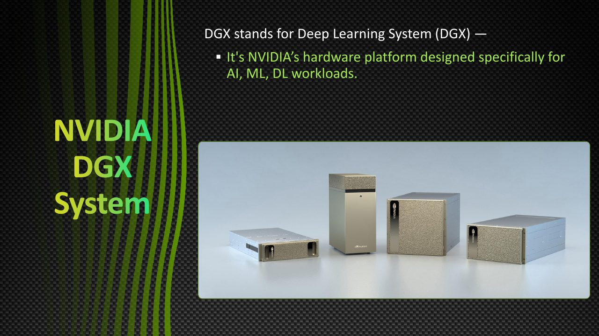
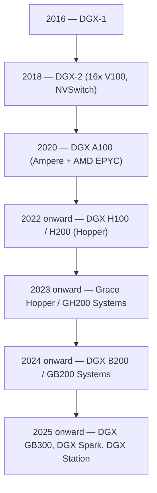
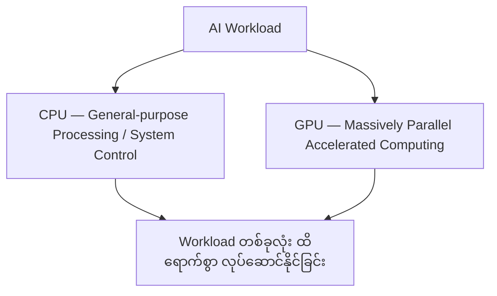
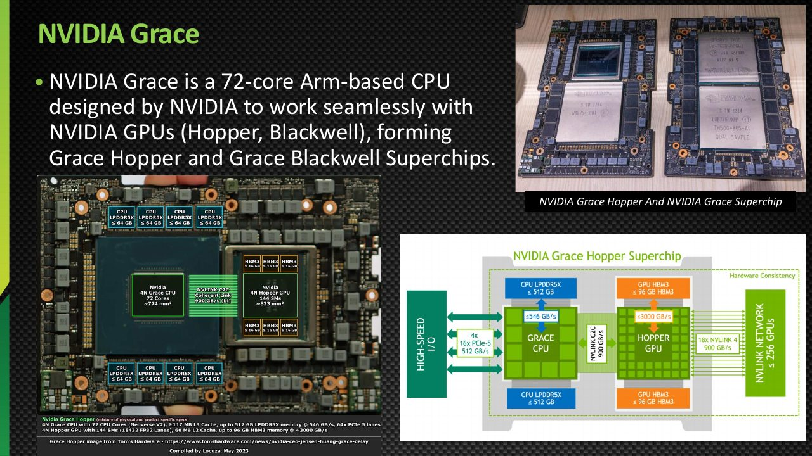
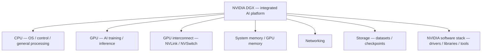
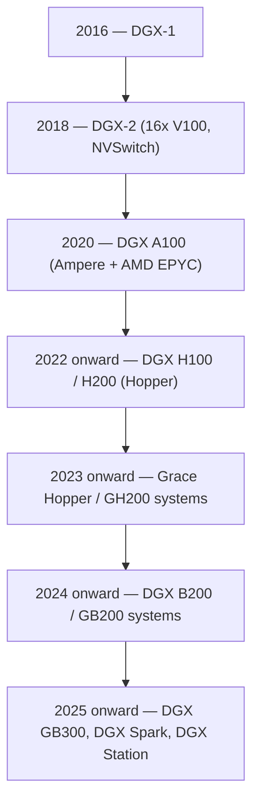
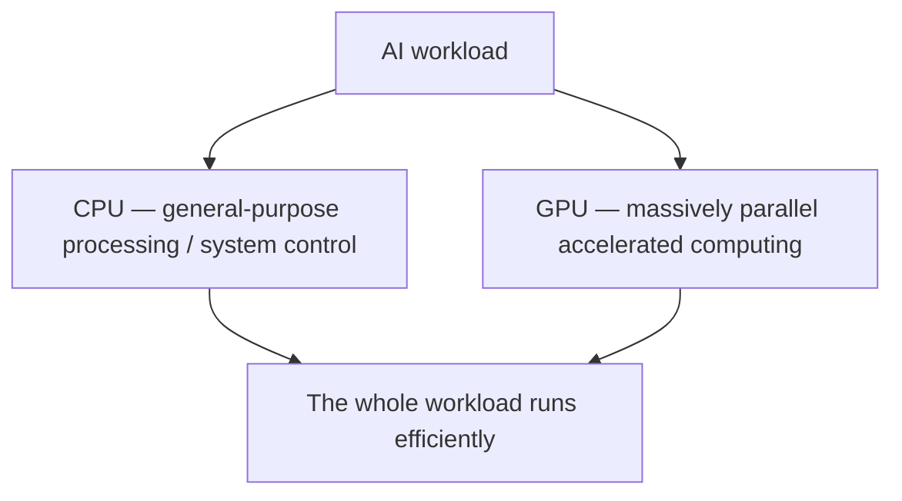
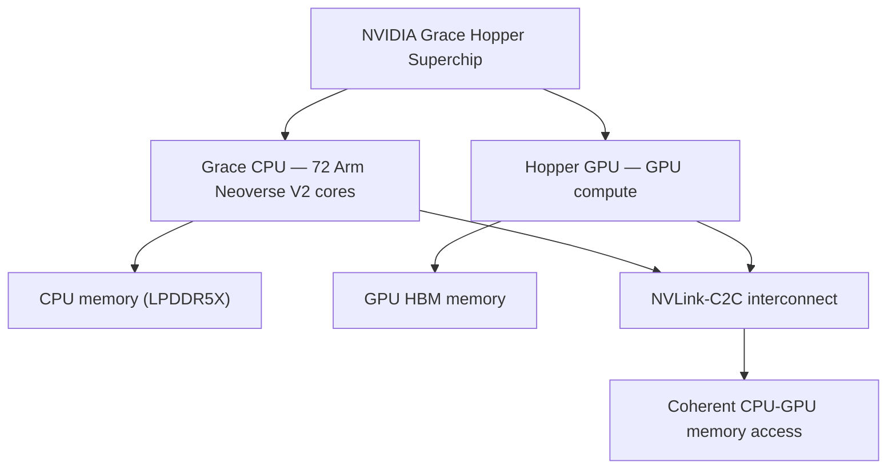

# Module — NVIDIA DGX Systems

> Part I · Course Module 06 (NVIDIA AI Infrastructure and DGX Systems) — topic notes

## မြန်မာဘာသာ version

## 1. DGX ဆိုတာ ဘာလဲ?

NVIDIA DGX ဟာ AI, Machine Learning (ML), Deep Learning နဲ့ High-Performance Computing (HPC) Workloads တွေအတွက် ရည်ရွယ်ထုတ်လုပ်ထားတဲ့ Integrated Hardware and Software Platform Family ဖြစ်ပါတယ်။

DGX System တစ်ခုကို GPU အများအပြား တပ်ဆင်ထားတဲ့ Server တစ်လုံးလို့သာ နားလည်ထားရင် မပြည့်စုံပါဘူး။ ပုံမှန်အားဖြင့် အောက်ပါ Components တွေကို ပေါင်းစပ်ထားတဲ့ AI Computing Platform ဖြစ်ပါတယ်။

- **CPU** — Operating System, Control Tasks နဲ့ အထွေထွေ Processing အတွက်။
- **GPU** — AI Training, Inference နဲ့ Accelerated Computing အတွက်။
- **GPU Interconnect** — NVLink နဲ့ NVSwitch ကဲ့သို့သော Technologies တွေမှတစ်ဆင့် GPU များအကြား Data Communication ကို ပံ့ပိုးပေးခြင်း။
- **System Memory နဲ့ GPU Memory** — CPU နဲ့ GPU Workloads တွေအတွက် Data သိမ်းဆည်းအသုံးပြုခြင်း။
- **Networking** — အခြား Servers, Storage နဲ့ Cluster Nodes တွေကို ဆက်သွယ်ခြင်း။
- **Storage** — Datasets, Model Weights, Checkpoints နဲ့ Application Data များကို သိမ်းဆည်းခြင်း။
- **NVIDIA Software Stack** — Drivers, Libraries, AI Framework Support နဲ့ System Management Tools များ။

**DGX ရဲ့ အမည်အကြောင်း** — မူရင်းသင်ခန်းစာက DGX ကို "Deep Learning Systems" လို့ အဓိပ္ပာယ်ဖွင့်ဆိုနိုင်တယ်လို့ ပြောထားပေမဲ့ အဲဒါဟာ တရားဝင် Acronym Expansion မဟုတ်ပါဘူး။ DGX ကို NVIDIA Product Family Name အဖြစ် မှတ်ထားပါ။

NVIDIA ရဲ့ DGX-1 ကို ၂၀၁၆ ခုနှစ်မှာ Deep Learning အတွက် အထူးရည်ရွယ်ထားတဲ့ Integrated System အဖြစ် မိတ်ဆက်ခဲ့ပါတယ်။ (Reference: NVIDIA DGX-1 announcement — https://nvidianews.nvidia.com/news/nvidia-launches-world-s-first-deep-learning-supercomputer)

**Figure 1 — DGX system တစ်ခုထဲမှာ ပေါင်းစပ်ထားတဲ့ အဓိက components များ**


**ပုံရှင်းလင်းချက် (Figure walkthrough):**
- အပေါ်ဆုံးက DGX ဟာ GPU ပါတဲ့ server တစ်လုံးထက် ပိုတဲ့ integrated AI platform ဖြစ်တာကို မြင်ရပါမယ်။
- အောက်က components ခုနစ်ခုကို တစ်ခုချင်းစီ ကြည့်ပါ — CPU က control အလုပ်၊ GPU က AI acceleration၊ GPU Interconnect က GPU ကြား ဆက်သွယ်ရေး ဖြစ်ပါတယ်။
- Memory၊ Networking၊ Storage နဲ့ NVIDIA Software Stack တွေ မပါဘဲ DGX ဟာ ပြည့်စုံတဲ့ AI platform မဖြစ်နိုင်ပါဘူး။


**ဓာတ်ပုံရှင်းလင်းချက် (Photo walkthrough):**
- ပုံထဲမှာ NVIDIA DGX system တစ်လုံးကို မြင်ရပါတယ် — ဒါဟာ data-center rack ထဲ တပ်ဆင်ရတဲ့ integrated server အမျိုးအစား ဖြစ်ပါတယ်။
- အပြင်ဘက်ကနေ CPU၊ GPU များ၊ memory၊ NVMe storage နဲ့ networking စတဲ့ components တွေ မမြင်ရပေမဲ့ ဒီ chassis တစ်ခုတည်းထဲမှာ အားလုံး ပေါင်းစပ်ပါဝင်နေပါတယ်။
- အပေါ်က Figure 1 မှာ ပြထားတဲ့ components ခုနစ်ခုစလုံး ဒီစက်ထဲမှာ ပါဝင်တာကြောင့် "integrated AI platform" ဆိုတဲ့ အဓိပ္ပာယ်ကို ဒီပုံနဲ့ ယှဉ်မှတ်ထားနိုင်ပါတယ်။



**ပုံရှင်းလင်းချက် (Slide walkthrough):** ဒီ training slide က DGX ရဲ့ အဓိပ္ပာယ်ကို ရှင်းပြထားပါတယ် — DGX ဟာ AI, Machine Learning, Deep Learning နဲ့ HPC workloads အတွက် ရည်ရွယ်ထုတ်လုပ်ထားတဲ့ integrated hardware and software platform family ဖြစ်ပါတယ်။ GPU ပါရုံ server တစ်လုံးထက် ပိုတယ်ဆိုတာကို အပေါ်က component စာရင်းနဲ့ ယှဉ်မှတ်ထားနိုင်ပါတယ်။

*(Source: NVIDIA NCA-AIIO training deck — study material)*

## 2. DGX Systems ရဲ့ Evolution

DGX Family ဟာ GPU Generations တွေ တိုးတက်လာတာနဲ့အမျှ CPU, GPU, Memory နဲ့ Interconnect Technologies တွေကိုလည်း တဖြည်းဖြည်း ပြောင်းလဲတိုးတက်လာခဲ့ပါတယ်။

| Period / Generation | System Example | အဓိကအချက် |
|---|---|---|
| 2016 | DGX-1 | Deep Learning အတွက် Integrated NVIDIA System ကို မိတ်ဆက်ခဲ့ခြင်း |
| 2018 | DGX-2 | 16 NVIDIA V100 Tensor Core GPUs နဲ့ NVSwitch ကို အသုံးပြုခဲ့ခြင်း |
| 2020 | DGX A100 | Ampere A100 GPUs နဲ့ AMD EPYC CPUs ကို အသုံးပြုခဲ့ခြင်း |
| 2022 onward | DGX H100 / H200 | Hopper Generation GPUs ကို အခြေခံထားသော Data Center Systems |
| 2023 onward | Grace Hopper / GH200-based systems | NVIDIA Grace CPU နဲ့ Hopper GPU ကို ပေါင်းစပ်ထားသော Superchip Platform |
| 2024 onward | DGX B200 / GB200 systems | Blackwell Generation နဲ့ Grace-Blackwell ပေါင်းစပ်မှုများ |
| 2025 onward | DGX GB300, DGX Spark, DGX Station | Blackwell Ultra Data Center Systems နဲ့ Desktop/Deskside AI Systems |

အရေးကြီးချက်: ဒီဇယားဟာ အဓိက Generation များကို အကျဉ်းချုပ်ပြထားတာဖြစ်ပြီး Product Launch Year အားလုံးကို စာရင်းပြည့်စုံအောင် ဖော်ပြထားတာ မဟုတ်ပါဘူး။ DGX H100 နဲ့ Grace Hopper Systems တွေဟာ မတူညီတဲ့ Product Designs တွေဖြစ်ပါတယ်။ DGX GB200 နဲ့ GB300 Systems တွေမှာလည်း CPU/GPU Configuration နဲ့ Scale ကွာခြားနိုင်ပါတယ်။

အသေးစိတ် Product Support ကို NVIDIA DGX OS System List (https://docs.nvidia.com/dgx/dgx-os-7-user-guide/introduction.html) မှာ လေ့လာနိုင်ပါတယ်။

**Figure 2 — DGX Systems များ၏ evolution timeline (2016 မှ 2025 အထိ)**



**ပုံရှင်းလင်းချက် (Figure walkthrough):**
- box တွေကို အပေါ်ကနေ အောက်ကို ဖတ်ရင် 2016 ခုနှစ် DGX-1 ကစပြီး generation အလိုက် အချိန်အစဉ်အတိုင်း ဖြစ်ပါတယ်။
- တစ်ဆင့်ချင်းစီမှာ GPU generation အသစ်တွေ (Ampere၊ Hopper၊ Blackwell) နဲ့ CPU ပေါင်းစပ်မှုတွေ ပြောင်းလဲလာတာကို တွေ့ရပါမယ်။
- အောက်ဆုံးမှာ DGX Spark နဲ့ DGX Station ဆိုပြီး desktop/deskside AI systems တွေပါ ထွက်လာတာကို တွေ့ရပါမယ်။

## 3. CPU နဲ့ GPU ကို ဘာကြောင့် ပေါင်းစပ်ထားသလဲ?

AI Server တစ်ခုမှာ CPU နဲ့ GPU ဟာ မတူညီတဲ့ အလုပ်တွေကို ဆောင်ရွက်ပေးပါတယ်။

**CPU ရဲ့ အခန်းကဏ္ဍ** — CPU က Operating System, Application Logic, System Management နဲ့ General-purpose Computing တို့ကို ဆောင်ရွက်ပေးပါတယ်။ AI Workload ကို စတင်စီမံခြင်း၊ Data Processing လုပ်ခြင်းနဲ့ GPU Workloads တွေကို စီစဉ်ခြင်းတို့မှာလည်း အရေးပါပါတယ်။

**GPU ရဲ့ အခန်းကဏ္ဍ** — GPU က Parallel Processing နဲ့ AI အတွက် လိုအပ်တဲ့ Matrix/Tensor Operations များကို အရှိန်မြှင့်ပေးပါတယ်။ ဥပမာ Deep Learning Training မှာ Neural Network တစ်ခုရဲ့ Forward Pass, Backpropagation နဲ့ Matrix Operations များစွာကို GPU က အရှိန်မြှင့်ပေးနိုင်ပါတယ်။

အလွယ်မှတ်ရန် —

- CPU = General-purpose Processing and System Control
- GPU = Massively Parallel Accelerated Computing

CPU နဲ့ GPU တို့ဟာ တစ်ခုကိုတစ်ခု အစားထိုးဖို့မဟုတ်ဘဲ Workload တစ်ခုလုံးကို ထိရောက်စွာ လုပ်ဆောင်နိုင်ဖို့ ပေါင်းစပ်ထားတာဖြစ်ပါတယ်။

**Figure 3 — AI Server တစ်ခုတွင် CPU နှင့် GPU တို့၏ အခန်းကဏ္ဍ**



**ပုံရှင်းလင်းချက် (Figure walkthrough):**
- အပေါ်က AI Workload တစ်ခုတည်းကို CPU နဲ့ GPU နှစ်ခုစလုံးက ကူညီဆောင်ရွက်ပေးပါတယ်။
- ဘယ်ဘက်က CPU က OS၊ control နဲ့ general-purpose အလုပ်တွေကို လုပ်ပြီး ညာဘက်က GPU ကတော့ parallel matrix/tensor operations တွေကို အရှိန်မြှင့်ပေးပါတယ်။
- နှစ်ခုစလုံး အောက်ဆုံး box ဆီ ပေါင်းဆုံမှ workload တစ်ခုလုံး ထိရောက်စွာ ပြီးမြောက်ပါတယ် — တစ်ခုကတစ်ခုကို အစားထိုးတာ မဟုတ်ပါဘူး။

## 4. NVIDIA DGX A100

DGX A100 ဟာ NVIDIA Ampere Architecture ကို အခြေခံထားတဲ့ A100 GPUs များကို အသုံးပြုပါတယ်။ ၎င်းမှာ AMD EPYC CPUs တွေကိုလည်း အသုံးပြုထားပါတယ်။

အဓိက Components တွေကတော့ —

- NVIDIA A100 GPUs
- AMD EPYC CPUs
- NVLink နဲ့ NVSwitch GPU Interconnect
- High-speed Networking
- System Memory နဲ့ NVMe Storage
- NVIDIA DGX Software Stack

DGX A100 ရဲ့ အဓိကရည်ရွယ်ချက်က AI Training, AI Inference, Analytics နဲ့ HPC Workloads တွေကို အရှိန်မြှင့်ပေးဖို့ဖြစ်ပါတယ်။ အသေးစိတ် Hardware Configuration ကို NVIDIA DGX A100 User Guide (https://docs.nvidia.com/dgx/dgxa100-user-guide/introduction-to-dgxa100.html) မှာ ကြည့်နိုင်ပါတယ်။

## 5. NVIDIA DGX H100 / H200

DGX H100 နဲ့ H200 ဟာ NVIDIA Hopper GPU Architecture ကို အခြေခံထားတဲ့ Data Center Systems တွေဖြစ်ပါတယ်။ အရေးကြီးတဲ့ အမည်ကွာခြားချက်က —

- A100 — Ampere Architecture
- H100 / H200 — Hopper Architecture
- B200 — Blackwell Architecture
- GB200 / GB300 — Grace CPU နဲ့ Blackwell GPU Architecture ကို ပေါင်းစပ်ထားသော Systems

DGX H100/H200 Systems တွေဟာ Large-scale AI Training, Generative AI နဲ့ Inference Workloads တွေအတွက် ရည်ရွယ်ထားပါတယ်။

**ပြင်ဆင်ဖတ်ရန် (Correction)** — မူရင်း Transcript ထဲက "DGX A100 which has Hopper GPUs" ဆိုတဲ့အပိုင်းဟာ မှားယွင်းပါတယ်။ DGX A100 က Ampere ကို အသုံးပြုပြီး DGX H100 က Hopper ကို အသုံးပြုတာဖြစ်ပါတယ်။

## 6. NVIDIA Grace CPU

NVIDIA Grace ဟာ NVIDIA က ဒီဇိုင်းထုတ်ထားတဲ့ Arm-based Data Center CPU ဖြစ်ပြီး AI Infrastructure နဲ့ HPC Systems တွေမှာ GPU နဲ့ ထိရောက်စွာ ပေါင်းစပ်အလုပ်လုပ်နိုင်ဖို့ ရည်ရွယ်ပါတယ်။

Grace CPU ရဲ့ အဓိက Features တွေကတော့ —

- Arm Neoverse CPU Cores
- LPDDR5X Memory
- High-bandwidth Memory Subsystem
- NVIDIA NVLink-C2C Interconnect
- Grace CPU နဲ့ NVIDIA GPU တို့အကြား Coherent Memory Access ကို ပံ့ပိုးနိုင်ခြင်း (Supported Grace-GPU Configurations များတွင်)

**Grace CPU မှာ Core ဘယ်လောက်ရှိသလဲ?** — NVIDIA Grace CPU တစ်ခုမှာ 72 Arm Neoverse V2 CPU Cores ပါဝင်တဲ့ Configuration ရှိပါတယ်။ Grace CPU Superchip ဆိုတာ CPU Chip နှစ်ခုကို ပေါင်းစပ်ထားတဲ့ သီးခြား Configuration ဖြစ်ပြီး 144 CPU Cores အထိ ရှိနိုင်ပါတယ်။

Grace CPU အကြောင်းကို NVIDIA Grace CPU Superchip (https://www.nvidia.com/en-sg/data-center/grace-cpu-superchip/) မှာ ဆက်လက်လေ့လာနိုင်ပါတယ်။



**ပုံရှင်းလင်းချက် (Slide walkthrough):** ဒီ training slide က NVIDIA Grace CPU ကို မိတ်ဆက်ပြထားပါတယ် — GPU နဲ့ အတူ ထိရောက်စွာ အလုပ်လုပ်နိုင်ဖို့ ဒီဇိုင်းထုတ်ထားတဲ့ Arm-based data center CPU ဖြစ်ပါတယ်။ အပေါ်က feature စာရင်း (Arm Neoverse cores၊ LPDDR5X memory၊ NVLink-C2C) နဲ့ ယှဉ်မှတ်ထားနိုင်ပါတယ်။

*(Source: NVIDIA NCA-AIIO training deck — study material)*

## 7. Grace Hopper Superchip

Grace Hopper Superchip ဟာ NVIDIA Grace CPU နဲ့ NVIDIA Hopper GPU ကို NVLink-C2C ဖြင့် ပေါင်းစပ်ထားတဲ့ CPU-GPU Platform ဖြစ်ပါတယ်။

အဓိက Components တွေကတော့ —

- Grace CPU
- Hopper GPU
- NVLink-C2C Interconnect
- CPU Memory
- GPU HBM Memory

Conceptual Architecture —

```
       NVIDIA Grace Hopper Superchip
       ┌─────────────────────────────┐
       │                             │
       │  Grace CPU     Hopper GPU   │
       │  72 CPU Cores  GPU Compute  │
       │      │              │       │
       │ CPU Memory       GPU HBM    │
       │      │              │       │
       │      └── NVLink-C2C ┘       │
       │                             │
       └─────────────────────────────┘
```

ဒီ Diagram က Conceptual View ဖြစ်ပါတယ်။ အမှန်တကယ် Physical Layout နဲ့ Memory Configuration တွေက System Model အလိုက် ကွာခြားနိုင်ပါတယ်။

**NVLink-C2C ဆိုတာ ဘာလဲ?** — NVLink-C2C (Chip-to-Chip) ဟာ Grace CPU နဲ့ GPU တို့ကြား High-bandwidth, Low-latency Communication နဲ့ Coherent Memory Access ကို ပံ့ပိုးပေးတဲ့ Interconnect Technology ဖြစ်ပါတယ်။ ဒါကြောင့် CPU နဲ့ GPU တို့ဟာ သက်ဆိုင်ရာ Memory Resources တွေကို ထိရောက်စွာ အသုံးပြုနိုင်ပါတယ်။ ဒါပေမဲ့ CPU RAM နဲ့ GPU HBM ဟာ Physical Memory အမျိုးအစားတူတူ ဖြစ်သွားတာ မဟုတ်ပါဘူး။

Reference: NVIDIA NVLink-C2C (https://www.nvidia.com/en-sg/data-center/nvlink-c2c/)

**Figure 4 — NVIDIA Grace Hopper Superchip ရဲ့ conceptual architecture**


**ပုံရှင်းလင်းချက် (Figure walkthrough):**
- အပေါ်ဆုံးက Superchip တစ်ခုတည်းထဲမှာ Grace CPU နဲ့ Hopper GPU နှစ်ခု ပေါင်းစပ်ထားတာကို မြင်ရပါမယ်။
- ဘယ်ဘက်လမ်းကြောင်းက CPU memory (LPDDR5X) ဆီ၊ ညာဘက်လမ်းကြောင်းက GPU HBM memory ဆီ သွားပါတယ် — memory အမျိုးအစား မတူညီပါဘူး။
- အောက်ဆုံးမှာ NVLink-C2C interconnect ကတစ်ဆင့် CPU နဲ့ GPU ကြား coherent memory access ရရှိပါတယ်။

## 8. Grace Blackwell — GB200 နဲ့ GB300

Grace Blackwell Platform ဟာ Grace CPU Technology နဲ့ Blackwell-family GPUs တွေကို ပေါင်းစပ်ထားပါတယ်။

- **GB200** — GB200 Superchip ဟာ Grace CPU တစ်ခုနဲ့ Blackwell GPUs နှစ်ခုကို NVLink-C2C နဲ့ ပေါင်းစပ်ထားတဲ့ Design ဖြစ်ပါတယ်။
- **GB300** — Blackwell Ultra Generation ကို အခြေခံထားတဲ့ ပိုမိုတိုးတက်သော Platform ဖြစ်ပါတယ်။ GB300 NVL72 ကဲ့သို့ Rack-scale Systems တွေမှာ Grace CPUs နဲ့ Blackwell Ultra GPUs အများအပြားကို ပေါင်းစပ်ထားပါတယ်။

GB200 နဲ့ GB300 ဟာ GPU တစ်လုံးတည်းရဲ့ အမည်သာ မဟုတ်ပါဘူး။ အမည်တူ Platform တွေကို အသုံးပြုထားတဲ့ Superchip နဲ့ Rack-scale System Configuration တွေ ရှိနိုင်တာကြောင့် Product Name အပြည့်အစုံကို စစ်ဆေးဖို့ လိုပါတယ်။

## 9. DGX Spark နဲ့ DGX Station — Desktop / Deskside AI

NVIDIA DGX Family ဟာ Data Center Server တွေတင်မကဘဲ Local AI Development အတွက် Desktop နဲ့ Deskside Systems တွေလည်း ပါဝင်လာပါတယ်။

**DGX Spark** — NVIDIA GB10 Grace Blackwell Superchip ကို အသုံးပြုထားတဲ့ Compact Desktop AI System ဖြစ်ပါတယ်။ အဓိကရည်ရွယ်ချက်တွေကတော့ —

- Local AI Model Development
- Model Fine-tuning
- AI Inference
- AI Agent Development
- Data Science နဲ့ Prototyping

DGX Spark ရဲ့ GB10 Superchip မှာ 20-core Arm CPU နဲ့ Blackwell GPU ကို ပေါင်းစပ်ထားပါတယ်။ ဒါကြောင့် GB10 ကို 72-core Grace CPU လို့ မမှတ်ယူသင့်ပါဘူး။

**DGX Station** — DGX Spark ထက် ပိုမိုကြီးမားတဲ့ Deskside AI System ဖြစ်ပါတယ်။ လက်ရှိ GB300-based DGX Station Configuration မှာ 72-core Grace CPU နဲ့ Blackwell Ultra GPU ကို ပေါင်းစပ်ထားပြီး Large AI Models တွေကို Local Environment မှာ Development, Fine-tuning နဲ့ Inference လုပ်ဆောင်နိုင်ပါတယ်။

တစ်ခုနဲ့တစ်ခု မရောထွေးစေဖို့ —

- DGX Spark = GB10 Grace Blackwell Desktop Platform
- DGX Station = GB300 Grace Blackwell Ultra Deskside Platform

NVIDIA DGX Spark (https://www.nvidia.com/en-sg/products/workstations/dgx-spark/) နဲ့ NVIDIA DGX Station (https://www.nvidia.com/en-gb/products/workstations/dgx-station/) တို့မှာ အသေးစိတ်ကို လေ့လာနိုင်ပါတယ်။

## 10. Platform ရွေးချယ်မှု — ဘယ် Workload အတွက် ဘယ်ဟာ?

| Requirement | သင့်တော်နိုင်သော Platform |
|---|---|
| Large-scale AI Training | DGX Data Center Systems |
| Enterprise AI Inference | DGX Data Center Systems |
| Distributed AI Training Cluster | Multiple DGX Systems with high-speed networking |
| Local AI Development | DGX Spark |
| Larger Local AI Development and Inference | DGX Station |
| Research and Prototyping | DGX Spark / DGX Station, workload ပေါ်မူတည်၍ |

ဒီရွေးချယ်မှုတွေဟာ အထွေထွေ Guideline ဖြစ်ပါတယ်။ တကယ့်ရွေးချယ်မှုမှာ Model Size, Memory Requirements, Training Time, Networking, Power, Cooling, Budget နဲ့ Software Support တို့ကို ထည့်သွင်းစဉ်းစားရပါမယ်။

## 11. Exam Notes — အမြန်မှတ်ရန်

- DGX = NVIDIA AI System Product Family။
- DGX-1 = 2016 မှာ မိတ်ဆက်ခဲ့သော Deep Learning System။
- DGX-2 = 16 V100 GPUs နဲ့ NVSwitch ကို အသုံးပြုခဲ့သော System။
- DGX A100 = Ampere GPUs + AMD EPYC CPUs။
- DGX H100/H200 = Hopper GPU Generation။
- Grace CPU = Arm-based NVIDIA Data Center CPU။
- Grace Hopper = Grace CPU + Hopper GPU။
- Grace Blackwell = Grace CPU + Blackwell GPU Platform။
- GB200 = Grace CPU + Blackwell GPUs ပေါင်းစပ်ထားသော Superchip။
- DGX Spark = GB10 Grace Blackwell Desktop AI System။
- DGX Station = GB300 Grace Blackwell Ultra Deskside AI System။
- NVLink-C2C = CPU နဲ့ GPU ကြား High-bandwidth, Coherent Interconnect။

အဓိကမှတ်ချက်: DGX ကို Server Hardware တစ်ခုတည်းလို့ မမြင်ဘဲ CPU, GPU, Memory, Interconnect, Networking, Storage နဲ့ NVIDIA Software Stack တို့ ပေါင်းစပ်ထားတဲ့ AI Platform အဖြစ် နားလည်ထားပါ။

## 12. Self-Check Questions (Exam Preparation)

**Q1. DGX ဆိုတာ ဘာလဲ? GPU Server တစ်လုံးနဲ့ ဘာကွာသလဲ?**
Answer: DGX ဟာ AI/ML/DL/HPC အတွက် NVIDIA ရဲ့ Integrated Hardware and Software Platform Family ဖြစ်ပါတယ်။ GPU Server တစ်လုံးထက် ပိုပါတယ် — CPU, GPU, NVLink/NVSwitch interconnect, memory, networking, storage နဲ့ NVIDIA Software Stack တွေကို ပေါင်းစပ်ထားပါတယ်။

**Q2. DGX A100 နဲ့ DGX H100 တွေမှာ ဘယ် GPU Architecture တွေ သုံးသလဲ?**
Answer: DGX A100 = Ampere (A100 GPUs + AMD EPYC CPUs)၊ DGX H100 = Hopper။ "DGX A100 which has Hopper GPUs" ဆိုတာ မှားယွင်းပါတယ်။

**Q3. Grace CPU တစ်ခုမှာ CPU Cores ဘယ်နှစ်ခု ပါသလဲ? Grace CPU Superchip မှာရော?**
Answer: Grace CPU တစ်ခုမှာ 72 Arm Neoverse V2 Cores ရှိပြီး Grace CPU Superchip မှာ CPU Chip နှစ်ခု ပေါင်းစပ်ထားတာကြောင့် 144 Cores အထိ ရှိနိုင်ပါတယ်။

**Q4. NVLink-C2C က ဘာလုပ်ပေးသလဲ?**
Answer: Grace CPU နဲ့ GPU ကြား High-bandwidth, Low-latency Communication နဲ့ Coherent Memory Access ကို ပံ့ပိုးပေးတဲ့ Chip-to-Chip Interconnect ဖြစ်ပါတယ်။ CPU RAM နဲ့ GPU HBM ကို Physical Memory အတူတူ မဖြစ်စေပါဘူး။

**Q5. DGX Spark နဲ့ DGX Station ကွာခြားချက်က ဘာလဲ?**
Answer: DGX Spark = GB10 Grace Blackwell (20-core Arm CPU + Blackwell GPU) Desktop System၊ DGX Station = GB300-based (72-core Grace CPU + Blackwell Ultra GPU) Deskside System ဖြစ်ပါတယ်။

---

## English Version

## 1. What Is NVIDIA DGX?

NVIDIA DGX is a family of integrated hardware and software platforms designed for AI, machine learning, deep learning, and high-performance computing (HPC).

A DGX system is more than a server containing GPUs. Depending on the model, it integrates:

- **CPUs** for operating-system, control, and general-purpose workloads.
- **GPUs** for accelerated AI and parallel computing.
- **GPU interconnect technologies** such as NVLink and NVSwitch.
- **System memory and GPU memory.**
- **High-speed networking and storage.**
- **NVIDIA drivers, libraries, frameworks, and system-management software.**

**Does DGX stand for "Deep Learning Systems"?** — The source lesson suggests that interpretation, but it is not an official acronym expansion. Treat DGX as NVIDIA's product-family name.

NVIDIA introduced DGX-1 in 2016 as an integrated system specifically designed for deep learning. (Reference: NVIDIA DGX-1 announcement — https://nvidianews.nvidia.com/news/nvidia-launches-world-s-first-deep-learning-supercomputer)

**Figure 1 — The main components integrated inside a DGX system**



**Figure walkthrough (ပုံရှင်းလင်းချက်):**
- The top box shows that DGX is an integrated AI platform — more than a server that just contains GPUs.
- Look at the seven components below one by one: the CPU handles control work, the GPU handles AI acceleration, and the GPU interconnect links the GPUs to each other.
- Memory, networking, storage, and the NVIDIA software stack are all part of the platform — without them DGX would not be complete.


**Photo walkthrough (ဓာတ်ပုံရှင်းလင်းချက်):**
- The photo shows an NVIDIA DGX system — an integrated server designed to be installed in a data-center rack.
- From the outside you cannot see the CPUs, GPUs, memory, NVMe storage, and networking, but all of them are combined inside this one chassis.
- Because all seven components from Figure 1 live inside this machine, the photo is a good anchor for the phrase "integrated AI platform".


**Slide walkthrough (ပုံရှင်းလင်းချက်):** This training slide gives the definition of DGX — an integrated hardware and software platform family built for AI, machine learning, deep learning, and HPC workloads. It reinforces the point above that a DGX is more than a server that simply contains GPUs.

*(Source: NVIDIA NCA-AIIO training deck — study material)*

## 2. DGX Evolution

| Period / Generation | Example | Key Characteristics |
|---|---|---|
| 2016 | DGX-1 | Integrated deep-learning system |
| 2018 | DGX-2 | 16 NVIDIA V100 Tensor Core GPUs and NVSwitch |
| 2020 | DGX A100 | Ampere A100 GPUs and AMD EPYC CPUs |
| 2022 onward | DGX H100 / H200 | Hopper-generation data-center GPUs |
| 2023 onward | Grace Hopper / GH200-based systems | Grace CPU paired with Hopper GPU |
| 2024 onward | DGX B200 / GB200 systems | Blackwell and Grace-Blackwell platforms |
| 2025 onward | DGX GB300, DGX Spark, DGX Station | Blackwell Ultra data-center and personal AI systems |

This is a high-level summary of important generations, not an exhaustive launch chronology. DGX H100 and Grace Hopper are different system designs, and GB200/GB300 products are available in multiple configurations.

For current supported DGX systems, consult the NVIDIA DGX OS System List (https://docs.nvidia.com/dgx/dgx-os-7-user-guide/introduction.html).

**Figure 2 — DGX systems evolution timeline (2016 to 2025)**



**Figure walkthrough (ပုံရှင်းလင်းချက်):**
- Read the boxes from top to bottom — they follow the time order from DGX-1 in 2016 onward.
- At each step, a new GPU generation (Ampere, Hopper, Blackwell) and new CPU combinations arrive.
- At the bottom, the family also grows beyond servers with desktop/deskside systems like DGX Spark and DGX Station.

## 3. Why Combine CPUs and GPUs?

**CPU** — The CPU handles the operating system, application logic, system management, and general-purpose processing. It also helps coordinate AI workloads and data movement.

**GPU** — The GPU accelerates parallel computation and matrix/tensor operations used extensively in AI training and inference. For example, in deep learning training the GPU accelerates the forward pass, backpropagation, and the many matrix operations of a neural network.

Memory aid:

- CPU = General-purpose processing and system control.
- GPU = Massively parallel accelerated computing.

The CPU and GPU complement one another rather than serving as direct replacements for each other.

**Figure 3 — The roles of the CPU and the GPU in an AI server**



**Figure walkthrough (ပုံရှင်းလင်းချက်):**
- One AI workload at the top is served by both the CPU and the GPU.
- On the left, the CPU handles the OS, control, and general-purpose work; on the right, the GPU accelerates parallel matrix/tensor operations.
- Both feed into the bottom box: the workload completes efficiently because the two complement each other rather than replace each other.

## 4. DGX A100

DGX A100 is based on NVIDIA's Ampere architecture and A100 GPUs. Its documented configuration includes AMD EPYC CPUs.

Key components include:

- NVIDIA A100 GPUs.
- AMD EPYC CPUs.
- NVLink and NVSwitch.
- High-speed networking.
- System memory and NVMe storage.
- NVIDIA DGX software.

DGX A100 targets AI training, inference, analytics, and HPC workloads. See the NVIDIA DGX A100 User Guide (https://docs.nvidia.com/dgx/dgxa100-user-guide/introduction-to-dgxa100.html) for hardware details.

## 5. DGX H100 / H200

DGX H100 and H200 systems use NVIDIA's Hopper GPU architecture and are designed for large-scale AI training, generative AI, and inference workloads. Remember these distinctions:

- A100: Ampere.
- H100 / H200: Hopper.
- B200: Blackwell.
- GB200 / GB300: Grace CPU paired with Blackwell-family GPUs.

**Correction** — The source transcript mixes the DGX A100 and H100 generations in one passage and includes the claim "DGX A100 which has Hopper GPUs," which is incorrect. The correct distinction is that DGX A100 uses Ampere A100 GPUs, while DGX H100 uses Hopper H100 GPUs.

## 6. NVIDIA Grace CPU

NVIDIA Grace is an Arm-based data-center CPU designed by NVIDIA for AI infrastructure and HPC, intended to work efficiently together with GPUs.

Its features include:

- Arm Neoverse CPU cores.
- LPDDR5X memory.
- A high-bandwidth memory subsystem.
- NVLink-C2C connectivity.
- Coherent CPU-GPU memory access in supported Grace-GPU configurations.

**How many cores?** — A Grace CPU configuration contains 72 Arm Neoverse V2 CPU cores. A Grace CPU Superchip combines two CPU chips and can provide 144 CPU cores.

See NVIDIA Grace CPU Superchip (https://www.nvidia.com/en-sg/data-center/grace-cpu-superchip/).


**Slide walkthrough (ပုံရှင်းလင်းချက်):** This training slide introduces the NVIDIA Grace CPU — the Arm-based data-center CPU designed to work efficiently alongside GPUs. Match it with the feature list above (Arm Neoverse cores, LPDDR5X memory, NVLink-C2C).

*(Source: NVIDIA NCA-AIIO training deck — study material)*

## 7. Grace Hopper Superchip

The Grace Hopper Superchip combines an NVIDIA Grace CPU and an NVIDIA Hopper GPU using NVLink-C2C.

Its main components include:

- Grace CPU.
- Hopper GPU.
- NVLink-C2C interconnect.
- CPU memory.
- GPU HBM memory.

Conceptual Architecture:

```
       NVIDIA Grace Hopper Superchip
       ┌─────────────────────────────┐
       │                             │
       │  Grace CPU     Hopper GPU   │
       │  72 CPU Cores  GPU Compute  │
       │      │              │       │
       │ CPU Memory       GPU HBM    │
       │      │              │       │
       │      └── NVLink-C2C ┘       │
       │                             │
       └─────────────────────────────┘
```

This is a conceptual diagram; actual physical layouts and memory configurations vary by product.

**What is NVLink-C2C?** — NVLink-C2C (Chip-to-Chip) is a high-bandwidth, low-latency interconnect that supports coherent CPU-GPU memory access, so the CPU and GPU can use their respective memory resources efficiently. However, it does not turn CPU RAM and GPU HBM into identical physical memory.

Reference: NVIDIA NVLink-C2C (https://www.nvidia.com/en-sg/data-center/nvlink-c2c/).

**Figure 4 — Conceptual architecture of the NVIDIA Grace Hopper Superchip**



**Figure walkthrough (ပုံရှင်းလင်းချက်):**
- The top box shows one Superchip combining a Grace CPU and a Hopper GPU.
- The left path leads to CPU memory (LPDDR5X), the right path to GPU HBM memory — the two memory types stay different physical memory.
- At the bottom, the NVLink-C2C interconnect provides coherent CPU-GPU memory access between them.

## 8. Grace Blackwell — GB200 and GB300

The Grace Blackwell platform combines Grace CPU technology with Blackwell-family GPUs.

- **GB200** — The GB200 Superchip combines one Grace CPU with two Blackwell GPUs over NVLink-C2C.
- **GB300** — A more advanced platform based on Blackwell Ultra technology, including rack-scale systems such as the GB300 NVL72 that combine many Grace CPUs and Blackwell Ultra GPUs.

GB200 and GB300 are not simply names for a single GPU. The names can refer to Superchips and systems built around those technologies. Always check the complete product name and configuration.

## 9. DGX Spark and DGX Station — Desktop / Deskside AI

NVIDIA also offers desktop and deskside systems for local AI development.

**DGX Spark** — A compact desktop AI system using the NVIDIA GB10 Grace Blackwell Superchip, intended for:

- Local AI development.
- Model fine-tuning.
- Inference.
- AI-agent development.
- Data science and prototyping.

The GB10 combines a 20-core Arm CPU with a Blackwell GPU. It should not be confused with the 72-core Grace CPU used in other Grace platforms.

**DGX Station** — A more powerful deskside system. The current GB300-based DGX Station combines a 72-core Grace CPU with a Blackwell Ultra GPU and is designed for local development, fine-tuning, and inference with large AI models.

Do not mix them up:

- DGX Spark = GB10 Grace Blackwell desktop platform.
- DGX Station = GB300 Grace Blackwell Ultra deskside platform.

References: DGX Spark (https://www.nvidia.com/en-sg/products/workstations/dgx-spark/) and DGX Station (https://www.nvidia.com/en-gb/products/workstations/dgx-station/).

## 10. Which Platform Fits Which Workload?

| Requirement | Potentially Suitable Platform |
|---|---|
| Large-scale AI training | DGX data-center systems |
| Enterprise AI inference | DGX data-center systems |
| Distributed AI training | Multiple DGX systems with high-speed networking |
| Local AI development | DGX Spark |
| Larger local AI development and inference | DGX Station |
| Research and prototyping | DGX Spark or DGX Station, depending on workload |

These are general guidelines. The final choice depends on model size, memory capacity, training time, networking, power, cooling, budget, and software support.

## 11. Exam Notes

- DGX is NVIDIA's AI-system product family.
- DGX-1 launched in 2016.
- DGX-2 used 16 V100 GPUs and NVSwitch.
- DGX A100 = Ampere GPUs and AMD EPYC CPUs.
- DGX H100/H200 = Hopper GPU generation.
- Grace CPU = NVIDIA Arm-based data-center CPU.
- Grace Hopper = Grace CPU plus Hopper GPU.
- Grace Blackwell = Grace CPU plus Blackwell-family GPU technology.
- GB200 = Grace CPU plus two Blackwell GPUs in the Superchip.
- DGX Spark = GB10 Grace Blackwell desktop system.
- DGX Station = GB300 Grace Blackwell Ultra deskside system.
- NVLink-C2C = High-bandwidth coherent interconnect between CPU and GPU.

Main takeaway: Understand DGX as an integrated AI platform combining compute, memory, interconnects, networking, storage, and software — not merely as a GPU server.

## 12. Self-Check Questions (Exam Preparation)

**Q1. What is DGX, and how does it differ from a plain GPU server?**
Answer: DGX is NVIDIA's family of integrated AI hardware-and-software platforms. It is more than a GPU server: it combines CPUs, GPUs, NVLink/NVSwitch interconnects, memory, networking, storage, and the NVIDIA software stack.

**Q2. Which GPU architectures do DGX A100 and DGX H100 use?**
Answer: DGX A100 = Ampere (A100 GPUs with AMD EPYC CPUs); DGX H100 = Hopper. The claim "DGX A100 which has Hopper GPUs" is incorrect.

**Q3. How many CPU cores does a Grace CPU have? What about a Grace CPU Superchip?**
Answer: A Grace CPU has 72 Arm Neoverse V2 cores. A Grace CPU Superchip combines two CPU chips and can provide up to 144 cores.

**Q4. What does NVLink-C2C do?**
Answer: It is a chip-to-chip interconnect providing high-bandwidth, low-latency communication and coherent memory access between the Grace CPU and the GPU. It does not make CPU RAM and GPU HBM the same physical memory.

**Q5. What is the difference between DGX Spark and DGX Station?**
Answer: DGX Spark is the GB10 Grace Blackwell desktop system (20-core Arm CPU + Blackwell GPU). DGX Station is the GB300-based deskside system (72-core Grace CPU + Blackwell Ultra GPU).

---

## Technical review notes

- Transcript claim "DGX A100 which has Hopper GPUs" is incorrect and is corrected in both language versions: DGX A100 = Ampere, DGX H100 = Hopper (per source note in the lesson material).
- "DGX = Deep Learning Systems" is kept as a source suggestion only, flagged as not an official acronym expansion (per source).
- GB200 = one Grace CPU + two Blackwell GPUs in the Superchip; GB200/GB300 names can also refer to systems — kept as an explicit caution (per source).
- GB10 (DGX Spark) is a 20-core Arm CPU + Blackwell GPU and must not be counted as a 72-core Grace CPU (per source).
- Grace Hopper diagram is conceptual; NVLink-C2C coherent access does not unify CPU RAM and GPU HBM into one physical memory type (per source).
- The DGX evolution table is a high-level generation summary, not an exhaustive launch chronology (per source caveat); product support must be checked against the NVIDIA DGX OS System List.
- DGX-1 (2016), DGX-2 (16× V100 + NVSwitch), 72-core Grace / 144-core Grace Superchip figures are taken from the source lesson and match NVIDIA's documented configurations; no additional specs were introduced.
- Mermaid figures (Figure 1–4) with figure walkthroughs added inline in both the Myanmar and English sections; figure numbering matches across the two sections; all existing text and ASCII diagrams preserved.
