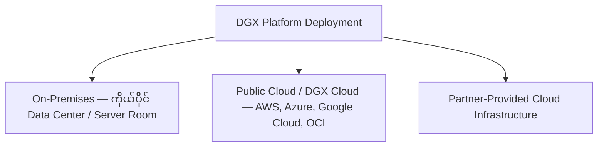
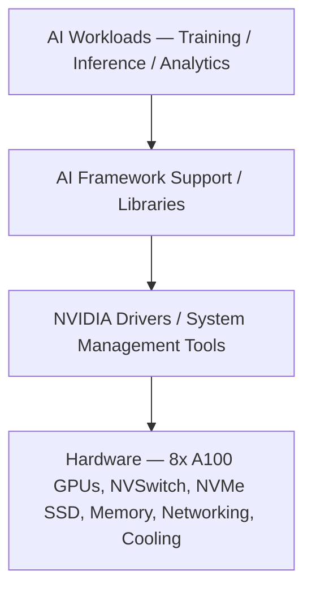
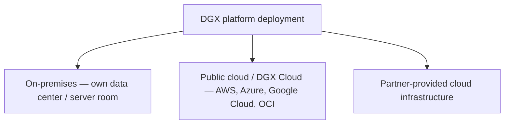
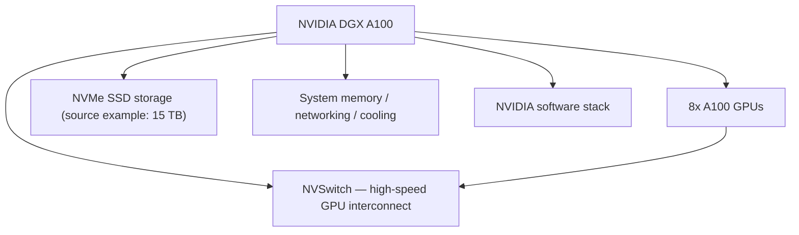
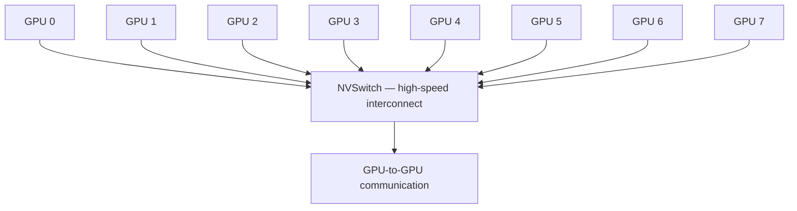
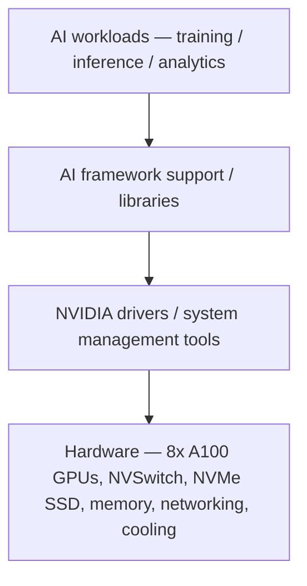

# Module — NVIDIA DGX Platform: Deployment, Hardware and Software Stack

> Part I · Course Module 06 (NVIDIA AI Infrastructure and DGX Systems) — topic notes

## မြန်မာဘာသာ version

## 1. DGX Platform ဆိုတာ ဘာလဲ? (Introduction)

NVIDIA technologies ရဲ့ အခြေခံ AI Data Center platform တစ်ခုအနေနဲ့ NVIDIA DGX ကို နားလည်ထားဖို့ အရေးကြီးပါတယ်။ ဒီ module မှာ example အနေနဲ့ **DGX A100 system** ကို အသုံးပြုထားပါတယ်။

**DGX is a platform.** — DGX ဟာ ပုံမှန် CPU-based server တစ်ခုကိုသာ ဆိုလိုတာမဟုတ်ဘဲ AI workloads အတွက် NVIDIA က integrated လုပ်ထားတဲ့ data-center AI system/platform ဖြစ်ပါတယ်။ အဓိကအားဖြင့်—

- AI Training
- AI Inference
- Analytics

စတဲ့ workload တွေအတွက် အသုံးပြုနိုင်ပါတယ်။

## 2. DGX Platform ကို Deployment လုပ်နိုင်တဲ့ နည်းလမ်းများ

NVIDIA DGX Platform ကို အသုံးပြုရာမှာ Infrastructure ကို ကိုယ်တိုင်ဝယ်ယူတည်ဆောက်ခြင်း၊ Workstation ဖြင့် Local Development လုပ်ခြင်း၊ Cloud မှတစ်ဆင့် Computing Capacity ရယူခြင်းနဲ့ Cluster အဖြစ် တိုးချဲ့ခြင်းတို့ကို ရွေးချယ်နိုင်ပါတယ်။

### 2.1 On-Premises Deployment

On-Premises ဆိုတာ Hardware ကို ကိုယ်ပိုင် Data Center သို့မဟုတ် ကိုယ်ပိုင် Server Room မှာ တပ်ဆင်ပြီး လည်ပတ်တာဖြစ်ပါတယ်။

အသုံးပြုသင့်တဲ့ အခြေအနေတွေ —

- Sensitive Data တွေကို ကိုယ်ပိုင် Infrastructure အတွင်းမှာပဲ ထိန်းသိမ်းလိုခြင်း။
- Data Residency, Compliance နဲ့ Security Requirements တွေ ရှိခြင်း။
- Hardware Configuration, Network နဲ့ Storage ကို ကိုယ်တိုင်ထိန်းချုပ်လိုခြင်း။
- ရေရှည်မှာ GPU Utilization မြင့်မားပြီး Dedicated Infrastructure လိုအပ်ခြင်း။

အားသာချက်များ —

- Infrastructure Control ပိုမိုရရှိနိုင်တယ်။
- Data Handling နဲ့ Security Controls တွေကို ကိုယ်ပိုင် Policy အတိုင်း တည်ဆောက်နိုင်တယ်။
- Workload အတွက် Hardware ကို Dedicated အဖြစ် အသုံးပြုနိုင်တယ်။

စဉ်းစားရမယ့်အချက်များ —

- Hardware ဝယ်ယူစရိတ် မြင့်မားနိုင်တယ်။
- Power, Cooling, Rack Space နဲ့ Networking လိုအပ်တယ်။
- Hardware Lifecycle, Maintenance နဲ့ Operations ကို စီမံခန့်ခွဲရတယ်။

**သတိပြုရန်** — On-Premises ဖြစ်တာနဲ့ Compliance အလိုအလျောက် ပြည့်မီသွားတာ မဟုတ်ပါဘူး။ Security Architecture, Access Control, Audit နဲ့ Data Governance တွေကိုလည်း မှန်ကန်စွာ အကောင်အထည်ဖော်ဖို့ လိုအပ်ပါတယ်။

### 2.2 Public Cloud / DGX Cloud

ကိုယ်ပိုင် DGX Hardware ကို ဝယ်ယူမထားဘဲ Cloud မှတစ်ဆင့် AI Computing Resources တွေကို ရယူအသုံးပြုနိုင်ပါတယ်။ NVIDIA DGX Cloud Offering တွေကို AWS, Microsoft Azure, Google Cloud နဲ့ Oracle Cloud Infrastructure တို့နဲ့ ပူးပေါင်းထားတဲ့ Platform များမှတစ်ဆင့် ရရှိနိုင်ပါတယ်။ Availability, Contract နဲ့ Pricing Model တွေဟာ Provider နဲ့ သီးခြား Offering အလိုက် ကွာခြားနိုင်ပါတယ်။

အားသာချက်များ —

- Hardware အတွက် ကြိုတင်ရင်းနှီးမြှုပ်နှံရမှုကို လျှော့ချနိုင်တယ်။
- လိုအပ်တဲ့ Computing Capacity ကို ပိုမိုလွယ်ကူစွာ တိုးချဲ့နိုင်တယ်။
- Infrastructure Maintenance အချို့ကို Provider က တာဝန်ယူပေးနိုင်တယ်။

စဉ်းစားရမယ့်အချက်များ —

- Long-running Workloads တွေအတွက် စုစုပေါင်းကုန်ကျစရိတ် (TCO) ကို တွက်ချက်ဖို့လိုတယ်။
- Data Transfer, Storage နဲ့ Networking Costs တွေ ရှိနိုင်တယ်။
- Cloud Region, GPU Availability, Security နဲ့ Licensing Requirements တွေကို စစ်ဆေးဖို့လိုတယ်။

**သတိပြုရန်** — Cloud Provider တစ်ခုမှာ NVIDIA GPUs ရှိတယ်ဆိုတာနဲ့ အဲဒီ Provider ရဲ့ GPU Instance တိုင်းဟာ DGX Cloud Offering ဖြစ်တယ်လို့ မဆိုလိုပါဘူး။ DGX Cloud ဟာ သီးခြား Offering ဖြစ်ပါတယ်။

### 2.3 Partner-Provided Cloud Infrastructure

NVIDIA Cloud Partners တွေကလည်း NVIDIA Accelerated Computing Infrastructure နဲ့ ဆက်စပ်တဲ့ Cloud Services တွေကို ပေးနိုင်ပါတယ်။ ဒီနည်းလမ်းမှာ ကိုယ်ပိုင် Hardware ကို ဝယ်ယူတပ်ဆင်စရာမလိုဘဲ Partner ရဲ့ Offering အလိုက် Computing Capacity နဲ့ Support ကို ရယူနိုင်ပါတယ်။ သို့သော် Partner အားလုံးရဲ့ Hardware, SLA, Pricing နဲ့ Software Stack တွေဟာ တူညီနေမှာ မဟုတ်ပါဘူး။

**Figure 1 — DGX Platform ကို deployment လုပ်နိုင်တဲ့ နည်းလမ်းသုံးမျိုး**



**ပုံရှင်းလင်းချက် (Figure walkthrough):**
- အပေါ်က DGX Platform ကစပြီး အောက်က နည်းလမ်းသုံးမျိုးထဲက တစ်ခုကို ရွေးနိုင်ပါတယ်။
- On-Premises က ကိုယ်ပိုင် data center မှာ ကိုယ်တိုင် တပ်ဆင်လည်ပတ်တာဖြစ်ပြီး Public Cloud / DGX Cloud ကတော့ cloud provider တွေကတစ်ဆင့် ရယူတာ ဖြစ်ပါတယ်။
- တတိယတစ်ခုက NVIDIA Cloud Partners တွေရဲ့ partner-provided cloud infrastructure ဖြစ်ပြီး ကိုယ်ပိုင် hardware ဝယ်စရာ မလိုပါဘူး။

## 3. DGX Family ရဲ့ Deployment Options

| Platform | အဓိကရည်ရွယ်ချက် | Typical Use Case |
|---|---|---|
| DGX Workstation / DGX Station | Local AI Development | Model Development, Fine-tuning, Testing |
| DGX Desktop / DGX Spark | Compact Local AI Computing | Prototyping, Inference, AI Application Development |
| DGX Server | Dedicated AI Computing | Production AI, Training, Inference |
| DGX BasePOD | Validated multi-node AI Infrastructure | Enterprise AI Cluster |
| DGX SuperPOD | Large-scale integrated AI Infrastructure | Large AI Training, HPC, Large-scale AI Operations |

ဒီဇယားက Platform တွေရဲ့ အထွေထွေရည်ရွယ်ချက်ကို ဖော်ပြထားတာပါ။ တကယ့် Deployment ရွေးချယ်မှုမှာ Model Size, Memory Requirements, Performance, Availability နဲ့ Budget တို့အပေါ် မူတည်ပါတယ်။

- **DGX BasePOD** — Enterprise AI Infrastructure ကို တည်ဆောက်ဖို့ ရည်ရွယ်ထားတဲ့ Prescriptive Infrastructure Architecture ဖြစ်ပါတယ်။
- **DGX SuperPOD** — အလွန်ကြီးမားတဲ့ AI/HPC Workloads တွေအတွက် Compute, Networking, Storage နဲ့ Management တို့ကို ပေါင်းစပ်ထားတဲ့ Scalable Infrastructure ဖြစ်ပါတယ်။

## 4. DGX A100 System

ဒီ example မှာ အသုံးပြုထားတဲ့ system က **NVIDIA DGX A100** ဖြစ်ပါတယ်။ DGX A100 system ထဲမှာ အောက်ပါ architecture ကို အခြေခံပြီး AI workload တွေအတွက် design လုပ်ထားပါတယ်။

```
                 NVIDIA DGX A100
                       │
       ┌───────────────┼───────────────┐
       │               │               │
       ▼               ▼               ▼
   8 × A100 GPU     NVSwitch       NVMe Storage
       │               │               │
       │               │               └── 15 TB
       │               │
       └───────────────┘
        High-speed GPU
        interconnect
```

**Figure 2 — DGX A100 system ရဲ့ internal architecture ပုံ**


**ပုံရှင်းလင်းချက် (Figure walkthrough):**
- အပေါ်ဆုံးက DGX A100 system တစ်ခုလုံးကို ဗဟိုပြုထားပါတယ်။
- အောက်ဘယ်ဘက်က 8x A100 GPUs နဲ့ အလယ်က NVSwitch ကို မြားနဲ့ ချိတ်ထားတာက GPU တွေကြား high-speed interconnect ရှိတာကို ပြပါတယ်။
- ညာဘက်မှာ NVMe SSD storage (source example အနေနဲ့ 15 TB)၊ system memory / networking / cooling နဲ့ NVIDIA software stack တွေ ပါဝင်ပါတယ်။

## 6. High-Speed Interconnect

DGX system ရဲ့ အရေးကြီးတဲ့ concept တစ်ခုက high-speed GPU interconnect ဖြစ်ပါတယ်။ GPU 8 လုံးရှိတာတစ်ခုတည်းနဲ့ မလုံလောက်ပါဘူး။ GPU တွေအချင်းချင်း data exchange လုပ်ရတဲ့အတွက် GPU-to-GPU communication မြန်ဆန်ဖို့လိုပါတယ်။

```
GPU 0 ──┐
GPU 1 ──┤
GPU 2 ──┤
GPU 3 ──┤
GPU 4 ──┼──► NVSwitch ──► GPU-to-GPU communication
GPU 5 ──┤
GPU 6 ──┤
GPU 7 ──┘
```

အဓိက idea က —

> Multiple GPUs + High-speed interconnect = Large-scale parallel AI computing

## 7. NVSwitch

NVSwitch က NVIDIA GPU system ထဲမှာ GPU-to-GPU communication ကို အမြန်ဆန်စွာ လုပ်ဆောင်နိုင်ဖို့ အသုံးပြုတဲ့ high-speed interconnect technology ဖြစ်ပါတယ်။

AI training လုပ်တဲ့အခါ workload တစ်ခုကို GPU အများကြီးပေါ်မှာ ဖြန့်ပြီး run လုပ်နိုင်ပါတယ်။ ဒီလို distributed/parallel processing လုပ်တဲ့အခါ GPU တွေကြားမှာ data နဲ့ computation information တွေ exchange လုပ်ရပါတယ်။ ဒါကြောင့် interconnect performance က အရေးကြီးပါတယ်။

```
Traditional idea:            DGX-style multi-GPU system:

GPU ───────── GPU            GPU ─┐
       data                   GPU ─┤
                              GPU ─┤
                              GPU ─┼── High-speed interconnect ── GPU
                              GPU ─┤
                              GPU ─┤
                              GPU ─┘
```

**Exam Point:** DGX ကိုလေ့လာတဲ့အခါ GPU count တင်မကဘဲ GPU interconnect ကိုပါ အာရုံစိုက်ပါ။

**Figure 3 — NVSwitch ဖြင့် GPU-to-GPU communication ပုံ**


**ပုံရှင်းလင်းချက် (Figure walkthrough):**
- ဘယ်ဘက်က GPU ရှစ်လုံး (GPU 0 မှ GPU 7) အားလုံးဟာ အလယ်က NVSwitch box ဆီ မြားတွေနဲ့ ချိတ်ဆက်ထားပါတယ်။
- GPU အများကြီးကြား data နဲ့ computation information တွေ ဖလှယ်ရမှာဖြစ်လို့ ဒီ interconnect ရဲ့ မြန်နှုန်းက အရေးကြီးပါတယ်။
- အောက်ဆုံး box က GPU-to-GPU communication မြန်ဆန်မှ 8 GPU ပေါ်မှာ parallel AI workload ကို ထိရောက်စွာ run လုပ်နိုင်မှာ ဖြစ်ပါတယ်။

## 8. NVMe SSD Storage

DGX A100 system မှာ NVMe SSD storage လည်း ပါဝင်ပါတယ်။ Source example မှာ **15 TB of NVMe SSD** လို့ ဖော်ပြထားပါတယ်။ NVMe SSD ဟာ high-performance local storage အတွက် အသုံးပြုနိုင်ပါတယ်။

```
NVMe Storage
     │
     ▼
   Data
     │
     ▼
   GPU
     │
     ▼
AI computation
```

AI system တစ်ခုမှာ GPU တွေကို အလုပ်လုပ်စေဖို့ data တွေကို storage ကနေ ဖတ်ယူရပါတယ်။ Storage က data ကို GPU တွေဆီ efficiently မပို့နိုင်ရင် powerful GPU တွေရှိနေပေမယ့် workload performance ကို storage I/O က bottleneck ဖြစ်စေနိုင်ပါတယ်။

## 9. Cooling System

DGX system ဟာ GPU အများကြီးကို high-performance workload အောက်မှာ run လုပ်ဖို့ design လုပ်ထားတာကြောင့် cooling ကလည်း အရေးကြီးပါတယ်။

```
AI workload
     ↓
GPU computation
     ↓
Electrical power
     ↓
Heat
     ↓
Cooling required
```

DGX server ရဲ့ physical design မှာ cooling mechanism တွေ ပါဝင်ပါတယ်။

## 10. Hardware and Software Stack အကျဉ်းချုပ်

DGX Platform ကို hardware နဲ့ software ပေါင်းစပ်မှုအဖြစ် နားလည်ပါ —

- **Hardware** — A100 GPUs (8×), NVSwitch high-speed interconnect, NVMe SSD storage, system memory, networking, cooling system။
- **Software Stack** — NVIDIA Drivers, Libraries, AI Framework Support နဲ့ System Management Tools များ။

Software stack မပါဘဲ hardware တစ်ခုတည်းနဲ့ AI workload တွေကို ထိရောက်စွာ run လုပ်လို့ မရပါဘူး။

**Figure 4 — DGX hardware နှင့် software stack layering ပုံ**



**ပုံရှင်းလင်းချက် (Figure walkthrough):**
- အပေါ်ဆုံးက AI workloads (training၊ inference၊ analytics) ကစပြီး အောက်ကို တစ်ဆင့်ချင်း ကြည့်ပါ။
- အလယ်အဆင့်နှစ်ခုက software stack ဖြစ်ပြီး libraries/framework support နဲ့ drivers/management tools တွေ ပါဝင်ပါတယ်။
- အောက်ဆုံးက hardware layer မှာ 8x A100 GPUs၊ NVSwitch၊ NVMe SSD၊ memory၊ networking နဲ့ cooling တွေ ရှိပါတယ် — software stack မပါဘဲ hardware တစ်ခုတည်းနဲ့ AI workload ကောင်းကောင်း run လို့ မရပါဘူး။

## 11. Operational Cautions — သတိပြုရန်အချက်များ

- **Generation မရောထွေးပါနဲ့** — "DGX A100 which has Hopper GPUs" ဆိုတဲ့ transcript claim ဟာ မှားယွင်းပါတယ်။ DGX A100 = Ampere၊ DGX H100 = Hopper ဖြစ်ပါတယ်။
- **On-Premises ≠ Automatic Compliance** — On-premises ဖြစ်ရုံနဲ့ compliance မပြည့်မီပါဘူး။ Security architecture, access control, audit, data governance ကို သီးခြား အကောင်အထည်ဖော်ရပါမယ်။
- **GPU Instance တိုင်း ≠ DGX Cloud** — Cloud provider တစ်ခုမှာ NVIDIA GPUs ရှိရုံနဲ့ အဲဒီ GPU instance တိုင်း DGX Cloud offering မဟုတ်ပါဘူး။
- **Storage I/O bottleneck** — storage က data ကို GPU ဆီ မမီနိုင်ရင် GPU performance ကို ထိခိုက်စေနိုင်ပါတယ်။
- **Power / Cooling / Rack Space** — on-premises deployment မှာ ကြိုတင်စီစဉ်ရပါမယ်။

## 12. Exam Points

- **Reference Architecture** — System implementation အတွက် အခြေခံအဖြစ် အသုံးပြုနိုင်တဲ့ architecture design နဲ့ guidance ဖြစ်ပါတယ် (အသေးစိတ်ကို နောက် module မှာ လေ့လာပါမယ်)။
- **NVIDIA DGX** — AI workloads အတွက် NVIDIA computing platform/system ဖြစ်ပါတယ်။
- **DGX A100** — 8× A100 GPUs (Ampere) + NVSwitch + NVMe storage (source example: 15 TB) ဖြင့် တည်ဆောက်ထားသော AI system ဖြစ်ပါတယ်။
- **Deployment Options** — On-Premises, Public Cloud / DGX Cloud, Partner-Provided Cloud တို့ ရှိပါတယ်။
- **BasePOD vs SuperPOD** — BasePOD = validated multi-node enterprise AI infrastructure၊ SuperPOD = large-scale integrated AI/HPC infrastructure ဖြစ်ပါတယ်။

## 13. Self-Check Questions (Exam Preparation)

**Q1. DGX Platform ကို deployment လုပ်နိုင်တဲ့ နည်းလမ်း သုံးမျိုးက ဘာတွေလဲ?**
Answer: On-Premises Deployment၊ Public Cloud / DGX Cloud၊ Partner-Provided Cloud Infrastructure တို့ ဖြစ်ပါတယ်။

**Q2. DGX A100 system မှာ ဘာတွေ ပါဝင်သလဲ?**
Answer: 8 × NVIDIA A100 GPUs (Ampere)၊ NVSwitch high-speed interconnect၊ NVMe SSD storage (source example: 15 TB)၊ networking, system memory, cooling နဲ့ NVIDIA software stack တို့ ပါဝင်ပါတယ်။

**Q3. DGX မှာ GPU count တင်မကဘဲ ဘာကြောင့် interconnect ကိုပါ အာရုံစိုက်ရသလဲ?**
Answer: GPU အများကြီးကြား data/computation exchange မြန်ဆန်မှသာ large-scale parallel AI computing ဖြစ်နိုင်လို့ပါ။ NVSwitch က GPU-to-GPU communication ကို အရှိန်မြှင့်ပေးပါတယ်။

**Q4. "DGX A100 which has Hopper GPUs" ဆိုတာ မှန်သလား?**
Answer: မမှန်ပါဘူး။ DGX A100 က Ampere ဖြစ်ပြီး DGX H100 က Hopper ဖြစ်ပါတယ်။

**Q5. DGX BasePOD နဲ့ DGX SuperPOD ကွာခြားချက်က ဘာလဲ?**
Answer: BasePOD က enterprise AI infrastructure အတွက် validated multi-node prescriptive architecture ဖြစ်ပြီး SuperPOD က large AI/HPC workloads အတွက် compute, networking, storage, management ပေါင်းစပ်ထားတဲ့ scalable infrastructure ဖြစ်ပါတယ်။

---

## English Version

## 1. What Is the DGX Platform? (Introduction)

Understanding NVIDIA DGX as a foundational AI data-center platform is important. This module uses the **DGX A100 system** as the example.

**DGX is a platform.** — DGX does not mean just an ordinary CPU-based server. It is an integrated data-center AI system/platform built by NVIDIA for AI workloads, mainly:

- AI Training
- AI Inference
- Analytics

## 2. Ways to Deploy the DGX Platform

When using the NVIDIA DGX Platform, you can choose between buying and building the infrastructure yourself, doing local development on a workstation, obtaining computing capacity through the cloud, or scaling out as a cluster.

### 2.1 On-Premises Deployment

On-premises means installing and operating the hardware in your own data center or server room.

Situations where it fits:

- Keeping sensitive data inside your own infrastructure.
- Data-residency, compliance, and security requirements.
- Wanting direct control of hardware configuration, networking, and storage.
- High long-term GPU utilization that justifies dedicated infrastructure.

Advantages:

- More infrastructure control.
- Data handling and security controls built to your own policies.
- Hardware dedicated to your workloads.

Considerations:

- Hardware acquisition cost can be high.
- Power, cooling, rack space, and networking are required.
- You must manage hardware lifecycle, maintenance, and operations.

**Caution** — Being on-premises does not automatically achieve compliance. Security architecture, access control, auditing, and data governance must still be implemented correctly.

### 2.2 Public Cloud / DGX Cloud

You can obtain AI computing resources through the cloud without buying your own DGX hardware. NVIDIA DGX Cloud offerings are available through platforms partnered with AWS, Microsoft Azure, Google Cloud, and Oracle Cloud Infrastructure. Availability, contracts, and pricing models vary by provider and by individual offering.

Advantages:

- Reduced upfront investment in hardware.
- Computing capacity can be scaled more easily.
- The provider can handle some infrastructure maintenance.

Considerations:

- Calculate total cost of ownership for long-running workloads.
- Data-transfer, storage, and networking costs may apply.
- Check cloud region, GPU availability, security, and licensing requirements.

**Caution** — A cloud provider having NVIDIA GPUs does not mean every GPU instance on that provider is a DGX Cloud offering. DGX Cloud is a distinct offering.

### 2.3 Partner-Provided Cloud Infrastructure

NVIDIA Cloud Partners can also provide cloud services built on NVIDIA accelerated computing infrastructure. With this approach you get computing capacity and support from the partner's offering without buying and installing hardware yourself. However, not all partners have identical hardware, SLAs, pricing, or software stacks.

**Figure 1 — Three ways to deploy the DGX platform**



**Figure walkthrough (ပုံရှင်းလင်းချက်):**
- Start at the top with the DGX platform and pick one of the three options below.
- On-premises means installing and operating the hardware in your own data center; public cloud / DGX Cloud means obtaining capacity through cloud providers.
- The third option is partner-provided cloud infrastructure from NVIDIA Cloud Partners — no hardware purchase needed.

## 3. DGX Family Deployment Options

| Platform | Main Purpose | Typical Use Case |
|---|---|---|
| DGX Workstation / DGX Station | Local AI development | Model development, fine-tuning, testing |
| DGX Desktop / DGX Spark | Compact local AI computing | Prototyping, inference, AI application development |
| DGX Server | Dedicated AI computing | Production AI, training, inference |
| DGX BasePOD | Validated multi-node AI infrastructure | Enterprise AI cluster |
| DGX SuperPOD | Large-scale integrated AI infrastructure | Large AI training, HPC, large-scale AI operations |

This table shows the general purpose of each platform. Actual deployment choices depend on model size, memory requirements, performance, availability, and budget.

- **DGX BasePOD** — A prescriptive infrastructure architecture intended for building enterprise AI infrastructure.
- **DGX SuperPOD** — Scalable infrastructure combining compute, networking, storage, and management for very large AI/HPC workloads.

## 4. The DGX A100 System

The system used in this example is the **NVIDIA DGX A100**. It is designed for AI workloads based on the following architecture:

```
                 NVIDIA DGX A100
                       │
       ┌───────────────┼───────────────┐
       │               │               │
       ▼               ▼               ▼
   8 × A100 GPU     NVSwitch       NVMe Storage
       │               │               │
       │               │               └── 15 TB
       │               │
       └───────────────┘
        High-speed GPU
        interconnect
```

**Figure 2 — Internal architecture of the DGX A100 system**



**Figure walkthrough (ပုံရှင်းလင်းချက်):**
- The top box is the whole DGX A100 system.
- The 8x A100 GPUs box on the lower left is linked by an arrow to NVSwitch in the middle — that is the high-speed interconnect between the GPUs.
- On the right: NVMe SSD storage (15 TB as the source example), system memory/networking/cooling, and the NVIDIA software stack.

## 6. High-Speed Interconnect

An important DGX concept is the high-speed GPU interconnect. Having 8 GPUs alone is not enough — the GPUs must exchange data with each other, so GPU-to-GPU communication must be fast. That is why the DGX A100 architecture uses NVSwitch.

```
GPU 0 ──┐
GPU 1 ──┤
GPU 2 ──┤
GPU 3 ──┤
GPU 4 ──┼──► NVSwitch ──► GPU-to-GPU communication
GPU 5 ──┤
GPU 6 ──┤
GPU 7 ──┘
```

The key idea:

> Multiple GPUs + High-speed interconnect = Large-scale parallel AI computing

## 7. NVSwitch

NVSwitch is the high-speed interconnect technology used in NVIDIA GPU systems to move GPU-to-GPU communication as fast as possible.

In AI training, a workload can be spread across many GPUs. In such distributed/parallel processing, data and computation information must be exchanged between GPUs, so interconnect performance matters.

```
Traditional idea:            DGX-style multi-GPU system:

GPU ───────── GPU            GPU ─┐
       data                   GPU ─┤
                              GPU ─┤
                              GPU ─┼── High-speed interconnect ── GPU
                              GPU ─┤
                              GPU ─┤
                              GPU ─┘
```

**Exam point:** When studying DGX, pay attention to the GPU interconnect, not only the GPU count.

**Figure 3 — GPU-to-GPU communication through NVSwitch**



**Figure walkthrough (ပုံရှင်းလင်းချက်):**
- All eight GPUs on the left (GPU 0 to GPU 7) connect with arrows to the central NVSwitch box.
- Many GPUs must exchange data and computation information, so the speed of this interconnect matters.
- The bottom box is the result: fast GPU-to-GPU communication lets a parallel AI workload run efficiently across all 8 GPUs.

## 8. NVMe SSD Storage

The DGX A100 system also includes NVMe SSD storage. The source example states **15 TB of NVMe SSD**. NVMe SSD provides high-performance local storage.

```
NVMe Storage
     │
     ▼
   Data
     │
     ▼
   GPU
     │
     ▼
AI computation
```

For GPUs to work, data must be read from storage. If storage cannot feed data to the GPUs efficiently, storage I/O can become a bottleneck for workload performance even with powerful GPUs.

## 9. Cooling System

Because the DGX system is designed to run many GPUs under high-performance workloads, cooling also matters.

```
AI workload
     ↓
GPU computation
     ↓
Electrical power
     ↓
Heat
     ↓
Cooling required
```

The DGX server's physical design includes cooling mechanisms.

## 10. Hardware and Software Stack Summary

Understand the DGX platform as a combination of hardware and software:

- **Hardware** — 8× A100 GPUs, NVSwitch high-speed interconnect, NVMe SSD storage, system memory, networking, cooling system.
- **Software stack** — NVIDIA drivers, libraries, AI framework support, and system-management tools.

Without the software stack, the hardware alone cannot run AI workloads efficiently.

**Figure 4 — DGX hardware and software stack layering**



**Figure walkthrough (ပုံရှင်းလင်းချက်):**
- Start at the top with the AI workloads (training, inference, analytics) and move down one step at a time.
- The two middle levels are the software stack: libraries/framework support, then drivers and management tools.
- The bottom hardware layer holds the 8x A100 GPUs, NVSwitch, NVMe SSD, memory, networking, and cooling — without the software stack the hardware alone cannot run AI workloads efficiently.

## 11. Operational Cautions

- **Do not mix GPU generations** — The transcript claim "DGX A100 which has Hopper GPUs" is incorrect. DGX A100 = Ampere; DGX H100 = Hopper.
- **On-premises ≠ automatic compliance** — Being on-premises does not by itself achieve compliance; security architecture, access control, auditing, and data governance must be implemented separately.
- **GPU instance ≠ DGX Cloud** — A provider having NVIDIA GPUs does not make every GPU instance a DGX Cloud offering.
- **Storage I/O bottleneck** — If storage cannot keep the GPUs fed, performance suffers.
- **Power / cooling / rack space** — Must be planned for in on-premises deployments.

## 12. Exam Points

- **Reference Architecture** — Architectural design and guidance that can serve as a starting point for system implementation (covered in detail in a later module).
- **NVIDIA DGX** — An NVIDIA computing platform/system for AI workloads.
- **DGX A100** — An AI system built with 8× A100 GPUs (Ampere), NVSwitch, and NVMe storage (source example: 15 TB).
- **Deployment options** — On-premises, public cloud / DGX Cloud, and partner-provided cloud.
- **BasePOD vs SuperPOD** — BasePOD = validated multi-node enterprise AI infrastructure; SuperPOD = large-scale integrated AI/HPC infrastructure.

## 13. Self-Check Questions (Exam Preparation)

**Q1. What are the three ways to deploy the DGX platform?**
Answer: On-premises deployment, public cloud / DGX Cloud, and partner-provided cloud infrastructure.

**Q2. What does a DGX A100 system contain?**
Answer: 8× NVIDIA A100 GPUs (Ampere), NVSwitch high-speed interconnect, NVMe SSD storage (source example: 15 TB), networking, system memory, cooling, and the NVIDIA software stack.

**Q3. Why study the interconnect, not just the GPU count, in a DGX?**
Answer: Only fast data/computation exchange between many GPUs enables large-scale parallel AI computing. NVSwitch accelerates GPU-to-GPU communication.

**Q4. Is the claim "DGX A100 which has Hopper GPUs" correct?**
Answer: No. DGX A100 is Ampere; DGX H100 is Hopper.

**Q5. What is the difference between DGX BasePOD and DGX SuperPOD?**
Answer: BasePOD is a validated multi-node prescriptive architecture for enterprise AI infrastructure; SuperPOD is scalable infrastructure combining compute, networking, storage, and management for very large AI/HPC workloads.

---

## Technical review notes

- Transcript claim "DGX A100 which has Hopper GPUs" is incorrect and is corrected explicitly in both language versions (DGX A100 = Ampere, DGX H100 = Hopper), per the source note.
- The "15 TB of NVMe SSD" figure is kept exactly as quoted in the source as an example configuration; exact storage configuration varies by DGX A100 order/configuration (needs verification against the NVIDIA DGX A100 User Guide for a specific system).
- DGX A100 = 8× A100 GPUs + NVSwitch architecture is the source's documented configuration and matches NVIDIA's DGX A100 documentation.
- The DGX Cloud partner list (AWS, Azure, Google Cloud, OCI) reflects the source lesson; availability, contracts, and pricing change over time and must be checked per provider (needs verification when planning a real deployment).
- BasePOD ("prescriptive infrastructure architecture") and SuperPOD ("scalable combined compute/networking/storage/management") descriptions are kept at the source's level of detail; specific POD reference-architecture details must come from NVIDIA documentation.
- The source transcript for this module ends mid-section after the cooling section; the hardware/software stack summary is assembled from the DGX component list supplied in the companion DGX Systems lesson (drivers, libraries, AI framework support, system-management tools). No new specs were introduced.
- Mermaid figures (Figure 1–4) with figure walkthroughs added inline in both the Myanmar and English sections; figure numbering matches across the two sections; all existing text and ASCII diagrams preserved.
