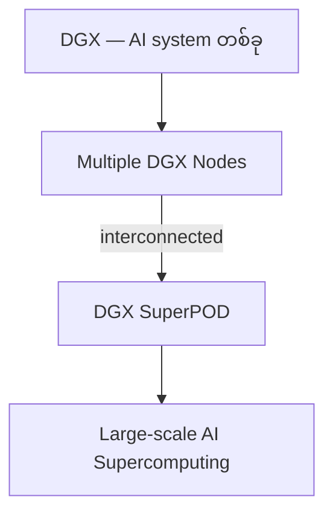
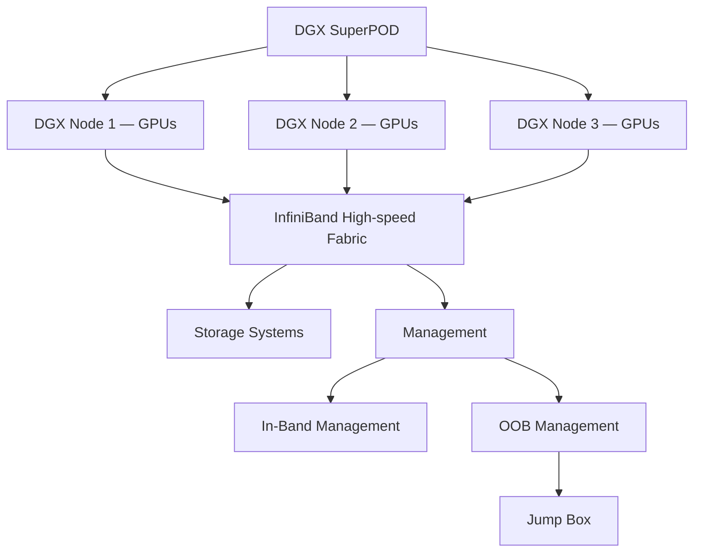
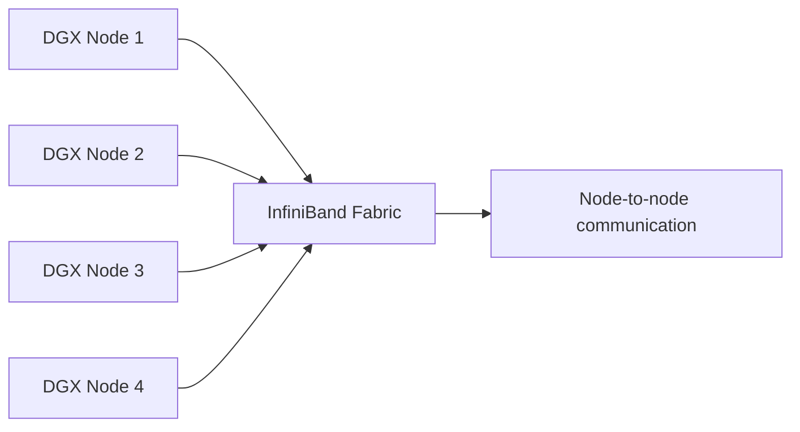
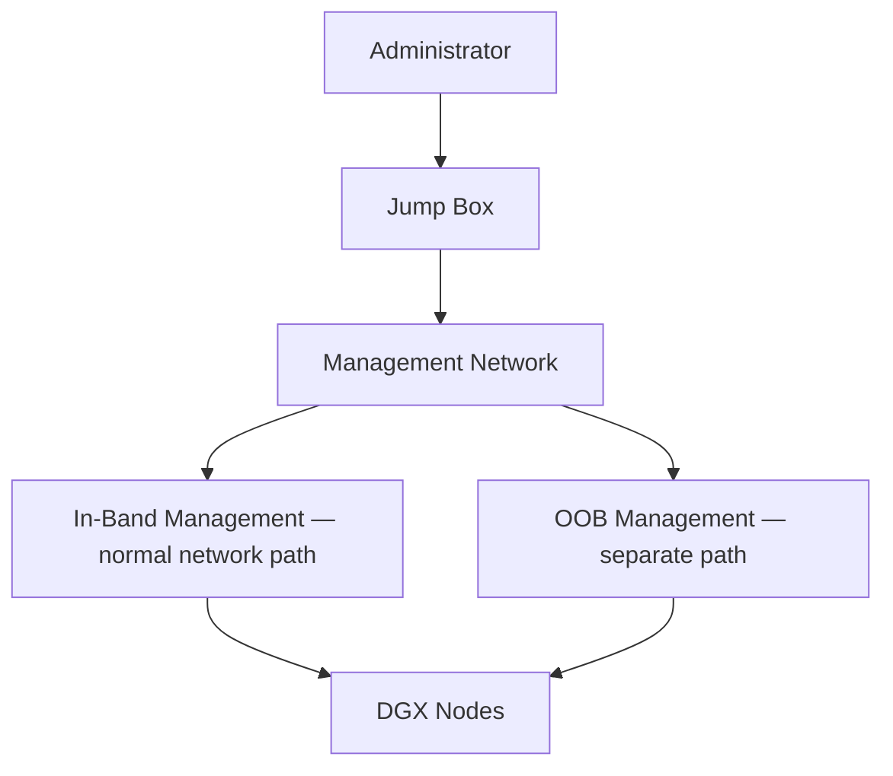
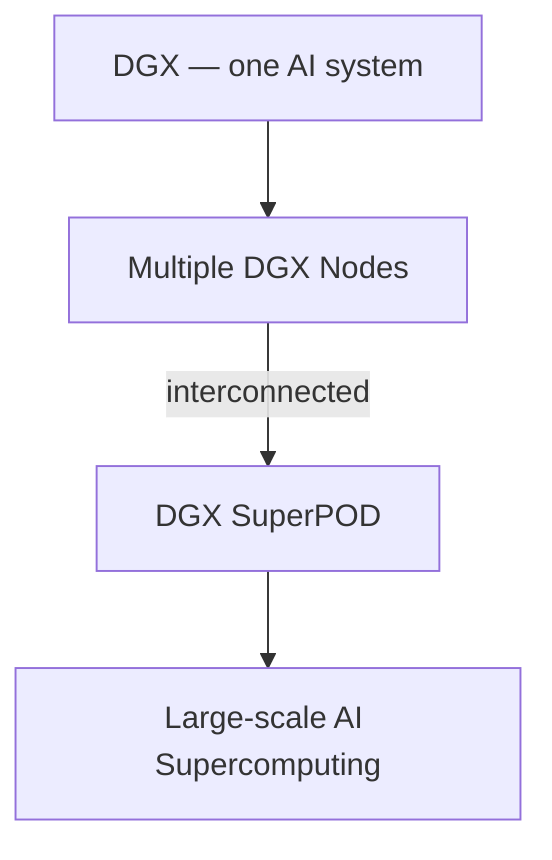

# Module — NVIDIA DGX SuperPOD

> Part I · Course Module 06 (NVIDIA AI Infrastructure and DGX Systems) — topic notes

## မြန်မာဘာသာ version

## 1. ဘာကြောင့် DGX SuperPOD လိုအပ်ရတာလဲ?

အရင် module တွေမှာ DGX system တစ်ခုကို လေ့လာခဲ့ပါတယ်။
DGX system တစ်ခုမှာ GPU အများကြီး ပါဝင်ပြီး ခက်ခဲတဲ့ AI နဲ့ HPC workloads တွေကို run ဖို့ design လုပ်ထားပါတယ်။
ဒါပေမယ့် AI/ML workload အတွက် အလွန်ကြီးမားတဲ့ system တစ်ခု တည်ဆောက်တဲ့အခါ—

- DGX system တစ်ခုတည်းနဲ့ မလုံလောက်နိုင်ပါဘူး။

ဒီနေရာမှာ DGX SuperPOD ဆိုတဲ့ concept က ရောက်လာပါတယ်။

## 2. DGX SuperPOD ဆိုတာ ဘာလဲ?

DGX SuperPOD ဟာ အချင်းချင်းချိတ်ဆက်ထားတဲ့ DGX systems/nodes အများကြီးနဲ့ ဖွဲ့စည်းထားတဲ့ architectural implementation တစ်ခု ဖြစ်ပါတယ်။
DGX systems တွေကနေ တည်ဆောက်ထားတဲ့ scalable AI supercomputing infrastructure ကို ပေးပါတယ်။
အခြေခံ progression က—

```
DGX
 │
 │  one AI system
 ▼
Multiple DGX Nodes
 │
 │  interconnected
 ▼
DGX SuperPOD
 │
 ▼
Large-scale AI Supercomputing
```

**Figure 1 — DGX တစ်လုံးကနေ DGX SuperPOD အထိ တိုးချဲ့ပုံ**



**ပုံရှင်းလင်းချက် (Figure walkthrough) —**

1. အပေါ်ဆုံးက box က DGX တစ်လုံးတည်း — AI system တစ်ခုကို ကိုယ်စားပြုပါတယ်။
2. ဒုတိယ box က DGX တစ်လုံးထက် ပိုများတဲ့ nodes တွေ စုလာတာကို ပြပါတယ်။
3. မြားကြောင်းအတိုင်း ဆက်ကြည့်ရင် nodes တွေကို ချိတ်ဆက်လိုက်တာက DGX SuperPOD ဖြစ်လာပုံကို တွေ့ရပါမယ်။
4. အောက်ဆုံး box က ဒီ SuperPOD ကနေ large-scale AI supercomputing ရရှိတာကို ပြပါတယ်။

ဒါကြောင့် အကြမ်းဖျင်းပြောရရင်—

- DGX SuperPOD = Multiple DGX systems working together as a large-scale AI computing infrastructure.

## 3. DGX Nodes

SuperPOD architecture diagram မှာ သေးငယ်တဲ့ box တွေက individual DGX nodes တွေကို ကိုယ်စားပြုပါတယ်။
Conceptually—

```
       DGX Node 1
       ┌─────────┐
       │   DGX   │
       └─────────┘

       DGX Node 2
       ┌─────────┐
       │   DGX   │
       └─────────┘

       DGX Node 3
       ┌─────────┐
       │   DGX   │
       └─────────┘

       DGX Node 4
       ┌─────────┐
       │   DGX   │
       └─────────┘
```

Node တစ်ခုချင်းစီက GPU compute resources တွေ ပေးပါတယ်။ Node အများကြီးကို high-performance network fabric ကနေ တစ်ခုနဲ့တစ်ခု ချိတ်ဆက်ထားပါတယ်။

## 4. DGX SuperPOD Architecture

ရိုးရှင်းတဲ့ architecture က အောက်ပါအတိုင်း ဖြစ်ပါတယ်။

```
                     DGX SuperPOD
                           │
        ┌──────────────────┼──────────────────┐
        │                  │                  │
        ▼                  ▼                  ▼
   DGX Node 1         DGX Node 2        DGX Node 3
   ┌─────────┐        ┌─────────┐       ┌─────────┐
   │ GPUs    │        │ GPUs    │       │ GPUs    │
   └─────────┘        └─────────┘       └─────────┘
        │                  │                  │
        └──────────────────┼──────────────────┘
                           │
                     InfiniBand
                  High-speed Fabric
                           │
              ┌────────────┴────────────┐
              │                         │
              ▼                         ▼
         Storage Systems          Management
                                  │
                           ┌──────┴──────┐
                           │             │
                       In-Band         OOB
                       Management    Management
                           │
                           ▼
                       Jump Box
```

**Figure 2 — DGX SuperPOD cluster architecture ပုံ**



**ပုံရှင်းလင်းချက် (Figure walkthrough) —**

1. အပေါ်ဆုံး box က DGX SuperPOD တစ်ခုလုံးကို ကိုယ်စားပြုပါတယ်။
2. အောက်က box သုံးခုက DGX Node တွေဖြစ်ပြီး တစ်ခုချင်းစီမှာ GPUs ပါဝင်ပါတယ်။
3. Node တွေအားလုံးက InfiniBand high-speed fabric ကို ဆက်သွယ်ထားပါတယ် — node တွေကြား အမြန်ဆုံးဆက်သွယ်နိုင်တဲ့ လမ်းကြောင်းပါ။
4. Fabric ကနေတစ်ဆင့် Storage Systems နဲ့ Management ဆီ ဆက်သွယ်နိုင်ပါတယ်။
5. Management က In-Band နဲ့ OOB ဆိုပြီး နှစ်မျိုးခွဲပြီး OOB ကနေတစ်ဆင့် Jump Box ကို အသုံးပြုပါတယ်။

အရေးကြီးတဲ့အချက်က—SuperPOD ဟာ GPU servers တွေ ရိုးရိုးစုစည်းမှုသက်သက် မဟုတ်ပါဘူး။
အောက်ပါ infrastructure တွေ ပါဝင်ပါတယ်—

- Compute
- High-speed networking
- Storage
- Management
- Administrative access

## 5. InfiniBand — DGX Nodes တွေကို ချိတ်ဆက်ခြင်း

ဒီ architecture မှာ အရေးကြီးဆုံး component တွေထဲက တစ်ခုက InfiniBand fabric ဖြစ်ပါတယ်။
DGX nodes တွေကြား high-speed communication ကို ပေးပါတယ်။
Conceptually—

```
DGX Node ───┐
            │
DGX Node ───┤
            │
DGX Node ───┼──── InfiniBand Fabric
            │
DGX Node ───┤
            │
DGX Node ───┘
```

**Figure 3 — InfiniBand fabric က DGX nodes တွေကို ချိတ်ဆက်ပေးပုံ**



**ပုံရှင်းလင်းချက် (Figure walkthrough) —**

1. ဘယ်ဘက်က box လေးခုက DGX Node တွေကို ကိုယ်စားပြုပါတယ်။
2. Node တိုင်းက မြားနဲ့ အလယ်က InfiniBand Fabric ဆီ ဆက်သွယ်ထားပါတယ်။
3. Fabric တစ်ခုတည်းကနေတစ်ဆင့် node တစ်ခုနဲ့တစ်ခု node-to-node communication လုပ်နိုင်ပါတယ်။
4. DGX တစ်လုံးအတွင်းမှာတော့ GPU-to-GPU communication ဖြစ်ပြီး node တွေကြားမှာတော့ ဒီ fabric ကို အသုံးပြုပါတယ်။

ဒါကြောင့် DGX systems အများကြီးက large distributed workloads တွေမှာ ပါဝင်နိုင်ပါတယ်။
ဒီခွဲခြားချက်က အရေးကြီးပါတယ်—

```
Within a DGX
      ↓
GPU-to-GPU communication

Across DGX systems
      ↓
Node-to-node communication
      ↓
High-speed network fabric
```

## 6. High-Speed Networking ဘာကြောင့် အရေးကြီးသလဲ?

Large-scale AI training မှာ workload ကို GPU နဲ့ node အများကြီးပေါ် မကြာခဏ ဖြန့်ဝေလေ့ရှိပါတယ်။
ဥပမာ—

```
Node 1
  ↕️
Node 2
  ↕️
Node 3
  ↕️
Node 4
```

Workload run နေစဉ်အတွင်း nodes တွေဟာ data တွေ အချင်းချင်း ဖလှယ်ကြရပါတယ်။
Communication က bottleneck ဖြစ်သွားရင် GPUs တွေဟာ computation လုပ်မယ့်အစား data ကို စောင့်ရင်း အချိန်ကုန်နိုင်ပါတယ်။
ဒါကြောင့်—

- Large-scale AI အတွက် high compute capability ရော high-performance communication ပါ လိုအပ်ပါတယ်။

အလွယ်မှတ်ရန် mental model—

```
More GPUs
   +
More nodes
   +
More communication
   ↓
Need high-performance interconnect
```

## 7. Storage Systems

SuperPOD architecture မှာ storage systems တွေလည်း ပါဝင်ပါတယ်။
AI workload ကြီးတွေအတွက် data အများကြီး လိုအပ်ပါတယ်—

- Training datasets
- Model files
- Checkpoints
- Logs
- Other AI data

Conceptually—

```
              DGX SuperPOD
                   │
       ┌───────────┴───────────┐
       │                       │
   Compute Nodes           Storage
       │                       │
       ▼                       ▼
   AI Training          Datasets / Models
                         Checkpoints / Logs
```

ဒါကြောင့် storage ဟာ large-scale AI infrastructure ရဲ့ အရေးကြီးတဲ့ အစိတ်အပိုင်းတစ်ခု ဖြစ်ပါတယ်။

## 8. Management Infrastructure

Large-scale infrastructure အတွက် management networks တွေလည်း လိုအပ်ပါတယ်။
Source မှာ အောက်ပါတွေကို ဖော်ပြထားပါတယ်—

- In-band management
- Out-of-band management
- Jump box

ဒီတွေက infrastructure ကို manage လုပ်ဖို့နဲ့ access လုပ်ဖို့ controlled ဖြစ်တဲ့ နည်းလမ်းတွေ ပေးပါတယ်။

**In-Band Management**

In-band management က normal network path ကနေ systems တွေကို manage လုပ်ပါတယ်။
ဥပမာ—

- Node management
- Monitoring
- Configuration
- Software operations

Conceptually—

```
Management System
       │
       ▼
 In-Band Network
       │
       ▼
DGX Nodes
```

**Out-of-Band Management**

Out-of-band management က normal operating network ကနေ သီးခြား management path ကို ပေးပါတယ်။
Normal OS သို့မဟုတ် network path က အသုံးမပြုနိုင်တဲ့အခါ အသုံးဝင်ပါတယ်။

```
Normal Network
      │
      └── In-Band Management

Separate Management Path
      │
      └── OOB Management
              │
              ▼
          DGX Hardware
```

## 9. Jump Box

Jump box (bastion-style access point လို့လည်း ခေါ်ပါတယ်) က infrastructure ထဲကို controlled administrative entry point တစ်ခု ပေးနိုင်ပါတယ်။
Conceptually—

```
Administrator
      │
      ▼
  Jump Box
      │
      ▼
Management Network
      │
      ▼
DGX Nodes
```

**Figure 4 — Jump Box ကတစ်ဆင့် controlled administrative access ပုံ**



**ပုံရှင်းလင်းချက် (Figure walkthrough) —**

1. အပေါ်ဆုံးက Administrator က DGX nodes တွေဆီကို တိုက်ရိုက်မသွားဘဲ အရင် Jump Box ကို အသုံးပြုပါတယ်။
2. Jump Box ကနေ management network ကတစ်ဆင့် ဆက်သွယ်ပါတယ်။
3. Management network က In-Band (normal network path) နဲ့ OOB (separate path) ဆိုပြီး နှစ်လမ်းခွဲသွားပါတယ်။
4. နောက်ဆုံးမှာ လမ်းကြောင်းနှစ်ခုစလုံးက DGX Nodes တွေဆီ ရောက်ရှိပါတယ်။

Administrator တွေက internal node တိုင်းကို တိုက်ရိုက် connect လုပ်ခွင့်ပေးမယ့်အစား သတ်မှတ်ထားတဲ့ administrative system ကနေ တစ်ဆင့် access ကို control လုပ်နိုင်ပါတယ်။

## 10. DGX SuperPOD as an AI Supercomputer

အကြမ်းဖျင်းပြောရရင် DGX SuperPOD ကို AI supercomputer တစ်ခုလို စဉ်းစားနိုင်ပါတယ်။
Idea က—

```
One DGX
   ↓
Multi-GPU AI System

Multiple DGX
   ↓
DGX SuperPOD

DGX SuperPOD
   ↓
Large-scale AI Supercomputing
```

DGX systems အများကြီးကို ချိတ်ဆက်ခြင်းအားဖြင့် GPU compute resources တွေရဲ့ အလွန်ကြီးမားတဲ့ pool ကို ပေးနိုင်ပါတယ်။

## 11. Large Language Model Training

အဓိက use case တစ်ခုက large-scale model training ဖြစ်ပါတယ်။
ဥပမာ—

- Large Language Models
- Foundation Models
- Large Deep Learning models

တွေဟာ substantial compute resources အများကြီး လိုအပ်နိုင်ပါတယ်။
SuperPOD က distributed training မှာ ပါဝင်နိုင်တဲ့ interconnected GPU systems အများကြီးကို ပေးပါတယ်။

```
Large Dataset
      │
      ▼
┌──────────────────────────────┐
│       DGX SuperPOD           │
│                              │
│ DGX ─ DGX ─ DGX ─ DGX       │
│  │     │     │     │         │
│ GPUs  GPUs  GPUs  GPUs       │
│                              │
└──────────────────────────────┘
      │
      ▼
Large Model Training
```

## 12. Foundation Model Training

Source မှာ foundation model training ကိုလည်း ဖော်ပြထားပါတယ်။
Foundation models ဆိုတာ downstream applications အများကြီးအတွက် base အဖြစ် အသုံးပြုနိုင်တဲ့ large-scale models တွေ ဖြစ်ပါတယ်။
ဒီ models တွေကို train လုပ်ဖို့ compute, memory, storage နဲ့ interconnect capacity အလွန်အမင်း လိုအပ်နိုင်ပါတယ်။
SuperPOD လို large-scale GPU infrastructure က ဒီလို environment တွေအတွက် သင့်တော်လာပါတယ်။

## 13. HPC Workloads

DGX SuperPOD ဟာ AI model training အတွက်ပဲ မဟုတ်ပါဘူး။
High Performance Computing (HPC) workloads တွေအတွက်လည်း အသုံးပြုနိုင်ပါတယ်။
ဥပမာ—

```
DGX SuperPOD
      │
      ├── AI Training
      ├── Foundation Models
      ├── LLM Training
      ├── AI Inference
      └── HPC
```

Parallel processing ကို အသုံးချနိုင်တဲ့ computationally intensive workloads တွေအတွက် GPU-based acceleration က အသုံးဝင်ပါတယ်။

## 14. Multi-Tenancy

Enterprise scale မှာ infrastructure ကို teams, users သို့မဟုတ် workloads အများကြီးက မျှဝေအသုံးပြုနိုင်ပါတယ်။
ဒါက multi-tenancy ဆိုတဲ့ concept ဖြစ်ပါတယ်။
ဥပမာ—

```
                 SuperPOD
                    │
       ┌────────────┼────────────┐
       │            │            │
       ▼            ▼            ▼
    Team A       Team B       Team C
       │            │            │
    AI Workload  AI Workload  HPC Workload
```

အရေးကြီးတဲ့ idea က—large AI infrastructure environment တစ်ခုဟာ model တစ်ခု သို့မဟုတ် user တစ်ယောက်တည်းအတွက် dedicate လုပ်ထားတာမဟုတ်ဘဲ workloads နဲ့ users အများကြီးကို ဝန်ဆောင်နိုင်တာ ဖြစ်ပါတယ်။

## 15. Federated Learning at Scale

Source မှာ global infrastructure အနှံ့ federated learning ကိုလည်း ဖော်ပြထားပါတယ်။
Conceptual level မှာ federated learning က data နဲ့ training activities တွေကို distributed အဖြစ် ထားရှိပြီး model-related updates တွေကို locations အမျိုးမျိုးကြား ညှိနှိုင်းဆောင်ရွက်ခွင့်ပေးပါတယ်။
ဥပမာ—

```
       Global AI Infrastructure
              │
      ┌───────┼───────┐
      │       │       │
      ▼       ▼       ▼
  Region A  Region B  Region C
      │       │       │
      └───────┼───────┘
              │
      Federated Learning
```

Locations အများကြီးမှာ AI infrastructure ကို operate လုပ်နေတဲ့ organizations တွေအတွက် ဒါက သက်ဆိုင်နိုင်ပါတယ်။

## 16. DGX SuperPOD က ဘယ်သူတွေအတွက် သင့်တော်သလဲ?

Source အရ SuperPOD သင့်တော်တဲ့ environment အမျိုးမျိုးကို ဖော်ပြထားပါတယ်။

**Enterprise AI Center of Excellence** — AI Center of Excellence တည်ဆောက်နေတဲ့ organizations တွေက shared AI capabilities တွေ ပေးဖို့ large-scale infrastructure ကို အသုံးပြုနိုင်ပါတယ်။

**National Laboratories** — National-level research environment တွေဟာ AI နဲ့ scientific workloads တွေအတွက် အလွန်ကြီးမားတဲ့ computing resources လိုအပ်နိုင်ပါတယ်။

**Research Organizations** — Large-scale model training နဲ့ HPC လုပ်ဆောင်တဲ့ research institutions တွေက ဒီလို infrastructure ကနေ အကျိုးကျေးဇူးရနိုင်ပါတယ်။

**Global-scale Model Training and Deployment** — Global-scale training နဲ့ deployment infrastructure လိုအပ်တဲ့ organizations တွေက SuperPOD-class architectures တွေကို အသုံးပြုနိုင်ပါတယ်။

**Multi-user / Multi-cluster AI and HPC** — အောက်ပါတွေ လိုအပ်တဲ့ organizations တွေ—

- Multiple users
- Multiple clusters
- AI workloads
- HPC workloads

ဒီလို infrastructure ကို အသုံးပြုနိုင်ပါတယ်။

## 17. DGX SuperPOD ဘယ်အခါ မသင့်တော်ဘူးလဲ?

SuperPOD ဟာ အလွန်ကြီးမားတဲ့ infrastructure platform ဖြစ်ပါတယ်။
ဒါကြောင့် workload တိုင်းအတွက် မသင့်တော်ပါဘူး။

**Small or Medium-sized Business** — အသေးစား/အလတ်စား organization တစ်ခုမှာ AI requirement အနည်းငယ်သာရှိရင် SuperPOD deploy လုပ်စရာ မလိုအပ်နိုင်ပါဘူး။

```
Small workload
     ↓
Smaller infrastructure

Massive workload
     ↓
SuperPOD
```

**Edge or Embedded AI** — SuperPOD ဟာ edge သို့မဟုတ် embedded AI platform အဖြစ် ရည်ရွယ်ထားတာ မဟုတ်ပါဘူး။
Edge application အတွက် architecture က အောက်ပါအတိုင်း ဖြစ်နိုင်ပါတယ်—

```
Edge Device
     ↓
Local AI Inference
     ↓
Local / Embedded GPU
```

ဒါဟာ large centralized AI supercomputing environment နဲ့ အခြေခံကျကျ ကွာခြားပါတယ်။

**Cost-Sensitive Deployment** — SuperPOD-class infrastructure အတွက် substantial investment လိုအပ်ပါတယ်။
ဒါကြောင့် cost က အဓိကကန့်သတ်ချက်ဖြစ်ပြီး workload က large-scale infrastructure ကို မတန်တဆ မဖြစ်စေရင် မသင့်တော်ပါဘူး။

## 18. SuperPOD ဘာကြောင့် စျေးကြီးပြီး ရှုပ်ထွေးရတာလဲ?

SuperPOD ဟာ GPU servers အနည်းငယ် ဝယ်လိုက်ရုံနဲ့ မပြီးပါဘူး။
Large deployment တစ်ခုအတွက် အောက်ပါတွေ လိုအပ်ပါတယ်—

- Compute infrastructure
- High-performance networking
- Storage
- Power
- Cooling
- Data-center space
- Deployment planning
- Infrastructure operations
- Skilled manpower
- Architecture/consulting expertise

Conceptually—

```
              DGX SuperPOD
                    │
     ┌──────────────┼──────────────┐
     │              │              │
  Compute        Network        Storage
     │              │              │
     └──────────────┼──────────────┘
                    │
             Power + Cooling
                    │
                    ▼
          Operations / People
                    │
                    ▼
             High Cost / Complexity
```

ဒါကြောင့် SuperPOD deploy လုပ်ခြင်းဟာ GPU servers အနည်းငယ် install လုပ်တာ မဟုတ်ဘဲ major data-center infrastructure project တစ်ခု ဖြစ်ပါတယ်။

## 19. DGX vs DGX SuperPOD

ဒီခွဲခြားချက်က certification study အတွက် အရေးကြီးပါတယ်။

| Feature | DGX | DGX SuperPOD |
|---|---|---|
| Scale | Single AI system/node | Multiple DGX nodes |
| Compute | Multiple GPUs | Many DGX systems / many GPUs |
| Interconnect | High-speed GPU interconnect | High-speed node-to-node fabric |
| Network example | NVLink/NVSwitch within system | InfiniBand fabric between systems |
| Storage | Local/system storage | Large-scale storage infrastructure |
| Management | System management | Large-scale cluster management |
| AI Training | Large model training | Massive-scale model training |
| HPC | Suitable | Large-scale HPC |
| Multi-user | Possible | Large-scale multi-user |
| Cost | High | Very high |
| Complexity | High | Very high |

Mental model—

```
DGX
 ↓
One powerful AI system

DGX SuperPOD
 ↓
Many DGX systems working together
 ↓
AI Supercomputing infrastructure
```

## 20. Overall Architecture

ပြည့်စုံတဲ့ mental model က—

```
                    DGX SuperPOD
                         │
       ┌─────────────────┼─────────────────┐
       │                 │                 │
       ▼                 ▼                 ▼
   DGX Nodes          Storage          Management
       │                                  │
       │                                  ├── In-Band
       │                                  ├── OOB
       │                                  └── Jump Box
       │
       ▼
  High-Speed Fabric
    (InfiniBand)
       │
       ▼
Large-Scale AI / HPC
       │
 ┌─────┼──────────┐
 │     │          │
 ▼     ▼          ▼
LLM   AI Training HPC
```

ဒါက မှတ်ထားရမယ့် overall architecture ဖြစ်ပါတယ်။

## 21. Exam Points ⭐️

**DGX SuperPOD** — Multiple interconnected DGX systems/nodes တွေနဲ့ တည်ဆောက်ထားတဲ့ scalable AI supercomputing architecture။

**DGX** — Integrated NVIDIA AI system တစ်ခု။

**SuperPOD** — Large scale မှာ အတူတကွ အလုပ်လုပ်တဲ့ DGX systems အများကြီး။

**InfiniBand** — ဒီ lesson မှာ ဖော်ပြထားတဲ့ architecture အတွင်း DGX nodes တွေကို ချိတ်ဆက်တဲ့ high-speed interconnect/fabric။

**Storage** — Large AI datasets, models, checkpoints နဲ့ related data တွေအတွက် infrastructure။

**Management** — In-band + OOB management နဲ့အတူ jump box လို controlled administrative access။

**Major Workloads**

- LLM Training
- Foundation Model Training
- AI / ML
- HPC
- Large-scale AI workloads
- Multi-user / Multi-cluster environments

## 22. Exam Shortcut

ဒီ progression ကို မှတ်ပါ—

```
DGX
  ↓
One powerful AI system
  ↓
Multiple DGX Nodes
  ↓
InfiniBand
  ↓
DGX SuperPOD
  ↓
AI Supercomputer
  ↓
Massive AI / HPC workloads
```

ပြီးတော့—

```
DGX SuperPOD
    =
Multiple DGX Nodes
    +
High-Speed Interconnect
    +
Storage
    +
Management
    +
Data-Center Infrastructure
```

**One-line memory** — DGX SuperPOD is a large-scale AI supercomputing architecture that connects multiple DGX systems with high-speed networking, storage, and management infrastructure for massive AI and HPC workloads.

## 23. ကိုယ့်ကိုယ်ကို စစ်ဆေးရန် မေးခွန်းများ (Self-Check Questions)

**မေးခွန်း ၁ —** DGX SuperPOD ဆိုတာ ဘာလဲ?
**အဖြေ —** အချင်းချင်းချိတ်ဆက်ထားတဲ့ DGX systems/nodes အများကြီးနဲ့ တည်ဆောက်ထားတဲ့ scalable AI supercomputing architecture ဖြစ်ပါတယ်။ High-speed networking, storage, management infrastructure တွေနဲ့ massive AI/HPC workloads တွေကို ပံ့ပိုးပါတယ်။

**မေးခွန်း ၂ —** SuperPOD မှာ DGX nodes တွေကြား ဘယ်လို fabric နဲ့ ချိတ်ဆက်သလဲ (ဒီ lesson အရ)?
**အဖြေ —** InfiniBand high-speed fabric နဲ့ ချိတ်ဆက်ပါတယ်။ (DGX တစ်လုံးအတွင်းကတော့ NVLink/NVSwitch ကဲ့သို့ GPU interconnect ဖြစ်ပါတယ်။)

**မေးခွန်း ၃ —** In-band management နဲ့ out-of-band management ကွာခြားချက်က ဘာလဲ?
**အဖြေ —** In-band management က normal network path ကနေ systems တွေကို manage လုပ်ပြီး out-of-band management က normal OS/network path က အသုံးမပြုနိုင်တဲ့အခါပါ အသုံးပြုနိုင်တဲ့ သီးခြား management path ဖြစ်ပါတယ်။ Jump box ကတော့ controlled administrative entry point ဖြစ်ပါတယ်။

**မေးခွန်း ၄ —** DGX SuperPOD ဘယ်အခါ မသင့်တော်ဘူးလဲ?
**အဖြေ —** AI requirement အနည်းငယ်သာရှိတဲ့ SMB တွေ၊ edge/embedded AI တွေ၊ cost က အဓိကကန့်သတ်ချက်ဖြစ်ပြီး workload က large-scale infrastructure ကို မတန်တဆမဖြစ်စေတဲ့ deployment တွေမှာ မသင့်တော်ပါဘူး။

**မေးခွန်း ၅ —** DGX တစ်ခုနဲ့ DGX SuperPOD ရဲ့ အဓိကကွာခြားချက်က ဘာလဲ?
**အဖြေ —** DGX က single AI system/node (multi-GPU) ဖြစ်ပြီး DGX SuperPOD က DGX nodes အများကြီး အတူတကွ အလုပ်လုပ်တဲ့ large-scale AI supercomputing infrastructure ဖြစ်ပါတယ်။

---

## English Version — NVIDIA DGX SuperPOD

## 1. Why Do We Need DGX SuperPOD?

In the previous module, we looked at a DGX system.
A DGX system contains multiple GPUs and is designed to run demanding AI and HPC workloads.
However, when building a very large system for an AI/ML workload:

- One DGX system may not be enough.

This is where the concept of DGX SuperPOD comes in.

## 2. What is DGX SuperPOD?

A DGX SuperPOD is an architectural implementation consisting of multiple interconnected DGX systems/nodes.
It provides scalable AI supercomputing infrastructure built from DGX systems.
The basic progression is:

```
DGX
 │
 │  one AI system
 ▼
Multiple DGX Nodes
 │
 │  interconnected
 ▼
DGX SuperPOD
 │
 ▼
Large-scale AI Supercomputing
```

**Figure 1 — Scaling from one DGX to a DGX SuperPOD**



**Figure walkthrough —**

1. The top box is a single DGX — one AI system.
2. The second box shows several DGX nodes gathered together.
3. Following the arrows, connecting those nodes produces a DGX SuperPOD.
4. The bottom box shows the result: large-scale AI supercomputing.

So, at a high level:

- DGX SuperPOD = Multiple DGX systems working together as a large-scale AI computing infrastructure.

## 3. DGX Nodes

In a SuperPOD architecture diagram, the small boxes represent individual DGX nodes.
Conceptually:

```
       DGX Node 1
       ┌─────────┐
       │   DGX   │
       └─────────┘

       DGX Node 2
       ┌─────────┐
       │   DGX   │
       └─────────┘

       DGX Node 3
       ┌─────────┐
       │   DGX   │
       └─────────┘

       DGX Node 4
       ┌─────────┐
       │   DGX   │
       └─────────┘
```

Each node provides GPU compute resources, and multiple nodes are connected through a high-performance network fabric.

## 4. DGX SuperPOD Architecture

A simplified architecture looks like this:

```
                     DGX SuperPOD
                           │
        ┌──────────────────┼──────────────────┐
        │                  │                  │
        ▼                  ▼                  ▼
   DGX Node 1         DGX Node 2        DGX Node 3
   ┌─────────┐        ┌─────────┐       ┌─────────┐
   │ GPUs    │        │ GPUs    │       │ GPUs    │
   └─────────┘        └─────────┘       └─────────┘
        │                  │                  │
        └──────────────────┼──────────────────┘
                           │
                     InfiniBand
                  High-speed Fabric
                           │
              ┌────────────┴────────────┐
              │                         │
              ▼                         ▼
         Storage Systems          Management
                                  │
                           ┌──────┴──────┐
                           │             │
                       In-Band         OOB
                       Management    Management
                           │
                           ▼
                       Jump Box
```

**Figure 2 — DGX SuperPOD cluster architecture**


**Figure walkthrough —**

1. The top box represents the whole DGX SuperPOD.
2. The three boxes below are DGX nodes, each containing GPUs.
3. All nodes connect to the InfiniBand high-speed fabric — the fast path between nodes.
4. From the fabric, the system reaches the storage systems and the management layer.
5. Management splits into in-band and out-of-band paths, with the out-of-band path leading to the jump box.

The important point is that a SuperPOD is not simply a collection of GPU servers.
It includes infrastructure for:

- Compute
- High-speed networking
- Storage
- Management
- Administrative access

## 5. InfiniBand — Connecting DGX Nodes

One of the most important components in the architecture described by the lesson is the InfiniBand fabric.
It provides high-speed communication between DGX nodes.
Conceptually:

```
DGX Node ───┐
            │
DGX Node ───┤
            │
DGX Node ───┼──── InfiniBand Fabric
            │
DGX Node ───┤
            │
DGX Node ───┘
```

**Figure 3 — How the InfiniBand fabric connects DGX nodes**


**Figure walkthrough —**

1. The four boxes on the left represent DGX nodes.
2. Each node connects with an arrow to the InfiniBand fabric in the middle.
3. Through the single fabric, any node can communicate with any other node — node-to-node communication.
4. Inside one DGX, GPUs talk GPU-to-GPU; between nodes, this fabric carries the traffic.

This allows multiple DGX systems to participate in large distributed workloads.
The distinction is important:

```
Within a DGX
      ↓
GPU-to-GPU communication

Across DGX systems
      ↓
Node-to-node communication
      ↓
High-speed network fabric
```

## 6. Why High-Speed Networking Matters

Large-scale AI training often distributes a workload across many GPUs and nodes.
For example:

```
Node 1
  ↕️
Node 2
  ↕️
Node 3
  ↕️
Node 4
```

The nodes need to exchange data while the workload is running.
If communication becomes a bottleneck, the GPUs may spend time waiting for data instead of performing computation.
Therefore:

- Large-scale AI requires both high compute capability and high-performance communication.

A useful mental model is:

```
More GPUs
   +
More nodes
   +
More communication
   ↓
Need high-performance interconnect
```

## 7. Storage Systems

A SuperPOD architecture also includes storage systems.
Large AI workloads require access to significant amounts of data, including:

- Training datasets
- Model files
- Checkpoints
- Logs
- Other AI data

Conceptually:

```
              DGX SuperPOD
                   │
       ┌───────────┴───────────┐
       │                       │
   Compute Nodes           Storage
       │                       │
       ▼                       ▼
   AI Training          Datasets / Models
                         Checkpoints / Logs
```

Therefore, storage is an important part of large-scale AI infrastructure.

## 8. Management Infrastructure

Large-scale infrastructure also requires management networks.
The source mentions:

- In-band management
- Out-of-band management
- Jump box

These provide controlled ways to manage and access the infrastructure.

**In-Band Management**

In-band management uses the normal network path to manage systems.
Examples include:

- Node management
- Monitoring
- Configuration
- Software operations

Conceptually:

```
Management System
       │
       ▼
 In-Band Network
       │
       ▼
DGX Nodes
```

**Out-of-Band Management**

Out-of-band management provides a separate management path from the normal operating network.
It is useful when the normal OS or network path is unavailable.

```
Normal Network
      │
      └── In-Band Management

Separate Management Path
      │
      └── OOB Management
              │
              ▼
          DGX Hardware
```

## 9. Jump Box

A jump box, also called a bastion-style access point, can provide a controlled administrative entry point into the infrastructure.
Conceptually:

```
Administrator
      │
      ▼
  Jump Box
      │
      ▼
Management Network
      │
      ▼
DGX Nodes
```

**Figure 4 — Controlled administrative access through a jump box**


**Figure walkthrough —**

1. At the top, the administrator does not connect to every node directly — the jump box comes first.
2. From the jump box, access continues through the management network.
3. The management network splits into the in-band path (the normal network path) and the out-of-band path (a separate path).
4. Both paths end at the DGX nodes, so access stays controlled at every step.

Instead of allowing administrators to connect directly to every internal node, access can be controlled through a designated administrative system.

## 10. DGX SuperPOD as an AI Supercomputer

At a high level, DGX SuperPOD can be thought of as an AI supercomputer.
The idea is:

```
One DGX
   ↓
Multi-GPU AI System

Multiple DGX
   ↓
DGX SuperPOD

DGX SuperPOD
   ↓
Large-scale AI Supercomputing
```

By connecting many DGX systems, the infrastructure can provide a very large pool of GPU compute resources.

## 11. Large Language Model Training

One major use case is large-scale model training.
For example:

- Large Language Models
- Foundation Models
- Large Deep Learning models

can require substantial compute resources.
A SuperPOD provides many interconnected GPU systems that can participate in distributed training.

```
Large Dataset
      │
      ▼
┌──────────────────────────────┐
│       DGX SuperPOD           │
│                              │
│ DGX ─ DGX ─ DGX ─ DGX       │
│  │     │     │     │         │
│ GPUs  GPUs  GPUs  GPUs       │
│                              │
└──────────────────────────────┘
      │
      ▼
Large Model Training
```

## 12. Foundation Model Training

The source also mentions foundation model training.
Foundation models are large-scale models that can serve as a base for multiple downstream applications.
Training these models can require very large amounts of compute, memory, storage and interconnect capacity.
This is one of the environments where large-scale GPU infrastructure such as SuperPOD becomes relevant.

## 13. HPC Workloads

DGX SuperPOD is not limited to AI model training.
It can also be used for High Performance Computing (HPC) workloads.
For example:

```
DGX SuperPOD
      │
      ├── AI Training
      ├── Foundation Models
      ├── LLM Training
      ├── AI Inference
      └── HPC
```

GPU-based acceleration can be useful for computationally intensive workloads that can take advantage of parallel processing.

## 14. Multi-Tenancy

At enterprise scale, the infrastructure may be shared by multiple teams, users or workloads.
This is the concept of multi-tenancy.
For example:

```
                 SuperPOD
                    │
       ┌────────────┼────────────┐
       │            │            │
       ▼            ▼            ▼
    Team A       Team B       Team C
       │            │            │
    AI Workload  AI Workload  HPC Workload
```

The important idea is that a large AI infrastructure environment can serve multiple workloads and users rather than being dedicated to a single model or user.

## 15. Federated Learning at Scale

The source also mentions federated learning across global infrastructure.
At a conceptual level, federated learning allows data and training activities to remain distributed while model-related updates are coordinated across locations.
For example:

```
       Global AI Infrastructure
              │
      ┌───────┼───────┐
      │       │       │
      ▼       ▼       ▼
  Region A  Region B  Region C
      │       │       │
      └───────┼───────┘
              │
      Federated Learning
```

This can be relevant for organizations operating AI infrastructure across multiple locations.

## 16. Who Is DGX SuperPOD Suitable For?

The source identifies several environments where SuperPOD is appropriate.

**Enterprise AI Center of Excellence** — Organizations building an AI Center of Excellence can use large-scale infrastructure to provide shared AI capabilities.

**National Laboratories** — National-level research environments may require very large computing resources for AI and scientific workloads.

**Research Organizations** — Research institutions performing large-scale model training and HPC can benefit from this type of infrastructure.

**Global-scale Model Training and Deployment** — Organizations requiring global-scale training and deployment infrastructure may use SuperPOD-class architectures.

**Multi-user / Multi-cluster AI and HPC** — Organizations that need:

- Multiple users
- Multiple clusters
- AI workloads
- HPC workloads

can use this type of infrastructure.

## 17. When Is DGX SuperPOD Not Suitable?

SuperPOD is a very large infrastructure platform.
It is therefore not appropriate for every workload.

**Small or Medium-sized Business** — If a small or medium-sized organization has only modest AI requirements, deploying a SuperPOD may be unnecessary.

```
Small workload
     ↓
Smaller infrastructure

Massive workload
     ↓
SuperPOD
```

**Edge or Embedded AI** — SuperPOD is not intended to be an edge or embedded AI platform.
For an edge application, the architecture might instead look like:

```
Edge Device
     ↓
Local AI Inference
     ↓
Local / Embedded GPU
```

This is fundamentally different from a large centralized AI supercomputing environment.

**Cost-Sensitive Deployment** — SuperPOD-class infrastructure requires substantial investment.
Therefore, if cost is the primary constraint and the workload does not justify large-scale infrastructure, it is not an appropriate choice.

## 18. Why Is SuperPOD Expensive and Complex?

A SuperPOD is much more than purchasing several GPU servers.
A large deployment requires:

- Compute infrastructure
- High-performance networking
- Storage
- Power
- Cooling
- Data-center space
- Deployment planning
- Infrastructure operations
- Skilled manpower
- Architecture/consulting expertise

Conceptually:

```
              DGX SuperPOD
                    │
     ┌──────────────┼──────────────┐
     │              │              │
  Compute        Network        Storage
     │              │              │
     └──────────────┼──────────────┘
                    │
             Power + Cooling
                    │
                    ▼
          Operations / People
                    │
                    ▼
             High Cost / Complexity
```

This is why deploying a SuperPOD is a major data-center infrastructure project rather than simply installing a few GPU servers.

## 19. DGX vs DGX SuperPOD

This distinction is important for certification study.

| Feature | DGX | DGX SuperPOD |
|---|---|---|
| Scale | Single AI system/node | Multiple DGX nodes |
| Compute | Multiple GPUs | Many DGX systems / many GPUs |
| Interconnect | High-speed GPU interconnect | High-speed node-to-node fabric |
| Network example | NVLink/NVSwitch within system | InfiniBand fabric between systems |
| Storage | Local/system storage | Large-scale storage infrastructure |
| Management | System management | Large-scale cluster management |
| AI Training | Large model training | Massive-scale model training |
| HPC | Suitable | Large-scale HPC |
| Multi-user | Possible | Large-scale multi-user |
| Cost | High | Very high |
| Complexity | High | Very high |

Mental model:

```
DGX
 ↓
One powerful AI system

DGX SuperPOD
 ↓
Many DGX systems working together
 ↓
AI Supercomputing infrastructure
```

## 20. Overall Architecture

The complete mental model is:

```
                    DGX SuperPOD
                         │
       ┌─────────────────┼─────────────────┐
       │                 │                 │
       ▼                 ▼                 ▼
   DGX Nodes          Storage          Management
       │                                  │
       │                                  ├── In-Band
       │                                  ├── OOB
       │                                  └── Jump Box
       │
       ▼
  High-Speed Fabric
    (InfiniBand)
       │
       ▼
Large-Scale AI / HPC
       │
 ┌─────┼──────────┐
 │     │          │
 ▼     ▼          ▼
LLM   AI Training HPC
```

This is the overall architecture to remember.

## 21. Exam Points ⭐️

**DGX SuperPOD** — A scalable AI supercomputing architecture built from multiple interconnected DGX systems/nodes.

**DGX** — One integrated NVIDIA AI system.

**SuperPOD** — Multiple DGX systems working together at large scale.

**InfiniBand** — High-speed interconnect/fabric used to connect DGX nodes in the architecture described in this lesson.

**Storage** — Provides infrastructure for large AI datasets, models, checkpoints and related data.

**Management** — In-band + OOB management, with controlled administrative access such as a jump box.

**Major Workloads**

- LLM Training
- Foundation Model Training
- AI / ML
- HPC
- Large-scale AI workloads
- Multi-user / Multi-cluster environments

## 22. Exam Shortcut

Remember this progression:

```
DGX
  ↓
One powerful AI system
  ↓
Multiple DGX Nodes
  ↓
InfiniBand
  ↓
DGX SuperPOD
  ↓
AI Supercomputer
  ↓
Massive AI / HPC workloads
```

And remember:

```
DGX SuperPOD
    =
Multiple DGX Nodes
    +
High-Speed Interconnect
    +
Storage
    +
Management
    +
Data-Center Infrastructure
```

**One-line memory** — DGX SuperPOD is a large-scale AI supercomputing architecture that connects multiple DGX systems with high-speed networking, storage, and management infrastructure for massive AI and HPC workloads.

## 23. Self-Check Questions

**Q1 —** What is a DGX SuperPOD?
**A —** A scalable AI supercomputing architecture built from multiple interconnected DGX systems/nodes, with high-speed networking, storage, and management infrastructure supporting massive AI and HPC workloads.

**Q2 —** Which fabric connects DGX nodes in a SuperPOD, according to this lesson?
**A —** An InfiniBand high-speed fabric. (Within a single DGX, GPU interconnect such as NVLink/NVSwitch is used.)

**Q3 —** What is the difference between in-band and out-of-band management?
**A —** In-band management uses the normal network path; out-of-band management provides a separate management path for when the normal OS/network path is unavailable. A jump box provides a controlled administrative entry point.

**Q4 —** When is a DGX SuperPOD not suitable?
**A —** For small/medium businesses with modest AI requirements, for edge/embedded AI, and for cost-sensitive deployments where the workload does not justify large-scale infrastructure.

**Q5 —** What is the main difference between a DGX and a DGX SuperPOD?
**A —** A DGX is one multi-GPU AI system/node; a DGX SuperPOD is large-scale AI supercomputing infrastructure where many DGX systems work together.

---

## Technical review notes

- The source module is single-language (English); the Burmese version is a faithful translation of the same content. No commands, specifications, or benchmark numbers were added.
- The InfiniBand fabric between DGX nodes, and NVLink/NVSwitch within a system, are stated by the source as the example interconnects of the architecture described; actual SuperPOD generations may use other fabric options (needs verification per generation).
- The source gives no POD scale figures (node counts, GPU counts); none are claimed here. DGX vs SuperPOD cost/complexity entries ("High" / "Very high") are qualitative values from the source.
- Mermaid figures (Figure 1-4) with figure walkthroughs were added inline in both the Myanmar and English sections; the diagrams only restate concepts already covered in this module.
