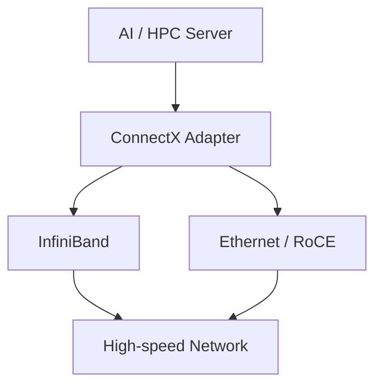
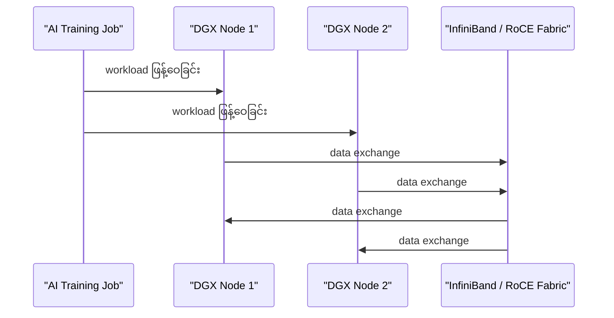
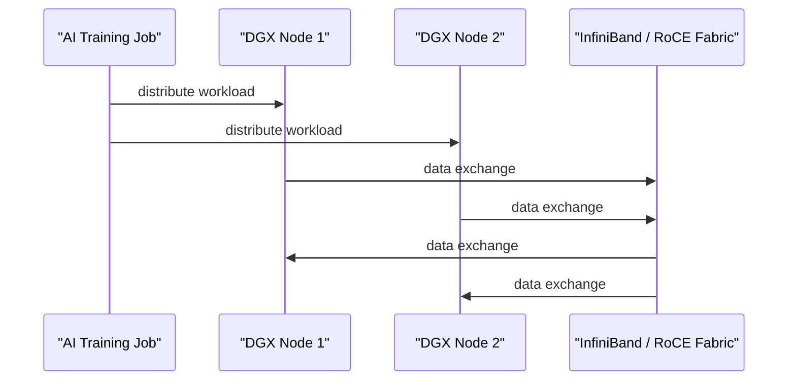

# Module — NVIDIA Networking, InfiniBand and ConnectX

> Part I · Course Module 06 (NVIDIA AI Infrastructure and DGX Systems) — topic notes

## မြန်မာဘာသာ version

## 1. Why Does an AI Supercomputer Need Networking?

အရင် module တွေမှာ—

- DGX
- DGX SuperPOD
- Multiple DGX nodes
- Large-scale AI training
- HPC

စတာတွေကို လေ့လာခဲ့ပါတယ်။
DGX SuperPOD လို AI supercomputer တစ်ခုကို တည်ဆောက်တဲ့အခါ GPU တွေ၊ compute nodes တွေ အများကြီး ပါဝင်လာပါတယ်။
ဒီ nodes တွေဟာ တစ်ခုနဲ့တစ်ခု data exchange လုပ်ရပါတယ်။
ဒါကြောင့်—

- AI supercomputer တစ်ခုမှာ high-performance networking က မဖြစ်မနေလိုအပ်ပါတယ်။

အဲဒီအတွက် NVIDIA က high-speed, low-latency networking solutions တွေကို ပေးထားပါတယ်။
အဓိကအားဖြင့်—

- InfiniBand
- Converged Ethernet

တို့ကို တွေ့ရပါတယ်။

## 2. NVIDIA Networking Portfolio

NVIDIA ရဲ့ networking portfolio ကို နားလည်ဖို့ Mellanox ကို သိထားဖို့ အရေးကြီးပါတယ်။
Mellanox Technologies ဟာ—

- InfiniBand
- High-performance networking
- Networking adapters
- Data-center networking

နယ်ပယ်တွေမှာ လူသိများတဲ့ company တစ်ခု ဖြစ်ပါတယ်။
NVIDIA က Mellanox ကို 2020 ခုနှစ်မှာ acquire လုပ်ခဲ့ပါတယ်။

> Source correction: Transcript မှာ “acquired by NVIDIA in 2022” လို့ ပြောထားပေမယ့် acquisition က 2020 ဖြစ်ပါတယ်။

Mellanox technology နဲ့ NVIDIA GPU/AI platform တွေ ပေါင်းစပ်လာတာကြောင့် NVIDIA ရဲ့ high-performance networking portfolio ပိုပြီး ခိုင်မာလာပါတယ်။

## 3. ConnectX

ဒီ networking portfolio ထဲမှာ အရေးကြီးတဲ့ product family တစ်ခုက—

- NVIDIA ConnectX

ဖြစ်ပါတယ်။
ConnectX ဟာ high-performance networking adapters / NICs အတွက် NVIDIA ရဲ့ အရေးကြီးတဲ့ product family ဖြစ်ပါတယ်။
High-level architecture:

```
        AI / HPC Server
              │
              ▼
       ConnectX Adapter
              │
      ┌───────┴────────┐
      │                │
      ▼                ▼
  InfiniBand       Ethernet / RoCE
      │                │
      └───────┬────────┘
              ▼
       High-speed Network
```

**Figure 1 — ConnectX adapter က server နဲ့ network ကြားမှာ ရှိပုံ**



**ပုံရှင်းလင်းချက် (Figure walkthrough) —**

1. အပေါ်ဆုံး box က AI / HPC Server ကို ပြပါတယ်။
2. Server ရဲ့အောက်မှာ ချိတ်ဆက်ထားတာက ConnectX Adapter ဖြစ်ပါတယ်။
3. Adapter ကနေ InfiniBand လမ်းကြောင်း သို့မဟုတ် Ethernet / RoCE လမ်းကြောင်း — နှစ်ခုထဲက တစ်ခုကို သုံးနိုင်ပါတယ်။
4. လမ်းကြောင်းနှစ်ခုစလုံးက အောက်ဆုံးက high-speed network ဆီ ရောက်ရှိသွားပါတယ်။

ဒါကြောင့် ConnectX ကို server နဲ့ high-performance network fabric ကြားက networking adapter လို့ conceptual အနေနဲ့ မှတ်နိုင်ပါတယ်။

## 10. Converged Ethernet

NVIDIA ရဲ့ high-performance networking solution တွေထဲမှာ Converged Ethernet လည်း ပါဝင်ပါတယ်။
ဒီ concept ကို အရင် module မှာလည်း လေ့လာခဲ့ပါတယ်။
Converged Ethernet ရဲ့ အရေးကြီးတဲ့ concept က—

- Ethernet infrastructure ပေါ်မှာ multiple traffic types ကို converge လုပ်နိုင်ခြင်း

ဖြစ်ပါတယ်။
RDMA ကို Ethernet ပေါ်မှာ အသုံးပြုတဲ့ important technology တစ်ခုက—

- RoCE — RDMA over Converged Ethernet

ဖြစ်ပါတယ်။
Concept:

```
Application / AI
      │
      ▼
     RDMA
      │
      ▼
     RoCE
      │
      ▼
Converged Ethernet
      │
      ▼
Network
```

## 11. InfiniBand vs Converged Ethernet

AI data center networking ကို high-level comparison လုပ်မယ်ဆိုရင်—

| Feature | InfiniBand | Converged Ethernet |
|---|---|---|
| Main purpose | High-performance networking | High-performance Ethernet networking |
| Common use | AI / HPC clusters | AI / Data Center / Enterprise |
| RDMA | Native/central to architecture | RoCE can provide RDMA |
| Latency | Very low | Can be very low |
| Ecosystem | Specialized | Ethernet-based / broader |
| Infrastructure | Specialized fabric | Ethernet fabric |

အရေးကြီးတာက—

- Ethernet = always slow လို့ မမှတ်ပါနဲ့။

Modern Ethernet technologies တွေကလည်း very high bandwidth နဲ့ low latency ကို support လုပ်နိုင်ပါတယ်။

## 12. AI Training Use Case

Large-scale AI training မှာ workload ကို GPU/node အများကြီးပေါ် ဖြန့်နိုင်ပါတယ်။
ဥပမာ—

```
          AI Training Job
                │
       ┌────────┼────────┐
       ▼        ▼        ▼
     DGX 1    DGX 2    DGX 3
       │        │        │
       └────────┼────────┘
                │
         High-speed Fabric
                │
       InfiniBand / RoCE
```

**Figure 4 — AI training အတွင်း node တွေကြား data exchange ဖြစ်ပုံ**



**ပုံရှင်းလင်းချက် (Figure walkthrough) —**

1. ဘယ်ဘက်က AI Training Job က workload ကို DGX nodes တွေဆီ ဖြန့်ဝေပေးပါတယ်။
2. Training run နေစဉ်အတွင်း DGX Node 1 နဲ့ DGX Node 2 က အချင်းချင်း data ဖလှယ်ကြပါတယ်။
3. ဒီ data exchange အားလုံးက InfiniBand / RoCE fabric ကတစ်ဆင့် ဖြတ်သန်းသွားပါတယ် (မြားကြောင်းတွေက နှစ်ဖက်သွား ဖလှယ်မှုကို ပြပါတယ်)။
4. Fabric မြန်ရင် node တွေ data စောင့်ချိန် နည်းပြီး GPU တွေ computation ကို ပိုလုပ်နိုင်ပါတယ်။

Training process အတွင်း node တွေကြား data exchange များတဲ့အတွက် high-speed networking က အရေးကြီးပါတယ်။

## 13. HPC Use Case

HPC environment တွေမှာလည်း nodes အများကြီးကို cluster တစ်ခုအဖြစ် ချိတ်ဆက်ထားပါတယ်။

```
HPC Node 1 ──┐
HPC Node 2 ──┤
HPC Node 3 ──┼── High-speed Fabric
HPC Node 4 ──┤
HPC Node 5 ──┘
```

ဒါကြောင့် InfiniBand / high-performance networking ကို HPC cluster တွေမှာ အသုံးပြုနိုင်ပါတယ်။

## 14. Storage Acceleration

High-performance networking က compute nodes တွေကြား communication အတွက်ပဲ မဟုတ်ပါဘူး။
Storage access နဲ့ data movement ကိုလည်း accelerate လုပ်နိုင်ပါတယ်။
Concept:

```
DGX / Compute Node
        │
        │ High-speed Network
        ▼
   Storage System
        │
        ▼
 Training Dataset
```

AI workload မှာ storage data ကို GPU တွေဆီ မြန်မြန်ပို့ပေးနိုင်ဖို့လိုတာကြောင့် network performance က storage performance နဲ့လည်း ဆက်စပ်နေပါတယ်။

## 15. Suitable Workloads

Source အရ high-performance InfiniBand solutions တွေဟာ အထူးသင့်တော်တာတွေက—

**Large-scale HPC Clusters** — Node အများကြီးပါဝင်ပြီး high bandwidth / low latency လိုအပ်တဲ့ HPC clusters။

**Multi-node AI Training** — AI training workload ကို node အများကြီးပေါ် distribute လုပ်ထားတဲ့ environment။

**AI Data Centers** — Large-scale GPU infrastructure တွေပါဝင်တဲ့ data centers။

**Storage-intensive / Data Movement Workloads** — High-speed data movement လိုအပ်တဲ့ environment တွေ။

## 16. When Is It Not Suitable?

High-performance networking infrastructure ဟာ အားလုံးအတွက် လိုအပ်တာမဟုတ်ပါဘူး။

**Consumer Networking** — ပုံမှန် home/consumer networking အတွက် InfiniBand လို specialized high-performance fabric မလိုအပ်ပါဘူး။

```
Home PC
   ↓
Normal Ethernet / Wi-Fi
```

**Small Office Networking** — Small office မှာ—

- Email
- Web browsing
- File sharing
- Normal business applications

လို workloads တွေအတွက် specialized AI/HPC networking က overkill ဖြစ်နိုင်ပါတယ်။

**Edge Devices** — Edge/embedded devices တွေအတွက် large-scale InfiniBand infrastructure မသင့်တော်ပါဘူး။

```
Edge Device
     ↓
Local Network
     ↓
Local AI Processing
```

**Workloads That Do Not Need High-speed Interconnect** — Workload က node-to-node communication မများဘူး၊ bandwidth/latency requirement မမြင့်ဘူးဆိုရင် expensive high-performance networking ကို အသုံးပြုဖို့ မလိုအပ်နိုင်ပါဘူး။

## 17. Cost Consideration

High-performance networking ရဲ့ disadvantage တစ်ခုက cost ဖြစ်ပါတယ်။
Large-scale AI/HPC networking မှာ—

- High-performance adapters
- Specialized switches
- High-speed cables/transceivers
- Network design
- Operations expertise

စတာတွေ လိုအပ်နိုင်ပါတယ်။
ဒါကြောင့်—

```
Higher performance requirement
          ↓
Specialized networking
          ↓
Higher infrastructure cost
```

ဖြစ်လာနိုင်ပါတယ်။

## 18. Where ConnectX Fits

အခု lesson ရဲ့ architecture ကို အတိုချုံးပြရင်—

```
             AI / HPC Server
                    │
                    ▼
             NVIDIA ConnectX
                    │
          ┌─────────┴─────────┐
          │                   │
          ▼                   ▼
      InfiniBand         Ethernet / RoCE
          │                   │
          └─────────┬─────────┘
                    ▼
              High-Speed Fabric
                    │
       ┌────────────┼────────────┐
       ▼            ▼            ▼
     DGX Node     DGX Node     Storage
```

ဒီ diagram က ConnectX = server-side networking adapter ဆိုတဲ့ concept ကို မှတ်ဖို့ အရေးကြီးပါတယ်။

## 19. Overall Mental Model

ဒီ module တစ်ခုလုံးကို—

```
AI Supercomputer
      │
      ▼
Many DGX Nodes
      │
      ▼
Need High-Speed Networking
      │
      ├── InfiniBand
      │
      └── Converged Ethernet / RoCE
              │
              ▼
      NVIDIA Networking
              │
              ▼
          ConnectX
              │
              ▼
        HCA / NIC Adapter
              │
              ▼
     Efficient Data Movement
              │
              ▼
          AI / HPC
```

လို့ မှတ်နိုင်ပါတယ်။

## 20. Exam Points ⭐️

**NVIDIA Networking** — High-speed, low-latency networking for AI, HPC and data-center workloads.

**Mellanox** — NVIDIA acquired Mellanox in 2020, bringing major high-performance networking technology into NVIDIA's portfolio.

**ConnectX** — NVIDIA family of high-performance networking adapters.

**HCA** — Host Channel Adapter — a high-performance adapter used to connect a host to an InfiniBand fabric.

**NIC** — Network Interface Card/Controller — a network interface connecting a host to a network.

**DMA** — Direct Memory Access — allows hardware devices to transfer data to/from memory with reduced CPU involvement.

**InfiniBand** — High-performance networking technology widely used for AI/HPC clusters.

**RoCE** — RDMA over Converged Ethernet

## 21. Exam Shortcut

Remember:

```
ConnectX
   ↓
Networking Adapter
   ↓
InfiniBand / Ethernet
   ↓
High Bandwidth + Low Latency
   ↓
AI / HPC / Data Center
```

And:

- HCA → Host ↔️ InfiniBand
- NIC → Host ↔️ Network
- DMA → Efficient Data Movement
- IB  → High-performance fabric
- RoCE → RDMA over Ethernet

**One-line memory** — NVIDIA ConnectX networking adapters provide high-performance connectivity for InfiniBand and Ethernet/RoCE environments, enabling efficient, high-bandwidth and low-latency communication for large-scale AI and HPC systems.

## 22. ကိုယ့်ကိုယ်ကို စစ်ဆေးရန် မေးခွန်းများ (Self-Check Questions)

**မေးခွန်း ၁ —** AI supercomputer တစ်ခုအတွက် high-performance networking ဘာကြောင့် မဖြစ်မနေ လိုအပ်ရတာလဲ?
**အဖြေ —** GPU/compute nodes အများကြီးပါဝင်တဲ့အတွက် nodes တွေကြား data exchange အမြဲလုပ်ရပြီး communication bottleneck ဖြစ်ရင် GPUs တွေ computation အစား data စောင့်ရင်း အချိန်ကုန်နိုင်လို့ ဖြစ်ပါတယ်။

**မေးခွန်း ၂ —** NVIDIA က Mellanox ကို ဘယ်နှစ်မှာ acquire လုပ်ခဲ့သလဲ (source correction အရ)?
**အဖြေ —** 2020 ခုနှစ်မှာ ဖြစ်ပါတယ်။ (Transcript မှာ “2022” လို့ ပြောထားပေမယ့် မှားယွင်းပါတယ်။)

**မေးခွန်း ၃ —** HCA နဲ့ NIC ကွာခြားချက်က ဘာလဲ?
**အဖြေ —** NIC = Network Interface Card/Controller ဖြစ်ပြီး host ကို network နဲ့ ချိတ်ဆက်ပေးတဲ့ ယေဘုယျ network interface ဖြစ်ပါတယ်။ HCA = Host Channel Adapter ဖြစ်ပြီး host ကို InfiniBand fabric နဲ့ ချိတ်ဆက်ပေးတဲ့ specialized high-performance adapter ဖြစ်ပါတယ်။

**မေးခွန်း ၄ —** DMA က AI server အတွက် ဘာကြောင့် အရေးကြီးသလဲ?
**အဖြေ —** DMA = Direct Memory Access ဖြစ်ပြီး hardware device တွေကို CPU involvement လျှော့ချပြီး memory နဲ့ data transfer လုပ်နိုင်စေလို့ CPU overhead လျော့ပြီး application/compute workloads အတွက် resources ပိုကျန်စေပါတယ်။

**မေးခွန်း ၅ —** InfiniBand နဲ့ Converged Ethernet နှစ်ခုလုံးရဲ့ RDMA ပိုင်း ကွာခြားချက်က ဘာလဲ?
**အဖြေ —** InfiniBand မှာ RDMA က architecture ရဲ့ native/central အစိတ်အပိုင်းဖြစ်ပြီး Converged Ethernet မှာတော့ RoCE (RDMA over Converged Ethernet) ကနေတစ်ဆင့် RDMA ကို ပေးနိုင်ပါတယ်။

---

## English Version — NVIDIA Networking, InfiniBand and ConnectX

## 1. Why Does an AI Supercomputer Need Networking?

In the previous modules, we discussed:

- DGX
- DGX SuperPOD
- Multiple DGX nodes
- Large-scale AI training
- HPC

When building an AI supercomputer, you have many compute nodes and GPUs.
Those nodes must communicate with each other.
Therefore:

- High-performance networking is a fundamental part of an AI supercomputer.

NVIDIA provides networking solutions designed for high-speed and low-latency communication, including:

- InfiniBand
- Converged Ethernet

## 2. NVIDIA Networking and Mellanox

To understand NVIDIA's networking portfolio, it is important to understand Mellanox Technologies.
Mellanox was well known for high-performance networking technologies, particularly:

- InfiniBand
- Networking hardware
- Networking software
- High-performance data-center connectivity

NVIDIA acquired Mellanox in 2020.

> Source correction: The transcript says “acquired by NVIDIA in 2022.” The acquisition was completed in 2020.

The acquisition significantly strengthened NVIDIA's networking portfolio and allowed NVIDIA to combine high-performance networking technologies with its GPU and AI platforms.

## 3. ConnectX

One of the important NVIDIA networking product families is:

- NVIDIA ConnectX

ConnectX provides high-performance networking adapters for data-center, AI and HPC environments.
At a high level:

```
        AI / HPC Server
              │
              ▼
       ConnectX Adapter
              │
      ┌───────┴────────┐
      │                │
      ▼                ▼
  InfiniBand       Ethernet / RoCE
      │                │
      └───────┬────────┘
              ▼
       High-speed Network
```

**Figure 1 — Where the ConnectX adapter sits between the server and the network**


**Figure walkthrough —**

1. The top box is the AI / HPC server.
2. Below the server sits the ConnectX adapter.
3. From the adapter, traffic can use either the InfiniBand path or the Ethernet / RoCE path.
4. Both paths end at the high-speed network at the bottom.

A useful mental model is:

- ConnectX = the high-performance networking adapter between the server and the network fabric.

## 10. Converged Ethernet

NVIDIA also provides high-performance networking based on Converged Ethernet.
The basic concept is to use Ethernet infrastructure to carry multiple types of traffic.
An important technology here is:

- RoCE — RDMA over Converged Ethernet

Conceptually:

```
Application / AI
      │
      ▼
     RDMA
      │
      ▼
     RoCE
      │
      ▼
Converged Ethernet
      │
      ▼
Network
```

RoCE therefore provides RDMA capabilities over Ethernet.

## 11. InfiniBand vs Converged Ethernet

At a high level:

| Feature | InfiniBand | Converged Ethernet |
|---|---|---|
| Main purpose | High-performance networking | High-performance Ethernet networking |
| Common use | AI / HPC clusters | AI / Data Center / Enterprise |
| RDMA | Native/central to architecture | RoCE can provide RDMA |
| Latency | Very low | Can be very low |
| Ecosystem | Specialized | Ethernet-based / broader |
| Infrastructure | Specialized fabric | Ethernet fabric |

An important point:

- Do not memorize “Ethernet = slow.”

Modern Ethernet can provide very high bandwidth and very low latency.
The difference is not simply “fast versus slow.” Architecture, protocol, congestion behavior, ecosystem, operational model and workload requirements all matter.

## 12. AI Training Use Case

Large-scale AI training can distribute a workload across many GPUs and nodes.
For example:

```
          AI Training Job
                │
       ┌────────┼────────┐
       ▼        ▼        ▼
     DGX 1    DGX 2    DGX 3
       │        │        │
       └────────┼────────┘
                │
         High-speed Fabric
                │
       InfiniBand / RoCE
```

**Figure 4 — Data exchange between nodes during AI training**



**Figure walkthrough —**

1. On the left, the AI training job distributes the workload to the DGX nodes.
2. While the training runs, DGX Node 1 and DGX Node 2 exchange data with each other.
3. All of this data exchange passes through the InfiniBand / RoCE fabric (the arrows show exchange in both directions).
4. A faster fabric means nodes wait less for data, so the GPUs can spend more time computing.

During training, the nodes may need to exchange data frequently.
Therefore, high-speed networking is an important component of distributed AI training.

## 13. HPC Use Case

HPC systems also contain many interconnected compute nodes.
For example:

```
HPC Node 1 ──┐
HPC Node 2 ──┤
HPC Node 3 ──┼── High-speed Fabric
HPC Node 4 ──┤
HPC Node 5 ──┘
```

InfiniBand and other high-performance networking technologies can therefore be used to connect HPC clusters.

## 14. Storage Acceleration

High-performance networking is not only about compute-node communication.
It can also be important for high-speed access to storage.
Conceptually:

```
DGX / Compute Node
        │
        │ High-speed Network
        ▼
   Storage System
        │
        ▼
 Training Dataset
```

AI workloads often need to move large amounts of data between compute and storage systems.
Therefore, network performance can also influence storage-related data movement.

## 15. Suitable Workloads

According to the source, high-performance InfiniBand networking is particularly suitable for:

**Large-scale HPC Clusters** — Clusters with many nodes and high bandwidth / low latency requirements.

**Multi-node AI Training** — AI training workloads distributed across multiple nodes.

**AI Data Centers** — Data centers containing large GPU-based AI infrastructure.

**High-speed Data Movement** — Workloads that require significant data movement between compute and storage or between compute nodes.

## 16. When Is It Not Suitable?

High-performance networking is not required for every environment.

**Consumer Networking** — A normal home or consumer environment does not generally require specialized InfiniBand infrastructure.

```
Home PC
   ↓
Normal Ethernet / Wi-Fi
```

**Small Office Networking** — For workloads such as:

- Email
- Web browsing
- File sharing
- Normal business applications

a specialized AI/HPC network may be unnecessary.

**Edge Devices** — Large-scale InfiniBand infrastructure is generally not an appropriate architecture for edge or embedded devices.

```
Edge Device
     ↓
Local Network
     ↓
Local AI Processing
```

**Workloads Without High-speed Interconnect Requirements** — If the workload does not require significant node-to-node communication or extremely high bandwidth/low latency, a specialized high-performance network may not justify its cost.

## 17. Cost Consideration

One of the disadvantages of specialized high-performance networking is cost.
A large AI/HPC network can require:

- High-performance adapters
- Specialized switches
- High-speed cables/transceivers
- Network architecture
- Operations expertise

Therefore:

```
Higher performance requirement
          ↓
Specialized networking
          ↓
Higher infrastructure cost
```

This is why InfiniBand is generally not chosen simply because it is “faster.”
The workload must justify the additional infrastructure and operational complexity.

## 18. Where ConnectX Fits

The overall architecture can be visualized as:

```
             AI / HPC Server
                    │
                    ▼
             NVIDIA ConnectX
                    │
          ┌─────────┴─────────┐
          │                   │
          ▼                   ▼
      InfiniBand         Ethernet / RoCE
          │                   │
          └─────────┬─────────┘
                    ▼
              High-Speed Fabric
                    │
       ┌────────────┼────────────┐
       ▼            ▼            ▼
     DGX Node     DGX Node     Storage
```

The important mental model is:

- ConnectX = server-side high-performance networking adapter.

## 19. Overall Mental Model

The complete lesson can be remembered as:

```
AI Supercomputer
      │
      ▼
Many DGX Nodes
      │
      ▼
Need High-Speed Networking
      │
      ├── InfiniBand
      │
      └── Converged Ethernet / RoCE
              │
              ▼
      NVIDIA Networking
              │
              ▼
          ConnectX
              │
              ▼
        HCA / NIC Adapter
              │
              ▼
     Efficient Data Movement
              │
              ▼
          AI / HPC
```

## 20. Exam Points ⭐️

**NVIDIA Networking** — High-speed, low-latency networking for AI, HPC and data-center workloads.

**Mellanox** — NVIDIA acquired Mellanox in 2020, strengthening NVIDIA's high-performance networking portfolio.

**ConnectX** — NVIDIA family of high-performance networking adapters.

**HCA** — Host Channel Adapter — a high-performance host adapter used to connect a host to an InfiniBand fabric.

**NIC** — Network Interface Card/Controller — a network interface used to connect a host to a network.

**DMA** — Direct Memory Access — a mechanism that allows hardware devices to transfer data to/from memory with reduced CPU involvement.

**InfiniBand** — High-performance networking technology widely used in AI/HPC clusters.

**RoCE** — RDMA over Converged Ethernet

## 21. Exam Shortcut

Remember:

```
ConnectX
   ↓
Networking Adapter
   ↓
InfiniBand / Ethernet
   ↓
High Bandwidth + Low Latency
   ↓
AI / HPC / Data Center
```

And:

- HCA → Host ↔️ InfiniBand
- NIC → Host ↔️ Network
- DMA → Efficient Data Movement
- IB  → High-performance fabric
- RoCE → RDMA over Ethernet

**One-line memory** — NVIDIA ConnectX networking adapters provide high-performance connectivity for InfiniBand and Ethernet/RoCE environments, enabling efficient, high-bandwidth and low-latency communication for large-scale AI and HPC systems.

## 22. Self-Check Questions

**Q1 —** Why is high-performance networking mandatory for an AI supercomputer?
**A —** It contains many GPU/compute nodes that must constantly exchange data; if communication becomes a bottleneck, GPUs wait for data instead of computing.

**Q2 —** When did NVIDIA acquire Mellanox, per the source correction?
**A —** In 2020 (the transcript's “2022” is incorrect).

**Q3 —** What is the difference between an HCA and a NIC?
**A —** A NIC (Network Interface Card/Controller) is the general network interface connecting a host to a network. An HCA (Host Channel Adapter) is the specialized high-performance adapter connecting a host to an InfiniBand fabric.

**Q4 —** Why does DMA matter for AI servers?
**A —** DMA (Direct Memory Access) lets hardware devices transfer data to/from memory with reduced CPU involvement, lowering CPU overhead and leaving more resources for application/compute work.

**Q5 —** How do InfiniBand and Converged Ethernet differ regarding RDMA?
**A —** RDMA is native/central to the InfiniBand architecture, while Converged Ethernet provides RDMA through RoCE (RDMA over Converged Ethernet).

---

## Technical review notes

- Source correction preserved: the transcript says NVIDIA acquired Mellanox “in 2022”; the acquisition was completed in **2020** (already flagged in the source itself).
- The HCA vs NIC distinction is presented as a simplified terminology model per the source; modern adapters can support multiple technologies and product naming varies.
- No speed, latency, or bandwidth figures are claimed in this module; the source deliberately avoids fixed numbers.
- Mermaid figures (Figure 1-4) with figure walkthroughs were added inline in both the Myanmar and English sections; the diagrams only restate concepts already covered in this module.
