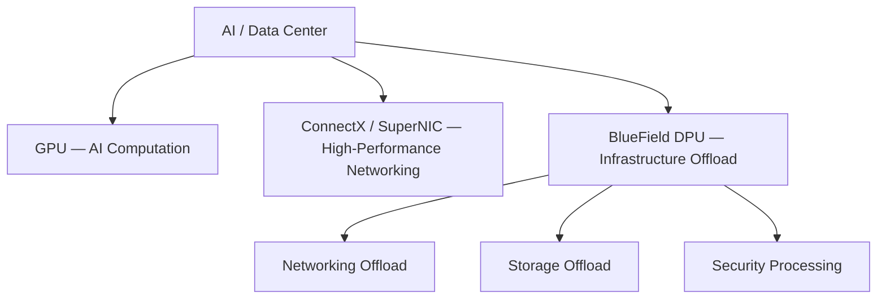
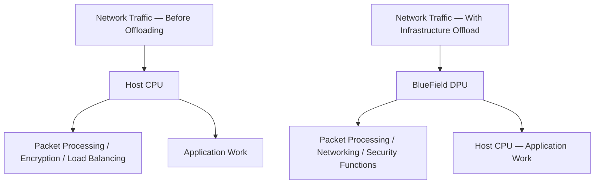
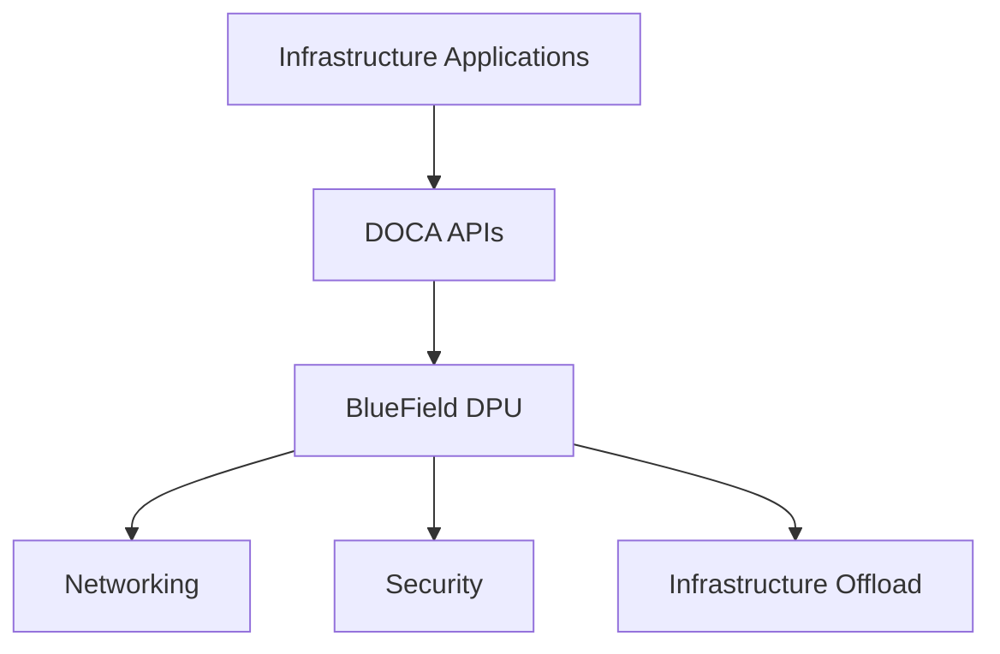
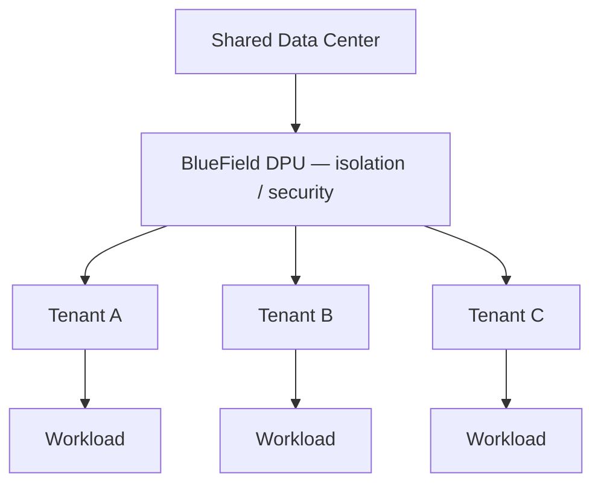

# Module — NVIDIA BlueField DPU and SuperNIC

> Part I · Course Module 06 (NVIDIA AI Infrastructure and DGX Systems) — topic notes

## မြန်မာဘာသာ version

## 1. Introduction — What Comes After GPU and Networking?

အရင် Module တွေမှာ NVIDIA ရဲ့ AI infrastructure ကို လေ့လာခဲ့ပါတယ်။

- GPU — AI computation နဲ့ parallel processing လုပ်ပေးတယ်။
- ConnectX — High-performance networking ကို ပံ့ပိုးပေးတယ်။
- InfiniBand / Ethernet — Servers နဲ့ compute nodes တွေကို ချိတ်ဆက်ပေးတယ်။

ဒါဆို မေးစရာတစ်ခုရှိလာပါတယ်။
GPU အတွက် solution ရှိတယ်၊ Networking အတွက် solution ရှိတယ်။ Infrastructure နဲ့ data movement ကို ဘယ်သူက handle လုပ်ပေးမလဲ။
အဲဒီနေရာမှာ NVIDIA ရဲ့ BlueField DPU ကို လေ့လာရပါမယ်။

## 2. What Is NVIDIA BlueField?

BlueField ဟာ NVIDIA ရဲ့ DPU — Data Processing Unit platform ဖြစ်ပါတယ်။
BlueField DPU တွေဟာ networking, compute နဲ့ acceleration capabilities တွေကို ပေါင်းစပ်ထားပြီး infrastructure-related workloads တွေကို host CPU ပေါ်ကနေ offload လုပ်ပေးနိုင်ပါတယ်။
အဓိကရည်ရွယ်ချက်က—

- Networking workload တွေကို offload လုပ်ရန်
- Storage-related operations တွေကို accelerate လုပ်ရန်
- Security processing ကို offload လုပ်ရန်
- Infrastructure workload တွေကို host CPU ပေါ်ကနေ လျှော့ချရန်
- Multi-tenant environment တွေအတွက် isolation နဲ့ security ကို ပံ့ပိုးရန်

အလွယ်ဆုံး မှတ်ရမယ်ဆိုရင်—

- BlueField DPU = Data Center Infrastructure အတွက် specialized processor ဖြစ်ပြီး networking, storage နဲ့ security workload တွေကို host CPU ပေါ်ကနေ offload လုပ်ပေးနိုင်တယ်။

## 3. What Is a SuperNIC?

BlueField technology နဲ့ ဆက်စပ်ပြီး NVIDIA က SuperNIC ဆိုတဲ့ concept ကိုလည်း အသုံးပြုပါတယ်။
SuperNIC ဟာ AI data center networking အတွက် high-performance networking နဲ့ acceleration ကို အလေးထားတဲ့ network interface platform ဖြစ်ပါတယ်။
ဒါပေမဲ့ SuperNIC နဲ့ DPU ကို အဓိပ္ပာယ်တူတဲ့ term နှစ်ခုလို အမြဲမယူဆသင့်ပါဘူး။ Product အလိုက် capabilities နဲ့ architecture ကွာခြားနိုင်ပါတယ်။
Conceptually—

```
GPU
 │
 └── AI Computation

ConnectX / SuperNIC
 │
 └── High-Performance Networking

BlueField DPU
 │
 ├── Networking Offload
 ├── Storage Offload
 ├── Security Processing
 └── Infrastructure Acceleration
```

**Figure 1 — GPU, ConnectX / SuperNIC နဲ့ BlueField DPU တို့ရဲ့ role ခွဲခြားပုံ**



**ပုံရှင်းလင်းချက် (Figure walkthrough) —**

1. အပေါ်ဆုံး box က AI / data center environment တစ်ခုလုံးကို ကိုယ်စားပြုပါတယ်။
2. အောက်မှာ component သုံးခု ခွဲပြထားပါတယ် — GPU က AI computation၊ ConnectX / SuperNIC က high-performance networking အတွက် ဖြစ်ပါတယ်။
3. တတိယ box က BlueField DPU ဖြစ်ပြီး infrastructure offload ကို လုပ်ပေးပါတယ်။
4. BlueField အောက်က box သုံးခုက networking, storage နဲ့ security ဆိုင်ရာ infrastructure workloads တွေကို offload လုပ်ပေးနိုင်ပုံကို ပြပါတယ်။

## 4. Why Do We Need Infrastructure Offload?

Server တစ်ခုမှာ data ပို့တာ၊ လက်ခံတာ၊ security စစ်တာတွေကို လုပ်ရပါတယ်။
ဥပမာ—

- Data ကို packet အဖြစ် ပြင်ဆင်ခြင်း (packet processing)
- Network protocol headers တွေ ထည့်ခြင်း
- Encapsulation / decapsulation လုပ်ခြင်း
- Load balancing လုပ်ခြင်း
- Encryption / decryption လုပ်ခြင်း
- Network traffic ကို process လုပ်ခြင်း

ဒီ operations တွေကို system design ပေါ်မူတည်ပြီး host CPU က handle လုပ်ရနိုင်ပါတယ်။
CPU က ဒီ infrastructure operations တွေမှာ အချိန်နဲ့ resources အများကြီး အသုံးပြုရရင် application workload အတွက် အသုံးပြုနိုင်တဲ့ resources လျော့နည်းလာနိုင်ပါတယ်။
အဲဒီအတွက် BlueField DPU ကို အသုံးပြုပြီး သင့်တော်တဲ့ infrastructure operations တွေကို offload လုပ်နိုင်ပါတယ်။

```
Before Offloading
Network Traffic
       │
       ▼
    Host CPU
       │
       ├── Packet Processing
       ├── Encryption
       ├── Load Balancing
       └── Application Work

With Infrastructure Offload
Network Traffic
       │
       ▼
   BlueField DPU
       │
       ├── Packet Processing
       ├── Encryption
       ├── Networking Functions
       └── Security Functions

Host CPU
       │
       └── Application Work
```

**Figure 2 — Infrastructure offload မလုပ်ခင်နဲ့ လုပ်ပြီးခါနီး နှိုင်းယှဉ်ပုံ**



**ပုံရှင်းလင်းချက် (Figure walkthrough) —**

1. ပုံမှာ အပေါ်ပိုင်းနဲ့အောက်ပိုင်း နှစ်ပိုင်းခွဲပြထားပါတယ် — အပေါ်က offload မလုပ်ခင်၊ အောက်က offload လုပ်ပြီး ဖြစ်ပါတယ်။
2. အပေါ်ပိုင်းမှာ network traffic အားလုံးက host CPU ဆီရောက်ပြီး CPU က packet processing, encryption, load balancing နဲ့ application work အားလုံးကို လုပ်ရပါတယ်။
3. အောက်ပိုင်းမှာတော့ infrastructure ဆိုင်ရာအလုပ်တွေကို BlueField DPU က ကိုင်တွယ်ပေးပါတယ်။
4. ဒါကြောင့် host CPU က application work ကိုပဲ အာရုံစိုက်နိုင်ပြီး resources ပိုကျန်ပါတယ် — ဒါက ဒီ module မှာပြောတဲ့ အဓိကအကျိုးကျေးဇူး ဖြစ်ပါတယ်။

ဒီ diagram က conceptual illustration ဖြစ်ပါတယ်။ ဘယ် operation တွေကို DPU က offload လုပ်နိုင်သလဲဆိုတာက product capabilities နဲ့ deployment configuration ပေါ်မူတည်ပါတယ်။
အဓိကအကျိုးကျေးဇူး: Host CPU ကို infrastructure workload တွေကနေ လျှော့ချပြီး application နဲ့ compute workload တွေအတွက် resources ပိုရရှိစေနိုင်ခြင်း ဖြစ်ပါတယ်။

## 5. What Is DOCA?

BlueField DPU တွေကို program လုပ်ဖို့၊ configure လုပ်ဖို့နဲ့ infrastructure acceleration applications တွေ တည်ဆောက်ဖို့ NVIDIA က DOCA software framework ကို ပေးထားပါတယ်။
DOCA ဆိုတာ—

- Data Center Infrastructure on a Chip Architecture

လို့ အမည်အပြည့်အစုံကို ဖော်ပြကြပါတယ်။
DOCA ဟာ NVIDIA ရဲ့ DPU software development framework ဖြစ်ပြီး DPU ပေါ်မှာ networking, security နဲ့ infrastructure-related applications တွေ တည်ဆောက်နိုင်အောင် ကူညီပေးပါတယ်။
Conceptually—

```
Infrastructure Applications
           │
           ▼
       DOCA APIs
           │
           ▼
     BlueField DPU
           │
           ├── Networking
           ├── Security
           └── Infrastructure Offload
```

**Figure 3 — DOCA က BlueField DPU ကို အသုံးချပုံ**



**ပုံရှင်းလင်းချက် (Figure walkthrough) —**

1. အပေါ်ဆုံး box က developer တွေ တည်ဆောက်တဲ့ infrastructure applications တွေ ဖြစ်ပါတယ်။
2. ဒီ applications တွေက DOCA APIs ကတစ်ဆင့် DPU ကို အသုံးပြုပါတယ်။
3. အလယ်က box က BlueField DPU ကိုယ်တိုင် ဖြစ်ပါတယ်။
4. DPU အောက်က box သုံးခုက networking, security နဲ့ infrastructure offload ဆိုတဲ့ အလုပ်နယ်ပယ်တွေကို ပြပါတယ်။

DOCA ရဲ့ အရေးကြီးတဲ့ role က hardware တစ်ခုတည်းပေးတာမဟုတ်ဘဲ DPU ကို အသုံးချဖို့ software framework ကိုပါ ပေးထားခြင်း ဖြစ်ပါတယ်။

## 6. BlueField and Switches

Data center networking တစ်ခုမှာ DPU တစ်ခုတည်းရှိရုံနဲ့ မလုံလောက်ပါဘူး။
Server တွေ၊ networking adapters တွေ၊ switches တွေနဲ့ network fabric တို့ကို ချိတ်ဆက်တည်ဆောက်ရပါတယ်။

```
        Server 1                     Server 2
   ┌────────────────┐           ┌────────────────┐
   │ CPU + GPU      │           │ CPU + GPU      │
   │ BlueField DPU  │           │ BlueField DPU  │
   └───────┬────────┘           └────────┬───────┘
           │                             │
           └───────────┐   ┌─────────────┘
                       ▼   ▼
                  Network Switch
                       │
                       ▼
                 Other Systems
```

NVIDIA ရဲ့ data center portfolio မှာ DPU တွေအပြင် high-performance switches နဲ့ networking technologies တွေလည်း ပါဝင်ပါတယ်။
ဒီလို components တွေကို ပေါင်းစပ်ပြီး AI, HPC, cloud computing နဲ့ hyperscale infrastructure တွေကို တည်ဆောက်နိုင်ပါတယ်။

## 7. BlueField DPU Use Cases

**A. Infrastructure Offload** — Networking နဲ့ infrastructure-related tasks တွေကို host CPU ပေါ်ကနေ offload လုပ်ပေးနိုင်ပါတယ်။

**B. Zero-Trust Security** — Zero-trust security architecture မှာ system တစ်ခု၊ workload တစ်ခု သို့မဟုတ် user တစ်ယောက်ကို ယုံကြည်စိတ်ချရတယ်လို့ အလိုအလျောက် မယူဆပါဘူး။
Access ကို policy အရ စစ်ဆေးပြီး လိုအပ်တဲ့ security controls တွေကို အသုံးပြုရပါတယ်။
BlueField-based infrastructure ကို အသုံးပြုပြီး သတ်မှတ်ထားတဲ့ security processing နဲ့ workload isolation ကို ပံ့ပိုးနိုင်ပါတယ်။

**C. Storage Acceleration** — Storage နဲ့ data movement ဆိုင်ရာ workload အချို့ကို offload လုပ်ခြင်းဖြင့် host CPU ရဲ့ workload ကို လျှော့ချနိုင်ပါတယ်။

**D. Cloud-Native and Containerized Workloads** — Containerized applications တွေကို run လုပ်တဲ့ data center environment မှာ infrastructure networking နဲ့ security functions တွေကို ပိုမိုထိရောက်စွာ handle လုပ်နိုင်ဖို့ DPU-based architecture ကို အသုံးပြုနိုင်ပါတယ်။

**E. AI and HPC Networking** — Large-scale AI နဲ့ HPC environment တွေမှာ high-throughput networking လိုအပ်ပါတယ်။
BlueField က infrastructure offload နဲ့ security capabilities တွေကို ပံ့ပိုးပေးနိုင်ပြီး ConnectX/SuperNIC နဲ့ network fabric တို့က high-performance connectivity အတွက် ပါဝင်နိုင်ပါတယ်။

## 8. Multi-Tenant Data Center

Multi-tenant data center ဆိုတာ infrastructure တစ်ခုတည်းကို organization, customer, team သို့မဟုတ် workload အများအပြားက မျှဝေအသုံးပြုတဲ့ environment ဖြစ်ပါတယ်။
ဥပမာ—

```
             Shared Data Center
                     │
              BlueField DPU
                     │
          ┌──────────┼──────────┐
          ▼          ▼          ▼
       Tenant A   Tenant B   Tenant C
          │          │          │
       Workload   Workload   Workload
```

**Figure 4 — Multi-tenant data center မှာ BlueField DPU ရဲ့ နေရာ**



**ပုံရှင်းလင်းချက် (Figure walkthrough) —**

1. အပေါ်ဆုံး box က tenant အများအပြား မျှဝေသုံးတဲ့ shared data center ကို ပြပါတယ်။
2. အောက်မှာ BlueField DPU က isolation နဲ့ security ဆိုင်ရာ functions တွေကို ကိုင်တွယ်ပေးပါတယ်။
3. DPU ကနေ tenant သုံးခု — Tenant A, B, C ဆီ ခွဲဝေပေးပါတယ်။
4. Tenant တစ်ခုချင်းစီရဲ့ workload က ကိုယ်ပိုင် box မှာ ရှိနေတာကြောင့် တစ်ခုနဲ့တစ်ခု မထိခိုက်စေဖို့ ဒီဇိုင်းပုံက ရှင်းပြထားပါတယ်။

ဒီလို environment မှာ tenant တစ်ခုရဲ့ traffic နဲ့ workload က တခြား tenant တွေရဲ့ resource တွေကို မသင့်လျော်စွာ မထိခိုက်စေဖို့ isolation နဲ့ security controls တွေ အရေးကြီးပါတယ်။
BlueField-based infrastructure က သင့်တော်တဲ့ networking, security နဲ့ isolation functions တွေကို implement လုပ်ဖို့ ကူညီပေးနိုင်ပါတယ်။

## 9. When Is BlueField Useful?

BlueField DPU ကို အောက်ပါလို requirements တွေရှိတဲ့ environment တွေမှာ စဉ်းစားနိုင်ပါတယ်။

- Infrastructure offload လိုအပ်ခြင်း
- Network သို့မဟုတ် storage data movement များပြားခြင်း
- Zero-trust security နဲ့ workload isolation လိုအပ်ခြင်း
- Multi-tenant cloud environment ဖြစ်ခြင်း
- Hyperscale data center ဖြစ်ခြင်း
- AI/HPC infrastructure မှာ specialized networking နဲ့ infrastructure acceleration လိုအပ်ခြင်း

## 10. When Might It Be Unnecessary?

BlueField လို DPU platform ကို environment တိုင်းမှာ မဖြစ်မနေ အသုံးပြုဖို့ မလိုအပ်ပါဘူး။
ဥပမာ—

- Infrastructure offload requirement မရှိခြင်း
- Specialized isolation requirements မရှိခြင်း
- High-throughput data movement မလိုအပ်ခြင်း
- Basic networking နဲ့ ordinary application workloads သာရှိခြင်း
- Additional hardware, software နဲ့ operational complexity ကို မျှတစေမယ့် workload benefit မရှိခြင်း

ဒီလိုအခြေအနေတွေမှာ DPU ကို ထပ်ထည့်ခြင်းက လိုအပ်ချက်ထက် ပိုမိုရှုပ်ထွေးပြီး ကုန်ကျစရိတ်ပိုများစေနိုင်ပါတယ်။

**Recommendation** — BlueField ကို ရွေးချယ်ရာမှာ brand သို့မဟုတ် performance ဆိုတဲ့စကားလုံးကြောင့်ပဲ မရွေးပါနဲ့။ အမှန်တကယ် offload လုပ်မယ့် infrastructure tasks, isolation requirements, throughput needs နဲ့ operational cost ကို အရင်ဆုံး သတ်မှတ်ပါ။

## 11. Final Architecture — GPU vs ConnectX vs BlueField

```
                 AI / Data Center
                        │
             ┌──────────┼──────────┐
             ▼          ▼          ▼
            GPU      ConnectX    BlueField
             │          │          │
             ▼          ▼          ▼
        AI Compute   Networking  Infrastructure
                                  Offload
                                     │
                             ┌───────┼────────┐
                             ▼       ▼        ▼
                         Network  Storage  Security
                         Functions Functions Functions
```

ဒီ diagram က conceptual comparison ဖြစ်ပြီး product တစ်ခုချင်းစီရဲ့ exact architecture နဲ့ capabilities ကို မဖော်ပြထားပါဘူး။

## 12. Exam Points

| Term | Meaning / Main Role |
|---|---|
| DPU | Data Processing Unit |
| BlueField | NVIDIA DPU platform |
| SuperNIC | High-performance networking interface/acceleration platform |
| DOCA | NVIDIA DPU software development framework |
| Infrastructure offload | Infrastructure tasks တွေကို host CPU ပေါ်ကနေ လျှော့ချခြင်း |
| Zero Trust | Access ကို ယုံကြည်မှုအပေါ် အလိုအလျောက်မထားဘဲ policy အရ စစ်ဆေးခြင်း |
| Multi-tenancy | Infrastructure တစ်ခုကို tenant အများအပြား မျှဝေသုံးစွဲခြင်း |

**Exam Shortcut**

- GPU = AI computation
- ConnectX = High-performance networking
- BlueField DPU = Infrastructure offload
- DOCA = DPU software framework
- Zero Trust = Security policy and access verification
- Multi-tenancy = Shared infrastructure with isolation

**One-line Memory** — NVIDIA BlueField DPU combines programmable compute and acceleration with networking capabilities to offload selected infrastructure, storage and security workloads from host CPUs, helping support efficient and secure AI and cloud data centers.

## 13. ကိုယ့်ကိုယ်ကို စစ်ဆေးရန် မေးခွန်းများ (Self-Check Questions)

**မေးခွန်း ၁ —** BlueField DPU ဆိုတာ ဘာလဲ၊ ဘာအတွက် ဒီဇိုင်းဆွဲထားသလဲ?
**အဖြေ —** BlueField ဟာ NVIDIA ရဲ့ DPU (Data Processing Unit) platform ဖြစ်ပြီး networking, storage, security ဆိုင်ရာ infrastructure workloads တွေကို host CPU ပေါ်ကနေ offload လုပ်ပေးဖို့ ဒီဇိုင်းဆွဲထားတဲ့ specialized data-center processor ဖြစ်ပါတယ်။

**မေးခွန်း ၂ —** SuperNIC နဲ့ DPU ကို အဓိပ္ပာယ်တူ term တွေလို့ မှတ်လို့ရမလား?
**အဖြေ —** မရပါဘူး။ SuperNIC က high-performance networking နဲ့ acceleration ကို အလေးထားတဲ့ network interface platform ဖြစ်ပြီး product အလိုက် capabilities နဲ့ architecture ကွာခြားနိုင်လို့ အလိုအလျောက် မတူညီနိုင်ပါဘူး။

**မေးခွန်း ၃ —** DOCA ဆိုတာ ဘာလဲ?
**အဖြေ —** DOCA = Data Center Infrastructure on a Chip Architecture ဖြစ်ပြီး NVIDIA ရဲ့ DPU software development framework ဖြစ်ပါတယ်။ DPU ပေါ်မှာ networking, security နဲ့ infrastructure applications တွေ တည်ဆောက်ဖို့ ကူညီပေးပါတယ်။

**မေးခွန်း ၄ —** Zero-Trust Security ရဲ့ အဓိက idea က ဘာလဲ?
**အဖြေ —** System, workload သို့မဟုတ် user ကို အလိုအလျောက် ယုံကြည်စိတ်ချမထားဘဲ policy အရ access ကို စစ်ဆေးပြီး လိုအပ်တဲ့ security controls တွေ အသုံးပြုခြင်း ဖြစ်ပါတယ်။

**မေးခွန်း ၅ —** ဘယ်အခြေအနေတွေမှာ BlueField DPU ထပ်မထည့်သင့်ဘူးလဲ?
**အဖြေ —** Infrastructure offload, specialized isolation, high-throughput data movement လိုအပ်ချက် မရှိဘဲ basic networking နဲ့ ordinary workloads သာရှိတဲ့အခါ၊ ထပ်ထည့်လိုက်တဲ့ hardware/software/operational complexity က workload benefit ထက် ပိုများစေမယ့်အခါ မသင့်တော်ပါဘူး။

---

## English Version — NVIDIA BlueField DPU and SuperNIC

## 1. Introduction — What Comes After GPU and Networking?

In the previous modules, we covered the main components of NVIDIA AI infrastructure:

- GPU — Performs AI computation and parallel processing.
- ConnectX — Provides high-performance networking.
- InfiniBand / Ethernet — Connects servers and compute nodes.

But another question arises:

- What handles infrastructure processing, data movement, and selected security tasks?

This is where NVIDIA's BlueField DPU comes in.

## 2. What Is NVIDIA BlueField?

BlueField is NVIDIA's DPU — Data Processing Unit platform.
BlueField DPUs combine networking, programmable compute, and acceleration capabilities to offload selected infrastructure workloads from the host CPU.
Their purposes include:

- Offloading networking workloads
- Accelerating selected storage-related operations
- Offloading security processing
- Reducing infrastructure workload on host CPUs
- Supporting isolation and security in multi-tenant environments

A simple definition is:

- BlueField DPU = a specialized data-center processor that can offload networking, storage, and security-related infrastructure workloads from the host CPU.

## 3. What Is a SuperNIC?

NVIDIA also uses the term SuperNIC for high-performance networking interfaces designed for demanding AI data-center workloads.
A SuperNIC emphasizes high-performance networking and acceleration.
However, SuperNIC and DPU should not automatically be treated as interchangeable terms. Their exact capabilities and architecture depend on the specific product.
Conceptually:

```
GPU
 │
 └── AI Computation

ConnectX / SuperNIC
 │
 └── High-Performance Networking

BlueField DPU
 │
 ├── Networking Offload
 ├── Storage Offload
 ├── Security Processing
 └── Infrastructure Acceleration
```

**Figure 1 — Separating the roles of GPU, ConnectX / SuperNIC, and BlueField DPU**


**Figure walkthrough —**

1. The top box represents the whole AI / data-center environment.
2. Below it, three components are separated: the GPU handles AI computation, and ConnectX / SuperNIC handles high-performance networking.
3. The third box is the BlueField DPU, which performs infrastructure offload.
4. The three boxes under BlueField show that it can offload networking, storage, and security-related infrastructure workloads.

## 4. Why Do We Need Infrastructure Offload?

Servers must perform data movement and infrastructure operations.
Examples include:

- Packet processing
- Adding or processing network protocol headers
- Encapsulation and decapsulation
- Load balancing
- Encryption and decryption
- Processing network traffic

Depending on the system design, the host CPU may need to perform some of these operations.
If the CPU spends too many resources on infrastructure tasks, fewer resources may remain available for application workloads.
A BlueField DPU can offload supported operations from the host CPU.

```
Before Offloading
Network Traffic
       │
       ▼
    Host CPU
       │
       ├── Packet Processing
       ├── Encryption
       ├── Load Balancing
       └── Application Work

With Infrastructure Offload
Network Traffic
       │
       ▼
   BlueField DPU
       │
       ├── Packet Processing
       ├── Encryption
       ├── Networking Functions
       └── Security Functions

Host CPU
       │
       └── Application Work
```

**Figure 2 — Comparing the system before and with infrastructure offload**


**Figure walkthrough —**

1. The figure is split into two parts: the upper part is before offloading, the lower part is with offload.
2. In the upper part, all network traffic reaches the host CPU, and the CPU must do packet processing, encryption, load balancing, and application work.
3. In the lower part, the BlueField DPU handles the infrastructure functions.
4. The host CPU can then focus on application work with more resources left over — the key benefit stated in this module.

This is a conceptual illustration. The exact functions that can be offloaded depend on the product and deployment configuration.
The key benefit is that infrastructure offload can reduce host CPU overhead and free resources for application and compute workloads.

## 5. What Is DOCA?

NVIDIA provides a software framework called DOCA for developing applications and managing infrastructure acceleration on supported DPU platforms.
DOCA stands for:

- Data Center Infrastructure on a Chip Architecture

DOCA is NVIDIA's DPU software development framework. It helps developers build networking, security, and other infrastructure-related applications for supported DPU hardware.
Conceptually:

```
Infrastructure Applications
           │
           ▼
       DOCA APIs
           │
           ▼
     BlueField DPU
           │
           ├── Networking
           ├── Security
           └── Infrastructure Offload
```

**Figure 3 — How DOCA is used with a BlueField DPU**


**Figure walkthrough —**

1. The top box holds the infrastructure applications built by developers.
2. Those applications use the DPU through the DOCA APIs.
3. The middle box is the BlueField DPU itself.
4. The three boxes below the DPU show its work areas: networking, security, and infrastructure offload.

DOCA is important because NVIDIA provides not only DPU hardware but also a software framework for developing solutions that use it.

## 6. BlueField and Switches

A DPU alone is not enough to build a data-center network.
The infrastructure also needs servers, networking adapters, switches, and a network fabric.

```
        Server 1                     Server 2
   ┌────────────────┐           ┌────────────────┐
   │ CPU + GPU      │           │ CPU + GPU      │
   │ BlueField DPU  │           │ BlueField DPU  │
   └───────┬────────┘           └────────┬───────┘
           │                             │
           └───────────┐   ┌─────────────┘
                       ▼   ▼
                  Network Switch
                       │
                       ▼
                 Other Systems
```

NVIDIA's data-center portfolio includes not only DPUs but also high-performance switches and networking technologies.
Combining these components makes it possible to build AI, HPC, cloud computing, and hyperscale infrastructure.

## 7. BlueField DPU Use Cases

**A. Infrastructure Offload** — Networking and infrastructure-related tasks can be offloaded from the host CPU.

**B. Zero-Trust Security** — In a zero-trust security architecture, no system, workload, or user is automatically assumed to be trustworthy.
Access is verified according to policy, and the necessary security controls are applied.
BlueField-based infrastructure can help support designated security processing and workload isolation.

**C. Storage Acceleration** — Offloading selected storage and data-movement workloads can reduce host CPU workload.

**D. Cloud-Native and Containerized Workloads** — In data-center environments running containerized applications, a DPU-based architecture can help handle infrastructure networking and security functions more efficiently.

**E. AI and HPC Networking** — Large-scale AI and HPC environments require high-throughput networking.
BlueField can support infrastructure offload and security capabilities, while ConnectX/SuperNIC and the network fabric provide high-performance connectivity.

## 8. Multi-Tenant Data Center

A multi-tenant data center is an environment where a single infrastructure is shared by many organizations, customers, teams, or workloads.
For example:

```
             Shared Data Center
                     │
              BlueField DPU
                     │
          ┌──────────┼──────────┐
          ▼          ▼          ▼
       Tenant A   Tenant B   Tenant C
          │          │          │
       Workload   Workload   Workload
```

**Figure 4 — Where the BlueField DPU sits in a multi-tenant data center**


**Figure walkthrough —**

1. The top box is the shared data center used by many tenants at once.
2. Below it, the BlueField DPU handles isolation and security functions.
3. The DPU separates the traffic for the three tenants — Tenant A, B, and C.
4. Each tenant's workload sits in its own box, which is how the design keeps one tenant from improperly affecting another.

In such environments, isolation and security controls are important so that one tenant's traffic and workload do not improperly affect other tenants' resources.
BlueField-based infrastructure can help implement appropriate networking, security, and isolation functions.

## 9. When Is BlueField Useful?

A BlueField DPU can be considered for environments with requirements such as:

- Infrastructure offload is needed
- Heavy network or storage data movement
- Zero-trust security and workload isolation are needed
- Multi-tenant cloud environment
- Hyperscale data center
- AI/HPC infrastructure needing specialized networking and infrastructure acceleration

## 10. When Might It Be Unnecessary?

A DPU platform like BlueField does not have to be used in every environment.
For example:

- No infrastructure offload requirement
- No specialized isolation requirements
- No need for high-throughput data movement
- Only basic networking and ordinary application workloads
- No workload benefit that justifies the additional hardware, software, and operational complexity

In these situations, adding a DPU can introduce more complexity and cost than the requirement warrants.

**Recommendation** — Do not choose BlueField just because of the brand or the word “performance.” First define the actual infrastructure tasks to offload, isolation requirements, throughput needs, and operational cost.

## 11. Final Architecture — GPU vs ConnectX vs BlueField

```
                 AI / Data Center
                        │
             ┌──────────┼──────────┐
             ▼          ▼          ▼
            GPU      ConnectX    BlueField
             │          │          │
             ▼          ▼          ▼
        AI Compute   Networking  Infrastructure
                                  Offload
                                     │
                             ┌───────┼────────┐
                             ▼       ▼        ▼
                         Network  Storage  Security
                         Functions Functions Functions
```

This diagram is a conceptual comparison and does not represent the exact architecture and capabilities of each individual product.

## 12. Exam Points

| Term | Meaning / Main Role |
|---|---|
| DPU | Data Processing Unit |
| BlueField | NVIDIA DPU platform |
| SuperNIC | High-performance networking interface/acceleration platform |
| DOCA | NVIDIA DPU software development framework |
| Infrastructure offload | Reducing infrastructure tasks on the host CPU |
| Zero Trust | Verifying access by policy instead of trusting automatically |
| Multi-tenancy | Sharing one infrastructure among many tenants |

**Exam Shortcut**

- GPU = AI computation
- ConnectX = High-performance networking
- BlueField DPU = Infrastructure offload
- DOCA = DPU software framework
- Zero Trust = Security policy and access verification
- Multi-tenancy = Shared infrastructure with isolation

**One-line Memory** — NVIDIA BlueField DPU combines programmable compute and acceleration with networking capabilities to offload selected infrastructure, storage and security workloads from host CPUs, helping support efficient and secure AI and cloud data centers.

## 13. Self-Check Questions

**Q1 —** What is a BlueField DPU, and what is it designed for?
**A —** BlueField is NVIDIA's DPU (Data Processing Unit) platform — a specialized data-center processor designed to offload networking, storage, and security-related infrastructure workloads from the host CPU.

**Q2 —** Can SuperNIC and DPU be treated as interchangeable terms?
**A —** No. A SuperNIC is a network interface platform emphasizing high-performance networking and acceleration; exact capabilities and architecture depend on the product.

**Q3 —** What is DOCA?
**A —** DOCA = Data Center Infrastructure on a Chip Architecture, NVIDIA's DPU software development framework for building networking, security, and infrastructure applications on the DPU.

**Q4 —** What is the core idea of Zero-Trust Security?
**A —** No system, workload, or user is trusted automatically; access is verified according to policy and the necessary security controls are applied.

**Q5 —** When should you not add a BlueField DPU?
**A —** When there is no infrastructure offload, isolation, or high-throughput data-movement need — only basic networking and ordinary workloads — or when the added complexity and cost outweigh the workload benefit.

---

## Technical review notes

- The English source transcript (msg 2531) ends mid-section 6; English sections 6–12 were completed by faithful translation of the corresponding Burmese source text (msg 2512), not by adding new claims.
- DOCA's expansion is given as “Data Center Infrastructure on a Chip Architecture” per the source; NVIDIA's official wording should be checked against current documentation (needs verification).
- The source explicitly states that SuperNIC and DPU are not automatically interchangeable and that the diagrams are conceptual; no product-specific capabilities or performance figures are claimed.
- Mermaid figures (Figure 1-4) with figure walkthroughs were added inline in both the Myanmar and English sections; the diagrams only restate concepts already covered in this module.
