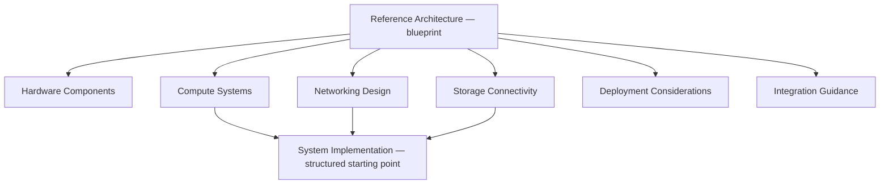
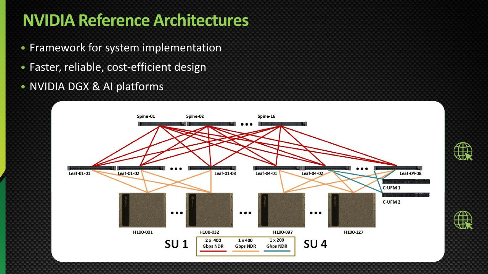
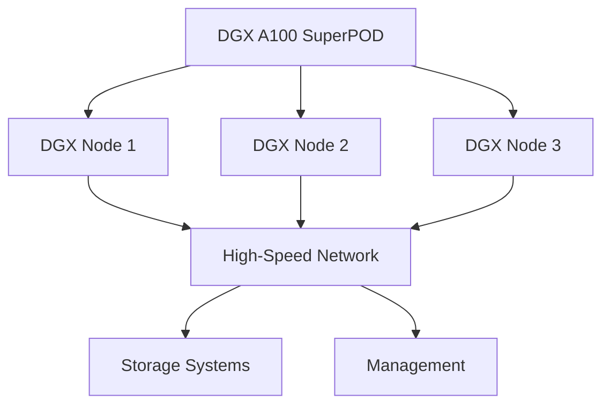
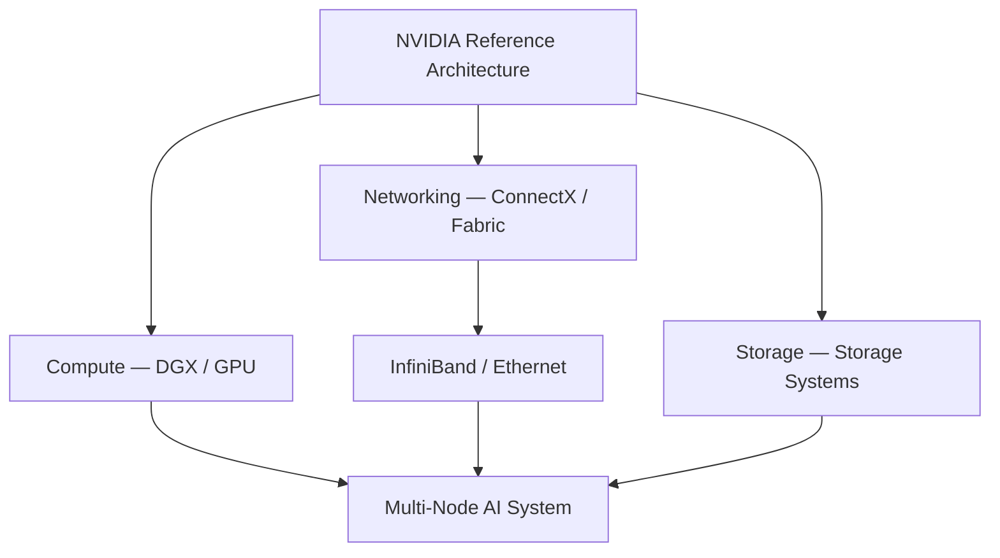
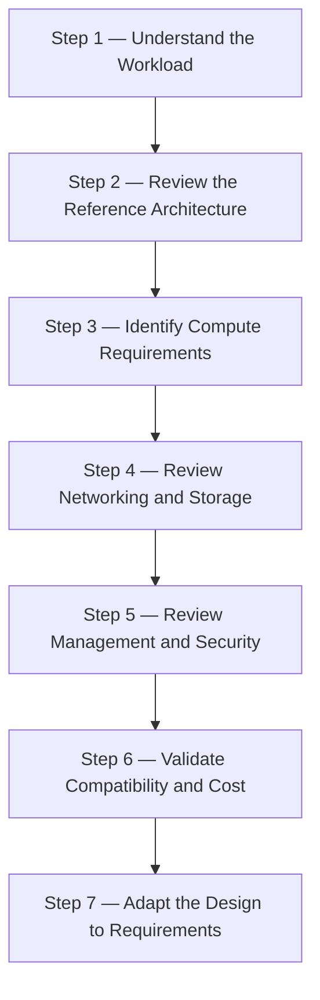

# Module — NVIDIA Reference Architectures

> Part I · Course Module 06 (NVIDIA AI Infrastructure and DGX Systems) — topic notes

## မြန်မာဘာသာ version

## 1. Introduction — Components တွေအားလုံးကို ဘယ်လို ပေါင်းစပ်မလဲ?

NVIDIA AI infrastructure ရဲ့ component အများအပြားကို လေ့လာပြီးပါပြီ။ ဥပမာ —

- GPU — AI computation
- DGX — AI computing system
- ConnectX — High-performance networking adapter
- BlueField DPU — Infrastructure offload
- InfiniBand — High-performance network fabric
- Storage — Datasets, models နဲ့ checkpoints တွေကို သိမ်းဆည်းခြင်း
- Switches — Servers နဲ့ network devices တွေကို ချိတ်ဆက်ခြင်း
- Management infrastructure — System administration နဲ့ operations ကို ပံ့ပိုးခြင်း

Component တစ်ခုချင်းစီကို သီးခြားနားလည်တာ အသုံးဝင်ပေမယ့် data center တစ်ခုလုံးကို implement လုပ်တာဟာ ရှုပ်ထွေးနိုင်ပါတယ်။ ဥပမာ —

- ဘယ် DGX systems တွေကို ရွေးချယ်ရမလဲ?
- Network ကို ဘယ်လို design လုပ်ရမလဲ?
- ဘယ် networking technology ကို သုံးရမလဲ?
- Storage ကို ဘယ်လိုချိတ်ဆက်ရမလဲ?
- Components တွေ အတူတကွ ဘယ်လိုအလုပ်လုပ်ရမလဲ?

ဒီ design decisions တွေကို စတင်ကူညီဖို့ NVIDIA က Reference Architectures တွေကို ပေးထားပါတယ်။

## 2. Reference Architecture ဆိုတာ ဘာလဲ?

Reference Architecture ဟာ system တစ်ခုကို တည်ဆောက်ရာမှာ starting point အဖြစ် အသုံးပြုနိုင်တဲ့ architectural design နဲ့ implementation guide ဖြစ်ပါတယ်။ Solution ပေါ်မူတည်ပြီး အောက်ပါတွေ ပါဝင်နိုင်ပါတယ် —

- Hardware components
- Compute systems
- Networking design
- Storage connectivity
- System configuration
- Deployment considerations
- Integration guidance

ရည်ရွယ်ချက်က implementation team တိုင်း system တစ်ခုလုံးကို အစကနေ ပြန်design မလုပ်ရအောင် structured starting point ပေးခြင်း ဖြစ်ပါတယ်။

**Simple Analogy** — အိမ်တစ်လုံး ဆောက်တယ်လို့ စဉ်းစားပါ။ အုတ်၊ သံ၊ ဘိလပ်မြေ၊ မီးလျှံပစ္စည်း၊ ရေပိုက်ပစ္စည်း အကြောင်း သိရုံနဲ့ ယုံကြည်ရတဲ့အိမ် ဆောက်လို့ မရသေးပါဘူး။ Architectural blueprint လည်း လိုပါတယ်။ Blueprint က —

- Components တွေကို ဘယ်နေရာမှာ ထားရမလဲ
- ဘယ်လို ချိတ်ဆက်ရမလဲ
- တည်ဆောက်မှုတစ်ခုလုံး ဘယ်လို အလုပ်လုပ်ရမလဲ

ဆိုတာ ရှင်းပြပေးပါတယ်။

**Figure 1 — Reference Architecture က blueprint လို အလုပ်လုပ်ပုံ**



**ပုံရှင်းလင်းချက် (Figure walkthrough) —**

1. အပေါ်ဆုံး box က Reference Architecture ကိုယ်တိုင် — အိမ်ဆောက်တဲ့ blueprint လို စဉ်းစားနိုင်ပါတယ်။
2. အောက်က box ခြောက်ခုက ဒီ blueprint မှာ ပါဝင်နိုင်တဲ့ အစိတ်အပိုင်းတွေ ဖြစ်ပါတယ် — hardware, compute, networking, storage, deployment နဲ့ integration guidance တို့ ဖြစ်ပါတယ်။
3. Compute, networking နဲ့ storage သုံးခုက အောက်ဆုံးက system implementation ဆီ ဆက်သွယ်သွားပါတယ်။
4. ဒါကြောင့် implementation team တွေ အစကနေ ပြန်design မလုပ်ရဘဲ structured starting point တစ်ခု ရရှိပါတယ်။

> Reference Architecture = Infrastructure implementation အတွက် architectural blueprint



**ပုံရှင်းလင်းချက် (Slide walkthrough):** ဒီ training slide က NVIDIA reference architectures တွေကို မိတ်ဆက်ပြထားပါတယ် — hardware, compute, networking, storage စတဲ့ components တွေကို ဘယ်လို ပေါင်းစပ်ရမလဲဆိုတဲ့ architectural blueprint အဖြစ် အသုံးပြုနိုင်တာကို အပေါ်က Figure 1 ရဲ့ blueprint ဥပမာနဲ့ ယှဉ်ကြည့်နိုင်ပါတယ်။

*(Source: NVIDIA NCA-AIIO training deck — study material)*

## 3. NVIDIA က Reference Architectures တွေ ဘာကြောင့် ပေးထားသလဲ?

NVIDIA Reference Architectures တွေက system implementation အတွက် frameworks နဲ့ design guidance တွေကို ပေးပါတယ်။ ရည်ရွယ်ထားတဲ့ အကျိုးကျေးဇူးတွေက —

**A. Faster Implementation** — အစကနေ architecture တစ်ခုလုံး design လုပ်ရတဲ့ အလုပ်ပမာဏကို လျှော့ချပေးနိုင်ပါတယ်။

**B. Reliable Design** — Compute, networking နဲ့ storage components တွေကို ပေါင်းစပ်ရာမှာ guidance ပေးပါတယ်။

**C. Cost-Efficient Design** — Structured design က performance requirements နဲ့ infrastructure costs တွေကို အတူတကွ လေ့လာတွက်ချက်နိုင်စေပါတယ်။

သို့သော် Reference Architecture သုံးလို့ အနိမ့်ဆုံးကုန်ကျစရိတ် အလိုအလျောက် အာမခံတာ မဟုတ်ပါဘူး။ တကယ့်ကုန်ကျစရိတ်က hardware, licensing, power, cooling, networking နဲ့ deployment requirements တွေအပေါ် မူတည်ပါတယ်။

**D. NVIDIA Platform Integration** — Team တွေက NVIDIA DGX systems နဲ့ NVIDIA AI platform components တွေကို system design ရဲ့ starting point အဖြစ် အသုံးပြုနိုင်ပါတယ်။

အဓိက idea က component တစ်ခုချင်းစီကို သီးခြားရွေးချယ်တာမဟုတ်ဘဲ စနစ်တစ်ခုလုံး ဘယ်လိုအလုပ်လုပ်သလဲဆိုတာ စဉ်းစားဖို့ ဖြစ်ပါတယ်။

## 4. ဘယ် Resources တွေ ရှိသလဲ?

NVIDIA Reference Architectures အကြောင်း လေ့လာဖို့ resource အမျိုးအစား အမျိုးမျိုး ရှိပါတယ်။

| Resource | Purpose |
|---|---|
| Reference Architecture documents | Overall design ကို နားလည်ရန် |
| White papers | Technical details နဲ့ design decisions တွေကို လေ့လာရန် |
| NVIDIA-Certified Systems information | Certified systems နဲ့ partners တွေကို ရှာဖွေရန် |
| Partner solutions | ရရှိနိုင်တဲ့ implementation support ကို နားလည်ရန် |
| Blog posts | Technical concepts နဲ့ architecture examples တွေ လေ့လာရန် |
| Videos | System design နဲ့ implementation concepts တွေကို မြင်သာအောင် ကြည့်ရန် |
| Certification resources | NVIDIA technologies နဲ့ certification pathways တွေ လေ့လာရန် |

ဒီ resources တွေဟာ ရည်ရွယ်ချက် မတူပါဘူး။ ဥပမာ white paper တစ်ခုက architecture ရဲ့ နောက်ကွယ်က technical reasoning ကို ရှင်းပြနိုင်ပြီး video က systems တွေ ဘယ်လိုချိတ်ဆက်သလဲဆိုတာကို ပိုမြင်သာအောင် ပြနိုင်ပါတယ်။

**Source limitation** — Transcript မှာ resource categories တွေကို ဖော်ပြထားပေမယ့် ကိုးကားထားတဲ့ links တွေရဲ့ exact URLs တွေ မပါဝင်ပါဘူး။

## 5. NVIDIA-Certified System ဆိုတာ ဘာလဲ?

NVIDIA-Certified Systems တွေဟာ NVIDIA ရဲ့ certification program နဲ့ ဆက်စပ်ပြီး သတ်မှတ်ထားတဲ့ NVIDIA technologies နဲ့ workloads တွေအတွက် system compatibility နဲ့ validation ကို နားလည်စေဖို့ ကူညီပေးပါတယ်။

System information တွေက အောက်ပါတွေကို စုံစမ်းလေ့လာနိုင်စေပါတယ် —

- ဘယ် server systems တွေ ရရှိနိုင်သလဲ
- ဘယ် vendors နဲ့ partners တွေက ပေးသလဲ
- ဘယ် NVIDIA technologies တွေကို support လုပ်သလဲ

Certification ရှိတိုင်း အဲဒီ system ဟာ deployment တိုင်းအတွက် အကောင်းဆုံး၊ အသက်သာဆုံး၊ အသင့်တော်ဆုံး ဖြစ်တယ်လို့ အလိုအလျောက် မဆိုလိုပါဘူး။ တကယ့် workload နဲ့ requirements တွေကို ဆက်လက် အကဲဖြတ်ရပါဦးမယ်။

## 6. DGX A100 Reference Architecture

Transcript မှာ DGX A100-based SuperPOD ကို နောက်ထပ် Reference Architecture example အဖြစ် မိတ်ဆက်ထားပါတယ်။ ဒီ architecture က multiple DGX A100 systems တွေကို ချိတ်ဆက်ပြီး ပိုကြီးတဲ့ AI infrastructure တစ်ခု ဘယ်လိုတည်ဆောက်နိုင်သလဲ ဆိုတာ ရှင်းပြပါတယ်။

အရေးကြီးတဲ့ design questions တွေက —

- DGX A100 systems တွေကို ဘယ်လို ချိတ်ဆက်ရမလဲ?
- Network connectivity ကို ဘယ်လို design လုပ်ရမလဲ?
- ဘယ် networking technology ကို သုံးရမလဲ?
- Storage နဲ့ networking ကို ဘယ်လို ပေါင်းစပ်ရမလဲ?
- Systems တွေ အတူတကွ ဘယ်လို အလုပ်လုပ်ရမလဲ?

Simplified Architecture —

```
                DGX A100 SuperPOD
                         │
           ┌─────────────┼─────────────┐
           ▼             ▼             ▼
        DGX Node 1    DGX Node 2    DGX Node 3
           │             │             │
           └─────────────┼─────────────┘
                         ▼
               High-Speed Network
                         │
                 ┌───────┴────────┐
                 ▼                ▼
           Storage Systems   Management
```

**Figure 2 — DGX A100 SuperPOD reference architecture အကျဉ်းချုပ်ပုံ**



**ပုံရှင်းလင်းချက် (Figure walkthrough) —**

1. အပေါ်ဆုံး box က DGX A100 SuperPOD တစ်ခုလုံးကို ကိုယ်စားပြုပါတယ်။
2. ဒုတိယအဆင့်မှာ DGX Node သုံးခု ခွဲပြထားပါတယ် — node တစ်ခုချင်းစီက compute အလုပ်ကို လုပ်ပါတယ်။
3. Node သုံးခုစလုံးက high-speed network ဆီ ဆက်သွယ်ထားပါတယ်။
4. Network ကနေတစ်ဆင့် storage systems နဲ့ management ဆီ ရောက်ရှိပါတယ်။ ဒါက conceptual overview သာဖြစ်ပြီး topology အသေးစိတ် မပါဝင်ပါဘူး။

ဒါဟာ conceptual overview သာဖြစ်ပြီး တကယ့် DGX A100 SuperPOD ရဲ့ complete deployment diagram မဟုတ်ပါဘူး။ Exact topology, switch layout, link count, storage configuration တွေကို သတ်မှတ်ပေးထားခြင်း မရှိပါဘူး။ အဲဒီအသေးစိတ်တွေကို သက်ဆိုင်ရာ NVIDIA Reference Architecture documentation ကနေ ရယူရပါမယ်။

## 7. SuperPOD Reference Architecture က ဘာကြောင့် အသုံးဝင်သလဲ?

SuperPOD တစ်ခု တည်ဆောက်ဖို့ DGX nodes တွေကို ချိတ်ဆက်ရုံနဲ့ မလုံလောက်ပါဘူး။ Networking, storage, management နဲ့ infrastructure design တွေကို အတူတကွ စဉ်းစားရပါမယ်။ Reference Architecture က အောက်ပါနယ်ပယ်တွေကို အကဲဖြတ်ရာမှာ ကူညီပေးပါတယ် —

- **Compute** — DGX systems တွေကို ဘယ်လို ရွေးချယ်၊ နေရာချရမလဲ?
- **Networking** — Nodes တွေကို ဘယ် network fabric နဲ့ topology က ချိတ်ဆက်ရမလဲ?
- **Storage** — Datasets, models, checkpoints တွေကို ဘယ်လို သိမ်းပြီး compute nodes တွေက ဘယ်လို ရယူသုံးစွဲရမလဲ?
- **Management** — Infrastructure ကို ဘယ်လို စီမံခန့်ခွဲ၊ စောင့်ကြည့်၊ ထိန်းသိမ်းရမလဲ?

ဒီ design decisions တွေက system ရဲ့ overall performance နဲ့ reliability ကို သက်ရောက်နိုင်ပါတယ်။

## 8. Components တွေ ဘယ်လို ပေါင်းစပ်ကြသလဲ?

ယခင် modules တွေမှာ လေ့လာခဲ့တဲ့ components တွေကို conceptually အောက်ပါအတိုင်း ချိတ်ဆက်နိုင်ပါတယ် —

```
              NVIDIA Reference Architecture
                           │
          ┌────────────────┼────────────────┐
          ▼                ▼                ▼
        Compute         Networking        Storage
          │                │                │
          ▼                ▼                ▼
       DGX / GPU    ConnectX / Fabric   Storage Systems
                           │
                           ▼
                 InfiniBand / Ethernet
                           │
                           ▼
                  Multi-Node AI System
```

**Figure 3 — Reference Architecture အောက်မှာ component တွေ ပေါင်းစပ်ပုံ**



**ပုံရှင်းလင်းချက် (Figure walkthrough) —**

1. အပေါ်ဆုံး box က NVIDIA Reference Architecture က component တွေ အားလုံးကို ဘယ်လိုပေါင်းစပ်ရမလဲ ဆိုတာ ညွှန်းပါတယ်။
2. ဒုတိယအဆင့်မှာ compute (DGX / GPU), networking (ConnectX / fabric) နဲ့ storage ဆိုပြီး သုံးပိုင်းခွဲပြထားပါတယ်။
3. Networking ဘက်က InfiniBand / Ethernet fabric ဆီ ဆက်သွယ်သွားပါတယ်။
4. အောက်ဆုံးမှာ compute, network နဲ့ storage သုံးခု ပေါင်းစပ်ပြီး multi-node AI system တစ်ခု ဖြစ်လာပုံကို တွေ့ရပါမယ်။

BlueField DPU, management infrastructure နဲ့ security controls တွေကိုလည်း သင့်တော်တဲ့ design အလိုက် ထည့်သွင်းနိုင်ပါတယ်။

Reference Architecture ရဲ့ အရေးကြီးဆုံး concept က components တွေကို သီးခြားစီသာ မကြည့်ဘဲ အပြန်အလှန်ဆက်စပ်နေတဲ့ system တစ်ခုအဖြစ် နားလည်ဖို့ ဖြစ်ပါတယ်။


**ဓာတ်ပုံရှင်းလင်းချက် (Photo walkthrough):**
- ပုံထဲမှာ NVIDIA Spectrum-X Ethernet networking platform ကို မြင်ရပါတယ် — Ethernet-based reference architecture တွေမှာ အသုံးပြုတဲ့ switch နဲ့ adapter ထုတ်ကုန်များ ဖြစ်ပါတယ်။
- အပေါ်က diagram မှာ "InfiniBand / Ethernet" လို့ ပြထားတဲ့ networking အပိုင်းကို Ethernet နဲ့ တည်ဆောက်မယ်ဆိုရင် Spectrum-X platform ကို အသုံးပြုပါတယ်။
- Ethernet reference architecture တစ်ခုမှာ compute nodes တွေကို Spectrum-X switch တွေနဲ့ ချိတ်ဆက်ပြီး multi-node AI system တစ်ခုလုံးကို network ပိုင်းက ပံ့ပိုးပေးပါတယ်။

*(Image: NVIDIA official product image)*

## 9. Component တိုင်းကို မှတ်ထားဖို့ လိုသလား?

Source ရဲ့ အဓိကအကြံပြုချက်က component အားလုံးရဲ့ အသေးစိတ်ကို ကျွမ်းကျင်ဖို့ထက် NVIDIA Reference Architectures တွေ ရှိတယ်ဆိုတာ သိထားဖို့ ဖြစ်ပါတယ်။ အထူးသဖြင့် စတင်လေ့လာနေတဲ့သူအတွက် —

- Reference Architecture ဆိုတာ ဘာလဲ နားလည်ပါ။
- NVIDIA က ဒီ architecture တွေကို ဘာကြောင့် ပေးထားသလဲ သိပါ။
- White papers နဲ့ supporting resources တွေ ရှိတယ်ဆိုတာ သိပါ။
- DGX A100 SuperPOD လို architecture examples တွေ ရှိတယ်ဆိုတာ သိပါ။
- လက်တွေ့ implementation လုပ်တဲ့အခါ သက်ဆိုင်ရာ reference documentation ကို ပြန်လည်အသုံးပြုပါ။

ဒီအချက်တွေကို မှတ်ထားရင် component တစ်ခုချင်းစီရဲ့ အသေးစိတ်ကို ချက်ချင်းမှတ်မိဖို့ မလိုဘဲ overall architecture ကို နားလည်လာနိုင်ပါတယ်။

## 10. Recommended Learning Workflow

NVIDIA AI infrastructure ကို လေ့လာတဲ့အခါ ဒီအစီအစဉ်အတိုင်း လုပ်နိုင်ပါတယ်။

```
Step 1: Understand the Workload
              │
              ▼
Step 2: Review the Reference Architecture
              │
              ▼
Step 3: Identify Compute Requirements
              │
              ▼
Step 4: Review Networking and Storage
              │
              ▼
Step 5: Review Management and Security
              │
              ▼
Step 6: Validate Compatibility and Cost
              │
              ▼
Step 7: Adapt the Design to Requirements
```

**Figure 4 — Recommended learning workflow အဆင့် ၇ ဆင့်**



**ပုံရှင်းလင်းချက် (Figure walkthrough) —**

1. အပေါ်ဆုံးက Step 1 မှာ workload ကို အရင်နားလည်ပါ — ဘာအလုပ်လုပ်မှာလဲ ဆိုတာ ရှင်းမှ ကျန်တဲ့အဆင့်တွေ ဆက်သင့်ပါတယ်။
2. Step 2 မှာ reference architecture ကို ပြန်ကြည့်ပြီး Step 3 မှာ compute requirements ကို သတ်မှတ်ပါတယ်။
3. Step 4 နဲ့ Step 5 မှာ networking, storage, management နဲ့ security ကို ဆက်လေ့လာပါတယ်။
4. Step 6 မှာ compatibility နဲ့ cost ကို စစ်ဆေးပြီး Step 7 မှာ ကိုယ့်လိုအပ်ချက်နဲ့ ကိုက်ညီအောင် design ကို ပြင်ဆင်ပါတယ်။ ဒီ workflow က general recommendation သာ ဖြစ်ပါတယ်။

ဒီ workflow က လက်တွေ့ design လုပ်တဲ့အခါ အသုံးပြုနိုင်တဲ့ general recommendation ဖြစ်ပြီး transcript ထဲမှာ ဖော်ပြထားတဲ့ official step-by-step NVIDIA procedure တစ်ခုကို တိုက်ရိုက်ကူးယူထားတာ မဟုတ်ပါဘူး။

## 11. Exam Points

- **Reference Architecture** — System implementation အတွက် အခြေခံအဖြစ် အသုံးပြုနိုင်တဲ့ architecture design နဲ့ guidance ဖြစ်ပါတယ်။
- **NVIDIA DGX** — AI workloads အတွက် NVIDIA computing platform/system ဖြစ်ပါတယ်။
- **NVIDIA-Certified Systems** — သတ်မှတ်ထားတဲ့ NVIDIA technologies နဲ့ systems compatibility/validation ကို နားလည်ဖို့ အသုံးဝင်တဲ့ resource ဖြစ်ပါတယ်။
- **White Papers, Blogs and Videos** — Architecture နဲ့ implementation ကို ပိုမိုလေ့လာဖို့ အသုံးပြုနိုင်တဲ့ supporting resources တွေ ဖြစ်ပါတယ်။
- **DGX A100 SuperPOD Reference Architecture** — Multiple DGX A100 systems တွေကို networking, storage နဲ့ supporting infrastructure တို့နဲ့ ဘယ်လိုပေါင်းစပ်နိုင်မလဲဆိုတာ လေ့လာဖို့ ဥပမာတစ်ခု ဖြစ်ပါတယ်။

## 12. Exam Shortcut

```
Reference Architecture
        │
        ▼
Design Guidance
        │
        ▼
Compute + Networking + Storage
        │
        ▼
Integrated AI Infrastructure
```

မှတ်ထားရမယ့် အချက် ၃ ချက် —

- Reference Architecture = Blueprint
- NVIDIA Resources = Learning and implementation guidance
- DGX SuperPOD Reference = Multiple DGX systems ကို system တစ်ခုအဖြစ် ပေါင်းစပ်ပုံ

**One-line Memory** — NVIDIA Reference Architectures provide design guidance for integrating NVIDIA compute, networking, storage and supporting infrastructure into reliable and cost-aware AI data-center systems.

## 13. Self-Check Questions (Exam Preparation)

**Q1. Reference Architecture ဆိုတာ ဘာလဲ?**
Answer: System တစ်ခု တည်ဆောက်ရာမှာ starting point အဖြစ် အသုံးပြုနိုင်တဲ့ architectural design နဲ့ implementation guide ဖြစ်ပါတယ်။ Infrastructure implementation အတွက် architectural blueprint လို့ မှတ်နိုင်ပါတယ်။

**Q2. NVIDIA က Reference Architectures တွေ ဘာကြောင့် ပေးထားသလဲ?**
Answer: Faster implementation, reliable design, cost-efficient design နဲ့ NVIDIA platform integration တွေအတွက် ဖြစ်ပါတယ်။ သို့သော် အနိမ့်ဆုံးကုန်ကျစရိတ်ကို အလိုအလျောက် အာမခံတာ မဟုတ်ပါဘူး။

**Q3. NVIDIA-Certified System ဆိုတာ ဘာလဲ? Certification ရှိရင် အကောင်းဆုံးလို့ ဆိုလိုသလား?**
Answer: သတ်မှတ်ထားတဲ့ NVIDIA technologies နဲ့ workloads အတွက် system compatibility/validation ကို နားလည်စေတဲ့ certification program resource ဖြစ်ပါတယ်။ Certification ရှိရုံနဲ့ deployment တိုင်းအတွက် အကောင်းဆုံး/အသက်သာဆုံး ဖြစ်တယ်လို့ မဆိုလိုပါဘူး။

**Q4. DGX A100 SuperPOD Reference Architecture က ဘာကို ရှင်းပြသလဲ?**
Answer: Multiple DGX A100 systems တွေကို networking, storage နဲ့ supporting infrastructure တွေနဲ့ ဘယ်လို ပေါင်းစပ်ပြီး ပိုကြီးတဲ့ AI infrastructure တစ်ခု တည်ဆောက်နိုင်သလဲဆိုတာ ဖြစ်ပါတယ်။

**Q5. ဒီ module အရ learning workflow ရဲ့ အဆင့်တွေက ဘာတွေလဲ?**
Answer: Understand the Workload → Review the Reference Architecture → Identify Compute Requirements → Review Networking and Storage → Review Management and Security → Validate Compatibility and Cost → Adapt the Design to Requirements (general recommendation သာ — official NVIDIA procedure မဟုတ်ပါ)။

---

## English Version

## 1. Introduction — How Do We Put All the Components Together?

We have now covered several components of NVIDIA AI infrastructure. Examples include:

- GPU — AI computation
- DGX — AI computing system
- ConnectX — High-performance networking adapter
- BlueField DPU — Infrastructure offload
- InfiniBand — High-performance network fabric
- Storage — Stores datasets, models, and checkpoints
- Switches — Connect servers and network devices
- Management infrastructure — Supports system administration and operations

Understanding each component individually is useful, but implementing a complete data center can be complicated. For example:

- Which DGX systems should be selected?
- How should the network be designed?
- Which networking technology should be used?
- How should storage be connected?
- How should the components work together?

NVIDIA provides Reference Architectures to help organizations get started with these design decisions.

## 2. What Is a Reference Architecture?

A Reference Architecture is an architectural design and implementation guide that can serve as a starting point for building a system. Depending on the solution, it may include:

- Hardware components
- Compute systems
- Networking design
- Storage connectivity
- System configuration
- Deployment considerations
- Integration guidance

The goal is to provide a structured starting point rather than requiring every implementation team to design the entire system from scratch.

**Simple Analogy** — Imagine building a house. Knowing about bricks, steel, cement, electrical equipment, and plumbing materials is not enough to build a reliable house. You also need an architectural blueprint. The blueprint explains:

- Where the components should be placed
- How they should be connected
- How the complete structure should work

**Figure 1 — How a Reference Architecture works as a blueprint**


**Figure walkthrough —**

1. The top box is the Reference Architecture itself — think of it like the blueprint for building a house.
2. The six boxes below are the parts a blueprint can cover: hardware, compute, networking, storage, deployment, and integration guidance.
3. Compute, networking, and storage continue down to system implementation at the bottom.
4. This is how an implementation team gets a structured starting point instead of designing everything from scratch.

> Reference Architecture = an architectural blueprint for infrastructure implementation.


**Slide walkthrough (ပုံရှင်းလင်းချက်):** This training slide introduces NVIDIA reference architectures — architectural blueprints showing how to combine hardware, compute, networking, and storage components into a working system. Read it alongside the blueprint analogy in Figure 1 above.

*(Source: NVIDIA NCA-AIIO training deck — study material)*

## 3. Why Does NVIDIA Provide Reference Architectures?

NVIDIA Reference Architectures provide frameworks and design guidance for system implementation. Their intended benefits include:

**A. Faster Implementation** — They can reduce the effort required to design a complete architecture from scratch.

**B. Reliable Design** — They provide guidance on integrating compute, networking, and storage components.

**C. Cost-Efficient Design** — A structured design helps teams evaluate performance requirements and infrastructure costs together.

However, using a Reference Architecture does not automatically guarantee the lowest cost. Actual costs depend on hardware, licensing, power, cooling, networking, and deployment requirements.

**D. NVIDIA Platform Integration** — Teams can use NVIDIA DGX systems and NVIDIA AI platform components as a starting point for system design.

The key idea is to consider how the complete system works rather than selecting every component independently.

## 4. What Resources Are Available?

The source mentions several types of resources for learning about NVIDIA Reference Architectures.

| Resource | Purpose |
|---|---|
| Reference Architecture documents | Understand the overall design |
| White papers | Study technical details and design decisions |
| NVIDIA-Certified Systems information | Explore certified systems and partners |
| Partner solutions | Understand available implementation support |
| Blog posts | Learn technical concepts and architecture examples |
| Videos | See system design and implementation concepts |
| Certification resources | Learn about NVIDIA technologies and certification pathways |

These resources serve different purposes. For example, a white paper may explain the technical reasoning behind an architecture, while a video may provide a more visual explanation of how systems are connected.

**Source limitation:** The transcript mentions these resource categories but does not include the exact URLs of the referenced links.

## 5. What Is an NVIDIA-Certified System?

NVIDIA-Certified Systems are associated with NVIDIA's certification program and help users understand system compatibility and validation for specified NVIDIA technologies and workloads. System information can help users investigate:

- Which server systems are available
- Which vendors and partners provide them
- Which NVIDIA technologies they support

Certification does not automatically mean that a system is the best, cheapest, or most appropriate choice for every deployment. The actual workload and requirements must still be evaluated.

## 6. DGX A100 Reference Architecture

The transcript introduces a DGX A100-based SuperPOD as another Reference Architecture example. This architecture helps illustrate how multiple DGX A100 systems can be connected to build a larger AI infrastructure. Important design questions include:

- How should DGX A100 systems be connected?
- How should network connectivity be designed?
- Which networking technology should be used?
- How should storage and networking be integrated?
- How should the systems work together?

Simplified Architecture:

```
                DGX A100 SuperPOD
                         │
           ┌─────────────┼─────────────┐
           ▼             ▼             ▼
        DGX Node 1    DGX Node 2    DGX Node 3
           │             │             │
           └─────────────┼─────────────┘
                         ▼
               High-Speed Network
                         │
                 ┌───────┴────────┐
                 ▼                ▼
           Storage Systems   Management
```

**Figure 2 — Simplified DGX A100 SuperPOD reference architecture**


**Figure walkthrough —**

1. The top box represents the whole DGX A100 SuperPOD.
2. The second level splits it into three DGX nodes — each node does compute work.
3. All three nodes connect to the high-speed network.
4. From the network, the design reaches the storage systems and the management layer. This is only a conceptual overview — it contains no topology details.

This is a conceptual overview, not a complete deployment diagram for an actual DGX A100 SuperPOD. It does not specify the exact topology, switch layout, link count, or storage configuration. Those details must be obtained from the relevant NVIDIA Reference Architecture documentation.

## 7. Why Is the SuperPOD Reference Architecture Useful?

Building a SuperPOD requires more than connecting DGX nodes. Networking, storage, management, and infrastructure design must be considered together. A Reference Architecture can help teams evaluate the following areas.

- **Compute** — How should DGX systems be selected and arranged?
- **Networking** — Which network fabric and topology should connect the nodes?
- **Storage** — How should datasets, models, and checkpoints be stored and accessed by compute nodes?
- **Management** — How should the infrastructure be administered, monitored, and maintained?

These design decisions can affect the overall performance and reliability of the system.

## 8. How Do the Components Fit Together?

The components covered in previous modules can be connected conceptually as follows:

```
              NVIDIA Reference Architecture
                           │
          ┌────────────────┼────────────────┐
          ▼                ▼                ▼
        Compute         Networking        Storage
          │                │                │
          ▼                ▼                ▼
       DGX / GPU    ConnectX / Fabric   Storage Systems
                           │
                           ▼
                 InfiniBand / Ethernet
                           │
                           ▼
                  Multi-Node AI System
```

**Figure 3 — How the components fit together under a Reference Architecture**


**Figure walkthrough —**

1. The top box is the NVIDIA Reference Architecture, which guides how all the components are combined.
2. The second level splits into three areas: compute (DGX / GPU), networking (ConnectX / fabric), and storage.
3. The networking side continues into the InfiniBand / Ethernet fabric.
4. At the bottom, compute, network, and storage join together into one multi-node AI system.

BlueField DPU, management infrastructure, and security controls can also be incorporated as appropriate to the design. The most important concept is to understand the components as an integrated system, not merely as separate products.


**Photo walkthrough (ဓာတ်ပုံရှင်းလင်းချက်):**
- The photo shows the NVIDIA Spectrum-X Ethernet networking platform — the switch and adapter products used in Ethernet-based reference architectures.
- Where the diagram above says "InfiniBand / Ethernet", an Ethernet design would build that networking layer from the Spectrum-X platform.
- In an Ethernet reference architecture, the compute nodes connect through Spectrum-X switches, and this hardware is what supports the whole multi-node AI system on the network side.

*(Image: NVIDIA official product image)*

## 9. Do You Need to Memorize Every Component?

The source emphasizes that you do not need to master every architectural component just to understand that NVIDIA Reference Architectures exist and can be used as implementation guidance. For someone beginning to study these technologies:

- Understand what a Reference Architecture is.
- Know why NVIDIA provides these architectures.
- Know that white papers and supporting resources are available.
- Recognize examples such as the DGX A100 SuperPOD architecture.
- Consult the relevant reference documentation when implementing a real system.

This helps you understand the overall architecture without having to memorize every implementation detail immediately.

## 10. Recommended Learning Workflow

A practical general workflow for studying NVIDIA AI infrastructure is:

```
Step 1: Understand the Workload
              │
              ▼
Step 2: Review the Reference Architecture
              │
              ▼
Step 3: Identify Compute Requirements
              │
              ▼
Step 4: Review Networking and Storage
              │
              ▼
Step 5: Review Management and Security
              │
              ▼
Step 6: Validate Compatibility and Cost
              │
              ▼
Step 7: Adapt the Design to Requirements
```

**Figure 4 — The seven steps of the recommended learning workflow**


**Figure walkthrough —**

1. Start at Step 1: understand the workload first — once you know what work will run, the later steps make sense.
2. Step 2 reviews the reference architecture, and Step 3 identifies the compute requirements.
3. Steps 4 and 5 continue with networking, storage, management, and security.
4. Step 6 validates compatibility and cost, and Step 7 adapts the design to the actual requirements. This workflow is a general recommendation only.

This workflow is a general recommendation for practical design work. It is not presented as an official NVIDIA step-by-step procedure in the supplied transcript.

## 11. Exam Points

- **Reference Architecture** — An architectural design and guide that provides a starting point for system implementation.
- **NVIDIA DGX** — An NVIDIA computing system/platform designed for AI workloads.
- **NVIDIA-Certified Systems** — A resource for understanding system compatibility and validation with specified NVIDIA technologies.
- **White Papers, Blogs and Videos** — Supporting resources for learning about architecture and implementation.
- **DGX A100 SuperPOD Reference Architecture** — An example that explains how multiple DGX A100 systems can be integrated with networking, storage, and supporting infrastructure.

## 12. Exam Shortcut

```
Reference Architecture
        │
        ▼
Design Guidance
        │
        ▼
Compute + Networking + Storage
        │
        ▼
Integrated AI Infrastructure
```

Remember these three points:

- Reference Architecture = Blueprint
- NVIDIA Resources = Learning and implementation guidance
- DGX SuperPOD Reference = How multiple DGX systems fit together

**One-line Memory** — NVIDIA Reference Architectures provide design guidance for integrating NVIDIA compute, networking, storage, and supporting infrastructure into reliable and cost-aware AI data-center systems.

## 13. Self-Check Questions (Exam Preparation)

**Q1. What is a Reference Architecture?**
Answer: An architectural design and implementation guide that serves as a starting point for building a system — an architectural blueprint for infrastructure implementation.

**Q2. Why does NVIDIA provide Reference Architectures?**
Answer: For faster implementation, reliable design, cost-efficient design, and NVIDIA platform integration. They do not automatically guarantee the lowest cost.

**Q3. What is an NVIDIA-Certified System? Does certification mean "best"?**
Answer: A resource from NVIDIA's certification program that helps understand system compatibility and validation with specified NVIDIA technologies and workloads. Certification does not make a system the best, cheapest, or most appropriate choice for every deployment.

**Q4. What does the DGX A100 SuperPOD Reference Architecture explain?**
Answer: How multiple DGX A100 systems can be integrated with networking, storage, and supporting infrastructure to build a larger AI infrastructure.

**Q5. What are the steps in the module's learning workflow?**
Answer: Understand the Workload → Review the Reference Architecture → Identify Compute Requirements → Review Networking and Storage → Review Management and Security → Validate Compatibility and Cost → Adapt the Design to Requirements (a general recommendation, not an official NVIDIA procedure).

---

## Technical review notes

- The supplied source transcript for the Burmese version of this module preserved only sections 8–12; Burmese sections 1–7 were reconstructed as faithful translations of the same lesson's complete English version (no content was invented).
- The transcript's resource list contains no exact URLs — kept as an explicit "source limitation" note in both language versions instead of inventing links.
- The DGX A100 SuperPOD diagram is kept as a conceptual overview with the source caveat that it specifies no topology, switch layout, link count, or storage configuration.
- The 7-step learning workflow is kept flagged as a general recommendation, not an official NVIDIA procedure (per source).
- Certification caveat ("certified ≠ best/cheapest/most appropriate for every deployment") and cost caveat ("reference architecture ≠ guaranteed lowest cost") are preserved verbatim in meaning.
- Mermaid figures (Figure 1-4) with figure walkthroughs were added inline in both the Myanmar and English sections; the diagrams only restate concepts already covered in this module.
