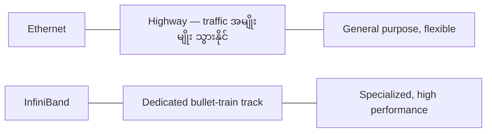
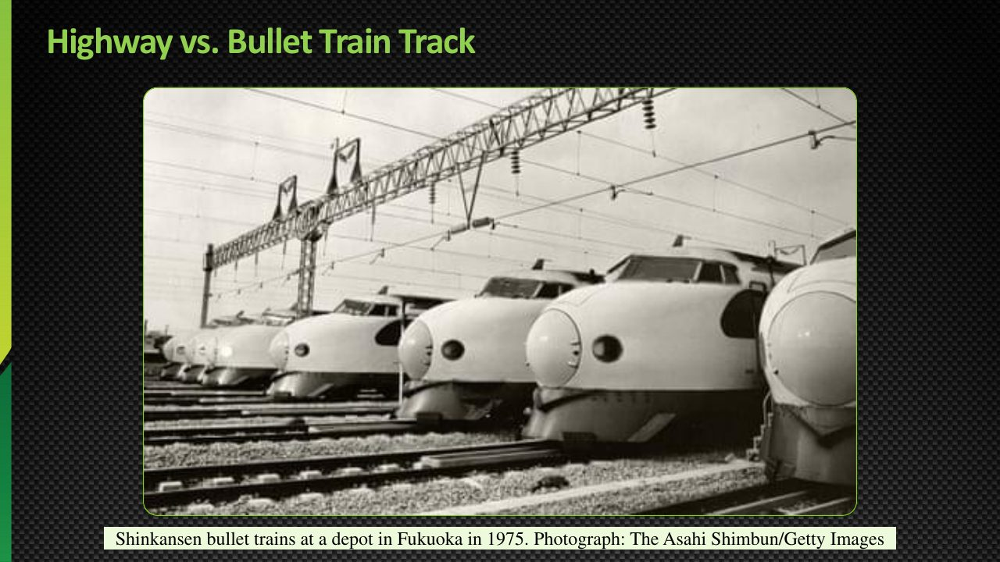
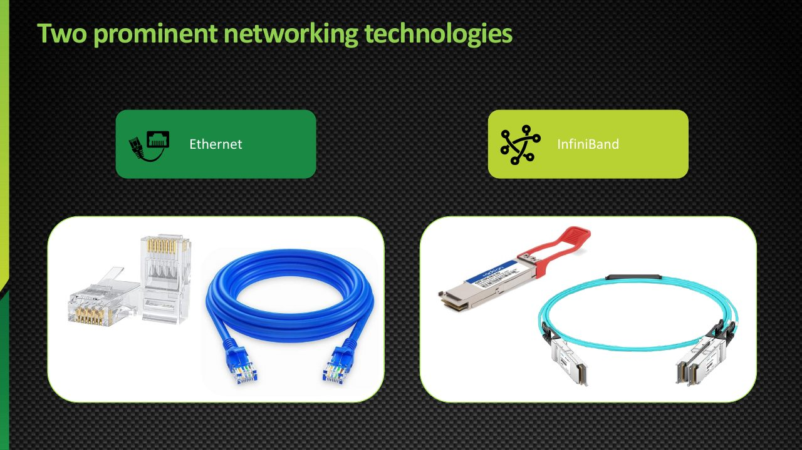
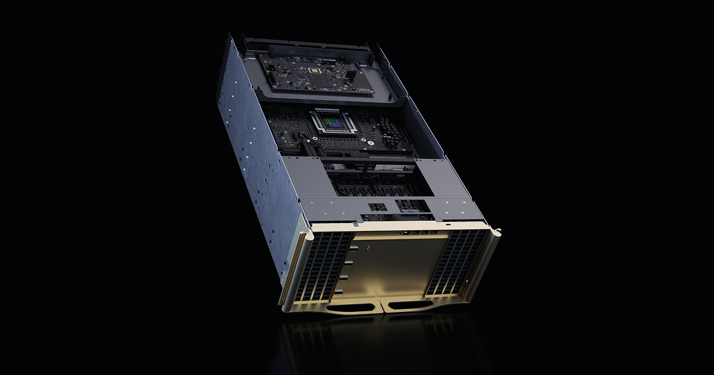
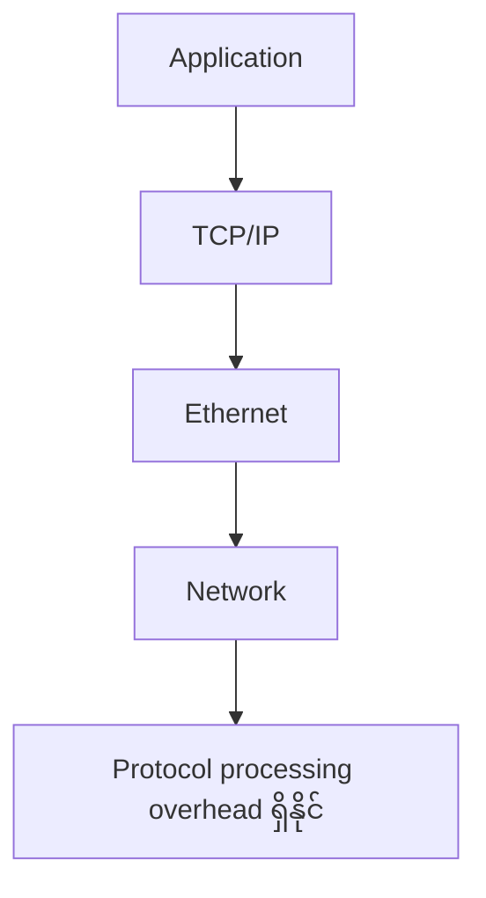
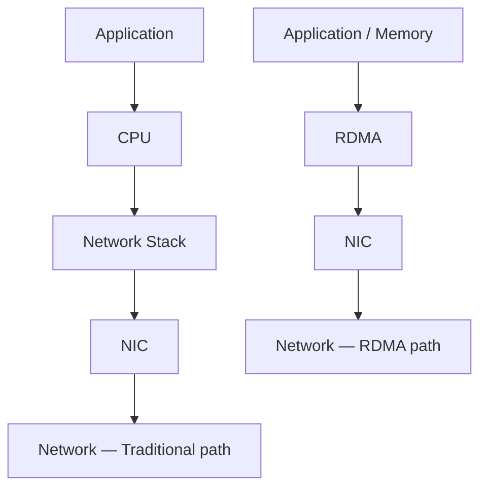
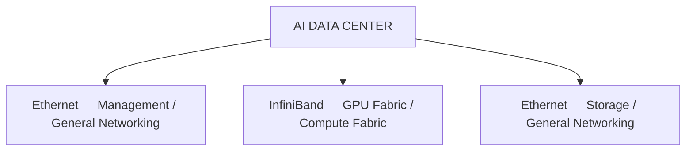
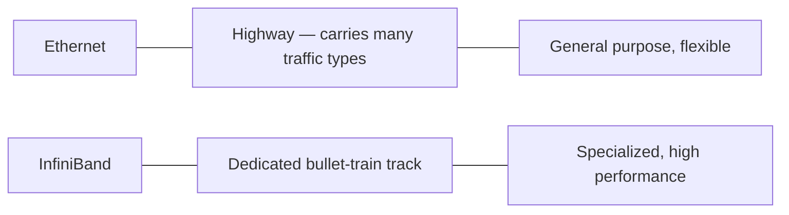
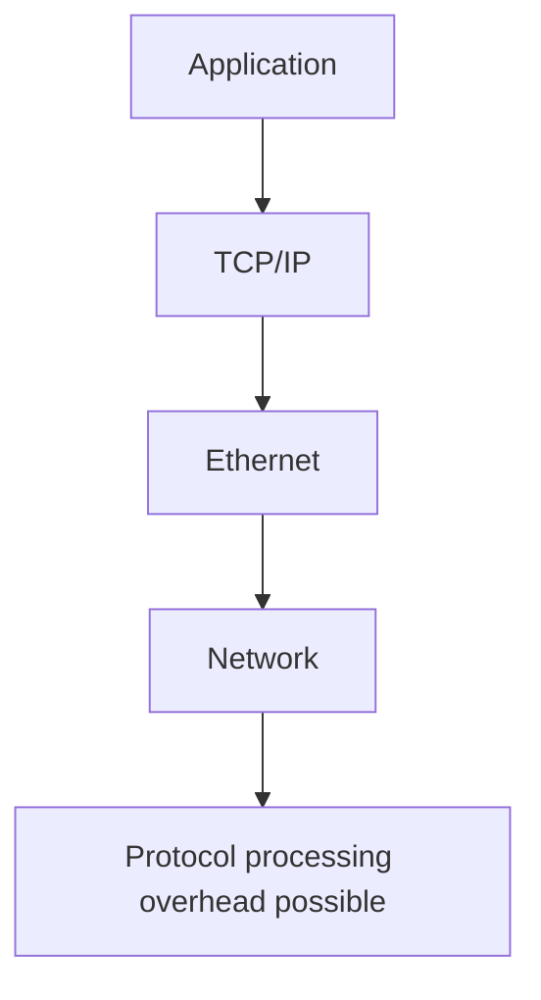

# Module — Ethernet vs InfiniBand in AI-Centric Data Centers

> Part II · GPU Interconnects, Networking and Data Movement — topic notes

## မြန်မာဘာသာ version

## 1. AI Data Center မှာ Ethernet နဲ့ InfiniBand

AI-centric data center networking ကို implement လုပ်တဲ့အခါ Ethernet နဲ့ InfiniBand ဆိုတဲ့ network technologies နှစ်မျိုးကို မကြာခဏတွေ့ရပါတယ်။

ဒီနှစ်ခုကို လေ့လာတဲ့အခါ—

- "Ethernet ကကောင်းပြီး InfiniBand ကမကောင်းဘူး"
- "InfiniBand ကကောင်းပြီး Ethernet မလိုဘူး"

လို့ မယူဆသင့်ပါဘူး။

နှစ်ခုလုံးမှာ ကိုယ်ပိုင် use case တွေရှိပြီး data center တစ်ခုထဲမှာတောင် နှစ်မျိုးလုံးကို complementary အနေနဲ့ အသုံးပြုနိုင်ပါတယ်။

အဓိကက—ဘယ် workload အတွက် ဘယ် technology က သင့်တော်သလဲ? ဆိုတာ နားလည်ဖို့ပါ။

## 2. Road Analogy — Network ကို လမ်းနဲ့ စဉ်းစားကြည့်မယ်

Network ဆိုတာ အခြေခံအားဖြင့် communication အတွက် ဖြစ်ပါတယ်။
Road ကလည်း တစ်နေရာကနေ တစ်နေရာကို သွားဖို့အတွက် ဖြစ်ပါတယ်။

ဥပမာ—`Point A → Point B`

Road နဲ့ လူတွေ၊ ကားတွေ၊ truck တွေကို တစ်နေရာကနေ တစ်နေရာ ရွှေ့နိုင်ပါတယ်။
Network မှာလည်း—`Server A → Server B` Data ကို ရွှေ့ပေးပါတယ်။

ဒါပေမယ့် လမ်းတွေဟာ အချိန်နဲ့အမျှ evolve ဖြစ်လာပါတယ်။

```
Dirt Road
    ↓
Gravel Road
    ↓
Cobblestone Road
    ↓
Modern Asphalt Road
    ↓
Highway
    ↓
Expressway
```

အခြေခံရည်ရွယ်ချက်ကတော့ မပြောင်းပါဘူး — Point A ကနေ Point B ကို သွားခြင်း။ ဒါပေမယ့်—Construction, Capacity, Speed, Design, Efficiency တွေက ကွာခြားလာပါတယ်။

## 3. Networking မှာလည်း အတူတူပဲ

Network ရဲ့ အခြေခံရည်ရွယ်ချက်က—**Data ကို Point A ကနေ Point B ကို ရွှေ့ပေးရန်** ဖြစ်ပါတယ်။

```
Server A
   │
   │ Data
   ▼
Network
   │
   ▼
Server B
```

ဒါပေမယ့် data ကို ဘယ်လိုပို့မလဲ၊ ဘယ် protocol သုံးမလဲ၊ ဘယ် hardware သုံးမလဲ၊ latency ဘယ်လောက်ရှိမလဲဆိုတာက technology ပေါ်မူတည်ပါတယ်။

ဒါကြောင့်—Ethernet နဲ့ InfiniBand နှစ်ခုလုံးဟာ data communication အတွက် ဖြစ်ပေမယ့် သူတို့ရဲ့ design goals နဲ့ implementation ကွာပါတယ်။

## 4. Highway vs Bullet Train Analogy

Traditional road / highway တစ်ခုဟာ—Cars, Trucks, Buses, Different types of vehicles အများကြီးကို သယ်ဆောင်နိုင်ပါတယ်။ ဒါပေမယ့် traffic နဲ့ stoplights တွေကြောင့် အချို့အခြေအနေမှာ speed လျော့နိုင်ပါတယ်။

AI data center networking မှာ Ethernet ကို ဒီလို general-purpose highway လို စဉ်းစားနိုင်ပါတယ်။

**Bullet Train** — "ကျွန်တော်တို့က normal road ထက် အလွန်မြန်တဲ့ dedicated transport လိုချင်တယ်" ဆိုရင် bullet train လို specialized infrastructure လိုလာပါတယ်။ Bullet train အတွက် သီးခြား track လိုပါတယ်။

```
Normal Highway
    │
    ├── Car
    ├── Truck
    ├── Bus
    └── Many Traffic Types

Bullet Train Track
    │
    └── High-Speed Train
```

**Figure 1 — Highway vs Bullet Train Analogy ကို Networking နဲ့ ယှဉ်ကြည့်ခြင်း**



**ပုံရှင်းလင်းချက် (Figure walkthrough)**
1. ဘယ်ဘက်က Ethernet ကို Highway နဲ့ နှိုင်းယှဉ်ထားပါတယ်။ Highway ပေါ်မှာ car, truck, bus စတဲ့ traffic အမျိုးမျိုး သွားနိုင်ပါတယ်။
2. ညာဘက်က InfiniBand ကို bullet train အတွက် သီးသန့်တည်ဆောက်ထားတဲ့ track နဲ့ နှိုင်းယှဉ်ထားပါတယ်။
3. Highway က general purpose ဖြစ်ပြီး flexible ဖြစ်သလို Ethernet ကလည်း အသုံးပြုရ ပေါ့ပါးကျယ်ပြန့်ပါတယ်။
4. Bullet-train track က specialized ဖြစ်သလို InfiniBand ကလည်း high-performance workload အတွက် အထူးတည်ဆောက်ထားခြင်း ဖြစ်ပါတယ်။

ဒီ analogy ကို networking မှာ အသုံးပြုရင်—Ethernet → Highway၊ InfiniBand → Dedicated high-performance transport လို့ မှတ်နိုင်ပါတယ်။



**ပုံရှင်းလင်းချက် (Training slide walkthrough)**
1. ဒီ slide မှာ general-purpose highway နဲ့ bullet train အတွက် သီးသန့်တည်ဆောက်ထားတဲ့ track ကို နှိုင်းယှဉ်ပြထားပါတယ်။
2. Highway ပေါ်မှာ car, truck, bus စတဲ့ ယာဉ်အမျိုးမျိုး သွားနိုင်သလို Ethernet ကလည်း traffic အမျိုးမျိုးအတွက် general-purpose ဖြစ်ပါတယ်။
3. Bullet train က သီးသန့်လမ်းပေါ်မှာ အမြန်ဆုံးသွားသလို InfiniBand ကလည်း high-performance workload အတွက် dedicated transport ဖြစ်ပါတယ်။
4. ပုံမှာ Shinkansen bullet train ဓာတ်ပုံကိုလည်း ထည့်သုံးထားတာ တွေ့ရပါမယ်။

*(Source: NVIDIA NCA-AIIO training deck — study material)*

## 5. Ethernet vs InfiniBand — Basic Idea

**Ethernet** — General-purpose networking အတွက် အလွန်ကျယ်ပြန့်စွာ အသုံးပြုတဲ့ technology ဖြစ်ပါတယ်။ အသုံးပြုနိုင်တဲ့နေရာတွေက—Home, Office, Enterprise, Data Center, Internet စတာတွေ ဖြစ်ပါတယ်။

**InfiniBand** — High-Performance Computing (HPC) နဲ့ high-performance data center workloads တွေအတွက် အထူးအသုံးဝင်တဲ့ specialized networking technology ဖြစ်ပါတယ်။ အထူးသဖြင့်—HPC, AI clusters, Distributed AI, High-performance storage/interconnect စတဲ့ environment တွေမှာ အသုံးပြုနိုင်ပါတယ်။



**ပုံရှင်းလင်းချက် (Training slide walkthrough)**
1. ဒီ slide မှာ networking technology နှစ်မျိုး—Ethernet နဲ့ InfiniBand ကို ဘေးချင်းယှဉ် မိတ်ဆက်ပြထားပါတယ်။
2. Ethernet က home, office, enterprise, data center, internet စတဲ့ နေရာတွေမှာ အသုံးများတဲ့ general-purpose networking technology ဖြစ်ပါတယ်။
3. InfiniBand ကတော့ HPC, AI clusters နဲ့ high-performance data center workload တွေအတွက် အထူးတည်ဆောက်ထားတဲ့ specialized technology ဖြစ်ပါတယ်။

*(Source: NVIDIA NCA-AIIO training deck — study material)*

## 6. Physical Connectivity

Ethernet မှာ ပုံမှန်အားဖြင့် network cables နဲ့ connectors တွေကို အသုံးပြုပါတယ်။ ဥပမာ—RJ45 connector ကို traditional Ethernet networking မှာ တွေ့နိုင်ပါတယ်။

```
Server
   │
   │ Ethernet Cable
   ▼
RJ45 / Ethernet Interface
```

High-speed Ethernet environment တွေမှာတော့ optical transceivers နဲ့ high-speed pluggable interfaces တွေကိုလည်း အသုံးပြုနိုင်ပါတယ်။

ဒီ Ethernet connectivity တွေကို physical အနေနဲ့ Ethernet switch များ၊ NIC များနဲ့ cable များဖြင့် တည်ဆောက်ပါတယ်။



**ပုံရှင်းလင်းချက် (Photo walkthrough)**
1. ဒီမှာ မြင်ရတာက Ethernet ဘက်ခြမ်းမှာ သုံးတဲ့ rack-mount Ethernet switch chassis ဖြစ်ပါတယ်။
2. ရှေ့ဘက် faceplate မှာ high-speed Ethernet port တွေကို အတန်းလိုက် တန်းစီထားပြီး cable ချိတ်ဆက်ဖို့ connector cage တွေ ပါရှိပါတယ်။
3. Server တွေက NIC ကတစ်ဆင့် ဒီ switch ထဲကို cable ချိတ်ပြီး Ethernet network ထဲ ဝင်ကြပါတယ်။

*(Image: NVIDIA official product image)*

## 7. InfiniBand Physical Connectivity

InfiniBand မှာလည်း cable နဲ့ connectors လိုအပ်ပါတယ်။ High-speed InfiniBand deployment တွေမှာ—Fiber optic, High-speed copper, SFP/QSFP-class pluggable interfaces စတဲ့ connectivity technologies တွေကို အသုံးပြုနိုင်ပါတယ်။

Source မှာ **QSFP — Quad Small Form-factor Pluggable** ဆိုတဲ့ connector/form-factor ကို mention လုပ်ထားပါတယ်။

အဓိက idea က—InfiniBand physical infrastructure ကို high-speed server-to-server interconnect အတွက် optimize လုပ်ထားခြင်း ဖြစ်ပါတယ်။

ဒီ InfiniBand fabric ရဲ့ အလယ်ခံ hardware ကတော့ InfiniBand switch တွေ ဖြစ်ပါတယ်။


**ပုံရှင်းလင်းချက် (Photo walkthrough)**
1. ဒီမှာ မြင်ရတာက InfiniBand ဘက်ခြမ်းမှာ သုံးတဲ့ rack-mount InfiniBand switch chassis ဖြစ်ပါတယ်။
2. ရှေ့ဘက် faceplate မှာ high-speed InfiniBand port တွေ အတန်းလိုက် တန်းစီပြီး QSFP-class connector cage တွေ ပါရှိပါတယ်။
3. ဒီ switch ကတစ်ဆင့် server တွေကြား high-speed, low-latency interconnect လမ်းကြောင်း ဖြစ်လာပါတယ်။

*(Image: NVIDIA official product image)*

## 8. Ethernet vs InfiniBand — Main Comparison

အခု feature တစ်ခုချင်းစီအလိုက် compare လုပ်ကြည့်ရအောင်။

## 9. Analogy

**Ethernet = Highway** — Highway ပေါ်မှာ Cars, Trucks, Buses စတဲ့ traffic အမျိုးမျိုး သွားနိုင်ပါတယ်။ ဒါကြောင့် Ethernet ဟာ general-purpose networking အတွက် သင့်တော်ပါတယ်။ ဒါပေမယ့် traffic/congestion နဲ့ network processing overhead တွေ ရှိနိုင်ပါတယ်။

**InfiniBand = Dedicated Bullet Train Line** — InfiniBand ကို dedicated high-speed transport လိုမျိုး စဉ်းစားနိုင်ပါတယ်။ အဓိကရည်ရွယ်ချက်က high-performance communication ဖြစ်ပါတယ်။ ဒါကြောင့် AI/HPC cluster တို့လို performance-sensitive environment တွေမှာ အသုံးဝင်ပါတယ်။

## 10. Purpose

| Technology | Main Purpose |
|---|---|
| Ethernet | General-purpose networking |
| InfiniBand | High-performance computing and high-speed interconnect |

**Ethernet** အသုံးများတဲ့နေရာတွေ—LAN, WAN, Enterprise, Data Center, Internet

**InfiniBand** အသုံးများတဲ့နေရာတွေ—HPC, AI clusters, Distributed training, High-performance interconnects, Specialized data center workloads

## 11. Speed

Source မှာ Ethernet နဲ့ InfiniBand နှစ်ခုလုံးဟာ implementation ပေါ်မူတည်ပြီး high-speed links ကို support လုပ်နိုင်တယ်လို့ ဖော်ပြထားပါတယ်။ ဥပမာ source က up to 400 Gbps လို့ ပြောထားပါတယ်။

ဒါကြောင့်—"InfiniBand က high speed ဖြစ်ပြီး Ethernet က slow ဖြစ်တယ်" လို့ ရိုးရိုးရှင်းရှင်း မမှတ်သင့်ပါဘူး။

အဓိကက speed တစ်ခုတည်း မဟုတ်ပါဘူး။ Network ရဲ့—Latency, Protocol overhead, CPU involvement, Reliability, Congestion behavior, Architecture, Workload suitability တို့ကလည်း အရေးကြီးပါတယ်။

**Exam Point**
- Ethernet ကလည်း very high bandwidth ကို ပေးနိုင်ပါတယ်။
- InfiniBand ရဲ့ အားသာချက်က "speed" တစ်ခုတည်း မဟုတ်ပါဘူး။ ၎င်းရဲ့ architecture ကို high-performance, low-latency communication အတွက် design လုပ်ထားခြင်း ဖြစ်ပါတယ်။

## 12. Latency

ဒီနေရာမှာ Ethernet နဲ့ InfiniBand ကြား အရေးကြီးတဲ့ difference တစ်ခုက latency ဖြစ်ပါတယ်။

Source အရ—

- **Ethernet** — Latency က environment နဲ့ implementation ပေါ်မူတည်ပြီး ပိုမြင့်နိုင်ပါတယ်။ Source example: ~10–100 microseconds
- **InfiniBand** — Source က ~1–2 microseconds လို ultra-low latency ကို example အနေနဲ့ ဖော်ပြထားပါတယ်။

Exact latency ဟာ hardware, topology, workload, configuration စတာတွေပေါ် မူတည်ပါတယ်။ ဒါပေမယ့် lesson ရဲ့ အဓိက concept က—**InfiniBand is designed for extremely low-latency communication.** ဖြစ်ပါတယ်။

> ⚠️ latency ဂဏန်းများသည် source ၏ example များသာဖြစ်ပြီး deployment အလိုက် ကွဲပြားနိုင်သည် (needs verification for specific hardware)။

## 13. Protocol / Processing Model

Ethernet environment မှာ traditional TCP/IP networking stack ကို အသုံးများပါတယ်။

```
Application
     ↓
TCP/IP
     ↓
Ethernet
     ↓
Network
```

**Figure 2 — Ethernet ရဲ့ TCP/IP Data Path**



**ပုံရှင်းလင်းချက် (Figure walkthrough)**
1. အပေါ်ဆုံးက Application က data ကို စတင်ပို့ပါတယ်။
2. Data က TCP/IP stack ကတစ်ဆင့် Ethernet ဆီ ရောက်သွားပါတယ်။
3. Ethernet ကနေ Network ပေါ်ကို data ထွက်သွားပါတယ်။
4. အောက်ဆုံး node က ဒီလမ်းကြောင်းမှာ protocol processing overhead ရှိနိုင်တယ်ဆိုတာ သတိပေးထားခြင်း ဖြစ်ပါတယ်။

TCP/IP processing မှာ protocol processing overhead ရှိနိုင်ပါတယ်။

## 14. InfiniBand and RDMA

InfiniBand environment မှာ **RDMA — Remote Direct Memory Access** ကို အရေးကြီးတဲ့ technology အနေနဲ့ အသုံးပြုပါတယ်။

Source transcript မှာ "RDM" လို့ ပြောထားပေမယ့် standard technical term က—**RDMA = Remote Direct Memory Access** ဖြစ်ပါတယ်။

RDMA ရဲ့ အဓိက idea က—CPU involvement နည်းအောင် memory-to-memory data transfer ကို လုပ်နိုင်ခြင်း ဖြစ်ပါတယ်။

```
Traditional Network

Application
    ↓
CPU
    ↓
Network Stack
    ↓
NIC
    ↓
Network
```

RDMA-based communication မှာ—

```
Application / Memory
        │
        ▼
      RDMA
        │
        ▼
       NIC
        │
        ▼
     Network
```

**Figure 3 — Traditional Network Path vs RDMA Path**



**ပုံရှင်းလင်းချက် (Figure walkthrough)**
1. အပေါ်တစ်ဝက်က traditional path ဖြစ်ပြီး Application → CPU → Network Stack → NIC → Network လို့ ဆင်းသွားပါတယ်။
2. ဒီလမ်းကြောင်းမှာ CPU နဲ့ network stack processing ပါဝင်ရပါတယ်။
3. အောက်တစ်ဝက်က RDMA path ဖြစ်ပြီး Application / Memory ကနေ တိုက်ရိုက် NIC ကတစ်ဆင့် Network ဆီ သွားပါတယ်။
4. RDMA မှာ CPU involvement ပိုနည်းတဲ့အတွက် processing overhead လျော့ပြီး low latency, high performance ရနိုင်ပါတယ်။

လိုမျိုး CPU involvement နည်းနိုင်ပါတယ်။ ဒီလို processing overhead လျော့နည်းခြင်းက low latency နဲ့ high performance ကို support ပေးနိုင်ပါတယ်။

## 15. Cost

**Ethernet** ရဲ့ အားသာချက်တစ်ခုက—Widely available, Commodity hardware, Broad vendor ecosystem, Lower cost ဖြစ်ပါတယ်။ ဒါကြောင့် Ethernet ကို နေရာအများကြီးမှာ တွေ့ရပါတယ်။

**InfiniBand** ကတော့ specialized infrastructure ဖြစ်တဲ့အတွက်—Specialized NICs, Specialized switches, Specialized drivers/software, Specialized operational expertise လိုအပ်နိုင်ပါတယ်။ ဒါကြောင့် Ethernet ထက် ပိုမိုကုန်ကျနိုင်ပါတယ်။

**Exam Shortcut**
- Ethernet → Lower cost / widely available
- InfiniBand → Higher cost / specialized infrastructure

## 16. Where Can You Use Them?

**Ethernet** ကို—`Home → Office → Enterprise → Data Center → Internet` လို environment အမျိုးမျိုးမှာ အသုံးပြုနိုင်ပါတယ်။ ဒါကြောင့်—**Ethernet = General-purpose networking** လို့ မှတ်ပါ။

**InfiniBand** ကတော့—`HPC → AI Cluster → Supercomputing → Distributed Training → High-Performance Interconnect` လို specialized workloads တွေအတွက် ပိုသင့်တော်ပါတယ်။

## 17. Operating System and Software Support

**Ethernet** ဟာ universally supported ဖြစ်တဲ့ technology ဖြစ်ပါတယ်။ Operating systems အများစုမှာ Ethernet NIC support ရှိပါတယ်။ ဒါကြောင့် deployment က ပိုလွယ်ပါတယ်။

**InfiniBand** မှာတော့ specialized Drivers, Firmware, Software stack, Configuration တွေ လိုအပ်နိုင်ပါတယ်။ ဒါကြောင့် Ethernet ထက် operational complexity ပိုများနိုင်ပါတယ်။

## 18. Reliability and Congestion

Ethernet က general-purpose networking အတွက် အလွန်ကောင်းပါတယ်။ ဒါပေမယ့် network congestion ဖြစ်လာရင်—Queueing / congestion ကြောင့် delay တက်နိုင်ပါတယ်။ အထူးသဖြင့် performance-sensitive workload တွေမှာ ဒီအချက်က အရေးကြီးပါတယ်။

## 19. InfiniBand — Lossless / Near-Lossless Design

InfiniBand ကို high-performance environments အတွက် design လုပ်ထားတဲ့အတွက်—**Lossless or near-lossless communication** ဆိုတဲ့ concept နဲ့ တွေ့ရပါတယ်။

ရည်ရွယ်ချက်က predictable / deterministic performance ရရှိစေရန် ဖြစ်ပါတယ်။ ဥပမာ distributed AI training မှာ—

```
GPU 1
  │
  ├─────────┐
  │         │
GPU 2       │
  │         ▼
  ├───── Communication
  │         │
GPU 3       │
  │         │
GPU 4 ──────┘
```

GPU/node communication performance က consistent ဖြစ်ဖို့ အရေးကြီးပါတယ်။ ဒါကြောင့် performance-sensitive workloads တွေအတွက် InfiniBand က သင့်တော်နိုင်ပါတယ်။

## 20. Ethernet vs InfiniBand — Complete Comparison

| Feature | Ethernet | InfiniBand |
|---|---|---|
| Analogy | Highway | Dedicated bullet-train line |
| Main Purpose | General networking | High-performance networking |
| Typical Use | LAN, WAN, Internet, enterprise, data center | HPC, AI clusters, supercomputing |
| Bandwidth | Can be very high | Can be very high |
| Latency | Generally higher | Extremely low |
| Protocol | Commonly TCP/IP | Designed around high-performance interconnect/RDMA |
| CPU Overhead | Can be higher depending on stack/workload | Lower with RDMA-based data movement |
| Cost | Generally lower | Generally higher |
| Hardware | Commodity / widely available | Specialized |
| Software | Broad OS support | Specialized drivers/software may be required |
| Deployment | Flexible and widespread | Specialized |
| Congestion | Can introduce delay | Designed for predictable high-performance communication |
| AI/HPC | Suitable, especially with modern high-speed Ethernet/RoCE | Excellent for high-performance AI/HPC workloads |

## 21. The Most Important Concept

"Ethernet = Slow"၊ "InfiniBand = Fast" ဆိုပြီး မမှတ်သင့်ပါဘူး — အရမ်းရိုးရှင်းလွန်းပါတယ်။

ဒီအစား ဒီလို မှတ်ပါ—

- **Ethernet** — General-purpose + flexible + widely available + cost-effective
- **InfiniBand** — Specialized + low latency + high performance + HPC/AI optimized

နှစ်ခုလုံးက very high bandwidth ကို ပေးနိုင်ပါတယ်။ အရေးကြီးတဲ့ ကွာခြားချက်က link speed တစ်ခုတည်း မဟုတ်ဘဲ networking system ကို ဘယ်လို design နဲ့ optimize လုပ်ထားသလဲ ဆိုတာ ဖြစ်ပါတယ်။

## 22. When Should You Use Ethernet?

Ethernet က အောက်ပါလိုအပ်ချက်တွေ ရှိတဲ့အခါ ကောင်းမွန်တဲ့ ရွေးချယ်မှု ဖြစ်ပါတယ်—

- General-purpose networking
- Broad compatibility
- Lower cost
- Large ecosystem
- Standard enterprise networking
- Internet connectivity
- Data center networking
- Management networking

AI data center တွေမှာ Ethernet ကို RoCE လို technology တွေနဲ့ high-performance workload တွေအတွက်လည်း အသုံးပြုနိုင်ပါတယ်။

## 23. When Should You Use InfiniBand?

အောက်ပါလိုအပ်ချက်တွေ ရှိတဲ့အခါ InfiniBand က အထူးသင့်တော်ပါတယ်—

- Extremely low latency
- High throughput
- Predictable communication
- Large-scale GPU clusters
- Distributed AI training
- HPC
- Supercomputing
- High-performance interconnects

## 24. AI Data Center Example

Data center တစ်ခုက technology တစ်မျိုးတည်းကိုပဲ ရွေးချယ်ရမယ်လို့ မဆိုလိုပါဘူး။ အောက်ပါ design မျိုး ရှိနိုင်ပါတယ်—

```
                 AI DATA CENTER
                       │
        ┌──────────────┼──────────────┐
        │              │              │
        ▼              ▼              ▼
    Ethernet       InfiniBand      Ethernet
        │              │              │
   Management      GPU Fabric       Storage/
   / General        / Compute       General
   Networking        Fabric         Networking
```

**Figure 4 — တစ်ခုတည်းသော Data Center ထဲမှာ Ethernet နဲ့ InfiniBand အတူသုံးပုံ**



**ပုံရှင်းလင်းချက် (Figure walkthrough)**
1. ထိပ်ဆုံးက AI DATA CENTER ကနေ network သုံးခု ခွဲထွက်သွားတာ မြင်ရပါမယ်။
2. ဘယ်ဘက် Ethernet က management နဲ့ general networking အတွက် ဖြစ်ပါတယ်။
3. အလယ် InfiniBand က GPU fabric / compute fabric အတွက် ဖြစ်ပြီး GPU-to-GPU communication ကို သယ်ပေးပါတယ်။
4. ညာဘက် Ethernet က storage နဲ့ general networking အတွက် ဖြစ်ပါတယ်။ ဒီလို နှစ်မျိုးလုံးကို complementary အနေနဲ့ အတူသုံးနိုင်ပါတယ်။

- **Ethernet** ကို အောက်ပါတွေအတွက် အသုံးပြုနိုင်ပါတယ်— Management, External connectivity, General data center networking, User/application access
- **InfiniBand** ကို အောက်ပါတွေအတွက် အသုံးပြုနိုင်ပါတယ်— GPU-to-GPU communication, Distributed AI training, HPC workloads, High-performance cluster interconnect

ဒါကြောင့် ဒီ technology နှစ်ခုက တစ်ခုနဲ့တစ်ခု ဖြည့်စွက်ပေးနိုင်ပါတယ်။

## 25. Exam Shortcut

**Ethernet** — Highway လို မှတ်ပါ → General purpose · Flexible · Widely available · Lower cost · TCP/IP · Enterprise / Internet / Data Center · Very high bandwidth ကို support လုပ်နိုင်

**InfiniBand** — Bullet Train လို မှတ်ပါ → Specialized · High performance · Ultra-low latency · RDMA · HPC · AI clusters · Specialized hardware/software

## 26. One-Line Memory Trick

**Ethernet is the flexible highway; InfiniBand is the dedicated high-performance track.**

မြန်မာလို—Ethernet က အမျိုးမျိုးသော traffic ကို သယ်နိုင်တဲ့ flexible highway ဖြစ်ပြီး၊ InfiniBand က high-performance workload တွေအတွက် အထူးတည်ဆောက်ထားတဲ့ dedicated transport လို ဖြစ်ပါတယ်။

## 27. Final Exam Summary

**Ethernet** — General-purpose network technology · Flexible · Widely deployed · Lower cost · Broad compatibility · TCP/IP · LAN/WAN/Data Center/Internet · High-speed versions ရှိနိုင်

**InfiniBand** — High-performance interconnect technology · Very low latency · High throughput · RDMA-based communication · Specialized hardware/software · HPC · AI clusters · Distributed training · Predictable high-performance communication

**Final Mental Model**

```
                    NETWORKING
                        │
             ┌──────────┴──────────┐
             │                     │
             ▼                     ▼
         ETHERNET              INFINIBAND
             │                     │
             ▼                     ▼
         HIGHWAY             BULLET TRAIN
             │                     │
       General Purpose       High Performance
             │                     │
       TCP/IP ecosystem          RDMA
             │                     │
       Flexible / Broad       Low Latency
       Compatibility          High Throughput
             │                     │
             ▼                     ▼
     Enterprise / DC         AI / HPC / Clusters
```

**မှတ်ထားရန်—**
- Ethernet = Flexibility + Compatibility + General Networking
- InfiniBand = Performance + Low Latency + Specialized AI/HPC Networking

## Self-Check Questions (အဖြေများပါဝင်သည်)

1. **"Ethernet = Slow, InfiniBand = Fast" ဆိုတဲ့ အမှတ်အသား ဘာကြောင့် မှားသလဲ?** — Ethernet ကလည်း very high bandwidth ပေးနိုင်ပါတယ် (source မှာ up to 400 Gbps ဥပမာပြထား)။ ကွာခြားချက်က link speed မဟုတ်ဘဲ latency, protocol overhead, CPU involvement, congestion behavior, architecture စတာတွေ ဖြစ်ပါတယ်။
2. **RDMA ဆိုတာ ဘာလဲ၊ InfiniBand အတွက် ဘာကြောင့် အရေးကြီးသလဲ?** — Remote Direct Memory Access ဖြစ်ပြီး CPU involvement အနည်းဆုံးနဲ့ memory-to-memory data transfer လုပ်နိုင်ခြင်းကြောင့် low latency, high performance ကို support ပေးနိုင်ပါတယ်။
3. **Ethernet ကို ဘယ်အခါ ရွေးချယ်သင့်သလဲ?** — General-purpose networking, broad compatibility, lower cost, large ecosystem လိုအပ်တဲ့အခါ ဖြစ်ပြီး RoCE ကဲ့သို့ technology တွေနဲ့ high-performance workload အတွက်လည်း အသုံးပြုနိုင်ပါတယ်။
4. **InfiniBand ကို ဘယ်အခါ ရွေးချယ်သင့်သလဲ?** — Extremely low latency, high throughput, predictable communication လိုအပ်ပြီး large GPU clusters, distributed AI training, HPC, supercomputing တွေအတွက် ဖြစ်ပါတယ်။
5. **Data center တစ်ခုထဲမှာ နှစ်ခုလုံးကို အတူတွဲ အသုံးပြုနိုင်သလား?** — ရပါတယ်။ Ethernet က management/general networking အတွက်၊ InfiniBand က GPU fabric/compute အတွက် ဆိုသလို complementary အနေနဲ့ အသုံးပြုနိုင်ပါတယ်။

## English Version

## 1. Ethernet and InfiniBand in AI Data Centers

When implementing AI-centric data center networking, you will frequently encounter two network technologies: Ethernet and InfiniBand.

When studying these two, you should NOT assume—

- "Ethernet is good and InfiniBand is bad"
- "InfiniBand is good and Ethernet is not needed"

Both have their own use cases, and even within a single data center both can be used complementarily.

The key is understanding which technology suits which workload.

## 2. Road Analogy — Think of a Network as a Road

A network is fundamentally for communication.
A road is also for getting from one place to another.

For example—`Point A → Point B`

With a road, people, cars, and trucks can move from one place to another.
On a network—`Server A → Server B` moves data.

But roads have evolved over time.

```
Dirt Road
    ↓
Gravel Road
    ↓
Cobblestone Road
    ↓
Modern Asphalt Road
    ↓
Highway
    ↓
Expressway
```

The basic purpose has not changed — going from Point A to Point B. But—Construction, Capacity, Speed, Design, Efficiency all differ.

## 3. The Same Is True in Networking

The basic purpose of a network is **to move Data from Point A to Point B**.

```
Server A
   │
   │ Data
   ▼
Network
   │
   ▼
Server B
```

But how the data is sent, which protocol is used, which hardware is used, and how much latency there is all depend on the technology.

That is why, although both Ethernet and InfiniBand exist for data communication, their design goals and implementations differ.

## 4. Highway vs Bullet Train Analogy

A traditional road / highway can carry—Cars, Trucks, Buses, many different types of vehicles. But traffic and stoplights can slow things down in some situations.

In AI data center networking, you can think of Ethernet as this kind of general-purpose highway.

**Bullet Train** — "We want dedicated transport that is much faster than a normal road" — then you need specialized infrastructure like a bullet train. A bullet train needs its own dedicated track.

```
Normal Highway
    │
    ├── Car
    ├── Truck
    ├── Bus
    └── Many Traffic Types

Bullet Train Track
    │
    └── High-Speed Train
```

**Figure 1 — The Highway vs Bullet Train Analogy Mapped to Networking**



**Figure walkthrough**
1. On the left, Ethernet is compared to a Highway, where cars, trucks, and buses all travel.
2. On the right, InfiniBand is compared to a dedicated bullet-train track.
3. The highway is general purpose and flexible, just as Ethernet is widely usable and adaptable.
4. The bullet-train track is specialized, just as InfiniBand is purpose-built for high-performance workloads.

Applying this analogy to networking—remember it as Ethernet → Highway, InfiniBand → Dedicated high-performance transport.


**Training slide walkthrough**
1. This slide compares a general-purpose highway with a dedicated bullet train track.
2. A highway carries cars, trucks and buses — just as Ethernet is general-purpose networking for many traffic types.
3. A bullet train runs on its own dedicated track at high speed — just as InfiniBand is dedicated transport for high-performance workloads.
4. The slide also uses a photograph of Shinkansen bullet trains to make the comparison concrete.

*(Source: NVIDIA NCA-AIIO training deck — study material)*

## 5. Ethernet vs InfiniBand — Basic Idea

**Ethernet** — A technology widely used for general-purpose networking. Where it is used—Home, Office, Enterprise, Data Center, Internet, and more.

**InfiniBand** — A specialized networking technology particularly useful for High-Performance Computing (HPC) and high-performance data center workloads. Especially—HPC, AI clusters, Distributed AI, high-performance storage/interconnect environments, and more.


**Training slide walkthrough**
1. This slide introduces the two prominent networking technologies side by side: Ethernet and InfiniBand.
2. Ethernet is the general-purpose networking technology used in homes, offices, enterprises, data centers and the internet.
3. InfiniBand is the specialized technology built for HPC, AI clusters and high-performance data center workloads.

*(Source: NVIDIA NCA-AIIO training deck — study material)*

## 6. Physical Connectivity

Ethernet typically uses network cables and connectors. For example—an RJ45 connector can be found in traditional Ethernet networking.

```
Server
   │
   │ Ethernet Cable
   ▼
RJ45 / Ethernet Interface
```

In high-speed Ethernet environments, optical transceivers and high-speed pluggable interfaces can also be used.

This Ethernet connectivity is physically built from Ethernet switches, NICs, and cables.


**Photo walkthrough**
1. What you see is a rack-mount Ethernet switch chassis used on the Ethernet side.
2. On the front faceplate, high-speed Ethernet ports are arranged in rows, each with a connector cage for the cable.
3. Servers connect through a cable from their NIC into a switch like this to join the Ethernet network.

*(Image: NVIDIA official product image)*

## 7. InfiniBand Physical Connectivity

InfiniBand also needs cables and connectors. In high-speed InfiniBand deployments—Fiber optic, high-speed copper, SFP/QSFP-class pluggable interfaces and other connectivity technologies can be used.

The source mentions **QSFP — Quad Small Form-factor Pluggable**, a connector/form-factor.

The key idea is that InfiniBand physical infrastructure is optimized for high-speed server-to-server interconnect.

The hardware at the center of this InfiniBand fabric is the InfiniBand switch.


**Photo walkthrough**
1. What you see is a rack-mount InfiniBand switch chassis used on the InfiniBand side.
2. On the front faceplate, high-speed InfiniBand ports are arranged in rows with QSFP-class connector cages.
3. Through this switch, servers get the high-speed, low-latency interconnect path between one another.

*(Image: NVIDIA official product image)*

## 8. Ethernet vs InfiniBand — Main Comparison

Let's compare them feature by feature.

## 9. Analogy

**Ethernet = Highway** — All kinds of traffic — Cars, Trucks, Buses — can travel on a highway. So Ethernet suits general-purpose networking. But there can be traffic/congestion and network processing overhead.

**InfiniBand = Dedicated Bullet Train Line** — You can think of InfiniBand as dedicated high-speed transport. Its main purpose is high-performance communication. So it is useful in performance-sensitive environments like AI/HPC clusters.

## 10. Purpose

| Technology | Main Purpose |
|---|---|
| Ethernet | General-purpose networking |
| InfiniBand | High-performance computing and high-speed interconnect |

Where **Ethernet** is commonly used—LAN, WAN, Enterprise, Data Center, Internet

Where **InfiniBand** is commonly used—HPC, AI clusters, Distributed training, High-performance interconnects, Specialized data center workloads

## 11. Speed

The source states that both Ethernet and InfiniBand can support high-speed links depending on the implementation. For example, the source mentions up to 400 Gbps.

Therefore—do not simply remember "InfiniBand is high speed and Ethernet is slow".

Speed alone is not the whole story. The network's—Latency, Protocol overhead, CPU involvement, Reliability, Congestion behavior, Architecture, Workload suitability all matter too.

**Exam Point**
- Ethernet can also provide very high bandwidth.
- InfiniBand's advantage is not simply "speed"; its architecture is designed for high-performance, low-latency communication.

## 12. Latency

Here is one important difference between Ethernet and InfiniBand: latency.

According to the source—

- **Ethernet** — Latency can be higher depending on environment and implementation. Source example: ~10–100 microseconds
- **InfiniBand** — The source gives ~1–2 microseconds as an example of ultra-low latency.

Exact latency depends on hardware, topology, workload, configuration, and more. But the core concept of the lesson is—**InfiniBand is designed for extremely low-latency communication.**

> ⚠️ The latency figures are only examples from the source and can vary by deployment (needs verification for specific hardware).

## 13. Protocol / Processing Model

Ethernet environments commonly use the traditional TCP/IP networking stack.

```
Application
     ↓
TCP/IP
     ↓
Ethernet
     ↓
Network
```

**Figure 2 — The TCP/IP Data Path on Ethernet**



**Figure walkthrough**
1. At the top, the Application starts sending data.
2. The data passes through the TCP/IP stack down to Ethernet.
3. From Ethernet, the data goes out onto the Network.
4. The bottom node warns that this path can involve protocol processing overhead.

TCP/IP processing can involve protocol processing overhead.

## 14. InfiniBand and RDMA

InfiniBand environments use **RDMA — Remote Direct Memory Access** as an important technology.

The source transcript says "RDM", but the standard technical term is—**RDMA = Remote Direct Memory Access**.

The main idea of RDMA is memory-to-memory data transfer with minimal CPU involvement.

```
Traditional Network

Application
    ↓
CPU
    ↓
Network Stack
    ↓
NIC
    ↓
Network
```

With RDMA-based communication—

```
Application / Memory
        │
        ▼
      RDMA
        │
        ▼
       NIC
        │
        ▼
     Network
```

**Figure 3 — Traditional Network Path vs RDMA Path**


**Figure walkthrough**
1. The top half is the traditional path: Application → CPU → Network Stack → NIC → Network.
2. On this path, the CPU and the network stack are involved in processing.
3. The bottom half is the RDMA path: Application / Memory goes straight through the NIC to the Network.
4. With less CPU involvement, RDMA reduces processing overhead and supports low latency and high performance.

CPU involvement can be reduced. This reduced processing overhead supports low latency and high performance.

## 15. Cost

One advantage of **Ethernet** is—Widely available, Commodity hardware, Broad vendor ecosystem, Lower cost. That is why Ethernet is found almost everywhere.

**InfiniBand**, being specialized infrastructure, may require—Specialized NICs, Specialized switches, Specialized drivers/software, Specialized operational expertise. So it can cost more than Ethernet.

**Exam Shortcut**
- Ethernet → Lower cost / widely available
- InfiniBand → Higher cost / specialized infrastructure

## 16. Where Can You Use Them?

**Ethernet** can be used in many kinds of environments—`Home → Office → Enterprise → Data Center → Internet`. So remember—**Ethernet = General-purpose networking**.

**InfiniBand** is better suited to specialized workloads like—`HPC → AI Cluster → Supercomputing → Distributed Training → High-Performance Interconnect`.

## 17. Operating System and Software Support

**Ethernet** is a universally supported technology. Most operating systems have Ethernet NIC support. So deployment is easier.

**InfiniBand** may require specialized Drivers, Firmware, Software stack, and Configuration. So it can involve more operational complexity than Ethernet.

## 18. Reliability and Congestion

Ethernet is excellent for general-purpose networking. But when network congestion occurs—Queueing / congestion can increase delay. This matters especially for performance-sensitive workloads.

## 19. InfiniBand — Lossless / Near-Lossless Design

Because InfiniBand is designed for high-performance environments, you will encounter the concept of **Lossless or near-lossless communication**.

The goal is predictable / deterministic performance. For example, in distributed AI training—

```
GPU 1
  │
  ├─────────┐
  │         │
GPU 2       │
  │         ▼
  ├───── Communication
  │         │
GPU 3       │
  │         │
GPU 4 ──────┘
```

Consistent GPU/node communication performance is important. That is why InfiniBand can be a good fit for performance-sensitive workloads.

## 20. Ethernet vs InfiniBand — Complete Comparison

| Feature | Ethernet | InfiniBand |
|---|---|---|
| Analogy | Highway | Dedicated bullet-train line |
| Main Purpose | General networking | High-performance networking |
| Typical Use | LAN, WAN, Internet, enterprise, data center | HPC, AI clusters, supercomputing |
| Bandwidth | Can be very high | Can be very high |
| Latency | Generally higher | Extremely low |
| Protocol | Commonly TCP/IP | Designed around high-performance interconnect/RDMA |
| CPU Overhead | Can be higher depending on stack/workload | Lower with RDMA-based data movement |
| Cost | Generally lower | Generally higher |
| Hardware | Commodity / widely available | Specialized |
| Software | Broad OS support | Specialized drivers/software may be required |
| Deployment | Flexible and widespread | Specialized |
| Congestion | Can introduce delay | Designed for predictable high-performance communication |
| AI/HPC | Suitable, especially with modern high-speed Ethernet/RoCE | Excellent for high-performance AI/HPC workloads |

## 21. The Most Important Concept

Don't memorize: "Ethernet = Slow" and "InfiniBand = Fast" — that's too simplistic.

Instead remember:

- **Ethernet** — General-purpose + flexible + widely available + cost-effective
- **InfiniBand** — Specialized + low latency + high performance + HPC/AI optimized

Both can provide very high bandwidth. The important difference is how the networking system is designed and optimized, not just the link speed.

## 22. When Should You Use Ethernet?

Ethernet is a good choice when you need:

- General-purpose networking
- Broad compatibility
- Lower cost
- Large ecosystem
- Standard enterprise networking
- Internet connectivity
- Data center networking
- Management networking

In AI data centers, Ethernet can also be used for high-performance workloads, particularly with technologies such as RoCE.

## 23. When Should You Use InfiniBand?

InfiniBand is particularly attractive when you need:

- Extremely low latency
- High throughput
- Predictable communication
- Large-scale GPU clusters
- Distributed AI training
- HPC
- Supercomputing
- High-performance interconnects

## 24. AI Data Center Example

A data center does not necessarily need to choose only one technology. You could have a design like:

```
                 AI DATA CENTER
                       │
        ┌──────────────┼──────────────┐
        │              │              │
        ▼              ▼              ▼
    Ethernet       InfiniBand      Ethernet
        │              │              │
   Management      GPU Fabric       Storage/
   / General        / Compute       General
   Networking        Fabric         Networking
```

**Figure 4 — Using Ethernet and InfiniBand Together in One Data Center**


**Figure walkthrough**
1. At the top, the AI DATA CENTER splits into three networks.
2. The left Ethernet network carries management and general networking traffic.
3. The middle InfiniBand network is the GPU fabric / compute fabric, carrying GPU-to-GPU communication.
4. The right Ethernet network handles storage and general networking. The two technologies complement each other.

- **Ethernet** could be used for: Management, External connectivity, General data center networking, User/application access
- **InfiniBand** could be used for: GPU-to-GPU communication, Distributed AI training, HPC workloads, High-performance cluster interconnect

This is why the two technologies can complement each other.

## 25. Exam Shortcut

**Ethernet** — Think: Highway → General purpose · Flexible · Widely available · Lower cost · TCP/IP · Enterprise / Internet / Data Center · Can support very high bandwidth

**InfiniBand** — Think: Bullet Train → Specialized · High performance · Ultra-low latency · RDMA · HPC · AI clusters · Specialized hardware/software

## 26. One-Line Memory Trick

**Ethernet is the flexible highway; InfiniBand is the dedicated high-performance track.**

In other words — Ethernet is a flexible highway that can carry all kinds of traffic, while InfiniBand is a dedicated transport built specifically for high-performance workloads.

## 27. Final Exam Summary

**Ethernet** — General-purpose network technology · Flexible · Widely deployed · Lower cost · Broad compatibility · TCP/IP · LAN/WAN/Data Center/Internet · High-speed versions available

**InfiniBand** — High-performance interconnect technology · Very low latency · High throughput · RDMA-based communication · Specialized hardware/software · HPC · AI clusters · Distributed training · Predictable high-performance communication

**Final Mental Model**

```
                    NETWORKING
                        │
             ┌──────────┴──────────┐
             │                     │
             ▼                     ▼
         ETHERNET              INFINIBAND
             │                     │
             ▼                     ▼
         HIGHWAY             BULLET TRAIN
             │                     │
       General Purpose       High Performance
             │                     │
       TCP/IP ecosystem          RDMA
             │                     │
       Flexible / Broad       Low Latency
       Compatibility          High Throughput
             │                     │
             ▼                     ▼
     Enterprise / DC         AI / HPC / Clusters
```

**Remember:**
- Ethernet = Flexibility + Compatibility + General Networking
- InfiniBand = Performance + Low Latency + Specialized AI/HPC Networking

## Self-Check Questions (with answers)

1. **Why is "Ethernet = Slow, InfiniBand = Fast" wrong?** — Ethernet can also provide very high bandwidth (the source gives up to 400 Gbps as an example). The real difference is latency, protocol overhead, CPU involvement, congestion behavior, and architecture — not link speed alone.
2. **What is RDMA and why does it matter for InfiniBand?** — Remote Direct Memory Access: memory-to-memory data transfer with minimal CPU involvement, which supports low latency and high performance.
3. **When should you choose Ethernet?** — When you need general-purpose networking, broad compatibility, lower cost, and a large ecosystem; with technologies such as RoCE it can also serve high-performance workloads.
4. **When should you choose InfiniBand?** — When you need extremely low latency, high throughput, and predictable communication — large GPU clusters, distributed AI training, HPC, and supercomputing.
5. **Can both be used in one data center?** — Yes, complementarily — for example Ethernet for management/general networking and InfiniBand for the GPU fabric/compute.

## Technical review notes

- Structure normalized to the bilingual convention: blockquote updated to the full Part II title ("GPU Interconnects, Networking and Data Movement"), `## မြန်မာဘာသာ version` and `## English Version` section headers added, and self-check questions with concise answers appended to each language section.
- English-only sections of the former mixed body (sections 21–27) and English fragments in sections 11, 22–25 were translated into Burmese; the unchanged English originals remain in the English section. Comparison tables and ASCII diagrams are preserved verbatim in both sections.
- Correction made (already present in the source text and preserved): the source transcript's "RDM" is corrected to the standard term **RDMA — Remote Direct Memory Access**.
- Needs verification: the latency examples "~10–100 microseconds" (Ethernet) and "~1–2 microseconds" (InfiniBand) and the "up to 400 Gbps" figure are source examples only — actual values depend on hardware, topology, workload, and configuration (flagged in the text itself).
- No commands, benchmark numbers beyond the source examples above, or compatibility claims were added.
- Mermaid figures (Figure 1–4) with figure walkthroughs were added inline in both the Myanmar and English sections; all existing text and ASCII diagrams are unchanged.
