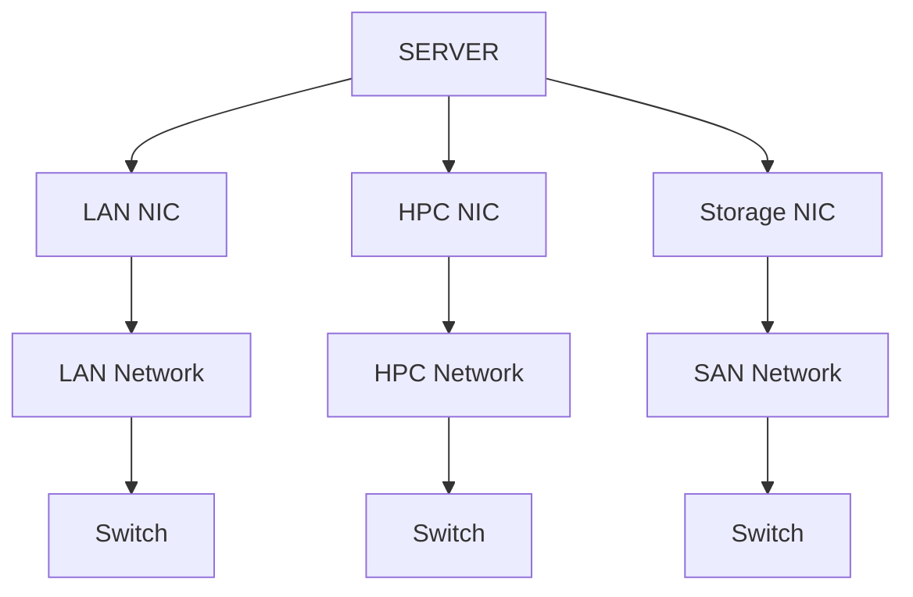
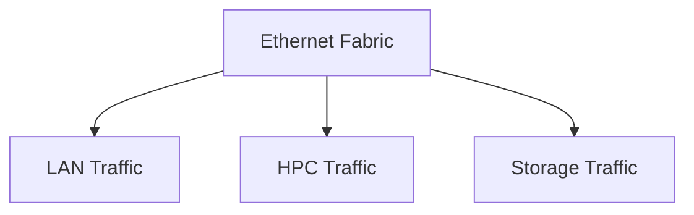
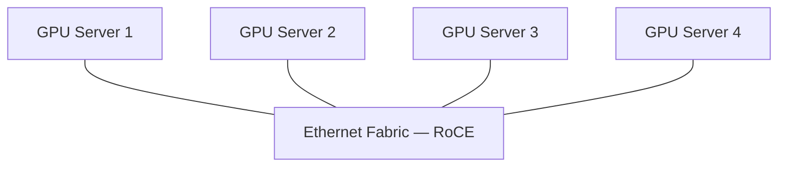

# Module — Converged Ethernet (CE) and RoCE

> Part II · GPU Interconnects, Networking and Data Movement — topic notes

## မြန်မာဘာသာ version

## 1. Converged Ethernet ဆိုတာဘာလဲ?

AI-centric data center networking အကြောင်းပြောတဲ့အခါ Converged Ethernet ဆိုတဲ့ term ကို တွေ့ရနိုင်ပါတယ်။

Converged ဆိုတဲ့စကားလုံးရဲ့ အဓိပ္ပါယ်က—**အရာများစွာက တစ်နေရာတည်းကို စုဝေးလာခြင်း / ပေါင်းစည်းလာခြင်း** ဖြစ်ပါတယ်။ ဥပမာ—

```
Line A ────────┐
               │
Line B ────────┼──────► Converged Point
               │
Line C ────────┘
```

Network မှာလည်း traffic အမျိုးမျိုးကို သီးခြား infrastructure များစွာနဲ့ မသယ်တော့ဘဲ shared Ethernet fabric ပေါ်မှာ traffic မျိုးစုံ သယ်ဆောင်နိုင်အောင် design လုပ်တာကို ဒီ concept နဲ့ နားလည်နိုင်ပါတယ်။

## 2. Traditional Data Center Network

Traditional network environment တစ်ခုကို စဉ်းစားကြည့်ရအောင်။ Traffic အမျိုးအစား မတူတာတွေ ရှိပါတယ်။ ဥပမာ—

- LAN Traffic
- HPC Traffic
- Storage Traffic (source မှာ SAN — Storage Area Network traffic လို့ ဖော်ပြထားသည်)

ဒီ traffic တွေကို အားလုံးသီးခြား network infrastructure နဲ့ တည်ဆောက်မယ်ဆိုရင်—

```
                 SERVER
                   │
       ┌───────────┼───────────┐
       │           │           │
       ▼           ▼           ▼
    LAN NIC      HPC NIC     Storage NIC
       │           │           │
       ▼           ▼           ▼
   LAN Network   HPC Network  SAN Network
       │           │           │
       ▼           ▼           ▼
    Switch       Switch       Switch
```

**Figure 1 — Traditional Separate Networks Architecture**



**ပုံရှင်းလင်းချက် (Figure walkthrough)**
1. အပေါ်ဆုံးက SERVER တစ်လုံးထဲကနေ NIC သုံးခု—LAN NIC, HPC NIC, Storage NIC ထွက်သွားတာ မြင်ရပါမယ်။
2. NIC တစ်ခုချင်းစီက သီးခြား network တစ်ခုစီ—LAN Network, HPC Network, SAN Network ဆီ သွားပါတယ်။
3. Network တစ်ခုချင်းစီအတွက် သီးခြား Switch တစ်ခုစီ ထပ်လိုအပ်ပါတယ်။
4. ဒီလိုဆိုရင် NIC, cable, switch, network အားလုံး ပိုများလာပြီး management လည်း ပိုရှုပ်ထွေးလာပါတယ်။

ဒီလိုဆိုရင်—Connector အမျိုးအစားများ, Cable အမျိုးအစားများ, NIC များ, Switch များ, Network များ ပိုများလာပါတယ်။

## 3. Separate Networks ရဲ့ Problem

Network သုံးမျိုးကို သီးခြားတည်ဆောက်ထားရင် infrastructure က ပိုရှုပ်ထွေးလာနိုင်ပါတယ်။ ဥပမာ—

```
LAN
 │
 ├── NIC
 ├── Cable
 └── Switch

HPC
 │
 ├── NIC
 ├── Cable
 └── Switch

Storage
 │
 ├── NIC
 ├── Cable
 └── Switch
```

ဒီလို architecture မှာ—**More hardware → More cables → More switches → More management** ဖြစ်လာနိုင်ပါတယ်။

## 4. Converged Ethernet ရဲ့ Idea

ဒီနေရာမှာ idea တစ်ခု ပေါ်လာပါတယ်—"Network အားလုံးကို သီးခြားမထားဘဲ Ethernet fabric တစ်ခုထဲမှာ traffic အမျိုးမျိုးကို သယ်မယ်ဆိုရင် ဘယ်လိုလဲ?"

ဒါက Converged Ethernet ရဲ့ အဓိက idea ဖြစ်ပါတယ်။

```
Traditional

LAN  ───────────────► LAN Network
HPC  ───────────────► HPC Network
SAN  ───────────────► Storage Network


Converged Ethernet

LAN  ────────┐
HPC  ────────┼──────► Ethernet Fabric
SAN  ────────┘
```

## 5. One Ethernet Fabric

Converged Ethernet မှာ physical infrastructure ကို ပိုပြီး consolidate လုပ်နိုင်ပါတယ်။

```
                    Ethernet Fabric
                         │
          ┌──────────────┼──────────────┐
          │              │              │
          ▼              ▼              ▼
       LAN Traffic    HPC Traffic    Storage Traffic
```

**Figure 2 — Converged Ethernet: One Fabric, Many Traffic Types**



**ပုံရှင်းလင်းချက် (Figure walkthrough)**
1. အပေါ်ဆုံးက Ethernet Fabric တစ်ခုတည်းကို မြင်ရပါမယ်။
2. ဒီ fabric အောက်ကနေ LAN Traffic, HPC Traffic, Storage Traffic ဆိုပြီး traffic သုံးမျိုး ခွဲထွက်သွားပါတယ်။
3. Fabric က တစ်ခုတည်းဖြစ်ပေမယ့် သယ်ဆောင်ပေးတဲ့ traffic အမျိုးအစားက မျိုးစုံ ဖြစ်ပါတယ်။
4. One fabric does not mean one traffic type — traffic တွေကို requirement အလိုက် logically သီးခြား စီမံနိုင်ဆဲ ဖြစ်ပါတယ်။

ဒါကြောင့် Ethernet fabric တစ်ခုတည်းက traffic အမျိုးအစား အမျိုးမျိုးကို သယ်ဆောင်နိုင်ပါတယ်။

အရေးကြီးတာက—**One fabric does not mean one traffic type.** တစ်ခုတည်းသော Ethernet infrastructure ပေါ်မှာ traffic အမျိုးမျိုး run နိုင်ပါတယ်။

## 6. "One Cable" ဆိုတာဘာကိုဆိုလိုတာလဲ?

Source မှာ—**Physically it is one cable** လို့ ရှင်းပြထားပါတယ်။

ဒါကို "Server မှာ cable တစ်ချောင်းတည်းပဲ ရှိမယ်" လို့ မယူဆသင့်ပါဘူး။ Source ကိုယ်တိုင်က—**At least two connections can come out of each server** လို့ redundancy ကိုလည်း ရှင်းပြထားပါတယ်။

```
              Server
             /      \
            /        \
       Link A          Link B
          │              │
          ▼              ▼
       Ethernet       Ethernet
        Fabric          Fabric
```

ဒါကြောင့် physical connectivity ကို redundant links နဲ့ တည်ဆောက်နိုင်ပါတယ်။

**Important Concept** — Converged ဆိုတာ single point of failure ကို ဆိုလိုတာ မဟုတ်ပါဘူး။ Redundant links တွေ ထားနိုင်တဲ့အတွက် availability ကို ထိန်းသိမ်းနိုင်ပါတယ်။

## 7. What Traffic Can Be Converged?

Source အရ Converged Ethernet fabric ပေါ်မှာ traffic အမျိုးမျိုး သယ်နိုင်ပါတယ်။

1. **LAN Traffic** — General network traffic
2. **Storage Traffic** — SAN / storage-related traffic
3. **HPC Traffic** — High-performance computing traffic

```
             CONVERGED ETHERNET
                     │
        ┌────────────┼────────────┐
        │            │            │
        ▼            ▼            ▼
       LAN          SAN          HPC
     Traffic      Traffic      Traffic
```

## 8. High Bandwidth

Converged Ethernet က high-bandwidth networking ကို support လုပ်နိုင်ပါတယ်။ Source မှာ example အနေနဲ့—**40 Gbps, 100 Gbps, 200 Gbps, 400 Gbps** စတဲ့ bandwidth levels တွေကို mention လုပ်ထားပါတယ်။

ဒါကြောင့် Converged Ethernet ဆိုတာ "Low-speed general Ethernet တစ်မျိုးပဲ" လို့ မယူဆသင့်ပါဘူး။ Modern high-speed Ethernet infrastructure မှာ အလွန်မြင့်မားတဲ့ bandwidth ကို ရရှိနိုင်ပါတယ်။

## 9. Cost Efficiency

Network infrastructure တွေကို converge လုပ်ခြင်းရဲ့ အားသာချက်တစ်ခုက cost efficiency ဖြစ်ပါတယ်။

**Separate networks ဖြစ်ရင်—**

```
3 Networks
   ↓
More NICs
   ↓
More Cables
   ↓
More Switches
   ↓
More Power
   ↓
More Management
```

**Converged design မှာ—**

```
Converged Ethernet Fabric
          ↓
Less Separate Infrastructure
          ↓
Less Hardware
          ↓
Less Power
          ↓
Simpler Management
```

ဒါကြောင့် source က—**Less network to manage, Less power usage, Less hardware to buy** ဆိုတဲ့ benefits တွေကို ဖော်ပြထားပါတယ်။

## 10. Low Latency

Converged Ethernet ဟာ high-performance networking ကို support လုပ်နိုင်ပြီး low-latency communication ကိုလည်း ရရှိစေနိုင်ပါတယ်။

အထူးသဖြင့် RDMA / RoCE လို technology တွေကို အသုံးပြုတဲ့အခါ high-performance data movement ကို support လုပ်နိုင်ပါတယ်။

## 11. RDMA in Converged Ethernet

ဒီနေရာမှာ source က အရေးကြီးတဲ့ point တစ်ခုကို ပြောထားပါတယ်။ **RDMA is not only for GPUs.** RDMA ကို network devices တွေနဲ့လည်း အသုံးပြုနိုင်ပါတယ်။

RDMA = Remote Direct Memory Access ရဲ့ အဓိက idea က—CPU involvement နည်းအောင် data ကို memory-to-memory transfer လုပ်နိုင်ခြင်း ဖြစ်ပါတယ်။

```
Traditional Networking

Application
     │
     ▼
    CPU
     │
     ▼
Network Stack
     │
     ▼
    NIC
     │
     ▼
  Network
```

RDMA-based communication မှာတော့ CPU involvement ကို လျှော့ချနိုင်ပါတယ်။

```
Memory
  │
  ▼
 RDMA
  │
  ▼
 NIC
  │
  ▼
Network
```

ဒါကြောင့်—Lower latency, Lower CPU overhead, High throughput လို benefits တွေကို ရရှိနိုင်ပါတယ်။

## 12. RoCE

Source transcript ထဲမှာ "rock" လို့ အသံထွက်သလို ရေးထားတဲ့နေရာက technical term အရ—**RoCE** ဖြစ်ပါတယ်။

RoCE ဆိုတာ—**RDMA over Converged Ethernet** ကို ဆိုလိုပါတယ်။

```
RDMA
  +
Ethernet
  ↓
RoCE
```

**Figure 3 — RoCE Layered Data Flow (RDMA over Converged Ethernet)**


**ပုံရှင်းလင်းချက် (Figure walkthrough)**
1. ဘယ်ဘက်ဆုံးက Server A ရဲ့ Memory ကနေ data စတင်ပါတယ်။
2. Data က RDMA layer ကတစ်ဆင့် NIC ဆီ ရောက်သွားပါတယ် — CPU involvement ဒီနေရာမှာ လျော့ပါတယ်။
3. အလယ်က Ethernet Fabric ပေါ်မှာ RoCE — RDMA over Converged Ethernet အနေနဲ့ data သွားပါတယ်။
4. ညာဘက်ဆုံးမှာ NIC → RDMA → Memory (Server B) ဆိုပြီး ပြန်ဆင်းသွားပြီး memory-to-memory transfer ပြီးဆုံးပါတယ်။

ဒါကြောင့် RoCE က Ethernet infrastructure ကို အသုံးပြုပြီး RDMA-style high-performance data transfer ကို လုပ်နိုင်စေပါတယ်။

## 13. RoCE ကို ဘာကြောင့်သုံးလဲ?

AI-centric data center မှာ GPU nodes အများကြီးရှိနိုင်ပါတယ်။ ဥပမာ—

```
GPU Server 1 ─────┐
                  │
GPU Server 2 ─────┤
                  │
GPU Server 3 ─────┼── Ethernet Fabric
                  │
GPU Server 4 ─────┤
                  │
GPU Server 5 ─────┘
```

**Figure 4 — RoCE ကို အသုံးပြုတဲ့ GPU Server Cluster**



**ပုံရှင်းလင်းချက် (Figure walkthrough)**
1. အလယ်က Ethernet Fabric — RoCE ဆိုတဲ့ shared fabric ကို မြင်ရပါမယ်။
2. GPU Server 1 ကနေ GPU Server 4 အထိ server တွေအားလုံး ဒီ fabric တစ်ခုတည်းနဲ့ ချိတ်ဆက်ထားပါတယ်။
3. Distributed AI training မှာ server တွေကြား data ဖလှယ်မှု များပြားတဲ့အတွက် ဒီ fabric ပေါ်မှာ high bandwidth + low latency လိုအပ်ပါတယ်။
4. RoCE က ဒီ Ethernet fabric ပေါ်မှာ RDMA-style efficient data movement ကို ရရှိစေပါတယ်။

Distributed AI training မှာ server တစ်ခုနဲ့တစ်ခု data exchange များပြားနိုင်ပါတယ်။ ဒါကြောင့်—High bandwidth + low latency + efficient data movement က အရေးကြီးပါတယ်။

RoCE က Ethernet fabric ပေါ်မှာ RDMA ကို အသုံးပြုနိုင်စေတဲ့အတွက် ဒီလို high-performance workload တွေအတွက် အသုံးဝင်နိုင်ပါတယ်။

## 14. Converged Ethernet vs Separate Networks

| Aspect | Traditional Separate Networks | Converged Ethernet |
|---|---|---|
| Network Fabric | Multiple | Shared Ethernet fabric |
| LAN | Separate | Shared/converged |
| HPC | Separate | Shared/converged |
| Storage | Separate | Shared/converged |
| Cables | More | Fewer physical paths |
| Switches | More | Fewer separate switches |
| Hardware | More | More consolidated |
| Power | Higher infrastructure overhead possible | Lower infrastructure overhead possible |
| Management | More complex | More centralized |
| Bandwidth | Depends on network | High-speed Ethernet possible |
| RDMA | Possible depending on technology | RoCE can provide RDMA over Ethernet |

## 15. Traditional vs Converged Architecture

**Traditional**

```
                 SERVER
                    │
        ┌───────────┼───────────┐
        │           │           │
        ▼           ▼           ▼
      LAN          HPC         Storage
       │            │            │
       ▼            ▼            ▼
    Switch        Switch       Switch
       │            │            │
       ▼            ▼            ▼
    Network       Network      Network
```

**Converged**

```
SERVER
                    │
             ┌──────┴──────┐
             │             │
          Link A         Link B
             │             │
             └──────┬──────┘
                    │
                    ▼
          CONVERGED ETHERNET
               FABRIC
                    │
       ┌────────────┼────────────┐
       │            │            │
       ▼            ▼            ▼
      LAN          HPC        Storage
    Traffic      Traffic      Traffic
```

## 16. Important Clarification

**Converged Ethernet ဆိုတာ traffic အားလုံး တူညီသွားတယ်လို့ မဆိုလိုပါဘူး။** ဆိုလိုတာက—Traffic အမျိုးအစား မတူတာတွေက common Ethernet infrastructure/fabric တစ်ခုတည်းကို share လုပ်ကြတယ် ဆိုတာ ဖြစ်ပါတယ်။ Traffic တွေကို requirement အလိုက် logically သီးခြားခွဲပြီး စီမံနိုင်ပါသေးတယ်။

ဥပမာ—

```
Ethernet Fabric
      │
      ├── LAN Traffic
      ├── Storage Traffic
      └── HPC / RDMA Traffic
```

ဒီ traffic တွေဟာ same physical fabric ကို share လုပ်နိုင်ပေမယ့် traffic handling, prioritization, isolation စတာတွေကို design အလိုက် သီးခြားစီ စီမံနိုင်ပါတယ်။

## 17. NVIDIA Context

Source ရဲ့ နောက်ဆုံးပိုင်းမှာ NVIDIA ရဲ့ InfiniBand နဲ့ Converged Ethernet implementation အကြောင်း ဆက်ပြောထားပါတယ်။ ဒါပေမယ့် source ကိုယ်တိုင်က—DGX / SGX server, OpenSim စတဲ့ terminology တွေကို ဒီအပိုင်းမှာ မရှင်းပြသေးဘူး လို့ ပြောထားပါတယ်။

ဒါကြောင့် ဒီ module မှာ NVIDIA-specific architecture details ကို မဖြည့်သွင်းဘဲ—**NVIDIA implements both InfiniBand and Ethernet-based high-performance networking approaches** ဆိုတဲ့ concept ကိုသာ မှတ်ထားရပါမယ်။ နောက် section မှာ NVIDIA-specific networking technologies တွေကို သီးခြားလေ့လာနိုင်ပါတယ်။

## 18. Exam Shortcut

```
Traditional Networking
Separate Traffic → Separate Networks → More Hardware

Converged Ethernet
Multiple Traffic Types → Shared Ethernet Fabric → Less Separate Infrastructure

RoCE
RDMA over Converged Ethernet
```

## 19. One-Line Memory Trick

**Converged Ethernet = LAN + Storage + HPC traffic sharing a common Ethernet fabric.**

မြန်မာလို—Converged Ethernet ဆိုတာ LAN, Storage, HPC စတဲ့ traffic အမျိုးမျိုးကို common Ethernet fabric တစ်ခုတည်းပေါ်မှာ သယ်ဆောင်နိုင်အောင် network infrastructure ကို converge လုပ်ထားတဲ့ architecture ဖြစ်ပါတယ်။

## 20. Final Mental Model

```
Traditional Data Center

 LAN ───────► LAN Switch
 HPC ───────► HPC Switch
 Storage ───► Storage Switch


             ↓ CONVERGENCE ↓


Converged Data Center

              ┌───────────────┐
 LAN ─────────┤               │
 Storage ─────┤   Ethernet    │
 HPC ─────────┤    Fabric     │
              │               │
              └───────────────┘
                       │
                     RoCE
                       │
              ┌────────┴────────┐
              ▼                 ▼
          Low Latency       High Throughput
```

**မှတ်ထားရန်—**
- Converged Ethernet = Traffic အမျိုးမျိုးအတွက် shared Ethernet fabric တစ်ခုတည်း။
- RoCE = RDMA over Converged Ethernet။
- RDMA = CPU involvement လျှော့ချပြီး remote memory-to-memory data ကို ထိရောက်စွာ ရွှေ့ပြောင်းခြင်း။
- Convergence က separate infrastructure ကို လျှော့ချပေးတာဖြစ်ပြီး redundancy ကို ဖယ်ရှားတာ မဟုတ်ပါဘူး။

## Self-Check Questions (အဖြေများပါဝင်သည်)

1. **Converged Ethernet မှာ "converged" ဆိုတာ ဘာကို ဆိုလိုသလဲ?** — LAN, Storage/SAN, HPC စတဲ့ traffic အမျိုးအစားတွေကို သီးခြား network တွေနဲ့ မသယ်တော့ဘဲ Ethernet fabric တစ်ခုတည်းပေါ်မှာ ပေါင်းစည်းသယ်ဆောင်ခြင်းကို ဆိုလိုပါတယ်။
2. **Converged ဆိုတာ single point of failure ကို ဆိုလိုသလား?** — မဆိုလိုပါဘူး။ Server တစ်ခုကနေ redundant links အနည်းဆုံးနှစ်ခုထွက်နိုင်ပြီး availability ကို ထိန်းသိမ်းနိုင်ပါတယ်။
3. **RoCE ဆိုတာ ဘာလဲ?** — RDMA over Converged Ethernet ဖြစ်ပြီး Ethernet infrastructure ပေါ်မှာ RDMA-style high-performance data transfer ကို လုပ်နိုင်စေပါတယ်။
4. **Network converge လုပ်ခြင်းရဲ့ အားသာချက်တွေက ဘာတွေလဲ?** — NIC, cable, switch နဲ့ separate infrastructure နည်းလာခြင်း၊ power သုံးစွဲမှု နည်းလာခြင်း၊ management ရိုးရှင်းလာခြင်း၊ high bandwidth နဲ့ RDMA/RoCE ကြောင့် low latency ရရှိနိုင်ခြင်း တို့ ဖြစ်ပါတယ်။
5. **Converged fabric ပေါ်က traffic တွေ အားလုံး တူညီသွားသလား?** — မတူညီသွားပါဘူး။ Traffic အမျိုးအစားတွေက physical fabric တစ်ခုတည်းကို share လုပ်ပေမယ့် traffic handling, prioritization, isolation စတာတွေကို design အလိုက် သီးခြားစီ စီမံနိုင်ပါတယ်။

## English Version

## 1. What Is Converged Ethernet?

When talking about AI-centric data center networking, you may come across the term Converged Ethernet.

The meaning of the word "converged" is—**many things coming together / merging into one place**. For example—

```
Line A ────────┐
               │
Line B ────────┼──────► Converged Point
               │
Line C ────────┘
```

In networking, this concept describes designing a shared Ethernet fabric that can carry many kinds of traffic, instead of carrying each traffic type on separate infrastructures.

## 2. Traditional Data Center Network

Consider a traditional network environment. There are different traffic types. For example—

- LAN Traffic
- HPC Traffic
- Storage Traffic (described in the source as SAN — Storage Area Network traffic)

If all of this traffic is built on separate network infrastructures—

```
                 SERVER
                   │
       ┌───────────┼───────────┐
       │           │           │
       ▼           ▼           ▼
    LAN NIC      HPC NIC     Storage NIC
       │           │           │
       ▼           ▼           ▼
   LAN Network   HPC Network  SAN Network
       │           │           │
       ▼           ▼           ▼
    Switch       Switch       Switch
```

**Figure 1 — Traditional Separate Networks Architecture**


**Figure walkthrough**
1. At the top, one SERVER exposes three NICs: LAN NIC, HPC NIC, and Storage NIC.
2. Each NIC leads to its own network — LAN Network, HPC Network, and SAN Network.
3. Each network needs its own separate Switch.
4. This multiplies NICs, cables, switches, and networks, and makes management more complex.

This means—more connector types, more cable types, more NICs, more switches, more networks.

## 3. The Problem with Separate Networks

Building the three networks separately makes the infrastructure more complex. For example—

```
LAN
 │
 ├── NIC
 ├── Cable
 └── Switch

HPC
 │
 ├── NIC
 ├── Cable
 └── Switch

Storage
 │
 ├── NIC
 ├── Cable
 └── Switch
```

In this architecture—**More hardware → More cables → More switches → More management**.

## 4. The Idea Behind Converged Ethernet

Here a new idea appears—"What if, instead of keeping every network separate, we carry different kinds of traffic on a single Ethernet fabric?"

That is the core idea of Converged Ethernet.

```
Traditional

LAN  ───────────────► LAN Network
HPC  ───────────────► HPC Network
SAN  ───────────────► Storage Network


Converged Ethernet

LAN  ────────┐
HPC  ────────┼──────► Ethernet Fabric
SAN  ────────┘
```

## 5. One Ethernet Fabric

With Converged Ethernet, the physical infrastructure can be consolidated further.

```
                    Ethernet Fabric
                         │
          ┌──────────────┼──────────────┐
          │              │              │
          ▼              ▼              ▼
       LAN Traffic    HPC Traffic    Storage Traffic
```

**Figure 2 — Converged Ethernet: One Fabric, Many Traffic Types**


**Figure walkthrough**
1. At the top is a single Ethernet Fabric.
2. From this fabric, three traffic types branch out: LAN Traffic, HPC Traffic, and Storage Traffic.
3. The fabric is one, but the traffic types it carries are many.
4. One fabric does not mean one traffic type — the traffic can still be logically separated and managed per requirement.

So a single Ethernet fabric can carry many different traffic types.

The important point is—**One fabric does not mean one traffic type.** Many kinds of traffic can run on one Ethernet infrastructure.

## 6. What Does "One Cable" Mean?

The source explains—**Physically it is one cable.**

This should NOT be taken to mean "a server will have exactly one cable." The source itself explains redundancy—**At least two connections can come out of each server**.

```
              Server
             /      \
            /        \
       Link A          Link B
          │              │
          ▼              ▼
       Ethernet       Ethernet
        Fabric          Fabric
```

So physical connectivity can be built with redundant links.

**Important Concept** — Converged does not mean single point of failure. Because you can keep redundant links, availability is preserved.

## 7. What Traffic Can Be Converged?

According to the source, many kinds of traffic can be carried on a Converged Ethernet fabric.

1. **LAN Traffic** — General network traffic
2. **Storage Traffic** — SAN / storage-related traffic
3. **HPC Traffic** — High-performance computing traffic

```
             CONVERGED ETHERNET
                     │
        ┌────────────┼────────────┐
        │            │            │
        ▼            ▼            ▼
       LAN          SAN          HPC
     Traffic      Traffic      Traffic
```

## 8. High Bandwidth

Converged Ethernet can support high-bandwidth networking. The source mentions example bandwidth levels—**40 Gbps, 100 Gbps, 200 Gbps, 400 Gbps**.

So do not assume Converged Ethernet is "just a kind of low-speed general Ethernet." Modern high-speed Ethernet infrastructure can deliver extremely high bandwidth.

## 9. Cost Efficiency

One advantage of converging network infrastructure is cost efficiency.

**With separate networks—**

```
3 Networks
   ↓
More NICs
   ↓
More Cables
   ↓
More Switches
   ↓
More Power
   ↓
More Management
```

**With a converged design—**

```
Converged Ethernet Fabric
          ↓
Less Separate Infrastructure
          ↓
Less Hardware
          ↓
Less Power
          ↓
Simpler Management
```

That is why the source lists these benefits—**Less network to manage, Less power usage, Less hardware to buy**.

## 10. Low Latency

Converged Ethernet supports high-performance networking and can also provide low-latency communication.

Especially when using technologies like RDMA / RoCE, it can support high-performance data movement.

## 11. RDMA in Converged Ethernet

Here the source makes an important point. **RDMA is not only for GPUs.** RDMA can also be used with network devices.

RDMA = Remote Direct Memory Access — its main idea is memory-to-memory data transfer with minimal CPU involvement.

```
Traditional Networking

Application
     │
     ▼
    CPU
     │
     ▼
Network Stack
     │
     ▼
    NIC
     │
     ▼
  Network
```

With RDMA-based communication, CPU involvement can be reduced.

```
Memory
  │
  ▼
 RDMA
  │
  ▼
 NIC
  │
  ▼
Network
```

So benefits like—Lower latency, Lower CPU overhead, High throughput can be obtained.

## 12. RoCE

In the source transcript, the place written the way "rock" is pronounced is, as a technical term—

**RoCE**.

RoCE means—**RDMA over Converged Ethernet**.

```
RDMA
  +
Ethernet
  ↓
RoCE
```

**Figure 3 — RoCE Layered Data Flow (RDMA over Converged Ethernet)**


**Figure walkthrough**
1. On the far left, the data starts in Memory on Server A.
2. The data passes through the RDMA layer to the NIC — CPU involvement is reduced here.
3. In the middle, the data travels over the Ethernet Fabric as RoCE — RDMA over Converged Ethernet.
4. On the far right it comes back through NIC → RDMA → Memory on Server B, completing the memory-to-memory transfer.

So RoCE enables RDMA-style high-performance data transfer using Ethernet infrastructure.

## 13. Why Use RoCE?

An AI-centric data center can have many GPU nodes. For example—

```
GPU Server 1 ─────┐
                  │
GPU Server 2 ─────┤
                  │
GPU Server 3 ─────┼── Ethernet Fabric
                  │
GPU Server 4 ─────┤
                  │
GPU Server 5 ─────┘
```

**Figure 4 — A GPU Server Cluster Using RoCE**


**Figure walkthrough**
1. In the middle is the shared Ethernet Fabric — RoCE.
2. From GPU Server 1 through GPU Server 4, all servers connect to this single fabric.
3. Distributed AI training generates heavy data exchange between servers, so this fabric needs high bandwidth and low latency.
4. RoCE enables RDMA-style efficient data movement over this Ethernet fabric.

In distributed AI training, there can be heavy data exchange between servers. So—High bandwidth + low latency + efficient data movement matter.

Because RoCE lets you use RDMA on an Ethernet fabric, it can be useful for such high-performance workloads.

## 14. Converged Ethernet vs Separate Networks

| Aspect | Traditional Separate Networks | Converged Ethernet |
|---|---|---|
| Network Fabric | Multiple | Shared Ethernet fabric |
| LAN | Separate | Shared/converged |
| HPC | Separate | Shared/converged |
| Storage | Separate | Shared/converged |
| Cables | More | Fewer physical paths |
| Switches | More | Fewer separate switches |
| Hardware | More | More consolidated |
| Power | Higher infrastructure overhead possible | Lower infrastructure overhead possible |
| Management | More complex | More centralized |
| Bandwidth | Depends on network | High-speed Ethernet possible |
| RDMA | Possible depending on technology | RoCE can provide RDMA over Ethernet |

## 15. Traditional vs Converged Architecture

**Traditional**

```
                 SERVER
                    │
        ┌───────────┼───────────┐
        │           │           │
        ▼           ▼           ▼
      LAN          HPC         Storage
       │            │            │
       ▼            ▼            ▼
    Switch        Switch       Switch
       │            │            │
       ▼            ▼            ▼
    Network       Network      Network
```

**Converged**

```
SERVER
                    │
             ┌──────┴──────┐
             │             │
          Link A         Link B
             │             │
             └──────┬──────┘
                    │
                    ▼
          CONVERGED ETHERNET
               FABRIC
                    │
       ┌────────────┼────────────┐
       │            │            │
       ▼            ▼            ▼
      LAN          HPC        Storage
    Traffic      Traffic      Traffic
```

## 16. Important Clarification

**Converged Ethernet does not mean that all traffic becomes identical.** It means: Different traffic types share a common Ethernet infrastructure/fabric. The traffic can still be logically separated and managed according to its requirements.

For example:

```
Ethernet Fabric
      │
      ├── LAN Traffic
      ├── Storage Traffic
      └── HPC / RDMA Traffic
```

These traffic types can share the same physical fabric, but traffic handling, prioritization, isolation, and so on can be managed separately according to the design.

## 17. NVIDIA Context

Near the end, the source talks about NVIDIA's InfiniBand and Converged Ethernet implementation. But the source itself notes that terminology such as DGX / SGX server and OpenSim is not explained in this part.

So, rather than filling in NVIDIA-specific architecture details in this module, just remember the concept—**NVIDIA implements both InfiniBand and Ethernet-based high-performance networking approaches**. You can study NVIDIA-specific networking technologies separately in a later section.

## 18. Exam Shortcut

```
Traditional Networking
Separate Traffic → Separate Networks → More Hardware

Converged Ethernet
Multiple Traffic Types → Shared Ethernet Fabric → Less Separate Infrastructure

RoCE
RDMA over Converged Ethernet
```

## 19. One-Line Memory Trick

**Converged Ethernet = LAN + Storage + HPC traffic sharing a common Ethernet fabric.**

In other words — Converged Ethernet is an architecture where the network infrastructure is converged so that many kinds of traffic — LAN, Storage, HPC — can be carried on a single common Ethernet fabric.

## 20. Final Mental Model

```
Traditional Data Center

 LAN ───────► LAN Switch
 HPC ───────► HPC Switch
 Storage ───► Storage Switch


             ↓ CONVERGENCE ↓


Converged Data Center

              ┌───────────────┐
 LAN ─────────┤               │
 Storage ─────┤   Ethernet    │
 HPC ─────────┤    Fabric     │
              │               │
              └───────────────┘
                       │
                     RoCE
                       │
              ┌────────┴────────┐
              ▼                 ▼
          Low Latency       High Throughput
```

**Remember:**
- Converged Ethernet = One shared Ethernet fabric for multiple traffic types.
- RoCE = RDMA over Converged Ethernet.
- RDMA = Efficient remote memory-to-memory data movement with reduced CPU involvement.
- Convergence reduces separate infrastructure; it does not mean removing redundancy.

## Self-Check Questions (with answers)

1. **What does "converged" mean in Converged Ethernet?** — Carrying multiple traffic types (LAN, Storage/SAN, HPC) on a single shared Ethernet fabric instead of separate networks per traffic type.
2. **Does converged mean a single point of failure?** — No. At least two connections can come out of each server, so redundant links can preserve availability.
3. **What is RoCE?** — RDMA over Converged Ethernet: it enables RDMA-style high-performance data transfer over Ethernet infrastructure.
4. **What are the benefits of converging the network?** — Fewer NICs, cables, switches, and separate infrastructures; lower power usage; simpler management; and high bandwidth with low latency when RDMA/RoCE is used.
5. **Does all traffic on a converged fabric become identical?** — No. The traffic types share one physical fabric but can still be logically separated and managed per requirements (traffic handling, prioritization, isolation).

## Technical review notes

- Structure normalized to the bilingual convention: blockquote updated to the full Part II title ("GPU Interconnects, Networking and Data Movement"), `## မြန်မာဘာသာ version` and `## English Version` section headers added, and self-check questions with concise answers appended to each language section.
- English fragments inside the Burmese body (section 6 important-concept line, section 16 clarification paragraph, section 20 remember bullets) were translated into Burmese; the unchanged English originals remain in the English section. Tables and ASCII diagrams are preserved verbatim in both sections.
- Correction made (already present in the source text and preserved): the source transcript's phonetic spelling of "rock" is corrected to the standard term **RoCE — RDMA over Converged Ethernet**.
- Needs verification: the example bandwidth levels "40 / 100 / 200 / 400 Gbps" (section 8) are source examples, not a specification of Converged Ethernet in general. The statement "at least two connections can come out of each server" (section 6) is a source claim about typical redundancy practice and is deployment-dependent.
- Needs verification: the source's "DGX / SGX server" and "OpenSim" terminology (section 17) appears in the transcript without explanation and may contain transcription artifacts; no NVIDIA-specific architecture details were added.
- Mermaid figures (Figure 1–4) with figure walkthroughs were added inline in both the Myanmar and English sections; all existing text and ASCII diagrams are unchanged.
