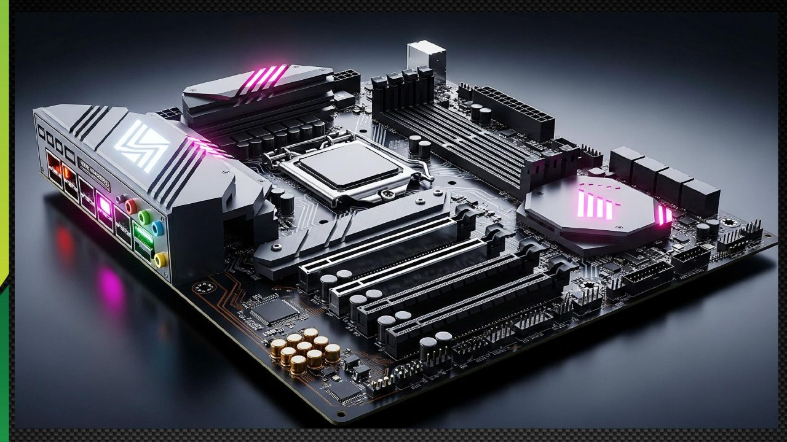
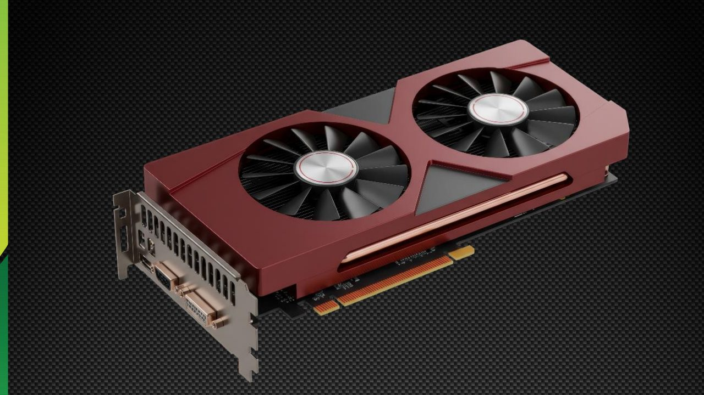
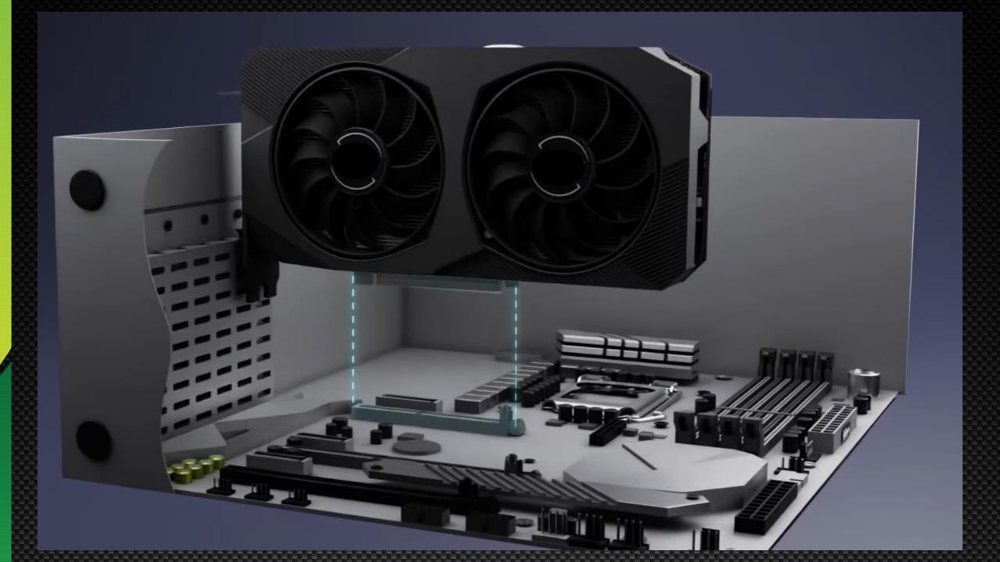
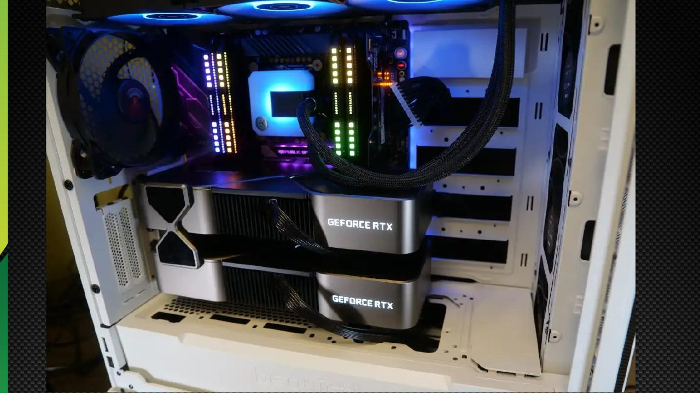
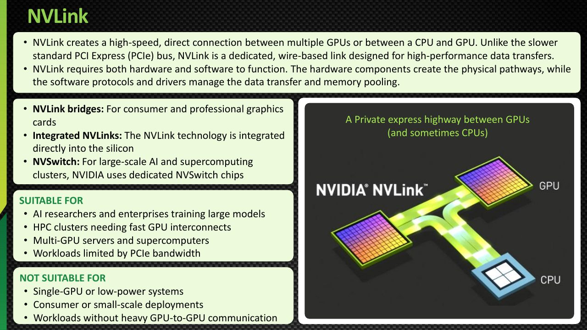
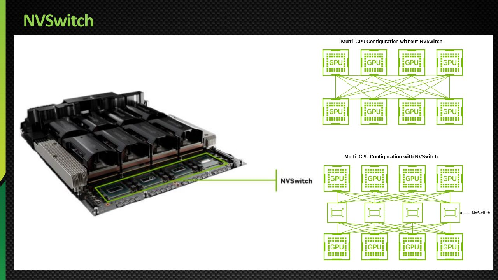

# Module 07 — NVIDIA NVLink and NVSwitch

> Part II · GPU Interconnects and Networking — Course Module 07 — topic notes

## မြန်မာဘာသာ version — NVIDIA NVLink and NVSwitch

## 1. ဒီ module မှာ ဘာတွေ လေ့လာရမလဲ

ဒီ module ကို လေ့လာပြီးရင် အောက်ပါအချက်တွေကို ရှင်းပြနိုင်ရပါမယ်—

- NVLink ရဲ့ ရည်ရွယ်ချက်ကို ရှင်းပြနိုင်ခြင်း။
- NVLink နဲ့ PCIe ကို နှိုင်းယှဉ်နိုင်ခြင်း။
- NVLink bridge ရဲ့ အခန်းကဏ္ဍကို ဖော်ပြနိုင်ခြင်း။
- NVSwitch က GPU တွေကို ဘယ်လို ချိတ်ဆက်ပေးသလဲ ဆိုတာ ရှင်းပြနိုင်ခြင်း။
- DGX A100 နဲ့ DGX H100 တို့မှာ NVLink ရဲ့ အရေးပါပုံကို သိရှိခြင်း။
- High-bandwidth GPU communication ကနေ အကျိုးကျေးဇူး ခံစားရနိုင်တဲ့ workloads တွေကို ခွဲခြားသိခြင်း။

## 2. Petronas Skybridge နှိုင်းယှဉ်ချက်

Kuala Lumpur က Petronas Twin Towers နှစ်ခုကို skybridge တစ်ခုက ချိတ်ဆက်ပေးထားပါတယ်။ မျှော်စင်တစ်ခုရဲ့ အပေါ်ထပ်မှာ ရှိနေတဲ့သူတစ်ယောက်က နောက်မျှော်စင်ထဲက သူတစ်ယောက်ဆီ သွားချင်တယ်ဆိုပါစို့။ တိုက်ရိုက်ချိတ်ဆက်မှု မရှိရင် တခြားလမ်းက သွားရမှာ ဖြစ်ပေမယ့် skybridge က ပိုတိုက်ရိုက်တဲ့ လမ်းကြောင်းတစ်ခု ပေးပါတယ်။

ရိုးရှင်းတဲ့ နှိုင်းယှဉ်ချက်အနေနဲ့—

- မျှော်စင် A က GPU 1 ကို ကိုယ်စားပြုပါတယ်။
- မျှော်စင် B က GPU 2 ကို ကိုယ်စားပြုပါတယ်။
- တခြားသွားလမ်းက system ထဲက ပုံမှန် communication path ကို ကိုယ်စားပြုပါတယ်။
- Skybridge ကတော့ NVLink ကို ကိုယ်စားပြုပါတယ်။

NVLink က support လုပ်တဲ့ GPU တွေကြားမှာ high-bandwidth communication path တစ်ခု ပေးပါတယ်။

ဒီနှိုင်းယှဉ်ချက်က conceptual ဖြစ်ပါတယ်။ PCIe က နှေးတာ မဟုတ်ပါဘူး—သူက အရေးကြီးတဲ့ high-speed interconnect တစ်ခု ဖြစ်ပါတယ်။ NVLink ကတော့ bandwidth နဲ့ topology အရ မတူညီတဲ့ GPU-focused communication path တစ်ခုကို ထပ်မံပေးတာ ဖြစ်ပါတယ်။

## 3. PCIe ဆိုတာ ဘာလဲ

PCIe ဆိုတာ Peripheral Component Interconnect Express ရဲ့ အတိုကောက် ဖြစ်ပါတယ်။

GPU တွေ၊ network adapters တွေ၊ storage controllers တွေလို system components တွေကို ချိတ်ဆက်ဖို့ အသုံးပြုတဲ့ high-speed interconnect standard တစ်ခု ဖြစ်ပါတယ်။

ရိုးရှင်းတဲ့ architecture ကတော့—

```
                CPU
                 |
          PCIe Root Complex
                 |
           PCIe Interconnect
           /       |       \
          GPU      NIC    Storage
```

တကယ့် systems တွေမှာ PCIe root ports အမျိုးမျိုး၊ switches တွေနဲ့ topologies အမျိုးမျိုး ပါဝင်နိုင်ပါတယ်။

PCIe bandwidth က PCIe generation နဲ့ lane count ပေါ် မူတည်ပါတယ်။ Multi-GPU workloads တွေမှာ GPU တွေကြား data အများကြီး လဲလှယ်ရင် PCIe topology က performance ကို သက်ရောက်နိုင်ပါတယ်။



**ပုံရှင်းလင်းချက် (Training slide walkthrough)**
1. ဒီ training slide မှာ GPU interconnect အကြောင်းကို ရုပ်ပုံဖြင့် ရှင်းပြထားပါတယ်။
2. အပေါ်က ဖတ်ရှုထားတဲ့ PCIe — CPU၊ GPU၊ NIC၊ storage controller စတဲ့ system components တွေကို ချိတ်ဆက်ပေးတဲ့ high-speed interconnect standard အကြောင်းနဲ့ တွဲဖက် ကြည့်ရှုနိုင်ပါတယ်။

*(Source: NVIDIA NCA-AIIO training deck — study material)*



**ပုံရှင်းလင်းချက် (Training slide walkthrough)**
1. ဒီပုံက GPU interconnect အကြောင်း ရှင်းပြထားတဲ့ ဒုတိယ visual ဖြစ်ပါတယ်။
2. ပုံမှာ ပြထားတဲ့ ချိတ်ဆက်မှုပုံစံကို ကြည့်ရင်း multi-GPU workload တွေမှာ GPU တွေကြား data အများကြီး လဲလှယ်ရတဲ့အခါ interconnect topology က performance ကို သက်ရောက်နိုင်ပုံကို ချိတ်ဆက်စဉ်းစားနိုင်ပါတယ်။

*(Source: NVIDIA NCA-AIIO training deck — study material)*



**ပုံရှင်းလင်းချက် (Training slide walkthrough)**
1. ဒီပုံက GPU interconnect အကြောင်း ရှင်းပြထားတဲ့ တတိယ visual ဖြစ်ပါတယ်။
2. ဒီ interconnect တွေရဲ့ အပေါ်မှာ နောက်ပိုင်း section တွေမှာ လေ့လာမယ့် NVLink နဲ့ NVSwitch တွေက GPU-to-GPU communication အတွက် ဘယ်လို ထပ်မံဖြည့်ဆည်းပေးသလဲ ဆိုတာ ယှဉ်ကြည့်နိုင်ပါတယ်။

*(Source: NVIDIA NCA-AIIO training deck — study material)*



**ပုံရှင်းလင်းချက် (Training slide walkthrough)**
1. ဒီပုံမှာ GeForce RTX graphics card နှစ်ခုကို မြင်ရပါမယ်။
2. Graphics card တွေဟာ system ထဲမှာ PCIe ကတစ်ဆင့် ချိတ်ဆက်ကြပြီး၊ support လုပ်တဲ့ card တွေအတွက် NVLink bridge က GPU ကြား တိုက်ရိုက်ချိတ်ဆက်မှု ထပ်ပေးနိုင်ပါတယ် (NVLink support က GPU model နဲ့ generation ပေါ် မူတည်ပါတယ်)။

*(Source: NVIDIA NCA-AIIO training deck — study material)*

## 4. NVLink ဆိုတာ ဘာလဲ

NVLink က NVIDIA ရဲ့ high-speed GPU interconnect technology ဖြစ်ပါတယ်။

Support လုပ်တဲ့ GPU တွေကြား high-bandwidth communication ကို လုပ်ဆောင်ပေးပါတယ်။ Applications တွေက model computation ကို GPU အများကြီးပေါ် ဖြန့်ဝေလုပ်ဆောင်တဲ့အခါ ဒါက အရေးကြီးနိုင်ပါတယ်။

ဥပမာ—ကြီးမားတဲ့ AI model တစ်ခုက GPU အများကြီးသုံးပြီး tensor-parallel ဒါမှမဟုတ် တခြား distributed computation တွေ လုပ်ဆောင်နိုင်ပါတယ်။ အဲဒီအခါ GPU တွေက intermediate results တွေ လဲလှယ်ပြီး အလုပ်တွေကို synchronize လုပ်ဖို့ လိုအပ်ပါတယ်။

NVLink က ဒီ interconnect ကို ထိရောက်စွာ အသုံးပြုတဲ့ workloads တွေမှာ communication bottleneck တွေ လျှော့ချပေးနိုင်ပါတယ်။

အဓိက အကျိုးကျေးဇူးများ—

- High-bandwidth GPU-to-GPU communication။
- သင့်တော်တဲ့ multi-GPU workloads တွေအတွက် ပိုမိုထိရောက်တဲ့ data exchange။
- GPU peer-to-peer communication ကို support လုပ်ခြင်း။
- Application က အကျိုးခံစားရရင် multi-GPU scaling ပိုကောင်းလာနိုင်ခြင်း။

NVLink က application တိုင်း ပိုမြန်သွားမယ်လို့ အာမခံတာ မဟုတ်ပါဘူး။ အကျိုးကျေးဇူးက workload၊ hardware topology နဲ့ software implementation ပေါ် မူတည်ပါတယ်။



**ပုံရှင်းလင်းချက် (Training slide walkthrough)**
1. ဒီ slide မှာ NVLink က GPU အများကြား (သို့မဟုတ် CPU နဲ့ GPU ကြား) high-speed, direct connection ဖန်တီးပေးပုံကို ရှင်းပြထားပါတယ်။
2. Standard PCIe bus နဲ့ မတူဘဲ NVLink က dedicated, wire-based link ဖြစ်ပြီး high-performance data transfer အတွက် ဒီဇိုင်းထုတ်ထားကြောင်း ဖော်ပြထားပါတယ်။
3. NVLink အလုပ်လုပ်ဖို့ hardware (physical pathways) နဲ့ software protocols/drivers (data transfer နဲ့ memory pooling ကို စီမံ) နှစ်မျိုးလုံး လိုအပ်ကြောင်း ပြထားပါတယ်။
4. အောက်ခြေမှာတော့ NVLink သုံးသင့်တဲ့ workload တွေ (large model training, HPC clusters, multi-GPU servers) နဲ့ မသုံးသင့်တဲ့ workload တွေ (single-GPU, low-power system, consumer deployment) ကို ခွဲခြားပြထားပါတယ်။

*(Source: NVIDIA NCA-AIIO training deck — study material)*

## 5. NVLink အတွက် Hardware နဲ့ Software ပံ့ပိုးမှု လိုအပ်ခြင်း

NVLink ဆိုတာ physical connector တစ်ခုထက် ပိုပါတယ်။

Hardware components များ—

- NVLink interfaces နဲ့ physical links များ။
- အချို့ support လုပ်တဲ့ workstation GPUs တွေမှာ NVLink bridges များ။
- Support လုပ်တဲ့ multi-GPU systems တွေမှာ NVSwitch hardware။

Software components များ—

- NVIDIA GPU drivers။
- CUDA နဲ့ GPU runtime support။
- Peer-to-peer access capabilities။
- Multi-GPU communication အတွက် application-level support။

Physical connection တစ်ခုတည်းနဲ့ application တိုင်းက NVLink ကို အသုံးပြုမယ်၊ ဒါမှမဟုတ် performance ကို automatic တိုးချဲ့ပေးမယ်လို့ အာမခံတာ မဟုတ်ပါဘူး။

## 6. NVLink Bridge

NVLink bridge ဆိုတာ အချို့ workstation configurations တွေမှာ support လုပ်တဲ့ graphics cards တွေကို ချိတ်ဆက်ဖို့ အသုံးပြုတဲ့ physical connector တစ်ခု ဖြစ်ပါတယ်။

Conceptual diagram—

```
       GPU 1                         GPU 2
  +-------------+               +-------------+
  | GPU Memory  |               | GPU Memory  |
  | GPU Compute |               | GPU Compute |
  +-------------+               +-------------+
          |                             |
          +---------- NVLink -----------+
                       Bridge
```

ဒီ bridge က universal မဟုတ်ပါဘူး။ GPU တွေက NVLink ကို support လုပ်ရမယ်၊ bridge ကလည်း support လုပ်တဲ့ hardware နဲ့ physical slot configuration နဲ့ ကိုက်ညီရပါမယ်။

Memory pooling ဒါမှမဟုတ် performance scaling အတွက် compatible application နဲ့ software support လည်း လိုအပ်ပါတယ်။

## 7. Integrated NVLink နဲ့ Multi-GPU Systems

AI servers တွေမှာ GPU modules တွေနဲ့ NVLink connections တွေကို system ရဲ့ GPU baseboard နဲ့ switching architecture ထဲမှာ integrate လုပ်ထားနိုင်ပါတယ်။

ဒါက workstation cards နှစ်ခုကြားမှာ သီးခြား bridge တစ်ခု တပ်ဆင်တာနဲ့ မတူပါဘူး။

NVIDIA DGX A100 နဲ့ DGX H100 systems တွေက GPU အများကြီးကြား high-bandwidth communication ပေးဖို့ NVLink နဲ့ NVSwitch ကို အသုံးပြုပါတယ်။

## 8. NVSwitch ဆိုတာ ဘာလဲ

NVSwitch ဆိုတာ NVLink fabric တစ်ခုမှတစ်ဆင့် GPU အများကြီးကို ချိတ်ဆက်ပေးတဲ့ switching technology တစ်ခု ဖြစ်ပါတယ်။

Server တစ်ခုထဲမှာ GPU အများကြီး ရှိတဲ့အခါ switching fabric တစ်ခုက ၎င်းတို့ကြား structured၊ high-bandwidth communication ကို ပေးပါတယ်။

ရိုးရှင်းတဲ့ conceptual diagram—

```
       GPU 0             GPU 1
          \               /
           \             /
          +---------------+
          |   NVSwitch    |
          +---------------+
           /             \
          /               \
       GPU 2             GPU 3
```

ဒီ diagram က concept ကို ပြတာဖြစ်ပြီး DGX system ရဲ့ တိကျတဲ့ physical topology ကို မပြပါဘူး။

NVSwitch က ပေးနိုင်တာတွေက—

- GPU အများကြီးကြား high-bandwidth communication။
- ထိရောက်တဲ့ GPU-to-GPU data exchange။
- Multi-GPU workloads တွေအတွက် scalable interconnect fabric။



**ပုံရှင်းလင်းချက် (Training slide walkthrough)**
1. ဒီ slide မှာ NVSwitch မပါတဲ့ multi-GPU configuration နဲ့ NVSwitch ပါတဲ့ multi-GPU configuration ကို အပေါ်အောက် နှိုင်းယှဉ်ပြထားပါတယ်။
2. အပေါ်ပိုင်းက configuration မှာ GPU တွေကို NVSwitch မပဲ ချိတ်ဆက်ထားပုံ၊ အောက်ပိုင်းမှာတော့ NVSwitch က GPU အများကြား ချိတ်ဆက်ပေးပုံကို မြင်ရပါမယ်။
3. ဒီပုံက section 8 မှာ ရှင်းပြထားတဲ့ NVSwitch ရဲ့ အခန်းကဏ္ဍ—GPU အများကြား structured, high-bandwidth communication ပေးခြင်းကို ပုံနဲ့ မြင်နိုင်အောင် ပြထားတာ ဖြစ်ပါတယ်။

*(Source: NVIDIA NCA-AIIO training deck — study material)*

## 9. DGX A100 vs DGX H100 — NVSwitch

| Specification | DGX A100 | DGX H100 |
|---|---|---|
| GPU architecture | Ampere | Hopper |
| GPUs | 8 | 8 |
| NVSwitch count | 6 | 4 |
| NVLink generation | Third generation | Fourth generation |
| GPU-to-GPU bandwidth | Up to 600 GB/s per GPU | Up to 900 GB/s per GPU |

ဒီ ဂဏန်းတွေက မှတ်တမ်းတင်ထားတဲ့ systems တွေကို ရည်ညွှန်းပါတယ်။ Per-GPU bandwidth နဲ့ aggregate system bandwidth ဆိုတာ တိုင်းတာမှု မတူညီတဲ့အတွက် ရှုပ်ထွေးမသွားစေရပါ။

DGX H100 က NVSwitch အလုံးရေ နည်းပေမယ့် ပိုမြင့်တဲ့ GPU-to-GPU bandwidth ပေးနိုင်ပါတယ်။ Switch အရေအတွက်တစ်ခုတည်းက performance ကို မဆုံးဖြတ်ပါဘူး—generation၊ link bandwidth နဲ့ topology ကလည်း အရေးပါပါတယ်။

## 10. NVLink က ဘယ်အခါ အသုံးဝင်သလဲ

GPU ကြား communication များတဲ့ workloads တွေအတွက် NVLink က အထူးအသုံးဝင်နိုင်ပါတယ်၊ အထူးသဖြင့်—

- Large language model training။
- Multi-GPU inference။
- Tensor parallelism။
- GPU-based scientific computing။
- Communication-intensive applications တွေပါတဲ့ multi-GPU servers များ။

GPU တစ်ခုတည်း အသုံးပြုတဲ့၊ GPU ကြား data ရှားရှားလဲလှယ်တဲ့၊ ဒါမှမဟုတ် သက်ဆိုင်ရာ multi-GPU features တွေကို support မလုပ်တဲ့ workload အတွက်တော့ အကျိုးကျေးဇူး အနည်းငယ်သာ ရနိုင်ပါတယ်။

NVLink က ကြီးမားတဲ့ data center တွေအတွက်သာ မဟုတ်ပါဘူး။ အချို့ NVIDIA workstation GPUs တွေက NVLink bridges ကို support လုပ်ပေမယ့် GPU model နဲ့ generation ပေါ် မူတည်ပြီး support ကွဲပြားပါတယ်။ Consumer graphics card တိုင်းက NVLink ကို support လုပ်တယ်လို့ မယူဆရပါ။

## 11. NVLink vs PCIe vs NVSwitch

| Technology | Primary role |
|---|---|
| PCIe | General-purpose connection between system components |
| NVLink | High-bandwidth communication between supported GPUs |
| NVLink bridge | Physical NVLink connection between certain supported graphics cards |
| NVSwitch | Switching fabric that connects multiple GPUs through NVLink |

ဒီ technologies တွေက တစ်ခုနဲ့တစ်ခု ဖြည့်စွက်ပေးပါတယ်။ PCIe က GPU တွေနဲ့ တခြား devices တွေကို host platform နဲ့ ချိတ်ဆက်ပေးနိုင်ပြီး NVLink/NVSwitch က support လုပ်တဲ့ systems တွေမှာ high-bandwidth GPU communication fabric ကို ပေးပါတယ်။

## 12. Exam Review (မေးခွန်းနှင့် အဖြေများ)

**Q1. NVLink ဆိုတာ ဘာလဲ**

NVIDIA ရဲ့ high-speed GPU interconnect technology ဖြစ်ပါတယ်။

**Q2. PCIe ဆိုတာ ဘာကို ဆိုလိုသလဲ**

Peripheral Component Interconnect Express။

**Q3. PCIe နဲ့ NVLink ရဲ့ အဓိက ကွာခြားချက်က ဘာလဲ**

PCIe က general-purpose system interconnect ဖြစ်ပြီး NVLink က support လုပ်တဲ့ GPU တွေကြား high-bandwidth communication path ပေးပါတယ်။

**Q4. NVLink bridge ဆိုတာ ဘာလဲ**

Support လုပ်တဲ့ workstation graphics cards တွေကို ချိတ်ဆက်ပေးတဲ့ physical link တစ်ခု ဖြစ်ပါတယ်။

**Q5. NVSwitch ဆိုတာ ဘာလဲ**

NVLink fabric တစ်ခုမှတစ်ဆင့် GPU အများကြီးကို ချိတ်ဆက်ပေးတဲ့ switching technology တစ်ခု ဖြစ်ပါတယ်။

**Q6. DGX H100 က DGX A100 ထက် NVSwitch နည်းပေမယ့် bandwidth ပိုမြင့်ရတာ ဘာကြောင့်လဲ**

Systems နှစ်ခုက NVLink/NVSwitch hardware ရဲ့ generations နဲ့ designs မတူညီလို့ ဖြစ်ပါတယ်။ Switch အရေအတွက်တစ်ခုတည်းက performance ကို မဆုံးဖြတ်ပါဘူး။

**Q7. NVLink က GPU နှစ်ခုရဲ့ memory ကို pool တစ်ခုအဖြစ် automatic ပေါင်းပေးသလား**

မပေးပါဘူး။ Memory pooling နဲ့ scaling က hardware၊ application နဲ့ software support ပေါ် မူတည်ပါတယ်။

**Q8. Single-GPU workload တိုင်းအတွက် NVLink လိုအပ်သလား**

မလိုအပ်ပါဘူး။ Support လုပ်တဲ့ workloads တွေက GPU-to-GPU communication ကနေ အကျိုးခံစားရချိန်မှာ NVLink က အရေးပါတာ ဖြစ်ပါတယ်။

## 13. အကျဉ်းချုပ်

NVLink ဆိုတာ support လုပ်တဲ့ GPU တွေကြား communication အတွက် NVIDIA ရဲ့ high-speed interconnect ဖြစ်ပါတယ်။ NVLink bridges တွေကို အချို့ workstation configurations တွေမှာ သုံးပြီး NVSwitch ကတော့ DGX A100 နဲ့ DGX H100 လို systems တွေမှာ multi-GPU communication fabrics တွေကို ဖြစ်စေပါတယ်။

မှတ်သားထားရမယ့် အဓိက ကွာခြားချက်တွေက—

- PCIe: general-purpose system interconnect။
- NVLink: high-bandwidth GPU interconnect။
- NVLink bridge: support လုပ်တဲ့ graphics cards တွေအတွက် physical link။
- NVSwitch: GPU အများအတွက် switching fabric။

တကယ့် performance တိုးတက်မှုက hardware topology နဲ့ workload ပေါ် မူတည်ပါတယ်။

## English Version — NVIDIA NVLink and NVSwitch

## 1. Learning Objectives

After studying this module, you should be able to:

- Explain the purpose of NVLink.
- Compare NVLink and PCIe.
- Describe the role of an NVLink bridge.
- Explain how NVSwitch connects multiple GPUs.
- Identify the relevance of NVLink to DGX A100 and DGX H100.
- Recognize workloads that can benefit from high-bandwidth GPU communication.

## 2. The Petronas Skybridge Analogy

The Petronas Twin Towers in Kuala Lumpur are connected by a skybridge.

Imagine someone on an upper floor of one tower who needs to visit someone in the other tower. Without a direct connection, they might need to take another route to reach their destination. A skybridge provides a more direct path.

In a simplified analogy:

- Tower A represents GPU 1.
- Tower B represents GPU 2.
- The alternative route represents a normal communication path through the system.
- The skybridge represents NVLink.

NVLink provides a high-bandwidth communication path between supported GPUs.

The analogy is conceptual. PCIe is not inherently slow; it is an important high-speed interconnect. NVLink provides an additional GPU-focused communication path with different bandwidth and topology characteristics.

## 3. What Is PCIe?

PCIe stands for Peripheral Component Interconnect Express.

It is a high-speed interconnect standard used to connect system components such as GPUs, network adapters and storage controllers.

A simplified architecture is:

```
                CPU
                 |
          PCIe Root Complex
                 |
           PCIe Interconnect
           /       |       \
          GPU      NIC    Storage
```

Actual systems can contain multiple PCIe root ports, switches and different topologies.

PCIe bandwidth depends on the PCIe generation and lane count. For multi-GPU workloads, the PCIe topology can influence performance when GPUs exchange substantial amounts of data.


**Training slide walkthrough**
1. This training slide explains GPU interconnects visually.
2. Look at it together with the PCIe overview above — the high-speed interconnect standard that connects system components such as CPUs, GPUs, NICs and storage controllers.

*(Source: NVIDIA NCA-AIIO training deck — study material)*


**Training slide walkthrough**
1. This picture is the second visual explaining GPU interconnects.
2. As you look at the connection layout, relate it to how the interconnect topology can affect performance when GPUs exchange large amounts of data in multi-GPU workloads.

*(Source: NVIDIA NCA-AIIO training deck — study material)*


**Training slide walkthrough**
1. This picture is the third visual explaining GPU interconnects.
2. Use it as a bridge to the next sections: NVLink and NVSwitch add to these interconnects for GPU-to-GPU communication.

*(Source: NVIDIA NCA-AIIO training deck — study material)*


**Training slide walkthrough**
1. In this picture you can see two GeForce RTX graphics cards.
2. Graphics cards connect into the system over PCIe, and on supported cards an NVLink bridge can add a direct GPU-to-GPU path (NVLink support depends on the GPU model and generation).

*(Source: NVIDIA NCA-AIIO training deck — study material)*

## 4. What Is NVLink?

NVLink is NVIDIA's high-speed GPU interconnect technology.

It enables high-bandwidth communication between supported GPUs. This can be important when applications distribute model computations across multiple GPUs.

For example, a large AI model may use multiple GPUs to perform tensor-parallel or other distributed computations. GPUs may need to exchange intermediate results and synchronize their work.

NVLink can help reduce communication bottlenecks in workloads that use the interconnect effectively.

Key benefits:

- High-bandwidth GPU-to-GPU communication.
- More efficient data exchange for suitable multi-GPU workloads.
- Support for GPU peer-to-peer communication.
- Potentially improved multi-GPU scaling when the application benefits from it.

NVLink does not guarantee that every application will become faster. Benefits depend on the workload, hardware topology and software implementation.


**Training slide walkthrough**
1. This slide explains how NVLink creates a high-speed, direct connection between multiple GPUs or between a CPU and a GPU.
2. Unlike the standard PCIe bus, NVLink is a dedicated, wire-based link designed for high-performance data transfers.
3. It shows that NVLink needs both hardware (the physical pathways) and software protocols/drivers (which manage data transfer and memory pooling).
4. At the bottom, the slide separates workloads that suit NVLink (large model training, HPC clusters, multi-GPU servers) from those that do not (single-GPU or low-power systems, consumer or small-scale deployments).

*(Source: NVIDIA NCA-AIIO training deck — study material)*

## 5. NVLink Requires Hardware and Software Support

NVLink is more than a physical connector.

Hardware components:

- NVLink interfaces and physical links.
- NVLink bridges on certain supported workstation GPUs.
- NVSwitch hardware in supported multi-GPU systems.

Software components:

- NVIDIA GPU drivers.
- CUDA and GPU runtime support.
- Peer-to-peer access capabilities.
- Application-level support for multi-GPU communication.

A physical connection alone does not guarantee that every application will use NVLink or scale its performance automatically.

## 6. NVLink Bridge

An NVLink bridge is a physical connector used to link supported graphics cards in certain workstation configurations.

A conceptual diagram:

```
       GPU 1                         GPU 2
  +-------------+               +-------------+
  | GPU Memory  |               | GPU Memory  |
  | GPU Compute |               | GPU Compute |
  +-------------+               +-------------+
          |                             |
          +---------- NVLink -----------+
                       Bridge
```

The bridge is not universal. The GPUs must support NVLink, and the bridge must match the supported hardware and physical slot configuration.

Memory pooling or performance scaling also requires compatible application and software support.

## 7. Integrated NVLink and Multi-GPU Systems

In AI servers, GPU modules and NVLink connections can be integrated into the system's GPU baseboard and switching architecture.

This differs from installing a separate bridge between two workstation cards.

NVIDIA DGX A100 and DGX H100 systems use NVLink and NVSwitch to provide high-bandwidth communication across multiple GPUs.

## 8. What Is NVSwitch?

NVSwitch is a switching technology that connects multiple GPUs through an NVLink fabric.

When a server contains many GPUs, a switching fabric helps provide structured, high-bandwidth communication between them.

A simplified conceptual diagram:

```
       GPU 0             GPU 1
          \               /
           \             /
          +---------------+
          |   NVSwitch    |
          +---------------+
           /             \
          /               \
       GPU 2             GPU 3
```

This diagram illustrates the concept, not the exact physical topology of a DGX system.

NVSwitch can provide:

- High-bandwidth communication among multiple GPUs.
- Efficient GPU-to-GPU data exchange.
- A scalable interconnect fabric for multi-GPU workloads.


**Training slide walkthrough**
1. This slide compares a multi-GPU configuration without NVSwitch (top) with one that uses NVSwitch (bottom).
2. In the top layout the GPUs are connected without NVSwitch; in the bottom layout NVSwitch sits between the GPUs and connects them.
3. The picture shows visually the role of NVSwitch described in section 8: providing structured, high-bandwidth communication among multiple GPUs.

*(Source: NVIDIA NCA-AIIO training deck — study material)*

## 9. DGX A100 vs DGX H100: NVSwitch

| Specification | DGX A100 | DGX H100 |
|---|---|---|
| GPU architecture | Ampere | Hopper |
| GPUs | 8 | 8 |
| NVSwitch count | 6 | 4 |
| NVLink generation | Third generation | Fourth generation |
| GPU-to-GPU bandwidth | Up to 600 GB/s per GPU | Up to 900 GB/s per GPU |

These figures refer to the documented systems. Per-GPU bandwidth and aggregate system bandwidth are different measurements and should not be confused.

The DGX H100 can provide higher GPU-to-GPU bandwidth despite having fewer NVSwitches. Switch count alone does not determine performance; generation, link bandwidth and topology also matter.

## 10. When Is NVLink Useful?

NVLink can be particularly useful for workloads with substantial GPU-to-GPU communication, including:

- Large language model training.
- Multi-GPU inference.
- Tensor parallelism.
- GPU-based scientific computing.
- Multi-GPU servers with communication-intensive applications.

It may provide limited benefit for a workload that uses only one GPU, rarely exchanges data between GPUs or does not support the relevant multi-GPU features.

NVLink is not exclusive to large data centers. Certain NVIDIA workstation GPUs support NVLink bridges, but support varies by GPU model and generation. Do not assume that every consumer graphics card supports NVLink.

## 11. NVLink vs PCIe vs NVSwitch

| Technology | Primary role |
|---|---|
| PCIe | General-purpose connection between system components |
| NVLink | High-bandwidth communication between supported GPUs |
| NVLink bridge | Physical NVLink connection between certain supported graphics cards |
| NVSwitch | Switching fabric that connects multiple GPUs through NVLink |

These technologies complement one another. PCIe can connect GPUs and other devices to the host platform, while NVLink/NVSwitch provides a high-bandwidth GPU communication fabric in supported systems.

## 12. Exam Review (Self-Check Questions and Answers)

**Q1. What is NVLink?**

NVIDIA's high-speed GPU interconnect technology.

**Q2. What does PCIe stand for?**

Peripheral Component Interconnect Express.

**Q3. What is the main difference between PCIe and NVLink?**

PCIe is a general-purpose system interconnect, while NVLink provides a high-bandwidth communication path between supported GPUs.

**Q4. What is an NVLink bridge?**

A physical link connecting certain supported workstation graphics cards.

**Q5. What is NVSwitch?**

A switching technology that connects multiple GPUs through an NVLink fabric.

**Q6. Why can DGX H100 have fewer NVSwitches than DGX A100 while providing higher bandwidth?**

The systems use different generations and designs of NVLink/NVSwitch hardware. Switch count alone does not determine performance.

**Q7. Does NVLink automatically combine two GPUs' memory into one pool?**

No. Memory pooling and scaling depend on hardware, application and software support.

**Q8. Does every single-GPU workload need NVLink?**

No. NVLink is most relevant when supported workloads benefit from GPU-to-GPU communication.

## 13. Final Summary

NVLink is NVIDIA's high-speed interconnect for communication between supported GPUs. NVLink bridges are used in certain workstation configurations, while NVSwitch enables multi-GPU communication fabrics in systems such as DGX A100 and DGX H100.

The most important distinctions to remember are:

- PCIe: general-purpose system interconnect.
- NVLink: high-bandwidth GPU interconnect.
- NVLink bridge: physical link for supported graphics cards.
- NVSwitch: switching fabric for multiple GPUs.

Actual performance gains depend on the hardware topology and workload.

## Technical review notes

- DGX A100 (6 NVSwitches, third-generation NVLink, up to 600 GB/s per GPU) and DGX H100 (4 NVSwitches, fourth-generation NVLink, up to 900 GB/s per GPU) figures are preserved from the supplied transcript; the per-GPU bandwidth figures match NVIDIA's published NVLink specifications (fourth generation: 900 GB/s per GPU).
- The NVLink bridge diagram's "NVLink Bridge" label is split across two lines in the source transcript; it is preserved as supplied.
- Source transcript for this module spans two messages and ends cleanly at the Final Summary; no content was omitted.
