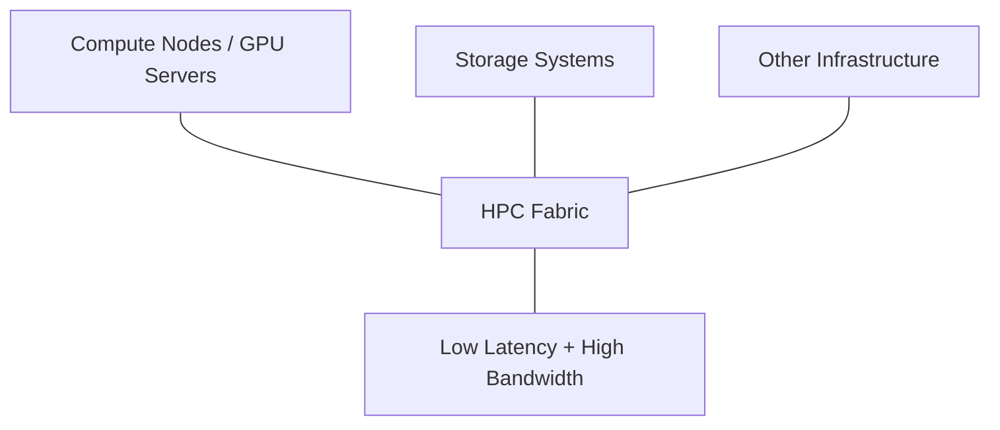
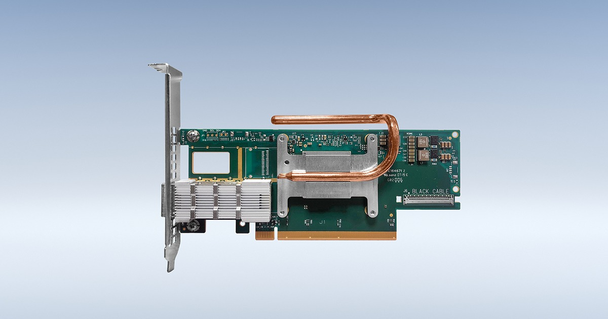
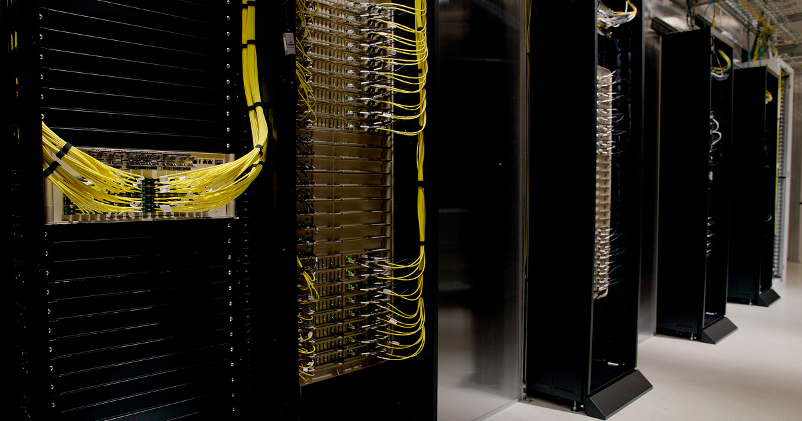
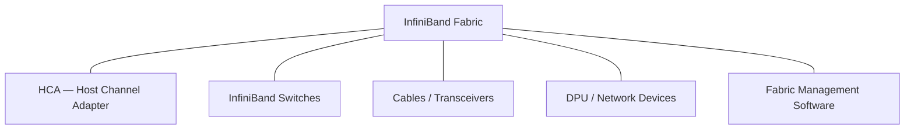
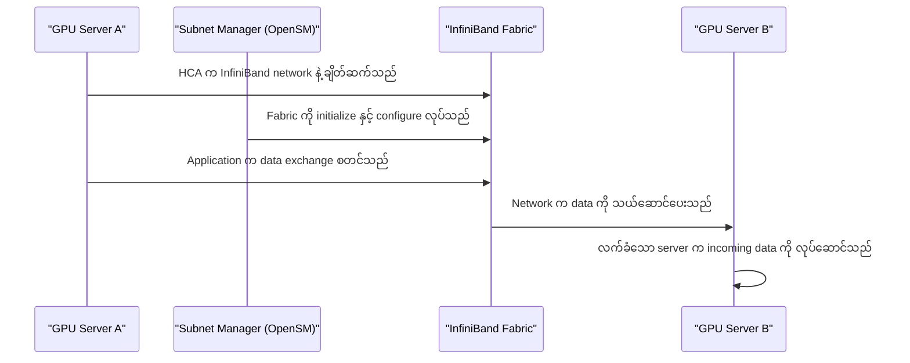
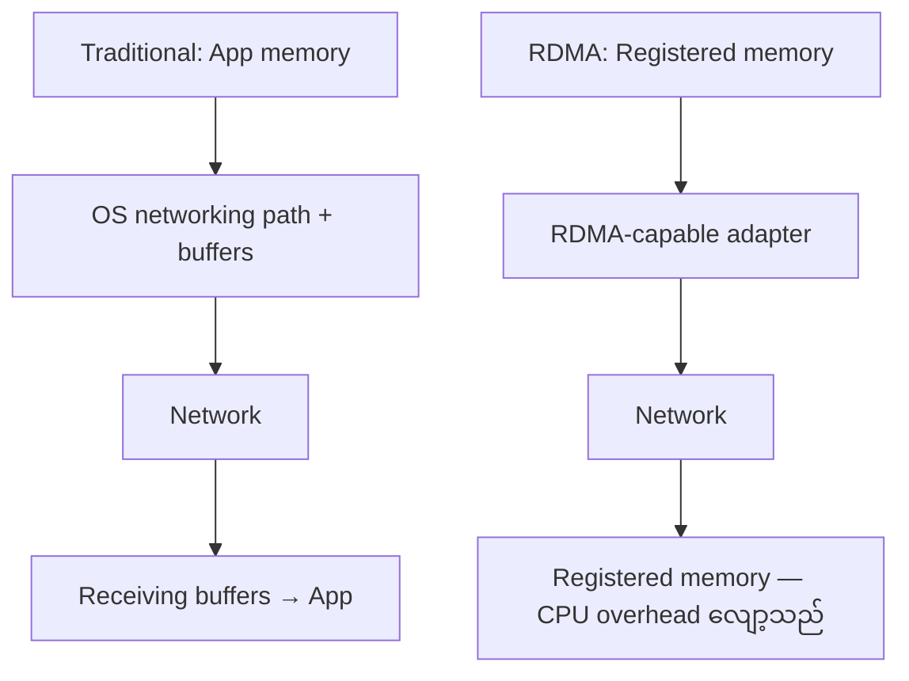
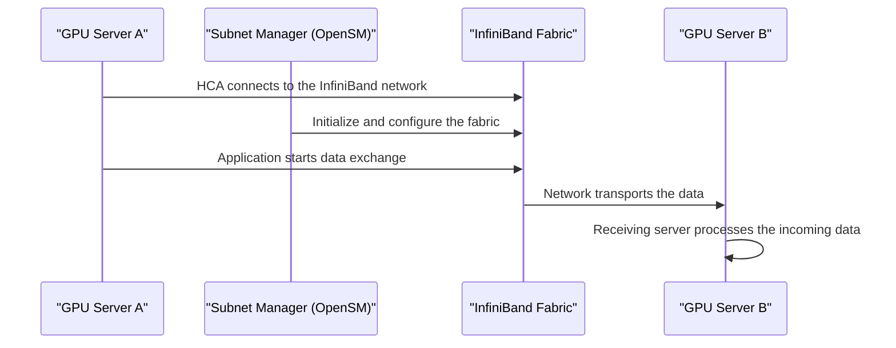
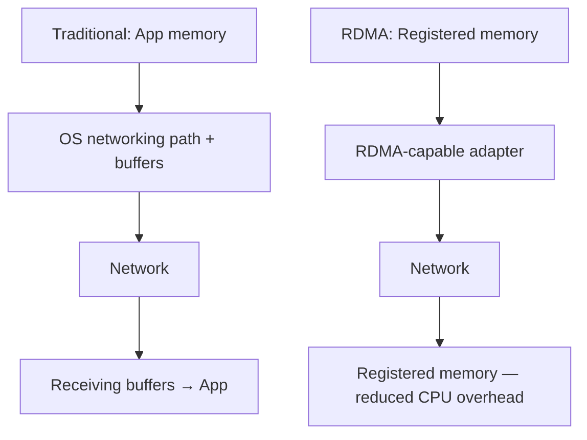

# Module 08 — HPC Fabric and InfiniBand

> Part II · GPU Interconnects and Networking — Course Module 08 — topic notes

_High-Performance Networking for AI and HPC Clusters_

## မြန်မာဘာသာ version — HPC Fabric and InfiniBand

## 1. HPC Fabric ဆိုတာ ဘာလဲ

HPC (High-Performance Computing) ဆိုတာ တွက်ချက်မှု ကြီးမားတဲ့ ပြဿနာတွေကို ဖြေရှင်းဖို့ စွမ်းအားမြင့် computing systems တွေကို မကြာခဏ အတူတကွ အသုံးပြုခြင်း ဖြစ်ပါတယ်။ ဥပမာတွေကတော့ scientific simulations၊ weather forecasting၊ molecular research နဲ့ ကြီးမားတဲ့ AI model training တွေ ဖြစ်ပါတယ်။

Servers ဒါမှမဟုတ် compute nodes အများကြီးက အလုပ်တစ်ခုကို အတူလုပ်တဲ့အခါ data တွေကို ထိရောက်စွာ ဖလှယ်ရပါတယ်။ GPU မြန်တစ်ခုတည်းနဲ့ မလုံလောက်ပါဘူး—network နှေးရင် GPU တွေက data ဒါမှမဟုတ် တခြား nodes တွေဆီက results တွေကို စောင့်နေရင်း idle ဖြစ်နေနိုင်ပါတယ်။

HPC fabric ဆိုတာ compute nodes တွေ၊ storage systems တွေနဲ့ တခြား infrastructure တွေကို low latency နဲ့ high bandwidth ဖြင့် ဆက်သွယ်ခွင့်ပေးတဲ့ high-performance interconnection system ဖြစ်ပါတယ်။

**Figure 1 — HPC Fabric က ဘာတွေကို ချိတ်ဆက်ပေးသလဲ**



**ပုံရှင်းလင်းချက် (Figure walkthrough)**
1. အလယ်က HPC Fabric ဆိုတဲ့ high-performance interconnection system ကို မြင်ရပါမယ်။
2. ဘယ်ဘက်အပေါ်က Compute Nodes / GPU Servers တွေ ဒီ fabric နဲ့ ချိတ်ဆက်ထားပါတယ်။
3. ဘယ်ဘက်အောက်က Storage Systems နဲ့ တခြား Infrastructure တွေလည်း ဒီ fabric ထဲ ပါဝင်ပါတယ်။
4. ညာဘက် node က fabric ရဲ့ အဓိကဂုဏ်သတ္တိ—Low Latency နဲ့ High Bandwidth ကို ပြထားပါတယ်။

Fabric မှာ ပါဝင်နိုင်တာတွေက—

- Servers တွေထဲ တပ်ဆင်ထားတဲ့ network adapters များ။
- High-performance switches များ။
- Network cables နဲ့ optical transceivers များ။
- Network protocols နဲ့ communication software များ။
- Fabric management နဲ့ monitoring components များ။

## 2. HPC က ဘာကြောင့် high-speed networking လိုအပ်သလဲ

GPU servers အများကြီးပေါ်မှာ ကြီးမားတဲ့ AI model တစ်ခုကို train လုပ်နေတယ်လို့ စဉ်းစားကြည့်ပါ။ Server တစ်ခုချင်းစီက workload ရဲ့ တစ်စိတ်တစ်ပိုင်းကို လုပ်ဆောင်ပေမယ့် model gradients၊ activations ဒါမှမဟုတ် တခြား intermediate results တွေလို အချက်အလက်တွေကို servers တွေကြား ဖလှယ်ကြရပါတယ်။

Network က ဒီအချက်အလက်တွေကို လုံလောက်စွာ မြန်မြန် မပို့နိုင်ရင် GPU တွေက communication ပြီးတဲ့အထိ စောင့်ရင်း idle ဖြစ်နေနိုင်ပါတယ်။

အဓိက network performance metrics နှစ်ခုက—

| Metric | အဓိပ္ပာယ် | ဘာကြောင့် အရေးကြီးသလဲ |
|---|---|---|
| Bandwidth | တစ်စက္ကန့်မှာ data ဘယ်လောက် ပို့နိုင်သလဲ | Bandwidth မြင့်မှ data လွှဲပြောင်းမှု ကြီးမားခြင်းနှင့် communication များသော workloads များကို ပံ့ပိုးနိုင်ခြင်း |
| Latency | Endpoints ကြား data သွားရန် ကြာချိန် | Latency နည်းမှ စာတိုများ မကြာခဏ ဖလှယ်ခြင်းနှင့် synchronization အတွက် ကောင်းမွန်ခြင်း |

ဥပမာ—distributed AI training မှာ GPU အများကြီးက ထပ်ခါထပ်ခါ ဆက်သွယ်ရတာ ဖြစ်နိုင်ပါတယ်။ High bandwidth ရော low latency ပါ ရှိတဲ့ fabric က communication overhead ကို လျှော့ချပြီး cluster ရဲ့ စုစုပေါင်း ထိရောက်မှုကို တိုးတက်စေနိုင်ပါတယ်။

## 3. InfiniBand ဆိုတာ ဘာလဲ

InfiniBand ဆိုတာ systems နဲ့ devices တွေကြား ထိရောက်တဲ့ communication အတွက် ဒီဇိုင်းလုပ်ထားတဲ့ high-performance interconnect architecture တစ်ခု ဖြစ်ပါတယ်။ HPC systems တွေ၊ AI infrastructure တွေနဲ့ performance-sensitive ဖြစ်တဲ့ တခြား environments တွေမှာ တွင်ကျယ်စွာ အသုံးပြုပါတယ်။

GPU-to-GPU တိုက်ရိုက် communication အတွက်သာ ကန့်သတ်ထားတာ မဟုတ်ပါဘူး။ System နဲ့ configuration ပေါ် မူတည်ပြီး InfiniBand က အောက်ပါတွေကို ချိတ်ဆက်ပေးနိုင်ပါတယ်—

- GPU servers တွေကို တခြား GPU servers တွေနဲ့။
- CPU-based compute nodes တွေ။
- Servers တွေကို high-performance storage systems တွေနဲ့။
- ကြီးမားတဲ့ HPC cluster တစ်ခုအတွင်းက compute nodes တွေ။

InfiniBand က open industry-standard architecture တစ်ခု ဖြစ်ပါတယ်။ NVIDIA ကတော့ adapters တွေ၊ switches တွေနဲ့ သက်ဆိုင်ရာ networking technologies တွေ အပါအဝင် InfiniBand products တွေရဲ့ အဓိက စီးပွားရေး supplier ကြီးတစ်ခု ဖြစ်ပါတယ်။

**NVIDIA နဲ့ Mellanox**

NVIDIA က Mellanox Technologies ကို 2022 ခုနှစ် မဟုတ်ဘဲ 2020 ခုနှစ် ဧပြီလ 27 ရက်နေ့မှာ ဝယ်ယူမှု ပြီးစီးခဲ့ပါတယ်။ Mellanox က high-performance networking ပိုင်းဆိုင်ရာ အတွေ့အကြုံနဲ့ products တွေကို NVIDIA ရဲ့ portfolio ထဲ ယူဆောင်လာခဲ့ပါတယ်။ ဝယ်ယူမှုရက်စွဲကို NVIDIA ရဲ့ ကြေညာချက်က အတည်ပြုထားပါတယ်—[NVIDIA acquisition announcement](https://nvidianews.nvidia.com/news/nvidia-completes-acquisition-of-mellanox-creating-major-force-driving-next-gen-data-centers)။

## 4. InfiniBand Fabric ရဲ့ အဓိက components များ

Typical fabric တစ်ခုက components အမျိုးမျိုး အတူလုပ်ဆောင်ရာကနေ တည်ဆောက်ထားပါတယ်။

**A. Host Channel Adapter (HCA)**

HCA ဆိုတာ host ကို InfiniBand fabric နဲ့ ချိတ်ဆက်ပေးတဲ့ server-side adapter ဖြစ်ပါတယ်။ Communication အတွက် hardware interface ပေးပြီး RDMA capabilities တွေကို support လုပ်ပါတယ်။



**ပုံရှင်းလင်းချက် (Photo walkthrough)**
1. ဒီမှာ မြင်ရတာက HCA အနေနဲ့ သုံးတဲ့ server-side InfiniBand adapter card ဖြစ်ပါတယ်။
2. Card ကို server ရဲ့ PCIe slot ထဲ ထည့်သုံးပြီး အစွန်းဘက် bracket မှာ InfiniBand cable ချိတ်ဖို့ QSFP-class port ပါရှိပါတယ်။
3. ဒီ adapter ကတစ်ဆင့် host က InfiniBand fabric ထဲ ဝင်ရောက်ပြီး RDMA ဖြင့် တိုက်ရိုက် data ပို့နိုင်ပါတယ်။

*(Image: NVIDIA official product image)*

**B. InfiniBand switches**

Switches တွေက servers အများကြီးကို ချိတ်ဆက်ပြီး data သွားလာဖို့ လမ်းကြောင်းတွေ ပေးပါတယ်။ ပိုကြီးတဲ့ clusters တွေမှာ switches အဆင့်ဆင့်နဲ့ သေချာ design လုပ်ထားတဲ့ network topologies တွေ အသုံးပြုနိုင်ပါတယ်။



**ပုံရှင်းလင်းချက် (Photo walkthrough)**
1. ဒီမှာ မြင်ရတာက rack ထဲ တပ်ဆင်သုံးရတဲ့ InfiniBand switch chassis ဖြစ်ပါတယ်။
2. ရှေ့ဘက် faceplate မှာ high-speed InfiniBand port တွေကို အတန်းလိုက် တန်းစီထားပြီး cable ချိတ်ဆက်ဖို့ connector cage တွေ ပါရှိပါတယ်။
3. Servers အများကြီးကို ဒီ switch တွေကတစ်ဆင့် ချိတ်ဆက်ပြီး cluster ကြီးလာရင် switches အဆင့်ဆင့် (multi-tier topology) ဖြင့် ချဲ့ကြပါတယ်။

*(Image: NVIDIA official product image)*

**C. Cables နဲ့ transceivers**

Adapters နဲ့ switches တွေကြား physical links တွေ ပေးပါတယ်။ Hardware ပေါ် မူတည်ပြီး copper cables ဒါမှမဟုတ် optical connections တွေ သုံးနိုင်ပါတယ်။

**D. DPU နဲ့ တခြား network devices**

အချို့ systems တွေမှာ networking၊ security ဒါမှမဟုတ် infrastructure tasks တွေကို offload လုပ်ဖို့ DPUs ဒါမှမဟုတ် တခြား programmable networking devices တွေ သုံးပါတယ်။ InfiniBand server တိုင်းမှာ DPU မလိုအပ်ပါဘူး။

**E. Fabric management software**

Management software က fabric ကို initialize နဲ့ configure လုပ်ပေးပြီး ချိတ်ဆက်ထားတဲ့ devices တွေကို ရှာဖွေရာမှာ ကူညီပြီး routing နဲ့ management functions တွေ ပေးပါတယ်။

**Figure 2 — InfiniBand Fabric ရဲ့ အဓိက Components များ**



**ပုံရှင်းလင်းချက် (Figure walkthrough)**
1. အလယ်က InfiniBand Fabric ကို ဝန်းရံထားတဲ့ component ငါးခုကို မြင်ရပါမယ်။
2. HCA — Host Channel Adapter က server ကို fabric နဲ့ ချိတ်ဆက်ပေးတဲ့ adapter ဖြစ်ပါတယ်။
3. InfiniBand Switches နဲ့ Cables / Transceivers တွေက data သွားလာဖို့ လမ်းကြောင်းနဲ့ physical links တွေ ပေးပါတယ်။
4. DPU / Network Devices နဲ့ Fabric Management Software တွေက offload နဲ့ fabric စီမံခန့်ခွဲမှုအတွက် ဖြစ်ပါတယ် (DPU က server တိုင်းမှာ မလိုအပ်ပါဘူး)။

## 5. OpenSM ဆိုတာ ဘာလဲ

မူရင်း transcript မှာ "Opensim" လို့ ဖော်ပြထားပါတယ်။ ရည်ညွှန်းချင်တဲ့ ဝေါဟာရကတော့ OpenSM (Open Subnet Manager) ဖြစ်နိုင်ပါတယ်။

OpenSM ဆိုတာ InfiniBand subnet တစ်ခုကို စီမံခန့်ခွဲတဲ့ software ဖြစ်ပါတယ်။ InfiniBand hardware ကို initialize လုပ်ဖို့နဲ့ fabric ကို configure လုပ်ဖို့ လိုအပ်တဲ့ tasks တွေ—devices တွေ ရှာဖွေခြင်း၊ routing information တည်ဆောက်ခြင်းတို့ လုပ်ဆောင်ပါတယ်။

InfiniBand subnet တစ်ခုအတွက် Subnet Manager (SM) လိုအပ်ပါတယ်။ OpenSM က implementation တစ်ခုဖြစ်ပြီး support လုပ်တဲ့ managed switches တွေ ဒါမှမဟုတ် တခြား fabric-management solutions တွေကနေ တခြား implementations တွေ ပေးနိုင်ပါတယ်။

အရေးကြီးတဲ့ ကွာခြားချက်—

- InfiniBand က networking architecture နဲ့ fabric technology ဖြစ်ပါတယ်။
- OpenSM က InfiniBand subnet တစ်ခုကို စီမံခန့်ခွဲပြီး initialize လုပ်ဖို့ အသုံးပြုတဲ့ software component တစ်ခု ဖြစ်ပါတယ်။
- InfiniBand switches နဲ့ adapters တွေက traffic ကို သယ်ဆောင်ပေးတဲ့ hardware components တွေ ဖြစ်ပါတယ်။

OpenSM က InfiniBand ကို အစားထိုးတာ မဟုတ်သလို သီးခြား networking fabric တစ်ခုလည်း မဟုတ်ပါဘူး—[NVIDIA OpenSM documentation](https://networking-docs.nvidia.com/mlnxofedswum/587061lts/opensm)။

## 6. Components တွေ အတူတကွ ဘယ်လို အလုပ်လုပ်သလဲ

GPU servers နှစ်ခုပါတဲ့ ရိုးရှင်းတဲ့ cluster တစ်ခုကို စဉ်းစားကြည့်ပါ—

```
       GPU Server A                         GPU Server B
  ┌────────────────────┐               ┌────────────────────┐
  │ CPU + GPUs         │               │ CPU + GPUs         │
  │ HCA                │               │ HCA                │
  └─────────┬──────────┘               └─────────┬──────────┘
            │                                    │
            └───────────┐          ┌─────────────┘
                        ▼          ▼
                  ┌────────────────────┐
                  │ InfiniBand Switch  │
                  └────────────────────┘

              Fabric management / Subnet Manager
                         (e.g., OpenSM)
```

အခြေခံ communication လုပ်ငန်းစဉ်က—

1. Server ရဲ့ HCA က InfiniBand network နဲ့ ချိတ်ဆက်ပါတယ်။
2. Fabric ကို Subnet Manager က initialize နဲ့ configure လုပ်ပါတယ်။
3. Application ဒါမှမဟုတ် communication library က data exchange ကို စတင်ပါတယ်။
4. Network က data ကို ပါဝင်ဆောင်ရွက်တဲ့ endpoints တွေကြား သယ်ဆောင်ပေးပါတယ်။
5. လက်ခံတဲ့ server က incoming data ကို လုပ်ဆောင်ပါတယ်။

**Figure 3 — Components တွေ အတူတကွ အလုပ်လုပ်ပုံ (Communication Process)**



**ပုံရှင်းလင်းချက် (Figure walkthrough)**
1. ဘယ်ဘက်က GPU Server A နဲ့ ညာဘက်က GPU Server B ကြား ဖြစ်ပွားတဲ့ အဆင့်ငါးဆင့်ကို အပေါ်ကနေ အောက်ကို ဖတ်ပါ။
2. ပထမဆုံး HCA က InfiniBand network နဲ့ ချိတ်ဆက်ပါတယ်။
3. ဒုတိယ Subnet Manager (OpenSM) က fabric ကို initialize နဲ့ configure လုပ်ပါတယ်။
4. တတိယနဲ့ စတုတ္ထအဆင့်မှာ application က data exchange စတင်ပြီး network က data ကို endpoints ကြား သယ်ဆောင်ပါတယ်။ နောက်ဆုံးမှာ GPU Server B က incoming data ကို လုပ်ဆောင်ပါတယ်။

တကယ့် clusters တွေမှာ switches အများကြီး၊ network paths အမျိုးမျိုး၊ storage endpoints တွေနဲ့ ထပ်မံ management systems တွေ ရှိနိုင်ပါတယ်။

## 7. RDMA ဆိုတာ ဘာလဲ

RDMA (Remote Direct Memory Access) က support လုပ်တဲ့ network adapter တစ်ခုကို systems အမျိုးမျိုးရဲ့ memory ကြား data ကို CPU ပါဝင်မှု လျှော့ချပြီး၊ traditional networking stacks တွေ အသုံးပြုလေ့ရှိတဲ့ intermediate copies တွေ မလိုအပ်ဘဲ လွှဲပြောင်းခွင့် ပေးပါတယ်။

ရိုးရှင်းတဲ့ နှိုင်းယှဉ်ချက်—

- Traditional data path: application memory → operating-system networking path နဲ့ buffers → network → receiving buffers → application။
- RDMA-capable data path: support လုပ်တဲ့ adapter နဲ့ RDMA mechanisms တွေက registered memory regions ကြား CPU overhead လျှော့ချပြီး data ကို လွှဲပြောင်းပေးပါတယ်။

**Figure 4 — Traditional Data Path vs RDMA-capable Data Path**



**ပုံရှင်းလင်းချက် (Figure walkthrough)**
1. အပေါ်တစ်ဝက်က traditional data path ဖြစ်ပြီး App memory → OS networking path + buffers → Network → receiving buffers → App ဆိုပြီး ဆင်းသွားပါတယ်။
2. ဒီလမ်းကြောင်းမှာ intermediate copies တွေ ပါဝင်နိုင်ပါတယ်။
3. အောက်တစ်ဝက်က RDMA-capable data path ဖြစ်ပြီး registered memory regions ကြား RDMA-capable adapter က တိုက်ရိုက် လွှဲပြောင်းပေးပါတယ်။
4. RDMA ဆိုတာ CPU တစ်ခါမှ မပါဝင်ဘူးလို့ မဆိုလိုပါဘူး—data-transfer operations အချို့ကို networking hardware ဆီ offload လုပ်တာ ဖြစ်ပါတယ်။

တိကျတဲ့ data path က hardware၊ drivers၊ application နဲ့ configuration ပေါ် မူတည်ပါတယ်။ RDMA ဆိုတာ CPU တစ်ခါမှ မပါဝင်ဘူးလို့ မဆိုလိုပါဘူး—data-transfer operations အချို့ကို networking hardware ဆီ offload လုပ်နိုင်တယ်လို့ ဆိုလိုတာ ဖြစ်ပါတယ်။

RDMA ဆိုတာ InfiniBand ကို distributed HPC နဲ့ AI workloads တွေအတွက် တွင်ကျယ်စွာ အသုံးပြုရတဲ့ အဓိကအကြောင်းရင်းတစ်ခု ဖြစ်ပါတယ်။ RDMA ကို RoCE (RDMA over Converged Ethernet) လို technologies တွေမှတစ်ဆင့် Ethernet ပေါ်မှာလည်း ရနိုင်တဲ့အတွက် InfiniBand အတွက်သာ သီးသန့် မဟုတ်ပါဘူး။

## 8. InfiniBand ကို ဘာကြောင့် lossless fabric လို့ မကြာခဏ ဖော်ပြကြသလဲ

InfiniBand က link-level flow control ကို အသုံးပြုပြီး switch ဒါမှမဟုတ် receiver က သူ့ရဲ့ receive-buffer capacity ထက် ကျော်လွန်တဲ့ traffic ကြောင့် ဝန်မပိစေဘဲ ကာကွယ်ပေးပါတယ်။ Buffer overflow ကြောင့် packet drops မဖြစ်စေဘဲ ခန့်မှန်းနိုင်တဲ့ high-performance communication ကို ပံ့ပိုးပါတယ်။

Lossless ဆိုတဲ့ ဝေါဟာရက fabric ရဲ့ flow-control design နဲ့ မှန်ကန်စွာ configure လုပ်ထားတဲ့ အခြေအနေတွေအောက်မှာ ရည်ရွယ်ထားတဲ့ behavior ကို ဖော်ပြတာ ဖြစ်ပါတယ်။ Hardware failures တွေ၊ link faults တွေ ဒါမှမဟုတ် network ပြဿနာ ဘယ်လိုမျိုးမဆို error တွေ ဘယ်တော့မှ မဖြစ်နိုင်ဘူးလို့ မဆိုလိုပါဘူး။

InfiniBand မှာ congestion-management features တွေနဲ့ Quality of Service (QoS) mechanisms တွေလည်း ပံ့ပိုးထားပါတယ်။ ၎င်းတို့က network ကို ယှဉ်ပြိုင်နေတဲ့ traffic တွေကို စီမံပြီး ထိရောက်တဲ့ communication ကို ထိန်းသိမ်းရာမှာ ကူညီပါတယ်—[NVIDIA InfiniBand overview](https://www.nvidia.com/en-us/networking/products/infiniband/)။

## 9. InfiniBand ကို ဘယ်အခါ စဉ်းစားသင့်သလဲ

Network performance က workload ပြီးဆုံးချိန်ကို သိသိသာသာ သက်ရောက်တဲ့အခါ InfiniBand က အထူးသင့်တော်ပါတယ်။

ကောင်းမွန်တဲ့ use cases တွေက—

- ကြီးမားတဲ့ distributed GPU training။
- HPC နဲ့ scientific computing clusters များ။
- Nodes ကြား data အများကြီး မကြာခဏ ဖလှယ်တဲ့ applications များ။
- Latency-sensitive distributed workloads များ။
- InfiniBand နဲ့ RDMA ကို support လုပ်တဲ့ high-performance storage systems များ။

ဘယ်အခါ မလိုအပ်နိုင်သလဲ—

Servers အနည်းငယ်သာ ရှိတဲ့၊ node ကြား communication နည်းတဲ့၊ latency ဒါမှမဟုတ် bandwidth အတွက် တောင်းဆိုမှု မမြင့်တဲ့ အသေးစား deployment တစ်ခုအတွက် conventional Ethernet က ပိုပြီး ကုန်ကျစရိတ်သက်သာပြီး လည်ပတ်ရ ပိုလွယ်နိုင်ပါတယ်။

ဆုံးဖြတ်ချက်ချရာမှာ link speed ထက် ပိုပြီး စဉ်းစားရပါမယ်—adapters တွေ၊ switches တွေ၊ cabling၊ software support၊ network topology၊ operational expertise နဲ့ workload လိုအပ်ချက်တွေ အပါအဝင် ပြည့်စုံတဲ့ solution တစ်ခုလုံးကို ထည့်သွင်းစဉ်းစားပါ။

## 10. InfiniBand vs. Ethernet

| Feature | InfiniBand | Ethernet |
|---|---|---|
| Main role | HPC၊ AI နှင့် specialized storage networks များအတွက် high-performance interconnect | Enterprise LANs မှ data centers အထိ general-purpose networking |
| Latency | Very low latency အတွက် ဒီဇိုင်းလုပ်ထားခြင်း | Hardware၊ configuration နှင့် protocol ပေါ် မူတည်၍ ကွဲပြားခြင်း |
| RDMA support | ပံ့ပိုးထားသည် | RoCE ကဲ့သို့သော technologies မှတစ်ဆင့် ပံ့ပိုးထားသည် |
| Loss-management approach | Buffer-overflow packet drops များကို ကာကွယ်ရန် ဒီဇိုင်းလုပ်ထားသော built-in link-level flow control | Standard Ethernet သည် ပုံမှန် best-effort delivery ကို အသုံးပြုလေ့ရှိသည်၊ RoCE deployments များတွင် PFC၊ ECN နှင့် အခြား congestion controls များ အသုံးပြုနိုင်သည် |
| Ecosystem | အထူးပြု HPC နှင့် AI networking ecosystem | ကျယ်ပြန့်သော enterprise နှင့် data-center ecosystem |
| Typical choice | Communication-intensive HPC နှင့် AI clusters များ | General enterprise networks နှင့် AI deployments များစွာ၊ RoCE က high-performance workloads များကိုလည်း ဆောင်ရွက်ပေးနိုင်သည် |

နည်းပညာ တစ်ခုချင်းစီက ဘယ် environment အတွက်မဆို automatic အကောင်းဆုံး မဟုတ်ပါဘူး။ HPC fabric performance အမြင့်ဆုံးနဲ့ integrated RDMA networking design က ဦးစားပေးဖြစ်ရင် InfiniBand က စဉ်းစားစရာ ကောင်းပါတယ်။ ရှိပြီးသား infrastructure နဲ့ ပေါင်းစပ်နိုင်မှု၊ operational familiarity ပိုကျယ်ပြန့်မှု ဒါမှမဟုတ် ကုန်ကျစရိတ်က ပိုအရေးကြီးရင်တော့ Ethernet က ပိုသင့်တော်နိုင်ပါတယ်။

## 11. အဓိက အကျဉ်းချုပ်ချက်များ

- HPC fabric က compute nodes တွေ၊ storage systems တွေနဲ့ တခြား devices တွေကို high-performance communication အတွက် ချိတ်ဆက်ပေးပါတယ်။
- Bandwidth က data-transfer capacity ကို တိုင်းတာပြီး latency က communication delay ကို တိုင်းတာပါတယ်။
- InfiniBand က HPC နဲ့ AI infrastructure တွေမှာ အသုံးပြုတဲ့ open-standard high-performance interconnect ဖြစ်ပါတယ်။
- NVIDIA က Mellanox ကို 2020 ခုနှစ်မှာ ဝယ်ယူမှု ပြီးစီးခဲ့ပါတယ်။
- HCAs၊ switches၊ cables နဲ့ management software တွေ အတူလုပ်ဆောင်မှ InfiniBand fabric တစ်ခု ဖြစ်လာပါတယ်။
- OpenSM ဆိုတာ Subnet Manager implementation တစ်ခုဖြစ်ပြီး သီးခြား fabric technology တစ်ခု မဟုတ်ပါဘူး။
- RDMA က CPU overhead နဲ့ data-copying လိုအပ်ချက်တွေကို လျှော့ချပေးနိုင်ပါတယ်။
- InfiniBand က ထိရောက်ပြီး low-latency၊ high-bandwidth communication အတွက် ဒီဇိုင်းလုပ်ထားပေမယ့် ၎င်းရဲ့ တန်ဖိုးက workload နဲ့ deployment လိုအပ်ချက်တွေပေါ် မူတည်ပါတယ်။

## 12. Review Questions (မေးခွန်းနှင့် အဖြေများ)

**Q1. HPC fabric ဆိုတာ ဘာလဲ**

Compute nodes တွေနဲ့ တခြား systems တွေကို data ကို ထိရောက်စွာ ဖလှယ်နိုင်စေတဲ့ high-performance interconnection system ဖြစ်ပါတယ်။

**Q2. Bandwidth နဲ့ latency ရဲ့ ကွာခြားချက်က ဘာလဲ**

Bandwidth ဆိုတာ အချိန်တစ်ယူနစ်အတွင်း လွှဲပြောင်းတဲ့ data ပမာဏ ဖြစ်ပြီး latency ဆိုတာ communication အတွက် ကြာချိန် ဖြစ်ပါတယ်။

**Q3. OpenSM က ဘာလုပ်သလဲ**

InfiniBand subnet တစ်ခုကို initialize နဲ့ manage လုပ်ပေးပြီး devices တွေ ရှာဖွေခြင်းနဲ့ routing configure လုပ်ခြင်းတို့ ပါဝင်ပါတယ်။

**Q4. HCA ဆိုတာ ဘာလဲ**

Host Channel Adapter—server ကို InfiniBand fabric နဲ့ ချိတ်ဆက်ဖို့ အသုံးပြုတဲ့ host-side networking adapter ဖြစ်ပါတယ်။

**Q5. RDMA က InfiniBand အတွက်သာ သီးသန့်လား**

မဟုတ်ပါဘူး။ RDMA ကို InfiniBand ပေါ်မှာ ပံ့ပိုးပြီး RoCE မှတစ်ဆင့် Ethernet ပေါ်မှာလည်း အသုံးပြုနိုင်ပါတယ်။

**Q6. InfiniBand က ဘယ်အခါ အသုံးဝင်ဆုံးလဲ**

ကြီးမားတဲ့ HPC ဒါမှမဟုတ် AI workloads တွေက nodes ကြား low-latency၊ high-bandwidth communication ပေါ် များစွာ မှီခိုနေတဲ့အခါ ဖြစ်ပါတယ်။

**Q7. Ethernet က ဘယ်အခါ လုံလောက်နိုင်သလဲ**

Communication လိုအပ်ချက် သိပ်မမြင့်တဲ့ deployment ဖြစ်ရင်၊ ဒါမှမဟုတ် ကုန်ကျစရိတ်၊ compatibility နဲ့ operational simplicity က specialized HPC fabric ရဲ့ အကျိုးကျေးဇူးတွေထက် ပိုအရေးကြီးရင် ဖြစ်ပါတယ်။

## English Version — HPC Fabric and InfiniBand

## 1. What Is an HPC Fabric?

HPC (High-Performance Computing) refers to using powerful computing systems, often working together, to solve computationally intensive problems. Examples include scientific simulations, weather forecasting, molecular research, and large-scale AI model training.

When multiple servers or compute nodes work on one task, they must exchange data efficiently. A fast GPU alone is not enough: if the network is slow, GPUs may wait for data or for results from other nodes.

An HPC fabric is the high-performance interconnection system that allows compute nodes, storage systems, and other infrastructure to communicate with low latency and high bandwidth.

**Figure 1 — What an HPC Fabric Connects**


**Figure walkthrough**
1. In the middle is the HPC Fabric, the high-performance interconnection system.
2. At the top left, Compute Nodes / GPU Servers connect to this fabric.
3. At the bottom left, Storage Systems and other Infrastructure are also part of the fabric.
4. The right node shows the fabric's key qualities: Low Latency and High Bandwidth.

The fabric can include:

- Network adapters installed in servers.
- High-performance switches.
- Network cables and optical transceivers.
- Network protocols and communication software.
- Fabric management and monitoring components.

## 2. Why Does HPC Need High-Speed Networking?

Imagine training a large AI model across several GPU servers. Each server processes part of the workload, but the servers must exchange information such as model gradients, activations, or other intermediate results.

If the network cannot transfer this information quickly enough, the GPUs may remain idle while waiting for communication to complete.

Two key network performance metrics are:

| Metric | Meaning | Why it matters |
|---|---|---|
| Bandwidth | How much data can be transferred per second | Higher bandwidth supports large data transfers and communication-heavy workloads |
| Latency | The time required for data to travel between endpoints | Lower latency benefits frequent exchanges of small messages and synchronization |

For example, distributed AI training may involve many GPUs communicating repeatedly. A fabric with both high bandwidth and low latency can help reduce communication overhead and improve overall cluster efficiency.

## 3. What Is InfiniBand?

InfiniBand is a high-performance interconnect architecture designed for efficient communication between systems and devices. It is widely used in HPC systems, AI infrastructure, and other performance-sensitive environments.

It is not limited to direct GPU-to-GPU communication. Depending on the system and configuration, InfiniBand can connect:

- GPU servers to other GPU servers.
- CPU-based compute nodes.
- Servers to high-performance storage systems.
- Compute nodes across a larger HPC cluster.

InfiniBand is an open industry-standard architecture. NVIDIA is a major commercial supplier of InfiniBand products, including adapters, switches, and related networking technologies.

**NVIDIA and Mellanox**

NVIDIA completed its acquisition of Mellanox Technologies on April 27, 2020 — not 2022. Mellanox brought high-performance networking expertise and products into NVIDIA's portfolio. The acquisition date is confirmed by NVIDIA's announcement: [NVIDIA acquisition announcement](https://nvidianews.nvidia.com/news/nvidia-completes-acquisition-of-mellanox-creating-major-force-driving-next-gen-data-centers).

## 4. Main Components of an InfiniBand Fabric

A typical fabric is built from several components working together.

**A. Host Channel Adapter (HCA)**

The HCA is the server-side adapter that connects a host to the InfiniBand fabric. It provides the hardware interface for communication and supports RDMA capabilities.


**Photo walkthrough**
1. What you see is a server-side InfiniBand adapter card used as the HCA.
2. The card goes into a PCIe slot in the server, and its edge bracket has a QSFP-class port for the InfiniBand cable.
3. Through this adapter the host joins the InfiniBand fabric and can move data directly with RDMA.

*(Image: NVIDIA official product image)*

**B. InfiniBand switches**

Switches connect multiple servers and provide paths for data to travel between nodes. Larger clusters may use multiple tiers of switches and carefully designed network topologies.


**Photo walkthrough**
1. What you see is an InfiniBand switch chassis designed to be mounted in a rack.
2. On the front faceplate, high-speed InfiniBand ports are arranged in rows, each with a connector cage for the cable.
3. Many servers connect through these switches, and as the cluster grows, multiple switch tiers (multi-tier topologies) are used.

*(Image: NVIDIA official product image)*

**C. Cables and transceivers**

These provide the physical links between adapters and switches. Depending on the hardware, the links may use copper cables or optical connections.

**D. DPU and other network devices**

Some systems also use DPUs or other programmable networking devices to offload supported networking, security, or infrastructure tasks. A DPU is not required in every InfiniBand server.

**E. Fabric management software**

Management software initializes and configures the fabric, helps discover connected devices, and provides routing and management functions.

**Figure 2 — Main Components of an InfiniBand Fabric**


**Figure walkthrough**
1. In the middle is the InfiniBand Fabric, surrounded by five components.
2. The HCA — Host Channel Adapter is the adapter that connects a server to the fabric.
3. InfiniBand Switches and Cables / Transceivers provide the data paths and physical links.
4. DPU / Network Devices and Fabric Management Software handle offload and fabric management (a DPU is not required in every server).

## 5. What Is OpenSM?

The source transcript mentions "Opensim." The likely intended term is OpenSM, short for Open Subnet Manager.

OpenSM is software that manages an InfiniBand subnet. It performs tasks needed to initialize InfiniBand hardware and configure the fabric, including discovering devices and establishing routing information.

An InfiniBand subnet needs a Subnet Manager (SM). OpenSM is one possible implementation; supported managed switches or other fabric-management solutions may provide alternative implementations.

Important distinction:

- InfiniBand is the networking architecture and fabric technology.
- OpenSM is a software component used to manage and initialize an InfiniBand subnet.
- InfiniBand switches and adapters are hardware components that carry the traffic.

OpenSM does not replace InfiniBand and is not a separate networking fabric — [NVIDIA OpenSM documentation](https://networking-docs.nvidia.com/mlnxofedswum/587061lts/opensm).

## 6. How the Components Work Together

Consider a simplified cluster with two GPU servers.

```
       GPU Server A                         GPU Server B
  ┌────────────────────┐               ┌────────────────────┐
  │ CPU + GPUs         │               │ CPU + GPUs         │
  │ HCA                │               │ HCA                │
  └─────────┬──────────┘               └─────────┬──────────┘
            │                                    │
            └───────────┐          ┌─────────────┘
                        ▼          ▼
                  ┌────────────────────┐
                  │ InfiniBand Switch  │
                  └────────────────────┘

              Fabric management / Subnet Manager
                         (e.g., OpenSM)
```

The basic communication process is:

1. The server's HCA connects to the InfiniBand network.
2. The fabric is initialized and configured by a Subnet Manager.
3. An application or communication library initiates data exchange.
4. The network transports the data between the participating endpoints.
5. The receiving server processes the incoming data.

**Figure 3 — How the Components Work Together (Communication Process)**



**Figure walkthrough**
1. Read the five steps from top to bottom, between GPU Server A on the left and GPU Server B on the right.
2. First, the HCA connects to the InfiniBand network.
3. Second, the Subnet Manager (OpenSM) initializes and configures the fabric.
4. Third and fourth, the application starts the data exchange and the network transports the data between endpoints. Finally, GPU Server B processes the incoming data.

In real clusters, there may be many switches, multiple network paths, storage endpoints, and additional management systems.

## 7. What Is RDMA?

RDMA (Remote Direct Memory Access) allows a supported network adapter to transfer data between the memory of different systems with reduced CPU involvement and without requiring the same sequence of intermediate copies commonly used by traditional networking stacks.

A simplified comparison:

- Traditional data path: application memory → operating-system networking path and buffers → network → receiving buffers → application.
- RDMA-capable data path: supported adapter and RDMA mechanisms transfer data between registered memory regions with reduced CPU overhead.

**Figure 4 — Traditional Data Path vs RDMA-capable Data Path**



**Figure walkthrough**
1. The top half is the traditional data path: App memory → OS networking path + buffers → Network → receiving buffers → App.
2. This path can involve intermediate copies.
3. The bottom half is the RDMA-capable data path: an RDMA-capable adapter moves data directly between registered memory regions.
4. RDMA does not mean the CPU is never involved — certain data-transfer operations are offloaded to the networking hardware.

The exact data path depends on the hardware, drivers, application, and configuration. RDMA does not mean the CPU is never involved; it means certain data-transfer operations can be offloaded to the networking hardware.

RDMA is an important reason InfiniBand is widely used for distributed HPC and AI workloads. RDMA is also available over Ethernet through technologies such as RoCE (RDMA over Converged Ethernet), so it is not exclusive to InfiniBand.

## 8. Why Is InfiniBand Often Described as a Lossless Fabric?

InfiniBand uses link-level flow control designed to prevent a switch or receiver from being overwhelmed by traffic beyond its available receive-buffer capacity. This helps avoid packet drops caused by buffer overflow and supports predictable, high-performance communication.

The term lossless describes the fabric's flow-control design and intended behavior under properly configured operating conditions. It does not mean that hardware failures, link faults, or every possible network problem can never cause errors.

InfiniBand also supports congestion-management features and Quality of Service (QoS) mechanisms. These help the network manage competing traffic and maintain efficient communication — [NVIDIA InfiniBand overview](https://www.nvidia.com/en-us/networking/products/infiniband/).

## 9. When Should You Consider InfiniBand?

InfiniBand is especially suitable when network performance has a significant effect on workload completion time.

Good use cases include:

- Large-scale distributed GPU training.
- HPC and scientific computing clusters.
- Applications that frequently exchange large amounts of data between nodes.
- Latency-sensitive distributed workloads.
- High-performance storage systems that support InfiniBand and RDMA.

When might it be unnecessary?

For a small deployment with only a few servers, little inter-node communication, and no demanding latency or bandwidth requirements, conventional Ethernet may be more cost-effective and easier to operate.

The decision should account for more than link speed. Consider the complete solution: adapters, switches, cabling, software support, network topology, operational expertise, and workload requirements.

## 10. InfiniBand vs. Ethernet

| Feature | InfiniBand | Ethernet |
|---|---|---|
| Main role | High-performance interconnect for HPC, AI, and specialized storage networks | General-purpose networking from enterprise LANs to data centers |
| Latency | Designed for very low latency | Varies by hardware, configuration, and protocol |
| RDMA support | Supported | Supported through technologies such as RoCE |
| Loss-management approach | Built-in link-level flow control designed to prevent buffer-overflow packet drops | Standard Ethernet commonly uses best-effort delivery; RoCE deployments may use PFC, ECN, and other congestion controls |
| Ecosystem | Specialized HPC and AI networking ecosystem | Broad enterprise and data-center ecosystem |
| Typical choice | Communication-intensive HPC and AI clusters | General enterprise networks and many AI deployments; RoCE can serve high-performance workloads too |

Neither technology is automatically the best choice for every environment. InfiniBand is often compelling when maximum HPC fabric performance and an integrated RDMA networking design are priorities. Ethernet may be preferable when interoperability with existing infrastructure, broader operational familiarity, or cost is more important.

## 11. Key Takeaways

- HPC fabric connects compute nodes, storage systems, and other devices for high-performance communication.
- Bandwidth measures data-transfer capacity; latency measures communication delay.
- InfiniBand is an open-standard high-performance interconnect used in HPC and AI infrastructure.
- NVIDIA completed the Mellanox acquisition in 2020.
- HCAs, switches, cables, and management software work together to form an InfiniBand fabric.
- OpenSM is a Subnet Manager implementation, not a separate fabric technology.
- RDMA can reduce CPU overhead and data-copying requirements.
- InfiniBand is designed for efficient, low-latency, high-bandwidth communication, but its value depends on workload and deployment requirements.

## 12. Review Questions (Self-Check Questions and Answers)

**Q1. What is an HPC fabric?**

A high-performance interconnection system that enables compute nodes and other systems to exchange data efficiently.

**Q2. What is the difference between bandwidth and latency?**

Bandwidth is the amount of data transferred per unit of time. Latency is the time taken for communication.

**Q3. What does OpenSM do?**

It initializes and manages an InfiniBand subnet, including discovering devices and configuring routing.

**Q4. What is an HCA?**

A Host Channel Adapter, the host-side networking adapter used to connect a server to an InfiniBand fabric.

**Q5. Is RDMA exclusive to InfiniBand?**

No. RDMA is supported over InfiniBand and can also be used over Ethernet through RoCE.

**Q6. When is InfiniBand most useful?**

When large-scale HPC or AI workloads depend heavily on low-latency, high-bandwidth communication between nodes.

**Q7. When might Ethernet be sufficient?**

When a deployment has modest communication requirements, or when cost, compatibility, and operational simplicity outweigh the benefits of a specialized HPC fabric.

## Technical review notes

- The source transcript contains two near-identical copies of this module; they were merged and deduplicated. Wording differences were minor (e.g., "A fast GPU" vs. "A powerful GPU"); the first copy's phrasing was kept where they differed.
- The transcript's "Opensim" is corrected to OpenSM (Open Subnet Manager) with the correction preserved inline in both versions.
- The transcript itself corrects the Mellanox acquisition date to April 27, 2020 ("not 2022"); this matches NVIDIA's official completion announcement and is preserved as supplied.
- Mermaid figures (Figure 1–4) with figure walkthroughs were added inline in both the Myanmar and English sections; all existing text and ASCII diagrams are unchanged.
