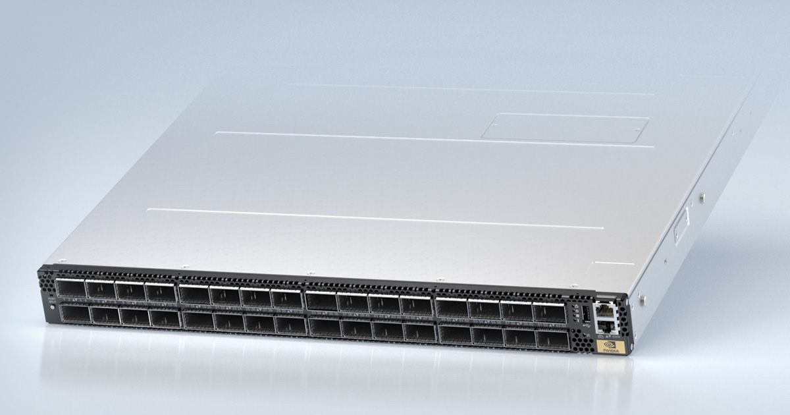
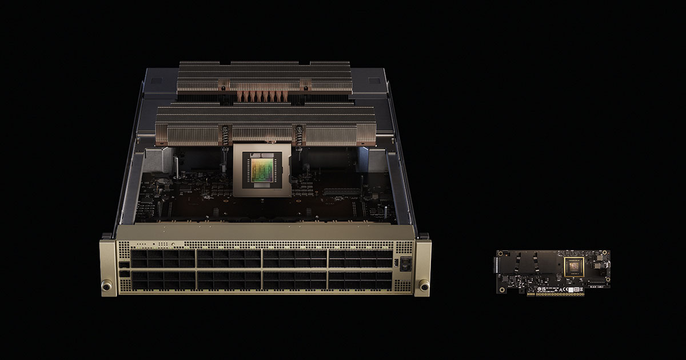
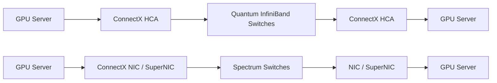
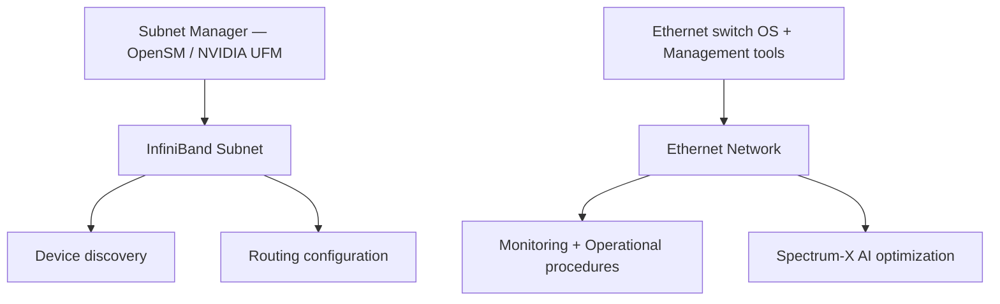
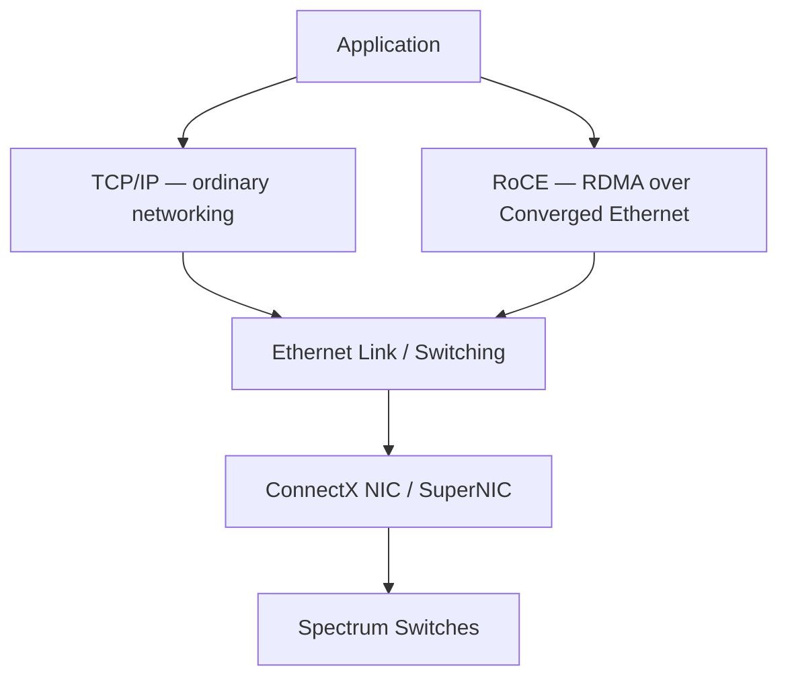
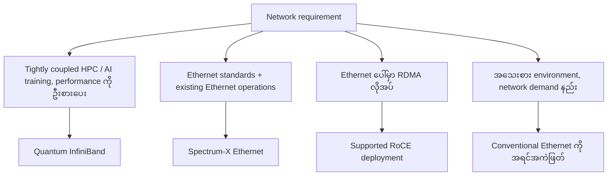
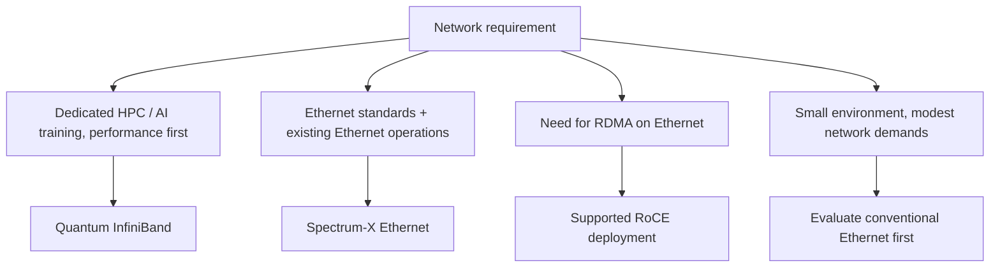

# Module 09 — NVIDIA InfiniBand vs. Spectrum-X Ethernet

> Part II · GPU Interconnects and Networking — Course Module 09 — topic notes

_Comparing AI Networking Fabrics_

## မြန်မာဘာသာ version — NVIDIA InfiniBand vs. Spectrum-X Ethernet

## 1. ခြုံငုံသုံးသပ်ချက်

NVIDIA က high-performance AI နဲ့ HPC infrastructure တွေအတွက် networking approach အဓိက နှစ်မျိုး ပေးပါတယ်—

- **NVIDIA Quantum InfiniBand** — dedicated high-performance InfiniBand fabric တစ်ခု။
- **NVIDIA Spectrum-X Ethernet** — ကြီးမားတဲ့ AI workloads တွေအတွက် ဒီဇိုင်းလုပ်ထားတဲ့ AI-optimized Ethernet fabric တစ်ခု။

နှစ်ခုလုံးက GPU clusters တွေအတွက် high-speed networking ပေးနိုင်ပါတယ်။ ရွေးချယ်မှုက ကြော်ငြာထားတဲ့ speed အမြင့်ဆုံး ဘယ်နည်းပညာက ရှိသလဲ ဆိုတာတစ်ခုတည်းနဲ့ မဟုတ်ပါဘူး။ Latency၊ congestion behavior၊ scalability၊ management၊ compatibility၊ cost နဲ့ operational experience တွေပေါ်လည်း မူတည်ပါတယ်။

## 2. အဓိက components များ

| Component | NVIDIA Quantum InfiniBand | NVIDIA Spectrum-X Ethernet |
|---|---|---|
| Networking fabric | InfiniBand | Ethernet |
| Switch family | Quantum | Spectrum |
| Server adapter examples | ConnectX InfiniBand HCA / supported SuperNIC | ConnectX Ethernet NIC / supported SuperNIC |
| High-performance communication | InfiniBand RDMA | RoCE — RDMA over Converged Ethernet |
| Fabric management | Subnet Manager (ဥပမာ OpenSM) နှင့်/ဒါမှမဟုတ် NVIDIA UFM | Ethernet switch OS နှင့် management tools များ၊ NVIDIA tools များ ထည့်နိုင်သည် |
| Typical use | Performance-focused HPC နှင့် AI clusters များ | Ethernet standards နှင့် operational integration ကို အကျိုးခံစားရသော AI clusters များ |

တိကျတဲ့ hardware က generation နဲ့ system configuration ပေါ် မူတည်ပါတယ်။ ဥပမာ—NVIDIA ရဲ့ နောက်ဆုံးပေါ် ConnectX-8 networking products တွေက product နဲ့ operating mode ပေါ် မူတည်ပြီး 800 Gb/s အထိ InfiniBand ဒါမှမဟုတ် Ethernet configurations တွေကို support လုပ်ပါတယ်—[NVIDIA Quantum-X800 documentation](https://networking-docs.nvidia.com/nvidia-quantum-x800-xdr-clusters)။

## 3. Quantum vs. Spectrum

Quantum ဆိုတာ NVIDIA ရဲ့ InfiniBand switch platform ဖြစ်ပါတယ်။ High-performance၊ low-latency communication နဲ့ ကြီးမားတဲ့ HPC နှင့် AI networking အတွက် ဒီဇိုင်းလုပ်ထားပါတယ်။

Spectrum ဆိုတာ NVIDIA ရဲ့ Ethernet switch platform ဖြစ်ပါတယ်။ Spectrum-X က Spectrum Ethernet switches တွေကို support လုပ်တဲ့ NVIDIA SuperNICs တွေနဲ့ networking software တွေနဲ့ ပေါင်းစပ်ပြီး တောင်းဆိုမှု မြင့်မားတဲ့ AI workloads တွေအတွက် Ethernet ကို optimize လုပ်ပေးပါတယ်။

NVIDIA Quantum InfiniBand—

```
GPU Server → ConnectX HCA → Quantum Switches → ConnectX HCA → GPU Server
```

ဒီ Quantum InfiniBand fabric ကို တည်ဆောက်ပေးတဲ့ switch hardware က အောက်ပုံလို ဖြစ်ပါတယ်။



**ပုံရှင်းလင်းချက် (Photo walkthrough)**
1. ဒီမှာ မြင်ရတာက InfiniBand ဘက်ခြမ်းမှာ သုံးတဲ့ NVIDIA Quantum-2 NDR InfiniBand switch chassis ဖြစ်ပါတယ်။
2. ရှေ့ဘက် faceplate မှာ high-speed InfiniBand port တွေကို အတန်းလိုက် တန်းစီထားပြီး cable ချိတ်ဆက်ဖို့ connector cage တွေ ပါရှိပါတယ်။
3. အပေါ်က data path မှာ ပြထားတဲ့ Quantum Switches ဆိုတာ ဒီလို switch hardware တွေကို ဆိုလိုပါတယ်။

*(Image: NVIDIA official product image)*

NVIDIA Spectrum-X Ethernet—

```
GPU Server → ConnectX NIC / SuperNIC → Spectrum Switches → NIC / SuperNIC → GPU Server
```

Spectrum-X ဘက်ခြမ်း hardware ကတော့ အောက်ပုံလို ဖြစ်ပါတယ်။



**ပုံရှင်းလင်းချက် (Photo walkthrough)**
1. ဒီမှာ မြင်ရတာက Spectrum-X Ethernet platform ရဲ့ hardware ဖြစ်တဲ့ Ethernet switch အမျိုးအစား ဖြစ်ပါတယ်။
2. Faceplate ပေါ်မှာ high-speed Ethernet port တွေ အတန်းလိုက် တန်းစီပြီး ဒီ port တွေကတစ်ဆင့် ConnectX NIC / SuperNIC တပ်ထားတဲ့ GPU server တွေ ချိတ်ဆက်ပါတယ်။
3. ဒီ switch hardware နဲ့ supported SuperNICs၊ networking software ပေါင်းစပ်မှုကပဲ Spectrum-X platform ကို ဖြစ်စေပါတယ်။

*(Image: NVIDIA official product image)*

**Figure 1 — Quantum InfiniBand vs Spectrum-X Ethernet Data Paths**



**ပုံရှင်းလင်းချက် (Figure walkthrough)**
1. ဒီပုံမှာ data path နှစ်ခုကို အပေါ်အောက် နှိုင်းယှဉ်ပြထားပါတယ်။
2. အပေါ်က Quantum InfiniBand path ဖြစ်ပြီး GPU Server → ConnectX HCA → Quantum InfiniBand Switches → ConnectX HCA → GPU Server ဆိုပြီး သွားပါတယ်။
3. အောက်က Spectrum-X Ethernet path ဖြစ်ပြီး GPU Server → ConnectX NIC / SuperNIC → Spectrum Switches → NIC / SuperNIC → GPU Server ဆိုပြီး သွားပါတယ်။
4. နှစ်ခုလုံးက GPU clusters အတွက် high-speed networking ပေးပေမယ့် fabric နဲ့ management ဘက်မှာ ကွာခြားပါတယ်။

ဒီ diagrams တွေက ရိုးရှင်းစွာ ဖော်ပြတာ ဖြစ်ပါတယ်။ တကယ့် deployments တွေမှာ switches အများကြီး၊ network rails အမျိုးမျိုး၊ topologies အမျိုးမျိုးနဲ့ storage၊ management နဲ့ GPU-to-GPU traffic တွေအတွက် သီးခြား networks တွေ အသုံးပြုနိုင်ပါတယ်။

## 4. အမြင့်ဆုံး speed တူညီသလား

မူရင်း transcript က နည်းပညာ နှစ်ခုလုံးကို "up to 800" လို့ နှိုင်းယှဉ်ထားပါတယ်။ အရေးကြီးတဲ့ ပြင်ဆင်ချက်က unit ဖြစ်ပါတယ်—800 Gb/s ဆိုတာ 800 gigabits per second ဖြစ်ပြီး 800 GB/s (gigabytes per second) မဟုတ်ပါဘူး။

NVIDIA က Quantum-X800 InfiniBand နဲ့ Spectrum-X800 Ethernet နှစ်ခုလုံးကို end-to-end 800 Gb/s networking ပေးနိုင်တဲ့ platforms အဖြစ် ကြေညာခဲ့ပါတယ်။ တကယ့် end-to-end throughput က support လုပ်တဲ့ adapters၊ switches၊ cabling၊ configuration နဲ့ workload ပေါ် မူတည်ပါတယ်—[NVIDIA X800 announcement](https://nvidianews.nvidia.com/news/networking-switches-gpu-computing-ai)။

Unit တွေကို နားလည်ဖို့—

- 8 bits = 1 byte။
- 800 Gb/s ÷ 8 = 100 GB/s — theoretical raw data rate။
- Protocol overhead နဲ့ တခြား implementation details တွေကြောင့် application အသုံးပြုနိုင်တဲ့ throughput က 100 GB/s အမြဲတမ်း မဟုတ်ပါဘူး။

ဒါကြောင့် fabric နှစ်ခုက nominal link rate တူညီပေမယ့် workload တစ်ခုအောက်မှာ application-level performance ကွဲပြားနိုင်ပါတယ်။

## 5. InfiniBand က အမြဲတမ်း latency ပိုနည်းသလား

InfiniBand က very low latency နဲ့ high-performance communication အတွက် ဒီဇိုင်းလုပ်ထားတဲ့အတွက် tightly coupled HPC workloads တွေနဲ့ distributed AI training အတွက် အားကောင်းတဲ့ ရွေးချယ်မှု ဖြစ်ပါတယ်။

ဒါပေမယ့် Ethernet က သဘာဝအားဖြင့် နှေးတယ်၊ ဒါမှမဟုတ် InfiniBand က ဘယ်အခြေအနေမှာမဆို အမြဲ ပိုမြန်တယ်လို့ ပြောရင် လှည့်စားရာ ရောက်ပါတယ်။ NVIDIA Spectrum-X က AI workloads တွေအတွက် Ethernet performance ကို တိုးတက်စေဖို့ အထူး အင်ဂျင်နီးယားလုပ်ထားပါတယ်—congestion management၊ high effective bandwidth နဲ့ predictable performance တွေ အပါအဝင်—[NVIDIA Spectrum-X overview](https://www.nvidia.com/en-sg/networking/spectrumx/)။

Fabrics တွေကို နှိုင်းယှဉ်တဲ့အခါ အောက်ပါတွေကို အကဲဖြတ်ပါ—

- **Latency** — message တွေ ပန်းတိုင်ဆီ ဘယ်လောက် မြန်မြန် ရောက်သလဲ။
- **Tail latency** — request တွေရဲ့ အနှေးဆုံး အစိတ်အပိုင်းက ဘယ်လောက်အထိ နှေးနိုင်သလဲ။
- **Effective bandwidth** — workload က တကယ် ဘယ်လောက် useful data လွှဲပြောင်းသလဲ။
- **Congestion behavior** — endpoints အများကြီး တစ်ပြိုင်နက် ဆက်သွယ်တဲ့အခါ network က ဘယ်လို တုံ့ပြန်သလဲ။
- **Application performance** — training ဒါမှမဟုတ် inference workloads တွေ ပြီးဆုံးဖို့ ဘယ်လောက် ကြာသလဲ။

Distributed AI training အတွက် congestion အောက်မှာ high effective bandwidth ကို ထိန်းသိမ်းပေးနိုင်တဲ့ network က ကြော်ငြာထားတဲ့ link speed လောက်ပဲ အရေးကြီးနိုင်ပါတယ်။

## 6. Network Management — OpenSM vs. Ethernet Tools

ဒါက transcript က ထောက်ပြထားတဲ့ အရေးကြီးတဲ့ ကွာခြားချက်တွေထဲက တစ်ခု ဖြစ်ပါတယ်။

**InfiniBand management**

InfiniBand က subnet ကို initialize နဲ့ manage လုပ်ဖို့၊ devices တွေ ရှာဖွေဖို့နဲ့ routing configure လုပ်ဖို့ Subnet Manager (SM) လိုအပ်ပါတယ်။ OpenSM (Open Subnet Manager) က implementation တစ်ခု ဖြစ်ပါတယ်။ NVIDIA UFM (Unified Fabric Manager) က ထပ်မံ fabric-management capabilities တွေ ပေးပါတယ်။

OpenSM ဆိုတာ deployment တိုင်း တပ်ဆင်ရမယ့် သီးခြား server တစ်ခု မဖြစ်မနေ မဟုတ်ပါဘူး—architecture ပေါ် မူတည်ပြီး Subnet Manager ကို support လုပ်တဲ့ software ဒါမှမဟုတ် switch-based implementation မှတစ်ဆင့် ပေးနိုင်ပါတယ်။

**Ethernet management**

Ethernet networks တွေက Ethernet switching နဲ့ IP networking technologies တွေ အသုံးပြုတဲ့အတွက် teams တွေက ရှိပြီးသား tools တွေ၊ monitoring systems တွေ၊ operational procedures တွေနဲ့ network expertise တွေကို ပြန်အသုံးပြုနိုင်ပါတယ်။

Spectrum-X က AI-specific networking optimization နဲ့ management ကိုလည်း ပံ့ပိုးပါတယ်။ Generic Ethernet administration အတွက်သာ ကန့်သတ်ထားတာ မဟုတ်ပါဘူး။

အရေးကြီးတဲ့ ကွာခြားချက်—InfiniBand management နဲ့ Ethernet management က မတူညီပေမယ့် fabric နှစ်ခုလုံးက management-free မဟုတ်ပါဘူး။ နှစ်ခုလုံးအတွက် သင့်တော်တဲ့ configuration၊ monitoring၊ troubleshooting နဲ့ lifecycle management လိုအပ်ပါတယ်။

**Figure 2 — InfiniBand Management vs Ethernet Management**



**ပုံရှင်းလင်းချက် (Figure walkthrough)**
1. ဘယ်ဘက်က InfiniBand management ဖြစ်ပြီး Subnet Manager (OpenSM / NVIDIA UFM) က InfiniBand Subnet ကို စီမံပါတယ်။
2. ဒီ Subnet အတွင်းမှာ device discovery နဲ့ routing configuration ဆိုပြီး အဓိကလုပ်ငန်းတွေ ရှိပါတယ်။
3. ညာဘက်က Ethernet management ဖြစ်ပြီး Ethernet switch OS နဲ့ management tools တွေက Ethernet Network ကို စီမံပါတယ်။
4. Ethernet ဘက်မှာ monitoring, operational procedures တွေအပြင် Spectrum-X ရဲ့ AI-specific optimization လည်း ရှိပါတယ်။ နှစ်ခုလုံးက management-free မဟုတ်ပါဘူး။

## 7. Spectrum-X က ပုံမှန် TCP/IP Ethernet သက်သက်လား

မဟုတ်ပါဘူး။ ဒါက အရေးကြီးတဲ့ technical clarification ဖြစ်ပါတယ်။

Ethernet က underlying link နဲ့ switching technology ကို ပေးပါတယ်။ TCP/IP ကို ပုံမှန် application networking အတွက် အသုံးများပေမယ့် Ethernet ပေါ်က high-performance AI communication ကတော့ RoCE (RDMA over Converged Ethernet) ကို အသုံးပြုနိုင်ပါတယ်။

RoCE က Ethernet ပေါ်မှာ RDMA-based data transfer ကို ခွင့်ပြုပြီး hardware နဲ့ software က support လုပ်ရင် CPU overhead နဲ့ intermediate data copying တွေကို လျှော့ချပေးပါတယ်။

ဒါကြောင့် Spectrum-X က ပုံမှန် TCP-based data transfers တွေပေါ်သာ အားကိုးမနေဘဲ high-performance RoCE networking ကို ပံ့ပိုးနိုင်ပါတယ်—[NVIDIA Spectrum-X documentation](https://docs.nvidia.com/networking/display/kubernetes2670/spectrum-x/spectrum-x.html)။

**Figure 3 — Spectrum-X ရဲ့ Layered Networking Flow (TCP/IP vs RoCE)**



**ပုံရှင်းလင်းချက် (Figure walkthrough)**
1. အပေါ်ဆုံးက Application ကနေ လမ်းကြောင်းနှစ်ခု ခွဲထွက်သွားတာ မြင်ရပါမယ်။
2. ဘယ်ဘက်က TCP/IP — ordinary networking လမ်းကြောင်း ဖြစ်ပါတယ်။
3. ညာဘက်က RoCE — RDMA over Converged Ethernet လမ်းကြောင်းဖြစ်ပြီး high-performance AI communication အတွက် ဖြစ်ပါတယ်။
4. နှစ်ခုလုံးက Ethernet Link / Switching အောက်ကို ဆင်းသွားပြီး ConnectX NIC / SuperNIC ကတစ်ဆင့် Spectrum Switches ဆီ ရောက်ပါတယ်။ Spectrum-X ဆိုတာ TCP/IP သက်သက် မဟုတ်ပါဘူး။

## 8. ကုန်ကျစရိတ်နဲ့ operational trade-offs

အချို့ deployments တွေမှာ InfiniBand က စုစုပေါင်း ကုန်ကျစရိတ် ပိုမြင့်နိုင်ပေမယ့် ကွာခြားချက်က hardware generation၊ topology၊ licensing၊ cabling၊ support နဲ့ scale ပေါ် မူတည်ပါတယ်။

Spectrum-X Ethernet က အဖွဲ့အစည်းတစ်ခုက ရှိပြီးသား Ethernet infrastructure ကို လည်ပတ်နေပြီး familiar Ethernet operations တွေပတ်လည် AI fabric တစ်ခု တည်ဆောက်ချင်ရင် စိတ်ဝင်စားစရာ ကောင်းနိုင်ပါတယ်။ ဒါပေမယ့် high-performance Spectrum-X deployment ဆိုတာ ကျွမ်းကျင်မှု လိုအပ်တဲ့ specialized AI networking solution တစ်ခု ဖြစ်နေဆဲပါ—ပုံမှန် enterprise Ethernet network တစ်ခုလို ကုန်ကျစရိတ် တူမယ်လို့ မယူဆရပါ။

လက်တွေ့ နှိုင်းယှဉ်ချက်တစ်ခုမှာ အောက်ပါတွေ ပါဝင်သင့်ပါတယ်—

- Switches၊ adapters၊ optics နဲ့ cables များ။
- Network design နဲ့ deployment အားထုတ်မှု။
- Management နဲ့ monitoring software။
- Operational skills နဲ့ support။
- ရှိပြီးသား infrastructure နဲ့ compatibility။
- Network performance က workload ပြီးဆုံးချိန်ကို သက်ရောက်ပုံ။

## 9. ဘယ်လို ရွေးချယ်မလဲ

| လိုအပ်ချက် | အကြံပြုလမ်းကြောင်း |
|---|---|
| တောင်းဆိုမှုမြင့်ပြီး tightly coupled communication ရှိတဲ့ dedicated HPC cluster | Quantum InfiniBand ကို စဉ်းစားပါ |
| High-performance InfiniBand fabric ကို ဦးစားပေးတဲ့ AI training cluster | Quantum InfiniBand ကို စဉ်းစားပါ |
| Ethernet standards နဲ့ ရှိပြီးသား Ethernet operations တွေပေါ် တည်ဆောက်ထားတဲ့ AI cluster | Spectrum-X Ethernet ကို စဉ်းစားပါ |
| Ethernet ပေါ်မှာ RDMA လိုအပ်ခြင်း | မှန်ကန်စွာ design လုပ်ပြီး support လုပ်တဲ့ RoCE deployment ကို စဉ်းစားပါ |
| Network လိုအပ်ချက် သိပ်မမြင့်တဲ့ အသေးစား environment | Specialized fabric မတိုင်မီ conventional Ethernet ကို အကဲဖြတ်ပါ |

ဒီတွေက universal rules တွေ မဟုတ်ဘဲ စတင်စဉ်းစားရမယ့် အချက်တွေသာ ဖြစ်ပါတယ်။ ရည်ရွယ်ထားတဲ့ workload ကို benchmark လုပ်ပြီး support လုပ်တဲ့ reference architecture ကို validate လုပ်ပြီးမှ fabric ကို ရွေးချယ်ပါ။

**Figure 4 — Fabric ရွေးချယ်မှု လမ်းကြောင်း**



**ပုံရှင်းလင်းချက် (Figure walkthrough)**
1. ထိပ်ဆုံးက Network requirement ကနေ အခြေအနေလေးမျိုး ခွဲထွက်သွားပါတယ်။
2. Tightly coupled HPC/AI training အတွက်ဆိုရင် Quantum InfiniBand ကို စဉ်းစားပါ။
3. Ethernet standards နဲ့ ရှိပြီးသား Ethernet operations ပေါ် တည်ဆောက်ချင်ရင် Spectrum-X Ethernet ကို စဉ်းစားပါ။
4. Ethernet ပေါ်မှာ RDMA လိုအပ်ရင် supported RoCE deployment ကို စဉ်းစားပြီး၊ network demand နည်းတဲ့ အသေးစား environment အတွက် conventional Ethernet ကို အရင် အကဲဖြတ်ပါ။

## 10. Exam Notes

- Quantum = NVIDIA InfiniBand switch family။
- Spectrum = NVIDIA Ethernet switch family။
- ConnectX = NVIDIA networking adapter family။ Support လုပ်တဲ့ protocol က တိကျတဲ့ product နဲ့ configuration ပေါ် မူတည်ပါတယ်။
- HCA = Host Channel Adapter — InfiniBand host adapter အတွက် အသုံးများတဲ့ ဝေါဟာရ။
- NIC = Network Interface Card/Controller — network interface အတွက် အထွေထွေ ဝေါဟာရ၊ Ethernet adapters တွေကို ပုံမှန် NICs လို့ ခေါ်ပါတယ်။
- OpenSM = Open Subnet Manager — InfiniBand Subnet Manager implementation တစ်ခု။
- RoCE = RDMA over Converged Ethernet။
- 800 Gb/s = overhead မတိုင်မီ theoretical raw data rate 100 GB/s။
- Link speed တူညီခြင်းက latency ဒါမှမဟုတ် application performance တူညီမယ်လို့ မယူဆရပါ။

## 11. Review Questions (မေးခွန်းနှင့် အဖြေများ)

**Q1. Quantum နဲ့ Spectrum ရဲ့ ကွာခြားချက်က ဘာလဲ**

Quantum က NVIDIA ရဲ့ InfiniBand switch platform ဖြစ်ပြီး Spectrum က NVIDIA ရဲ့ Ethernet switch platform ဖြစ်ပါတယ်။

**Q2. Platforms နှစ်ခုလုံးက 800 Gb/s networking ပေးနိုင်သလား**

ရနိုင်ပါတယ်။ Support လုပ်တဲ့ X800-generation configurations တွေက 800 Gb/s ပေးနိုင်ပါတယ်။ ဒီ rate က gigabits per second ဖြစ်ပြီး gigabytes per second မဟုတ်ပါဘူး။

**Q3. OpenSM က ဘာလုပ်သလဲ**

Fabric ကို initialize နဲ့ configure လုပ်ခြင်းဖြင့် InfiniBand subnet ကို စီမံခန့်ခွဲပါတယ်။ ၎င်းက Subnet Manager implementation တစ်ခု ဖြစ်ပါတယ်။

**Q4. Spectrum-X Ethernet က TCP/IP ကိုသာ အသုံးပြုသလား**

မဟုတ်ပါဘူး။ Spectrum-X က Ethernet-based connectivity အပြင် high-performance RoCE networking ကိုလည်း ပံ့ပိုးပါတယ်။

**Q5. Latency ကြောင့် InfiniBand က အမြဲ ပိုကောင်းတဲ့ ရွေးချယ်မှုလား**

မဟုတ်ပါဘူး။ InfiniBand က very low latency အတွက် ဒီဇိုင်းလုပ်ထားပေမယ့် အကောင်းဆုံး ရွေးချယ်မှုက workload benchmarks၊ congestion behavior၊ scale၊ cost နဲ့ operational လိုအပ်ချက်တွေပေါ် မူတည်ပါတယ်။

**Q6. Link speed အပြင် ဘာတွေကို နှိုင်းယှဉ်သင့်သလဲ**

Latency၊ tail latency၊ effective bandwidth၊ congestion handling၊ application performance၊ management၊ compatibility နဲ့ စုစုပေါင်း ကုန်ကျစရိတ်တို့ ဖြစ်ပါတယ်။

## English Version — NVIDIA InfiniBand vs. Spectrum-X Ethernet

## 1. Overview

NVIDIA provides two major networking approaches for high-performance AI and HPC infrastructure:

- **NVIDIA Quantum InfiniBand** — a dedicated high-performance InfiniBand fabric.
- **NVIDIA Spectrum-X Ethernet** — an AI-optimized Ethernet fabric designed for large-scale AI workloads.

Both can provide high-speed networking for GPU clusters. The choice is not simply about which technology has the highest advertised speed. It also depends on latency, congestion behavior, scalability, management, compatibility, cost, and operational experience.

## 2. The Main Components

| Component | NVIDIA Quantum InfiniBand | NVIDIA Spectrum-X Ethernet |
|---|---|---|
| Networking fabric | InfiniBand | Ethernet |
| Switch family | Quantum | Spectrum |
| Server adapter examples | ConnectX InfiniBand HCA / supported SuperNIC | ConnectX Ethernet NIC / supported SuperNIC |
| High-performance communication | InfiniBand RDMA | RoCE — RDMA over Converged Ethernet |
| Fabric management | Subnet Manager, such as OpenSM, and/or NVIDIA UFM | Ethernet switch OS and management tools; NVIDIA tools can be added |
| Typical use | Performance-focused HPC and AI clusters | AI clusters that benefit from Ethernet standards and operational integration |

The exact hardware depends on the generation and system configuration. NVIDIA's newer ConnectX-8 networking products, for example, support up to 800 Gb/s InfiniBand or Ethernet configurations depending on the product and operating mode — [NVIDIA Quantum-X800 documentation](https://networking-docs.nvidia.com/nvidia-quantum-x800-xdr-clusters).

## 3. Quantum vs. Spectrum

Quantum is NVIDIA's InfiniBand switch platform. It is designed for high-performance, low-latency communication and large-scale HPC and AI networking.

Spectrum is NVIDIA's Ethernet switch platform. Spectrum-X combines Spectrum Ethernet switches with supported NVIDIA SuperNICs and networking software to optimize Ethernet for demanding AI workloads.

NVIDIA Quantum InfiniBand:

```
GPU Server → ConnectX HCA → Quantum Switches → ConnectX HCA → GPU Server
```

The switch hardware that builds this Quantum InfiniBand fabric looks like the photo below.


**Photo walkthrough**
1. What you see is an NVIDIA Quantum-2 NDR InfiniBand switch chassis used on the InfiniBand side.
2. On the front faceplate, high-speed InfiniBand ports are arranged in rows, each with a connector cage for the cable.
3. The "Quantum Switches" shown in the data path above are switch hardware like this one.

*(Image: NVIDIA official product image)*

NVIDIA Spectrum-X Ethernet:

```
GPU Server → ConnectX NIC / SuperNIC → Spectrum Switches → NIC / SuperNIC → GPU Server
```

The Spectrum-X side hardware looks like the photo below.


**Photo walkthrough**
1. What you see is Ethernet switch-class hardware from the Spectrum-X Ethernet platform.
2. High-speed Ethernet ports are arranged in rows on the faceplate, and GPU servers with ConnectX NICs / SuperNICs connect through these ports.
3. The combination of this switch hardware, supported SuperNICs, and the networking software is what makes the Spectrum-X platform.

*(Image: NVIDIA official product image)*

**Figure 1 — Quantum InfiniBand vs Spectrum-X Ethernet Data Paths**


**Figure walkthrough**
1. The figure compares two data paths, one above the other.
2. The top path is Quantum InfiniBand: GPU Server → ConnectX HCA → Quantum InfiniBand Switches → ConnectX HCA → GPU Server.
3. The bottom path is Spectrum-X Ethernet: GPU Server → ConnectX NIC / SuperNIC → Spectrum Switches → NIC / SuperNIC → GPU Server.
4. Both provide high-speed networking for GPU clusters, but they differ in fabric technology and management.

These are simplified diagrams. Real deployments may use multiple switches, multiple network rails, different topologies, and separate networks for storage, management, and GPU-to-GPU traffic.

## 4. Is the Maximum Speed the Same?

The source transcript compares both technologies at "up to 800." The important correction is the unit: 800 Gb/s means 800 gigabits per second, not 800 GB/s (gigabytes per second).

NVIDIA announced both Quantum-X800 InfiniBand and Spectrum-X800 Ethernet as platforms capable of end-to-end 800 Gb/s networking. Actual end-to-end throughput depends on the supported adapters, switches, cabling, configuration, and workload — [NVIDIA X800 announcement](https://nvidianews.nvidia.com/news/networking-switches-gpu-computing-ai).

To understand the units:

- 8 bits = 1 byte.
- 800 Gb/s ÷ 8 = 100 GB/s theoretical raw data rate.
- Protocol overhead and other implementation details mean usable application throughput is not necessarily 100 GB/s.

Therefore, two fabrics can advertise the same nominal link rate while delivering different application-level performance under a particular workload.

## 5. Is InfiniBand Always Lower Latency?

InfiniBand is designed for very low latency and high-performance communication, which makes it a strong option for tightly coupled HPC workloads and distributed AI training.

However, it would be misleading to say that Ethernet is inherently slow or that InfiniBand is always faster in every situation. NVIDIA Spectrum-X is specifically engineered to improve Ethernet performance for AI workloads, including congestion management, high effective bandwidth, and predictable performance — [NVIDIA Spectrum-X overview](https://www.nvidia.com/en-sg/networking/spectrumx/).

When comparing fabrics, evaluate:

- **Latency** — how quickly messages reach their destination.
- **Tail latency** — how slow the slowest portion of requests can become.
- **Effective bandwidth** — how much useful data the workload actually transfers.
- **Congestion behavior** — how the network responds when many endpoints communicate simultaneously.
- **Application performance** — how long training or inference workloads take to complete.

For distributed AI training, a network that maintains high effective bandwidth under congestion can matter as much as its advertised link speed.

## 6. Network Management: OpenSM vs. Ethernet Tools

This is one of the important differences highlighted by the transcript.

**InfiniBand management**

InfiniBand requires a Subnet Manager (SM) to initialize and manage the subnet, discover devices, and configure routing. OpenSM (Open Subnet Manager) is one implementation. NVIDIA UFM (Unified Fabric Manager) provides additional fabric-management capabilities.

OpenSM is not necessarily a separate server that every deployment must install: the Subnet Manager can be provided through a supported software or switch-based implementation, depending on the architecture.

**Ethernet management**

Ethernet networks use Ethernet switching and IP networking technologies, so teams may be able to reuse existing tools, monitoring systems, operational procedures, and network expertise.

Spectrum-X also supports AI-specific networking optimization and management. It is not limited to generic Ethernet administration.

Important distinction: InfiniBand management and Ethernet management differ, but neither fabric is completely management-free. Both need appropriate configuration, monitoring, troubleshooting, and lifecycle management.

**Figure 2 — InfiniBand Management vs Ethernet Management**


**Figure walkthrough**
1. On the left is InfiniBand management: a Subnet Manager (OpenSM / NVIDIA UFM) manages the InfiniBand Subnet.
2. Inside that subnet, the main tasks are device discovery and routing configuration.
3. On the right is Ethernet management: the Ethernet switch OS and management tools manage the Ethernet Network.
4. On the Ethernet side there is monitoring and operational procedures plus Spectrum-X AI-specific optimization. Neither fabric is management-free.

## 7. Is Spectrum-X Just Ordinary TCP/IP Ethernet?

No. This is a key technical clarification.

Ethernet provides the underlying link and switching technology. TCP/IP is commonly used for ordinary application networking, but high-performance AI communication over Ethernet can use RoCE (RDMA over Converged Ethernet).

RoCE allows RDMA-based data transfer over Ethernet, reducing CPU overhead and intermediate data copying when the hardware and software support it.

Thus, Spectrum-X can support high-performance RoCE networking rather than relying exclusively on ordinary TCP-based data transfers — [NVIDIA Spectrum-X documentation](https://docs.nvidia.com/networking/display/kubernetes2670/spectrum-x/spectrum-x.html).

**Figure 3 — Spectrum-X Layered Networking Flow (TCP/IP vs RoCE)**


**Figure walkthrough**
1. At the top, the Application splits into two paths.
2. The left path is TCP/IP — ordinary networking.
3. The right path is RoCE — RDMA over Converged Ethernet, used for high-performance AI communication.
4. Both descend into Ethernet Link / Switching and reach the Spectrum Switches through the ConnectX NIC / SuperNIC. Spectrum-X is not just plain TCP/IP.

## 8. Cost and Operational Trade-offs

InfiniBand may have a higher overall cost in some deployments, but the difference depends on the hardware generation, topology, licensing, cabling, support, and scale.

Spectrum-X Ethernet may be attractive when an organization already operates Ethernet infrastructure and wants to build an AI fabric around familiar Ethernet operations. However, a high-performance Spectrum-X deployment is still a specialized AI networking solution; it should not be assumed to cost the same as a basic enterprise Ethernet network.

A practical comparison should include:

- Switches, adapters, optics, and cables.
- Network design and deployment effort.
- Management and monitoring software.
- Operational skills and support.
- Compatibility with existing infrastructure.
- The effect of network performance on workload completion time.

## 9. How to Choose

| Requirement | Suggested direction |
|---|---|
| Dedicated HPC cluster with demanding, tightly coupled communication | Consider Quantum InfiniBand |
| AI training cluster prioritizing a high-performance InfiniBand fabric | Consider Quantum InfiniBand |
| AI cluster built around Ethernet standards and existing Ethernet operations | Consider Spectrum-X Ethernet |
| Need for RDMA on Ethernet | Consider a properly designed and supported RoCE deployment |
| Small environment with modest network demands | Evaluate conventional Ethernet before adopting a specialized fabric |

These are starting points, not universal rules. Benchmark the intended workload and validate the supported reference architecture before selecting the fabric.

**Figure 4 — Fabric Selection Paths**



**Figure walkthrough**
1. At the top, the Network requirement splits into four situations.
2. For tightly coupled HPC/AI training, consider Quantum InfiniBand.
3. When building around Ethernet standards and existing Ethernet operations, consider Spectrum-X Ethernet.
4. When you need RDMA on Ethernet, consider a supported RoCE deployment; for a small environment with modest demands, evaluate conventional Ethernet first.

## 10. Exam Notes

- Quantum = NVIDIA InfiniBand switch family.
- Spectrum = NVIDIA Ethernet switch family.
- ConnectX = NVIDIA networking adapter family. The supported protocol depends on the specific product and configuration.
- HCA = Host Channel Adapter, the usual term for an InfiniBand host adapter.
- NIC = Network Interface Card/Controller, the general term for a network interface; Ethernet adapters are commonly called NICs.
- OpenSM = Open Subnet Manager, an InfiniBand Subnet Manager implementation.
- RoCE = RDMA over Converged Ethernet.
- 800 Gb/s = 100 GB/s theoretical raw data rate, before overhead.
- Do not assume that matching link speeds guarantee identical latency or application performance.

## 11. Review Questions (Self-Check Questions and Answers)

**Q1. What is the difference between Quantum and Spectrum?**

Quantum is NVIDIA's InfiniBand switch platform; Spectrum is NVIDIA's Ethernet switch platform.

**Q2. Can both platforms provide 800 Gb/s networking?**

Yes, supported X800-generation configurations can provide 800 Gb/s. The rate is gigabits per second, not gigabytes per second.

**Q3. What does OpenSM do?**

It manages an InfiniBand subnet by initializing and configuring the fabric. It is one possible Subnet Manager implementation.

**Q4. Does Spectrum-X Ethernet use only TCP/IP?**

No. Spectrum-X supports high-performance RoCE networking as well as Ethernet-based connectivity.

**Q5. Is InfiniBand always the better choice because of latency?**

No. InfiniBand is designed for very low latency, but the best choice depends on workload benchmarks, congestion behavior, scale, cost, and operational requirements.

**Q6. What should be compared besides link speed?**

Latency, tail latency, effective bandwidth, congestion handling, application performance, management, compatibility, and total cost.

## Technical review notes

- The unit correction in section 4 is preserved from the source transcript: 800 Gb/s (gigabits per second) ≠ 800 GB/s; 800 Gb/s ÷ 8 = 100 GB/s theoretical raw data rate. The X800 end-to-end 800 Gb/s figure matches NVIDIA's official announcement (March 2024).
- The task attribution mentions msg_2565 for this module, but msg_2565 contains no Module 09 content (its body begins with Module 10); Module 09 is complete within msg_2563 and ends at Review Question Q6 as supplied.
- ConnectX-8 "up to 800 Gb/s InfiniBand or Ethernet depending on product and operating mode" is preserved from the transcript; exact per-SKU support is product-dependent (needs verification per configuration).
- Mermaid figures (Figure 1–4) with figure walkthroughs were added inline in both the Myanmar and English sections; all existing text and ASCII diagrams are unchanged.
