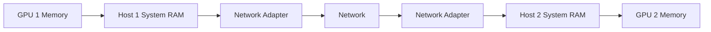
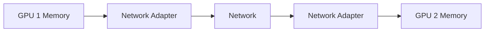
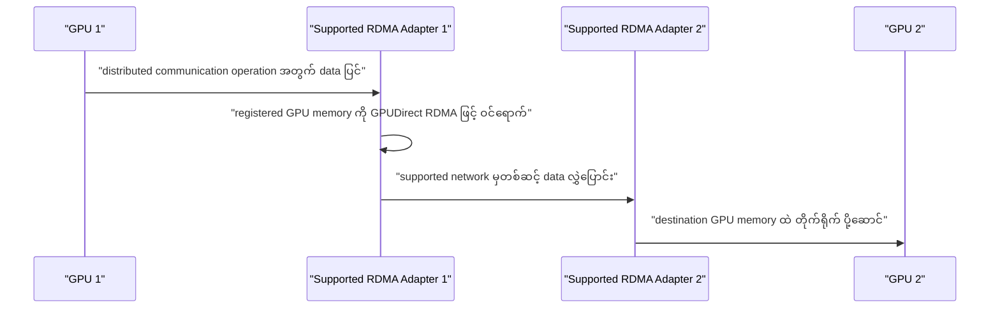
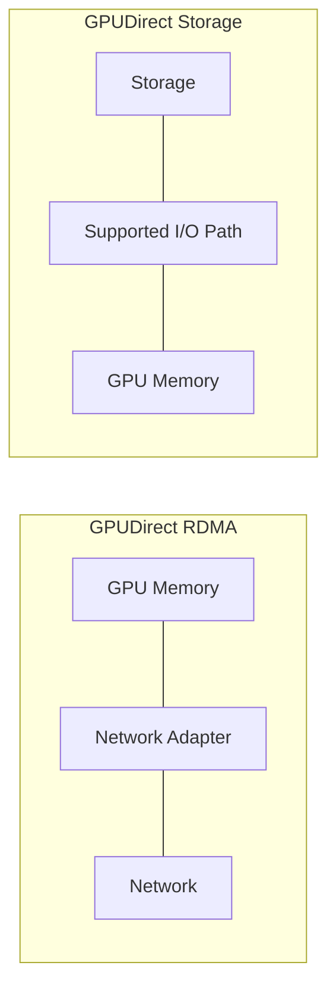
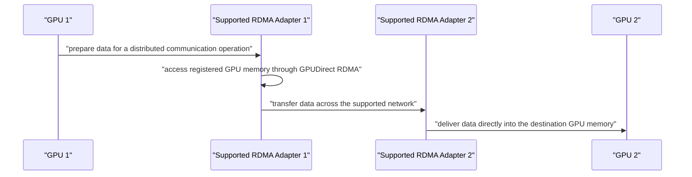

# Module 11 — NVIDIA GPUDirect RDMA

> Part II · Course Module 11 (GPUDirect RDMA) — topic notes

_Direct GPU-to-GPU Data Movement Across Servers_

## မြန်မာဘာသာ version — NVIDIA GPUDirect RDMA

## 1. NVIDIA က DMA ရဲ့ အပေါ်မှာ ဘာတွေ တည်ဆောက်ခဲ့သလဲ

အရင် module မှာ DMA နဲ့ RDMA အကြောင်း လေ့လာခဲ့ပြီး ဖြစ်ပါတယ်—

- **DMA (Direct Memory Access)** — support လုပ်တဲ့ device တစ်ခုက CPU က byte တိုင်း copy မလုပ်ဘဲ accessible memory ဆီ/ကနေ data လွှဲပြောင်းနိုင်ပါတယ်။
- **RDMA (Remote Direct Memory Access)** — support လုပ်တဲ့ network adapters တွေက CPU ပါဝင်မှု လျှော့ချပြီး hosts အမျိုးမျိုးပေါ်က registered memory regions ကြား data လွှဲပြောင်းနိုင်ပါတယ်။

NVIDIA က GPU memory ပါဝင်တဲ့ data movement ကို တိုးတက်စေတဲ့ technologies တွေမှတစ်ဆင့် ဒီ capabilities တွေအပေါ် ဆက်လက် တည်ဆောက်ပါတယ်။

အရေးကြီးတဲ့ technologies နှစ်ခုက—

- **GPUDirect RDMA** — support လုပ်တဲ့ peer devices တွေ (ဥပမာ network adapters) ကို GPU memory နဲ့ တိုက်ရိုက် data ဖလှယ်ခွင့် ပေးပါတယ်။
- **GPUDirect Storage (GDS)** — storage နဲ့ GPU memory ကြား support လုပ်တဲ့ data path ကို ပေးပြီး host memory မှတစ်ဆင့် မလိုအပ်တဲ့ intermediate copies တွေကို လျှော့ချပေးပါတယ်။

၎င်းတို့က ဆက်စပ်တဲ့ data-movement capabilities တွေအပေါ် တည်ဆောက်ထားပေမယ့် ပြဿနာ မတူညီတာတွေကို ဖြေရှင်းပါတယ်။

| Technology | အဓိက ရည်ရွယ်ချက် |
|---|---|
| DMA | Support လုပ်တဲ့ system တစ်ခုအတွင်း device-to-memory data movement ကို ထိရောက်စေခြင်း |
| RDMA | Hosts ကြား registered memory regions ကြား data movement ကို ထိရောက်စေခြင်း |
| GPUDirect RDMA | Support လုပ်တဲ့ peer devices တွေနှင့် GPU memory ကြား တိုက်ရိုက် data ဖလှယ်ခြင်း |
| GPUDirect Storage | Support လုပ်တဲ့ storage systems တွေနှင့် GPU memory ကြား ပိုမိုတိုက်ရိုက် data movement |

## 2. GPU Memory က ဘာကြောင့် အရေးကြီးသလဲ

GPU တစ်ခုမှာ သူ့ကိုယ်ပိုင် high-bandwidth memory ရှိပြီး ပုံမှန် GPU memory ဒါမှမဟုတ် VRAM လို့ ခေါ်ပါတယ်။ ဥပမာ—NVIDIA GPU တစ်ခုမှာ model ပေါ် မူတည်ပြီး 24 GB၊ 40 GB၊ 80 GB ဒါမှမဟုတ် အဲဒီထက်ပို ရှိနိုင်ပါတယ်။

ဒီ memory မှာ GPU က လုပ်ဆောင်ရမယ့် data တွေ—အောက်ပါအပါအဝင်—သိမ်းဆည်းထားပါတယ်—

- Model parameters နဲ့ weights များ။
- Input tensors များ။
- Intermediate activations များ။
- Training အတွင်း အသုံးပြုတဲ့ gradients များ။
- တခြား computation-related data များ။

System memory နဲ့ GPU memory ဆိုတာ memory spaces မတူညီပါဘူး။ Server တစ်ခုမှာ system RAM ရာဂဏန်း gigabytes ရှိနိုင်ပြီး ၎င်းရဲ့ GPU ကတော့ သီးခြား high-bandwidth memory ပမာဏတစ်ခု ရှိပါတယ်။

GPU servers အများကြီးက distributed workload တစ်ခုမှာ ပါဝင်တဲ့အခါ ၎င်းတို့ရဲ့ GPU memories တွေထဲက data တွေကို ဖလှယ်ဖို့ လိုအပ်နိုင်ပါတယ်။

စိန်ခေါ်မှုကတော့ host memory မှတစ်ဆင့် မလိုအပ်တဲ့ copies တွေ မထည့်ဘဲ ဒီ data ကို ထိရောက်စွာ ရွှေ့ပြောင်းဖို့ ဖြစ်ပါတယ်။

## 3. ရိုးရိုးရားရား data-movement ပြဿနာ

GPU servers နှစ်ခုက distributed AI training မှာ ပါဝင်နေတယ်လို့ မှန်းကြည့်ပါ—

- Host 1 မှာ GPU 1 ရှိပါတယ်။
- Host 2 မှာ GPU 2 ရှိပါတယ်။
- GPU 1 က GPU 2 နဲ့ data ဖလှယ်ဖို့ လိုအပ်ပါတယ်။
- Servers တွေက high-speed network တစ်ခုမှတစ်ဆင့် ချိတ်ဆက်ထားပါတယ်။

Host memory မှတစ်ဆင့် data ကို staging လုပ်တဲ့ ရိုးရှင်းတဲ့ path က အောက်ပါအတိုင်း ရှိနိုင်ပါတယ်—

```
HOST 1                                      HOST 2

GPU 1 Memory                                GPU 2 Memory
     │                                            ▲
     ▼                                            │
Host 1 System RAM                           Host 2 System RAM
     │                                            ▲
     ▼                                            │
Network Adapter ─────── Network ───────► Network Adapter
```

**ပုံ ၁ (Figure 1) — Host-memory staging သုံးတဲ့ traditional data path**



**ပုံရှင်းလင်းချက်** — GPU 1 Memory က data ကို အရင် Host 1 System RAM ထဲ ချ၊ ပြီးမှ Network Adapter ကနေ Network ဖြတ်ပြီး Host 2 ဘက်ကို ပို့၊ ရောက်မှ Host 2 System RAM ကနေ GPU 2 Memory ထဲ ထပ်ချရပါတယ်။ RAM ကြား ချိန်းရတဲ့ extra copies တွေကြောင့် memory bandwidth နဲ့ CPU/software overhead ပိုကုန်စေနိုင်ပါတယ်။

ဒါက host-memory staging အသုံးပြုတဲ့ path ရဲ့ conceptual example ဖြစ်ပါတယ်။ တကယ့် traditional data paths တွေက operating system၊ driver၊ communication library နဲ့ hardware ပေါ် မူတည်ပြီး ကွဲပြားနိုင်ပါတယ်။

Host-memory staging က data copies အပိုတွေ ဖြစ်စေနိုင်ပြီး memory bandwidth စားသုံးပြီး CPU ဒါမှမဟုတ် software overhead တိုးစေနိုင်ပါတယ်။

ကြီးမားတဲ့ AI training အတွက် ထပ်ခါထပ်ခါ လွှဲပြောင်းမှုတွေက performance bottleneck တစ်ခု ဖြစ်လာနိုင်ပါတယ်။

## 4. GPUDirect RDMA က ဘယ်လို ကူညီသလဲ

GPUDirect RDMA က support လုပ်တဲ့ peer device တစ်ခု—ဥပမာ ConnectX network adapter—ကို compatible platform နဲ့ software stack မှတစ်ဆင့် support လုပ်တဲ့ GPU memory ကို တိုက်ရိုက် ဝင်ရောက်ခွင့် ပေးပါတယ်။

ဒါက network data ကို host-memory bounce buffer မှတစ်ဆင့် staging လုပ်ရန် လိုအပ်ချက်ကို ဖယ်ရှားပေးနိုင်ပါတယ်။

ရိုးရှင်းတဲ့ data path က အောက်ပါအတိုင်း ရှိပါတယ်—

```
HOST 1                                      HOST 2

GPU 1 Memory                                GPU 2 Memory
     │                                            ▲
     ▼                                            │
Network Adapter ───────── Network ───────► Network Adapter
```

**ပုံ ၂ (Figure 2) — GPUDirect RDMA ပါတဲ့ direct data path**



**ပုံရှင်းလင်းချက်** — ပုံ ၁ နဲ့ ယှဉ်ကြည့်ရင် System RAM အဆင့် မပါတော့ဘဲ GPU 1 Memory ကနေ Network Adapter ဖြတ်ပြီး တန်းပို့၊ လက်ခံတဲ့ဘက်မှာလည်း Network Adapter ကနေ GPU 2 Memory ထဲ တိုက်ရိုက် ရောက်ပါတယ်။ ဒါပေမယ့် setup၊ memory registration နဲ့ completion handling မှာ CPU က ပါဝင်နေဆဲ ဖြစ်ပါတယ်။

Network adapters တွေက support လုပ်တဲ့ hardware paths တွေမှတစ်ဆင့် GPUs တွေရဲ့ memory နဲ့ data ဖလှယ်နိုင်ပါတယ်။

အဓိက idea ကတော့—data ကို GPU memory နဲ့ network ကြား host RAM မှတစ်ဆင့် extra copy မလိုဘဲ ရွှေ့ပြောင်းနိုင်တယ် ဆိုတာ ဖြစ်ပါတယ်။

CPU က application execution၊ communication setup၊ memory registration၊ synchronization နဲ့ completion handling တွေမှာ ပုံမှန်အားဖြင့် ပါဝင်နေဆဲ ဖြစ်ပါတယ်။ ဒါကြောင့် "direct" ဆိုတာ CPU နဲ့ operating system တွေ ဘယ်တော့မှ မပါဝင်ဘူးလို့ မဆိုလိုပါဘူး။

## 5. GPU 1 က GPU 2 ရဲ့ memory ကို တိုက်ရိုက် ဖတ်သလား

မူရင်း transcript က GPUDirect RDMA ကို CPU ဒါမှမဟုတ် operating system မပါဝင်ဘဲ GPU တစ်ခုက နောက် GPU တစ်ခုရဲ့ memory ကို ဝင်ရောက်ခွင့် ပေးတယ်လို့ ဖော်ပြထားပါတယ်။

CPU-mediated data movement လျှော့ချလိုတဲ့ ရည်ရွယ်ချက်ကိုတော့ ဖမ်းမိပေမယ့် implementation ရဲ့ oversimplification ဖြစ်ပါတယ်။

ပိုပြီး တိကျစွာ ပြောရရင်—

1. GPU 1 က distributed communication operation တစ်ခုမှာ ပါဝင်ဆောင်ရွက်နိုင်ပါတယ်။
2. Support လုပ်တဲ့ network adapter တစ်ခုက GPUDirect RDMA mechanism မှတစ်ဆင့် registered GPU memory ကို ဝင်ရောက်နိုင်ပါတယ်။
3. Adapter က support လုပ်တဲ့ network တစ်ခုမှတစ်ဆင့် data ကို လွှဲပြောင်းပါတယ်။
4. လက်ခံတဲ့ adapter က data ကို ပန်းတိုင်ဖြစ်တဲ့ GPU ရဲ့ memory ထဲ တိုက်ရိုက် ပို့ဆောင်ပေးနိုင်ပါတယ်။

**ပုံ ၃ (Figure 3) — GPUDirect RDMA ဖြင့် data လွှဲပြောင်းပုံ အဆင့်ဆင့်**



**ပုံရှင်းလင်းချက်** — ပုံမှာ GPU 1 က operation အတွက် data ပြင်ပြီး RDMA Adapter 1 က registered GPU memory ကို GPUDirect RDMA ဖြင့် တိုက်ရိုက် ဖတ်ယူပါတယ်။ ပြီးရင် network ဖြတ်ပြီး RDMA Adapter 2 ကနေ GPU 2 Memory ထဲ တိုက်ရိုက် ပို့ဆောင်ပေးပါတယ်။ CPU ကတော့ setup၊ registration နဲ့ completion handling မှာ ပါဝင်နေဆဲ ဖြစ်ပါတယ်။

GPU-to-GPU ဖလှယ်မှုကို ပုံမှန်အားဖြင့် NVIDIA NCCL ကဲ့သို့သော communication software တွေက စီစဉ်ဆောင်ရွက်ပါတယ်။ တိကျတဲ့ transfer direction နဲ့ mechanism က operation ပေါ် မူတည်ပါတယ်။

GPUDirect RDMA က GPU တိုင်းကို အကန့်အသတ်မရှိ remote GPU memory ကို ဝင်ရောက်ခွင့် automatic မပေးပါဘူး။ Hardware၊ drivers၊ permissions၊ memory registration၊ platform topology နဲ့ application support အားလုံးက အရေးပါပါတယ်။

## 6. Distributed AI Training ဥပမာ

GPU servers နှစ်ခုက model ကြီးတစ်ခုကို train လုပ်ရာမှာ ပါဝင်တယ်လို့ ယူဆကြည့်ပါ—

1. GPU 1 က ၎င်းရဲ့ သတ်မှတ်ထားတဲ့ batch ကို လုပ်ဆောင်ပြီး တခြား GPUs တွေနဲ့ ဖလှယ်ရမယ့် intermediate results ဒါမှမဟုတ် gradients တွေ ထုတ်လုပ်ပါတယ်။
2. Communication software က support လုပ်တဲ့ networking hardware နဲ့ GPUDirect RDMA ကို အသုံးပြုပြီး မလိုအပ်တဲ့ host-memory staging ကို ရှောင်ရှားကာ GPU memory နဲ့ network ကြား data ကို လွှဲပြောင်းပါတယ်။
3. လက်ခံတဲ့ GPU က ၎င်းရဲ့ နောက် operation အတွက် လိုအပ်တဲ့ data ကို ရရှိပါတယ်။ Communication overhead လျှော့ချခြင်းက cluster ကို data ရွှေ့ချိန်ထက် တွက်ချက်ချိန် ပိုကုန်စေဖို့ ကူညီနိုင်ပါတယ်။

GPU အများကြီးကြား collective communication အတွက် NCCL (NVIDIA Collective Communications Library) ကို All-Reduce၊ Reduce၊ Broadcast နှင့် All-Gather ကဲ့သို့ operations တွေ အကောင်အထည်ဖော်ရာမှာ အသုံးများပါတယ်။ NCCL က support လုပ်တဲ့ high-speed networking နဲ့ GPUDirect RDMA paths တွေကို အသုံးပြုနိုင်ပါတယ်။

## 7. ဘယ် hardware နဲ့ software လိုအပ်သလဲ

GPUDirect RDMA အတွက် compatible end-to-end configuration လိုအပ်ပါတယ်။ Typical လိုအပ်ချက်တွေက—

- Support လုပ်တဲ့ NVIDIA GPUs များ။
- Support လုပ်တဲ့ ConnectX product ကဲ့သို့ compatible network adapter။
- InfiniBand ဒါမှမဟုတ် RoCE Ethernet ကဲ့သို့ support လုပ်တဲ့ network fabric။
- Compatible GPU နဲ့ network drivers။
- Support လုပ်တဲ့ operating system၊ PCIe topology နဲ့ platform configuration။
- ဒီ feature ကို support လုပ်တဲ့ applications ဒါမှမဟုတ် communication libraries။

DPU က infrastructure ရဲ့ အစိတ်အပိုင်း ဖြစ်နိုင်ပေမယ့် GPUDirect RDMA deployment တိုင်းအတွက် မဖြစ်မနေ မဟုတ်ပါဘူး။

## 8. GPUDirect Storage က ဘယ်လို မတူညီသလဲ

GPUDirect Storage က တခြား အဖြစ်များတဲ့ data-movement bottleneck တစ်ခု—storage ကနေ GPU memory ထဲ data ရယူခြင်း—ကို ဖြေရှင်းပါတယ်။

Dataset ကြီးတစ်ခု load နေတဲ့ AI model တစ်ခုကို စဉ်းစားကြည့်ပါ—

Optimized data path မရှိရင် data က GPU memory ဆီ မရောက်မီ host memory မှတစ်ဆင့် copy ဖြစ်နိုင်ပါတယ်။ GDS က support လုပ်တဲ့ storage၊ networking နဲ့ GPU hardware မှတစ်ဆင့် ပိုတိုက်ရိုက်တဲ့ path ကို ဖြစ်စေနိုင်ပါတယ်။

```
GPUDirect RDMA

GPU Memory ◄────► Network Adapter ◄────► Network

GPUDirect Storage

Storage ◄────► Supported I/O Path ◄────► GPU Memory
```

**ပုံ ၄ (Figure 4) — GPUDirect RDMA နဲ့ GPUDirect Storage ရဲ့ ရည်ရွယ်ချက် ကွာခြားပုံ**



**ပုံရှင်းလင်းချက်** — အပေါ်ပိုင်း GPUDirect RDMA က GPU Memory နဲ့ Network ကြား data exchange အတွက် ဖြစ်ပြီး အောက်ပိုင်း GPUDirect Storage ကတော့ Storage ကနေ GPU Memory ထဲ data ရယူတဲ့ path အတွက် ဖြစ်ပါတယ်။ နှစ်ခုလုံးက host memory ကြား မလိုအပ်တဲ့ copy တွေ လျှော့ချပေးပေမယ့် ချိတ်ဆက်ပေးတဲ့ ပစ္စည်း မတူပါဘူး။

## 9. Self-Check Questions (မေးခွန်းနှင့် အဖြေများ)

**Q1. GPUDirect RDMA က ဘယ်လို devices တွေကို GPU memory နဲ့ တိုက်ရိုက် data ဖလှယ်ခွင့် ပေးသလဲ**

Support လုပ်တဲ့ peer devices တွေ—ဥပမာ ConnectX network adapter ဒါမှမဟုတ် BlueField DPU—ကို support လုပ်တဲ့ PCIe peer-to-peer path မှတစ်ဆင့် ဖြစ်ပါတယ်။

**Q2. GPUDirect RDMA က host-memory bounce buffer ကို ဘယ်လို ရှောင်ရှားပေးသလဲ**

Network data ကို host memory မှတစ်ဆင့် staging မလုပ်ဘဲ GPU memory နဲ့ network ကြား တိုက်ရိုက် လွှဲပြောင်းခွင့် ပေးခြင်းဖြင့် ဖြစ်ပါတယ်။

**Q3. "GPUDirect RDMA က GPU 1 ကို CPU ဒါမှမဟုတ် operating system မပါဘဲ GPU 2 ရဲ့ memory ကို တိုက်ရိုက် ဝင်ရောက်ခွင့် ပေးတယ်" — ဒီစကား ဘယ်လောက် မှန်သလဲ**

CPU-mediated data movement လျှော့ချလိုတဲ့ ရည်ရွယ်ချက်ကို ဖော်ပြပေမယ့် implementation ကို oversimplify လုပ်ထားတာ ဖြစ်ပါတယ်။ Support လုပ်တဲ့ adapter က registered GPU memory ကို GPUDirect RDMA mechanism မှတစ်ဆင့် ဝင်ရောက်ပြီး data ကို ပန်းတိုင် GPU memory ထဲ ပို့ဆောင်ပေးတာ ဖြစ်ပြီး CPU က setup၊ registration နဲ့ completion handling တွေမှာ ပါဝင်နေဆဲ ဖြစ်ပါတယ်။

**Q4. GPUDirect RDMA အတွက် ဘာတွေ လိုအပ်သလဲ**

Support လုပ်တဲ့ NVIDIA GPUs၊ compatible network adapter (ဥပမာ ConnectX)၊ support လုပ်တဲ့ fabric (InfiniBand ဒါမှမဟုတ် RoCE)၊ compatible drivers၊ supported OS/PCIe topology နဲ့ feature ကို support လုပ်တဲ့ applications ဒါမှမဟုတ် communication libraries တွေ လိုအပ်ပါတယ်။

**Q5. GPUDirect RDMA နဲ့ GPUDirect Storage ရဲ့ ကွာခြားချက်က ဘာလဲ**

GPUDirect RDMA က GPU memory နဲ့ network ကြား data exchange ကို ရည်ရွယ်ပြီး GPUDirect Storage က storage ကနေ GPU memory ထဲ data ရယူခြင်းကို ရည်ရွယ်ပါတယ်။

## English Version — NVIDIA GPUDirect RDMA

_Direct GPU-to-GPU Data Movement Across Servers_

## 1. What Did NVIDIA Build on Top of DMA?

In the previous module, we learned about DMA and RDMA:

- **DMA (Direct Memory Access)**: A supported device can transfer data to or from accessible memory without requiring the CPU to copy every byte.
- **RDMA (Remote Direct Memory Access)**: Supported network adapters can transfer data between registered memory regions on different hosts with reduced CPU involvement.

NVIDIA builds on these capabilities through technologies that improve data movement involving GPU memory.

Two important technologies are:

- **GPUDirect RDMA** — enables supported peer devices, such as network adapters, to exchange data directly with GPU memory.
- **GPUDirect Storage (GDS)** — enables a supported data path between storage and GPU memory, reducing unnecessary intermediate copies through host memory.

They build on related data-movement capabilities, but they address different problems.

| Technology | Main purpose |
|---|---|
| DMA | Efficient device-to-memory data movement within a supported system |
| RDMA | Efficient data movement between registered memory regions across hosts |
| GPUDirect RDMA | Direct data exchange between supported peer devices and GPU memory |
| GPUDirect Storage | More direct data movement between supported storage systems and GPU memory |

## 2. Why Does GPU Memory Matter?

A GPU has its own high-bandwidth memory, commonly called GPU memory or VRAM. For example, an NVIDIA GPU may have 24 GB, 40 GB, 80 GB, or more, depending on the model.

This memory stores the data the GPU needs to process, such as:

- Model parameters and weights.
- Input tensors.
- Intermediate activations.
- Gradients used during training.
- Other computation-related data.

System memory and GPU memory are different memory spaces. A server may have hundreds of gigabytes of system RAM while its GPU has a separate amount of high-bandwidth memory.

When multiple GPU servers participate in one distributed workload, they may need to exchange data held in their respective GPU memories.

The challenge is to move this data efficiently without introducing unnecessary copies through host memory.

## 3. The Traditional Data-Movement Problem

Imagine two GPU servers participating in distributed AI training.

- Host 1 has GPU 1.
- Host 2 has GPU 2.
- GPU 1 needs to exchange data with GPU 2.
- The servers are connected through a high-speed network.

A simplified path that stages data through host memory could look like this:

```
HOST 1                                      HOST 2

GPU 1 Memory                                GPU 2 Memory
     │                                            ▲
     ▼                                            │
Host 1 System RAM                           Host 2 System RAM
     │                                            ▲
     ▼                                            │
Network Adapter ─────── Network ───────► Network Adapter
```

**Figure 1 — Traditional data path using host-memory staging**


**Figure walkthrough** — The data from GPU 1 memory is first dropped into Host 1 system RAM, sent through the network adapter and the network to Host 2, and then copied from Host 2 system RAM into GPU 2 memory. Those extra copies through RAM consume memory bandwidth and add CPU or software overhead.

This is a conceptual example of a path that uses host-memory staging. Actual traditional data paths vary by operating system, driver, communication library, and hardware.

Host-memory staging can introduce additional data copies, consume memory bandwidth, and increase CPU or software overhead.

For large-scale AI training, repeated transfers can become a performance bottleneck.

## 4. How GPUDirect RDMA Helps

GPUDirect RDMA enables a supported peer device, such as a ConnectX network adapter, to access supported GPU memory directly through a compatible platform and software stack.

This can remove the need to stage network data through a host-memory bounce buffer.

A simplified data path looks like this:

```
HOST 1                                      HOST 2

GPU 1 Memory                                GPU 2 Memory
     │                                            ▲
     ▼                                            │
Network Adapter ───────── Network ───────► Network Adapter
```

**Figure 2 — Direct data path with GPUDirect RDMA**


**Figure walkthrough** — Compared with Figure 1, the system RAM step is gone: GPU 1 memory sends data through the network adapter directly, and the receiving adapter delivers it into GPU 2 memory. The CPU is still involved in setup, memory registration, and completion handling.

The network adapters can exchange data with the GPUs' memory through supported hardware paths.

This is the key idea: the data can move between GPU memory and the network without requiring an extra copy through host RAM.

The CPU is still typically involved in application execution, communication setup, memory registration, synchronization, and completion handling. Therefore, "direct" does not mean that the CPU and operating system are never involved.

## 5. Does GPU 1 Directly Read GPU 2's Memory?

The source transcript describes GPUDirect RDMA as allowing one GPU to access another GPU's memory without involving the CPU or operating system.

That captures the goal of reducing CPU-mediated data movement, but it is an oversimplification of the implementation.

More precisely:

1. GPU 1 can participate in a distributed communication operation.
2. A supported network adapter can access the registered GPU memory through the GPUDirect RDMA mechanism.
3. The adapter transfers data across the supported network.
4. The receiving adapter can deliver the data directly into the destination GPU's memory.

**Figure 3 — Transferring data step by step with GPUDirect RDMA**



**Figure walkthrough** — GPU 1 prepares the data for the operation, and RDMA Adapter 1 reads the registered GPU memory directly through the GPUDirect RDMA mechanism. The data crosses the supported network, and RDMA Adapter 2 delivers it directly into GPU 2's memory. The CPU remains involved in setup, registration, and completion handling.

The GPU-to-GPU exchange is typically orchestrated by communication software such as NVIDIA NCCL. The exact transfer direction and mechanism depend on the operation.

GPUDirect RDMA does not automatically give every GPU unrestricted access to arbitrary remote GPU memory. Hardware, drivers, permissions, memory registration, platform topology, and application support all matter.

## 6. A Distributed AI Training Example

Suppose two GPU servers participate in training one large model:

1. GPU 1 processes its assigned batch and generates intermediate results or gradients that must be exchanged with other GPUs.
2. The communication software uses supported networking hardware and GPUDirect RDMA to transfer data between GPU memory and the network, avoiding unnecessary host-memory staging.
3. The receiving GPU obtains the data needed for its next operation. Reducing communication overhead can help the cluster spend more time computing and less time moving data.

For collective communication among many GPUs, NCCL (NVIDIA Collective Communications Library) is commonly used to implement operations such as All-Reduce, Reduce, Broadcast, and All-Gather. NCCL can use supported high-speed networking and GPUDirect RDMA paths.

## 7. What Hardware and Software Are Required?

GPUDirect RDMA requires a compatible end-to-end configuration. Typical requirements include:

- Supported NVIDIA GPUs.
- A compatible network adapter, such as a supported ConnectX product.
- A supported network fabric, such as InfiniBand or RoCE Ethernet.
- Compatible GPU and network drivers.
- A supported operating system, PCIe topology, and platform configuration.
- Applications or communication libraries that support the feature.

A DPU may be part of the infrastructure, but it is not mandatory for every GPUDirect RDMA deployment.

## 8. How Is GPUDirect Storage Different?

GPUDirect Storage addresses another common data-movement bottleneck: getting data from storage into GPU memory.

Consider an AI model loading a large dataset.

Without an optimized data path, data may be copied through host memory before reaching GPU memory. GDS can enable a more direct path through supported storage, networking, and GPU hardware.

```
GPUDirect RDMA

GPU Memory ◄────► Network Adapter ◄────► Network

GPUDirect Storage

Storage ◄────► Supported I/O Path ◄────► GPU Memory
```

**Figure 4 — Different purposes of GPUDirect RDMA and GPUDirect Storage**


**Figure walkthrough** — The top diagram shows GPUDirect RDMA, which targets data exchange between GPU memory and the network. The bottom diagram shows GPUDirect Storage, which targets getting data from storage into GPU memory. Both reduce unnecessary copies through host memory, but they connect different components.

## 9. Self-Check Questions (Questions and Answers)

**Q1. What kind of devices does GPUDirect RDMA let exchange data directly with GPU memory?**

Supported peer devices — such as a ConnectX network adapter or a BlueField DPU — over a supported PCIe peer-to-peer path.

**Q2. How does GPUDirect RDMA avoid the host-memory bounce buffer?**

It allows data to move directly between GPU memory and the network without staging it through host memory.

**Q3. How accurate is the statement "GPUDirect RDMA lets GPU 1 access GPU 2's memory directly, without the CPU or operating system"?**

It captures the goal of reducing CPU-mediated data movement but oversimplifies the implementation. A supported adapter accesses registered GPU memory through the GPUDirect RDMA mechanism and delivers data into the destination GPU's memory, while the CPU remains involved in setup, registration, and completion handling.

**Q4. What is required for GPUDirect RDMA?**

Supported NVIDIA GPUs, a compatible network adapter (such as ConnectX), a supported fabric (InfiniBand or RoCE), compatible drivers, a supported OS/PCIe topology, and applications or communication libraries that support the feature.

**Q5. What is the difference between GPUDirect RDMA and GPUDirect Storage?**

GPUDirect RDMA targets data exchange between GPU memory and the network; GPUDirect Storage targets getting data from storage into GPU memory.

## Technical review notes

- The supplied source transcript for this module ends after section 8's comparison diagram; no summary or review questions were supplied. Sections 1–8 are preserved as given, and section 9's self-check questions were written strictly from the module's own content (no new specs, commands, or benchmarks introduced).
- The section-6 steps in the source carried stray `</box>` markup artifacts from the paste; they were converted into a plain numbered list without changing the three steps' content.
- `<Cite refs={...}/>` reply-UI artifacts were dropped; no content was attached to them.
- Example GPU memory sizes (24 GB / 40 GB / 80 GB) are the transcript's illustrative examples, not a specification claim.
- Mermaid figures (Figures 1–4) with figure walkthroughs were added inline to both language sections; all existing text, ASCII diagrams, and review notes are unchanged.
