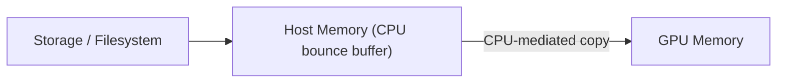
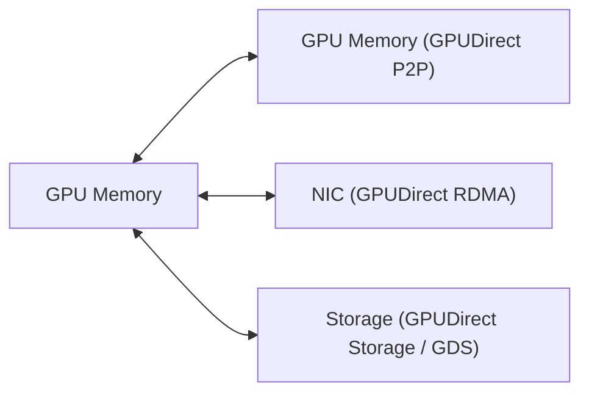
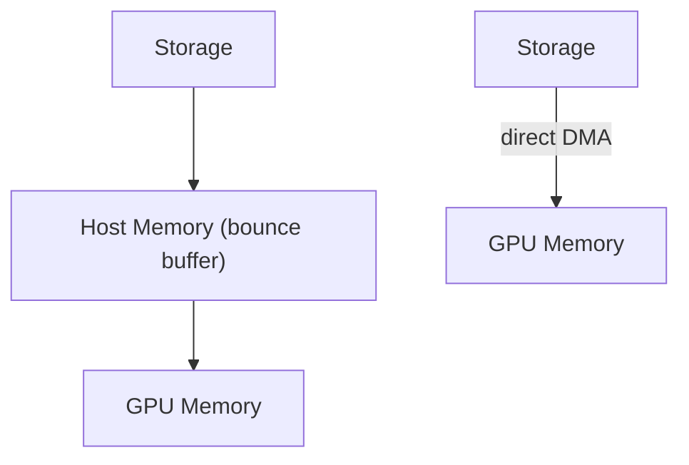
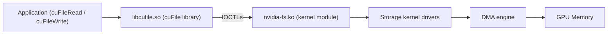

# Module 12 — GPUDirect Storage (GDS)

> Part II · GPU Interconnects, Networking and Data Movement — Course Module 12 (GPUDirect Storage) — topic notes

_Storage ကနေ GPU Memory ဆီ တိုက်ရိုက် Data Path_

## မြန်မာဘာသာ version — NVIDIA GPUDirect Storage (GDS)

## 1. ပြဿနာ — Data Loading နှင့် I/O Bottleneck

AI training၊ HPC နှင့် data analytics မှာ dataset တွေ ကြီးမားလာလေလေ၊ storage ကနေ GPU memory ဆီ data တွေ load လုပ်ရတဲ့ အချိန်က application performance ကို ပိုမိုသက်ရောက်လာပါတယ်။ GPU တွေ တိုးတက် မြန်ဆန်လာလေလေ ၎င်းတို့ စားသုံးမယ့် data ပမာဏလည်း ပိုများလာပြီး နှေးကွေးတဲ့ I/O ကြောင့် မြန်ဆန်တဲ့ GPU တွေက data အတွက် စောင့်ဆိုင်းနေရတဲ့ အခြေအနေ (fast GPUs are starved by slow IO) ဖြစ်လာနိုင်ပါတယ်။

ရိုးရိုးရားရား storage I/O path မှာ data က GPU memory ထဲ မရောက်ခင် host memory ထဲက bounce buffer မှတစ်ဆင့် ကြားခံ copy ဖြစ်ပါတယ်—

```
Storage / Filesystem
     │
     ▼
Host Memory (CPU bounce buffer)
     │
     ▼
GPU Memory
```

**ပုံ ၁ (Figure 1) — ရိုးရိုး storage I/O path မှာ bounce buffer ကြားခံ copy ဖြစ်ပုံ**



**ပုံရှင်းလင်းချက်** — data က Storage ကနေ အရင် Host Memory ထဲက bounce buffer ကို ရောက်ပြီးမှ CPU ကြားခံ copy ကတစ်ဆင့် GPU Memory ထဲ ရောက်ပါတယ်။ အလယ်က Host Memory အဆင့် ထပ်ပါလို့ extra copy ဖြစ်ပြီး memory bandwidth၊ CPU အားနဲ့ latency ပိုကုန်စေပါတယ်။

ဒီ path မှာ ပြဿနာတွေက—

- မလိုအပ်တဲ့ ကြားခံ data copies တွေ ဖြစ်ပေါ်ပြီး system memory bandwidth ကို စားသုံးပါတယ်။
- CPU က data copy လုပ်ငန်းတွေမှာ ပါဝင်ရတဲ့အတွက် CPU utilization မြင့်တက်ပြီး တခြားအလုပ်တွေအတွက် CPU အား နည်းသွားနိုင်ပါတယ်။
- Latency မြင့်တက်စေပြီး ကြီးမားတဲ့ dataset တွေ ထပ်ခါထပ်ခါ load ရာမှာ performance bottleneck တစ်ခု ဖြစ်လာနိုင်ပါတယ်။

ဒီကြားခံ copy နဲ့ CPU overhead ကို လျှော့ချဖို့ NVIDIA က GPUDirect Storage (GDS) ကို ဖန်တီးထားပါတယ်။

## 2. အဓိက အယူအဆများ (Core Concepts)

### 2.1 GDS ဆိုတာ ဘာလဲ

GPUDirect Storage (GDS) က GPU memory နဲ့ storage ကြား direct memory access (DMA) transfers အတွက် direct data path တစ်ခု ပေးပါတယ်။ CPU မှတစ်ဆင့် bounce buffer ကို ရှောင်ရှားနိုင်တဲ့အတွက် system bandwidth bottlenecks သက်သာစေပြီး latency နဲ့ CPU ရဲ့ utilization load ကို လျော့ကျစေနိုင်ပါတယ်။

GDS က local storage (ဥပမာ NVMe) ဖြစ်ဖြစ် remote storage (ဥပမာ NVMe over Fabric (NVMe-oF)) ဖြစ်ဖြစ် GPU memory နဲ့ ကြား direct data path ကို ဖွင့်ပေးနိုင်ပါတယ်။ NIC ဒါမှမဟုတ် storage နားမှာ ရှိတဲ့ DMA engine က data ကို direct path အတိုင်း GPU memory ထဲ/ထဲကနေ ရွှေ့ပြောင်းပေးပြီး CPU ကို ဝန်မပေးပါဘူး။

### 2.2 GPUDirect Family

GPUDirect ဆိုတာ Magnum IO ရဲ့ အစိတ်အပိုင်းဖြစ်တဲ့ technologies မိသားစုဖြစ်ပြီး NVIDIA data center GPUs တွေရဲ့ data movement နဲ့ access ကို တိုးတက်စေပါတယ်။ ဒီ technologies တွေထဲမှာ GPUDirect P2P၊ GPUDirect RDMA၊ GPUDirect Storage နဲ့ GPUDirect Video တို့ ပါဝင်ပါတယ်။ အဓိက သုံးခုရဲ့ ရည်ရွယ်ချက်ကွာခြားချက်ကို အောက်ပါ ဇယားမှာ နှိုင်းယှဉ်ကြည့်ပါ—

| Technology | တိုက်ရိုက် လွှဲပြောင်းမှု (Direct DMA) |
|---|---|
| GPUDirect P2P (Peer-to-Peer) | GPU memory နှစ်ခုကြား |
| GPUDirect RDMA | GPU memory နဲ့ NIC (network adapter) ကြား |
| GPUDirect Storage (GDS) | GPU memory နဲ့ storage ကြား |

**ပုံ ၂ (Figure 2) — GPUDirect family ရဲ့ direct DMA ချိတ်ဆက်မှု သုံးမျိုး**



**ပုံရှင်းလင်းချက်** — ပုံမှာ GPU Memory ကို ဗဟိုပြုပြီး ချိတ်ဆက်မှု သုံးမျိုးကို မြင်ရပါတယ် — GPUDirect P2P က GPU Memory နှစ်ခုကြား၊ GPUDirect RDMA က NIC (network adapter) နဲ့ကြား၊ GPUDirect Storage (GDS) က Storage နဲ့ကြား တိုက်ရိုက် DMA ဖြစ်ပါတယ်။ တစ်ခုချင်းစီရဲ့ endpoint မတူတာကို ကြည့်ပြီး ဘယ် technology ကို ဘယ်အခါ သုံးရမလဲ ခွဲခြားနိုင်ပါတယ်။

### 2.3 Direct DMA Path က ဘယ်လို အလုပ်လုပ်သလဲ

ရိုးရိုး I/O path နဲ့ GDS direct path ကို နှိုင်းယှဉ်ကြည့်ပါ—

```
ရိုးရိုး I/O path (CPU bounce buffer)

Storage ──► Host Memory ──► GPU Memory
            (bounce buffer)

GDS Direct Path

Storage ──────────────────► GPU Memory
            (direct DMA)
```

ရိုးရိုး path မှာ data က storage ကနေ host memory ထဲ အရင်ရောက်ပြီးမှ CPU ကြားခံ copy ကတစ်ဆင့် GPU memory ထဲ ရောက်ပါတယ်။ GDS direct path မှာတော့ storage data ကို host memory ထဲ ကြားခံမထည့်ဘဲ DMA engine က GPU memory ထဲကို တိုက်ရိုက် ရေးသွင်းပေးနိုင်ပါတယ်။ ဒါက extra copies တွေကို ဖယ်ရှားပေးပြီး CPU overhead နဲ့ latency ကို လျှော့ချပါတယ်။

**ပုံ ၃ (Figure 3) — ရိုးရိုး I/O path နဲ့ GDS direct path နှိုင်းယှဉ်ချက်**



**ပုံရှင်းလင်းချက်** — ပုံထဲမှာ data path နှစ်စကို ယှဉ်ပြထားပါတယ်။ တစ်ခုက Storage → Host Memory (bounce buffer) → GPU Memory ဆိုပြီး အဆင့်နှစ်ဆင့် ဖြတ်ရပြီး နောက်တစ်ခုကတော့ Storage က direct DMA ဖြင့် GPU Memory ထဲ တိုက်ရိုက် ရောက်ပါတယ်။ GDS က ဒုတိယ path ကို ဖွင့်ပေးခြင်းဖြစ်လို့ extra copy နဲ့ CPU overhead လျော့ကျသွားပါတယ်။

NVIDIA ရဲ့ ရုပ်ပုံမှာ traditional staging path နဲ့ GDS direct path ကို အောက်ပါအတိုင်း ယှဉ်ပြထားပါတယ်—

## 3. Software Components များ

GDS software architecture ရဲ့ အဓိက အစိတ်အပိုင်းတွေက အောက်ပါအတိုင်း ဖြစ်ပါတယ်—

1. **libcufile.so (user-level cuFile library)** — application တွေ အသုံးပြုတဲ့ cuFile API ကို ပေးပါတယ်။ cuFileRead/cuFileWrite က POSIX pread/pwrite နဲ့ ဆင်တူပြီး O_DIRECT နဲ့ အသုံးပြုပါတယ်။
2. **nvidia-fs.ko (kernel-level driver)** — DKMS kernel module ဖြစ်ပြီး cuFile user library ကနေ လာတဲ့ IOCTLs တွေကို ကိုင်တွယ်ပါတယ်။ storage drivers တွေကနေ ခေါ်ယူတဲ့ DMA callbacks တွေကို implement လုပ်ပေးပြီး GPU virtual addresses တွေကို physical addresses တွေအဖြစ် ပြောင်းလဲပေးပါတယ်။
3. **Storage kernel drivers** — cuFileDriverOpen မှတစ်ဆင့် nvidia-fs ဆီ callbacks တွေ register လုပ်ပါတယ်။

**ပုံ ၄ (Figure 4) — GDS software components တွေ ချိတ်ဆက်အလုပ်လုပ်ပုံ**



**ပုံရှင်းလင်းချက်** — Application က cuFile API ဖြင့် libcufile.so ကို ခေါ်ပြီး၊ ၎င်းက IOCTLs ဖြင့် nvidia-fs.ko kernel module ကို အသိပေးပါတယ်။ nvidia-fs.ko က storage kernel drivers ကနေ ခေါ်ယူတဲ့ DMA callbacks ကို ကိုင်တွယ်ပြီး DMA engine က data ကို GPU Memory ထဲ/ထဲကနေ တိုက်ရိုက် ရွှေ့ပေးပါတယ်။ Data path ပေါ်မှာ CPU ကြားခံ copy မပါဝင်ပါဘူး။

GDS software architecture တစ်ခုလုံးကို NVIDIA ရဲ့ architecture overview ပုံမှာ အောက်ပါအတိုင်း ကြည့်ရှုနိုင်ပါတယ်—

Packaging အနေနဲ့ libraries နဲ့ kernel sources တွေကို CUDA toolkit နဲ့အတူ (Ubuntu/RedHat အတွက် debs/RPMs အဖြစ်) ထုပ်ပိုးထားပါတယ်။ nvidia_fs.ko kernel sources တွေကို DGX BaseOS 6.0+ releases တွေမှာလည်း တွေ့ရှိနိုင်ပါတယ်။

Documentation မှာ interfaces နှစ်ခု ရှိပါတယ်—

| Interface | အသုံးပြုပုံ |
|---|---|
| cuFile | Filesystem-based GDS — local နဲ့ distributed storage အတွက် အဓိက entry point |
| cuObject | GDS data paths ကို အသုံးပြုတဲ့ object storage solutions များအတွက် client/server APIs |

## 4. အလုပ်လုပ်ပုံ နှင့် Usage Patterns

- **cuFileRead / cuFileWrite** — POSIX pread/pwrite နဲ့ ဆင်တူသော operations များဖြစ်ပြီး O_DIRECT ဖြင့် file data ကို GPU memory ထဲ/ထဲကနေ ဖတ်ခြင်းနှင့် ရေးသွင်းခြင်း လုပ်ပါတယ်။
- **cuFile Batch APIs** — Linux AIO ကဲ့သို့ asynchronous IO အတွက် batch operations များ ပေးပါတယ်။
- **cuFile stream APIs** — CUDA 12.2 မှ စတင်ပြီး CUDA stream ပေါ်မှာ asynchronous submission အတွက် ရရှိနိုင်ပါတယ်။
- **Stream-ordered async operations** — CUDA streams ပေါ်မှာ IO-after-compute နဲ့ compute-after-IO ordering ကို ထိန်းချုပ်နိုင်ပြီး streams အမျိုးမျိုးနှင့် DMA engines အမျိုးမျိုးကြား concurrency ရယူနိုင်ပါတယ်။

အသုံးပြုရာမှာ လိုက်နာရမယ့် အခြေခံအချက်တွေက—

- GPU memory ထဲက buffers တွေကို pinned လုပ်ထားရပါမယ်။
- O_DIRECT requirements တွေကို လိုက်နာရပါမယ် (O_DIRECT Requirements Guide ကို ကြည့်ပါ)။
- Applications တွေကို CUDA + cuFile APIs ဖြင့် ရေးသားအသုံးပြုရပါမယ်။

## 5. ဘယ်အခါ အသုံးပြုသင့်သလဲ (When to Use / Suitability)

GDS က application developers တွေအတွက် အောက်ပါ benefits တွေ ပေးပါတယ်—

- GPU memory နဲ့ storage ကြား direct path ကို ဖွင့်ပေးခြင်း။
- Bandwidth bottlenecks သက်သာစေခြင်း၊ latency လျှော့ချခြင်း၊ data transfer အတွက် CPU ပေါ် ဝန်ပိခြင်းကို လျှော့ချခြင်း။
- Storage data transfer ကို လုပ်ဆောင်ရာမှာ CPU အပေါ် မူတည်မှုနဲ့ performance impact ကို လျှော့ချခြင်း။
- Computational pipeline ကို အပြည့်အဝ GPU ပေါ် ပြောင်းထားရင် storage နဲ့ GPU ကြား ရွှေ့ပြောင်းတဲ့ data ကို CPU ထက် GPU က first touch နဲ့ last touch လုပ်တဲ့အတွက် compute advantage ပေါ်မှာ performance force multiplier ဖြစ်စေခြင်း။
- OS-based file access နဲ့ interoperability ရှိခြင်း — traditional file IO ဖြင့် device ပေါ်/ပြင်ပ data လွှဲပြောင်းပြီး cuFile APIs သုံးတဲ့ middleware ဒါမှမဟုတ် application ကနေ ဆက်လက်အသုံးပြုနိုင်ခြင်း။
- GPU နဲ့ data လွှဲပြောင်းရာမှာ standard Linux file IO ထက် performance ပိုကောင်းခြင်းနှင့် CPU load ပိုနည်းခြင်း။
- Memory allocation နဲ့ data movement ကို expert-level သတိထား စီမံခန့်ခွဲမှု မလိုအပ်ဘဲ ပိုမိုလွယ်ကူစွာ အသုံးပြုနိုင်ခြင်း။
- POSIX pread/pwrite with O_DIRECT ထက် unaligned transfers ကို ပိုမိုကျယ်ပြန့်စွာ support လုပ်ခြင်း။
- Local နှင့် distributed file systems၊ block interfaces၊ namespace systems စသည့် storage အမျိုးမျိုးမှာ အထွေထွေ အသုံးပြုနိုင်ခြင်း (standard Linux နှင့် third-party နှစ်မျိုးလုံး)။

Application တစ်ခု GDS အတွက် သင့်/မသင့် စဉ်းစားရာမှာ Design Guide အရ အောက်ပါ requirements တွေ ရှိရပါမယ်—

- I/O က application ရဲ့ performance bottleneck အဓိက ဖြစ်နေရမယ်။
- Data transfers တွေကို explicit အနေနဲ့ လုပ်ဆောင်ရမယ်။
- Buffers တွေ GPU memory မှာ pinned ဖြစ်နေရမယ်။
- GPUDirect-capable NVIDIA GPUs (Data Center GPUs) တွေမှာ CUDA + cuFile APIs ကို အသုံးပြုရမယ်။

## 6. ကန့်သတ်ချက်များ နှင့် သတိပြုရန် အချက်များ (Limitations and Cautions)

- **Compatibility fallback path** — unsupported filesystem၊ driver ဒါမှမဟုတ် topology ကြောင့် direct path မဖြစ်နိုင်ရင် CPU bounce buffer မှတစ်ဆင့် compatibility path အဖြစ် ကျဆင်းသွားနိုင်ပြီး ပိုမိုနှေးကွေးပါတယ်။ GDS tooling (gdscheck) က direct path active ဖြစ်/မဖြစ် စစ်ဆေးပေးနိုင်ပါတယ် (tool details များကို installation guide ကို ကြည့်ပါ)။
- **Release-dependent support** — filesystem နဲ့ driver support က release ပေါ် မူတည်ပါတယ်။ supported filesystems and platforms ကို အမြဲ GDS Release Notes အတိုင်း စစ်ဆေးပါ။
- **Topology နှင့် P2P** — GPU၊ storage နှင့် NIC တို့ရဲ့ PCIe topology (P2P support) နဲ့ IOMMU settings တွေက direct path ကို တိုက်ရိုက် သက်ရောက်ပါတယ်။
- **O_DIRECT requirements** — O_DIRECT အသုံးပြုမှုဆိုင်ရာ requirements တွေ လိုက်နာရပါမယ်။
- **Performance ဂဏန်းများ** — performance က workload၊ hardware နဲ့ configuration ပေါ် မူတည်ပါတယ်။ ဒီ module မှာ benchmark ဂဏန်းတွေ မဖော်ပြထားပါဘူး။

## 7. Self-Check Questions (မေးခွန်းနှင့် အဖြေများ)

**Q1. GDS က ဖယ်ရှားပေးတဲ့ အဓိက ကြားခံ copy က ဘာလဲ**

CPU memory ထဲက bounce buffer မှတစ်ဆင့် ကြားခံ copy ဖြစ်ပါတယ်။ GDS က storage နဲ့ GPU memory ကြား direct DMA path ကို အသုံးပြုပါတယ်။

**Q2. GPUDirect P2P၊ GPUDirect RDMA နှင့် GDS ရဲ့ ကွာခြားချက်က ဘာလဲ**

P2P က GPU memory နှစ်ခုကြား direct DMA၊ RDMA က GPU memory နဲ့ NIC ကြား direct DMA၊ GDS က GPU memory နဲ့ storage ကြား direct DMA ဖြစ်ပါတယ်။

**Q3. GDS software architecture ရဲ့ အဓိက အစိတ်အပိုင်း သုံးခုက ဘာတွေလဲ**

libcufile.so (user-level cuFile library)၊ nvidia-fs.ko (DKMS kernel module) နဲ့ nvidia-fs ဆီ callbacks register လုပ်တဲ့ storage kernel drivers တို့ ဖြစ်ပါတယ်။

**Q4. cuFile နဲ့ cuObject ရဲ့ ကွာခြားချက်က ဘာလဲ**

cuFile က filesystem-based GDS အတွက် local နှင့် distributed storage ရဲ့ အဓိက entry point ဖြစ်ပြီး cuObject က GDS data paths သုံး object storage solutions များအတွက် client/server APIs ဖြစ်ပါတယ်။

**Q5. GDS အသုံးမပြုခင် application suitability အတွက် စစ်ဆေးရမယ့် အချက်လေးချက်က ဘာတွေလဲ**

I/O က significant performance bottleneck ဖြစ်ခြင်း၊ data transfers များ explicit ဖြစ်ခြင်း၊ buffers များ GPU memory တွင် pinned ဖြစ်ခြင်း၊ GPUDirect-capable NVIDIA GPUs (Data Center GPUs) တွင် CUDA + cuFile APIs အသုံးပြုခြင်းတို့ ဖြစ်ပါတယ်။

## English Version — NVIDIA GPUDirect Storage (GDS)

_A Direct Data Path Between Storage and GPU Memory_

## 1. The Problem — The Data-Loading and I/O Bottleneck

In AI training, HPC, and data analytics, datasets keep growing, and the time spent loading data from storage into GPU memory increasingly affects application performance. As GPUs get faster, their demand for I/O bandwidth grows too, and slow I/O can leave fast GPUs starved — waiting for data instead of computing.

In a traditional storage I/O path, data passes through a bounce buffer in host memory before it reaches GPU memory:

```
Storage / Filesystem
     │
     ▼
Host Memory (CPU bounce buffer)
     │
     ▼
GPU Memory
```

**Figure 1 — The bounce-buffer copy on a traditional storage I/O path**


**Figure walkthrough** — Data from storage first lands in the bounce buffer in host memory, and only then does a CPU-mediated copy move it into GPU memory. That extra host-memory step means extra copies, consuming memory bandwidth and CPU time, and adding latency.

This path has several problems:

- Unnecessary intermediate data copies occur and consume system memory bandwidth.
- The CPU participates in the copying work, raising CPU utilization and starving other work.
- Latency increases, and loading large datasets repeatedly becomes a performance bottleneck.

NVIDIA GPUDirect Storage (GDS) exists to reduce this intermediate copy and the CPU overhead that comes with it.

## 2. Core Concepts

### 2.1 What Is GDS?

GPUDirect Storage (GDS) enables a direct data path for direct memory access (DMA) transfers between GPU memory and storage. By avoiding a bounce buffer through the CPU, it can relieve system bandwidth bottlenecks and decrease latency and the utilization load on the CPU.

GDS can open a direct data path between GPU memory and local storage (for example NVMe) or remote storage (for example NVMe over Fabric (NVMe-oF)). A DMA engine near the NIC or the storage moves data on a direct path into or out of GPU memory — without burdening the CPU.

### 2.2 The GPUDirect Family

GPUDirect is a family of technologies that is part of Magnum IO, enhancing data movement and access for NVIDIA data center GPUs. The family includes GPUDirect P2P, GPUDirect RDMA, GPUDirect Storage, and GPUDirect Video. Compare the purposes of the main three:

| Technology | Direct DMA between |
|---|---|
| GPUDirect P2P (Peer-to-Peer) | Two GPUs' memory |
| GPUDirect RDMA | GPU memory and a NIC (network adapter) |
| GPUDirect Storage (GDS) | GPU memory and storage |

**Figure 2 — The three direct-DMA connections of the GPUDirect family**


**Figure walkthrough** — With GPU memory at the center, the figure shows three connections: GPUDirect P2P links two GPU memories, GPUDirect RDMA links GPU memory and the NIC (network adapter), and GPUDirect Storage (GDS) links GPU memory and storage. Each endpoint tells you which technology fits which situation.

### 2.3 How a Direct DMA Path Works

Compare the traditional I/O path with the GDS direct path:

```
Traditional I/O path (CPU bounce buffer)

Storage ──► Host Memory ──► GPU Memory
            (bounce buffer)

GDS Direct Path

Storage ──────────────────► GPU Memory
            (direct DMA)
```

On the traditional path, data lands in host memory first and reaches GPU memory through a CPU-mediated copy. On the GDS direct path, a DMA engine writes storage data straight into GPU memory without staging it through host memory. This removes extra copies and reduces CPU overhead and latency.

**Figure 3 — Traditional I/O path vs. the GDS direct path**


**Figure walkthrough** — The figure compares two data paths. One goes Storage → Host Memory (bounce buffer) → GPU Memory in two steps; the other delivers data from storage straight into GPU memory via direct DMA. GDS enables that second path, so extra copies and CPU overhead shrink.

NVIDIA's diagram below compares the traditional staging path with the GDS direct path—

## 3. Software Components

The primary components of the GDS software architecture are:

1. **libcufile.so (user-level cuFile library)** — provides the cuFile API that applications use. cuFileRead/cuFileWrite are similar to POSIX pread/pwrite and are used with O_DIRECT.
2. **nvidia-fs.ko (kernel-level driver)** — a DKMS kernel module that handles IOCTLs from the cuFile user library. It implements DMA callbacks called from storage drivers and translates GPU virtual addresses to physical addresses.
3. **Storage kernel drivers** — register callbacks to nvidia-fs via cuFileDriverOpen.

**Figure 4 — How the GDS software components connect**


**Figure walkthrough** — The application calls libcufile.so through the cuFile API, which notifies the nvidia-fs.ko kernel module with IOCTLs. nvidia-fs.ko handles the DMA callbacks called by the storage kernel drivers, and the DMA engine moves data directly into or out of GPU memory. No CPU-mediated copy sits on the data path.

The whole GDS software architecture can be seen in NVIDIA's architecture overview diagram below—

For packaging, the libraries and kernel sources ship with the CUDA toolkit (as debs/RPMs for Ubuntu/RedHat). The nvidia_fs.ko kernel sources are also available in DGX BaseOS 6.0+ releases.

The documentation exposes two interfaces:

| Interface | Usage |
|---|---|
| cuFile | Filesystem-based GDS — the main entry point for local and distributed storage |
| cuObject | Client/server APIs for object storage solutions that use GDS data paths |

## 4. How It Works — Usage Patterns

- **cuFileRead / cuFileWrite** — operations similar to POSIX pread/pwrite, used with O_DIRECT to read and write file data into and out of GPU memory.
- **cuFile Batch APIs** — batch operations for asynchronous IO, similar in spirit to Linux AIO.
- **cuFile stream APIs** — available from CUDA 12.2 for asynchronous submission on a CUDA stream.
- **Stream-ordered async operations** — IO-after-compute and compute-after-IO ordering can be controlled on CUDA streams, with concurrency across streams and multiple DMA engines.

Basic rules when using the APIs:

- Buffers in GPU memory must be pinned.
- O_DIRECT requirements apply (see the O_DIRECT Requirements Guide).
- Applications must be written with the CUDA + cuFile APIs.

## 5. When to Use GDS — Application Suitability

GDS provides the following benefits for application developers:

- Enables a direct path between GPU memory and storage.
- Relieves bandwidth bottlenecks, reduces latency, and reduces the load on CPUs for data transfer.
- Reduces the performance impact and dependence on CPUs to process storage data transfer.
- Acts as a performance force multiplier on top of the compute advantage for pipelines fully migrated to the GPU, so the GPU — not the CPU — has the first and last touch of data moving between storage and the GPU.
- Interoperates with OS-based file access: data can move to and from the device with traditional file IO and then be accessed by middleware or applications that use the cuFile APIs.
- Increased performance and lower CPU load relative to standard Linux file IO for transfers to and from the GPU.
- Easier memory management — no careful expert management of memory allocation and data movement is required.
- Broader support for unaligned transfers than POSIX pread/pwrite with O_DIRECT.
- Generality across local and distributed file systems, block interfaces, and namespace systems (standard Linux and third-party).

Per the Design Guide, an application is a good fit for GDS when:

- I/O is a significant performance bottleneck.
- Data transfers are explicit.
- Buffers are pinned in GPU memory.
- CUDA + cuFile APIs are used with GPUDirect-capable NVIDIA GPUs (Data Center GPUs).

## 6. Limitations and Cautions

- **Compatibility fallback path** — when the direct path is not possible (unsupported filesystem, driver, or topology), I/O can fall back to a compatibility path through CPU bounce buffers, which is slower. GDS tooling (gdscheck) verifies whether the direct path is active (for tool details, see the installation guide).
- **Release-dependent support** — filesystem and driver support depends on the release. Always check supported filesystems and platforms per the GDS Release Notes.
- **Topology and P2P** — the PCIe topology (P2P support) of the GPU, storage, and NIC, and IOMMU settings, directly affect the direct path.
- **O_DIRECT requirements** — the O_DIRECT usage requirements must be met.
- **Performance numbers** — performance depends on the workload, hardware, and configuration. This module quotes no benchmark numbers.

## 7. Self-Check Questions (Questions and Answers)

**Q1. What intermediate copy does GDS eliminate?**

The intermediate copy through a bounce buffer in CPU memory. GDS uses a direct DMA path between storage and GPU memory.

**Q2. What is the difference between GPUDirect P2P, GPUDirect RDMA, and GDS?**

P2P is direct DMA between two GPUs' memory, RDMA is direct DMA between GPU memory and a NIC, and GDS is direct DMA between GPU memory and storage.

**Q3. What are the three primary components of the GDS software architecture?**

libcufile.so (the user-level cuFile library), nvidia-fs.ko (the DKMS kernel module), and storage kernel drivers that register callbacks to nvidia-fs.

**Q4. What is the difference between cuFile and cuObject?**

cuFile is the main entry point for filesystem-based GDS on local and distributed storage; cuObject provides client/server APIs for object storage solutions that use GDS data paths.

**Q5. What four suitability conditions should you check before using GDS?**

I/O is a significant performance bottleneck; data transfers are explicit; buffers are pinned in GPU memory; CUDA + cuFile APIs are used with GPUDirect-capable NVIDIA GPUs (Data Center GPUs).

## Official references

- https://docs.nvidia.com/gpudirect-storage/ (Documentation Hub)
- https://docs.nvidia.com/gpudirect-storage/overview-guide/index.html (Overview Guide)
- https://docs.nvidia.com/cuda/gpudirect-storage/index.html (CUDA Toolkit GDS page)
- https://docs.nvidia.com/gpudirect-storage/pdf/design-guide.pdf (Design Guide v1.19.1)
- https://developer.nvidia.com/gpudirect (GPUDirect family)

## Technical review notes

- All facts in this module come from the official NVIDIA documentation listed under "Official references". No commands, benchmarks, or compatibility claims were invented; only API and component names appearing in those sources are used (cuFileRead/cuFileWrite, cuFile Batch APIs, cuFile stream APIs, cuFileDriverOpen, libcufile.so, nvidia-fs.ko, gdscheck).
- Release-specific claims taken from the research notes — cuFile stream APIs "from CUDA 12.2" and nvidia_fs.ko kernel sources in "DGX BaseOS 6.0+" — are version-dependent; verify against the current GDS Release Notes before publishing (needs verification against the latest release).
- gdscheck is referenced only as a known GDS verification tool; its usage details are flagged "see installation guide" because exact syntax was not verified here.
- The GPUDirect developer page lists GPUDirect Video as a fourth family member; it is outside this module's scope and is only mentioned in passing in section 2.2.
- The "10X better performance" figure on the GPUDirect developer page applies to GPUDirect RDMA, not GDS, and was deliberately not carried into this module. No GDS performance numbers are claimed anywhere.

- Mermaid figures (Figures 1–4) with figure walkthroughs (ပုံရှင်းလင်းချက်) were added inline to both language sections; all existing text, ASCII diagrams, and review notes are unchanged.
