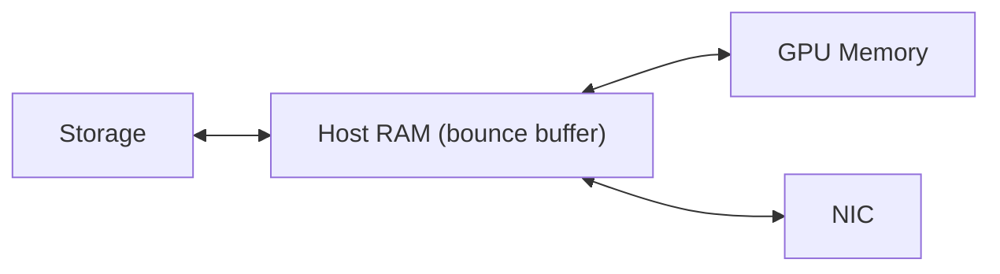
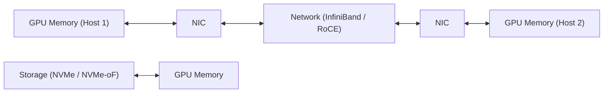
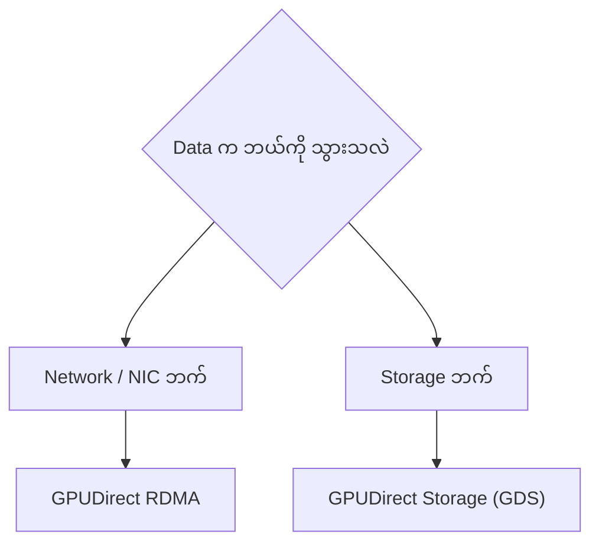
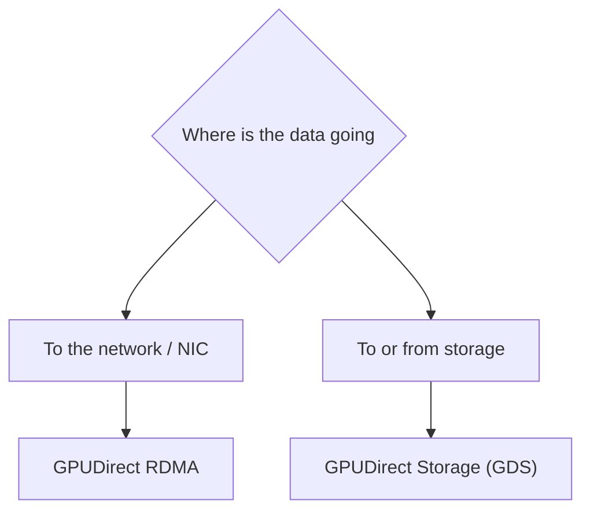

# Module 13 — GPUDirect RDMA vs GPUDirect Storage

> Part II · GPU Interconnects, Networking and Data Movement — Course Module 13 (GPUDirect RDMA vs GPUDirect Storage) — topic notes

## မြန်မာဘာသာ version

## 1. ပြဿနာ — data-movement bottlenecks နှစ်မျိုး

GPU workload တစ်ခုမှာ data ကို ရွှေ့ပြောင်းရတဲ့ နေရာတွေ အများကြီး ရှိပါတယ်။ အဓိက bottleneck ဖြစ်တတ်တဲ့ နေရာ နှစ်ခုကတော့—

- **Network** — GPU servers အများကြီး ပါဝင်တဲ့ distributed training မှာ GPU memory ထဲက data (ဥပမာ gradients) တွေကို တစ် host ကနေ တစ် host ဆီ လွှဲပြောင်းရပါတယ်။
- **Storage** — dataset ကြီးတွေ load ခြင်း၊ checkpoint ရေးခြင်း/ဖတ်ခြင်း၊ storage ကနေ streaming IO တွေမှာ data ကို storage ကနေ GPU memory ထဲ ရောက်အောင် ပို့ရပါတယ်။

ပုံမှန် path နှစ်ခုစလုံးမှာ data က host memory ထဲက bounce buffer မှတစ်ဆင့် အလယ်ကနေ ဖြတ်သန်း copy ဖြစ်တတ်ပါတယ်။ ဒီ intermediate copy တွေက memory bandwidth စားသုံးပြီး latency တိုးစေကာ CPU ပေါ် ဝန်ထုပ်ဝန်ပိုး ဖြစ်စေပါတယ်။ GPU တွေ ပိုမိုမြန်လာလေလေ IO bandwidth လိုအပ်ချက် ပိုတက်လာလေလေ ဖြစ်ပါတယ်။

**ပုံ ၁ (Figure 1) — Network path နဲ့ Storage path နှစ်ခုစလုံး bounce buffer ဖြတ်ရပုံ**



**ပုံရှင်းလင်းချက်** — Storage က data ဖြစ်ဖြစ် NIC က network data ဖြစ်ဖြစ် GPU Memory နဲ့ ဖလှယ်ရာမှာ Host RAM ထဲက bounce buffer ကို ဖြတ်ရပုံကို ပြထားပါတယ်။ ဒီကြားခံ copy တွေက memory bandwidth စားသုံးပြီး latency တိုးစေကာ CPU ပေါ် ဝန်ဖြစ်စေပါတယ်။

NVIDIA GPUDirect က ဒီ ပြဿနာ နှစ်ခုစလုံးအတွက် CPU bounce buffer ကို ရှောင်ရှားတဲ့ DMA-based direct paths တွေ ပေးပါတယ် — ဒါပေမယ့် နှစ်ခုက ပြဿနာ မတူတဲ့အတွက် သီးခြား technology တွေ ဖြစ်ပါတယ်။

## 2. အယူအဆ — GPUDirect family ရဲ့ DMA paths

GPUDirect ဆိုတာ NVIDIA data center GPUs တွေအတွက် data movement ကို တိုးတက်စေတဲ့ technologies မိသားစု (Magnum IO ရဲ့ အစိတ်အပိုင်း) ဖြစ်ပါတယ်။ အဓိက အဖွဲ့ဝင်တွေက—

- **GPUDirect P2P** — GPU memory တွေ ကြား တိုက်ရိုက် DMA။
- **GPUDirect RDMA** — GPU memory နဲ့ network adapter (NIC) ကြား တိုက်ရိုက် DMA path။
- **GPUDirect Storage (GDS)** — GPU memory နဲ့ storage ကြား တိုက်ရိုက် DMA data path။ CPU bounce buffer ကို ရှောင်ရှားပါတယ်။

နှစ်ခုစလုံးက DMA-based peer-to-peer data movement ကို အသုံးပြုပြီး host-memory bounce buffer ကို လျှော့ချ/ရှောင်ရှားပါတယ်။ support လုပ်တဲ့ hardware (GPUDirect-capable GPU၊ supported NIC ဒါမှမဟုတ် storage drivers)၊ supported drivers/software နဲ့ သင့်လျော်တဲ့ PCIe topology လိုအပ်ပါတယ်။

Default (CPU bounce buffer) path နဲ့ GPUDirect paths တွေကို နှိုင်းယှဉ်ပြတဲ့ conceptual diagram—

```
Default: CPU bounce buffer ကြားမှ ဖြတ်သန်းရသော path များ

  Storage ──► Host RAM (bounce buffer) ──► GPU Memory
  NIC    ◄──► Host RAM (bounce buffer) ◄──► GPU Memory


GPUDirect RDMA: NIC နှင့် GPU memory ကြား တိုက်ရိုက်

  GPU Memory ◄──────────────► NIC ◄──── Network ────► NIC ◄──────────────► GPU Memory
             (Host 1)              (InfiniBand/RoCE)      (Host 2)


GPUDirect Storage: Storage နှင့် GPU memory ကြား တိုက်ရိုက်

  Storage (NVMe / NVMe-oF / filesystem) ────────────────► GPU Memory
```

ဒါတွေက conceptual examples တွေ ဖြစ်ပြီး actual data paths တွေက hardware၊ drivers၊ operating system နဲ့ communication/software stack ပေါ် မူတည်ပြီး ကွဲပြားနိုင်ပါတယ်။

**GPUDirect RDMA က ဘယ်လို အလုပ်လုပ်သလဲ** — support လုပ်တဲ့ NIC (HCA) က network fabric (InfiniBand ဒါမှမဟုတ် RoCE) ပေါ်မှတစ်ဆင့် GPU memory ကို တိုက်ရိုက် ဖတ်/ရေးနိုင်ပါတယ်။ host-memory copy ရှောင်ရှားခြင်း၊ latency လျှော့ချခြင်း၊ CPU ပါဝင်မှု လျှော့ချခြင်းတို့ ရရှိပါတယ်။ multi-node distributed training communication မှာ အသုံးပြုပြီး NCCL ကဲ့သို့ communication libraries တွေက RDMA transports ကို အသုံးပြုနိုင်ပါတယ်။ (အသေးစိတ်ကို Module 11 — GPUDirect RDMA မှာ ဖော်ပြပြီး ဖြစ်ပါတယ်။ ဒီ module မှာ ထပ်မဖော်ပြဘဲ နှိုင်းယှဉ်မှုအပိုင်းကိုသာ အာရုံစိုက်ပါမယ်။)

**GPUDirect Storage က ဘယ်လို အလုပ်လုပ်သလဲ** — cuFile API နဲ့ nvidia-fs kernel module မှတစ်ဆင့် storage နဲ့ GPU memory ကြား direct DMA path ကို ဖွင့်ပေးပါတယ်။ dataset loading၊ checkpoint read/write၊ storage ကနေ streaming IO တွေအတွက် ရည်ရွယ်ပါတယ်။

**ပုံ ၂ (Figure 2) — GPUDirect RDMA (NIC ↔ GPU Memory) နှင့် GPUDirect Storage (Storage ↔ GPU Memory) နှိုင်းယှဉ်ချက်**



**ပုံရှင်းလင်းချက်** — GPU Memory (Host 1) ကနေ NIC၊ Network၊ NIC ဖြတ်ပြီး GPU Memory (Host 2) ဆီ သွားတဲ့ ချိတ်ဆက်မှုက GPUDirect RDMA ဖြစ်ပြီး GPU Memory နဲ့ NIC ကြား တိုက်ရိုက် DMA ဖြစ်ပါတယ်။ Storage နဲ့ GPU Memory ကြား တိုက်ရိုက် ချိတ်ဆက်မှုကတော့ GPUDirect Storage ဖြစ်ပါတယ်။ Endpoint ကွာခြားတဲ့အတွက် network communication အတွက် RDMA၊ dataset/checkpoint IO အတွက် GDS ကို သုံးရပါမယ်။

## 3. နှိုင်းယှဉ်ချက် — အဓိက ကွာခြားချက်များ

| အချက် | GPUDirect RDMA | GPUDirect Storage (GDS) |
|---|---|---|
| Data path | NIC (HCA) ↔ GPU memory — network ကတစ်ဆင့် remote host ရဲ့ GPU memory နဲ့ ဖလှယ်ခြင်း | Storage ↔ GPU memory — local ဒါမှမဟုတ် distributed storage (ဥပမာ NVMe၊ NVMe-oF) ကနေ GPU memory ဆီ |
| Direction / ဦးတည်ရာ | Remote / network — hosts ကြား နှစ်ဖက်သွား data exchange | Local ဒါမှမဟုတ် distributed filesystem IO — storage ကနေ ဖတ်ခြင်းနှင့် storage ဆီ ရေးခြင်း |
| Software stack | RDMA verbs / NCCL ကဲ့သို့ communication libraries + NIC drivers | cuFile / nvidia-fs + filesystem drivers |
| Typical workloads | Multi-node training မှာ gradients/parameters synchronization (collective communication) | Dataset loading၊ checkpoint read/write၊ streaming IO |
| Validation | Fabric-level tools များဖြင့် link/fabric အခြေအနေ စစ်ဆေးခြင်း (Module 11 ကို ကြည့်ပါ) | gdscheck ကဲ့သို့ tools နှင့် GDS installation/troubleshooting guide ဖြင့် စစ်ဆေးခြင်း |
| Common failures | Fabric configuration မှားခြင်း၊ InfiniBand subnet manager ပြဿနာ၊ RoCE configuration ပြဿနာ | Unsupported filesystem mount သုံးခြင်း၊ O_DIRECT မပါတဲ့ IO၊ PCIe topology ပြဿနာ |

ဒီ table က နှစ်ခုကို ရွေးချယ်ရာမှာ အဓိက ကိုးကားစရာ ဖြစ်ပါတယ်။ တူညီတဲ့ အခြေခံ idea (DMA ဖြင့် bounce buffer ရှောင်ခြင်း) ပေါ် တည်ဆောက်ထားပေမယ့် data ရဲ့ အဆုံးသတ် (endpoint) မတူတဲ့အတွက် tool stack နဲ့ operational concerns တွေလည်း မတူပါဘူး။

## 4. ဘယ်အခါ ဘာကို သုံးမလဲ

- **GPUDirect RDMA ကို သုံးရမယ့် အခါ** — data က GPU memory နဲ့ network ကြား ရွှေ့ရမယ့်အခါ။ ဥပမာ—nodes အများကြီး ပါဝင်တဲ့ distributed training ရဲ့ gradient/parameter exchange၊ NCCL collectives။
- **GPUDirect Storage ကို သုံးရမယ့် အခါ** — data က storage နဲ့ GPU memory ကြား ရွှေ့ရမယ့်အခါ။ ဥပမာ—training မစမီ dataset ကြီး load ခြင်း၊ training အတွင်း checkpoint ရေး/ဖတ်ခြင်း၊ inference pipeline ထဲ storage ကနေ streaming လုပ်ခြင်း။
- တစ်ခုက တစ်ခုကို အစားထိုးတာ မဟုတ်ပါဘူး။ ဘယ် data က ဘယ် endpoint ဆီ သွားလဲဆိုတဲ့ မေးခွန်းပေါ် မူတည်ပြီး ဆုံးဖြတ်ရပါတယ်။

**ပုံ ၃ (Figure 3) — Data ရဲ့ သွားရာ endpoint ပေါ် မူတည်ပြီး ရွေးချယ်ပုံ**



**ပုံရှင်းလင်းချက်** — ပုံက ရွေးချယ်မှု စဉ်းစားပုံကို ပြပါတယ် — data က GPU Memory နဲ့ network (NIC) ကြား သွားမယ်ဆိုရင် GPUDirect RDMA ကို ရွေးပြီး၊ data က storage နဲ့ GPU Memory ကြား သွားမယ်ဆိုရင် GPUDirect Storage ကို ရွေးပါ။ တစ်ခုက တစ်ခုကို အစားထိုးတာ မဟုတ်ဘဲ data ရဲ့ endpoint ပေါ် မူတည်ပြီး ဆုံးဖြတ်ရတာ ဖြစ်ပါတယ်။

## 5. Real pipelines တွေမှာ နှစ်ခုစလုံး သုံးပါတယ်

Multi-node training pipeline တစ်ခုကို စဉ်းစားကြည့်ပါ—

1. **ရှေ့ပိုင်း (data intake)** — training job စတင်ချိန်နှင့် epoch အလိုက် dataset ကို storage ကနေ GPU memory ဆီ load ရပါတယ်။ checkpoint တွေကိုလည်း storage ပေါ် ပုံမှန် ရေးသိမ်း/ပြန်ဖတ်ရပါတယ်။ ဒီ IO အတွက် **GPUDirect Storage** က host-memory bounce buffer ကို ရှောင်ရှားပေးနိုင်ပါတယ်။
2. **လယ်ပိုင်း (compute)** — GPU တွေက ၎င်းတို့ရဲ့ batch တွေကို တွက်ချက်ပြီး gradients တွေ ထုတ်လုပ်ပါတယ်။
3. **နောက်ပိုင်း (communication)** — gradients/parameters တွေကို nodes ကြား synchronize လုပ်ရပါတယ်။ NCCL ကဲ့သို့ collective communication library က **GPUDirect RDMA** ကို အသုံးပြုပြီး GPU memory နဲ့ network ကြား data ကို host-memory staging မပါဘဲ လွှဲပြောင်းပေးပါတယ်။

ဒီ pipeline တစ်ခုလုံးမှာ နှစ်ခုစလုံးက မတူညီတဲ့ data-movement jobs တွေကို တစ်ချိန်တည်းမှာ ကိုင်တွယ်ပါတယ် — **complementary ဖြစ်ပြီး အစားထိုး alternatives မဟုတ်ပါဘူး**။ ဒီနေရာမှာ command တွေ မပါဝင်ပါဘူး — ဒါက architecture-level concept သက်သက် ဖြစ်ပါတယ်။

**ပုံ ၄ (Figure 4) — Training pipeline တစ်ခုတွင် GDS နှင့် RDMA တို့ အတူတကွ အသုံးပြုပုံ**

```mermaid
flowchart LR
    ST["Storage (dataset / checkpoint)"] -->|"GDS direct path"| GM["GPU Memory"]
    GM --> CP["GPU compute (gradients)"]
    CP --> GM    GM <-->|"GPUDirect RDMA"| NW["Network (other nodes' GPUs)"]
```

**ပုံရှင်းလင်းချက်** — ပုံမှာ training pipeline တစ်ခုတွင်းက data movement နှစ်မျိုးကို မြင်ရပါတယ် — dataset/checkpoint တွေက GDS direct path ဖြင့် Storage ကနေ GPU Memory ထဲ ရောက်ပြီး၊ compute ပြီးထွက်လာတဲ့ gradients တွေကိုတော့ GPUDirect RDMA ဖြင့် network ကတစ်ဆင့် တစ်ခြား nodes တွေရဲ့ GPU Memory ဆီ လွှဲပေးပါတယ်။ ဒါကြောင့် နှစ်ခုစလုံးက pipeline တစ်ခုတည်းမှာ အတူအလုပ်လုပ်တဲ့ complementary technologies တွေ ဖြစ်ပါတယ်။

## 6. သတိပြုရန် အချက်များ

- **Support matrix ပေါ် မူတည်ပါတယ်** — နှစ်ခုစလုံးက supported hardware (GPUDirect-capable GPUs၊ supported NICs/storage drivers)၊ supported drivers/software နဲ့ platform ပေါ် မူတည်ပါတယ်။ deployment မလုပ်မီ NVIDIA ရဲ့ support documentation နဲ့ ကိုက်ညီမှု ရှိ/မရှိ စစ်ဆေးပါ။
- **GPUDirect RDMA က CPU ကို အခန်းကဏ္ဍ အားလုံးကနေ မဖယ်ရှားပါဘူး** — data path ထဲက host-memory copies တွေကို ဖယ်ရှားပေးတာ ဖြစ်ပါတယ်။ CPU က application execution၊ communication setup၊ memory registration၊ synchronization နဲ့ completion handling တွေမှာ ပါဝင်နေဆဲ ဖြစ်ပါတယ်။ "direct" ဆိုတာ CPU/OS ဘယ်တော့မှ မပါဝင်ဘူးလို့ မဆိုလိုပါဘူး။
- **PCIe topology က အရေးပါပါတယ်** — GPU နဲ့ NIC (သို့) storage path ကြား ချိတ်ဆက်မှု topology က direct path ရ/မရ ကို သက်ရောက်ပါတယ်။
- **Performance ဂဏန်းတွေကို ကိန်းဂဏန်းအဖြစ် မပြောပါဘူး** — bandwidth/latency အကျိုးကျေးဇူးတွေက workload၊ hardware နဲ့ configuration ပေါ် မူတည်ပါတယ်။ ဒီ module မှာ benchmark ဂဏန်းတွေ မဖော်ပြပါဘူး — တိကျတဲ့ ဂဏန်းလိုအပ်ရင် ကိုယ်ပိုင် workload ပေါ်မှာ တိုင်းတာပါ။
- **Validation မလုပ်ဘဲ မယူဆပါနဲ့** — GDS အတွက် gdscheck ကဲ့သို့ tools နဲ့ GDS documentation ဖြင့် စစ်ဆေးပါ။ RDMA/fabric အတွက် fabric tools နဲ့ NIC driver အခြေအနေ စစ်ဆေးပါ။

## 7. Self-Check Questions (မေးခွန်းနှင့် အဖြေများ)

**Q1. GPUDirect RDMA နဲ့ GPUDirect Storage နှစ်ခုစလုံးက CPU bounce buffer ကို ရှောင်ရှားပေးပါတယ်။ အဓိက ကွာခြားချက်က ဘာလဲ**

Data ရဲ့ အဆုံးသတ် endpoint ဖြစ်ပါတယ် — GPUDirect RDMA က NIC/network နဲ့ GPU memory ကြား (remote hosts ကြား) ဖြစ်ပြီး GPUDirect Storage က storage နဲ့ GPU memory ကြား (local ဒါမှမဟုတ် distributed filesystem) ဖြစ်ပါတယ်။

**Q2. Multi-node training မှာ gradients synchronize ဖို့ ဘယ် stack ကို သုံးမလဲ**

NCCL ကဲ့သို့ collective communication library ကတစ်ဆင့် GPUDirect RDMA (RDMA transports) ကို သုံးပါတယ်။

**Q3. GDS မအောင်မြင်တဲ့အခါ အဖြစ်များတဲ့ အကြောင်းရင်း သုံးခု ပြောပြပါ**

Unsupported filesystem mount သုံးခြင်း၊ O_DIRECT မပါတဲ့ IO သုံးခြင်း၊ PCIe topology ပြဿနာတို့ ဖြစ်ပါတယ်။ (GPUDirect RDMA ဘက်မှာတော့ fabric configuration၊ subnet manager၊ RoCE configuration ပြဿနာတွေ အဖြစ်များပါတယ်။)

**Q4. Real training pipeline မှာ GPUDirect RDMA နဲ့ GDS က တစ်ခုကိုတစ်ခု အစားထိုးနိုင်သလား**

မထိုးနိုင်ပါဘူး — complementary ဖြစ်ပါတယ်။ Dataset/checkpoint IO အတွက် GDS ကို သုံးပြီး nodes ကြား gradients/parameters communication အတွက် GPUDirect RDMA ကို သုံးပါတယ်။

**Q5. "GPUDirect RDMA က CPU ကို လုံးဝ ဖယ်ရှားပေးတယ်" ဆိုတဲ့ စကား မှန်သလား**

မမှန်ပါဘူး။ Data path ထဲက host-memory copies တွေကို ဖယ်ရှားပေးတာဖြစ်ပြီး CPU က setup၊ memory registration၊ synchronization နဲ့ completion handling တွေမှာ ပါဝင်နေဆဲ ဖြစ်ပါတယ်။

## English Version

## 1. The Problem — Two Different Data-Movement Bottlenecks

GPU workloads move data in many places. Two spots commonly become bottlenecks:

- **Network** — in distributed training across many GPU servers, data held in GPU memory (gradients, for example) must move from one host to another.
- **Storage** — when loading large datasets, reading or writing checkpoints, or streaming IO from storage, data must travel from storage into GPU memory.

On both of the default paths, the data passes through a bounce buffer in host memory. These intermediate copies consume memory bandwidth, add latency, and load the CPU. The faster the GPUs become, the more IO bandwidth they demand.

**Figure 1 — Both the network path and the storage path pass through the bounce buffer**


**Figure walkthrough** — Whether the data is storage data or network data through the NIC, exchanging it with GPU memory goes through the bounce buffer in host RAM. These intermediate copies consume memory bandwidth, add latency, and load the CPU.

NVIDIA GPUDirect provides DMA-based direct paths that avoid the CPU bounce buffer for both problems — but because the two problems are different, they are separate technologies.

## 2. Concepts — DMA Paths in the GPUDirect Family

GPUDirect is a family of technologies (part of Magnum IO) that enhance data movement for NVIDIA data center GPUs. Its main members are:

- **GPUDirect P2P** — direct DMA between GPU memories.
- **GPUDirect RDMA** — a direct DMA path between GPU memory and a network adapter (NIC).
- **GPUDirect Storage (GDS)** — a direct DMA data path between GPU memory and storage, avoiding the CPU bounce buffer.

Both technologies discussed here use DMA-based peer-to-peer data movement and reduce or avoid the host-memory bounce buffer. They require supported hardware (GPUDirect-capable GPUs, supported NICs or storage drivers), supported drivers and software, and a suitable PCIe topology.

A conceptual diagram comparing the default (CPU bounce buffer) paths with the GPUDirect paths:

```
Default: paths passing through a CPU bounce buffer

  Storage ──► Host RAM (bounce buffer) ──► GPU Memory
  NIC    ◄──► Host RAM (bounce buffer) ◄──► GPU Memory


GPUDirect RDMA: direct between NIC and GPU memory

  GPU Memory ◄──────────────► NIC ◄──── Network ────► NIC ◄──────────────► GPU Memory
             (Host 1)              (InfiniBand/RoCE)      (Host 2)


GPUDirect Storage: direct between storage and GPU memory

  Storage (NVMe / NVMe-oF / filesystem) ────────────────► GPU Memory
```

These are conceptual examples; actual data paths vary with hardware, drivers, the operating system, and the communication/software stack.

**How GPUDirect RDMA works** — a supported NIC (HCA) can read and write GPU memory directly over the network fabric (InfiniBand or RoCE). The benefits are avoiding host-memory copies, lower latency, and less CPU involvement. It is used by multi-node distributed training communication, and libraries such as NCCL can use RDMA transports. (Details are covered in Module 11 — NVIDIA GPUDirect RDMA; this module focuses on the comparison instead of repeating that material.)

**How GPUDirect Storage works** — through the cuFile API and the nvidia-fs kernel module, it opens a direct DMA path between storage and GPU memory. It targets dataset loading, checkpoint read/write, and streaming IO from storage.

**Figure 2 — GPUDirect RDMA (NIC ↔ GPU memory) vs. GPUDirect Storage (Storage ↔ GPU memory)**


**Figure walkthrough** — The chain running GPU Memory (Host 1) → NIC → Network → NIC → GPU Memory (Host 2) is GPUDirect RDMA: GPU memory connects directly to the NIC, and data crosses to another host's GPU memory. The direct link between Storage and GPU Memory is GPUDirect Storage. Because the endpoints differ, use RDMA for network communication and GDS for dataset/checkpoint IO.

## 3. Comparison — Key Differences

| Aspect | GPUDirect RDMA | GPUDirect Storage (GDS) |
|---|---|---|
| Data path | NIC (HCA) ↔ GPU memory — exchanging data with a remote host's GPU memory over the network | Storage ↔ GPU memory — from local or distributed storage (e.g. NVMe, NVMe-oF) to GPU memory |
| Direction | Remote / network — bidirectional data exchange between hosts | Local or distributed filesystem IO — reads from storage and writes to storage |
| Software stack | RDMA verbs / communication libraries such as NCCL + NIC drivers | cuFile / nvidia-fs + filesystem drivers |
| Typical workloads | Gradient/parameter synchronization in multi-node training (collective communication) | Dataset loading, checkpoint read/write, streaming IO |
| Validation | Checking link/fabric status with fabric-level tools (see Module 11) | Checking with tools such as gdscheck and the GDS installation/troubleshooting guide |
| Common failures | Fabric configuration errors, InfiniBand subnet manager problems, RoCE configuration problems | Using an unsupported filesystem mount, IO without O_DIRECT, PCIe topology problems |

This table is the main reference for choosing between the two. They build on the same basic idea (DMA that avoids the bounce buffer), but the data endpoints differ, so the tool stacks and operational concerns differ as well.

## 4. When to Use Which

- **Use GPUDirect RDMA** when data moves between GPU memory and the network — for example, gradient/parameter exchange in distributed training across many nodes, or NCCL collectives.
- **Use GPUDirect Storage** when data moves between storage and GPU memory — for example, loading a large dataset before training, checkpointing during training, or streaming from storage into an inference pipeline.
- One does not replace the other. The decision depends on the question: where is this data going?

**Figure 3 — Choosing by where the data is going**



**Figure walkthrough** — The figure shows the decision: if data moves between GPU memory and the network (NIC), choose GPUDirect RDMA; if data moves between storage and GPU memory, choose GPUDirect Storage. One does not replace the other — the decision follows the data's endpoint.

## 5. Real Pipelines Use Both

Consider a multi-node training pipeline:

1. **Front (data intake)** — at job start and per epoch, the dataset must be loaded from storage into GPU memory, and checkpoints are periodically written to and read back from storage. **GPUDirect Storage** can avoid the host-memory bounce buffer for this IO.
2. **Middle (compute)** — the GPUs process their batches and produce gradients.
3. **Back (communication)** — gradients/parameters must be synchronized across nodes. A collective communication library such as NCCL can use **GPUDirect RDMA** to move data between GPU memory and the network without host-memory staging.

In such a pipeline, the two technologies handle different data-movement jobs at the same time — they are **complementary, not alternatives**. No commands appear here; this is an architecture-level concept only.

**Figure 4 — Using GDS and RDMA together in one training pipeline**

```mermaid
flowchart LR
    ST["Storage (dataset / checkpoint)"] -->|"GDS direct path"| GM["GPU Memory"]
    GM --> CP["GPU compute (gradients)"]
    CP --> GM    GM <-->|"GPUDirect RDMA"| NW["Network (other nodes' GPUs)"]
```

**Figure walkthrough** — The figure shows two kinds of data movement inside one training pipeline: datasets and checkpoints reach GPU memory from storage over the GDS direct path, while the gradients produced by compute go over GPUDirect RDMA through the network to other nodes' GPU memory. Both technologies therefore work together as complements in one pipeline.

## 6. Cautions

- **The support matrix matters** — both technologies depend on supported hardware (GPUDirect-capable GPUs, supported NICs or storage drivers), supported drivers/software, and platform. Check compatibility against NVIDIA's support documentation before deploying.
- **GPUDirect RDMA does not remove the CPU from all roles** — it removes host-memory copies from the data path. The CPU is still involved in application execution, communication setup, memory registration, synchronization, and completion handling. "Direct" does not mean the CPU and OS are never involved.
- **PCIe topology matters** — the topology of the connection between the GPU and the NIC (or storage path) affects whether a direct path is possible.
- **No performance numbers are claimed here** — bandwidth and latency benefits depend on workload, hardware, and configuration. This module quotes no benchmark figures; measure your own workload if you need exact numbers.
- **Do not assume without validating** — for GDS, verify with tools such as gdscheck and the GDS documentation. For RDMA/fabric, verify with fabric tools and check NIC driver status.

## 7. Self-Check Questions (Questions and Answers)

**Q1. Both GPUDirect RDMA and GPUDirect Storage avoid the CPU bounce buffer. What is the essential difference?**

The data endpoint: GPUDirect RDMA is between the NIC/network and GPU memory (across remote hosts), while GPUDirect Storage is between storage and GPU memory (local or distributed filesystem).

**Q2. Which stack is used to synchronize gradients in multi-node training?**

GPUDirect RDMA (RDMA transports) through a collective communication library such as NCCL.

**Q3. Name three common reasons GDS fails.**

Using an unsupported filesystem mount, IO without O_DIRECT, and PCIe topology problems. (On the GPUDirect RDMA side, fabric configuration, subnet manager, and RoCE configuration problems are common.)

**Q4. In a real training pipeline, can GPUDirect RDMA and GDS replace each other?**

No — they are complementary. GDS is used for dataset/checkpoint IO, while GPUDirect RDMA is used for gradient/parameter communication between nodes.

**Q5. Is the statement "GPUDirect RDMA completely removes the CPU" accurate?**

No. It removes host-memory copies from the data path, while the CPU remains involved in setup, memory registration, synchronization, and completion handling.

## Official references

- https://developer.nvidia.com/gpudirect (GPUDirect family overview)
- https://docs.nvidia.com/gpudirect-storage/overview-guide/index.html (GPUDirect Storage Overview Guide)
- https://docs.nvidia.com/deeplearning/nccl/user-guide/docs/ (NCCL documentation)
- https://docs.nvidia.com/cuda/gpudirect-storage/index.html (GPUDirect Storage documentation)

## Technical review notes

- Content is written from research notes verified against the official NVIDIA sources listed above; GPUDirect RDMA details are cross-referenced to Module 11 rather than repeated, per the module brief.
- No bandwidth/latency figures, benchmark numbers, command syntax, or compatibility matrices are stated anywhere in this module; validation is described at the tool-name level only (gdscheck, fabric-level tools) because exact command syntax was not part of the verified material.
- The gdscheck tool name and the failure classes (unsupported filesystem mount, non-O_DIRECT IO, PCIe topology; fabric configuration, subnet manager, RoCE configuration) come from the research notes summarizing official GDS and GPUDirect documentation; exact tool invocation syntax needs verification against the GDS Installation and Troubleshooting Guide before being taught as commands.
- The ASCII diagrams are conceptual, matching the style of Module 11; real data paths vary by OS, drivers, hardware, and software stack, as noted in the text.

- Mermaid figures (Figures 1–4) with figure walkthroughs (ပုံရှင်းလင်းချက်) were added inline to both language sections; all existing text, ASCII diagrams, and review notes are unchanged.
