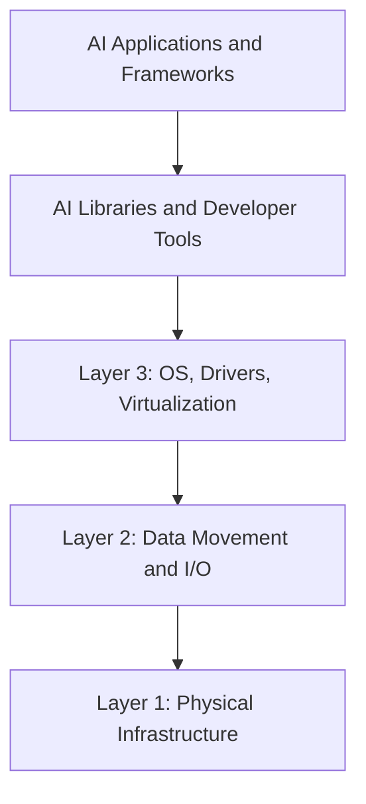
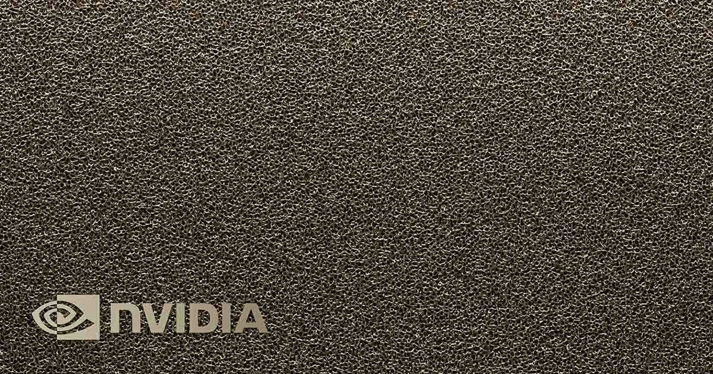
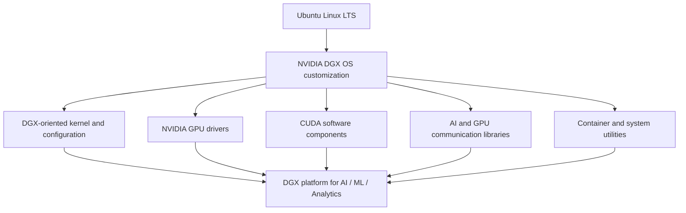
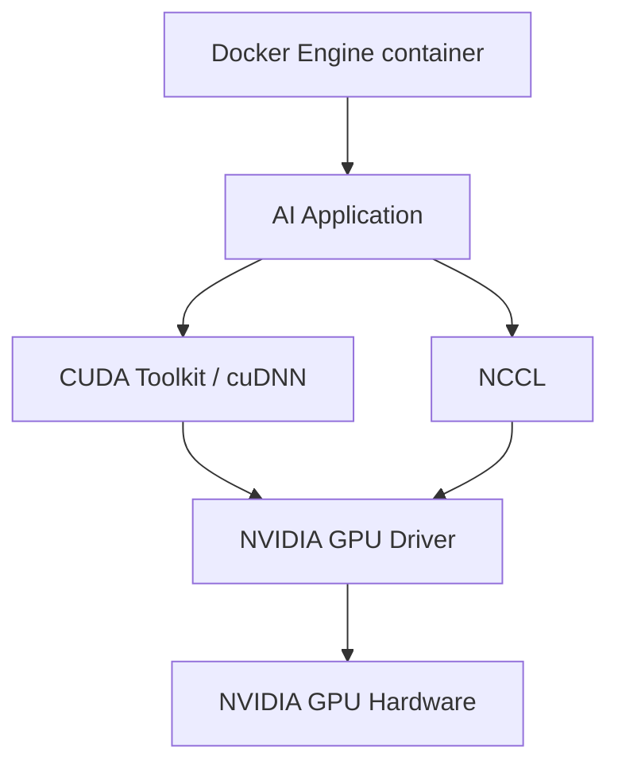
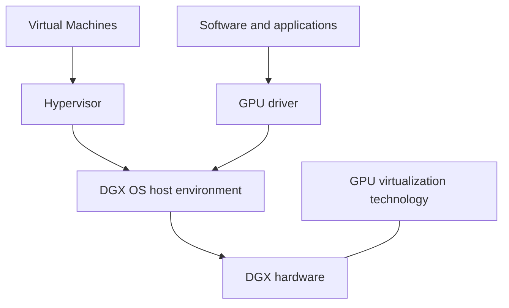

# Module 14 — Layer 3: DGX OS, GPU Drivers, and Virtualization

> Part II · Course Module 14 (Layer 3 Networking, DGX OS and GPU Software Foundations) — topic notes

## မြန်မာဘာသာ version

## 1. Layer 3 မိတ်ဆက်

NVIDIA technology stack မှာ အောက်ခြေ layer တွေက physical hardware ကို တည်ဆောက်ပြီး GPU, network adapter, storage system တွေကြား data ကို ထိရောက်စွာ ရွှေ့ပေးပါတယ်။

Hardware နဲ့ data-movement infrastructure အဆင်သင့် ဖြစ်ပြီးတဲ့အခါ— ဒီ resource တွေကို စီမံခန့်ခွဲပြီး အသုံးပြုဖို့ operating system, device driver နဲ့ လိုအပ်ရင် virtualization layer တစ်ခု လိုအပ်လာပါတယ်။

ဒီ module မှာ Layer 3 ဖြစ်တဲ့ OS, Drivers နဲ့ Virtualization ကို မိတ်ဆက်ပါမယ်။ အဓိက ခေါင်းစဉ်တွေက—

- NVIDIA DGX OS
- GPU driver များနဲ့ ၎င်းတို့ရဲ့ CUDA software နဲ့ ဆက်စပ်မှု
- AI workload များအတွက် operating-system optimization
- GPU virtualization

ဒီ မိတ်ဆက် lesson မှာတော့ အဓိကအားဖြင့် DGX OS ကို အာရုံစိုက် လေ့လာပါမယ်။

## 2. NVIDIA Stack မှာ Layer 3 ရပ်တည်ပုံ

Technology stack ရဲ့ ရိုးရှင်းတဲ့ ပုံကတော့—

```
+--------------------------------------+
| AI Applications and Frameworks      |
+--------------------------------------+
| AI Libraries and Developer Tools     |
+--------------------------------------+
| Layer 3: OS, Drivers, Virtualization |
+--------------------------------------+
| Layer 2: Data Movement and I/O       |
| NVLink, NVSwitch, RDMA, GDS           |
+--------------------------------------+
| Layer 1: Physical Infrastructure     |
| GPUs, CPUs, NICs, Storage, Switches  |
+--------------------------------------+
```

**ပုံ ၁ (Figure 1) — NVIDIA stack မှာ Layer 3 ရပ်တည်ပုံ**



**ပုံရှင်းလင်းချက်** — အောက်ခြေကနေ အပေါ်ဘက်ကို ဖတ်ကြည့်ပါ — အောက်ဆုံး Layer 1 မှာ GPU, CPU, NIC, storage လို physical hardware ရှိပြီး Layer 2 က data ကို ထိရောက်စွာ ရွှေ့ပေးပါတယ်။ Layer 3 က OS, driver, virtualization ဖြင့် ဒီ hardware ကို software က စီမံ အသုံးပြုနိုင်အောင် ချိတ်ဆက်ပေးပြီး အပေါ်ဆုံးမှာတော့ AI libraries နဲ့ AI applications တွေ အလုပ်လုပ်ပါတယ်။

Layer တစ်ခုချင်းစီမှာ တာဝန် မတူညီပါဘူး—

- **Physical infrastructure** — GPU, CPU, memory, network adapter နဲ့ storage ကို ပေးပါတယ်။
- **Data movement and I/O** — ဒီ component တွေကြား data ကို ထိရောက်စွာ ရွှေ့ပေးပါတယ်။
- **OS and drivers** — software က hardware ကို ထိန်းချုပ် အသုံးပြုနိုင်ဖို့၊ system resource တွေကို စီမံနိုင်ဖို့ ဖြစ်ပါတယ်။
- **AI software** — training, inference, analytics workload တွေ လုပ်ဆောင်ဖို့ အောက်ခြေ system ကို အသုံးပြုပါတယ်။

ဒီ layer တွေ အတူတကွ လုပ်ဆောင်ပါတယ်။ Performance ကောင်းတဲ့ hardware တစ်ခုတည်းနဲ့ မလုံလောက်ပါဘူး— operating system နဲ့ သင့်တော်တဲ့ driver တွေကလည်း မှန်ကန်စွာ support လုပ်ပေးရပါမယ်။

## 3. Operating System ဆိုတာဘာလဲ?

Operating system (OS) ဆိုတာ computer ရဲ့ hardware ကို စီမံခန့်ခွဲပြီး application တွေအတွက် service တွေ ပေးတဲ့ software ဖြစ်ပါတယ်။

ပုံမှန် တာဝန်တွေကတော့—

- CPU နဲ့ system memory ကို စီမံခြင်း
- Process နဲ့ thread များကို schedule လုပ်ခြင်း
- Filesystem နဲ့ storage ကို စီမံခြင်း
- Networking service များ ပေးခြင်း
- Driver များမှတစ်ဆင့် device များကို စီမံခြင်း
- Access control နဲ့ permission များကို ထိန်းချုပ်ခြင်း
- Application အလုပ်လုပ်ခြင်းကို support ပေးခြင်း

ဥပမာများ— Microsoft Windows, Ubuntu Linux, Red Hat Enterprise Linux နဲ့ အခြား Linux distribution များ ဖြစ်ပါတယ်။

Operating system နဲ့ distribution အမျိုးမျိုးကို environment အမျိုးမျိုးအတွက် design လုပ်ထားပါတယ်။ General-purpose desktop OS, cloud server OS, enterprise AI appliance OS တို့ဟာ default configuration, supported software, operational requirement တွေ ကွဲပြားနိုင်ပါတယ်။

## 4. NVIDIA DGX OS ဆိုတာဘာလဲ?

NVIDIA DGX OS ဆိုတာ NVIDIA DGX system များအတွက် NVIDIA က ပေးအပ်တဲ့ operating-system environment ဖြစ်ပါတယ်။

Course မှာ DGX OS ကို customized Ubuntu-based OS အဖြစ် ဖော်ပြထားပြီး DGX platform ပေါ်မှာ AI, machine learning နဲ့ analytics workload များအတွက် optimization များနဲ့ integrated software stack ပါဝင်တယ်လို့ ရှင်းပြထားပါတယ်။

အဓိက idea က— NVIDIA က generic OS installation ထက် ပိုပေးပါတယ်။ Software environment ကို DGX hardware နဲ့ ၎င်း support ပြုတဲ့ NVIDIA software component တွေနဲ့ အတူ အလုပ်လုပ်နိုင်အောင် design လုပ်ထားခြင်း ဖြစ်ပါတယ်။



**ပုံရှင်းလင်းချက် (ဓာတ်ပုံ 1)** — ဓာတ်ပုံမှာ NVIDIA DGX system ကို မြင်ရပါမယ် — အပြင်ဘက်မှာ ခိုင်မာတဲ့ chassis ဖြင့် ဖုံးအုပ်ထားပြီး အတွင်းမှာ GPU များစွာ၊ high-speed interconnect နဲ့ storage တွေကို ပေါင်းစပ်တပ်ဆင်ထားတဲ့ integrated AI server ဖြစ်ပါတယ်။ DGX OS ဆိုတာ ဒီ hardware component တွေ အားလုံးကို တစ်ခုတည်းသော platform အဖြစ် အလုပ်လုပ်စေဖို့ ရည်ရွယ်ထားတဲ့ operating-system environment ဖြစ်ပါတယ်။

*(Image: NVIDIA official product image)*

DGX-specific OS ကို ဘာကြောင့် သုံးရသလဲ?

DGX system မှာ စွမ်းအားမြင့် GPU များကို high-speed interconnect, storage နဲ့ အခြား hardware များနဲ့ ပေါင်းစပ်ထားပါတယ်။ OS နဲ့ software environment က ဒီ component တွေကို ပေါင်းစပ် platform တစ်ခုအဖြစ် support လုပ်ပေးရပါမယ်။

DGX-oriented software stack က အောက်ပါတွေကို ပေးနိုင်ပါတယ်—

- Compatible NVIDIA GPU driver များ
- CUDA software component များ
- GPU computing library များ
- Multi-GPU communication library များ
- Container runtime နဲ့ management component များ
- System configuration နဲ့ platform utility များ

ပါဝင်တဲ့ component အတိအကျကတော့ DGX OS release နဲ့ supported software configuration ပေါ် မူတည်ပါတယ်။

## 5. DGX OS နဲ့ Ubuntu

Lesson အရ DGX OS ကို customized Ubuntu Long Term Support (LTS) ပေါ် အခြေခံထားတယ်လို့ ဖော်ပြပြီး instructor ပြောတဲ့ version မှာ အထူးသဖြင့် Ubuntu 22.04 LTS ဖြစ်ပါတယ်။

Ubuntu LTS release တွေက enterprise နဲ့ server environment များအတွက် stable foundation ပေးဖို့ ရည်ရွယ်ပြီး regular interim release တွေထက် support lifecycle ပိုရှည်ပါတယ်။

ရိုးရှင်းတဲ့ ဆက်စပ်ပုံကတော့—

```
Ubuntu Linux
     |
     v
NVIDIA DGX OS customization
     |
     +--> DGX-oriented kernel and configuration
     +--> NVIDIA GPU drivers
     +--> CUDA software components
     +--> AI and GPU communication libraries
     +--> Container and system utilities
     |
     v
DGX platform for AI / ML / Analytics
```

**ပုံ ၂ (Figure 2) — Ubuntu LTS ကနေ DGX OS ဖြစ်လာပုံ**



**ပုံရှင်းလင်းချက်** — Ubuntu LTS ကို အခြေခံပြီး NVIDIA က DGX OS customization လုပ်ထားတာ ဖြစ်ပါတယ်။ Customization ကနေ DGX-oriented kernel/configuration၊ GPU drivers၊ CUDA components၊ communication libraries နဲ့ container utilities တွေ ထွက်လာပြီး အားလုံးပေါင်းပြီးမှ DGX platform ပေါ်မှာ AI, ML, analytics workload တွေ အလုပ်လုပ်နိုင်တာ ဖြစ်ပါတယ်။ ဒါက conceptual view သာ ဖြစ်ပါတယ်။

ဒါက conceptual view သာဖြစ်ပြီး complete package manifest မဟုပ်ပါဘူး။ တကယ် ပါဝင်တဲ့အကြောင်းအရာက install လုပ်ထားတဲ့ DGX OS release ပေါ် မူတည်ပါတယ်။

**Course ပါ version အချက်အလက်**

Instructor က DGX OS version 7.21 ဟာ 19 August 2025 အထိ latest version ဖြစ်တယ်လို့ ပြောထားပြီး base အနေနဲ့ Ubuntu 22.04 LTS ကို ရည်ညွှန်းပါတယ်။

ဒါက supplied lesson ရဲ့ historical statement သာဖြစ်ပြီး ယနေ့ နောက်ဆုံး release ကို confirm လုပ်တာ မဟုတ်ပါဘူး။ DGX OS release, supported base distribution နဲ့ package version တွေက ပြောင်းလဲနိုင်ပါတယ်။ Install သို့မဟုတ် upgrade မလုပ်မီ NVIDIA ရဲ့ တရားဝင် DGX documentation ကို စစ်ဆေးပါ။

## 6. ဘယ် Software Component တွေ ပါဝင်သလဲ?

Lesson မှာ DGX software environment နဲ့ သက်ဆိုင်တဲ့ component အချို့ကို အမည်တပ် ဖော်ပြထားပါတယ်။

| Component | ရည်ရွယ်ချက် |
|---|---|
| NVIDIA GPU driver | OS နဲ့ software ကို supported NVIDIA GPU များနဲ့ ဆက်သွယ်စေရန် |
| CUDA Toolkit | GPU programming tool, compiler component နဲ့ development library များ ပေးရန် |
| cuDNN | Deep-learning framework များ သုံးတဲ့ GPU-accelerated primitive များ ပေးရန် |
| NCCL | Multi-GPU နဲ့ multi-node workload များအတွက် communication primitive များ ပေးရန် |
| Docker Engine | Container image နဲ့ container runtime functionality ပေးရန် |
| Additional system utilities | System configuration, monitoring နဲ့ platform operation များကို support ရန် |

Component တစ်ခုချင်းစီရဲ့ ရရှိနိုင်မှုနဲ့ version အတိအကျက DGX OS release နဲ့ installation method ပေါ် မူတည်ပါတယ်။

**ပုံ ၃ (Figure 3) — DGX software component တွေ အလွှာလိုက် ဆက်စပ်ပုံ**



**ပုံရှင်းလင်းချက်** — AI Application က Docker container ထဲမှာ ရှိနေနိုင်ပြီး CUDA Toolkit/cuDNN နဲ့ NCCL လို library တွေကို သုံးပြီး အလုပ်လုပ်ပါတယ်။ ဒီ library တွေ အားလုံးက NVIDIA GPU Driver ကတစ်ဆင့် GPU hardware ကို ခိုင်းစေတာ ဖြစ်ပါတယ်။ Docker Engine က application ကို container ထဲ ထည့်ပေးပေမယ့် compatible host GPU driver နဲ့ GPU access configuration လိုအပ်ချက် မပျောက်သွားပါဘူး။

**GPU driver**

NVIDIA GPU driver က supported software က GPU ကို အသုံးပြုနိုင်စေပါတယ်။ ဒါက OS, GPU hardware နဲ့ NVIDIA computing stack ကြား အရေးကြီးတဲ့ compatibility component ဖြစ်ပါတယ်။

**CUDA Toolkit**

CUDA ဆိုတာ NVIDIA ရဲ့ parallel-computing platform နဲ့ programming model ဖြစ်ပါတယ်။ CUDA Toolkit မှာ GPU-accelerated application တွေ တည်ဆောက်ရာမှာ သုံးတဲ့ tool နဲ့ library တွေ ပါဝင်ပါတယ်။

CUDA Toolkit နဲ့ NVIDIA GPU driver က ဆက်စပ်ပေမယ့် အတူတူ မဟုတ်ပါဘူး။ ၎င်းတို့ version ကြား compatibility က အရေးကြီးပါတယ်။

**cuDNN**

cuDNN က deep-learning application နဲ့ framework တွေ သုံးတဲ့ GPU-accelerated operation တွေကို ပေးပါတယ်။ Neural-network operation အသုံးများတွေကို software က ထိရောက်စွာ execute လုပ်နိုင်ဖို့ ကူညီပါတယ်။

**NCCL**

NCCL ဆိုတာ GPU များကြား collective communication အတွက် NVIDIA ရဲ့ library ဖြစ်ပါတယ်။ All-Reduce, All-Gather, Reduce, Broadcast စတဲ့ operation တွေကို support ပြုပြီး ဒါတွေက multi-GPU နဲ့ distributed training မှာ အရေးကြီးပါတယ်။

**Docker Engine**

Docker Engine က container functionality ပေးပါတယ်။ Container တွေက application နဲ့ ၎င်းရဲ့ dependency အများစုကို portable runtime environment တစ်ခုထဲ ထည့်သွင်းပေးနိုင်ပါတယ်။

Container တွေက compatible host GPU driver နဲ့ သင့်တော်တဲ့ GPU access configuration လိုအပ်ချက်ကို ဖယ်ရှားပေးတာ မဟုတ်ပါဘူး။

## 7. Integrated Software Stack ဘာကြောင့် အရေးကြီးသလဲ?

GPU driver, CUDA Toolkit, cuDNN, NCCL နဲ့ container runtime ကို compatibility မစစ်ဆေးဘဲ သီးခြားစီ install လုပ်ကြည့်ပါ—

ဖြစ်နိုင်တဲ့ ပြဿနာတွေက—

- Driver နဲ့ CUDA version မကိုက်ခြင်း
- Library ပျောက်ဆုံးခြင်း
- Package dependency ချင်း ဆန့်ကျင်ခြင်း
- Container GPU configuration မှားယွင်းခြင်း
- Software environment နဲ့ NVIDIA ရဲ့ supported configuration ကွာခြားခြင်း

Integrated, validated DGX software environment က manual compatibility အလုပ်ပမာဏကို လျှော့ချပေးပြီး platform deployment နဲ့ maintenance ကို ရိုးရှင်းစေနိုင်ပါတယ်။

သို့သော် integrated software stack ဆိုတာ package တိုင်းက အမြဲ latest version ဖြစ်တယ်လို့ မဆိုလိုပါဘူး။ Enterprise system တွေက နောက်ဆုံး release တိုင်းကို သီးခြား install လုပ်တာထက် tested compatibility နဲ့ platform stability ကို ဦးစားပေးလေ့ရှိပါတယ်။

## 8. DGX OS က Hypervisor မဟုတ်ပါ

Instructor က virtualization ကိုလည်း Layer 3 ထဲက နောက်တစ်ခုသော ဘာသာရပ်အဖြစ် မိတ်ဆက်ထားပါတယ်။ DGX OS ကို hypervisor နဲ့ ခွဲခြားနားလည်ဖို့ အရေးကြီးပါတယ်။

| Technology | အဓိက တာဝန် |
|---|---|
| DGX OS | DGX hardware နဲ့ ၎င်းရဲ့ supported software stack အတွက် operating-system environment ပေးခြင်း |
| GPU driver | Software ကို supported GPU များနဲ့ ဆက်သွယ် အသုံးပြုနိုင်စေခြင်း |
| Hypervisor | Virtual machine များ ဖန်တီး စီမံပြီး virtualized hardware resource များ ခွဲဝပေးခြင်း |
| GPU virtualization technology | GPU resource များကို workload များအတွက် share, partition သို့မဟုတ် assign လုပ်နိုင်တဲ့ supported နည်းလမ်းများ ပေးခြင်း |

**ပုံ ၄ (Figure 4) — DGX OS, GPU driver, Hypervisor တို့ရဲ့ တာဝန် ခွဲခြားပုံ**



**ပုံရှင်းလင်းချက်** — DGX OS က host operating-system environment ကို စီမံပြီး DGX hardware ပေါ်မှာ ရပ်တည်ပါတယ်။ GPU driver က software ကို GPU သုံးခွင့် ပေးပါတယ်။ Hypervisor ကတော့ virtual machine တွေ ဖန်တီး စီမံတာဖြစ်လို့ DGX OS ရဲ့ နောက်တစ်မျိုး အမည် မဟုတ်ပါဘူး။ GPU virtualization technology ကတော့ GPU resource တွေကို workload တွေအတွက် share, partition သို့မဟုတ် assign လုပ်ပေးနိုင်တဲ့ နည်းလမ်း ဖြစ်ပါတယ်။

Hypervisor ဆိုတာ DGX OS ရဲ့ နောက်တစ်မျိုး အမည် မဟုတ်ပါဘူး။ သူတို့က ပြဿနာ မတူညီပါဘူး။

DGX OS က host operating-system environment ကို စီမံပါတယ်။ Deployment မှာ virtual machine များ သို့မဟုတ် supported GPU-sharing / partitioning model လိုအပ်မှသာ virtualization ကို ထပ်မံ ထည့်သွင်းနိုင်ပါတယ်။

## 9. Command-Line ကျွမ်းကျင်မှု ဘာကြောင့် အရေးကြီးသလဲ?

Lesson အရ DGX OS command line ကို သက်တောင့်သက်သာ လှုပ်ရှား အသုံးပြုတတ်ဖို့ လိုအပ်ပါတယ်။

ပုံမှန် Linux administration အလုပ်တွေထဲက ဥပမာများ—

```bash
# Identify the operating system
cat /etc/os-release

# Display the running kernel
uname -r

# Check the NVIDIA GPU and driver status
nvidia-smi

# Check the installed Docker version
docker --version
```

ဒီ command တွေက basic system inspection ရဲ့ ဥပမာများ ဖြစ်ပါတယ်။ သက်ဆိုင်ရာ software မ install ရသေးရင် သို့မဟုတ် user မှာ လိုအပ်တဲ့ permission မရှိရင် command တစ်ခု မရနိုင်ပါဘူး။

DGX administration အတွက် Linux process, systemd service, package management, storage, networking, log နဲ့ driver troubleshooting ကို နားလည်ထားသင့်ပါတယ်။

## 10. အဓိက အကျဉ်းချုပ်

- Layer 3 က hardware ပေါ်မှာ AI workload တွေ လုပ်ဆောင်ဖို့ OS, driver နဲ့ virtualization foundation ကို ပေးပါတယ်။
- NVIDIA DGX OS ဆိုတာ course မှာ ဆွေးနွေးထားတဲ့ version အရ Ubuntu ပေါ် အခြေခံထားတဲ့ NVIDIA-provided, DGX-oriented operating-system environment ဖြစ်ပါတယ်။
- GPU driver, CUDA, cuDNN, NCCL နဲ့ container component တွေက software stack ထဲမှာ ရည်ရွယ်ချက် မတူညီပါဘူး။
- OS, driver, CUDA software နဲ့ application ကြား compatibility က အရေးကြီးပါတယ်။
- DGX OS နဲ့ hypervisor က technology မတူညီပါဘူး။
- Recorded course ထဲက version အချက်အလက်ကို deployment မလုပ်မီ လက်ရှိ တရားဝင် NVIDIA documentation နဲ့ စစ်ဆေးသင့်ပါတယ်။

## 11. တရားဝင် စာရွက်စာတမ်းများ

- NVIDIA DGX documentation: https://docs.nvidia.com/dgx/
- NVIDIA CUDA documentation: https://docs.nvidia.com/cuda/
- NVIDIA cuDNN documentation: https://docs.nvidia.com/deeplearning/cudnn/
- NVIDIA NCCL documentation: https://docs.nvidia.com/deeplearning/nccl/user-guide/docs/

## 12. ကိုယ်တိုင် စစ်ဆေးမေးခွန်းများ (Self-Check Questions)

**Q1. NVIDIA stack မှာ Layer 3 ရဲ့ တာဝန်က ဘာလဲ?**

A: OS, device driver နဲ့ virtualization foundation ကို ပေးပြီး software က hardware ကို စီမံ အသုံးပြုနိုင်စေခြင်း ဖြစ်ပါတယ်။

**Q2. DGX OS ကို ဘယ် Linux distribution ပေါ် အခြေခံထားသလဲ (course ပြောဆိုချက်အရ)?**

A: Customized Ubuntu LTS — instructor ပြောတဲ့ version မှာ Ubuntu 22.04 LTS ဖြစ်ပါတယ် (historical claim — လက်ရှိ release ကို ပြန်စစ်ပါ)။

**Q3. CUDA Toolkit နဲ့ GPU driver က အတူတူလား?**

A: မဟုတ်ပါ။ Driver က GPU ကို အသုံးပြုခွင့်ပေးပြီး CUDA Toolkit က CUDA application တည်ဆောက်ရန် development tool နဲ့ library တွေ ပေးပါတယ်။ Version compatibility ကို ဂရုစိုက်ရပါမယ်။

**Q4. DGX OS က hypervisor နဲ့ ဘာကွာသလဲ?**

A: DGX OS က host OS environment ကို စီမံပြီး hypervisor က virtual machine တွေ ဖန်တီး စီမံပါတယ်။ DGX OS မှာ VM တွေ မပါဝင်ပါဘူး။

**Q5. Integrated DGX software stack ရဲ့ အားသာချက်က ဘာလဲ?**

A: Driver/CUDA/library version ချင်း compatibility ကို NVIDIA က validate လုပ်ပြီးသားဖြစ်လို့ manual compatibility အလုပ် လျော့ကျစေပြီး deployment နဲ့ maintenance ကို ရိုးရှင်းစေပါတယ်။

## English Version

## 1. Introduction to Layer 3

In the NVIDIA technology stack, the lower layers establish the physical hardware and move data efficiently between GPUs, network adapters, and storage systems.

Once the hardware and data-movement infrastructure are in place, the system needs an operating system, device drivers, and potentially a virtualization layer to manage and use those resources.

This module introduces Layer 3: OS, Drivers, and Virtualization. The main topics are:

- NVIDIA DGX OS.
- GPU drivers and their relationship with CUDA software.
- Operating-system optimization for AI workloads.
- GPU virtualization.

This introductory lesson focuses primarily on DGX OS.

## 2. Where Layer 3 Fits in the NVIDIA Stack

A simplified view of the technology stack is:

```
+--------------------------------------+
| AI Applications and Frameworks      |
+--------------------------------------+
| AI Libraries and Developer Tools     |
+--------------------------------------+
| Layer 3: OS, Drivers, Virtualization |
+--------------------------------------+
| Layer 2: Data Movement and I/O       |
| NVLink, NVSwitch, RDMA, GDS           |
+--------------------------------------+
| Layer 1: Physical Infrastructure     |
| GPUs, CPUs, NICs, Storage, Switches  |
+--------------------------------------+
```

**Figure 1 — Where Layer 3 sits in the NVIDIA stack**


**Figure walkthrough** — Read the figure from the bottom up: Layer 1 at the bottom holds the physical hardware (GPUs, CPUs, NICs, storage), and Layer 2 moves data between those components efficiently. Layer 3 connects this hardware to software through the OS, drivers, and virtualization, and the AI libraries and applications run on top.

Each layer has a different responsibility.

- **Physical infrastructure:** Provides the GPUs, CPUs, memory, network adapters, and storage.
- **Data movement and I/O:** Moves data efficiently between these components.
- **OS and drivers:** Enable software to operate the hardware and manage system resources.
- **AI software:** Uses the underlying system to run training, inference, and analytics workloads.

These layers work together. High-performance hardware alone is not sufficient; the operating system and compatible drivers must also support it correctly.

## 3. What Is an Operating System?

An operating system (OS) manages a computer's hardware and provides services to applications. Common responsibilities include:

- Managing CPU and system memory.
- Scheduling processes and threads.
- Managing filesystems and storage.
- Providing networking services.
- Managing devices through drivers.
- Enforcing access controls and permissions.
- Supporting application execution.

Examples include Microsoft Windows, Ubuntu Linux, Red Hat Enterprise Linux, and other Linux distributions.

Different operating systems and distributions are designed for different environments. A general-purpose desktop OS, a cloud server OS, and an enterprise AI appliance OS may have different default configurations, supported software, and operational requirements.

## 4. What Is NVIDIA DGX OS?

NVIDIA DGX OS is an NVIDIA-provided operating-system environment designed for NVIDIA DGX systems.

The course describes DGX OS as a customized Ubuntu-based OS, with optimizations and an integrated software stack intended for AI, machine learning, and analytics workloads on DGX platforms.

The key idea is that NVIDIA provides more than a generic OS installation: the software environment is designed to work with DGX hardware and its supported NVIDIA software components.


**Photo walkthrough (Photo 1)** — The photo shows an NVIDIA DGX system: a sturdy chassis enclosing an integrated AI server that combines many GPUs, high-speed interconnects, and storage. DGX OS is the operating-system environment designed to make all of these hardware components work as a single platform.

*(Image: NVIDIA official product image)*

Why use a DGX-specific OS?

A DGX system combines powerful GPUs with high-speed interconnects, storage, and other hardware. The OS and software environment must support these components as a coordinated platform. A DGX-oriented software stack can help provide:

- Compatible NVIDIA GPU drivers.
- CUDA software components.
- GPU computing libraries.
- Multi-GPU communication libraries.
- Container runtime and management components.
- System configuration and platform utilities.

The exact components depend on the DGX OS release and the supported software configuration.

## 5. DGX OS and Ubuntu

The lesson identifies DGX OS as being based on customized Ubuntu Long Term Support (LTS), specifically Ubuntu 22.04 LTS in the version discussed by the instructor.

Ubuntu LTS releases are intended to provide a stable foundation for enterprise and server environments, with a longer support lifecycle than regular interim releases.

A simplified relationship is:

```
Ubuntu Linux
     |
     v
NVIDIA DGX OS customization
     |
     +--> DGX-oriented kernel and configuration
     +--> NVIDIA GPU drivers
     +--> CUDA software components
     +--> AI and GPU communication libraries
     +--> Container and system utilities
     |
     v
DGX platform for AI / ML / Analytics
```

**Figure 2 — How DGX OS is built on Ubuntu LTS**


**Figure walkthrough** — NVIDIA builds DGX OS as a customization on top of Ubuntu LTS. From that customization come the DGX-oriented kernel and configuration, GPU drivers, CUDA software components, communication libraries, and container utilities, which together let AI, ML, and analytics workloads run on the DGX platform. This is a conceptual view only.

This is a conceptual view rather than a complete package manifest. The actual contents depend on the installed DGX OS release.

**Version information from the course**

The instructor states that DGX OS version 7.21 was the latest version as of 19 August 2025, and refers to Ubuntu 22.04 LTS as its base.

This is a historical statement from the supplied lesson, not a confirmation of the latest release today. DGX OS releases, supported base distributions, and package versions can change. Check NVIDIA's official DGX documentation before installing or upgrading.

## 6. What Software Components Are Included?

The lesson names several components commonly associated with a DGX software environment.

| Component | Purpose |
|---|---|
| NVIDIA GPU driver | Enables the OS and software to communicate with supported NVIDIA GPUs |
| CUDA Toolkit | Provides GPU programming tools, compiler components, and development libraries |
| cuDNN | Provides GPU-accelerated primitives used by deep-learning frameworks |
| NCCL | Provides communication primitives for multi-GPU and multi-node workloads |
| Docker Engine | Provides container image and container runtime functionality |
| Additional system utilities | Support system configuration, monitoring, and platform operations |

The precise availability and version of each component depend on the DGX OS release and installation method.

**Figure 3 — How the DGX software components layer on each other**


**Figure walkthrough** — An AI application — possibly inside a Docker container — uses libraries such as the CUDA Toolkit/cuDNN and NCCL. All of these libraries reach the GPU hardware through the NVIDIA GPU driver. Docker Engine packages the application, but it does not remove the need for a compatible host GPU driver and proper GPU access configuration.

**GPU driver** — The NVIDIA GPU driver enables supported software to use the GPU. It is a key compatibility component between the OS, GPU hardware, and the NVIDIA computing stack.

**CUDA Toolkit** — CUDA is NVIDIA's parallel-computing platform and programming model. The CUDA Toolkit includes tools and libraries used to build GPU-accelerated applications. The CUDA Toolkit and the NVIDIA GPU driver are related but are not the same thing. Compatibility between their versions matters.

**cuDNN** — cuDNN provides GPU-accelerated operations used by deep-learning applications and frameworks. It helps software execute common neural-network operations efficiently.

**NCCL** — NCCL is NVIDIA's library for collective communication among GPUs. It supports operations such as All-Reduce, All-Gather, Reduce, and Broadcast, which are important in multi-GPU and distributed training.

**Docker Engine** — Docker Engine provides container functionality. Containers can package an application and many of its dependencies into a portable runtime environment. Containers do not eliminate the need for compatible host GPU drivers and appropriate GPU access configuration.

## 7. Why an Integrated Software Stack Matters

Imagine installing a GPU driver, CUDA Toolkit, cuDNN, NCCL, and container runtime independently, without checking compatibility. Possible problems include:

- Incompatible driver and CUDA versions.
- Missing libraries.
- Conflicting package dependencies.
- Incorrect container GPU configuration.
- Differences between the software environment and NVIDIA's supported configuration.

An integrated, validated DGX software environment can reduce the amount of manual compatibility work and help simplify platform deployment and maintenance.

However, an integrated software stack does not mean every package is always the newest version. Enterprise systems often prioritize tested compatibility and platform stability over installing every latest release independently.

## 8. DGX OS Is Not a Hypervisor

The instructor also introduces virtualization as another subject within Layer 3. It is important to distinguish DGX OS from a hypervisor.

| Technology | Main responsibility |
|---|---|
| DGX OS | Provides the operating-system environment for DGX hardware and its supported software stack |
| GPU driver | Enables software to communicate with and use supported GPUs |
| Hypervisor | Creates and manages virtual machines and allocates virtualized hardware resources |
| GPU virtualization technology | Enables supported ways to share, partition, or assign GPU resources to workloads |

**Figure 4 — Separating the roles of DGX OS, the GPU driver, and a hypervisor**


**Figure walkthrough** — DGX OS manages the host operating-system environment and sits directly on the DGX hardware. The GPU driver lets software use the GPU. A hypervisor creates and manages virtual machines, so it is not another name for DGX OS. GPU virtualization technology provides supported ways to share, partition, or assign GPU resources to workloads.

A hypervisor is not simply another name for DGX OS. They solve different problems.

DGX OS manages the host operating-system environment. Virtualization may be added when the deployment requires virtual machines or a supported GPU-sharing or partitioning model.

## 9. Why Command-Line Skills Matter

The lesson notes that users should be comfortable navigating the DGX OS command line. Common Linux administration tasks include:

```bash
# Identify the operating system
cat /etc/os-release

# Display the running kernel
uname -r

# Check the NVIDIA GPU and driver status
nvidia-smi

# Check the installed Docker version
docker --version
```

These commands are examples of basic system inspection. A particular command may not be available if the corresponding software is not installed or the user lacks the required permissions.

For DGX administration, it is useful to understand Linux processes, systemd services, package management, storage, networking, logs, and driver troubleshooting.

## 10. Key Takeaways

- Layer 3 provides the OS, driver, and virtualization foundation for running AI workloads on the hardware.
- NVIDIA DGX OS is an NVIDIA-provided, DGX-oriented operating-system environment based on Ubuntu in the version discussed in the course.
- GPU drivers, CUDA, cuDNN, NCCL, and container components serve different purposes within the software stack.
- Compatibility between the OS, driver, CUDA software, and applications is important.
- DGX OS and a hypervisor are different technologies.
- The version information in a recorded course should be checked against current official NVIDIA documentation before deployment.

## 11. Official Documentation

- NVIDIA DGX documentation: https://docs.nvidia.com/dgx/
- NVIDIA CUDA documentation: https://docs.nvidia.com/cuda/
- NVIDIA cuDNN documentation: https://docs.nvidia.com/deeplearning/cudnn/
- NVIDIA NCCL documentation: https://docs.nvidia.com/deeplearning/nccl/user-guide/docs/

## 12. Self-Check Questions

**Q1. What is the responsibility of Layer 3 in the NVIDIA stack?**

A: It provides the OS, device-driver, and virtualization foundation that lets software operate and manage the hardware.

**Q2. Which Linux distribution is DGX OS based on (according to the course)?**

A: Customized Ubuntu LTS — specifically Ubuntu 22.04 LTS in the instructor's version (a historical claim; verify the current release).

**Q3. Are the CUDA Toolkit and the GPU driver the same thing?**

A: No. The driver lets software use the GPU; the CUDA Toolkit provides development tools and libraries for building CUDA applications. Version compatibility matters.

**Q4. How does DGX OS differ from a hypervisor?**

A: DGX OS manages the host OS environment; a hypervisor creates and manages virtual machines. DGX OS itself does not provide VMs.

**Q5. What is the advantage of an integrated DGX software stack?**

A: NVIDIA validates driver/CUDA/library compatibility, which reduces manual compatibility work and simplifies deployment and maintenance.

## Technical review notes

- "DGX OS version 7.21 was the latest as of 19 August 2025" and the "Ubuntu 22.04 LTS base" are historical statements from the supplied lesson. The current DGX OS release, its base distribution, and package versions need verification against https://docs.nvidia.com/dgx/ before deployment.
- The component table (GPU driver, CUDA Toolkit, cuDNN, NCCL, Docker Engine) names components commonly associated with a DGX software environment; exact availability and versions depend on the DGX OS release and installation method (needs verification per release).
- The stack and Ubuntu-relationship diagrams are conceptual views, not package manifests.
- The `cat /etc/os-release`, `uname -r`, `nvidia-smi`, `docker --version` commands are illustrative basic inspection examples; availability depends on installed software and permissions.
- Mermaid figures (Figures 1–4) with figure walkthroughs (ပုံရှင်းလင်းချက်) were added inline to both language sections; all existing text, ASCII diagrams, and review notes are unchanged.
