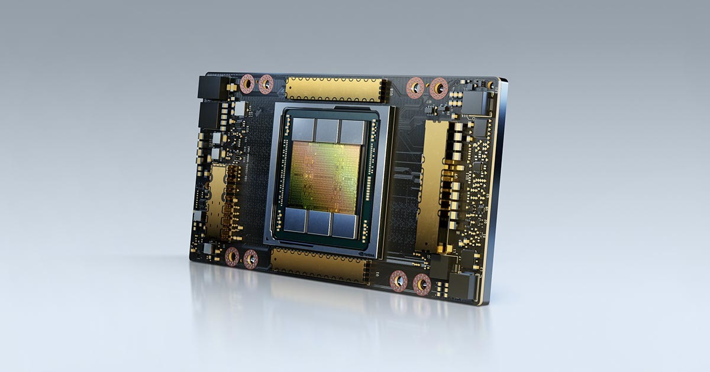
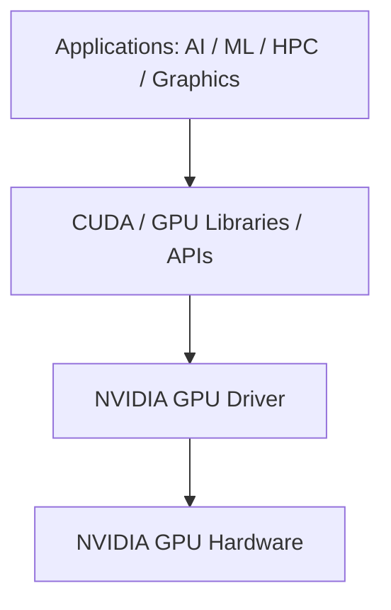
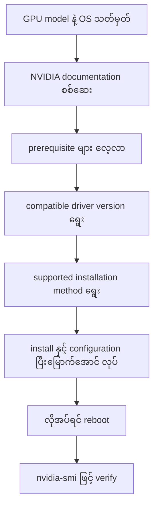
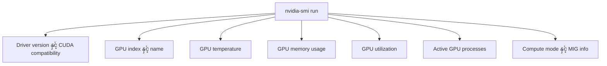
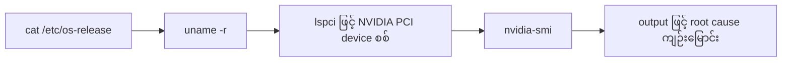
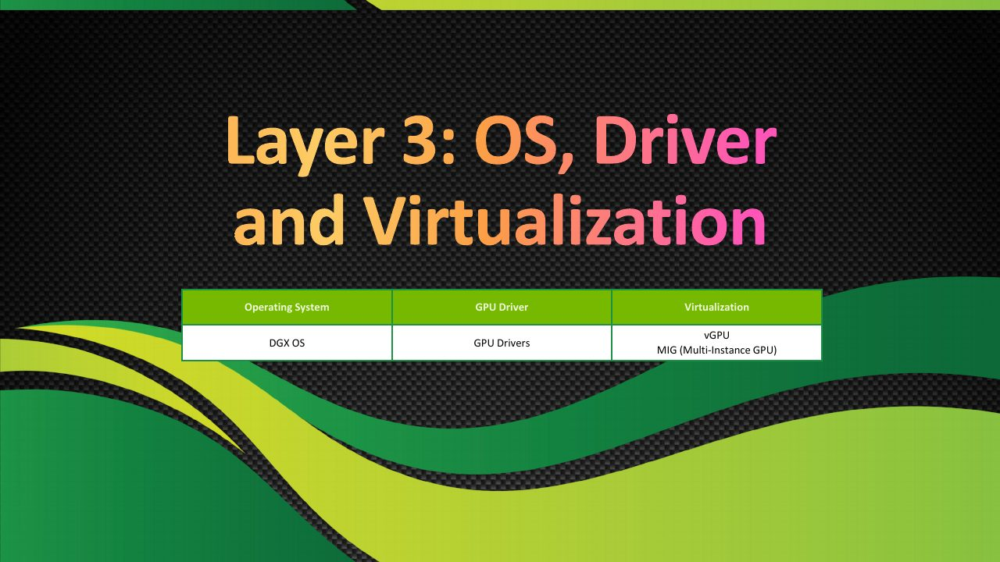
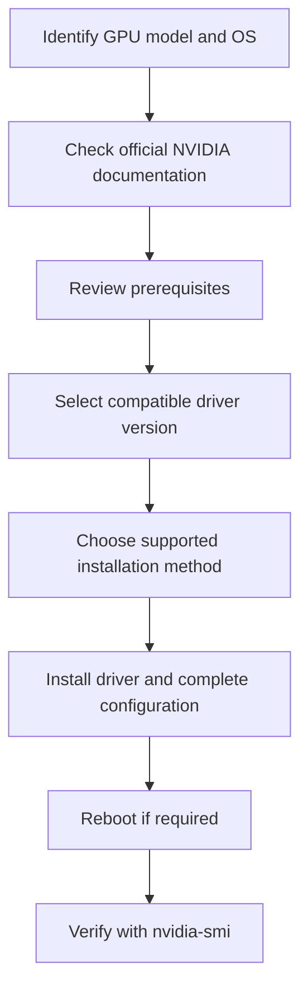
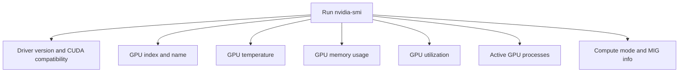
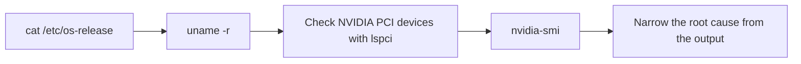

# Module 15 — NVIDIA GPU Drivers and nvidia-smi

> Part III · Course Module 15 (NVIDIA GPU Drivers and nvidia-smi) — topic notes

## မြန်မာဘာသာ version

## 1. မိတ်ဆက် — Device Driver ဆိုတာဘာလဲ?

Device driver ဆိုတာ operating system က hardware device တစ်ခုနဲ့ ဆက်သွယ် ထိန်းချုပ်အသုံးပြုနိုင်ဖို့ ပေးတဲ့ software ဖြစ်ပါတယ်။

ဥပမာ—

- USB device တစ်ခုကို operating system က မှတ်မိ အသုံးပြုနိုင်ဖို့ driver လိုအပ်နိုင်ပါတယ်။
- Printer တစ်ခုရဲ့ printing feature တွေကို application တွေအတွက် ဖော်ပြပေးဖို့ driver လိုအပ်နိုင်ပါတယ်။
- NVIDIA GPU တစ်ခုအတွက် operating system နဲ့ supported application တွေက GPU ကို အသုံးပြုနိုင်ဖို့ compatible GPU driver လိုအပ်ပါတယ်။

သင့်တော်တဲ့ driver မပါရင် GPU က server ထဲ ရုပ်ပိုင်းအရ တပ်ဆင်ထားပေမယ့် ပုံမှန် GPU-accelerated workload တွေအတွက် အသုံးပြု၍ မရနိုင်ပါဘူး။

## 2. NVIDIA GPU Driver ဆိုတာဘာလဲ?

NVIDIA GPU driver ဆိုတာ NVIDIA GPU hardware ကို operating system နဲ့ application တွေနဲ့ ချိတ်ဆက်ပေးတဲ့ software ဖြစ်ပါတယ်။

AI, machine learning, High-Performance Computing (HPC) နဲ့ graphics အပါအဝင် supported workload တွေအတွက် GPU ကို စီမံ အသုံးပြုဖို့ software interface ကို ပေးပါတယ်။

အရေးကြီးတဲ့ တာဝန်တွေက—

- Application တွေ GPU computing capability ကို access လုပ်နိုင်စေခြင်း
- GPU memory နဲ့ hardware resource တွေကို စီမံခြင်း
- GPU execution နဲ့ performance management ကို support ခြင်း
- Compatible GPU monitoring နဲ့ management tool တွေကို အသုံးပြုနိုင်စေခြင်း
- Multi-GPU configuration များကို support ခြင်း
- Compatible container နဲ့ virtualization environment များ လိုအပ်တဲ့ driver functionality ပေးခြင်း

တိကျတဲ့ capability တွေက GPU model, driver version, operating system နဲ့ supported software configuration ပေါ် မူတည်ပါတယ်။



**ပုံရှင်းလင်းချက် (ဓာတ်ပုံ 1)** — ဓာတ်ပုံမှာ NVIDIA A100 GPU ကို မြင်ရပါမယ် — GPU chip ကို ဖုံးအုပ်ထားတဲ့ heatsink နဲ့ cooling assembly ပါဝင်တဲ့ GPU board ဖြစ်ပါတယ်။ ဒီဓာတ်ပုံက ဒီ section မှာ ပြောတဲ့ "NVIDIA GPU Hardware" layer ရဲ့ လက်တွေ့ ပုံစံ ဖြစ်ပြီး GPU driver ဆိုတာ ဒီ hardware ကို operating system နဲ့ application တွေနဲ့ ချိတ်ဆက်ပေးတဲ့ software ဖြစ်ပါတယ်။

*(Image: NVIDIA official product image)*

**ရိုးရှင်းသော architecture**

```
+------------------------------------+
| Applications                       |
| AI / ML / HPC / Graphics           |
+------------------------------------+
                 |
                 v
+------------------------------------+
| CUDA / GPU Libraries / APIs         |
+------------------------------------+
                 |
                 v
+------------------------------------+
| NVIDIA GPU Driver                  |
+------------------------------------+
                 |
                 v
+------------------------------------+
| NVIDIA GPU Hardware                |
| Tesla T4 / A100 / H100 / Others    |
+------------------------------------+
```

**ပုံ ၁ (Figure 1) — Application ကနေ GPU hardware အထိ software layers များ**



**ပုံရှင်းလင်းချက်** — Application တွေက GPU ကို တိုက်ရိုက် မထိနိုင်ဘဲ CUDA, GPU libraries ဒါမှမဟုတ် APIs ကတစ်ဆင့် တောင်းဆိုပြီး NVIDIA GPU Driver က GPU hardware ကို စီမံ ခိုင်းစေပါတယ်။ Driver မပါရင် hardware တပ်ထားပေမယ့် software က GPU ကို အသုံးပြု၍ မရနိုင်ပါဘူး။

ဒီ diagram က simplified ဖြစ်ပါတယ်။ Application က CUDA, graphics API သို့မဟုတ် အခြား supported interface သုံးခြင်းပေါ် မူတည်ပြီး exact software path ကွဲပြားနိုင်ပါတယ်။

## 3. GPU Driver က ကြိုတင် install လုပ်ပြီးသားလား?

Environment အများစုမှာ NVIDIA driver က ကြိုတင် install လုပ်ပြီး ဖြစ်နိုင်ပါတယ်။

**ဥပမာများ—**

- **Preconfigured GPU server** — NVIDIA GPU ပါတဲ့ server တစ်လုံးက system provider က driver ကို ကြိုတင် install/configure လုပ်ပေးထားနိုင်ပါတယ်။
- **Cloud GPU instance** — Cloud provider တွေက GPU driver နဲ့ ဆက်စပ် software တွေ ပြီးသားပါတဲ့ machine image တွေ ပေးနိုင်ပါတယ်။ ဥပမာ— သင့်တော်တဲ့ Deep Learning Amazon Machine Image (AMI) ကနေ launch လုပ်တဲ့ Amazon EC2 GPU instance မှာ NVIDIA driver နဲ့ အခြား GPU software တွေ ပါဝင်နိုင်ပါတယ်။ သို့သော် ဒါက specific AMI နဲ့ image version ပေါ် မူတည်ပါတယ်။ Machine image တိုင်းက အတူတူ driver/CUDA component တွေ မပါဝင်ပါဘူး။

**Manual installation**

သင့်တော်တဲ့ driver မရှိရင် operating system နဲ့ GPU အတွက် supported method နဲ့ install လုပ်နိုင်ပါတယ်။ Install မလုပ်မီ အောက်ပါတွေကို သတ်မှတ်ပါ—

- GPU model
- Operating system နဲ့ version
- CPU architecture
- လိုအပ်တဲ့ driver branch
- CUDA, application သို့မဟုတ် vendor compatibility requirement များ

## 4. NVIDIA GPU Driver တပ်ဆင်ခြင်း

NVIDIA က supported operating system များအတွက် driver installation ကို ဖုံးအုပ်တဲ့ တရားဝင် documentation ပေးထားပါတယ်။

Installation procedure က platform အလိုက် ကွဲပြားပါတယ်။ Driver release ပေါ် မူတည်ပြီး Ubuntu, Red Hat Enterprise Linux, Rocky Linux, Windows နဲ့ အခြား platform များ ပါဝင်နိုင်ပါတယ်။

**ယေဘုယျ installation workflow**

1. GPU model နဲ့ operating system ကို သတ်မှတ်ပါ။
2. တရားဝင် NVIDIA driver documentation ကို စစ်ဆေးပါ။
3. Operating-system နဲ့ hardware prerequisite များကို လေ့လာပါ။
4. Compatible driver version ကို ရွေးပါ။
5. Supported installation method ကို ရွေးပါ။
6. Driver ကို install ပြီး လိုအပ်တဲ့ configuration ပြီးမြောက်အောင် လုပ်ပါ။
7. Installation procedure က reboot လိုအပ်ရင် reboot လုပ်ပါ။
8. `nvidia-smi` နဲ့ installation ကို verify လုပ်ပါ။

**ပုံ ၂ (Figure 2) — NVIDIA GPU driver installation workflow**



**ပုံရှင်းလင်းချက်** — အဆင့်တွေကို အပေါ်ကနေ အောက်ဘက် အစဉ်လိုက် လုပ်သွားရုံ ဖြစ်ပါတယ် — အရင် GPU model နဲ့ OS ကို သိဖို့၊ တရားဝင် NVIDIA documentation ကြည့်ဖို့၊ version နဲ့ installation method မှန်မှန် ရွေးဖို့ လုပ်ပြီး install ပြီးမှ နောက်ဆုံးအဆင့်မှာ `nvidia-smi` နဲ့ တကယ် အလုပ်လုပ်/မလုပ် verify လုပ်ပါတယ်။

**အရေးကြီးသော စဉ်းစားရန်အချက်များ**

- Specific operating system နဲ့ driver branch အတွက် ညွှန်ကြားချက်ကို လိုက်နာပါ။
- မကိုက်ညီတဲ့ installation method သို့မဟုတ် driver package တွေကို ရောမသုံးပါနဲ့။
- အထူးသဖြင့် Linux မှာ kernel နဲ့ driver compatibility ကို စစ်ဆေးပါ။
- လိုအပ်ရင် Secure Boot, kernel module နဲ့ package dependency တွေကို ထည့်သွင်း စဉ်းစားပါ။
- Production DGX system များအတွက် machine ကို အလွတ် Linux server လို မသဘောထားဘဲ NVIDIA ရဲ့ supported DGX-specific procedure ကို လိုက်နာပါ။
- နောက်ဆုံး driver က အကောင်းဆုံး ဖြစ်တယ်လို့ မယူဆပါနဲ့။ Compatibility နဲ့ vendor support က အရေးကြီးပါတယ်။

**တရားဝင် resource များ**

- NVIDIA Driver Downloads: https://www.nvidia.com/Download/index.aspx
- NVIDIA Linux Driver Installation Guide: https://docs.nvidia.com/datacenter/tesla/driver-installation-guide/

## 5. nvidia-smi ဆိုတာဘာလဲ?

nvidia-smi ဆိုတာ **NVIDIA System Management Interface** ရဲ့ အတိုကောက် ဖြစ်ပါတယ်။

Supported NVIDIA GPU များကို inspect နဲ့ manage လုပ်ဖို့ command-line utility ဖြစ်ပါတယ်။ NVIDIA GPU server တစ်လုံးကို troubleshoot လုပ်တဲ့အခါ အသုံးအဝင်ဆုံး ပထမဆုံး command တွေထဲက တစ်ခု ဖြစ်ပါတယ်။

Run လုပ်ပါ—

```bash
nvidia-smi
```

Successful command တစ်ခုက ပုံမှန်အားဖြင့် အောက်ပါအချက်အလက်တွေ ပြပေးပါတယ်—

- NVIDIA driver version
- Driver က report လုပ်တဲ့ CUDA compatibility version
- GPU index နဲ့ model name
- GPU temperature
- GPU power နဲ့ performance အချက်အလက်
- GPU memory usage
- GPU utilization
- Active GPU process များ
- Compute mode နဲ့ supported hardware ပေါ်မှာ MIG အချက်အလက်

**ပုံ ၃ (Figure 3) — nvidia-smi run ကြည့်တဲ့အခါ ဘာတွေ စစ်ဆေးနိုင်သလဲ**



**ပုံရှင်းလင်းချက်** — `nvidia-smi` တစ်ချက် run လိုက်ရုံနဲ့ ပုံမှာ ခွဲပြထားသလို အချက်အလက် အုပ်စုတွေ တစ်ပြိုင်နက် ကြည့်ရပါတယ် — driver version၊ GPU index/name၊ temperature၊ memory usage၊ utilization၊ active processes နဲ့ compute mode/MIG အချက်အလက်တွေ ဖြစ်ပါတယ်။ ပြသတဲ့ field တွေက GPU model, driver နဲ့ platform ပေါ် မူတည်ပါတယ်။

ပြသတဲ့ field တွေက GPU model, driver နဲ့ platform ပေါ် မူတည်ပါတယ်။

## 6. nvidia-smi Output ကို နားလည်ခြင်း

Lesson မှာ NVIDIA Tesla T4 ပါတဲ့ EC2 GPU instance က ဥပမာတစ်ခု ပေးထားပါတယ်။ Report လုပ်တဲ့ driver version က 580.95.05 ဖြစ်ပြီး GPU temperature က ခန့်မှန်းခြေ 24°C ဖြစ်ပါတယ်။ GPU မှာ memory ခန့်မှန်းခြေ 16 GB ရှိပြီး ဒီဥပမာမှာ idle ဖြစ်နေပါတယ်။

ဒီတန်ဖိုးတွေက အဲဒီ ဥပမာ တစ်ခုတည်းကို ဖော်ပြတာဖြစ်ပြီး Tesla T4 server တိုင်းကို မဆိုလိုပါဘူး။

**Example output structure**

```
+----------------------------------------------------------------------------------+
| NVIDIA-SMI                         Driver Version: 580.95.05                     |
|-----------------------------------------+------------------------+---------------|
| GPU  Name                  Temp         | Memory-Usage           | GPU-Util      |
|=========================================+========================+===============|
|  0   Tesla T4              24C           | 0MiB / 15360MiB        | 0%            |
+-----------------------------------------+------------------------+---------------+
```

ဒါက original terminal output ရဲ့ copy မဟုတ်ဘဲ illustrative example ဖြစ်ပါတယ်။

### A. Driver Version

ဥပမာ—

```
Driver Version: 580.95.05
```

ဒါက utility က report လုပ်တဲ့ install လုပ်ထားတဲ့ NVIDIA driver version ကို ဖော်ပြပါတယ်။

CUDA application, framework နဲ့ အခြား NVIDIA software တွေနဲ့ compatibility ကို troubleshoot လုပ်တဲ့အခါ driver version က အရေးကြီးပါတယ်။

### B. CUDA Version

nvidia-smi ပြတဲ့ CUDA Version field က install လုပ်ထားတဲ့ driver က support လုပ်တဲ့ **maximum CUDA version level** ကို အဲဒီ utility က ဖော်ပြတာ ဖြစ်ပါတယ်။

**အရေးကြီးတဲ့ ခွဲခြားချက်** — ဒါက သက်ဆိုင်ရာ CUDA Toolkit install လုပ်ထားတယ်လို့ သက်သေမပြပါဘူး။

CUDA compiler ရှိ/မရှိ စစ်ဆေးချင်ရင်—

```bash
nvcc --version
```

ဒီ command က CUDA compiler install လုပ်ပြီး current executable search path ထဲ ရှိမှသာ အလုပ်လုပ်ပါတယ်။

အောက်ပါတွေက concept မတူညီပါဘူး—

- **NVIDIA driver** — Software က GPU ကို အသုံးပြုခွင့် ပေးပါတယ်။
- **CUDA Toolkit** — CUDA application တည်ဆောက်ရန် development tool နဲ့ library တွေ ပေးပါတယ်။
- **nvidia-smi ပြတဲ့ CUDA version** — Driver CUDA compatibility ကို ဖော်ပြတာဖြစ်ပြီး install လုပ်ထားတဲ့ Toolkit version ကို အမြဲ မဆိုလိုပါဘူး။

### C. GPU Index နဲ့ Name

ဥပမာ—

```
GPU 0: Tesla T4
```

GPU index က system ရဲ့ enumeration ထဲမှာ GPU တစ်ခုကို သတ်မှတ်ပါတယ်။

Multi-GPU server တစ်ခုမှာ index 0, 1, 2, 3 စသည် ပြနိုင်ပါတယ်။ GPU name က detect လုပ်ထားတဲ့ model ကို ဖော်ပြပြီး ၎င်းရဲ့ capability နဲ့ supported feature တွေကို ဆုံးဖြတ်ရာမှာ ကူညီပါတယ်။

### D. GPU Temperature

ဥပမာ—

```
24C
```

ဒါက degree Celsius နဲ့ ဖော်ပြတဲ့ report လုပ်ထားတဲ့ GPU temperature ဖြစ်ပါတယ်။

Temperature monitoring က administrator တွေကို ဖြစ်နိုင်တဲ့ thermal ပြဿနာတွေကို ရှာဖွေရာမှာ ကူညီပါတယ်။ Acceptable operating range က GPU model နဲ့ system configuration ပေါ် မူတည်ပါတယ်။

### E. GPU Memory Usage

ဥပမာ—

```
0MiB / 15360MiB
```

ဒါက GPU အတွက် ရနိုင်တဲ့ memory ခန့်မှန်းခြေ 15,360 MiB အနက် report လုပ်ထားတဲ့ GPU memory usage 0 MiB ဖြစ်တယ်လို့ ဆိုလိုပါတယ်။

Tesla T4 မှာ physical GPU memory 16 GB ရှိပေမယ့် memory ကို report/reserve လုပ်ပုံကြောင့် ရနိုင်တဲ့ပမာဏက ပြတဲ့အတိုင်း နည်းနိုင်ပါတယ်။

AI application တစ်ခုက model ကို GPU ပေါ် load လုပ်ရင် memory usage သိသိသာသာ တက်လာနိုင်ပါတယ်။

### F. GPU Utilization

ဥပမာ—

```
GPU-Util: 0%
```

ဒါက measured interval အတွင်း GPU က active GPU utilization မ report ဘူးဆိုတာကို ဖော်ပြပါတယ်။

0% ဆိုတာ GPU ပျက်နေတယ်လို့ မဆိုလိုပါဘူး။ လက်ရှိမှာ workload တစ်ခုမှ မသုံးသေးလို့ ဖြစ်နိုင်ပါတယ်။

GPU utilization က GPU memory usage နဲ့လည်း အတူတူ မဟုတ်ပါဘူး။ Application တစ်ခုက GPU memory ကို reserve လုပ်ထားပြီး computation အနည်းငယ်သာ လုပ်နေနိုင်ပါတယ်။

### G. GPU Processes

Application တွေက GPU သုံးတဲ့အခါ nvidia-smi က process အချက်အလက် ပြနိုင်ပါတယ်—

- Process ID (PID)
- Process name (ရရှိနိုင်ရင်)
- အဲဒီ process ကို ခွဲဝပေးထားတဲ့ GPU memory usage

ဥပမာ— CUDA-based training application တစ်ခုက GPU memory ခွဲဝပေးထားတဲ့ running process အဖြစ် ပေါ်လာနိုင်ပါတယ်။

System အချို့မှာ permission, container သို့မဟုတ် operating environment ကြောင့် process အသေးစိတ် ကန့်သတ်ခံရနိုင်ပါတယ်။

## 7. အသုံးဝင်သော nvidia-smi Command များ

**Standard GPU status ပြရန်**

```bash
nvidia-smi
```

**Display ကို ဆက်တိုက် refresh လုပ်ရန်**

```bash
watch -n 1 nvidia-smi
```

ဒါက command output ကို တစ်စက္ကန့်တစ်ကြိမ်ခန့် refresh လုပ်ပါတယ်။ ရပ်ဖို့ Ctrl+C နှိပ်ပါ။

**Detect လုပ်ထားတဲ့ GPU name များ ပြရန်**

```bash
nvidia-smi --query-gpu=name --format=csv
```

**Driver နဲ့ memory အချက်အလက် ပြရန်**

```bash
nvidia-smi --query-gpu=name,driver_version,memory.total,memory.used,memory.free --format=csv
```

**GPU ပေါ် run နေတဲ့ process များ ပြရန်**

```bash
nvidia-smi
```

Output အောက်ခြေက Processes section ကို ကြည့်ပါ (ရနိုင်ရင်)။

ဒီ command တွေက basic inspection အတွက် အသုံးဝင်ပါတယ်။ ရနိုင်တဲ့ query field တွေနဲ့ process visibility က driver နဲ့ platform ပေါ် မူတည်ပြီး ကွဲပြားနိုင်ပါတယ်။

## 8. Compute Mode နဲ့ MIG ကို နားလည်ခြင်း

Lesson မှာ compute mode နဲ့ MIG mode ကိုလည်း ဖော်ပြထားပါတယ်။

**Compute mode**

Compute mode က GPU compute process တွေက GPU တစ်ခုကို အသုံးပြုခွင့် ပြု/မပြုဆိုတဲ့ အပိုင်းတွေကို ထိန်းချုပ်ပါတယ်။ ရနိုင်တဲ့ mode တွေနဲ့ ၎င်းတို့ရဲ့ behavior က GPU နဲ့ driver ပေါ် မူတည်ပါတယ်။

`Default` လို့ ပြတာက ပုံမှန် default compute mode ကို ယေဘုယျအားဖြင့် ဖော်ပြပါတယ်။

**MIG mode**

MIG ဆိုတာ **Multi-Instance GPU** ဖြစ်ပါတယ်။ Supported NVIDIA GPU model များပေါ်မှာ MIG က physical GPU တစ်ခုကို GPU resource အပိုင်းများ dedicated ဖြစ်အောင် ခွဲဝပေးတဲ့ GPU instance များအဖြစ် partition လုပ်နိုင်ပါတယ်။

MIG က NVIDIA GPU တိုင်းက support မလုပ်ပါဘူး။ Lesson မှာ သုံးထားတဲ့ Tesla T4 က MIG မ support လို့ အဲဒီ model ပေါ်မှာ MIG-specific functionality မရနိုင်ပါဘူး။

`N/A` သို့မဟုတ် unavailable ဆိုတဲ့ field ကို error အဖြစ် အလိုအလျောက် မမှတ်ယူပါနဲ့။ Feature က support မလုပ်ခြင်း သို့မဟုတ် မသက်ဆိုင်ခြင်းကို ဖော်ပြတာ ဖြစ်နိုင်ပါတယ်။

## 9. nvidia-smi မအောင်မြင်ရင် Troubleshooting

nvidia-smi က GPU နဲ့ ဆက်သွယ်၍ မရရင် ဖြစ်နိုင်တဲ့ အကြောင်းရင်းတွေက—

- NVIDIA driver မ install ရသေးခြင်း
- Driver install ထားပေမယ့် မှန်ကန်စွာ load မဖြစ်ခြင်း
- Kernel module သို့မဟုတ် kernel compatibility ပြဿနာ ရှိခြင်း
- GPU က operating system သို့မဟုတ် virtual machine အတွက် မမြင်ရခြင်း
- Container မှာ host GPU access မရှိခြင်း
- Driver installation မပြီးသေးခြင်း သို့မဟုတ် reboot လိုအပ်ခြင်း

Linux ပေါ်မှာ အသုံးဝင်တဲ့ first-check sequence ကတော့—

```bash
# Check operating system
cat /etc/os-release

# Check the running kernel
uname -r

# Check whether NVIDIA PCI devices are detected
lspci | grep -i nvidia

# Check NVIDIA GPU status
nvidia-smi
```

**ပုံ ၄ (Figure 4) — nvidia-smi မအောင်မြင်ရင် စစ်ဆေးမယ့် အစဉ်လိုက် flow**



**ပုံရှင်းလင်းချက်** — ဘယ်ဘက်ကနေ ညာဘက် တစ်ဆင့်ချင်း စစ်ပါ — အရင် OS version (`cat /etc/os-release`) ကြည့်၊ ပြီး running kernel (`uname -r`) ကြည့်၊ NVIDIA PCI device ကို system က မြင်/မမြင် စစ် (`lspci | grep -i nvidia`)၊ နောက်ဆုံးမှ `nvidia-smi` ကိုယ်တိုင် run ကြည့်ပါ။ Command တစ်ခု မအောင်မြင်တိုင်း root cause မဟုတ်သေးဘဲ ရရှိတဲ့ output နဲ့ ပြဿနာကို တဖြည်းဖြည်း ကျဉ်းမြောင်းအောင် လုပ်ရတာ ဖြစ်ပါတယ်။

Command တစ်ခုက result မရခြင်းက root cause ကို တစ်ခုတည်း မသတ်မှတ်ပေးပါဘူး။ Output ကို သုံးပြီး စုံစမ်းမှုကို ကျဉ်းမြောင်းအောင် လုပ်ပါ။

## 10. အဓိက အကျဉ်းချုပ်

- NVIDIA GPU driver တွေက operating system နဲ့ supported application တွေကို NVIDIA GPU များ အသုံးပြုခွင့် ပေးပါတယ်။
- Cloud GPU instance နဲ့ preconfigured server တွေမှာ လိုအပ်တဲ့ driver တွေ ကြိုတင် ပါဝင်နိုင်ပါတယ်။
- Driver installation က operating system နဲ့ hardware အတွက် supported procedure ကို လိုက်နာရပါမယ်။
- nvidia-smi က GPU, driver, memory, temperature, utilization နဲ့ process အချက်အလက် စစ်ဆေးရာမှာ အဓိက utility ဖြစ်ပါတယ်။
- nvidia-smi ပြတဲ့ CUDA version က install လုပ်ထားတဲ့ CUDA Toolkit version ကို အမြဲ မဆိုလိုပါဘူး။
- GPU memory usage နဲ့ GPU utilization က အရာ မတူညီပါဘူး။
- MIG က specific GPU model များမှာသာ support ဖြစ်ပြီး `N/A` က fault ကို အမြဲ မဆိုလိုပါဘူး။



**ပုံရှင်းလင်းချက် (Slide walkthrough):** ဒီ training ပုံက OS နဲ့ GPU driver section တစ်ခုလုံးရဲ့ အကျဉ်းချုပ် (recap) ဖြစ်ပါတယ်။ Device driver ဆိုတာ ဘာလဲ၊ NVIDIA GPU driver ဘယ်လို တပ်ဆင်ရလဲ၊ `nvidia-smi` နဲ့ GPU, driver, memory, temperature, utilization နဲ့ process အချက်အလက်တွေ ဘယ်လို စစ်ဆေးရလဲ ဆိုတဲ့ အဓိက အချက်တွေကို အပေါ်က အကျဉ်းချုပ် အချက်တွေနဲ့အတူ ပြန်လည် သုံးသပ်ပြထားပါတယ်။

*(Source: NVIDIA NCA-AIIO training deck — study material)*

## 11. တရားဝင် စာရွက်စာတမ်းများ

- NVIDIA Driver Downloads: https://www.nvidia.com/Download/index.aspx
- NVIDIA Linux Driver Installation Guide: https://docs.nvidia.com/datacenter/tesla/driver-installation-guide/
- NVIDIA System Management Interface documentation: https://docs.nvidia.com/deploy/nvidia-smi/
- NVIDIA CUDA Compatibility: https://docs.nvidia.com/deploy/cuda-compatibility/

## 12. ကိုယ်တိုင် စစ်ဆေးမေးခွန်းများ (Self-Check Questions)

**Q1. Device driver ဆိုတာ ဘာလဲ?**

A: Operating system က hardware device ကို ဆက်သွယ် ထိန်းချုပ်အသုံးပြုနိုင်ဖို့ ပေးတဲ့ software ဖြစ်ပါတယ်။

**Q2. nvidia-smi ပြတဲ့ CUDA Version က ဘာကို ဆိုလိုသလဲ?**

A: Install လုပ်ထားတဲ့ driver က support လုပ်တဲ့ maximum CUDA version level ကို ဆိုလိုပါတယ်။ CUDA Toolkit တကယ် install ထား/မထားကို မသက်သေပြပါဘူး — `nvcc --version` နဲ့ သီးခြား စစ်ရပါမယ်။

**Q3. GPU-Util 0% က GPU ပျက်နေတယ်လို့ ဆိုလိုသလား?**

A: မဟုတ်ပါ။ လက်ရှိမှာ GPU သုံးတဲ့ workload မရှိခြင်းကြောင့် ဖြစ်နိုင်ပါတယ်။ GPU-Util နဲ့ memory usage ကလည်း အရာ မတူပါဘူး။

**Q4. nvidia-smi မအောင်မြင်ရင် ပထမ ဘာတွေ စစ်သင့်သလဲ?**

A: OS version (`cat /etc/os-release`), kernel (`uname -r`), NVIDIA PCI device ရှိ/မရှိ (`lspci | grep -i nvidia`) နဲ့ `nvidia-smi` output ကို အစဉ်လိုက် စစ်ဆေးပါ။

**Q5. Tesla T4 က MIG support လုပ်သလား?**

A: မလုပ်ပါ။ MIG က supported GPU model အချို့မှာသာ ရနိုင်ပြီး T4 ပေါ်မှာ MIG field `N/A` ပြခြင်းက error မဟုတ်ပါဘူး။

## English Version

## 1. Introduction: What Is a Device Driver?

A device driver is software that enables an operating system to communicate with and control a hardware device.

For example:

- A USB device may require a driver so that the operating system can recognize and use it.
- A printer may require a driver to expose its printing features to applications.
- An NVIDIA GPU requires a compatible GPU driver so that the operating system and supported applications can use the GPU.

Without the appropriate driver, a GPU may be physically installed in the server but unavailable for normal GPU-accelerated workloads.

## 2. What Is an NVIDIA GPU Driver?

The NVIDIA GPU driver is software that connects the NVIDIA GPU hardware with the operating system and applications.

It provides the software interface needed to manage and use the GPU for supported workloads, including AI, machine learning, High-Performance Computing (HPC), and graphics.

Important responsibilities include:

- Enabling applications to access GPU computing capabilities.
- Managing GPU memory and hardware resources.
- Supporting GPU execution and performance management.
- Enabling compatible GPU monitoring and management tools.
- Supporting multi-GPU configurations.
- Providing the driver functionality required by compatible container and virtualization environments.

The exact capabilities depend on the GPU model, driver version, operating system, and supported software configuration.


**Photo walkthrough (Photo 1)** — The photo shows an NVIDIA A100 GPU: a GPU board with a heatsink and cooling assembly covering the GPU chip. This is the real-world form of the "NVIDIA GPU Hardware" layer below, and the GPU driver is the software that connects this hardware with the operating system and applications.

*(Image: NVIDIA official product image)*

**Simplified architecture**

```
+------------------------------------+
| Applications                       |
| AI / ML / HPC / Graphics           |
+------------------------------------+
                 |
                 v
+------------------------------------+
| CUDA / GPU Libraries / APIs         |
+------------------------------------+
                 |
                 v
+------------------------------------+
| NVIDIA GPU Driver                  |
+------------------------------------+
                 |
                 v
+------------------------------------+
| NVIDIA GPU Hardware                |
| Tesla T4 / A100 / H100 / Others    |
+------------------------------------+
```

**Figure 1 — Software layers from the application down to the GPU hardware**


**Figure walkthrough** — Applications cannot touch the GPU directly; they request work through CUDA, GPU libraries, or APIs, and the NVIDIA GPU driver manages and drives the GPU hardware. Without the driver, the hardware may be installed but software cannot use it.

This diagram is simplified. The exact software path depends on the application and whether it uses CUDA, graphics APIs, or other supported interfaces.

## 3. Are GPU Drivers Already Installed?

In many environments, NVIDIA drivers may already be installed.

**Examples include:**

- **Preconfigured GPU servers** — A server supplied with an NVIDIA GPU may have its driver preinstalled and configured by the system provider.
- **Cloud GPU instances** — Cloud providers may offer machine images with GPU drivers and related software already installed. For example, an Amazon EC2 GPU instance launched from a suitable Deep Learning Amazon Machine Image (AMI) may include NVIDIA drivers and additional GPU software. However, this depends on the specific AMI and image version. Not every machine image includes the same driver or CUDA components.

**Manual installation** — If the appropriate driver is missing, it can be installed using a method supported for the operating system and GPU. Before installation, identify:

- The GPU model.
- The operating system and version.
- The CPU architecture.
- The required driver branch.
- Any CUDA, application, or vendor compatibility requirements.

## 4. Installing NVIDIA GPU Drivers

NVIDIA provides official documentation covering driver installation for supported operating systems.

The installation procedure varies by platform. Supported environments may include Ubuntu, Red Hat Enterprise Linux, Rocky Linux, Windows, and other platforms, depending on the driver release.

**A general installation workflow is:**

1. Identify the GPU model and operating system.
2. Check the official NVIDIA driver documentation.
3. Review the operating-system and hardware prerequisites.
4. Select a compatible driver version.
5. Choose a supported installation method.
6. Install the driver and complete any required configuration.
7. Reboot if required by the installation procedure.
8. Verify the installation using `nvidia-smi`.

**Figure 2 — NVIDIA GPU driver installation workflow**



**Figure walkthrough** — Follow the steps from top to bottom: first identify the GPU model and OS, check the official NVIDIA documentation, pick the right driver version and installation method, install and configure, and finally verify with `nvidia-smi` that everything actually works.

**Important installation considerations**

- Follow the instructions for the specific operating system and driver branch.
- Avoid mixing incompatible installation methods or driver packages.
- Check kernel and driver compatibility, particularly on Linux systems.
- Consider Secure Boot, kernel modules, and package dependencies where applicable.
- For production DGX systems, follow NVIDIA's supported DGX-specific procedures rather than treating the machine as an arbitrary Linux server.
- Do not assume that the newest driver is automatically the best choice. Compatibility and vendor support are important.

**Official resources:**

- NVIDIA Driver Downloads: https://www.nvidia.com/Download/index.aspx
- NVIDIA Linux Driver Installation Guide: https://docs.nvidia.com/datacenter/tesla/driver-installation-guide/

## 5. What Is nvidia-smi?

nvidia-smi stands for **NVIDIA System Management Interface**.

It is a command-line utility for inspecting and managing supported NVIDIA GPUs. It is one of the most useful first commands when troubleshooting an NVIDIA GPU server.

Run:

```bash
nvidia-smi
```

A successful command typically displays information such as:

- NVIDIA driver version.
- CUDA compatibility version reported by the driver.
- GPU index and model name.
- GPU temperature.
- GPU power and performance information.
- GPU memory usage.
- GPU utilization.
- Active GPU processes.
- Compute mode and, on supported hardware, MIG information.

**Figure 3 — What you can inspect in one nvidia-smi run**



**Figure walkthrough** — A single `nvidia-smi` run shows all the groups in the figure at once: the driver version, the GPU index and name, temperature, memory usage, utilization, active processes, and compute mode/MIG information. The displayed fields depend on the GPU model, driver, and platform.

The displayed fields depend on the GPU model, driver, and platform.

## 6. Understanding nvidia-smi Output

The lesson provides an example from an EC2 GPU instance with an NVIDIA Tesla T4. The reported driver version is 580.95.05, and the GPU temperature is approximately 24°C. The GPU has approximately 16 GB of memory and is idle in the example.

These values describe that particular example, not every Tesla T4 server.

**Example output structure**

```
+----------------------------------------------------------------------------------+
| NVIDIA-SMI                         Driver Version: 580.95.05                     |
|-----------------------------------------+------------------------+---------------|
| GPU  Name                  Temp         | Memory-Usage           | GPU-Util      |
|=========================================+========================+===============|
|  0   Tesla T4              24C           | 0MiB / 15360MiB        | 0%            |
+-----------------------------------------+------------------------+---------------+
```

This is an illustrative example, not a copy of the original terminal output.

### A. Driver Version

Example:

```
Driver Version: 580.95.05
```

This indicates the installed NVIDIA driver version reported by the utility.

The driver version is important when troubleshooting compatibility with CUDA applications, frameworks, and other NVIDIA software.

### B. CUDA Version

The CUDA Version field shown by nvidia-smi indicates the **maximum CUDA version level supported by the installed driver**, as represented by that utility.

**Important distinction:** This does not prove that the corresponding CUDA Toolkit is installed.

To check whether the CUDA compiler is available, run:

```bash
nvcc --version
```

This command works only if the CUDA compiler is installed and available in the current executable search path.

The following are different concepts:

- **NVIDIA driver:** Allows software to use the GPU.
- **CUDA Toolkit:** Provides development tools and libraries for building CUDA applications.
- **CUDA version shown by nvidia-smi:** Indicates driver CUDA compatibility, not necessarily the installed Toolkit version.

### C. GPU Index and Name

Example:

```
GPU 0: Tesla T4
```

The GPU index identifies a GPU in the system's enumeration. A server with multiple GPUs may display indexes such as 0, 1, 2, and 3.

The GPU name identifies the detected model, which helps determine its capabilities and supported features.

### D. GPU Temperature

Example:

```
24C
```

This is the reported GPU temperature in degrees Celsius.

Temperature monitoring helps administrators identify possible thermal issues. The acceptable operating range depends on the GPU model and system configuration.

### E. GPU Memory Usage

Example:

```
0MiB / 15360MiB
```

This means the reported GPU memory usage is 0 MiB out of approximately 15,360 MiB available to the GPU.

The Tesla T4 has 16 GB of physical GPU memory, but the amount displayed as available may be lower because of how memory is reported and reserved.

If an AI application loads a model onto the GPU, its memory usage may increase substantially.

### F. GPU Utilization

Example:

```
GPU-Util: 0%
```

This indicates that the GPU is not reporting active GPU utilization during the measured interval.

A value of 0% does not necessarily mean the GPU is broken. It may simply mean no workload is currently using it.

GPU utilization is also not identical to GPU memory usage. An application may reserve GPU memory while performing little computation.

### G. GPU Processes

When applications use the GPU, nvidia-smi may display process information such as:

- Process ID (PID).
- Process name, when available.
- GPU memory usage attributed to the process.

For example, a CUDA-based training application may appear as a running process with GPU memory allocated to it.

On some systems, process details may be restricted by permissions, containers, or the operating environment.

## 7. Useful nvidia-smi Commands

**Display the standard GPU status**

```bash
nvidia-smi
```

**Refresh the display continuously**

```bash
watch -n 1 nvidia-smi
```

This refreshes the command output approximately once per second. Press Ctrl+C to stop.

**Display detected GPU names**

```bash
nvidia-smi --query-gpu=name --format=csv
```

**Display driver and memory information**

```bash
nvidia-smi --query-gpu=name,driver_version,memory.total,memory.used,memory.free --format=csv
```

**Display running GPU processes**

```bash
nvidia-smi
```

Inspect the Processes section at the bottom of the output, if available.

These commands are useful for basic inspection. Available query fields and process visibility may vary with the driver and platform.

## 8. Understanding Compute Mode and MIG

The lesson also mentions compute mode and MIG mode.

**Compute mode** — Compute mode controls aspects of how GPU compute processes are allowed to use a GPU. The available modes and their behavior depend on the GPU and driver. A displayed `Default` value generally indicates the normal default compute mode.

**MIG mode** — MIG stands for **Multi-Instance GPU**. On supported NVIDIA GPU models, MIG can partition a physical GPU into multiple GPU instances with dedicated portions of GPU resources.

MIG is not supported by every NVIDIA GPU. The Tesla T4 used in the lesson does not support MIG, so MIG-specific functionality is not available on that model.

A field showing `N/A` or an unavailable value should not automatically be interpreted as an error. It may simply indicate that the feature is unsupported or not applicable.

## 9. Troubleshooting When nvidia-smi Fails

If nvidia-smi cannot communicate with the GPU, possible causes include:

- The NVIDIA driver is not installed.
- The driver is installed but not loaded correctly.
- A kernel module or kernel compatibility problem exists.
- The GPU is not visible to the operating system or virtual machine.
- The container does not have access to the host GPU.
- The driver installation is incomplete or requires a reboot.

A useful first-check sequence on Linux is:

```bash
# Check operating system
cat /etc/os-release

# Check the running kernel
uname -r

# Check whether NVIDIA PCI devices are detected
lspci | grep -i nvidia

# Check NVIDIA GPU status
nvidia-smi
```

**Figure 4 — First-check flow when nvidia-smi fails**



**Figure walkthrough** — Work from left to right: check the OS version (`cat /etc/os-release`), then the running kernel (`uname -r`), then whether the system sees the NVIDIA PCI device (`lspci | grep -i nvidia`), and finally run `nvidia-smi` itself. A failing command does not by itself identify the root cause — use the output to narrow the investigation down step by step.

The absence of a result from one command does not, by itself, identify the root cause. Use the output to narrow down the investigation.

## 10. Key Takeaways

- NVIDIA GPU drivers allow the operating system and supported applications to use NVIDIA GPUs.
- Cloud GPU instances and preconfigured servers may already include the necessary drivers.
- Driver installation must follow the supported procedure for the operating system and hardware.
- nvidia-smi is a key utility for checking GPU, driver, memory, temperature, utilization, and process information.
- The CUDA version shown by nvidia-smi is not necessarily the version of the installed CUDA Toolkit.
- GPU memory usage and GPU utilization measure different things.
- MIG is supported only on specific GPU models; N/A does not necessarily indicate a fault.


**Slide walkthrough (ပုံရှင်းလင်းချက်):** This training slide recaps the whole OS and GPU driver section: what a device driver is, how NVIDIA GPU drivers are installed, and how nvidia-smi checks GPU, driver, memory, temperature, utilization, and process information — reviewed together with the key takeaways above.

*(Source: NVIDIA NCA-AIIO training deck — study material)*

## 11. Official Documentation

- NVIDIA Driver Downloads: https://www.nvidia.com/Download/index.aspx
- NVIDIA Linux Driver Installation Guide: https://docs.nvidia.com/datacenter/tesla/driver-installation-guide/
- NVIDIA System Management Interface documentation: https://docs.nvidia.com/deploy/nvidia-smi/
- NVIDIA CUDA Compatibility: https://docs.nvidia.com/deploy/cuda-compatibility/

## 12. Self-Check Questions

**Q1. What is a device driver?**

A: Software that enables an operating system to communicate with and control a hardware device.

**Q2. What does the CUDA Version shown by nvidia-smi mean?**

A: The maximum CUDA version level supported by the installed driver. It does not prove the CUDA Toolkit is installed — check separately with `nvcc --version`.

**Q3. Does GPU-Util 0% mean the GPU is broken?**

A: No. It may simply mean no workload is currently using the GPU. GPU-Util and memory usage also measure different things.

**Q4. What should you check first when nvidia-smi fails?**

A: In order — the OS version (`cat /etc/os-release`), the running kernel (`uname -r`), whether NVIDIA PCI devices are detected (`lspci | grep -i nvidia`), then the `nvidia-smi` output.

**Q5. Does the Tesla T4 support MIG?**

A: No. MIG is available only on specific supported GPU models; a `N/A` MIG field on the T4 is not an error.

## Technical review notes

- The nvidia-smi output table is an illustrative example from the lesson (Tesla T4 on EC2, Driver Version 580.95.05, 24°C, 0MiB / 15360MiB, 0%), not a copy of real terminal output; values vary by system and driver.
- "CUDA Version = maximum CUDA level supported by the driver" is the lesson's wording; exact semantics (including minor-version compatibility behavior) are version-dependent — verify against https://docs.nvidia.com/deploy/cuda-compatibility/ when troubleshooting specific stacks.
- The Tesla T4's displayed 15360MiB versus 16GB physical memory reflects reporting/reservation behavior of the driver, as stated in the lesson.
- The lesson states the Tesla T4 does not support MIG; this is consistent with NVIDIA's documented MIG support matrix (A100/H100-class and select other GPUs), but check the current support list for any model-specific exceptions.
- Query field availability and process visibility vary with driver version and platform, as noted in the lesson.
- Mermaid figures (Figures 1–4) with figure walkthroughs (ပုံရှင်းလင်းချက်) were added inline to both language sections; all existing text, ASCII diagrams, and review notes are unchanged.
