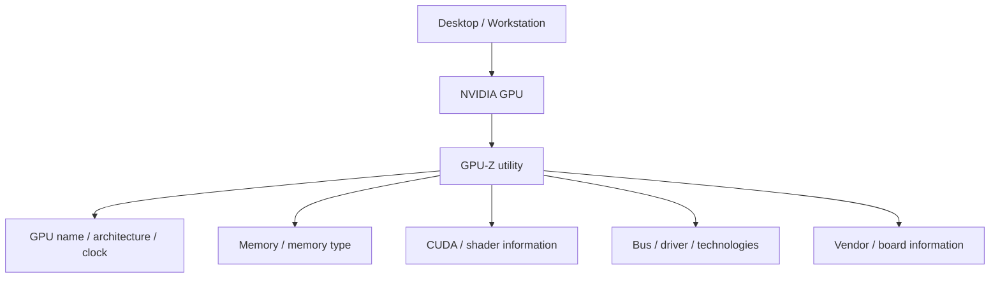
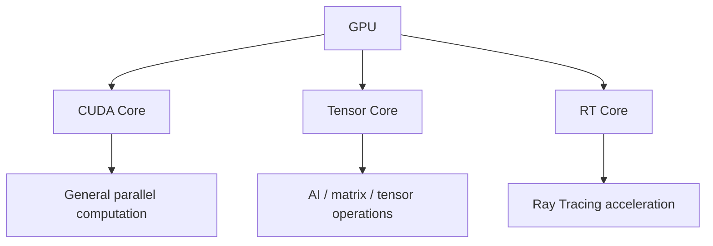
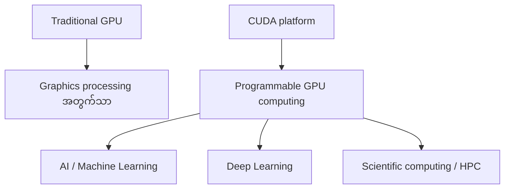
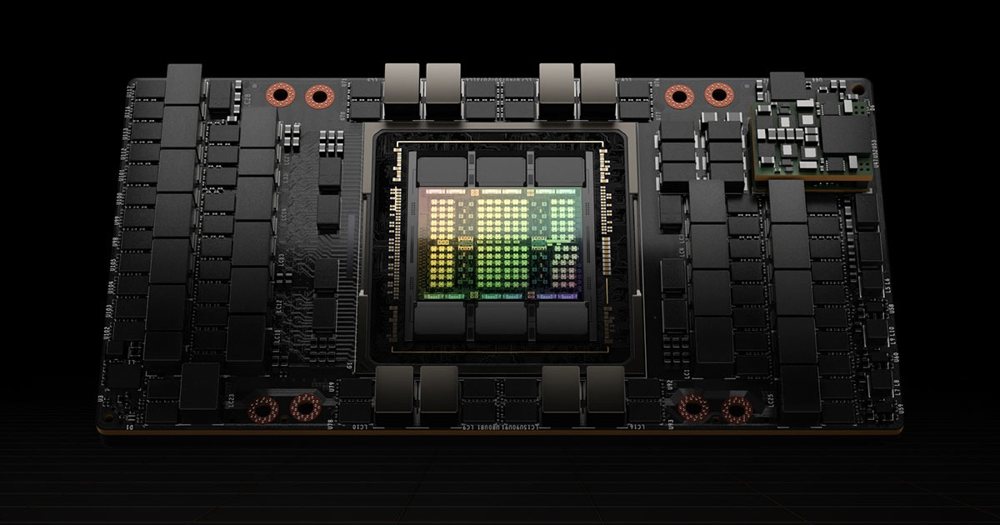
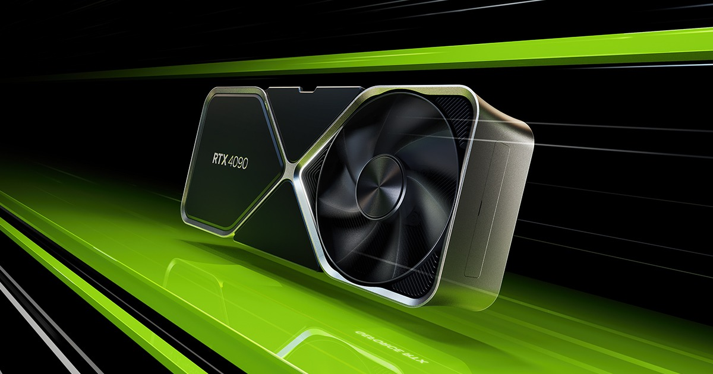
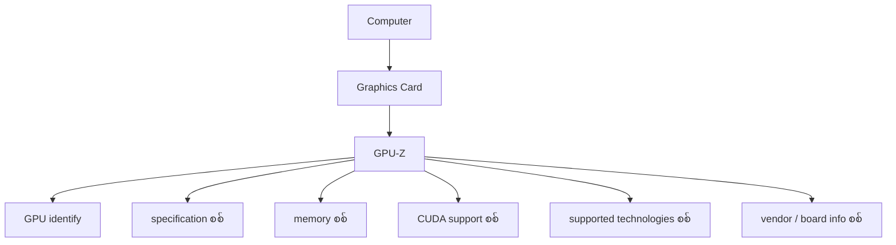
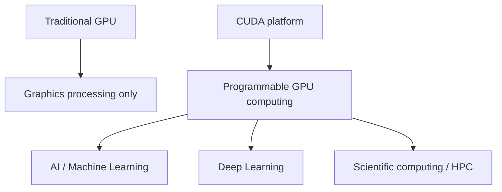
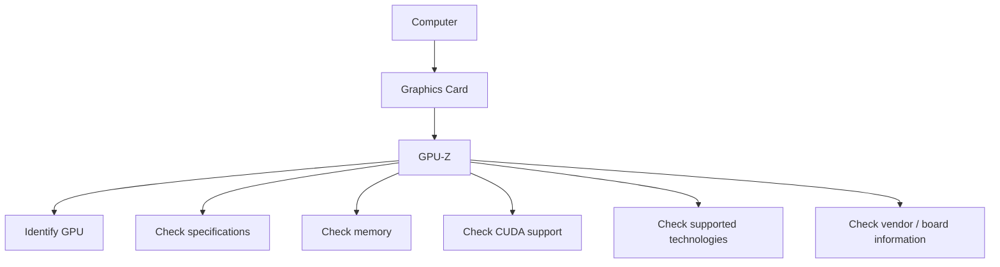

# Module — How to Inspect an NVIDIA GPU

> Part III · Course Module 15 — topic notes

## မြန်မာဘာသာ version

## 1. မိတ်ဆက်

အခုအပိုင်းမှာ ရှိပြီးသား NVIDIA graphics card တစ်ခုကို ဘယ်လို inspect လုပ်မလဲ ဆိုတာကို လေ့လာပါမယ်။

ဥပမာအနေနဲ့ desktop system အဟောင်းတစ်လုံးမှာရှိတဲ့ NVIDIA graphics card ကို အသုံးပြုပြီး GPU utility တစ်ခုက report လုပ်တဲ့ အချက်အလက်တချို့ကို နားလည်အောင် ကြည့်ပါမယ်။

ရည်ရွယ်ချက်က ဒီ GPU က modern workload တွေအတွက် လုံလောက်/မလုံလောက် လေ့လာတာ မဟုတ်ပါဘူး။ ရည်ရွယ်ချက်က—

- GPU တစ်ခုကို ဘယ်လို ဖော်ထုတ်မလဲ?
- ၎င်းရဲ့ basic specification နဲ့ supported technology တွေကို ဘယ်လို ဖတ်ရှု အဓိပ္ပာယ်ဖွင့်မလဲ?

ဆိုတာကို နားလည်ဖို့ ဖြစ်ပါတယ်။

## 2. GPU-Z ဆိုတာဘာလဲ?

GPU-Z က graphics card အကြောင်း အသေးစိတ် အချက်အလက်တွေကို inspect လုပ်ပြီး ပြသဖို့ အသုံးပြုတဲ့ utility ဖြစ်ပါတယ်။

GPU-Z ကို run လုပ်တဲ့အခါ system ထဲက graphics processor ကို detect လုပ်ပြီး အောက်ပါအချက်အလက်တွေလိုမျိုး ပြပေးနိုင်ပါတယ်—

- GPU name
- GPU architecture
- GPU clock
- Memory
- Memory type
- CUDA information
- Shader information
- Bus information
- Driver information
- Supported technologies
- Board / vendor information
- Temperature နဲ့ အခြား hardware အချက်အလက်များ

Conceptually—

```
Desktop / Workstation
        │
        ▼
   NVIDIA GPU
        │
        ▼
     GPU-Z
        │
        ├── GPU Name
        ├── CUDA information
        ├── Shader / Core information
        ├── Memory
        ├── Clock
        ├── Technologies
        └── Vendor / Board information
```

**ပုံ ၁ (Figure 1) — GPU-Z က GPU အချက်အလက် ဘယ်လို ဖော်ပေးသလဲ**



**ပုံရှင်းလင်းချက်** — Computer ထဲက NVIDIA GPU ကို GPU-Z utility က ဖတ်ပြီး ညာဘက်မှာ မြင်ရတဲ့အတိုင်း အချက်အလက် အုပ်စုတွေ ခွဲပြီး ပြသပေးပါတယ်။ ဒါကြောင့် GPU-Z က GPU ကို identify လုပ်ပြီး specification တွေကို တစ်နေရာတည်းမှာ စစ်ဆေးနိုင်တဲ့ tool ဖြစ်ပါတယ်။

## 3. ဥပမာ — NVIDIA GeForce GTX 710

ဒီ ဥပမာမှာ အသုံးပြုထားတဲ့ graphics card က—

**NVIDIA GeForce GTX 710**

ဒီ GPU ဟာ 2014 ခုနှစ်လောက်မှာ release လုပ်ခဲ့တဲ့ generation အဟောင်းတစ်ခု ဖြစ်ပါတယ်။ ဒါကြောင့် ယနေ့ခေတ် စံချိန်နဲ့ဆိုရင် ဆယ်စုနှစ်တစ်ခုကျော် ရှေ့က GPU ဖြစ်နေပါပြီ။

ထပ်ပြောရရင်— ဒီ lesson ရဲ့ ရည်ရွယ်ချက်က GTX 710 ရဲ့ performance ကို လေ့လာတာ မဟုတ်ပါဘူး။ အဓိက lesson က **GPU အချက်အလက်ကို ဘယ်လို ဖတ်ရမလဲ** ဆိုတာကို သင်ယူခြင်း ဖြစ်ပါတယ်။

> ⚠️ Source lesson က ဒီကတ်ကို "GTX 710" လို့ ဖော်ပြထားပါတယ်။ NVIDIA retail lineup မှာ GeForce **GT** 710 ဆိုတဲ့ model ရှိပါတယ် — model naming နဲ့ release ခုနှစ် (ခန့်မှန်းခြေ 2014) ကို တရားဝင် spec နဲ့ ပြန်စစ်ရန် လိုအပ်ပါတယ် (needs verification)။

## 4. Shaders

GPU-Z မှာ ပြတဲ့ value တွေထဲက တစ်ခုက Shaders အရေအတွက် ဖြစ်ပါတယ်။ ဒီ ဥပမာမှာ—

```
Shaders: 192
```

Basic conceptual နားလည်မှုအတွက် shader resource တွေကို GPU ရဲ့ parallel processing capability နဲ့ ဆက်စပ်ပြီး စဉ်းစားနိုင်ပါတယ်။

ရိုးရှင်းတဲ့ idea ကတော့—

```
More processing resources
          ↓
More parallel work
          ↓
Potentially higher throughput
```

GPU တွေက highly parallel processing ပတ်လည် design လုပ်ထားတာဖြစ်လို့ processing resource ရဲ့ အရေအတွက်နဲ့ အမျိုးအစားက GPU ရဲ့ အရေးကြီးတဲ့ characteristic တွေ ဖြစ်ပါတယ်။

## 5. Shader, CUDA Core, Tensor Core နဲ့ RT Core

NVIDIA GPU တွေကို လေ့လာတဲ့အခါ အောက်ပါ term တွေကို တွေ့ရနိုင်ပါတယ်—

- Shader
- CUDA Core
- Tensor Core
- RT Core

Source lesson မှာ shader ကို "core" တွေနှင့် ဆင်တူသလို စဉ်းစားနိုင်တယ်လို့ ရိုးရှင်းစွာ ရှင်းပြထားပါတယ်။

ဒါက မိတ်ဆက် ရှင်းလင်းချက်အဖြစ် အသုံးဝင်ပေမယ့် technical အရတော့ ဒီ term တွေကို အတူတူလို့ မသတ်မှတ်သင့်ပါဘူး။

```
Shader ≠ CUDA Core ≠ Tensor Core ≠ RT Core
```

သူတို့က GPU architecture ထဲမှာ concept မတူညီတဲ့ သို့မဟုတ် အထူးပြု processing capability တွေကို ကိုယ်စားပြုပါတယ်။

**CUDA Core**

CUDA Core တွေက general parallel computation အတွက် အသုံးပြုတဲ့ processing element တွေ ဖြစ်ပါတယ်။

```
CUDA Core
    ↓
Parallel computation
    ↓
AI / scientific computing / graphics-related workloads
```

**Tensor Core**

Tensor Core တွေက matrix နဲ့ tensor operation တွေကို accelerate လုပ်ဖို့ design လုပ်ထားတဲ့ specialized hardware ဖြစ်ပြီး AI နဲ့ Deep Learning workload တွေအတွက် အထူး အရေးကြီးပါတယ်။

```
Tensor Core
     ↓
Matrix / Tensor operations
     ↓
AI / Deep Learning workloads
```

**RT Core**

RT Core တွေက Ray Tracing ကို accelerate လုပ်ဖို့ NVIDIA ရဲ့ specialized hardware ဖြစ်ပါတယ်။

```
RT Core
   ↓
Ray Tracing acceleration
   ↓
Real-time graphics / visualization
```

ရိုးရှင်းတဲ့ ပုံကတော့—

```
GPU
 │
 ├── CUDA Cores
 │      → General parallel computation
 │
 ├── Tensor Cores
 │      → AI / matrix operations
 │
 └── RT Cores
        → Ray tracing
```

**ပုံ ၂ (Figure 2) — CUDA Core, Tensor Core, RT Core တို့ရဲ့ role ကွဲပြားပုံ**



**ပုံရှင်းလင်းချက်** — GPU ထဲမှာ processing resource သုံးမျိုး ရှိပြီး တစ်ခုချင်းစီက အလုပ် မတူပါဘူး — CUDA Core က general parallel computation၊ Tensor Core က AI/matrix/tensor operation နဲ့ RT Core က Ray Tracing acceleration အတွက် ဖြစ်ပါတယ်။ ဒါကြောင့် Shader ≠ CUDA Core ≠ Tensor Core ≠ RT Core လို့ ခွဲခြား မှတ်သင့်ပါတယ်။

**Exam clarification**

ဒီလို မမှတ်ပါနဲ့—

> "CUDA Core, Tensor Core နဲ့ RT Core က အတူတူပဲ"

အဲဒီအစား— သူတို့က workload မတူညီတွေအတွက် design လုပ်ထားတဲ့ processing resource / accelerator အမျိုးအစား မတူညီတွေ ဖြစ်တယ်လို့ မှတ်ပါ။

## 6. CUDA ဆိုတာဘာလဲ?

GPU အချက်အလက်ထဲမှာ ပြတဲ့ နောက်အရေးကြီး item တစ်ခုက CUDA ဖြစ်ပါတယ်။

CUDA က **Compute Unified Device Architecture** ရဲ့ အတိုကောက် ဖြစ်ပါတယ်။

CUDA က NVIDIA GPU တွေကို graphics rendering တစ်ခုတည်း မဟုတ်ဘဲ general-purpose computing အတွက် အသုံးပြုနိုင်စေတဲ့ NVIDIA ecosystem နဲ့ programming model ကို ပေးပါတယ်။

သမိုင်းကြောင်းအရ GPU တွေကို အဓိက graphics processing နဲ့ ဆက်စပ်ပါတယ်။ CUDA ကြောင့် developer တွေက GPU ရဲ့ parallel-processing capability ကို အောက်ပါ workload တွေအတွက် အသုံးပြုနိုင်ပါတယ်—

- Scientific computing
- Machine Learning
- Deep Learning
- Data processing
- High-performance computing

Conceptually—

```
Traditional GPU
      │
      ▼
Graphics processing

CUDA
      │
      ▼
Programmable GPU computing
      │
      ├── AI
      ├── ML
      ├── Scientific computing
      └── HPC
```

**ပုံ ၃ (Figure 3) — CUDA ကြောင့် GPU က general-purpose accelerator ဖြစ်လာပုံ**



**ပုံရှင်းလင်းချက်** — ဘယ်ဘက်က Traditional GPU က graphics processing အတွက်သာ ဆိုပေမယ့် CUDA programming model (ညာဘက်) ဝင်လာတော့ GPU ကို programmable general-purpose computing အတွက် သုံးလို့ ရလာပါတယ် — AI၊ Machine Learning၊ Deep Learning နဲ့ scientific computing/HPC workload တွေအထိ ဖြစ်ပါတယ်။

ဒါက GPU တွေ graphics processor ကနေ general-purpose accelerator ဘက် ဘယ်လို တိုးတက်လာခဲ့သလဲ ဆိုတာကို နားလည်ရာမှာ အရေးကြီးတဲ့ အဆင့် ဖြစ်ပါတယ်။

## 7. Ray Tracing Support

GPU-Z က GPU တစ်ခုက particular technology တွေကို support လုပ်/မလုပ်လည်း ပြနိုင်ပါတယ်။

ဒီ GTX 710 ဥပမာမှာတော့ Ray Tracing ကို support မလုပ်ပါဘူး။

Ray Tracing ဆိုတာ scene ထဲက object တွေနဲ့ အလင်းရောင် ray တွေ အပြန်အလှန် ဆက်ဆံပုံကို model လုပ်ပြီး လက်တွေ့ဆန်တဲ့ effect တွေ ထုတ်လုပ်တဲ့ graphics technique ဖြစ်ပါတယ်—

- Reflections
- Shadows
- Lighting
- Global illumination effects

Modern NVIDIA RTX GPU တွေမှာ Ray Tracing workload ကို accelerate လုပ်ဖို့ RT Core တွေ ပါဝင်ပါတယ်။

Conceptually—

```
Older GPU
   │
   └── No dedicated RT Core
           ↓
      No hardware RT acceleration

Modern RTX GPU
   │
   └── RT Cores
           ↓
      Hardware-accelerated Ray Tracing
```

အရေးကြီးတဲ့ lesson က— NVIDIA GPU ရှိခြင်းက modern NVIDIA technology အားလုံးကို support လုပ်တယ်လို့ အလိုအလျောက် မဆိုလိုပါဘူး။ GPU generation အလိုက် capability ကွဲပြားပါတယ်။

## 8. NVIDIA နဲ့ ASUS

နောက်အသုံးဝင်တဲ့ အသေးစိတ်အချက်က NVIDIA နဲ့ board vendor ကြား ခွဲခြားချက် ဖြစ်ပါတယ်။

ဒီ ဥပမာမှာ GPU technology က NVIDIA က လာပြီး physical graphics card ကိုတော့ ASUS လို board partner က ထုတ်လုပ် ထုပ်ပိုးထားနိုင်ပါတယ်။

Conceptually—

```
NVIDIA
   │
   └── GPU technology / GPU design

ASUS
   │
   └── Graphics-card / board vendor
```

ဒါကြောင့် GPU-Z က NVIDIA GPU နဲ့ board manufacturer / vendor နှစ်ခုလုံးအကြောင်း အချက်အလက် ပြနိုင်ပါတယ်။

## 9. Physical Graphics Card

GPU-Z မှာ physical graphics card အကြောင်း ပိုမိုအချက်အလက် ကြည့်ရန် lookup option ပါဝင်နိုင်ပါတယ်။

Graphics card တစ်ခုမှာ ပုံမှန်အားဖြင့် အောက်ပါ component တွေ ပါဝင်ပါတယ်—

```
 ┌─────────────────────────────┐
 │       Heat Sink / Cooler    │
 │      ┌─────────────────┐    │
 │      │       GPU       │    │
 │      └─────────────────┘    │
 │                             │
 │        Graphics Board       │
 └─────────────────────────────┘
```

GPU က computation လုပ်တဲ့အခါ အပူ ထုတ်လုပ်ပါတယ်။ ဒါကြောင့် GPU ကို သင့်တော်တဲ့ temperature range အတွင်း လည်ပတ်စေဖို့ cooling system လိုအပ်ပါတယ်။

**Heat sink ရဲ့ အခန်းကဏ္ဍ**

```
GPU processing
      ↓
Heat generated
      ↓
Heat sink / cooler
      ↓
Heat dissipation
      ↓
GPU temperature control
```

Physical graphics card ကို ကြည့်တဲ့အခါ GPU chip ဆိုတာ board တစ်ခုလုံးရဲ့ အစိတ်အပိုင်း တစ်ခုသာ ဖြစ်တယ်ဆိုတာ မှတ်ပါ။

Graphics card တစ်ခုမှာ အောက်ပါတွေလည်း ပါဝင်နိုင်ပါတယ်—

- GPU
- Graphics memory
- PCB
- Power delivery components
- Heat sink
- Fans / cooling
- Display outputs



**ပုံရှင်းလင်းချက် (ဓာတ်ပုံ 1)** — ဓာတ်ပုံမှာ NVIDIA H100 data-center GPU ကို မြင်ရပါမယ် — GPU chip ကို ဖုံးအုပ်ထားတဲ့ heatsink နဲ့ cooling assembly ပါဝင်တဲ့ board ဖြစ်ပါတယ်။ GPU အကြောင်း inspect လုပ်တဲ့အခါ တွေ့ရမယ့် specifications တွေဟာ ဒီ board ရဲ့ အတွင်းပိုင်း component တွေကို ရည်ညွှန်းတာ ဖြစ်ပါတယ်။

*(Image: NVIDIA official product image)*



**ပုံရှင်းလင်းချက် (ဓာတ်ပုံ 2)** — ဓာတ်ပုံမှာ GeForce RTX 4090 graphics card တစ်ခုလုံးကို မြင်ရပါမယ် — ကတ်ရဲ့ အပေါ်ယံမှာ GPU ကို အေးအောင် ထိန်းပေးတဲ့ cooler (heatsink နဲ့ fan) က ကတ်အလျားလိုက် ဖုံးအုပ်ထားပြီး အောက်ဘက်မှာ motherboard ရဲ့ PCIe slot ထဲ ထည့်ရမယ့် connector (gold fingers) ရှိပါတယ်။ ဒီမှာ သတိပြုရမာက GPU chip ဆိုတာ ဒီကတ်တစ်ခုလုံးရဲ့ အစိတ်အပိုင်း တစ်ခုသာ ဖြစ်ပြီး memory၊ PCB၊ power delivery နဲ့ cooling component တွေလည်း အတူ ပါဝင်ပါတယ်။

*(Image: NVIDIA official product image)*

## 10. GPU အချက်အလက်ကို Inspect လုပ်ခြင်း

အဓိက lesson က— GPU အချက်အလက်ကို software utility တွေနဲ့ inspect လုပ်နိုင်တယ် ဆိုတာ ဖြစ်ပါတယ်။

ဥပမာ— Windows ပေါ်မှာ GPU-Z လို utility က install လုပ်ထားတဲ့ graphics card အကြောင်း အသေးစိတ် အချက်အလက် ပေးနိုင်ပါတယ်။

Basic workflow ကတော့—

```
Computer
   │
   ▼
Graphics Card
   │
   ▼
GPU-Z
   │
   ├── Identify GPU
   ├── Check specifications
   ├── Check memory
   ├── Check CUDA support
   ├── Check supported technologies
   └── Check vendor / board information
```

**ပုံ ၄ (Figure 4) — GPU အချက်အလက် inspect လုပ်မယ့် basic workflow**



**ပုံရှင်းလင်းချက်** — Computer ထဲ တပ်ထားတဲ့ Graphics Card ကို GPU-Z နဲ့ ဖတ်ပြီး အောက်ခြေက အချက်တွေကို တစ်ခုချင်း စစ်ဆေးသွားရုံ ဖြစ်ပါတယ်။ Tool က GPU ရဲ့ hardware characteristic တွေကို ဖတ်ပြပေးတာသာ ဖြစ်လို့ ဒီ workflow ကို မှတ်ထားရုံပါပဲ။

Source lesson အရ Windows နဲ့ Mac နှစ်ခုလုံးအတွက် graphics-card အချက်အလက် ရယူနိုင်တဲ့ utility တွေ ရှိပါတယ်။

Exam အတွက် specific utility ကို မှတ်မထားလည်း ရပါတယ်။ အရေးကြီးတဲ့ concept က— GPU hardware characteristic တွေကို software tool တွေနဲ့ inspect လုပ်နိုင်တယ် ဆိုတာကို နားလည်ခြင်း ဖြစ်ပါတယ်။

## 11. GTX 710 ဥပမာကနေ ဘာတွေ သင်ယူနိုင်သလဲ?

ဥပမာကို အကျဉ်းချုပ်ကြည့်ပါ—

| Information | ဥပမာ | အဓိပ္ပာယ် |
|---|---|---|
| GPU | GeForce GTX 710 | NVIDIA GPU model |
| Generation | 2014 ခုနှစ်လောက် | GPU generation အဟောင်း |
| Shaders | 192 | Parallel graphics-processing resource |
| CUDA | Supported | Programmable NVIDIA GPU computing |
| Ray Tracing | Not supported | Modern dedicated RT acceleration မရှိခြင်း |
| Vendor | ASUS | Graphics-card / board vendor |
| Cooling | Heat sink | GPU အပူကို ဖယ်ရှားပေးခြင်း |
| Utility | GPU-Z | GPU information inspection tool |

## 12. အရေးကြီးသော Technical ရှင်းလင်းချက်

Source က—

> "You can think of shaders like cores."

ဒါက ရိုးရှင်းတဲ့ မိတ်ဆက် analogy အဖြစ် အသုံးဝင်ပါတယ်။ ဒါပေမယ့် technical လေ့လာမှုနဲ့ certification preparation အတွက် terminology ကို ခွဲခြား နားလည်တာ ပိုကောင်းပါတယ်—

```
Shader ≠ CUDA Core ≠ Tensor Core ≠ RT Core
```

သူတို့က GPU processing နဲ့ ဆက်စပ်ပေမယ့် အဓိပ္ပာယ်နဲ့ role တွေ မတူညီပါဘူး။ ဒီခွဲခြားချက်က modern NVIDIA GPU architecture တွေကို လေ့လာတဲ့အခါ အထူး အရေးကြီးလာပါတယ်။

## 13. Exam Points ⭐️

**GPU-Z** — GPU hardware အချက်အလက်ကို inspect လုပ်ဖို့ utility။

**CUDA** — Programmable GPU computing အတွက် NVIDIA ရဲ့ platform / programming ecosystem။

**CUDA Core** — Parallel computation အတွက် အသုံးပြုတဲ့ processing element။

**Tensor Core** — AI, matrix နဲ့ tensor operation တွေအတွက် specialized hardware။

**RT Core** — Ray Tracing acceleration အတွက် specialized hardware။

**Heat Sink** — GPU က ထုတ်လုပ်တဲ့ အပူကို ဖယ်ရှားဖို့ cooling component။

**Vendor** — NVIDIA = GPU technology / GPU design၊ ASUS = Graphics-card / board vendor။

## 14. Exam Shortcut

မှတ်ရန်—

```
GPU-Z
  ↓
Inspect GPU
  ↓
GPU Model
  ↓
Shaders / CUDA Cores
  ↓
CUDA Support
  ↓
Tensor / RT capabilities
  ↓
Memory / Clock / Vendor
```

နှင့်—

```
CUDA Core   → Parallel Compute
Tensor Core → AI / Matrix
RT Core     → Ray Tracing
Heat Sink   → Cooling
GPU-Z       → GPU Information
```

**One-line memory**

GPU-Z က GPU ကို ဖော်ထုတ် inspect လုပ်ရာမှာ ကူညီပြီး CUDA, Tensor Core နဲ့ RT Core တွေကတော့ NVIDIA GPU computing နဲ့ acceleration capability ရဲ့ အစိတ်အပိုင်း မတူညီတွေကို ကိုယ်စားပြုပါတယ်။

## 15. ကိုယ်တိုင် စစ်ဆေးမေးခွန်းများ (Self-Check Questions)

**Q1. GPU-Z က ဘာအတွက် သုံးသလဲ?**

A: Graphics card အကြောင်း အသေးစိတ် အချက်အလက် (GPU name, architecture, clock, memory, bus, driver, supported technologies, vendor) တွေကို inspect ပြီး ပြသဖို့ utility ဖြစ်ပါတယ်။

**Q2. Shader, CUDA Core, Tensor Core, RT Core တွေ အတူတူလား?**

A: မဟုတ်ပါ။ Shader ≠ CUDA Core ≠ Tensor Core ≠ RT Core — parallel compute, AI/matrix နဲ့ ray tracing အတွက် resource အမျိုးအစား မတူညီတွေ ဖြစ်ပါတယ်။

**Q3. CUDA ဆိုတာ ဘာကို ဆိုလိုသလဲ?**

A: Compute Unified Device Architecture — GPU ကို graphics ထက်ကျော်လွန်ပြီး programmable general-purpose computing အတွက် အသုံးပြုနိုင်စေတဲ့ NVIDIA platform / programming model ဖြစ်ပါတယ်။

**Q4. ဒီ ဥပမာ GPU က Ray Tracing support လုပ်သလား? ဘာကြောင့်လဲ?**

A: မလုပ်ပါ။ GTX 710 လို GPU generation အဟောင်းတွေမှာ dedicated RT Core မပါလို့ hardware RT acceleration မရှိပါဘူး။

**Q5. NVIDIA နဲ့ ASUS ကွာခြားချက်က ဘာလဲ?**

A: NVIDIA က GPU technology / GPU design ကို ပေးပြီး ASUS က physical graphics card ကို ထုတ်လုပ်တဲ့ board vendor / partner ဖြစ်ပါတယ်။

## English Version

## 1. Introduction

In this section, we look at how to inspect an NVIDIA graphics card and understand some of the information reported by a GPU utility.

For the example, we use an old desktop system that has an NVIDIA graphics card.

The purpose is not to study whether this particular GPU is powerful enough for modern workloads. The purpose is to understand:

- How can we identify a GPU and interpret its basic specifications and supported technologies?

## 2. What is GPU-Z?

GPU-Z is a utility used to inspect and display detailed information about a graphics card.

When GPU-Z runs, it detects the graphics processor in the system and provides information such as:

- GPU name
- GPU architecture
- GPU clock
- Memory
- Memory type
- CUDA information
- Shader information
- Bus information
- Driver information
- Supported technologies
- Board / vendor information
- Temperature and other hardware information

Conceptually:

```
Desktop / Workstation
        │
        ▼
   NVIDIA GPU
        │
        ▼
     GPU-Z
        │
        ├── GPU Name
        ├── CUDA information
        ├── Shader / Core information
        ├── Memory
        ├── Clock
        ├── Technologies
        └── Vendor / Board information
```

**Figure 1 — How GPU-Z presents GPU information**


**Figure walkthrough** — The GPU-Z utility reads the NVIDIA GPU inside the computer and displays the information in the groups shown on the right. GPU-Z is therefore the tool for identifying a GPU and checking its specifications in one place.

## 3. Example: NVIDIA GeForce GTX 710

The graphics card used in the example is:

**NVIDIA GeForce GTX 710**

The GTX 710 belongs to an older generation, released around 2014. Therefore, by today's standards, it is a more than ten-year-old GPU.

Again, the important point is not the performance of the GTX 710. The important lesson is learning **how to read GPU information**.

> ⚠️ The source lesson names this card "GTX 710". NVIDIA's retail lineup includes a GeForce **GT** 710 — the model naming and the release year (stated as around 2014) need verification against official specs (needs verification).

## 4. Shaders

One of the values shown by GPU-Z is the number of Shaders. In this example:

```
Shaders: 192
```

For a basic conceptual understanding, you can think of shader resources as being related to the GPU's ability to perform parallel processing.

The simplified idea is:

```
More processing resources
          ↓
More parallel work
          ↓
Potentially higher throughput
```

GPUs are designed around highly parallel processing, so the number and type of processing resources are important characteristics of a GPU.

## 5. Shader, CUDA Core, Tensor Core and RT Core

There are several terms you will encounter when studying NVIDIA GPUs:

- Shader
- CUDA Core
- Tensor Core
- RT Core

The source lesson simplifies shaders as being similar to "cores." That is useful for an introductory explanation, but technically these terms should not be treated as identical.

```
Shader ≠ CUDA Core ≠ Tensor Core ≠ RT Core
```

They represent different concepts or specialized processing capabilities within GPU architectures.

**CUDA Core** — CUDA Cores are processing elements used for general parallel computation.

```
CUDA Core
    ↓
Parallel computation
    ↓
AI / scientific computing / graphics-related workloads
```

**Tensor Core** — Tensor Cores are specialized hardware designed to accelerate matrix and tensor operations, particularly important for AI and Deep Learning workloads.

```
Tensor Core
     ↓
Matrix / Tensor operations
     ↓
AI / Deep Learning workloads
```

**RT Core** — RT Cores are specialized NVIDIA hardware designed to accelerate Ray Tracing.

```
RT Core
   ↓
Ray Tracing acceleration
   ↓
Real-time graphics / visualization
```

A simplified view is therefore:

```
GPU
 │
 ├── CUDA Cores
 │      → General parallel computation
 │
 ├── Tensor Cores
 │      → AI / matrix operations
 │
 └── RT Cores
        → Ray tracing
```

**Figure 2 — Different roles of CUDA Core, Tensor Core, and RT Core**


**Figure walkthrough** — The GPU contains three kinds of processing resources, each doing a different job: CUDA Cores for general parallel computation, Tensor Cores for AI/matrix/tensor operations, and RT Cores for Ray Tracing acceleration. This is why Shader ≠ CUDA Core ≠ Tensor Core ≠ RT Core.

**Exam clarification**

Do not memorize:

> "CUDA Core, Tensor Core and RT Core are the same thing."

Instead remember that they are different types of processing resources or accelerators designed for different workloads.

## 6. What is CUDA?

Another important item shown in the GPU information is CUDA. CUDA stands for:

**Compute Unified Device Architecture**

CUDA provides the NVIDIA ecosystem and programming model that allows NVIDIA GPUs to be used for general-purpose computing rather than only graphics rendering.

Historically, GPUs were primarily associated with graphics processing. With CUDA, developers can use GPU parallel-processing capabilities for workloads such as:

- Scientific computing
- Machine Learning
- Deep Learning
- Data processing
- High-performance computing

Conceptually:

```
Traditional GPU
      │
      ▼
Graphics processing

CUDA
      │
      ▼
Programmable GPU computing
      │
      ├── AI
      ├── ML
      ├── Scientific computing
      └── HPC
```

**Figure 3 — How CUDA turns the GPU into a general-purpose accelerator**



**Figure walkthrough** — A traditional GPU on the left serves graphics processing only, but once the CUDA programming model (right) is in place, the GPU can be used for programmable general-purpose computing — AI, Machine Learning, Deep Learning, and scientific computing/HPC workloads.

This is an important step in understanding how GPUs evolved from graphics processors into general-purpose accelerators.

## 7. Ray Tracing Support

GPU-Z can also show whether a GPU supports particular technologies.

In this GTX 710 example, Ray Tracing is not supported.

Ray Tracing is a graphics technique that models the behavior of light rays interacting with objects in a scene to produce realistic effects such as:

- Reflections
- Shadows
- Lighting
- Global illumination effects

Modern NVIDIA RTX GPUs include RT Cores to accelerate Ray Tracing workloads.

Conceptually:

```
Older GPU
   │
   └── No dedicated RT Core
           ↓
      No hardware RT acceleration

Modern RTX GPU
   │
   └── RT Cores
           ↓
      Hardware-accelerated Ray Tracing
```

The important lesson is that having an NVIDIA GPU does not automatically mean that it supports every modern NVIDIA technology. Different GPU generations support different capabilities.

## 8. NVIDIA and ASUS

Another useful detail is the distinction between NVIDIA and the board vendor.

In this example, the GPU technology comes from NVIDIA, while the physical graphics card may be produced and packaged by a board partner such as ASUS.

Conceptually:

```
NVIDIA
   │
   └── GPU technology / GPU design

ASUS
   │
   └── Graphics-card / board vendor
```

Therefore, GPU-Z can show information about both the NVIDIA GPU and the board manufacturer/vendor.

## 9. Physical Graphics Card

GPU-Z may provide a lookup option that allows you to see more information about the physical graphics card.

A graphics card typically contains components such as:

```
 ┌─────────────────────────────┐
 │       Heat Sink / Cooler    │
 │      ┌─────────────────┐    │
 │      │       GPU       │    │
 │      └─────────────────┘    │
 │                             │
 │        Graphics Board       │
 └─────────────────────────────┘
```

The GPU generates heat while performing computations. A cooling system is therefore required to keep the GPU operating within an appropriate temperature range.

**Heat sink role**

```
GPU processing
      ↓
Heat generated
      ↓
Heat sink / cooler
      ↓
Heat dissipation
      ↓
GPU temperature control
```

When looking at a physical graphics card, remember that the GPU chip is only one part of the complete board. A graphics card can also contain:

- GPU
- Graphics memory
- PCB
- Power delivery components
- Heat sink
- Fans / cooling
- Display outputs


**Photo walkthrough (Photo 1)** — The photo shows an NVIDIA H100 data-center GPU: a board with a heatsink and cooling assembly covering the GPU chip. The specifications you inspect with tools like GPU-Z describe the internal components of a board like this one.

*(Image: NVIDIA official product image)*


**Photo walkthrough (Photo 2)** — The photo shows a complete GeForce RTX 4090 graphics card: a cooler (heatsink and fan) covering the length of the card keeps the GPU cool, and along the bottom edge is the connector (gold fingers) that plugs into a PCIe slot on the motherboard. Note that the GPU chip is only one part of this card — graphics memory, the PCB, power delivery, and cooling components come with it.

*(Image: NVIDIA official product image)*

## 10. Inspecting GPU Information

The main lesson is that GPU information can be inspected using software utilities.

For example, on Windows, a utility such as GPU-Z can provide detailed information about the installed graphics card.

The basic workflow is:

```
Computer
   │
   ▼
Graphics Card
   │
   ▼
GPU-Z
   │
   ├── Identify GPU
   ├── Check specifications
   ├── Check memory
   ├── Check CUDA support
   ├── Check supported technologies
   └── Check vendor / board information
```

**Figure 4 — Basic workflow for inspecting GPU information**



**Figure walkthrough** — Read the graphics card installed in the computer with GPU-Z and check the items at the bottom one by one. The tool only reads and shows the GPU's hardware characteristics, so this workflow is all you need to remember.

The source lesson also points out that utilities are available on Windows and Mac for obtaining graphics-card information.

You do not necessarily need to memorize the specific utility for an exam. The important concept is understanding that GPU hardware characteristics can be inspected using software tools.

## 11. What Can We Learn from the GTX 710 Example?

Let's summarize the example:

| Information | Example | Meaning |
|---|---|---|
| GPU | GeForce GTX 710 | NVIDIA GPU model |
| Generation | Around 2014 | Older GPU generation |
| Shaders | 192 | Parallel graphics-processing resources |
| CUDA | Supported | Programmable NVIDIA GPU computing |
| Ray Tracing | Not supported | No modern dedicated RT acceleration |
| Vendor | ASUS | Graphics-card / board vendor |
| Cooling | Heat sink | Dissipates GPU heat |
| Utility | GPU-Z | GPU information inspection tool |

## 12. Important Technical Clarification

The source says:

> "You can think of shaders like cores."

This is useful as a simple introductory analogy. However, for technical study and certification preparation, it is better to distinguish the terminology:

```
Shader ≠ CUDA Core ≠ Tensor Core ≠ RT Core
```

They are related to GPU processing, but they have different meanings and roles. This distinction becomes particularly important when studying modern NVIDIA GPU architectures.

## 13. Exam Points ⭐️

**GPU-Z** — GPU-Z = A utility for inspecting GPU hardware information.

**CUDA** — CUDA = NVIDIA's platform/programming ecosystem for programmable GPU computing.

**CUDA Core** — CUDA Core = A processing element used for parallel computation.

**Tensor Core** — Tensor Core = Specialized hardware for AI, matrix and tensor operations.

**RT Core** — RT Core = Specialized hardware for Ray Tracing acceleration.

**Heat Sink** — Heat Sink = A cooling component used to dissipate heat generated by the GPU.

**Vendor** — NVIDIA = GPU technology / GPU design; ASUS = Graphics-card / board vendor.

## 14. Exam Shortcut

Remember the following:

```
GPU-Z
  ↓
Inspect GPU
  ↓
GPU Model
  ↓
Shaders / CUDA Cores
  ↓
CUDA Support
  ↓
Tensor / RT capabilities
  ↓
Memory / Clock / Vendor
```

And:

```
CUDA Core   → Parallel Compute
Tensor Core → AI / Matrix
RT Core     → Ray Tracing
Heat Sink   → Cooling
GPU-Z       → GPU Information
```

**One-line memory**

GPU-Z helps you identify and inspect a GPU, while CUDA, Tensor Cores and RT Cores represent different aspects of NVIDIA GPU computing and acceleration capabilities.

## 15. Self-Check Questions

**Q1. What is GPU-Z used for?**

A: A utility that inspects and displays detailed graphics-card information (GPU name, architecture, clock, memory, bus, driver, supported technologies, vendor).

**Q2. Are Shader, CUDA Core, Tensor Core and RT Core the same thing?**

A: No. Shader ≠ CUDA Core ≠ Tensor Core ≠ RT Core — they are different resource types for parallel compute, AI/matrix operations, and ray tracing.

**Q3. What does CUDA stand for and provide?**

A: Compute Unified Device Architecture — the NVIDIA platform/programming model that lets GPUs be used for programmable general-purpose computing beyond graphics.

**Q4. Does this example GPU support Ray Tracing, and why?**

A: No. Older GPU generations like the GTX 710 have no dedicated RT Cores, so there is no hardware RT acceleration.

**Q5. What is the difference between NVIDIA and ASUS?**

A: NVIDIA provides the GPU technology/design; ASUS is the board vendor/partner that produces the physical graphics card.

## Technical review notes

- The source lesson names the example card "NVIDIA GeForce GTX 710" with "Shaders: 192" and a release date "around 2014". NVIDIA's retail lineup includes the GeForce **GT 710** (GK208-based); the "GTX 710" naming and the stated release year need verification against official product specifications. The card name is preserved as supplied.
- "You can think of shaders like cores" is the source's introductory analogy; it is technically imprecise. Corrected in-text to Shader ≠ CUDA Core ≠ Tensor Core ≠ RT Core, per the source's own clarification section.
- CUDA = "Compute Unified Device Architecture" is the standard expansion; kept in both language versions.
- The GPU-Z field list and the statement that inspection utilities exist on Windows and Mac are general capability claims from the lesson; exact fields shown vary by utility version and GPU model (needs verification per tool version).
- Mermaid figures (Figures 1–4) with figure walkthroughs (ပုံရှင်းလင်းချက်) were added inline to both language sections; all existing text, ASCII diagrams, and review notes are unchanged.
