# Module 17 — NVIDIA vGPU vs. MIG: Conceptual Fundamentals

> Part III · GPU Virtualization — topic notes

## မြန်မာဘာသာ version — NVIDIA vGPU vs. MIG (Conceptual Fundamentals)

## 1. လေ့လာမည့် ရည်ရွယ်ချက်များ

ဒီ Module မှာ အောက်ပါအချက်တွေကို နားလည်နိုင်ရပါမယ်။

- Physical GPU တစ်လုံးကို workload များစွာကြား ဘယ်လိုမျှဝေအသုံးပြုကြသလဲ
- NVIDIA vGPU နဲ့ MIG ရဲ့ အဓိက mechanism ကွာခြားချက်
- Hypervisor ရဲ့ အခန်းကဏ္ဍ ဘယ်လောက်အရေးကြီးသလဲ
- GPU Memory ကို ဘယ်လိုခွဲဝေစီမံကြသလဲ
- Isolation model နှစ်ခု ဘယ်လိုကွာခြားသလဲ
- Container workload တွေအတွက် ဘယ်နည်းလမ်းက သင့်တော်သလဲ

## 2. ပြဿနာ — GPU တစ်လုံးကို မျှဝေအသုံးပြုရန် လိုအပ်ခြင်း

AI infrastructure မှာ GPU ဟာ ဈေးအကြီးဆုံးနဲ့ အရင်းအနှီးအများဆုံး resource တွေထဲက တစ်ခုဖြစ်ပါတယ်။ Server တစ်လုံးထဲက GPU ကို—

- VM များစွာ
- User များစွာ
- Container workload များစွာ

ကြားမှာ မျှဝေချင်တဲ့အခါ ရွေးချယ်စရာ နည်းလမ်းတွေ လိုအပ်လာပါတယ်။ GPU တစ်လုံးလုံးကို workload တစ်ခုတည်းထံ ပေးလိုက်ရင် resource က waste ဖြစ်နိုင်သလို၊ software နည်းလမ်းတစ်ခုတည်းနဲ့သာ ခွဲဝေရင်လည်း isolation နဲ့ performance predictability အတွက် စိုးရိမ်ရပါတယ်။

NVIDIA ရဲ့ ဖြေရှင်းချက် နှစ်ခုကတော့ **NVIDIA vGPU** နဲ့ **NVIDIA MIG** ဖြစ်ပါတယ်။ ဒီနှစ်ခုဟာ တူညီတဲ့ပြဿနာကို မတူညီတဲ့ mechanism တွေနဲ့ ဖြေရှင်းတာဖြစ်ပါတယ်။

**Figure 1 — GPU တစ်လုံးကို workload များစွာကြား မျှဝေအသုံးပြုရမည့် ပြဿနာ**

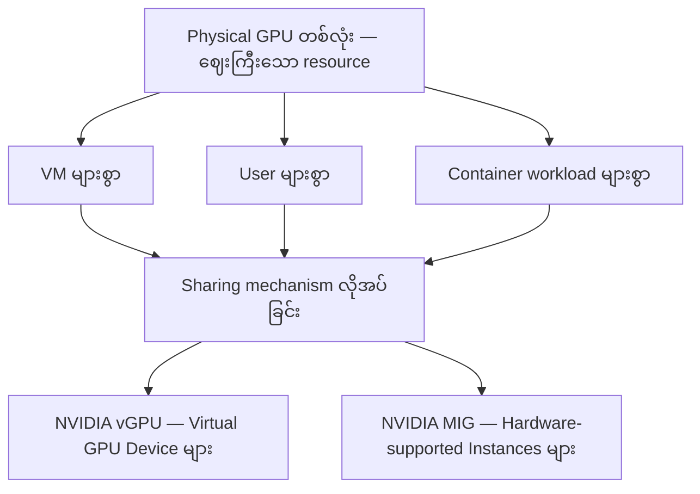

**ပုံရှင်းလင်းချက်:**
- အပေါ်ဆုံး node က Physical GPU တစ်လုံးကို VM၊ User နဲ့ Container workload တွေကြား မျှဝေရမယ့် အခြေအနေကို ပြပါတယ်။
- အလယ်က "Sharing mechanism လိုအပ်ခြင်း" node က ဒီပြဿနာကို ဖြေရှင်းဖို့ နည်းလမ်း ရွေးချယ်ရမယ့် နေရာဖြစ်ပါတယ်။
- အောက်ဆုံးမှာ NVIDIA ရဲ့ ဖြေရှင်းချက်နှစ်ခုဖြစ်တဲ့ vGPU နဲ့ MIG ဆီ ဘယ်လိုခွဲထွက်သွားသလဲဆိုတာ တွေ့ရပါမယ်။

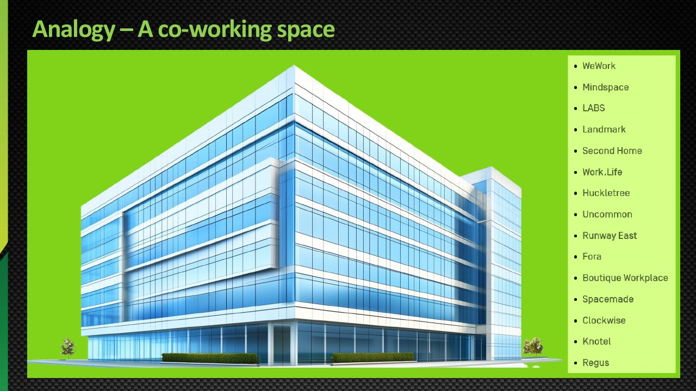

**ပုံရှင်းလင်းချက် (Slide walkthrough):** GPU မျှဝေ အသုံးပြုမှု ပြဿနာကို နားလည်စေဖို့ co-working space ဥပမာနဲ့ ရှင်းလင်းပြထားတဲ့ training ပုံ ဖြစ်ပါတယ်။ ဈေးကြီးပြီး အရင်းအနှီးများတဲ့ နေရာတစ်ခုကို လူအများကြား ဘယ်လို ခွဲဝေ အသုံးပြုမလဲ ဆိုတဲ့ မေးခွန်းကို လုပ်ငန်းခွင်/ရုံးခန်း မျှဝေအသုံးပြုမှုနဲ့ နှိုင်းယှဉ် ပြထားပြီး၊ အပေါ်က GPU တစ်လုံးကို workload များစွာကြား မျှဝေရမယ့် ပြဿနာနဲ့ ဆင်တူပါတယ်။

*(Source: NVIDIA NCA-AIIO training deck — study material)*

## 3. vGPU နဲ့ MIG ဆိုတာ ဘာလဲ — Mechanism

**NVIDIA vGPU** က GPU Virtualization Software နဲ့ Driver များကို အသုံးပြုပြီး VM များထံ **Virtual GPU Device** တွေ ပေးအပ်ပါတယ်။ VM တစ်ခုချင်းစီဟာ သတ်မှတ်ထားတဲ့ vGPU Device ကို အသုံးပြုနိုင်ပြီး၊ ပုံမှန် vGPU Deployment တွင် Hypervisor က အဓိကအစိတ်အပိုင်းအဖြစ် ပါဝင်ပါတယ်။

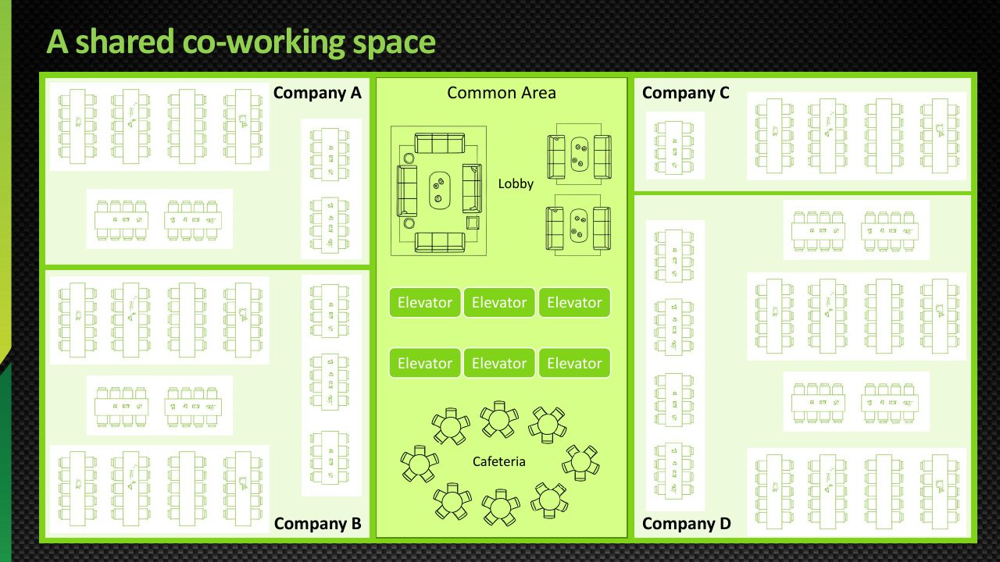

**ပုံရှင်းလင်းချက် (Slide walkthrough):** ဒီ training ပုံက ပူးတွဲ အလုပ်လုပ်ရာ နေရာ (co-working space) ကို အားလုံး အတူတကွ မျှဝေ အသုံးပြုတဲ့ ပုံစံ (shared co-working space) ကို ပြထားပါတယ်။ GPU တစ်လုံးကို workload များစွာကြား အားလုံး အတူ မျှဝေ အသုံးပြုတဲ့ ပုံစံနဲ့ နှိုင်းယှဉ် လေ့လာနိုင်ပြီး၊ ဒီနေရာက vGPU ရဲ့ sharing model နဲ့ ဆက်စပ်နေပါတယ်။

*(Source: NVIDIA NCA-AIIO training deck — study material)*

**NVIDIA MIG** ကတော့ Physical GPU တစ်လုံးကို **Hardware-supported Instances** များအဖြစ် ခွဲခြားပါတယ်။ သတ်မှတ်ထားတဲ့ Compute နဲ့ Memory Resource များကို Instance တစ်ခုချင်းစီထံ ပေးအပ်ပါတယ်။ Bare-metal Linux နဲ့ Containers တွေအတွက် အသုံးဝင်ပြီး၊ VM အသုံးပြုမှုကတော့ သက်ဆိုင်ရာ Platform က MIG ကို Support လုပ်ပုံပေါ် မူတည်ပါတယ်။

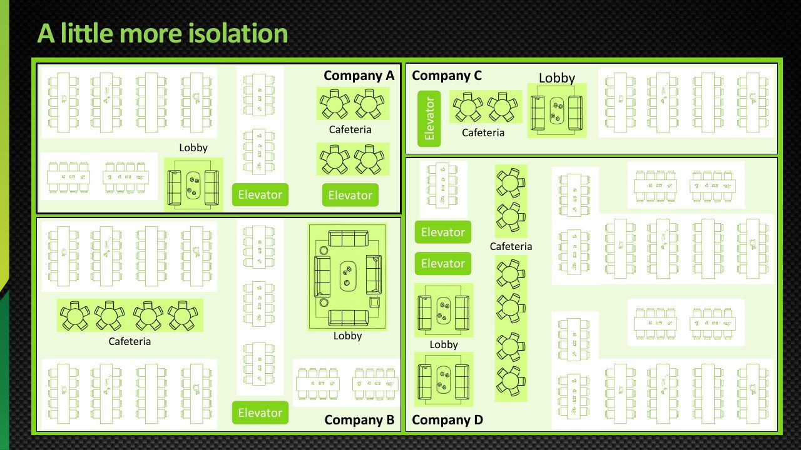

**ပုံရှင်းလင်းချက် (Slide walkthrough):** ဒီ training ပုံက ပိုမို သီးခြားဖြစ်တဲ့ ပုံစံ (more isolation) ကို ပြထားပါတယ်။ မျှဝေ အသုံးပြုမှုမှာ တစ်ခုနဲ့တစ်ခု သက်ရောက်မှု မရှိစေဖို့ ပိုမို ခိုင်မာတဲ့ isolation ဖြင့် ခွဲဝေတဲ့ ပုံစံကို ရှင်းလင်းပြထားပြီး၊ ဒီနေရာက MIG ရဲ့ hardware-supported instances တွေလို သတ်မှတ်ထားတဲ့ resource ပေးအပ်ပြီး isolation ပိုမို ခိုင်မာတဲ့ ခွဲဝေမှု ပုံစံနဲ့ နှိုင်းယှဉ် လေ့လာနိုင်ပါတယ်။

*(Source: NVIDIA NCA-AIIO training deck — study material)*

**Figure 2 — vGPU နှင့် MIG ရဲ့ mechanism ကွာခြားပုံ**

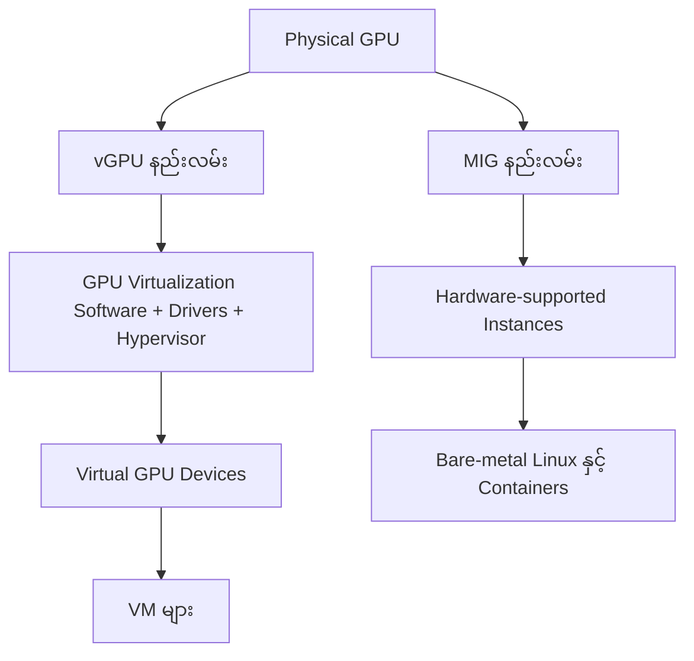

**ပုံရှင်းလင်းချက်:**
- ဘယ်ဘက်/အပေါ်ဘက်လမ်းကြောင်းက vGPU ဖြစ်ပြီး GPU Virtualization Software၊ Drivers နဲ့ Hypervisor ကတစ်ဆင့် Virtual GPU Device တွေကို VM တွေဆီ ပေးပါတယ်။
- ညာဘက်/အောက်ဘက်လမ်းကြောင်းက MIG ဖြစ်ပြီး Physical GPU ကို hardware level ကနေ directly ခွဲပြီး Bare-metal Linux နဲ့ Containers တွေကို ပေးပါတယ်။
- နှစ်ခုလုံးရဲ့ အစက Physical GPU တစ်ခုတည်းဖြစ်ပေမယ့် ခွဲဝေပုံချင်း မတူတာကို သတိပြုကြည့်ပါ။

**Exam မှတ်စု:** vGPU = Virtual GPU Device for VMs; MIG = Hardware-supported GPU partitioning into multiple instances.

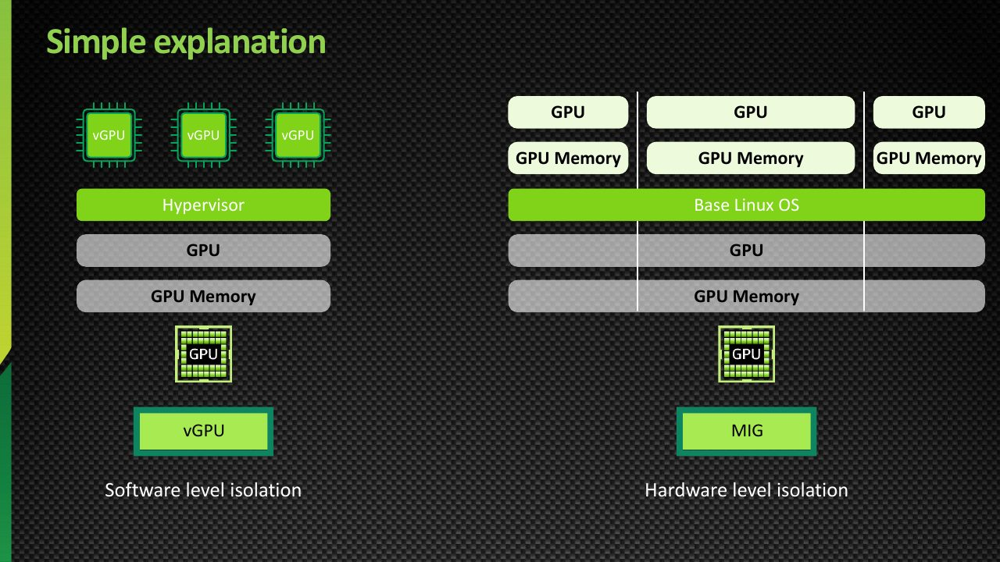

**ပုံရှင်းလင်းချက် (Slide walkthrough):** vGPU နဲ့ MIG ရဲ့ ကွာခြားချက်ကို ရိုးရှင်းစွာ ရှင်းလင်းပြထားတဲ့ training ပုံ ဖြစ်ပါတယ်။ အပေါ်က အဓိက ခွဲခြားချက်အတိုင်း vGPU က VM များအတွက် Virtual GPU Device များ ပေးအပ်ခြင်း၊ MIG က Physical GPU ကို Hardware-supported Instance များအဖြစ် ခွဲခြားခြင်း ဆိုတဲ့ သဘောကို အခြေခံ ပြထားပါတယ်။

*(Source: NVIDIA NCA-AIIO training deck — study material)*

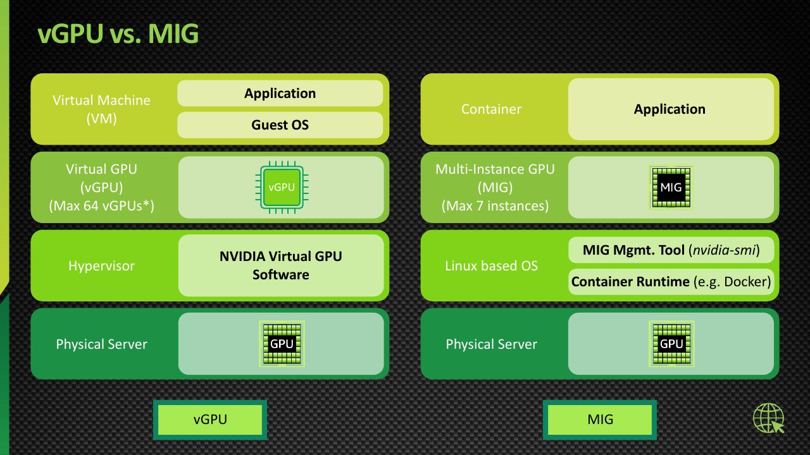

**ပုံရှင်းလင်းချက် (Slide walkthrough):** vGPU နဲ့ MIG ကို နှိုင်းယှဉ်ပြထားတဲ့ diagram ဖြစ်ပါတယ်။ ပြဿနာတစ်ခုတည်းကို ဖြေရှင်းပေးပေမယ့် vGPU က virtualization software, driver နဲ့ hypervisor ကတစ်ဆင့် Virtual GPU Device တွေကို VM တွေဆီ ပေးပြီး၊ MIG က Physical GPU ကို hardware level ကနေ instance တွေအဖြစ် ခွဲပေးတဲ့ ကွာခြားချက်ကို ပုံဖြင့် နှိုင်းယှဉ် ပြထားပါတယ်။

*(Source: NVIDIA NCA-AIIO training deck — study material)*

## 4. vGPU vs. MIG — Feature Comparison

**Isolation (vGPU)**

vGPU က Virtual GPU Device များကို VM တွေထံ တင်ပြပေးဖို့ GPU Virtualization Software, Driver နဲ့ Hypervisor Support ကို အသုံးပြုပါတယ်။ VM တစ်ခုချင်းစီဟာ သတ်မှတ်ထားတဲ့ vGPU Device ကို အသုံးပြုနိုင်ပါတယ်။ Isolation နဲ့ Resource Management ရဲ့ အသေးစိတ်က သက်ဆိုင်ရာ vGPU Implementation နဲ့ GPU Model ပေါ်မူတည်ပါတယ်။

**Isolation (MIG)**

MIG က Supported GPU များပေါ်မှာ Compute နဲ့ Memory Resource တွေကို Hardware-supported Instances အဖြစ် ခွဲခြားပေးပါတယ်။ ဒီနည်းလမ်းက Instance တစ်ခုနဲ့တစ်ခုကြား GPU Resource Isolation ကို ပိုမိုခိုင်မာစေပါတယ်။

**သတိပြုရန်:** vGPU နဲ့ MIG ကို “Software Isolation” နဲ့ “Hardware Isolation” လို့သာ ခွဲခြားပြီး အမြဲတမ်း သီးခြားနည်းပညာနှစ်ခုလို့ မယူဆသင့်ပါဘူး။ NVIDIA ရဲ့ Supported Configuration အချို့မှာ MIG-backed vGPU ကိုလည်း အသုံးပြုနိုင်ပါတယ်။

| Feature | NVIDIA vGPU | NVIDIA MIG |
|---|---|---|
| Main purpose | VM များထံ Virtual GPU Device ပေးခြင်း | Physical GPU ကို Hardware GPU Instances များအဖြစ် ခွဲခြားခြင်း |
| Isolation mechanism | Virtualization Software, Drivers နဲ့ Supported Hardware | Hardware-supported Resource Partitioning |
| Hypervisor | ပုံမှန် vGPU Deployment မှာ အဓိကပါဝင်တယ် | Bare-metal အသုံးပြုမှုအတွက် မလိုအပ် |
| Resource allocation | vGPU Profile နဲ့ Supported Configuration ပေါ်မူတည် | MIG Profile နဲ့ GPU Architecture ပေါ်မူတည် |
| Maximum instance count | GPU နဲ့ vGPU Configuration အလိုက် ကွဲပြား | GPU Model နဲ့ Supported MIG Profile အလိုက် ကွဲပြား |
| Performance | Sharing Model, Scheduling နဲ့ Workload ပေါ်မူတည် | သတ်မှတ်ထားတဲ့ Hardware Resource Partition များကြောင့် ပိုမိုခန့်မှန်းနိုင် |
| Common workloads | VDI, Virtual Workstations, VM-based AI | AI Inference, HPC, Containerized AI |
| Licensing | NVIDIA vGPU Software License လိုအပ်နိုင် | MIG Feature အတွက် သက်ဆိုင်ရာ Platform နဲ့ Software Requirements ကို စစ်ဆေးရမယ် |

NVIDIA vGPU ကို Supported GPU များမှာ အသုံးပြုနိုင်ပြီး၊ အချို့ Configuration များမှာ MIG-backed vGPU နဲ့ Time-sliced vGPU နှစ်မျိုးလုံး ရှိနိုင်ပါတယ်။ ထို့ကြောင့် အမှန်တကယ်ရွေးချယ်ရာမှာ NVIDIA ရဲ့ သက်ဆိုင်ရာ vGPU Product Support Matrix (https://docs.nvidia.com/vgpu/) ကို စစ်ဆေးရပါမယ်။

## 5. Hypervisor ၏ အခန်းကဏ္ဍ

- **vGPU** — ပုံမှန် vGPU Deployment မှာ Hypervisor က GPU ရဲ့စွမ်းရည်ကို VM များစွာကြား ခွဲဝေပေးတဲ့ ဗဟို component ဖြစ်ပါတယ်။ vGPU Software နဲ့ Driver များနဲ့အတူ လုပ်ဆောင်ပါတယ်။
- **MIG** — Bare-metal အသုံးပြုမှုအတွက် Hypervisor မလိုအပ်ပါဘူး။ VM များပေါ်မှာ MIG အသုံးပြုမယ်ဆိုရင်တော့ သက်ဆိုင်ရာ Platform ရဲ့ MIG Support ပုံစံပေါ် မူတည်ပါတယ်။
- **MIG-backed vGPU** — Supported Platform အချို့မှာ Hypervisor-based vGPU ကို MIG Instance ပေါ်မှာ တည်ဆောက်နိုင်တဲ့ configuration များ ရှိပါတယ်။ ဒါကြောင့် နှစ်ခုလုံးကို အပြန်အလှန်ဖယ်ထုတ်ရမယ့် ရွေးချယ်စရာတွေလို့ မယူဆသင့်ပါဘူး။

## 6. GPU Memory Partitioning

**vGPU** — GPU Memory ကို vGPU Profile နဲ့ Platform အရ ခွဲဝေစီမံပါတယ်။

**MIG** — MIG Instance အလိုက် သတ်မှတ်ထားတဲ့ Memory Resource ပေးအပ်ပါတယ်။ A100 40GB GPU တစ်လုံးကို ဥပမာအဖြစ် ကြည့်ကြည့်ပါမယ်။

**Option A — GPU တစ်လုံးလုံးကို Instance တစ်ခုအဖြစ် အသုံးပြုခြင်း**

```
Physical GPU: A100 40GB
+------------------------------------+
|            7g.40gb                 |
|       Full GPU Instance            |
|       ~40 GB memory class          |
+------------------------------------+
```

**Option B — Instance နှစ်ခု ခွဲခြင်း**

```
Physical GPU: A100 40GB
+------------------+-----------------+
|    3g.20gb       |    3g.20gb      |
|    Instance 1    |    Instance 2   |
|    ~20 GB        |    ~20 GB       |
+------------------+-----------------+
```

A100 40GB ရဲ့ Supported Profile များအရ 3g.20gb Instance နှစ်ခုကို ဖန်တီးနိုင်ပါတယ်။ Instance တစ်ခုချင်းစီမှာ သတ်မှတ်ထားတဲ့ Compute Slice နဲ့ Memory Resource ရရှိပါတယ်။

**Option C — Mixed Profile များ အသုံးပြုခြင်း**

```
Physical GPU: A100 40GB
+----------+---------------+---------------+
| 1g.5gb   |   2g.10gb     |   4g.20gb     |
| Instance |   Instance    |   Instance    |
+----------+---------------+---------------+
```

A100 40GB အတွက် အထက်ပါ Profile ပေါင်းစပ်မှုကို Supported Configuration ဥပမာအဖြစ် အသုံးပြုနိုင်ပါတယ်။ သို့သော် Instance ဖန်တီးနိုင်ခြင်းက Profile နဲ့ Placement Rules ကိုက်ညီမှုအပေါ် မူတည်ပါတယ်။

**Figure 3 — A100 40GB ပေါ်က MIG Profile layout ဥပမာများ**

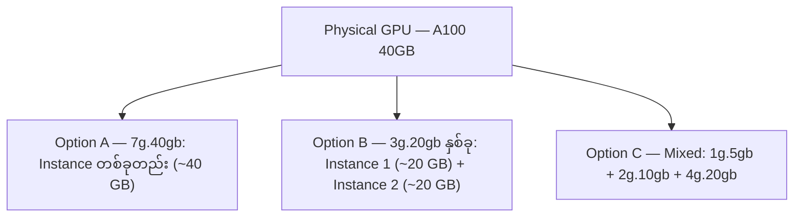

**ပုံရှင်းလင်းချက်:**
- GPU တစ်လုံးကို Option A အတိုင်း Instance တစ်ခုတည်းအဖြစ် အသုံးပြုနိုင်သလို၊ Option B အတိုင်း အညီအမျှ နှစ်ခုခွဲနိုင်ပါတယ်။
- Option C ကတော့ profile အမျိုးမျိုးကို ရောနှောဖွဲ့စည်းတဲ့ ဥပမာဖြစ်ပါတယ်။
- ဒီ layout တွေအားလုံးဟာ GPU က support လုပ်ထားတဲ့ MIG Profile တွေထဲကနေသာ ရွေးချယ်ရတာဖြစ်ကြောင်း ပုံက သတိပေးပါတယ်။

**အရေးကြီးချက်:** MIG ကို အသုံးပြုရာမှာ GPU Memory ကို လိုသလို 5 GB, 10 GB, 30 GB စသည်ဖြင့် မည်သည့်ပမာဏမဆို သီးခြားခွဲပေးနိုင်တာ မဟုတ်ပါဘူး။ GPU က Support လုပ်ထားတဲ့ Profile များထဲကနေ ရွေးချယ်ရပါတယ်။ ထို့အပြင် Memory ပမာဏတစ်ခုတည်းနဲ့ Compute Resource ကို ဆုံးဖြတ်လို့ မရပါဘူး။

## 7. Isolation Model

| အချက် | NVIDIA vGPU | NVIDIA MIG |
|---|---|---|
| Isolation အခြေခံ | Virtualization Software + Driver + Supported Hardware ပေါင်းစပ်မှု | Hardware-backed Resource Partitioning |
| Resource သီးခြားဖြစ်မှု | Implementation နဲ့ GPU Model ပေါ်မူတည် | Instance တစ်ခုချင်းစီအတွက် သတ်မှတ်ထားတဲ့ Compute/Memory |
| Performance predictability | Sharing model နဲ့ scheduling ပေါ်မူတည် | Hardware partition များကြောင့် ပိုမိုခန့်မှန်းနိုင် |

MIG က hardware-supported partitioning ကြောင့် instance ကြား isolation ပိုခိုင်မာပေမယ့်၊ vGPU ကိုတော့ “software isolation ပဲ” လို့ ရိုးရိုးရှင်းရှင်း မသတ်မှတ်သင့်ပါဘူး။ vGPU Implementation နဲ့ GPU Model ပေါ်မူတည်ပြီး hardware support ပါဝင်နိုင်သလို၊ MIG-backed vGPU ကဲ့သို့ ပေါင်းစပ် configuration များလည်း ရှိပါတယ်။

## 8. Container အသုံးပြုမှု

- **vGPU** — VM အတွင်းမှာ Container များ Run လုပ်နိုင်ပါတယ်။ Container တွေက VM ထဲက vGPU Device ကို အသုံးပြုကြတာဖြစ်ပါတယ်။
- **MIG** — Supported MIG Instances တွေကို Container များက တိုက်ရိုက်အသုံးပြုနိုင်ပါတယ်။ Bare-metal Linux Environment ပေါ်က Containerized AI Workload တွေအတွက် သင့်တော်ပါတယ်။

ဆိုလိုတာက vGPU မှာ container workload က VM ကို ဖြတ်သန်းပြီး သွားတာဖြစ်ပြီး၊ MIG မှာတော့ container က physical GPU ရဲ့ hardware partition ကို တိုက်ရိုက်အသုံးပြုတာ ဖြစ်ပါတယ်။

**Figure 4 — Container workload များအတွက် vGPU နှင့် MIG လမ်းကြောင်း ကွာခြားပုံ**

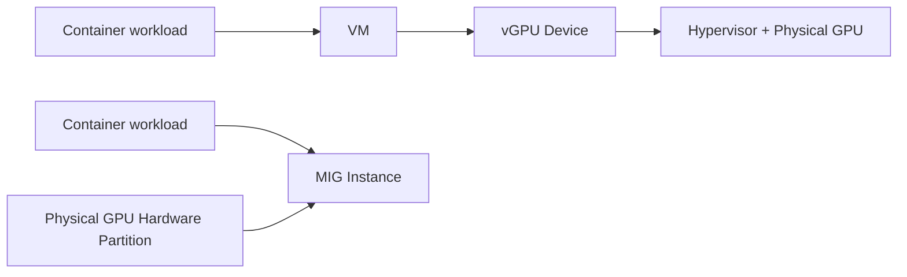

**ပုံရှင်းလင်းချက်:**
- အပေါ်လမ်းကြောင်းမှာ container က VM ထဲမှာ run ပြီး VM ရဲ့ vGPU Device ကတစ်ဆင့် Hypervisor က စီမံတဲ့ GPU ကို အသုံးပြုပါတယ်။
- အောက်လမ်းကြောင်းမှာတော့ container က MIG Instance ကတစ်ဆင့် Physical GPU ရဲ့ hardware partition ကို တိုက်ရိုက် အသုံးပြုပါတယ်။
- VM ကို ဖြတ်သန်းရမလား မဖြတ်ရဘူးလားဆိုတာ ဒီနှစ်လမ်းကြောင်းရဲ့ အဓိက ကွာခြားချက်ဖြစ်ပါတယ်။

## 9. GPU Model က MIG Support ကို ဆုံးဖြတ်ပေးတယ်

GPU တစ်လုံးမှာ GPU Memory အများကြီးရှိရုံနဲ့ MIG Support ရှိတယ်လို့ မဆိုနိုင်ပါဘူး။ သင်ခန်းစာမှာ စစ်ဆေးထားတဲ့ GPU များက—

| GPU Model | Memory | MIG Support |
|---|---|---|
| NVIDIA Tesla T4 | 16 GB | မရှိ |
| NVIDIA A10G | 24 GB | မရှိ |
| NVIDIA A100 40GB | 40 GB | ရှိ |
| NVIDIA A100 80GB | 80 GB | ရှိ |

ဒီဇယားက သင်ခန်းစာထဲက Model များကို နှိုင်းယှဉ်ထားတာဖြစ်ပါတယ်။ GPU တစ်ခုကို အသုံးပြုမယ့်အခါ အတိအကျ Model နဲ့ Product Variant ကို စစ်ဆေးဖို့ လိုအပ်ပါတယ်။

**မှတ်သားရန်:** T4 နဲ့ A10G တို့မှာ MIG မရှိပေမယ့်၊ သက်ဆိုင်ရာ Supported Platform နဲ့ License ရှိပါက vGPU သို့မဟုတ် GPU Pass-through နည်းလမ်းတွေကို အသုံးပြုနိုင်တဲ့ Configuration များ ရှိပါတယ်။ MIG Support မရှိခြင်းဟာ GPU Virtualization လုံးဝမလုပ်နိုင်ဘူးလို့ ဆိုလိုတာ မဟုတ်ပါဘူး။

## 10. Instance အရေအတွက် — အရေးကြီးသော မှတ်ချက်

မူရင်းသင်ခန်းစာမှာ MIG နဲ့ GPU Instances အများဆုံး 7 ခု ဖန်တီးနိုင်တယ်လို့ ရှင်းပြထားပါတယ်။ ဒီအချက်ကို GPU အားလုံးအတွက် အမြဲတမ်းသက်ဆိုင်တယ်လို့ မယူဆသင့်ပါဘူး။ MIG Instance အရေအတွက်က—

- GPU Model နဲ့ Architecture
- အသုံးပြုနိုင်တဲ့ MIG Profiles
- Instance တစ်ခုချင်းစီရဲ့ Size
- လက်ရှိ GPU Configuration

တို့ပေါ်မူတည်ပါတယ်။ MIG ကို Support လုပ်တဲ့ GPU အချို့မှာ အများဆုံး GPU Instances 7 ခုအထိ ရရှိနိုင်ပေမယ့်၊ Instance အားလုံးကို တူညီတဲ့ Profile နဲ့ ဖန်တီးနိုင်မယ်လို့ မဆိုလိုပါဘူး။ Deployment မလုပ်ခင် သက်ဆိုင်ရာ GPU ရဲ့ Documentation ကို စစ်ဆေးသင့်ပါတယ်။

အလားတူ vGPU အရေအတွက်အတွက်လည်း Universal Maximum တစ်ခုတည်း မရှိပါဘူး။ GPU Model၊ vGPU Profile နဲ့ Software Support အပေါ် မူတည်ပါတယ်။

Server တစ်လုံးမှာ MIG ကို Support လုပ်တဲ့ GPU 4 လုံး ရှိပြီး တစ်လုံးစီမှာ Instance 7 ခုအထိ ဖန်တီးနိုင်တဲ့ Supported Configuration ဖြစ်တယ်ဆိုရင် သီအိုရီအရ—

```
4 GPUs × 7 instances = 28 instances
```

ဒါပေမဲ့ ဒီတွက်ချက်မှုဟာ GPU တစ်လုံးစီမှာ 7 Instances အပြည့် ဖန်တီးနိုင်တယ်လို့ ယူဆထားတဲ့ အခြေအနေဖြစ်ပါတယ်။ အမှန်တကယ် Instance အရေအတွက်က GPU Model, Profile Size, Placement နဲ့ Resource Availability ပေါ်မူတည်ပါတယ်။

## 11. ဘယ်အချိန်မှာ ဘာကို ရွေးချယ်သင့်သလဲ?

**vGPU ကို စဉ်းစားသင့်တဲ့အခြေအနေ**

- VM များစွာကို အသုံးပြုနေတယ်
- VM တစ်ခုချင်းစီထံ Virtual GPU Device ပေးချင်တယ်
- Virtual Desktop Infrastructure (VDI), Graphics သို့မဟုတ် VM အတွင်း AI Workload တွေကို Run လုပ်ချင်တယ်
- Hypervisor နဲ့ vGPU Software ကို အသုံးပြုပြီး Centralized Management လုပ်ချင်တယ်

**MIG ကို စဉ်းစားသင့်တဲ့အခြေအနေ**

- MIG-capable GPU ကို အသုံးပြုနေတယ်
- Bare-metal Linux Environment မှာ Containers တွေ Run လုပ်ချင်တယ်
- Workload တစ်ခုချင်းစီအတွက် သတ်မှတ်ထားတဲ့ GPU Compute နဲ့ Memory Resource လိုအပ်တယ်
- Hardware-backed Resource Partitioning ကို ဦးစားပေးတယ်

တကယ့် Deployment မှာတော့ Workload Requirement, Security, Performance, GPU Compatibility နဲ့ License Cost တို့ကို ပေါင်းစပ်စဉ်းစားပြီး ရွေးချယ်သင့်ပါတယ်။ အချို့ Supported Platform များမှာ MIG-backed vGPU ကို အသုံးပြုနိုင်တာကြောင့် ဒီနည်းပညာနှစ်ခုဟာ အမြဲတမ်း အပြန်အလှန်ဖယ်ထုတ်ရမယ့် ရွေးချယ်စရာတွေ မဟုတ်ပါဘူး။

## 12. Module Summary

- vGPU က Virtualization Software နဲ့ Driver များကို အသုံးပြုပြီး VM များထံ Virtual GPU Device ပေးတယ်။
- MIG က Supported GPU တစ်လုံးရဲ့ Hardware Resource တွေကို သတ်မှတ်ထားတဲ့ GPU Instances များအဖြစ် ခွဲခြားတယ်။
- vGPU နဲ့ MIG ဟာ အမြဲတမ်း အစားထိုးရွေးချယ်ရမယ့် နည်းပညာတွေ မဟုတ်ပါဘူး။
- MIG ကို Bare-metal Linux နဲ့ Containers တွေမှာ Hypervisor မလိုဘဲ အသုံးပြုနိုင်တဲ့ Configuration များရှိတယ်။
- vGPU အရေအတွက်နဲ့ MIG Instance အရေအတွက်ဟာ GPU Model နဲ့ Supported Configuration အပေါ်မူတည်တယ်။

**Exam မှတ်စု:** vGPU = Virtual GPU Device for VMs; MIG = Hardware-supported GPU partitioning into multiple instances.

## 13. စစ်ဆေးရန် မေးခွန်းများနှင့် အဖြေများ

**မေးခွန်း ၁။** vGPU နဲ့ MIG ရဲ့ အဓိက mechanism ကွာခြားချက်က ဘာလဲ?

**အဖြေ။** vGPU က GPU Virtualization Software နဲ့ Driver များဖြင့် VM များထံ Virtual GPU Device ပေးတယ်။ MIG က Physical GPU ကို Hardware-supported Instances များအဖြစ် ခွဲခြားပြီး Instance တစ်ခုချင်းစီထံ သတ်မှတ်ထားတဲ့ Compute နဲ့ Memory ပေးတယ်။

**မေးခွန်း ၂။** MIG အသုံးပြုရာမှာ Hypervisor မဖြစ်မနေ လိုအပ်သလား?

**အဖြေ။** မလိုအပ်ပါဘူး။ MIG ကို Bare-metal Linux နဲ့ Container အသုံးပြုမှုအတွက် Hypervisor မလိုဘဲ အသုံးပြုနိုင်ပါတယ်။ VM အသုံးပြုမှုကတော့ Platform ရဲ့ MIG Support ပေါ် မူတည်ပါတယ်။

**မေးခွန်း ၃။** MIG ဖြင့် GPU Memory ကို လိုသလို မည်သည့်ပမာဏမဆို ခွဲပေးနိုင်သလား?

**အဖြေ။** မပေးနိုင်ပါဘူး။ GPU က Support လုပ်ထားတဲ့ MIG Profile များထဲကနေသာ ရွေးချယ်ရပြီး၊ Memory ပမာဏတစ်ခုတည်းနဲ့ Compute Resource ကို ဆုံးဖြတ်လို့ မရပါဘူး။

**မေးခွန်း ၄။** Tesla T4 ပေါ်မှာ MIG မရှိရင် GPU Virtualization လုံးဝ မလုပ်နိုင်ဘူးလား?

**အဖြေ။** မဟုတ်ပါဘူး။ T4 နဲ့ A10G မှာ MIG မရှိပေမယ့်၊ Supported Platform နဲ့ License ရှိပါက vGPU သို့မဟုတ် GPU Pass-through ကဲ့သို့ နည်းလမ်းများ အသုံးပြုနိုင်ပါတယ်။

**မေးခွန်း ၅။** Container workload အတွက် vGPU နဲ့ MIG ဘယ်လိုကွာခြားသလဲ?

**အဖြေ။** vGPU မှာ container တွေက VM အတွင်းက vGPU Device ကို အသုံးပြုပြီး run လုပ်ပါတယ်။ MIG မှာတော့ container တွေက supported MIG Instances တွေကို bare-metal ပေါ်မှာ တိုက်ရိုက်အသုံးပြုနိုင်ပါတယ်။

---

## English Version — NVIDIA vGPU vs. MIG (Conceptual Fundamentals)

## 1. Learning Objectives

By the end of this module, you should be able to:

- Explain how a single physical GPU is shared among multiple workloads
- Describe the core mechanism difference between NVIDIA vGPU and MIG
- Explain the role of the hypervisor in each approach
- Compare how GPU memory is partitioned and managed
- Compare the two isolation models
- Decide which approach fits container-based workloads

## 2. The Problem — Sharing One GPU Across Many Workloads

In AI infrastructure, the GPU is one of the most expensive resources in a server. When you need to share one GPU among:

- many VMs
- many users
- many container workloads

you need a deliberate sharing mechanism. Giving the whole GPU to one workload wastes capacity, while splitting it with software alone raises concerns about isolation and performance predictability.

NVIDIA provides two solutions: **NVIDIA vGPU** and **NVIDIA MIG**. They solve the same problem with different mechanisms.

**Figure 1 — The problem: sharing one GPU across many workloads**

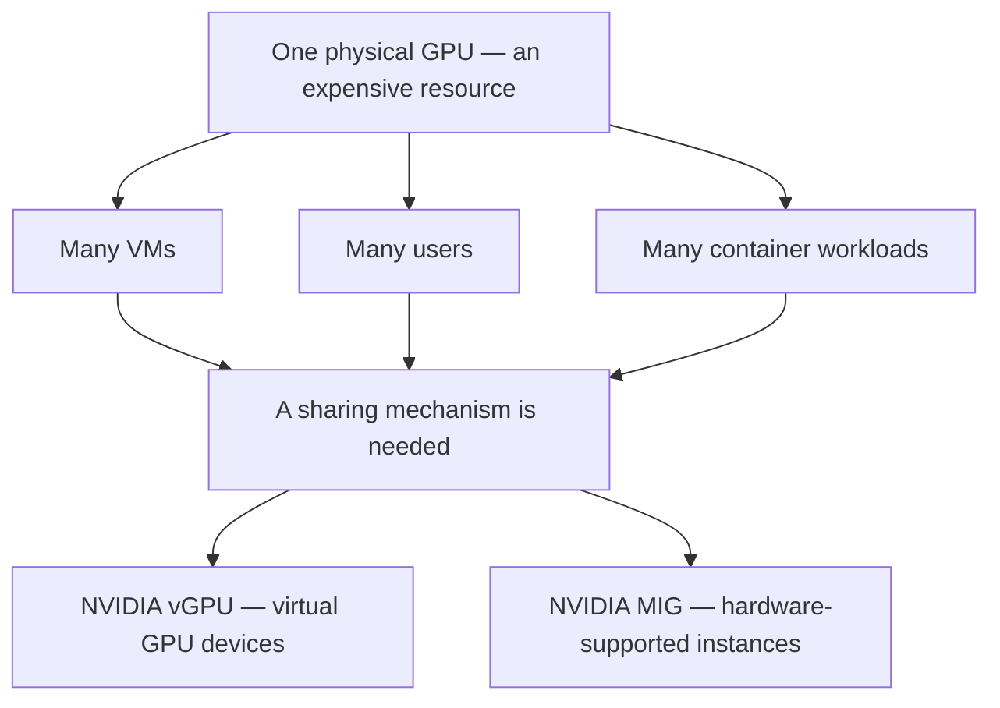

**Figure walkthrough:**
- The top node shows one physical GPU that must be shared among VMs, users, and container workloads.
- The middle node shows that a deliberate sharing mechanism is required to solve this problem.
- The bottom nodes show the two NVIDIA solutions the problem branches into: vGPU and MIG.


**Slide walkthrough (ပုံရှင်းလင်းချက်):** This training slide explains the GPU-sharing problem with a co-working space analogy: how one expensive space is arranged for shared use by many people mirrors the question of how one GPU is shared among many workloads, just like the problem in the figure above.

*(Source: NVIDIA NCA-AIIO training deck — study material)*

## 3. What Are vGPU and MIG? — Mechanism

**NVIDIA vGPU** uses GPU Virtualization Software and drivers to present **virtual GPU devices** to VMs. Each VM can use its own assigned vGPU device, and the hypervisor is a central component of a normal vGPU deployment.


**Slide walkthrough (ပုံရှင်းလင်းချက်):** This training slide shows the shared co-working space model — one space used jointly by everyone. Compare it with the way one GPU is shared among many workloads, which connects to the vGPU sharing model explained here.

*(Source: NVIDIA NCA-AIIO training deck — study material)*

**NVIDIA MIG** (Multi-Instance GPU) splits a physical GPU into **hardware-supported instances**. Each instance receives its own dedicated compute and memory resources. It is useful for bare-metal Linux and containers; using it with VMs depends on how the platform supports MIG.


**Slide walkthrough (ပုံရှင်းလင်းချက်):** This training slide shows a more isolated arrangement: dividing the shared resource with stronger isolation so one user does not affect another. Compare it with MIG's hardware-supported instances, where each instance gets its own dedicated resources and isolation is stronger.

*(Source: NVIDIA NCA-AIIO training deck — study material)*

**Figure 2 — How the vGPU and MIG mechanisms differ**

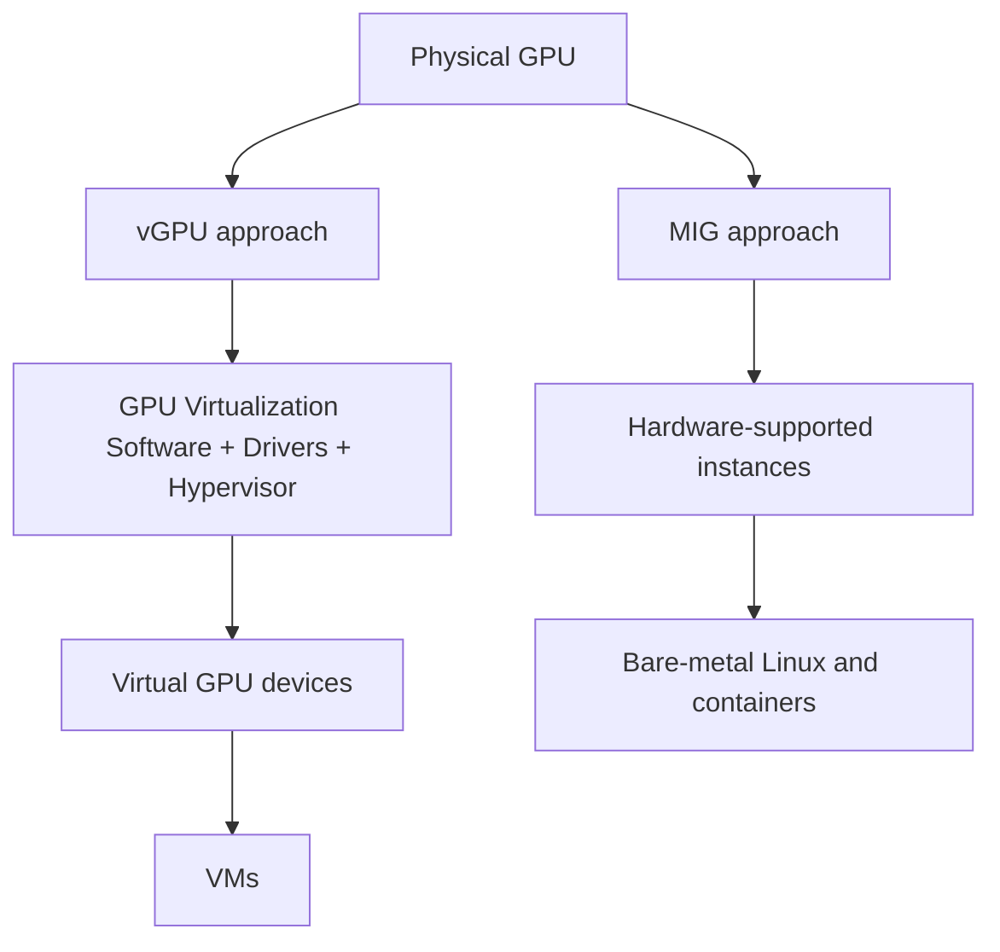

**Figure walkthrough:**
- The upper path is vGPU: GPU virtualization software, drivers, and the hypervisor present virtual GPU devices to VMs.
- The lower path is MIG: the physical GPU is split at the hardware level and used by bare-metal Linux and containers directly.
- Both paths start from the same physical GPU, but the way it is divided is completely different — watch how each path branches.

**Exam note:** vGPU = virtual GPU devices for VMs; MIG = hardware-supported GPU partitioning into multiple instances.


**Slide walkthrough (ပုံရှင်းလင်းချက်):** This training slide gives a simple explanation of the difference between vGPU and MIG. Based on the key distinction above: vGPU presents virtual GPU devices to VMs, while MIG splits the physical GPU into hardware-supported instances.

*(Source: NVIDIA NCA-AIIO training deck — study material)*


**Slide walkthrough (ပုံရှင်းလင်းချက်):** This training slide compares vGPU and MIG in diagram form. Both solve the same problem, but vGPU delivers virtual GPU devices to VMs through virtualization software, drivers, and the hypervisor, while MIG splits the physical GPU into instances at the hardware level.

*(Source: NVIDIA NCA-AIIO training deck — study material)*

## 4. vGPU vs. MIG — Feature Comparison

**Isolation (vGPU)**

vGPU presents virtual GPU devices to VMs using GPU virtualization software, drivers, and hypervisor support. Each VM uses its assigned vGPU device. The details of isolation and resource management depend on the specific vGPU implementation and GPU model.

**Isolation (MIG)**

MIG splits compute and memory resources into hardware-supported instances on supported GPUs. This makes resource isolation between instances stronger.

**Caution:** Do not treat vGPU and MIG as two always-separate technologies labeled only "software isolation" and "hardware isolation". Some NVIDIA supported configurations offer MIG-backed vGPU.

| Feature | NVIDIA vGPU | NVIDIA MIG |
|---|---|---|
| Main purpose | Provide virtual GPU devices to VMs | Split a physical GPU into hardware GPU instances |
| Isolation mechanism | Virtualization software, drivers, supported hardware | Hardware-supported resource partitioning |
| Hypervisor | Central to normal vGPU deployments | Not required for bare-metal use |
| Resource allocation | Depends on vGPU profile and supported configuration | Depends on MIG profile and GPU architecture |
| Maximum instance count | Varies by GPU and vGPU configuration | Varies by GPU model and supported MIG profiles |
| Performance | Depends on sharing model, scheduling, workload | More predictable due to dedicated hardware resource partitions |
| Common workloads | VDI, virtual workstations, VM-based AI | AI inference, HPC, containerized AI |
| Licensing | May require an NVIDIA vGPU software license | Check platform and software requirements for the MIG feature itself |

NVIDIA vGPU works on supported GPUs, and some configurations offer both MIG-backed vGPU and time-sliced vGPU. For real deployments, always check the relevant NVIDIA vGPU product support matrix (https://docs.nvidia.com/vgpu/).

## 5. The Role of the Hypervisor

- **vGPU** — In a normal vGPU deployment, the hypervisor is the central component that divides GPU capability among many VMs, working together with the vGPU software and drivers.
- **MIG** — A hypervisor is not required for bare-metal use. Running MIG on VMs depends on how the platform supports MIG.
- **MIG-backed vGPU** — On some supported platforms, hypervisor-based vGPU can be built on top of MIG instances. This is why the two technologies are not always mutually exclusive choices.

## 6. GPU Memory Partitioning

**vGPU** — GPU memory is divided and managed according to the vGPU profile and the platform.

**MIG** — Each MIG instance receives its own dedicated memory resource. Take an A100 40GB GPU as an example.

**Option A — Use the whole GPU as one instance**

```
Physical GPU: A100 40GB
+------------------------------------+
|            7g.40gb                 |
|       Full GPU Instance            |
|       ~40 GB memory class          |
+------------------------------------+
```

**Option B — Split into two instances**

```
Physical GPU: A100 40GB
+------------------+-----------------+
|    3g.20gb       |    3g.20gb      |
|    Instance 1    |    Instance 2   |
|    ~20 GB        |    ~20 GB       |
+------------------+-----------------+
```

According to the supported profiles of the A100 40GB, you can create two 3g.20gb instances. Each instance gets its own dedicated compute slice and memory resource.

**Option C — Mixed profiles**

```
Physical GPU: A100 40GB
+----------+---------------+---------------+
| 1g.5gb   |   2g.10gb     |   4g.20gb     |
| Instance |   Instance    |   Instance    |
+----------+---------------+---------------+
```

For the A100 40GB, the combination above can be used as an example of a supported configuration. Whether instances can actually be created depends on matching the profile and placement rules.

**Figure 3 — Example MIG profile layouts on an A100 40GB**

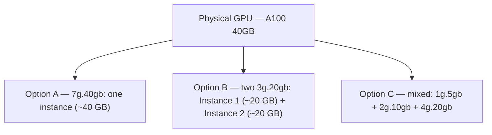

**Figure walkthrough:**
- Option A uses the whole GPU as one instance; Option B splits it evenly into two instances.
- Option C mixes profiles of different sizes in one GPU.
- All three layouts come from the profiles the GPU supports — you cannot carve memory into arbitrary sizes.

**Important:** MIG cannot split GPU memory into arbitrary amounts such as 5 GB, 10 GB, or 30 GB on demand. You must choose from the profiles the GPU supports. Memory size alone also does not determine the compute resources.

## 7. Isolation Model

| Aspect | NVIDIA vGPU | NVIDIA MIG |
|---|---|---|
| Isolation basis | Combination of virtualization software, drivers, supported hardware | Hardware-backed resource partitioning |
| Resource separation | Depends on implementation and GPU model | Dedicated compute/memory per instance |
| Performance predictability | Depends on sharing model and scheduling | More predictable thanks to hardware partitions |

MIG gives stronger isolation between instances because of hardware-supported partitioning, but vGPU should not be dismissed as "software only" — implementations can include hardware support, and combined configurations such as MIG-backed vGPU exist.

## 8. Container Usage

- **vGPU** — Containers can run inside a VM, using the vGPU device exposed to that VM.
- **MIG** — Containers can use supported MIG instances directly. This suits containerized AI workloads on bare-metal Linux environments.

In short, container workloads under vGPU go through a VM, while container workloads under MIG use a hardware partition of the physical GPU directly.

**Figure 4 — Different paths for container workloads under vGPU and MIG**


**Figure walkthrough:**
- In the upper path the container runs inside a VM and uses the VM's vGPU device, with the hypervisor managing the GPU.
- In the lower path the container uses a hardware partition of the physical GPU directly through a MIG instance.
- Whether the path goes through a VM is the key difference between the two approaches.

## 9. The GPU Model Determines MIG Support

A GPU with a lot of memory does not automatically support MIG. The GPUs compared in the source lesson are:

| GPU Model | Memory | MIG Support |
|---|---|---|
| NVIDIA Tesla T4 | 16 GB | No |
| NVIDIA A10G | 24 GB | No |
| NVIDIA A100 40GB | 40 GB | Yes |
| NVIDIA A100 80GB | 80 GB | Yes |

This table compares only the models used in the lesson. When adopting a GPU, check the exact model and product variant.

**Note:** Although T4 and A10G lack MIG, configurations using vGPU or GPU pass-through may be available with the relevant supported platform and license. The absence of MIG does not mean GPU virtualization is impossible.

## 10. Instance Count — An Important Caveat

The original lesson explains that up to 7 MIG GPU instances can be created. This should not be assumed to apply to every GPU. The MIG instance count depends on:

- GPU model and architecture
- available MIG profiles
- the size of each instance
- the current GPU configuration

Some MIG-capable GPUs can provide up to 7 GPU instances, but this does not mean all instances can be created with the same profile. Check the documentation for the specific GPU before deployment.

Likewise, there is no single universal maximum for the number of vGPUs — it depends on the GPU model, vGPU profile, and software support.

If a server has 4 MIG-capable GPUs and each supports up to 7 instances, then in theory:

```
4 GPUs × 7 instances = 28 instances
```

But this calculation assumes every GPU can be filled with 7 instances. The real instance count depends on GPU model, profile size, placement, and resource availability.

## 11. When Should You Choose Each Technology?

**Consider vGPU when:**

- You are running many VMs
- You want to give each VM a virtual GPU device
- You run VDI, graphics, or AI workloads inside VMs
- You want centralized management through the hypervisor and vGPU software

**Consider MIG when:**

- You are using a MIG-capable GPU
- You run containers on bare-metal Linux
- Each workload needs dedicated GPU compute and memory resources
- You prefer hardware-backed resource partitioning

In real deployments, combine workload requirements, security, performance, GPU compatibility, and license cost. Because some supported platforms offer MIG-backed vGPU, the two technologies are not always mutually exclusive.

## 12. Module Summary

- vGPU uses virtualization software and drivers to present virtual GPU devices to VMs.
- MIG splits a supported GPU's hardware resources into dedicated GPU instances.
- vGPU and MIG are not always substitute technologies.
- MIG can be used on bare-metal Linux and containers without a hypervisor.
- vGPU counts and MIG instance counts depend on the GPU model and supported configurations.

**Exam note:** vGPU = virtual GPU devices for VMs; MIG = hardware-supported GPU partitioning into multiple instances.

## 13. Self-Check Questions and Answers

**Q1.** What is the core mechanism difference between vGPU and MIG?

**A1.** vGPU presents virtual GPU devices to VMs using GPU virtualization software and drivers. MIG splits a physical GPU into hardware-supported instances, each with dedicated compute and memory.

**Q2.** Is a hypervisor mandatory when using MIG?

**A2.** No. MIG can be used on bare-metal Linux and containers without a hypervisor. VM usage depends on the platform's MIG support.

**Q3.** Can MIG split GPU memory into any arbitrary amount?

**A3.** No. You must choose from the MIG profiles the GPU supports, and memory size alone does not determine compute resources.

**Q4.** If a Tesla T4 has no MIG, is GPU virtualization impossible?

**A4.** No. Although T4 and A10G lack MIG, vGPU or GPU pass-through configurations may be available with a supported platform and license.

**Q5.** How do vGPU and MIG differ for container workloads?

**A5.** Under vGPU, containers run inside a VM using the VM's vGPU device. Under MIG, containers can use supported MIG instances directly on bare metal.

---

## Technical review notes

- The "up to 7 MIG instances" figure comes from the source lesson and is kept with an explicit caveat: the maximum depends on GPU model, supported profiles, and placement rules. It is not a universal number.
- The A100 40GB/80GB, Tesla T4 (16 GB), and A10G (24 GB) MIG support table is reproduced from the source material and matches NVIDIA's documented MIG support (A100 supports MIG; T4 and A10G do not).
- MIG profile names (1g.5gb, 2g.10gb, 3g.20gb, 4g.20gb, 7g.40gb) and the mixed-profile example are taken from the source; exact usable memory may differ slightly from the profile name, as noted in the operations module.
- The source states some supported configurations offer MIG-backed vGPU alongside time-sliced vGPU; kept as supplied, referenced to https://docs.nvidia.com/vgpu/ for verification.
- The opening comparison material (direct comparison table, instance-count caveat, technology choice) arrived as a continuation fragment without its original module header; it is merged into this module's conceptual sections.
- Beginner-friendly Mermaid figures (Figure 1–4, each with a figure walkthrough) were added inline in both the Myanmar and English sections; existing text and ASCII diagrams are unchanged.
