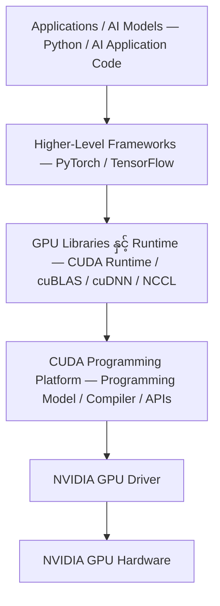
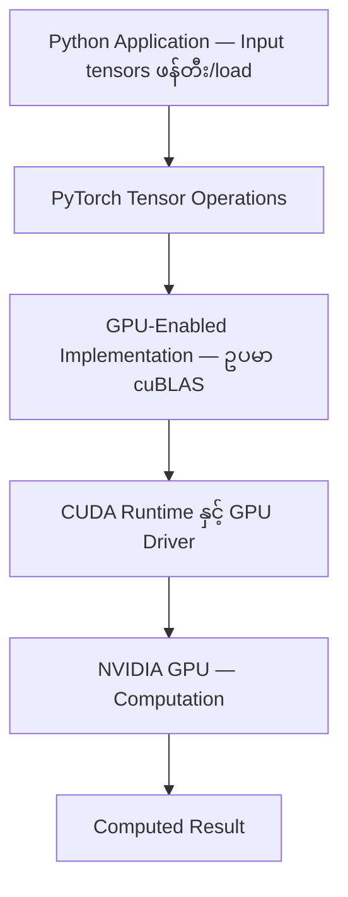
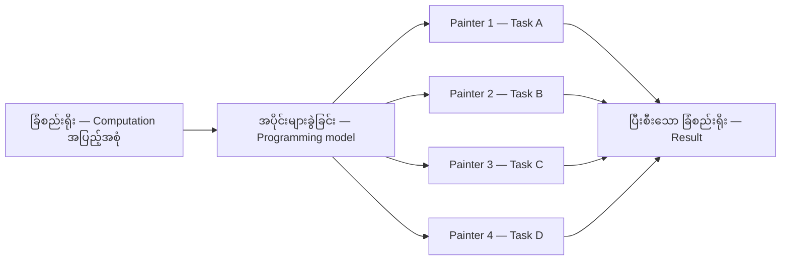
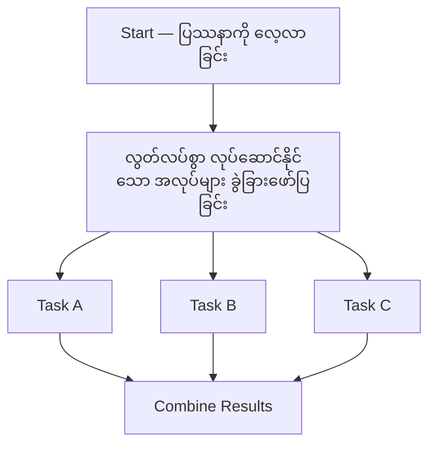
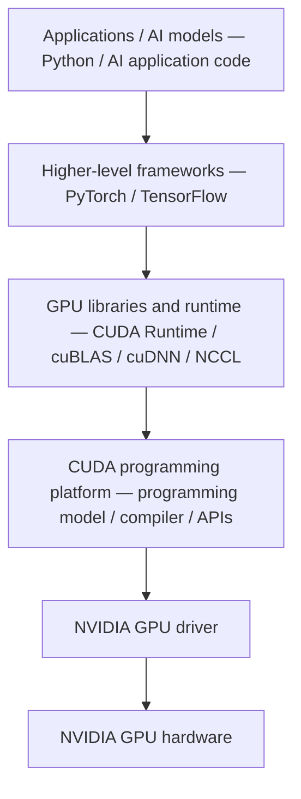
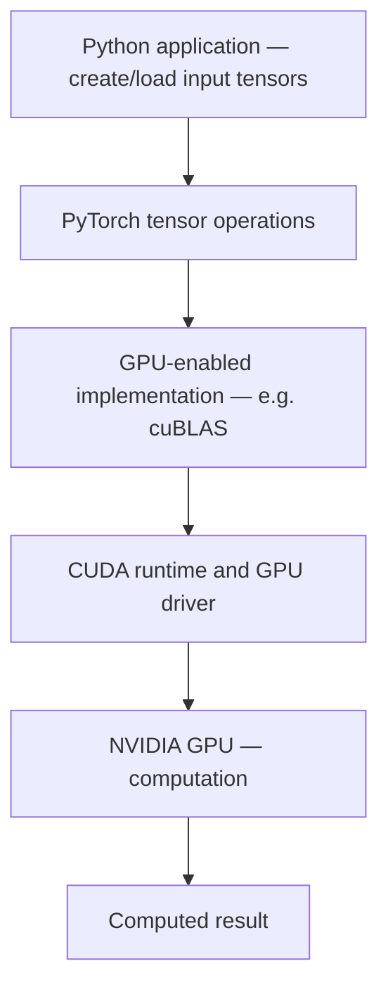
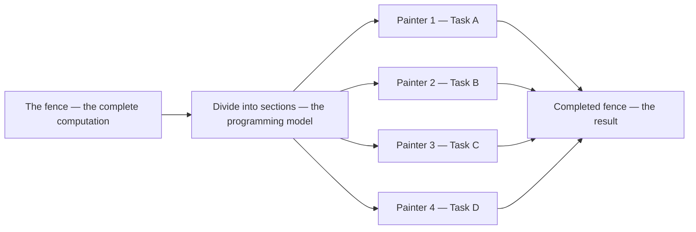
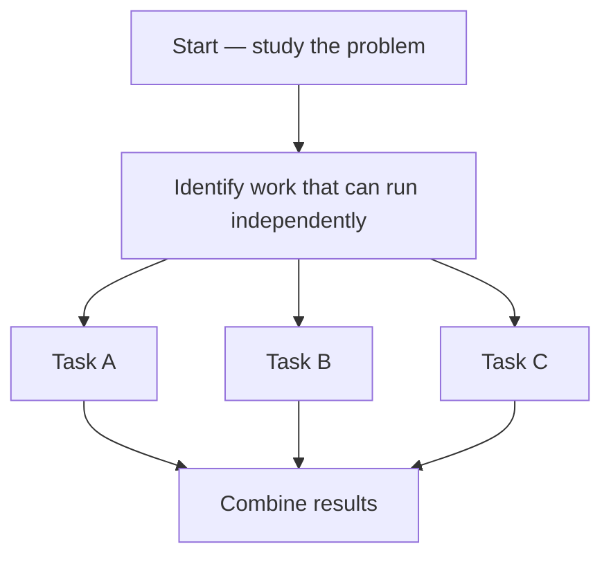

# Module 20 — NVIDIA CUDA Architecture, Programming Model and GPU Software Stack

> Part IV · Course Module 20 (CUDA Architecture, Programming Model and Software Stack) — topic notes

## မြန်မာဘာသာ version — NVIDIA CUDA Architecture, Programming Model နှင့် GPU Software Stack

## 1. Learning Objectives

ဒီ Module ပြီးဆုံးချိန်မှာ အောက်ပါအချက်တွေကို လုပ်ဆောင်နိုင်ရပါမယ်။

- NVIDIA AI infrastructure software stack အတွင်းမှာ CUDA က ဘယ်နေရာမှာ ရှိသလဲ ရှင်းပြခြင်း
- CUDA က NVIDIA GPU platform အတွက်သာ အထူးဖြစ်ရတဲ့ အကြောင်းရင်းကို နားလည်ခြင်း
- GPU hardware, driver, CUDA နှင့် higher-level framework များကြား ဆက်နွယ်မှုကို ဖော်ပြခြင်း
- Developer များက CUDA kernel တွေ တိုက်ရိုက်မရေးဘဲ PyTorch သို့မဟုတ် TensorFlow ကို ဘာကြောင့် အသုံးများသလဲ ရှင်းပြခြင်း
- CUDA ကို parallel computing platform လည်းဖြစ်၊ programming model လည်းဖြစ်ကြောင်း နားလည်ခြင်း
- Fence-painting analogy ဖြင့် parallel computing ကို ရှင်းပြခြင်း
- Application code ရေးခြင်းနှင့် GPU operation လုပ်ဆောင်ခြင်း ကွာခြားချက်ကို နားလည်ခြင်း
- CUDA libraries နှင့် GPU communication libraries များ၏ အခန်းကဏ္ဍကို ခွဲခြားသိခြင်း

## 2. CUDA က Software Stack မှာ ဘယ်နေရာမှာ ရှိသလဲ?

CUDA သည် GPU hardware နှင့် AI နှင့် data-processing application များ ဖွံ့ဖြိုးရာတွင် အသုံးပြုသော higher-level software ကြားတွင် ရှိပါတယ်။

ရိုးရှင်းသော NVIDIA GPU software stack က အောက်ပါအတိုင်း ဖြစ်ပါတယ်။

```
+----------------------------------------+
|         Applications and AI Models     |
|       Python / AI Application Code     |
+----------------------------------------+
                    |
                    v
+----------------------------------------+
|       Higher-Level Frameworks          |
|           PyTorch / TensorFlow         |
+----------------------------------------+
                    |
                    v
+----------------------------------------+
|       GPU Libraries and Runtime        |
|    CUDA Runtime / cuBLAS / cuDNN       |
|          NCCL / Other Libraries        |
+----------------------------------------+
                    |
                    v
+----------------------------------------+
|       CUDA Programming Platform        |
|   Programming Model / Compiler / APIs  |
+----------------------------------------+
                    |
                    v
+----------------------------------------+
|         NVIDIA GPU Driver              |
+----------------------------------------+
                    |
                    v
+----------------------------------------+
|          NVIDIA GPU Hardware           |
+----------------------------------------+
```

ဤ diagram သည် conceptual view ဖြစ်ပြီး strict installation သို့မဟုတ် execution sequence မဟုတ်ပါ။ Component အချို့သည် overlap ဖြစ်နိုင်ပြီး framework များက libraries နှင့် runtime APIs များစွာကို ခေါ်ဆိုနိုင်ပါတယ်။ ဥပမာ NCCL သည် general-purpose GPU computation library မဟုတ်ဘဲ အဓိကအားဖြင့် communication library ဖြစ်ပါတယ်။

**Figure 1 — NVIDIA GPU Software Stack အတွင်း CUDA ၏ နေရာ**



**ပုံရှင်းလင်းချက်:**
- အပေါ်ဆုံးက application code ကနေ စပြီး အောက်ကို တစ်ဆင့်ချင်း ဆင်းကြည့်ပါ။
- အလယ်ဘက်မှာ CUDA Programming Platform ရှိပြီး ၎င်းအပေါ်မှာ libraries/runtime နဲ့ frameworks တွေ တည်ရှိပါတယ်။
- အောက်ဆုံးနှစ်ဆင့်က GPU driver နဲ့ physical GPU hardware ဖြစ်ပြီး computation အမှန်တကယ် လုပ်ဆောင်ရာ နေရာဖြစ်ပါတယ်။

**Layer များကို နားလည်ခြင်း**

1. **GPU Hardware** — Physical NVIDIA GPU သည် computation ကို လုပ်ဆောင်ပါတယ်။ ၎င်းရဲ့ processing resources, memory နှင့် specialized hardware က ဘယ် operation တွေကို accelerate လုပ်နိုင်မလဲ ဆုံးဖြတ်ပေးပါတယ်။
2. **NVIDIA GPU Driver** — Application နှင့် GPU software components များ GPU နှင့် အပြန်အလှန် ဆက်သွယ်နိုင်ရန် software interface ပေးပါတယ်။
3. **CUDA Platform and Toolkit** — CUDA က GPU computing အတွက် programming model နှင့် development ecosystem ပေးပါတယ်။ CUDA Toolkit မှာ compiler tools, runtime components, libraries, debugging သို့မဟုတ် profiling tools များ ပါဝင်ပါတယ်။
4. **CUDA Libraries** — အသုံးများသော operation များရဲ့ optimized implementation များ ပေးပါတယ်။ Developer များက operation တိုင်းကို ကိုယ်တိုင် implement မလုပ်ဘဲ ၎င်း routines များကို အသုံးပြုနိုင်ပါတယ်။
5. **Higher-Level Frameworks** — PyTorch နှင့် TensorFlow ကဲ့သို့သော framework များက tensors, neural networks, automatic differentiation နှင့် model training အတွက် abstraction များ ပေးပါတယ်။ Compatible GPU support ဖြင့် configure လုပ်ထားပါက support လုပ်သော operation များကို GPU သို့ dispatch လုပ်နိုင်ပါတယ်။
6. **Applications** — Application developer သည် ဖြေရှင်းမည့်ပြဿနာ (ဥပမာ neural network training) အပေါ်သာ အာရုံစိုက်နိုင်ပြီး low-level GPU operation တိုင်းကို ကိုယ်တိုင် implement လုပ်စရာ မလိုပါဘူး။

## 3. CUDA သည် NVIDIA-Specific ဖြစ်သည်

CUDA သည် NVIDIA ၏ proprietary GPU computing platform နှင့် programming model ဖြစ်ပါတယ်။ CUDA application များသည် support လုပ်သော NVIDIA GPU hardware နှင့် compatible software components များအပေါ် မှီခိုပါတယ်။

ဥပမာ —

- NVIDIA GPU + compatible NVIDIA driver + compatible CUDA software = supported CUDA execution environment
- AMD GPU = CUDA သည် NVIDIA hardware ကဲ့သို့ ၎င်း GPU ပေါ်တွင် native အနေဖြင့် execute မဖြစ်ပါ

AMD က ROCm အပါအဝင် ၎င်း၏ကိုယ်ပိုင် GPU computing ecosystem ရှိပါတယ်။ အခြား portability approaches နှင့် frameworks များက hardware platform များစွာကို support လုပ်နိုင်သော်လည်း ထို့ကြောင့် CUDA သည် universal GPU programming platform ဖြစ်လာခြင်း မဟုတ်ပါ။

**ဘာကြောင့် အရေးကြီးသလဲ** — AI infrastructure စီစဉ်ရာတွင် developer နှင့် administrator များသည် အောက်ပါအချက်များကို ထည့်သွင်းစဉ်းစားရပါမယ်။

- GPU vendor နှင့် architecture
- GPU driver compatibility
- CUDA version compatibility
- Framework နှင့် library requirements
- Container runtime နှင့် host driver integration
- ပစ်မှတ် GPU ၏ supported capabilities

High-level framework ဖြင့် ရေးထားသော program သည် supported hardware backends များတွင် portable ဖြစ်နိုင်သော်လည်း actual implementation, available operations, performance နှင့် dependencies များသည် ကွဲပြားနိုင်ပါတယ်။

## 4. Developer များ CUDA Code ကို တိုက်ရိုက်ရေးဖို့ လိုအပ်သလား?

မဖြစ်မနေ မလိုအပ်ပါဘူး။ GPU programming အတွက် အသုံးများသော ချဉ်းကပ်မှုနှစ်ခု ရှိပါတယ်။

**Approach A — Direct CUDA Programming**

Developer က CUDA C/C++ code ရေးပြီး GPU kernel များ သတ်မှတ်ကာ memory allocation, kernel execution နှင့် synchronization ကဲ့သို့ အသေးစိတ်များကို စီမံပါတယ်။ အောက်ပါအခြေအနေများတွင် အသုံးဝင်ပါတယ်။

- Custom GPU algorithm ဖွံ့ဖြိုးရာ
- Performance-critical operation ကို optimize လုပ်ရာ
- Existing libraries များဖြင့် မလုံလေားသော specialized computation implement လုပ်ရာ
- GPU architecture နှင့် low-level execution behavior လေ့လာရာ

သို့သော် GPU programming model အကြောင်း ပိုမိုနက်ရှိုင်းစွာ သိရှိရန် လိုအပ်ပြီး development နှင့် optimization အလုပ်များ များပြားနိုင်ပါတယ်။

**Approach B — Higher-Level Frameworks**

Developer က PyTorch သို့မဟုတ် TensorFlow ကဲ့သို့ framework ဖြင့် code ရေးပါတယ်။ ဥပမာ tensors နှင့် framework operations များဖြင့် neural network တစ်ခု သတ်မှတ်နိုင်ပါတယ်။ GPU support မှန်ကန်စွာ configure လုပ်ထားပြီး သက်ဆိုင်ရာ operation ကို support လုပ်ပါက framework က optimized GPU implementations သို့ dispatch လုပ်ပေးနိုင်ပါတယ်။ Developer က CUDA kernel တစ်ခုမှ တိုက်ရိုက် ရေးစရာ မလိုပါဘူး။

Framework များက အသုံးဝင်သော abstraction များ ပေးပြီး အောက်ခြေတွင် optimized libraries များ အသုံးပြုသောကြောင့် ခေတ်ပေါ် AI development တွင် ဤနည်းလမ်း အသုံးများပါတယ်။

**နှိုင်းယှဉ်ချက်**

| Area | Direct CUDA programming | Higher-level frameworks |
|---|---|---|
| Programming level | Lower level | Higher level |
| Control over custom kernels | More direct | Depends on framework and extension support |
| Development effort | Often greater | Often lower |
| Typical use | Custom kernels and low-level optimization | Model development, training, inference |
| CUDA knowledge required | Deeper understanding generally needed | Less direct CUDA knowledge for common workflows |

**Important:** Direct CUDA programming သည် သဘာဝအားဖြင့် inefficient မဟုတ်ပါ။ ရိုးရှင်းစွာ lower level ဖြစ်ပြီး ပိုမို specialized ဖြစ်ရုံသာ ဖြစ်ပါတယ်။ ပုံမှန် AI application development အတွက် high-level framework များက ပိုမိုကောင်းမွန်သော အစပြုရာ ဖြစ်နိုင်ပြီး specialized optimization အတွက်မူ custom CUDA programming က အဖိုးတန်နိုင်ပါတယ်။

## 5. PyTorch Application တစ်ခု Run လုပ်သောအခါ ဘာဖြစ်သလဲ?

Matrix ကြီးနှစ်ခု မြှောက်သော Python application တစ်ခု ရေးထားသည်ဟု စိတ်ကူးကြည့်ပါ။

Python code က operation ကို ဖော်ပြသော်လည်း Python program တစ်ခုလုံး အလိုအလျောက် CUDA kernel ဖြစ်သွားခြင်း မဟုတ်ပါ။

ရိုးရှင်းသော execution flow —

1. Python application က input tensors များ ဖန်တီးသည် သို့မဟုတ် load လုပ်သည်။
2. Tensors များကို request ပြုပြီး support လုပ်ပါက GPU ပေါ်တွင် ထားရှိသည်။
3. PyTorch က matrix multiplication ကို သင့်လျော်သော GPU implementation သို့ dispatch လုပ်သည်။
4. သင့်လျော်ပါက cuBLAS ကဲ့သို့ optimized library က matrix operation ကို လုပ်ဆောင်နိုင်သည်။
5. CUDA runtime နှင့် driver components များက NVIDIA GPU ပေါ်တွင် execution ကို support လုပ်သည်။
6. GPU က computation ကို လုပ်ဆောင်သည်။
7. Result ကို GPU ပေါ်တွင် ထားသည် သို့မဟုတ် လိုအပ်သလို အခြားနေရာသို့ လွှဲပြောင်းသည်။

**Conceptually:**

```
Python Application
        |
        v
PyTorch Tensor Operations
        |
        v
GPU-Enabled Implementation
        |
        v
CUDA Runtime and GPU Driver
        |
        v
NVIDIA GPU
        |
        v
Computed Result
```

Exact call path သည် framework version, operation, installed libraries နှင့် device configuration ပေါ် မူတည်ပါတယ်။

**Figure 2 — PyTorch Application Run လုပ်သောအခါ ဖြတ်သန်းရသည့် လမ်းကြောင်း**



**ပုံရှင်းလင်းချက်:**
- အပေါ်က Python code က operation ကို ဖော်ပြပေမယ့် ကိုယ်တိုင် CUDA kernel မဖြစ်သွားပါဘူး။
- အလယ်မှာ PyTorch က matrix operation ကို optimized GPU implementation ဖြစ်တဲ့ cuBLAS ကဲ့သို့ library ဆီ dispatch လုပ်ပါတယ်။
- အောက်ဘက်မှာ CUDA runtime နဲ့ driver ကတစ်ဆင့် GPU က computation လုပ်ပြီး result ပြန်ရပါတယ်။

**Example: PyTorch**

```python
import torch

if torch.cuda.is_available():
    device = "cuda"
else:
    device = "cpu"

a = torch.randn(2048, 2048, device=device)
b = torch.randn(2048, 2048, device=device)

c = a @ b

print("Device:", device)
print("Result shape:", c.shape)
```

ဤနေရာတွင် `@` က matrix multiplication ကို လုပ်ဆောင်ပါတယ်။ CUDA ရရှိနိုင်ပြီး tensors များကို CUDA device ပေါ်တွင် allocate လုပ်ထားပါက PyTorch က supported GPU implementation ကို အသုံးပြုနိုင်ပါတယ်။ ဤဥပမာတွင် developer က custom CUDA kernel ရေးစရာ မလိုအပ်ပါဘူး။

## 6. Parallel Computing Platform အနေဖြင့် CUDA

CUDA ကို parallel computing platform လို့ မကြာခဏ ဖော်ပြကြပါတယ်။ GPU execution resources များစွာတွင် ဖြန့်ဝေနိုင်သော computation များကို developer များ ဖော်ပြနိုင်စေသောကြောင့် ဖြစ်ပါတယ်။

Parallel computing ဆိုသည်မှာ ပြဿနာနှင့် dependencies က ခွင့်ပြုသောအခါ operation များစွာကို တစ်ချိန်တည်းတွင် လုပ်ဆောင်ခြင်း ဖြစ်ပါတယ်။ အကျိုးကျေးဇူးက workload ပေါ် မူတည်ပါတယ်။ အချို့ task များတွင် parallelism များစွာရှိပြီး အချို့က ယခင်ရလဒ်များအပေါ် များစွာမှီခိုသည် သို့မဟုတ် GPU execution အတွက် အလုပ်ပမာဏ နည်းလွန်းပါတယ်။

**Fence-painting analogy**

ရှည်လျားသော ခြံစည်းရိုးတစ်ခုကို ဆေးသုတ်ရမည်ဟု စိတ်ကူးပါ။

- **Sequential approach:** လူတစ်ယောက်က ဘယ်ဘက်မှ ညာဘက်သို့ တစ်ခုလုံးကို ဆေးသုတ်သည်။

```
Painter 1
|----------------------------------------|
                  Fence
```

- **Parallel approach:** လူများစွာက အပိုင်းတစ်ခုစီကို သီးခြား ဆေးသုတ်ကြသည်။

```
Painter 1  |--------|
Painter 2           |--------|
Painter 3                    |--------|
Painter 4                             |--------|
```

အပိုင်းတစ်ခုစီကို လွတ်လပ်စွာ ဆေးသုတ်နိုင်ပါက အလုပ်က ပိုမိုမြန်ဆန်စွာ ပြီးစီးနိုင်ပါတယ်။

ဤ analogy တွင် —

- ခြံစည်းရိုး = ပြီးစီးသော computation အပြည့်အစုံ
- အပိုင်းတစ်ခုစီ = ပိုမိုသေးငယ်သော task
- ဆေးသုတ်သူများ = သီးခြား task များ လုပ်ဆောင်သော workers
- ခြံစည်းရိုး ခွဲဝေမည့် အစီအစဉ် = programming model
- ပြီးစီးသော ခြံစည်းရိုး = result

CUDA က GPU ပေါ်တွင် parallel work ကို ဖော်ပြပြီး စီစဉ်ရန် tools များ ပေးပါတယ်။

**Figure 3 — Fence-painting Analogy: Sequential နှင့် Parallel ကွာခြားပုံ**



**ပုံရှင်းလင်းချက်:**
- ဘယ်ဘက်ဆုံးက ခြံစည်းရိုးတစ်ခုလုံးက computation အပြည့်အစုံကို ကိုယ်စားပြုပါတယ်။
- အလယ်က programming model အတိုင်း အပိုင်းတွေခွဲပြီး painter တစ်ယောက်စီက သီးခြား task တစ်ခုစီ လုပ်ကြပါတယ်။
- အပိုင်းတွေ လွတ်လပ်စွာ ဆေးသုတ်နိုင်ရင် အလုပ်က ပိုမြန်မြန် ပြီးပြီး ညာဘက်ဆုံးက result ရပါတယ်။

**အရေးကြီးသော ကန့်သတ်ချက်** — GPU က operation တိုင်းအတွက် physical worker တစ်ယောက်စီ ဖန်တီးပေးခြင်း မဟုတ်ပါ။ GPU threads များကို hardware execution resources များပေါ်တွင် schedule လုပ်ပြီး threads များစွာကို အချိန်ကာလတစ်ခုအတွင်း အုပ်စုလိုက် execute လုပ်နိုင်ပါတယ်။ ရလဒ်သည် memory bandwidth, synchronization, task dependencies, workload size နှင့် အလုပ်ခွဲဝေမှု ထိရောက်မှုအပေါ်လည်း မူတည်ပါတယ်။

## 7. Programming Model အနေဖြင့် CUDA

Programming model ဆိုသည်မှာ underlying hardware က ရည်ရွယ်ထားသော အလုပ်ကို execute လုပ်နိုင်ရန် program ကို ဖွဲ့စည်းပုံပေးသော နည်းလမ်း ဖြစ်ပါတယ်။

ရိုးရားရိုးရှင်းသော sequential code က dependent steps များကို အစဉ်လိုက် ဖော်ပြလေ့ရှိပါတယ်။

```
Step 1 → Step 2 → Step 3 → Step 4
```

Parallel algorithm ကတော့ လွတ်လပ်စွာ လုပ်ဆောင်နိုင်သော အလုပ်များကို ခွဲခြားဖော်ပြပါတယ်။

```
Start
               |
       +-------+-------+
       |       |       |
     Task A  Task B  Task C
       |       |       |
       +-------+-------+
               |
          Combine Results
```

**Figure 4 — Programming Model: Sequential Code နှင့် Parallel Algorithm**



**ပုံရှင်းလင်းချက်:**
- Sequential code ကတော့ Step 1 → Step 2 → Step 3 → Step 4 လို တစ်ဆင့်ပြီးတစ်ဆင့် ဖြစ်ပါတယ်။
- ဒီပုံကတော့ parallel algorithm မှာ အလုပ်တွေကို Task A, B, C အဖြစ် ခွဲပြီး တစ်ပြိုင်နက် လုပ်နိုင်ပုံကို ပြပါတယ်။
- အောက်ဆုံးမှာ ရလဒ်တွေကို Combine Results မှာ ပြန်ပေါင်းစပ်ပါတယ်။

CUDA က developer များ parallel work ကို ဖော်ပြနိုင်ရန် programming concepts များ ပေးပါတယ်။ CUDA C/C++ အတွက် အသုံးများသော concepts များမှာ —

- **Kernel:** GPU ပေါ်တွင် execute လုပ်ရန် ရည်ရွယ်ထားသော function
- **Thread:** Kernel ၏ အလုပ်အပိုင်းတစ်ခုအတွက် execution unit
- **Block:** Supported synchronization နှင့် shared memory ဖြင့် ပူးပေါင်းလုပ်ဆောင်နိုင်သော thread အုပ်စု
- **Grid:** Kernel launch တစ်ခုနှင့် ဆက်စပ်သော thread block အားလုံး၏ စုစည်းမှု
- **Memory management:** Host နှင့် device memory တွင် data စီမံခြင်း
- **Synchronization:** Dependencies က လိုအပ်သောအခါ execution ကို ညှိနှိုင်းခြင်း

ထို့နောက် CUDA runtime နှင့် hardware က workload ကို launch ခြင်းနှင့် execute ခြင်းကို support လုပ်ပါတယ်။

CUDA က မည်သည့် program ကိုမဆို အလိုအလျောက် independent tasks ထောင်ပေါင်းများစွာအဖြစ် မခွဲပေးပါ။ Application, framework, compiler, libraries နှင့် runtime တို့က ၎င်းတို့၏ အခန်းကဏ္ဍအလိုက် အတူတကွ လုပ်ဆောင်ကြခြင်း ဖြစ်ပါတယ်။

## 8. CUDA က မည်သည့်ဘာသာစကားကိုမဆို GPU Instructions အဖြစ် ပြောင်းလဲပေးသလား?

ဤစကားရပ်ကို ရှင်းလင်းချက် အနည်းငယ် လိုအပ်ပါတယ်။

CUDA က CUDA C/C++ ဖြင့် development ကို support လုပ်ပြီး ၎င်း၏ ecosystem က supported Python libraries နှင့် interfaces အပါအဝင် higher-level programming approaches များကိုလည်း support လုပ်ပါတယ်။

သို့သော် CUDA က C, C++ သို့မဟုတ် Python program တိုင်းကို အလိုအလျောက် GPU code အဖြစ် မပြောင်းပေးပါ။ လမ်းကြောင်းများစွာ ရှိပါတယ် —

- **CUDA C/C++:** CUDA kernels များကို NVIDIA ၏ CUDA compiler toolchain ဖြင့် compile လုပ်နိုင်ပါတယ်
- **Python with PyTorch:** Supported tensor operations များကို GPU implementations သို့ dispatch လုပ်နိုင်ပါတယ်
- **Python with TensorFlow:** Supported operations များက compatible GPU-enabled implementations ကို အသုံးပြုနိုင်ပါတယ်
- **RAPIDS:** GPU acceleration အတွက် CUDA ကို အသုံးပြုသော Python-oriented data science နှင့် analytics libraries များ ပေးပါတယ်
- **NCCL:** GPU များနှင့် GPU servers များစွာအတွက် collective communication operations များ ပေးပါတယ်

အရေးကြီးသော ခွဲခြားချက်မှာ higher-level frameworks နှင့် libraries များက GPU-capable operations များကို implement လုပ်ခြင်း သို့မဟုတ် ရွေးချယ်ပေးခြင်း ဖြစ်ပါတယ်။ CUDA တပ်ဆင်ထားရုံဖြင့် ပုံမှန် CPU code က GPU ပေါ်တွင် အလိုအလျောက် run မဖြစ်ပါဘူး။

## 9. ဤ Course တွင် ဖော်ပြထားသော CUDA Libraries နှင့် Frameworks များ

| Component | Main purpose |
|---|---|
| CUDA | GPU programming platform နှင့် programming model |
| PyTorch | Machine learning နှင့် deep learning framework |
| TensorFlow | Machine learning နှင့် deep learning framework |
| cuBLAS | GPU-accelerated linear algebra operations |
| cuDNN | GPU-accelerated deep learning primitives |
| NCCL | GPU များကြား collective communication |
| RAPIDS | GPU-accelerated data science နှင့် analytics libraries |

ဤ components များကို အတူတကွ အသုံးပြုနိုင်သော်လည်း တစ်ခုနှင့်တစ်ခု အစားထိုး၍ မရပါ။ ဥပမာ cuBLAS က linear algebra အပေါ် အာရုံစိုက်ပြီး၊ cuDNN က deep learning primitives ပေးပါတယ်။ NCCL က GPU communication အပေါ် အာရုံစိုက်ပြီး၊ RAPIDS က higher-level data science functionality ပေးပါတယ်။

## 10. Key Takeaways

- CUDA သည် NVIDIA ၏ GPU computing platform နှင့် programming model ဖြစ်ပါတယ်။
- CUDA သည် compatible NVIDIA GPU hardware နှင့် software လိုအပ်ပါတယ်။
- CUDA Toolkit components များက GPU software development ကို support လုပ်ပြီး toolkit သည် GPU driver နှင့် အတူတူ မဟုတ်ပါ။
- PyTorch နှင့် TensorFlow ကဲ့သို့ framework များက application developer များ GPU kernel တိုင်း ရေးစရာမလိုဘဲ CUDA-enabled implementations များကို အသုံးပြုနိုင်ပါတယ်။
- Parallel computing က dependencies က ခွင့်ပြုသောနေရာတွင် တစ်ချိန်တည်း execute လုပ်နိုင်သော tasks များအဖြစ် အလုပ်ကို ခွဲဝေပါတယ်။
- CUDA က GPU work ကို ဖော်ပြပြီး စီစဉ်ရန် abstractions ပေးပါတယ်။ မည်သည့် program ကိုမဆို အလိုအလျောက် parallelize မလုပ်ပါ။
- NCCL က GPU communication ကို ဖြေရှင်းပေးပြီး CUDA က GPU computation အတွက် ပိုမိုကျယ်ပြန့်သော programming ecosystem ပေးပါတယ်။
- GPU acceleration ကို workload, data movement costs, compatibility နှင့် performance requirements နှင့် နှိုင်းယှဉ်၍ အကဲဖြတ်ရပါမယ်။

## 11. Module Summary

CUDA က supported NVIDIA GPUs များ general-purpose computations များကို accelerate လုပ်နိုင်ရန် programming platform နှင့် software ecosystem ပေးပါတယ်။ ၎င်းကို developer များ တိုက်ရိုက်အသုံးပြုနိုင်သလို framework နှင့် libraries များမှတစ်ဆင့် သွယ်ဝိုက်အသုံးပြုနိုင်ပါတယ်။

ခေတ်ပေါ် AI development တွင် model ဖွံ့ဖြိုးရာအတွက် high-level framework အသုံးပြုပြီး CUDA-enabled libraries များက underlying GPU operations အများအပြားကို ကိုင်တွယ်ခြင်းက အသုံးများသော ချဉ်းကပ်မှု ဖြစ်ပါတယ်။ Stack ကို နားလည်ခြင်းက application code က GPU သို့ ဘယ်လိုရောက်သလဲ၊ computation နှင့် communication ဘယ်လို ကွာခြားသလဲဆိုတာ ရှင်းပြပေးပါတယ်။

## 12. စစ်ဆေးရန် မေးခွန်းများနှင့် အဖြေများ

**မေးခွန်း ၁။** CUDA က NVIDIA GPU platform အတွက်သာ အထူးဖြစ်ရတဲ့ အကြောင်းရင်းက ဘာလဲ?

**အဖြေ။** CUDA သည် NVIDIA ၏ proprietary GPU computing platform ဖြစ်ပြီး compatible NVIDIA GPU hardware နှင့် software components များအပေါ် မှီခိုပါတယ်။ AMD GPU ပေါ်တွင် native အနေဖြင့် execute မဖြစ်ပါဘူး။

**မေးခွန်း ၂။** Python AI application နှင့် NVIDIA GPU hardware ကြားမှာ အဓိက layer တွေက ဘာတွေလဲ?

**အဖြေ။** Higher-level frameworks (PyTorch/TensorFlow)၊ GPU libraries နှင့် runtime (CUDA Runtime, cuBLAS, cuDNN, NCCL)၊ CUDA programming platform၊ NVIDIA GPU driver၊ NVIDIA GPU hardware တို့ ဖြစ်ပါတယ်။

**မေးခွန်း ၃။** AI developer တစ်ယောက်က CUDA C++ kernels တွေ မရေးဘဲ PyTorch ကို ဘာကြောင့် အသုံးပြုသလဲ?

**အဖြေ။** Framework က tensors, neural networks, training အတွက် abstraction ပေးပြီး optimized GPU implementations များကို underlying တွင် အသုံးပြုပါတယ်။ Development effort ပိုနည်းပြီး custom kernel ရေးစရာ မလိုအပ်ပါဘူး။

**မေးခွန်း ၄။** Fence-painting analogy ကို ရှင်းပြပါ။

**အဖြေ။** ခြံစည်းရိုးရှည်ကို ဆေးသုတ်ရာတွင် လူတစ်ယောက်တည်း တစ်ခုလုံးသုတ်မယ့်အစား လူများစွာက အပိုင်းခွဲ၍ သီးခြားသုတ်ကြရင် ပိုမြန်မြန်ပြီးပါတယ်။ ခြံစည်းရိုး = computation၊ အပိုင်းများ = tasks၊ ဆေးသုတ်သူများ = workers၊ ခွဲဝေမှုအစီအစဉ် = programming model ဖြစ်ပါတယ်။

**မေးခွန်း ၅။** CUDA က Python program တိုင်းကို GPU instructions အဖြစ် အလိုအလျောက် ပြောင်းပေးသလား?

**အဖြေ။** မပြောင်းပေးပါဘူး။ Framework နှင့် libraries များက supported operations များကို GPU ပေါ်သို့ ပို့ပေးခြင်း ဖြစ်ပါတယ်။ CUDA တပ်ဆင်ထားရုံဖြင့် ပုံမှန် CPU code က GPU ပေါ်တွင် run မဖြစ်ပါဘူး။

---

## English Version — NVIDIA CUDA Architecture, Programming Model and GPU Software Stack

## 1. Learning Objectives

By the end of this module, you should be able to:

- Explain where CUDA fits within the NVIDIA AI infrastructure software stack
- Understand why CUDA is specific to NVIDIA's GPU platform
- Describe the relationship between GPU hardware, drivers, CUDA, and higher-level frameworks
- Explain why developers often use PyTorch or TensorFlow instead of writing CUDA kernels directly
- Understand CUDA as both a parallel computing platform and a programming model
- Explain parallel computing using the fence-painting analogy
- Understand the difference between writing application code and executing GPU operations
- Identify the role of CUDA libraries and GPU communication libraries

## 2. Where Does CUDA Fit in the Software Stack?

CUDA sits between the GPU hardware and the higher-level software used to develop AI and data-processing applications.

A simplified NVIDIA GPU software stack looks like this:

```
+----------------------------------------+
|         Applications and AI Models     |
|       Python / AI Application Code     |
+----------------------------------------+
                    |
                    v
+----------------------------------------+
|       Higher-Level Frameworks          |
|           PyTorch / TensorFlow         |
+----------------------------------------+
                    |
                    v
+----------------------------------------+
|       GPU Libraries and Runtime        |
|    CUDA Runtime / cuBLAS / cuDNN       |
|          NCCL / Other Libraries        |
+----------------------------------------+
                    |
                    v
+----------------------------------------+
|       CUDA Programming Platform        |
|   Programming Model / Compiler / APIs  |
+----------------------------------------+
                    |
                    v
+----------------------------------------+
|         NVIDIA GPU Driver              |
+----------------------------------------+
                    |
                    v
+----------------------------------------+
|          NVIDIA GPU Hardware           |
+----------------------------------------+
```

This is a conceptual view, not a strict installation or execution sequence. Some components overlap, and frameworks may invoke multiple libraries and runtime APIs. NCCL, for example, is primarily a communication library rather than a general-purpose GPU computation library.

**Figure 1 — Where CUDA sits in the NVIDIA GPU software stack**



**Figure walkthrough:**
- Start at the top with the application code and read downward one layer at a time.
- In the middle sits the CUDA programming platform, with libraries/runtime and frameworks stacked above it.
- The bottom two layers are the GPU driver and the physical GPU hardware, where the computation actually happens.

**Understanding the layers**

1. **GPU hardware** — The physical NVIDIA GPU performs the computation. Its processing resources, memory, and specialized hardware determine which operations it can accelerate.
2. **NVIDIA GPU driver** — The driver provides the software interface needed for applications and GPU software components to interact with the GPU.
3. **CUDA platform and toolkit** — CUDA provides the programming model and development ecosystem for GPU computing. The CUDA Toolkit includes development components such as compiler tools, runtime components, libraries, and debugging or profiling tools.
4. **CUDA libraries** — Libraries provide optimized implementations of common operations. Developers can use these routines instead of implementing every operation themselves.
5. **Higher-level frameworks** — Frameworks such as PyTorch and TensorFlow provide abstractions for tensors, neural networks, automatic differentiation, and model training. When configured with compatible GPU support, they can dispatch supported operations to the GPU.
6. **Applications** — The application developer can focus on the problem being solved — for example, training a neural network — rather than manually implementing every low-level GPU operation.

## 3. CUDA Is NVIDIA-Specific

CUDA is NVIDIA's proprietary GPU computing platform and programming model. CUDA applications depend on supported NVIDIA GPU hardware and compatible software components.

For example:

- NVIDIA GPU + compatible NVIDIA driver + compatible CUDA software = a supported CUDA execution environment
- AMD GPU: CUDA does not natively execute on that GPU as though it were NVIDIA hardware

AMD provides its own GPU computing ecosystem, including ROCm. Other portability approaches and frameworks may support multiple hardware platforms, but this does not make CUDA itself a universal GPU programming platform.

**Why this matters** — When planning AI infrastructure, developers and administrators must consider:

- GPU vendor and architecture
- GPU driver compatibility
- CUDA version compatibility
- Framework and library requirements
- Container runtime and host driver integration
- The target GPU's supported capabilities

A program written using a high-level framework may be portable across supported hardware backends, but the actual implementation, available operations, performance, and dependencies can differ.

## 4. Do Developers Need to Write CUDA Code Directly?

Not necessarily. There are two common approaches to GPU programming.

**Approach A — Direct CUDA programming**

A developer writes CUDA C/C++ code, defines GPU kernels, and manages details such as memory allocation, kernel execution, and synchronization. This approach is useful when:

- Developing a custom GPU algorithm
- Optimizing a performance-critical operation
- Implementing specialized computation not adequately covered by existing libraries
- Studying GPU architecture and low-level execution behavior

However, it requires more detailed knowledge of the GPU programming model and can involve substantial development and optimization work.

**Approach B — Higher-level frameworks**

A developer writes code using a framework such as PyTorch or TensorFlow. For example, a developer can define a neural network using tensors and framework operations. When GPU support is configured correctly and the relevant operation is supported, the framework can dispatch the operation to optimized GPU implementations. The developer may never write a CUDA kernel directly.

This is common in modern AI development because frameworks provide useful abstractions and use optimized libraries underneath.

**Comparison**

| Area | Direct CUDA programming | Higher-level frameworks |
|---|---|---|
| Programming level | Lower level | Higher level |
| Control over custom kernels | More direct | Depends on framework and extension support |
| Development effort | Often greater | Often lower |
| Typical use | Custom kernels and low-level optimization | Model development, training, inference |
| CUDA knowledge required | Deeper understanding generally needed | Less direct CUDA knowledge for common workflows |

**Important:** Direct CUDA programming is not inherently inefficient. It is simply lower-level and more specialized. High-level frameworks are often the better starting point for ordinary AI application development, while custom CUDA programming can be valuable for specialized optimization.

## 5. What Happens When You Run a PyTorch Application?

Imagine you write a Python application that multiplies two large matrices.

Your Python code expresses the operation, but the entire Python program does not automatically become a CUDA kernel.

A simplified execution flow is:

1. The Python application creates or loads the input tensors.
2. The tensors are placed on the GPU when requested and supported.
3. PyTorch dispatches the matrix multiplication to a suitable GPU implementation.
4. An optimized library, such as cuBLAS where appropriate, can perform the matrix operation.
5. CUDA runtime and driver components support execution on the NVIDIA GPU.
6. The GPU performs the computation.
7. The result remains on the GPU or is transferred elsewhere as required.

**Conceptually:**

```
Python Application
        |
        v
PyTorch Tensor Operations
        |
        v
GPU-Enabled Implementation
        |
        v
CUDA Runtime and GPU Driver
        |
        v
NVIDIA GPU
        |
        v
Computed Result
```

The exact call path depends on the framework version, operation, installed libraries, and device configuration.

**Figure 2 — The path a PyTorch application travels at runtime**



**Figure walkthrough:**
- At the top, the Python code expresses the operation but does not become a CUDA kernel by itself.
- In the middle, PyTorch dispatches the matrix operation to an optimized GPU implementation such as cuBLAS.
- Toward the bottom, the CUDA runtime and driver support execution, the GPU computes, and the result comes back.

**Example: PyTorch**

```python
import torch

if torch.cuda.is_available():
    device = "cuda"
else:
    device = "cpu"

a = torch.randn(2048, 2048, device=device)
b = torch.randn(2048, 2048, device=device)

c = a @ b

print("Device:", device)
print("Result shape:", c.shape)
```

Here, `@` performs matrix multiplication. If CUDA is available and the tensors are allocated on the CUDA device, PyTorch can use a supported GPU implementation. This example does not require the developer to write a custom CUDA kernel.

## 6. CUDA as a Parallel Computing Platform

CUDA is often described as a parallel computing platform because it enables developers to express computations that can be distributed across many GPU execution resources.

Parallel computing means performing multiple operations at the same time when the problem and dependencies allow it. The benefit depends on the workload. Some tasks have substantial parallelism; others depend heavily on earlier results or involve too little work to justify GPU execution.

**The fence-painting analogy**

Imagine a long fence that must be painted.

- Sequential approach: one person paints the entire fence from left to right.

```
Painter 1
|----------------------------------------|
                  Fence
```

- Parallel approach: several people each paint a separate section.

```
Painter 1  |--------|
Painter 2           |--------|
Painter 3                    |--------|
Painter 4                             |--------|
```

If each section can be painted independently, the task may finish sooner.

In this analogy:

- The fence is the complete computation
- Each section is a smaller task
- The painters represent workers processing separate tasks
- The plan for dividing the fence represents the programming model
- The completed fence represents the result

CUDA provides tools for expressing and organizing parallel work on the GPU.

**Figure 3 — The fence-painting analogy: sequential vs parallel**



**Figure walkthrough:**
- On the far left, the whole fence stands for the complete computation.
- In the middle, the programming model divides it into sections, and each painter handles one independent task.
- If the sections can be painted independently, the work finishes sooner — the completed fence on the right is the result.

**An important limitation** — A GPU does not literally create one physical worker for every operation. GPU threads are scheduled onto hardware execution resources, and many threads may execute in groups over time. The result also depends on memory bandwidth, synchronization, task dependencies, workload size, and how effectively the work is divided.

## 7. CUDA as a Programming Model

A programming model is a way of structuring a program so that the underlying hardware can execute the intended work.

Traditional sequential code often describes a sequence of dependent steps:

```
Step 1 → Step 2 → Step 3 → Step 4
```

A parallel algorithm instead identifies work that can be performed independently:

```
Start
               |
       +-------+-------+
       |       |       |
     Task A  Task B  Task C
       |       |       |
       +-------+-------+
               |
          Combine Results
```

**Figure 4 — Programming model: sequential code vs a parallel algorithm**



**Figure walkthrough:**
- Sequential code would run Step 1 → Step 2 → Step 3 → Step 4, one after another.
- This figure shows a parallel algorithm: the work is split into Task A, B, and C, which can run at the same time.
- At the bottom, the results of the tasks are combined again.

CUDA provides programming concepts that help developers express this parallel work. For CUDA C/C++, common concepts include:

- **Kernel:** a function intended to execute on the GPU
- **Thread:** a unit of execution for a portion of the kernel's work
- **Block:** a group of threads that can cooperate using supported synchronization and shared memory
- **Grid:** the collection of thread blocks associated with a kernel launch
- **Memory management:** managing data in host and device memory
- **Synchronization:** coordinating execution when dependencies require it

The CUDA runtime and hardware then support launching and executing the workload.

CUDA does not automatically break every arbitrary program into thousands of independent tasks. The application, framework, compiler, libraries, and runtime work together according to their respective roles.

## 8. Does CUDA Translate Any Language into GPU Instructions?

This statement needs a little clarification.

CUDA supports development through CUDA C/C++ and its ecosystem also supports higher-level programming approaches, including supported Python libraries and interfaces.

However, CUDA does not automatically translate every C, C++, or Python program into GPU code. Different paths exist:

- **CUDA C/C++:** CUDA kernels can be compiled using NVIDIA's CUDA compiler toolchain
- **Python with PyTorch:** supported tensor operations can be dispatched to GPU implementations
- **Python with TensorFlow:** supported operations can use compatible GPU-enabled implementations
- **RAPIDS:** provides Python-oriented data science and analytics libraries that leverage CUDA for GPU acceleration
- **NCCL:** provides collective communication operations for multiple GPUs and GPU servers

The important distinction is that higher-level frameworks and libraries implement or select GPU-capable operations. Ordinary CPU code does not automatically run on the GPU merely because CUDA is installed.

## 9. CUDA Libraries and Frameworks Mentioned in This Course

| Component | Main purpose |
|---|---|
| CUDA | GPU programming platform and programming model |
| PyTorch | Machine learning and deep learning framework |
| TensorFlow | Machine learning and deep learning framework |
| cuBLAS | GPU-accelerated linear algebra operations |
| cuDNN | GPU-accelerated deep learning primitives |
| NCCL | Collective communication between GPUs |
| RAPIDS | GPU-accelerated data science and analytics libraries |

These components can be used together, but they are not interchangeable. For example, cuBLAS focuses on linear algebra; cuDNN provides deep learning primitives; NCCL focuses on GPU communication; and RAPIDS offers higher-level data science functionality.

## 10. Key Takeaways

- CUDA is NVIDIA's GPU computing platform and programming model.
- CUDA requires compatible NVIDIA GPU hardware and software.
- CUDA Toolkit components support GPU software development; the toolkit is not the same thing as the GPU driver.
- Frameworks such as PyTorch and TensorFlow can use CUDA-enabled implementations without requiring application developers to write every GPU kernel.
- Parallel computing divides work into tasks that can execute concurrently where dependencies allow.
- CUDA provides abstractions for expressing and organizing GPU work; it does not automatically parallelize every arbitrary program.
- NCCL addresses GPU communication, while CUDA provides the broader programming ecosystem for GPU computation.
- GPU acceleration must be evaluated against the workload, data movement costs, compatibility, and performance requirements.

## 11. Module Summary

CUDA provides the programming platform and software ecosystem that enables supported NVIDIA GPUs to accelerate general-purpose computations. It can be used directly by developers or indirectly through frameworks and libraries.

In modern AI development, a common approach is to use a high-level framework for model development while CUDA-enabled libraries handle many of the underlying GPU operations. Understanding the stack helps explain how application code reaches the GPU and how computation differs from communication.

## 12. Self-Check Questions and Answers

**Q1.** Why is CUDA specific to NVIDIA's GPU platform?

**A1.** CUDA is NVIDIA's proprietary GPU computing platform and depends on compatible NVIDIA GPU hardware and software components. It does not natively execute on AMD GPUs.

**Q2.** What are the main layers between a Python AI application and NVIDIA GPU hardware?

**A2.** Higher-level frameworks (PyTorch/TensorFlow), GPU libraries and runtime (CUDA Runtime, cuBLAS, cuDNN, NCCL), the CUDA programming platform, the NVIDIA GPU driver, and the GPU hardware.

**Q3.** Why might an AI developer use PyTorch instead of writing CUDA C++ kernels?

**A3.** Frameworks provide abstractions for tensors, neural networks, and training, and use optimized GPU implementations underneath — less development effort, no custom kernels required.

**Q4.** Explain the fence-painting analogy.

**A4.** Painting a long fence is faster when several people paint separate sections than when one person paints the whole thing. The fence is the computation, sections are tasks, painters are workers, and the division plan is the programming model.

**Q5.** Does CUDA automatically convert every Python program into GPU instructions?

**A5.** No. Frameworks and libraries dispatch supported operations to the GPU. Ordinary CPU code does not run on the GPU just because CUDA is installed.

---

## Technical review notes

- The software stack diagram, execution-flow diagrams, PyTorch example, and fence-painting ASCII diagrams are reproduced from the source material and are marked conceptual, as in the source.
- The source text for this module arrived split across two messages (the module text was cut mid-sentence at "A parallel algorithm instead identifies work that can be performed independently:" and continued in the following message); the two fragments are merged seamlessly above.
- The comparison table (direct CUDA programming vs higher-level frameworks) and the component table (CUDA, PyTorch, TensorFlow, cuBLAS, cuDNN, NCCL, RAPIDS) are reproduced from the source without added specifications or benchmarks.
- The source contains 10 review questions without answers; 5 were selected and given concise answers to match the course format.
- The ROCm/AMD statement is kept as supplied: AMD has its own GPU computing ecosystem; no portability or performance claims were added.
- Beginner-friendly Mermaid figures (Figure 1–4, each with a figure walkthrough) were added inline in both the Myanmar and English sections; existing text and ASCII diagrams are unchanged.
