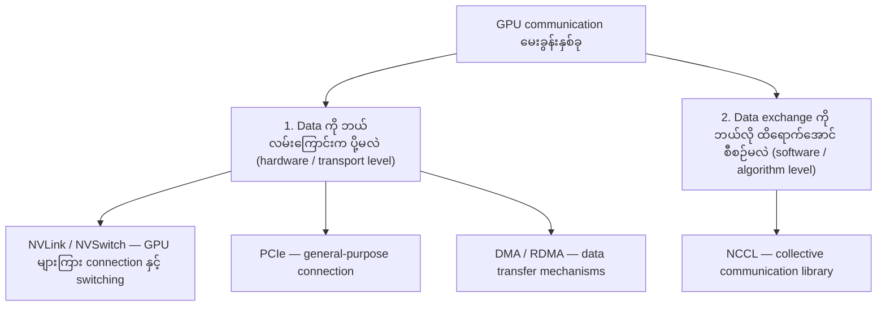
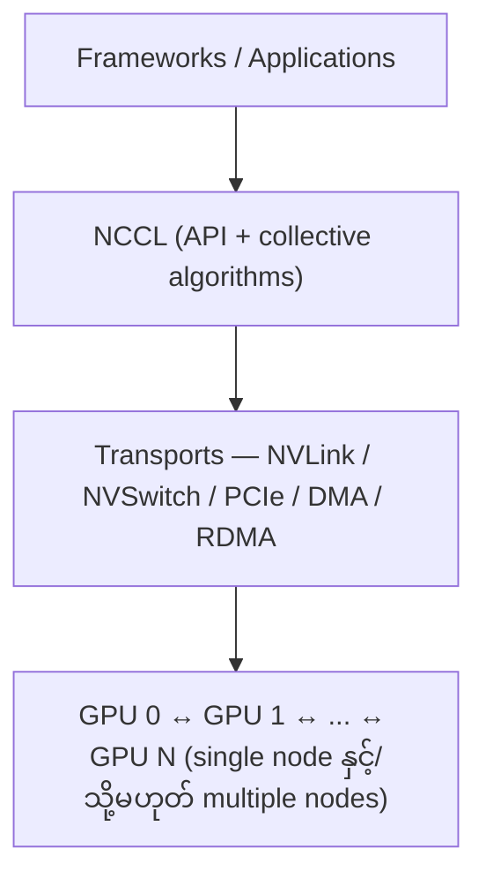
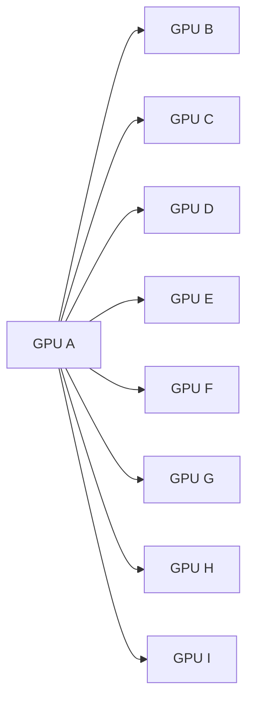
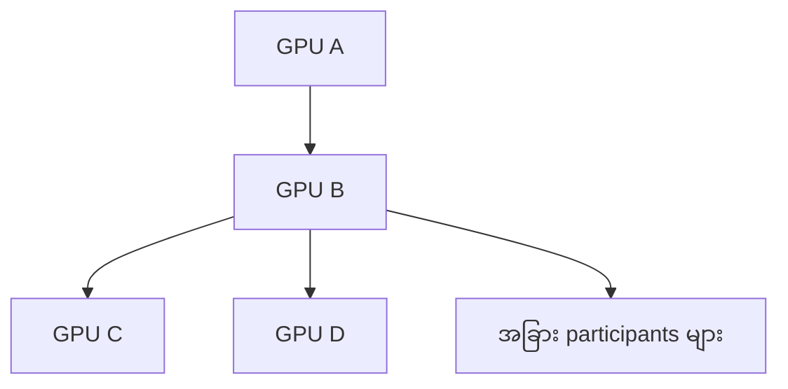
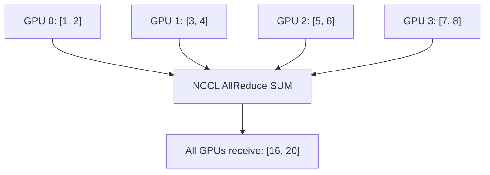
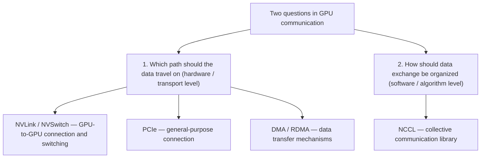
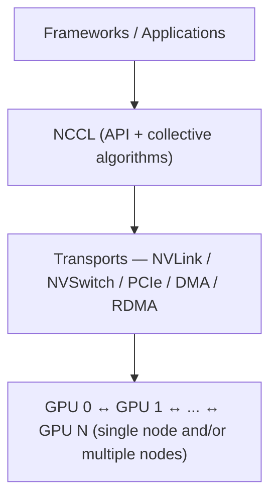
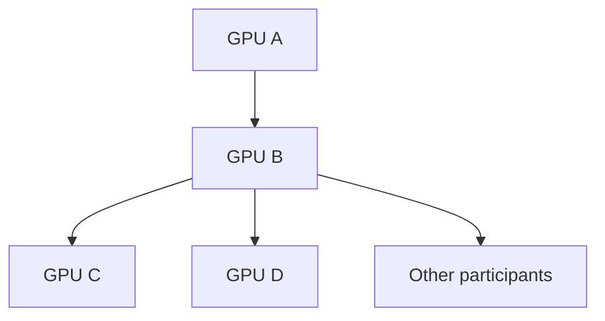

# Module 23 — NVLink, NVSwitch, PCIe, RDMA vs. NCCL

> Part IV · Course Module 23 — topic notes

## မြန်မာဘာသာ version — NVLink, NVSwitch, PCIe, RDMA vs. NCCL

## 1. သင်ယူရမည့် ရည်ရွယ်ချက်များ (Learning Objectives)

ဒီ Module ပြီးဆုံးတဲ့အခါ အောက်ပါအချက်တွေကို နားလည်နိုင်ရပါမယ်။

- NVLink, NVSwitch, PCIe, DMA, RDMA နဲ့ NCCL တို့ရဲ့ ကွာခြားချက်။
- Hardware interconnect နဲ့ software communication library တို့ရဲ့ အခန်းကဏ္ဍ။
- NCCL က multi-GPU communication ကို ဘယ်လိုအကျိုးရှိရှိ စီစဉ်ပေးသလဲ။
- GPU တစ်လုံးက GPU အများအပြားဆီ data ပို့တဲ့အခါ ဘာကြောင့် communication algorithm အရေးကြီးသလဲ။
- AllReduce, Broadcast နဲ့ ReduceScatter ကဲ့သို့ collective operations တွေ ဘာကြောင့်လိုအပ်သလဲ။
- Certification exam တွေအတွက် မဖြစ်မနေ ခွဲခြားမှတ်သားရမယ့် concepts တွေ။

## 2. ဘာကြောင့် ဒီ Technology တွေကို ခွဲခြားနားလည်ဖို့ လိုအပ်သလဲ။

AI infrastructure မှာ NVIDIA GPU အများအပြားကို အသုံးပြုတဲ့အခါ GPU တွေဟာ data တွေကို အချင်းချင်း ဖလှယ်ဖို့ လိုအပ်ပါတယ်။

ဥပမာ—Distributed Training မှာ GPU တစ်လုံးစီက model ရဲ့ အစိတ်အပိုင်းတစ်ခုကို တွက်ချက်ပြီးနောက် gradient တွေကို အခြား GPU တွေနဲ့ ပေါင်းစပ်ရနိုင်ပါတယ်။

ဒီနေရာမှာ အဓိကမေးခွန်းနှစ်ခု ရှိပါတယ်—

1. **Data ကို ဘယ်လမ်းကြောင်းကနေ ပို့မလဲ။** (Which path should the data travel on?)
2. **GPU အများအပြားကြားမှာ data exchange ကို ဘယ်လိုစီစဉ်ရင် ထိရောက်မလဲ။** (How should the exchange among many GPUs be organized?)

ဒီမေးခွန်းနှစ်ခုက ဆက်စပ်ပေမဲ့ အဖြေတစ်ခုတည်း မဟုတ်ပါဘူး။ ပထမမေးခွန်းက **hardware/transport** အဆင့်ကို မေးတာဖြစ်ပြီး ဒုတိယမေးခွန်းက **communication software/algorithm** အဆင့်ကို မေးတာ ဖြစ်ပါတယ်။

| မေးခွန်း | သက်ဆိုင်ရာ technology |
|---|---|
| GPU တွေကြားမှာ high-bandwidth connection ဘယ်လိုပေးမလဲ။ | **NVLink** |
| NVLink ချိတ်ဆက်ထားတဲ့ GPU တွေကြား traffic ကို switching ဘယ်လိုလုပ်မလဲ။ | **NVSwitch** |
| GPU နဲ့ အခြား devices တွေကြား general-purpose connection ဘယ်လိုပေးမလဲ။ | **PCIe** |
| CPU က data တစ် byte စီကို ကိုယ်တိုင် copy မလုပ်ဘဲ device က memory transfer ကို ဘယ်လိုလုပ်မလဲ။ | **DMA** |
| Network ပေါ်က remote system ရဲ့ registered memory ဆီ data ကို CPU overhead နည်းနည်းနဲ့ ဘယ်လိုပို့မလဲ။ | **RDMA** |
| GPU အများအပြားကြား collective communication ကို ဘယ်လိုစီစဉ်ပြီး optimize လုပ်မလဲ။ | **NCCL** |

**Figure 1 — မေးခွန်းနှစ်ခုနဲ့ သက်ဆိုင်ရာ technology များ ပုံ**



**ပုံရှင်းလင်းချက်** — အပေါ်ဆုံး node က ပြဿနာကို မေးခွန်းနှစ်ခုအဖြစ် ခွဲပြထားခြင်း ဖြစ်ပါတယ်။ ဘယ်ဘက် branch က data ပို့မယ့် လမ်းကြောင်း (hardware) အကြောင်းဖြစ်ပြီး NVLink, NVSwitch, PCIe, DMA, RDMA တွေက ဖြေရှင်းပေးပါတယ်။ ညာဘက် branch က GPU အများအပြားကြား data exchange ကို စီစဉ်မယ့် software/algorithm အကြောင်းဖြစ်ပြီး NCCL က ဖြေရှင်းပေးပါတယ်။

ဒီအချက်တွေကို မှတ်ထားရင် technology တစ်ခုချင်းစီရဲ့ role ကို ရှင်းရှင်းလင်းလင်း ခွဲခြားနိုင်ပါပြီ။

## 3. Expressway နဲ့ Traffic Management Analogy

သင်ခန်းစာထဲမှာ အသုံးပြုထားတဲ့ analogy ကို စဉ်းစားကြည့်ရအောင်။

Expressway တစ်ခုရှိတယ်လို့ စဉ်းစားပါ။ ကားတွေကို မြန်မြန်သွားလာနိုင်ဖို့ လမ်းတွေ၊ လမ်းဆုံတွေ၊ တံတားတွေ လိုအပ်ပါတယ်။ အဲဒီအပြင် ကားတွေ ဘယ်လိုသွားလာရမလဲဆိုတာ စီစဉ်ဖို့လည်း လိုအပ်ပါတယ်။

GPU communication နဲ့ နှိုင်းယှဉ်ကြည့်ရင်—

- **NVLink** — GPU တွေကြား high-bandwidth connection ပေးတဲ့ expressway တစ်ခုလို။
- **NVSwitch** — NVLink connection တွေကို switching လုပ်ပေးတဲ့ လမ်းဆုံတစ်ခုလို။
- **PCIe** — GPU နဲ့ အခြား devices တွေကြား ဆက်သွယ်ပေးတဲ့ general-purpose connection လို။
- **DMA / RDMA** — Data transfer ကို ဘယ်လိုလုပ်ဆောင်မလဲဆိုတဲ့ mechanism တွေနဲ့ သက်ဆိုင်တယ်။
- **NCCL** — GPU အများအပြားကြား collective communication ကို စီစဉ်ပေးတဲ့ traffic management system တစ်ခုလို။

ဒါပေမဲ့ analogy မှာ ကန့်သတ်ချက်တစ်ခု ရှိပါတယ်။ NCCL က network router တစ်ခုလို packet တစ်ခုချင်းစီအတွက် physical route ကို အမြဲရွေးချယ်ပေးတာ မဟုတ်ပါဘူး။ ၎င်းက collective communication algorithm နဲ့ communication strategy တွေကို စီစဉ်ပေးပြီး အောက်ခံ hardware နဲ့ transport တွေကို အသုံးပြုပါတယ်။

## 4. Physical Interconnect နဲ့ Software Library ရဲ့ ကွာခြားချက်

**NVLink, NVSwitch, PCIe နဲ့ RDMA**

ဒီ technology တွေဟာ အခန်းကဏ္ဍ မတူကြပါဘူး။

- NVLink နဲ့ PCIe တို့က hardware interconnect technology တွေ ဖြစ်ပါတယ်။
- NVSwitch က NVLink fabric အတွင်း connection တွေကို ချိတ်ဆက်ပေးတဲ့ switching technology ဖြစ်ပါတယ်။
- DMA က Direct Memory Access ဖြစ်ပြီး data transfer mechanism တစ်ခု ဖြစ်ပါတယ်။
- RDMA က Remote Direct Memory Access ဖြစ်ပြီး network ပေါ်က remote registered memory နဲ့ data transfer လုပ်နိုင်တဲ့ technology ဖြစ်ပါတယ်။

DMA နဲ့ RDMA ကို NVLink နဲ့ PCIe လို physical interconnect အမျိုးအစားတူတစ်ခုလို့ မသတ်မှတ်သင့်ပါဘူး။ Hardware, driver, memory registration နဲ့ network support တို့ပေါ် မူတည်ပြီး အသုံးပြုကြပါတယ်။

**NCCL**

NCCL က software library ဖြစ်ပါတယ်။ GPU အများအပြားကြားမှာ AllReduce, Broadcast နဲ့ ReduceScatter လို communication operations တွေကို လုပ်ဆောင်နိုင်ဖို့ API နဲ့ optimized algorithms တွေ ပေးပါတယ်။

Conceptual architecture က ဒီလို ဖြစ်ပါတယ်—

```
Frameworks / Applications
        │
        ▼
   NCCL (API + collective algorithms)
        │
        ▼
 NVLink / NVSwitch / PCIe / DMA / RDMA (transports)
        │
        ▼
   GPU 0 ↔ GPU 1 ↔ ... ↔ GPU N   (single node and/or multiple nodes)
```

ဒီ diagram က conceptual overview ဖြစ်ပါတယ်။ Actual software stack နဲ့ transport selection ဟာ platform ပေါ်မူတည်ပြီး ပိုမိုရှုပ်ထွေးနိုင်ပါတယ်။

**Figure 2 — Software library နဲ့ hardware transports ရဲ့ အဆင့်များ ပုံ**



**ပုံရှင်းလင်းချက်** — အပေါ်ဆုံးက application/framework အဆင့်၊ အလယ်က NCCL က communication ကို စီစဉ်ပေးတဲ့ software library အဆင့်၊ အောက်က transports အဆင့်၊ အောက်ဆုံးမှာ data ကို အချင်းချင်း ဖလှယ်နေတဲ့ GPU တွေကို အဆင့်လိုက် မြင်ရပါမယ်။ NCCL က အလုပ်ကို စီစဉ်ပေးပြီး NVLink, PCIe, DMA, RDMA တွေက data ကို သယ်ဆောင်ပေးတာ ဖြစ်ပါတယ်။

## 5. NCCL က ဘာကြောင့် အရေးကြီးသလဲ။

GPU တစ်လုံးနဲ့ GPU တစ်လုံးကြား data transfer လုပ်နိုင်တာနဲ့ GPU အများအပြားကြားမှာ communication ကို ထိရောက်စွာ စီစဉ်နိုင်တာဟာ မတူပါဘူး။

ဥပမာ—GPU 100 လုံးပါဝင်တဲ့ training cluster တစ်ခုမှာ GPU တစ်လုံးစီက အခြား GPU အားလုံးဆီ data ကို တစ်ခုချင်းစီ ပို့ဖို့ လိုအပ်တယ်လို့ စဉ်းစားကြည့်ပါ။

Communication pattern ကို မထိရောက်စွာ စီစဉ်ထားရင်—

- Transfer အရေအတွက် များလာနိုင်တယ်။
- Network traffic များလာနိုင်တယ်။
- Synchronization overhead မြင့်လာနိုင်တယ်။
- GPU တွေဟာ computation ဆက်လုပ်ဖို့ communication ပြီးဆုံးတာကို စောင့်နေရနိုင်တယ်။
- Training အချိန်နဲ့ cluster utilization ထိခိုက်နိုင်တယ်။

NCCL က workload နဲ့ topology အတွက် သင့်တော်တဲ့ collective algorithms တွေကို အသုံးပြုပြီး communication ကို optimize လုပ်ဖို့ ကူညီပေးပါတယ်။

သတိပြုရန် — NCCL က transfer အရေအတွက်ကို အမြဲလျှော့ချပေးမယ်လို့ အာမခံတာ မဟုတ်ပါဘူး။ အချို့ algorithms တွေမှာ intermediate communication များနိုင်ပေမဲ့ စုစုပေါင်း bandwidth အသုံးချမှုနဲ့ performance ပိုကောင်းလာနိုင်ပါတယ်။

## 6. ဥပမာ — GPU A က GPU အားလုံးဆီ Data ပို့ရမယ်ဆိုရင်

GPU 9 လုံးကို A မှ I အထိ အမည်ပေးထားတယ်လို့ ယူဆပါ။

**Approach A — One-to-One ပို့ခြင်း**

GPU A က GPU B, C, D, E, F, G, H, I တို့ဆီ data ကို တစ်ခုချင်းစီ ပို့ပါတယ်။

```
          B
          ↑
      C ← A → D
       ↗️  ↓  ↘️
      E   F   G
       ↖️     ↗️
        H   I
```

ဒီပုံဟာ ရိုးရှင်းတဲ့ conceptual illustration ဖြစ်ပါတယ်။ အမှန်တကယ် direct communication လုပ်နိုင်ခြင်းနဲ့ connection တစ်ခုချင်းစီရဲ့ cost က topology ပေါ်မူတည်ပါတယ်။

ဒီနည်းလမ်းမှာ A က destination တစ်ခုချင်းစီအတွက် communication လုပ်ရနိုင်ပါတယ်။ ဒါပေမဲ့ workload အားလုံးအတွက် ဒီနည်းလမ်းက အကောင်းဆုံးဖြစ်မယ်လို့ မဆိုနိုင်ပါဘူး။

**Figure 3 — Approach A: GPU A မှ အခြား GPU များဆီ တစ်ခုချင်းစီ ပို့ခြင်း ပုံ**



**ပုံရှင်းလင်းချက်** — ဘယ်ဘက်က GPU A ကနေ မြှာက်ကိန်း (arrow) ရှစ်ခုက တစ်ခုချင်းစီ သီးခြားပို့ရတာကို ပြပါတယ်။ GPU အရေအတွက် များလာရင် ဒီလို တစ်ခုချင်းစီ ပို့နည်းက transfer အရေအတွက် များလာစေနိုင်ကြောင်း မြင်ရပါမယ်။ ဒီပုံက conceptual illustration ဖြစ်ပြီး connection တစ်ခုချင်းစီရဲ့ cost က topology ပေါ် မူတည်ပါတယ်။

**Approach B — Multi-Step Communication**

အချို့ collective operations တွေမှာ data ကို intermediate participants တွေကတစ်ဆင့် ပို့နိုင်ပါတယ်။

```
GPU A
  │
  ▼
GPU B ─────► GPU C
  │
  ├────────► GPU D
  │
  ▼
Other participants
```

ဒီပုံကလည်း conceptual example သာဖြစ်ပါတယ်။ NCCL က အမြဲတမ်း GPU B ကို intermediary အဖြစ် သတ်မှတ်ပေးတယ်လို့ မဆိုလိုပါဘူး။

အမှန်တကယ်မှာ ring, tree နဲ့ အခြား communication algorithms တွေကို operation, message size, topology နဲ့ system configuration ပေါ်မူတည်ပြီး အသုံးပြုနိုင်ပါတယ်။

**Figure 4 — Approach B: intermediate participants များကတဆင့် ပို့ခြင်း ပုံ**



**ပုံရှင်းလင်းချက်** — GPU A က ပို့တဲ့ data ဟာ တစ်ဆင့်ခံ participant (ဒီပုံမှာ GPU B) ကတဆင့် အခြားသူတွေဆီ ဆက်သွားတာကို မြင်ရပါတယ်။ ဒါပေမဲ့ NCCL က GPU B ကို အမြဲတမ်း intermediary လုပ်ပေးတယ်လို့ မဆိုလိုပါဘူး — တကယ့်မှာ ring, tree စတဲ့ algorithm တွေကို အခြေအနေပေါ်မူတည်ပြီး သုံးနိုင်ပါတယ်။

**အဓိကသင်ခန်းစာ** — NCCL ရဲ့ တန်ဖိုးက connection တစ်ခုချင်းစီကို ကိုယ်တိုင်ရေးစရာမလိုဘဲ GPU အများအပြားအတွက် သင့်တော်တဲ့ communication algorithm ကို အသုံးပြုနိုင်ခြင်း ဖြစ်ပါတယ်။

## 7. ဥပမာ — AllReduce နဲ့ Gradient Sharing

Distributed Training မှာ GPU တစ်လုံးစီက gradient တွေကို တွက်ချက်တယ်လို့ ယူဆပါ။

```
GPU 0: [1, 2]
GPU 1: [3, 4]
GPU 2: [5, 6]
GPU 3: [7, 8]

         NCCL AllReduce SUM

All GPUs receive: [16, 20]
```

**Figure 5 — AllReduce SUM ဖြင့် gradient sharing လုပ်ပုံ ပုံ**



**ပုံရှင်းလင်းချက်** — ဘယ်ဘက်က GPU လေးလုံးက သူ့တန်ဖိုးတွေကို တစ်လုံးချင်းစီ ပေးပို့ပါတယ်။ အလယ်က NCCL AllReduce SUM က အဲဒီတန်ဖိုးတွေကို ပေါင်းပေးပါတယ်။ ညာဘက်မှာ GPU အားလုံးက ရလဒ် [16, 20] ကို တူညီစွာ ပြန်ရတာကို မြင်ရပါမယ်။

ဒီဥပမာမှာ AllReduce က တန်ဖိုးတွေကို ပေါင်းပြီး participant အားလုံးဆီ reduced result ကို ပြန်ပေးပါတယ်။

တကယ့် training workload တွေမှာ gradient tensor တွေဟာ အလွန်ကြီးမားနိုင်တာကြောင့် communication bandwidth, latency နဲ့ algorithm efficiency တို့က training performance အပေါ် အရေးကြီးတဲ့ သက်ရောက်မှုရှိပါတယ်။

## 8. Latency နဲ့ Communication Efficiency

ဒီနှစ်ခုကို ခွဲခြားနားလည်ဖို့ လိုအပ်ပါတယ်။

- **Low latency per transfer** ဆိုတာ transfer တစ်ခု စတင်ပြီး အဆုံးသတ်ဖို့ ကြာချိန်နည်းတာကို ဆိုလိုပါတယ်။
- **Efficient collective communication** ဆိုတာ GPU အများအပြားကြား data exchange တစ်ခုလုံးကို လိုအပ်တဲ့အချိန်၊ bandwidth နဲ့ synchronization overhead တို့အရ ထိရောက်စွာ ဆောင်ရွက်နိုင်တာကို ဆိုလိုပါတယ်။

ဥပမာ—

- NVLink က supported GPUs တွေကြား high-bandwidth communication ပေးနိုင်တယ်။
- RDMA က supported network ပေါ်မှာ CPU overhead ကို လျှော့ချနိုင်တယ်။
- NCCL က collective operation တစ်ခုလုံးကို ထိရောက်စွာ အကောင်အထည်ဖော်ဖို့ algorithms နဲ့ communication strategy တွေ ပေးတယ်။

ဒီနည်းပညာတွေဟာ ပြိုင်ဘက် technology တွေ မဟုတ်ပါဘူး။ မတူညီတဲ့ layer တွေမှာ အလုပ်လုပ်ပြီး အတူတကွ အသုံးပြုနိုင်ပါတယ်။

## 9. Certification Exam အတွက် မှတ်သားရန်

| Technology | အဓိကမှတ်သားရမယ့်အချက် |
|---|---|
| NVLink | High-bandwidth GPU interconnect |
| NVSwitch | NVLink-based GPU fabric switching |
| PCIe | General-purpose device interconnect |
| DMA | CPU က byte တစ်ခုချင်းစီကို copy မလုပ်ဘဲ device transfer လုပ်နိုင်စေတဲ့ mechanism |
| RDMA | Remote registered memory နဲ့ low-overhead data transfer |
| NCCL | Multi-GPU / multi-node collective communication library |

**Quick questions**

1. NCCL က hardware လား၊ software လား။
2. NVLink နဲ့ NCCL ရဲ့ ကွာခြားချက်က ဘာလဲ။
3. RDMA နဲ့ NCCL ဟာ ဘာကြောင့် အစားထိုးသုံးလို့မရတာလဲ။
4. NCCL က topology-aware communication ကို ဘယ်လိုကူညီပေးသလဲ။
5. NCCL က transfer အရေအတွက်ကို အမြဲလျှော့ချပေးသလား။
6. Distributed Training မှာ AllReduce ကို ဘာကြောင့် အသုံးပြုသလဲ။

## Module Summary

NVLink, NVSwitch နဲ့ PCIe တို့ဟာ GPU နဲ့ device communication infrastructure ရဲ့ အစိတ်အပိုင်းတွေ ဖြစ်ပါတယ်။ DMA နဲ့ RDMA တို့က memory transfer mechanisms တွေနဲ့ ဆက်စပ်ပါတယ်။ NCCL ကတော့ GPU အများအပြားကြား collective communication ကို အကောင်အထည်ဖော်ဖို့ optimized algorithms နဲ့ API တွေ ပေးတဲ့ software library ဖြစ်ပါတယ်။

အရေးကြီးဆုံးမှတ်ချက်: NVLink က data သယ်ဆောင်တဲ့ connection ကို ပေးတယ်။ RDMA က remote-memory transfer ကို ပံ့ပိုးတယ်။ NCCL က GPU အများအပြားကြား communication operations တွေကို ထိရောက်စွာ စီစဉ်ပေးတယ်။ ဒီ technology တွေဟာ မတူညီတဲ့ အခန်းကဏ္ဍတွေမှာ အတူတကွ အလုပ်လုပ်နိုင်ပါတယ်။

## Self-Check Questions (အဖြေများပါဝင်သည်)

1. **GPU တွေကြား high-bandwidth link ကို ဘယ် technology က ပေးသလဲ။** — NVLink က ပေးပါတယ်။ NVSwitch ကတော့ NVLink connection တွေကြား traffic ကို switching လုပ်ပေးပါတယ်။
2. **NCCL က hardware လား။** — မဟုတ်ပါဘူး။ NCCL က collective communication အတွက် API နဲ့ optimized algorithms ပေးတဲ့ software library ဖြစ်ပါတယ်။
3. **DMA နဲ့ RDMA ကို NVLink/PCIe လို physical interconnect လို့ မှတ်လို့ရသလား။** — မရပါဘူး။ DMA နဲ့ RDMA က data transfer mechanisms/technologies တွေဖြစ်ပြီး hardware, driver, memory registration နဲ့ network support ပေါ် မူတည်ပြီး အလုပ်လုပ်ပါတယ်။
4. **"Data ကို ဘယ်လမ်းကြောင်းကနေ ပို့မလဲ" နဲ့ "data exchange ကို ဘယ်လိုစီစဉ်မလဲ" ဆိုတဲ့ မေးခွန်းနှစ်ခု ဘာကွာသလဲ။** — ပထမတစ်ခုက hardware/transport path (NVLink, PCIe, network/RDMA) ကို ရွေးချယ်တဲ့မေးခွန်းဖြစ်ပြီး ဒုတိယတစ်ခုက NCCL ကဲ့သို့ software library က collective communication ကို စီစဉ်/optimize လုပ်တဲ့မေးခွန်း ဖြစ်ပါတယ်။ ဆက်စပ်ပေမဲ့ အဖြေတစ်ခုတည်း မဟုတ်ပါဘူး။
5. **AllReduce က transfer အရေအတွက်ကို အမြဲအနည်းဆုံးဖြစ်အောင် လုပ်ပေးသလား။** — မလုပ်ပေးပါဘူး။ NCCL က transfer အရေအတွက်ကို အမြဲလျှော့ချပေးတယ်လို့ အာမခံတာ မဟုတ်ဘဲ algorithm ပေါ်မူတည်ပြီး intermediate communication များနိုင်ပေမဲ့ စုစုပေါင်း bandwidth အသုံးချမှုနဲ့ performance ပိုကောင်းလာနိုင်ပါတယ်။

## English Version — NVLink, NVSwitch, PCIe, RDMA vs. NCCL

## 1. Learning Objectives

By the end of this module, you should be able to:

- Distinguish NVLink, NVSwitch, PCIe, DMA, RDMA, and NCCL.
- Explain the roles of hardware interconnects and the software communication library.
- Describe how NCCL organizes multi-GPU communication efficiently.
- Explain why the communication algorithm matters when one GPU sends data to many GPUs.
- Explain why collective operations such as AllReduce, Broadcast, and ReduceScatter are needed.
- Identify the concepts that must be distinguished for certification exams.

## 2. Why Do We Need to Distinguish These Technologies?

When many NVIDIA GPUs are used in AI infrastructure, the GPUs need to exchange data with one another.

For example, in distributed training each GPU computes part of a model and may then combine its gradients with those of other GPUs.

Two key questions arise here:

1. **Which path should the data be sent on?**
2. **How should data exchange among many GPUs be organized to be efficient?**

These two questions are related, but they do not have the same answer. The first question is about the **hardware/transport** level; the second is about the **communication software/algorithm** level.

| Question | Relevant technology |
|---|---|
| How do we provide a high-bandwidth connection between GPUs? | **NVLink** |
| How is traffic switched among NVLink-connected GPUs? | **NVSwitch** |
| How do we provide a general-purpose connection between the GPU and other devices? | **PCIe** |
| How does a device perform memory transfers without the CPU copying every byte itself? | **DMA** |
| How do we send data to a remote system's registered memory over the network with low CPU overhead? | **RDMA** |
| How do we organize and optimize collective communication among many GPUs? | **NCCL** |

**Figure 1 — The two questions and the technologies that answer them**



**Figure walkthrough** — The top node splits the problem into two different questions. The left branch is about hardware paths, answered by NVLink, NVSwitch, PCIe, DMA, and RDMA. The right branch is about organizing exchange among many GPUs, answered by NCCL.

Keep these mappings in mind and you can clearly separate the role of each technology.

## 3. Expressway and Traffic Management Analogy

Consider the analogy used in the lesson.

Imagine an expressway. For cars to move quickly, you need roads, interchanges, and bridges. In addition, something must organize how the cars should travel.

Compared with GPU communication—

- **NVLink** — like the expressway that provides a high-bandwidth connection between GPUs.
- **NVSwitch** — like the interchange that switches traffic among NVLink connections.
- **PCIe** — like the general-purpose connection linking the GPU with other devices.
- **DMA / RDMA** — relate to the mechanisms of how data transfer is performed.
- **NCCL** — like a traffic management system that organizes collective communication among many GPUs.

The analogy has a limit, however. NCCL is not like a network router that always picks a physical route for each packet. It organizes collective communication algorithms and strategies and uses the underlying hardware and transports.

## 4. Physical Interconnects vs. the Software Library

**NVLink, NVSwitch, PCIe, and RDMA**

These technologies play different roles.

- NVLink and PCIe are hardware interconnect technologies.
- NVSwitch is a switching technology that connects links within the NVLink fabric.
- DMA (Direct Memory Access) is a data-transfer mechanism.
- RDMA (Remote Direct Memory Access) is a technology for data transfer with remote registered memory across a network.

DMA and RDMA should not be classified as the same kind of physical interconnect as NVLink and PCIe. They are used depending on hardware, drivers, memory registration, and network support.

**NCCL**

NCCL is a software library. It provides APIs and optimized algorithms for performing communication operations such as AllReduce, Broadcast, and ReduceScatter among many GPUs.

The conceptual architecture looks like this:

```
Frameworks / Applications
        │
        ▼
   NCCL (API + collective algorithms)
        │
        ▼
 NVLink / NVSwitch / PCIe / DMA / RDMA (transports)
        │
        ▼
   GPU 0 ↔ GPU 1 ↔ ... ↔ GPU N   (single node and/or multiple nodes)
```

This diagram is a conceptual overview. The actual software stack and transport selection depend on the platform and can be more complex.

**Figure 2 — Layers of the software library and the hardware transports**



**Figure walkthrough** — Applications sit on top, NCCL organizes the communication in the middle, the transports carry the data below, and the GPUs at the bottom exchange data on a single node or across nodes. NCCL plans the work; NVLink, PCIe, DMA, and RDMA move the data.

## 5. Why Is NCCL Important?

Transferring data between two GPUs is not the same as organizing communication efficiently among many GPUs.

For example, consider a training cluster of 100 GPUs where every GPU needs to send data to all the other GPUs individually.

If the communication pattern is not organized efficiently—

- The number of transfers can grow.
- Network traffic can grow.
- Synchronization overhead can grow.
- GPUs may have to wait for communication to finish before continuing computation.
- Training time and cluster utilization can suffer.

NCCL helps optimize communication by using collective algorithms suited to the workload and topology.

Caveat — NCCL does not guarantee that it will always reduce the number of transfers. Some algorithms may involve more intermediate communication while achieving better overall bandwidth use and performance.

## 6. Example — GPU A Sending Data to All GPUs

Assume nine GPUs are named A through I.

**Approach A — One-to-One Sending**

GPU A sends data to GPUs B, C, D, E, F, G, H, and I individually.

```
          B
          ↑
      C ← A → D
       ↗️  ↓  ↘️
      E   F   G
       ↖️     ↗️
        H   I
```

This figure is a simple conceptual illustration. Whether direct communication is actually possible, and the cost of each connection, depend on the topology.

With this approach, A can communicate for each destination separately. However, this approach cannot be said to be optimal for every workload.

**Figure 3 — Approach A: one-to-one sending from GPU A to every other GPU**


**Figure walkthrough** — From GPU A on the left, eight separate arrows show eight separate sends. As the number of GPUs grows, this one-to-one pattern grows the number of transfers. The figure is conceptual; the cost of each connection depends on the topology.

**Approach B — Multi-Step Communication**

In some collective operations, data can be sent through intermediate participants.

```
GPU A
  │
  ▼
GPU B ─────► GPU C
  │
  ├────────► GPU D
  │
  ▼
Other participants
```

This figure is also only a conceptual example. It does not mean NCCL always designates GPU B as an intermediary.

In practice, ring, tree, and other communication algorithms may be used depending on the operation, message size, topology, and system configuration.

**Figure 4 — Approach B: multi-step communication through intermediate participants**



**Figure walkthrough** — Data leaves GPU A and passes through an intermediate participant (GPU B in this picture) before reaching the others. This does not mean NCCL always picks GPU B; in practice ring, tree, and other algorithms can be used depending on the situation.

**Key lesson** — The value of NCCL is that a communication algorithm suited to many GPUs can be used without writing every connection by hand.

## 7. Example — AllReduce for Gradient Sharing

Assume each GPU computes gradients in distributed training.

```
GPU 0: [1, 2]
GPU 1: [3, 4]
GPU 2: [5, 6]
GPU 3: [7, 8]

         NCCL AllReduce SUM

All GPUs receive: [16, 20]
```

**Figure 5 — Gradient sharing with AllReduce SUM**


**Figure walkthrough** — On the left, each of the four GPUs contributes its own values. In the middle, NCCL AllReduce SUM adds them together. On the right, every GPU receives the same result, [16, 20].

In this example, AllReduce sums the values and returns the reduced result to all participants.

In real training workloads, gradient tensors can be very large, so communication bandwidth, latency, and algorithm efficiency have an important effect on training performance.

## 8. Latency and Communication Efficiency

These two must be distinguished.

- **Low latency per transfer** means the time to start and finish a single transfer is short.
- **Efficient collective communication** means the whole data exchange among many GPUs is carried out efficiently in terms of required time, bandwidth, and synchronization overhead.

For example—

- NVLink can provide high-bandwidth communication among supported GPUs.
- RDMA can reduce CPU overhead on supported networks.
- NCCL provides algorithms and strategies to implement an entire collective operation efficiently.

These technologies are not competing alternatives. They work at different layers and can be used together.

## 9. What to Remember for the Certification Exam

| Technology | Key point to remember |
|---|---|
| NVLink | High-bandwidth GPU interconnect |
| NVSwitch | NVLink-based GPU fabric switching |
| PCIe | General-purpose device interconnect |
| DMA | Mechanism that lets a device perform transfers without the CPU copying each byte |
| RDMA | Low-overhead data transfer with remote registered memory |
| NCCL | Multi-GPU / multi-node collective communication library |

**Quick questions**

1. Is NCCL hardware or software?
2. What is the difference between NVLink and NCCL?
3. Why can't RDMA and NCCL be used interchangeably?
4. How does NCCL help with topology-aware communication?
5. Does NCCL always reduce the number of transfers?
6. Why is AllReduce used in distributed training?

## Module Summary

NVLink, NVSwitch, and PCIe are parts of the GPU and device communication infrastructure. DMA and RDMA relate to memory transfer mechanisms. NCCL is a software library that provides optimized algorithms and APIs for implementing collective communication among many GPUs.

Most important note: NVLink provides the connection that carries data. RDMA supports remote-memory transfer. NCCL organizes communication operations among many GPUs efficiently. These technologies work together in different roles.

## Self-Check Questions (with answers)

1. **Which technology provides the high-bandwidth link between GPUs?** — NVLink. NVSwitch, in turn, switches traffic among NVLink connections.
2. **Is NCCL hardware?** — No. NCCL is a software library providing APIs and optimized algorithms for collective communication.
3. **Can DMA and RDMA be treated as physical interconnects like NVLink/PCIe?** — No. DMA and RDMA are data-transfer mechanisms/technologies whose behavior depends on hardware, drivers, memory registration, and network support.
4. **How do the questions "which path to send data on" and "how to organize the exchange" differ?** — The first concerns choosing the hardware/transport path (NVLink, PCIe, network/RDMA); the second concerns how a software library such as NCCL organizes and optimizes collective communication. They are related but not the same answer.
5. **Does AllReduce always minimize the number of transfers?** — No. NCCL does not guarantee fewer transfers; depending on the algorithm, intermediate communication may increase while overall bandwidth use and performance improve.

---

## Technical review notes

- Source transcript (msg_2616) မှ Module 23 အကြောင်းအရာ အားလုံး (sections 1–9 နှင့် Module Summary) ကို မူရင်း Burmese version အတိုင်း ထိန်းထားပြီး English Version ကို အဓိပ္ပာယ်မပျက် ဘာသာပြန်ထားသည်။ Technical terms များကို နှစ်ဘာသာလုံးတွင် English အတိုင်း ထားရှိသည်။
- Question-to-technology mapping table (high-bandwidth GPU link = NVLink, traffic switching = NVSwitch, general-purpose connection = PCIe, byte-copy-free transfer = DMA, remote registered memory = RDMA, collective communication = NCCL) နှင့် အဓိကမေးခွန်းနှစ်ခု (data path vs. exchange organization) ကို source အတိုင်း ထိန်းထားသည်။
- Section 4 ရှိ "Conceptual architecture" diagram သည် source transcript တွင် reference သာ ပါရှိပြီး မူရင်းပုံကို မဖမ်းမိသဖြင့် concept ကို ကိုယ်စားပြုသော ရိုးရှင်း diagram ဖြင့် ဖော်ပြထားသည် — actual stack နှင့် transport selection သည် platform ပေါ်မူတည်ကြောင်း source caveat ကို ထိန်းထားသည်။
- AllReduce SUM ဥပမာ ဂဏန်းများ ([1,2]…[7,8] → [16,20]) ၊ Approach A/B diagrams နှင့် ၎င်းတို့၏ conceptual/topology-dependent caveats များကို source အတိုင်း ထိန်းထားသည်။
- "NCCL က transfer အရေအတွက်ကို အမြဲမလျှော့ချပေး" ဆိုသော caveat ကို source အတိုင်း ထိန်းထားသည်။
- Mermaid figures (Figure 1–5) နှင့် ၎င်းတို့၏ ပုံရှင်းလင်းချက်များကို မြန်မာဘာသာ version နှင့် English Version နှစ်ခုလုံးတွင် အဆင့်တူ ထည့်သွင်းထားသည် — မူရင်းစာသားနှင့် ASCII diagrams များ မပြောင်းလဲပါ။
