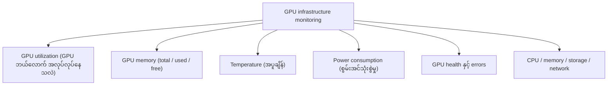
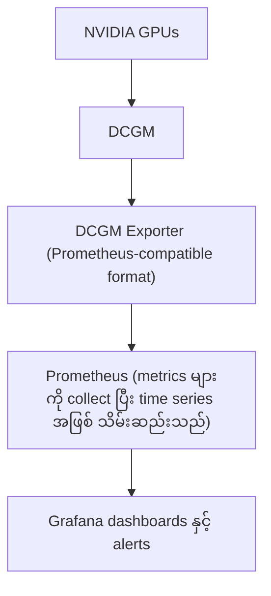
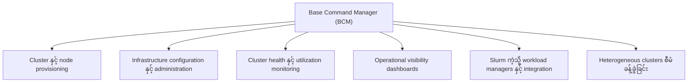
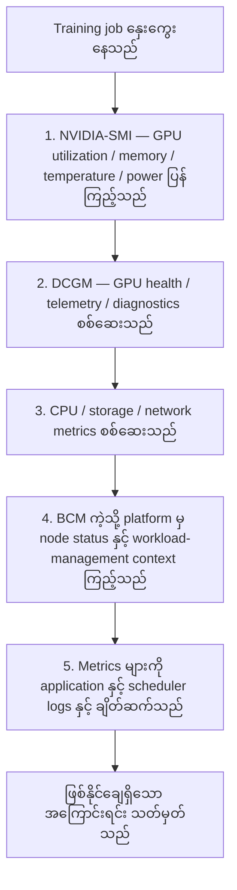
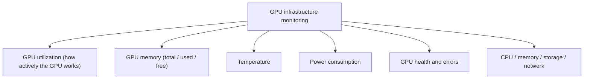
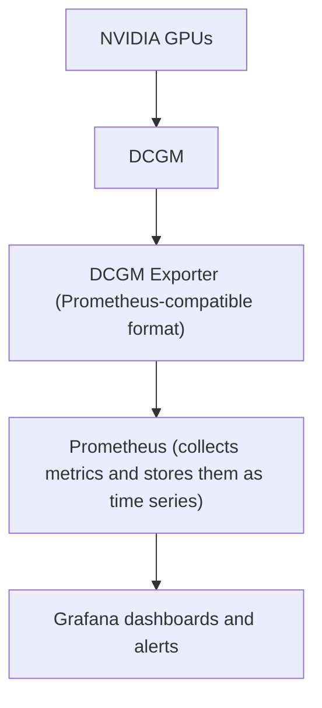
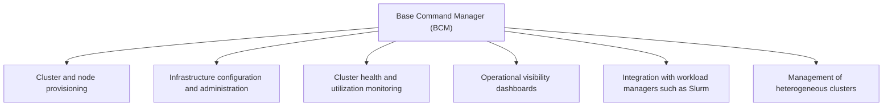
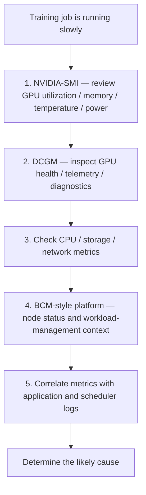

# Module 24 — NVIDIA GPU Monitoring and Data Center Management

> Part V · NVIDIA Monitoring, Cluster Management and Tool Selection — topic notes

## မြန်မာဘာသာ version

## 1. Learning Objectives

ဒီ Module က AI data center တစ်ခုမှာ GPU monitoring ဘာကြောင့် အရေးကြီးသလဲ၊ ဘယ် tools တွေကို ဘယ်အချိန်မှာ အသုံးပြုရမလဲဆိုတာ ရှင်းပြပါတယ်။

သင်ခန်းစာပြီးဆုံးတဲ့အခါ အောက်ပါအချက်တွေကို နားလည်နိုင်ရပါမယ်။

- GPU monitoring ရဲ့ ရည်ရွယ်ချက်
- NVIDIA-SMI နဲ့ DCGM တို့ရဲ့ ကွာခြားချက်
- GPU utilization, memory, temperature နဲ့ power ကို ဖတ်ခြင်း
- Prometheus နဲ့ Grafana integration
- Metrics, dashboards နဲ့ alerting
- GPU fleet visibility
- Infrastructure monitoring နဲ့ model monitoring ကွာခြားခြင်း
- Operational troubleshooting

သင်ယူရမည့်ရလဒ် — GPU monitoring tools တွေကို သင့်တော်တဲ့ operational requirement နဲ့ ချိတ်ဆက်နိုင်ရန်။

## 2. Monitoring ဘာကြောင့် လိုအပ်သလဲ။

High-performance sports car တစ်စီးကို မောင်းနေတယ်လို့ စဉ်းစားကြည့်ပါ။

Engine က စွမ်းအားကောင်းပြီး ထိရောက်နိုင်ပေမဲ့ dashboard မရှိရင် အောက်ပါအချက်တွေကို သိနိုင်မှာ မဟုတ်ပါဘူး။

- Fuel သို့မဟုတ် battery capacity ဘယ်လောက်ကျန်သလဲ။
- ကားက ဘယ်လောက်မြန်မြန်သွားနေသလဲ။
- Engine temperature မြင့်နေသလား။
- Warning light က ပြဿနာကို ပြနေသလား။
- ကားက ပုံမှန်အတိုင်း အလုပ်လုပ်နေသလား။

Data center မှာလည်း အလားတူ လိုအပ်ချက်ရှိပါတယ်။ AI server တစ်လုံးမှာ ဈေးကြီးတဲ့ GPUs, CPUs, memory, storage နဲ့ high-speed networking equipment တွေ ပါဝင်နိုင်ပါတယ်။ Monitoring မရှိရင် administrator တွေဟာ အဲဒီ resources တွေ ထိရောက်စွာ အသုံးပြုနေသလား၊ ပြဿနာ ဖြစ်နေသလားကို လွယ်လွယ်ကူကူ မသိနိုင်ပါဘူး။

| Vehicle dashboard | Data center equivalent |
|---|---|
| Fuel or battery level | Available memory, storage, and resource capacity |
| Speedometer | Workload throughput and performance metrics |
| Engine temperature | GPU, CPU, and system temperatures |
| Warning lights | Hardware errors, health alerts, and incidents |
| Engine power consumption | GPU and server power consumption |
| Vehicle diagnostics | Hardware and software health checks |

Monitoring ဆိုတာ failure တွေကို ရှာဖွေရုံသာ မဟုတ်ပါဘူး။ Underutilized resources တွေကို ဖော်ထုတ်ခြင်း၊ performance bottlenecks တွေကို စုံစမ်းခြင်း၊ capacity ကို စီစဉ်ခြင်းနဲ့ infrastructure efficiency ကို မြှင့်တင်ခြင်းတွေအတွက်လည်း ကူညီပေးပါတယ်။

## 3. ဘာတွေကို Monitor လုပ်သင့်သလဲ။

GPU infrastructure monitoring strategy တစ်ခုမှာ အောက်ပါ categories တွေ ပါဝင်ပါတယ်။

**Figure 1 — Monitor လုပ်သင့်သော အဓိက categories များ ပုံ**



**ပုံရှင်းလင်းချက်** — အလယ်က node က monitoring strategy တစ်ခုလုံးကို ကိုယ်စားပြုပြီး ပတ်ဝန်းကျင်က branch ခြောက်ခုက စောင့်ကြည့်ရမယ့် category တွေ ဖြစ်ပါတယ်။ GPU utilization, memory, temperature, power တွေက GPU ရဲ့ ကိုယ်ပိုင်အခြေအနေတွေ ဖြစ်ပြီး နောက်ဆုံး branch ကတော့ GPU တစ်ခုတည်းနဲ့ မလုံလောက်ဘဲ CPU, storage, network တွေပါ စစ်ဆေးရမယ်ဆိုတာကို သတိပေးထားခြင်း ဖြစ်ပါတယ်။

### 3.1 GPU utilization

GPU utilization က GPU က အလုပ်ကို ဘယ်လောက် active ဖြစ်ဖြစ် လုပ်နေသလဲဆိုတာ ပြနိုင်ပါတယ်။

ဥပမာ — GPU တစ်လုံးက 90% utilization ပြနေရင် ပြထားတဲ့ utilization metric အရ GPU က busy ဖြစ်နေတယ်လို့ ဆိုလိုပါတယ်။ သို့သော် high utilization က workload က ထိရောက်နေတယ်လို့ အလိုအလျောက် မဆိုလိုပါဘူး။ (GPU-Util 97% ဆိုတာ performance အကောင်းဆုံး ရနေတယ်လို့ မဆိုလိုပါဘူး။)

အလားတူပဲ low utilization ကလည်း အမြဲတမ်း ပြဿနာကို မဆိုလိုပါဘူး။ Workload က data ကို စောင်းနေတာ၊ intermittent ဖြစ်ဖြစ် execute လုပ်တာ၊ သို့မဟုတ် GPU capacity ရဲ့ အစိတ်အပိုင်းတစ်ခုကိုသာ ရည်ရွယ်ချက်ရှိရှိ အသုံးပြုတာ ဖြစ်နိုင်ပါတယ်။

### 3.2 GPU memory

အောက်ပါတွေကို စောင့်ကြည့်ပါ။

- Total GPU memory
- Used GPU memory
- Free GPU memory

Memory consumption ဟာ AI training နဲ့ inference အတွက် အထူးအရေးကြီးပါတယ်။ GPU compute utilization နည်းနေချိန်မှာတောင် workload က out-of-memory error နဲ့ ပျက်နိုင်ပါတယ်။

### 3.3 Temperature

GPU temperature က operating behavior နဲ့ performance ကို သက်ရောက်စေနိုင်ပါတယ်။ Monitoring က အပူချိန် လွန်ကဲခြင်းနဲ့ cooling ပြဿနာ ဖြစ်နိုင်ခြေကို ဖော်ထုတ်ရာမှာ ကူညီပါတယ်။ Temperature thresholds တွေက GPU model, system design နဲ့ manufacturer specifications ပေါ် မူတည်ပါတယ်။

### 3.4 Power consumption

Power telemetry က energy use ကို နားလည်ဖို့၊ မမျှော်လင့်ထားတဲ့ ပြောင်းလဲမှုတွေကို တွေ့ရှိဖို့၊ power-related performance limits တွေကို စုံစမ်းဖို့ ကူညီပါတယ်။ ပြထားတဲ့ power value ဟာ အချိန်တစ်ခုမှာ တိုင်းတာထားတဲ့ တန်ဖိုးဖြစ်ပြီး server ရဲ့ စုစုပေါင်း power consumption နဲ့ မတူနိုင်ပါဘူး။

### 3.5 GPU health နဲ့ errors

Monitoring နဲ့ diagnostic tools တွေက hardware health ပြဿနာတွေ၊ error events တွေ၊ စုံစမ်းစရာ အခြေအနေတွေကို ဖော်ထုတ်ရာမှာ ကူညီနိုင်ပါတယ်။

### 3.6 CPU, memory, storage နဲ့ network

GPU monitoring တစ်ခုတည်းနဲ့ data center ရဲ့ ပြည့်စုံတဲ့ ပုံရိပ်ကို မလုံလောက်ပါဘူး။ AI workload တစ်ခုဟာ CPU processing, storage throughput, network bandwidth သို့မဟုတ် data preparation ကြောင့် ကန့်သတ်ခံရနိုင်ပါတယ်။ ဒီ components တွေကိုလည်း သင့်တော်တဲ့ system နဲ့ infrastructure monitoring tools တွေနဲ့ စောင့်ကြည့်သင့်ပါတယ်။

## 4. Tool 1 — NVIDIA-SMI

NVIDIA-SMI ရဲ့ အမည်အပြည့်အစုံက NVIDIA System Management Interface ဖြစ်ပါတယ်။

NVIDIA GPU devices တွေကို query လုပ်ဖို့နဲ့ support ရှိပြီး ခွင့်ပြုထားတဲ့နေရာတွေမှာ manage လုပ်ဖို့ အသုံးပြုတဲ့ command-line utility ဖြစ်ပါတယ်။ NVML အပါအဝင် NVIDIA ရဲ့ management software interfaces တွေပေါ် အခြေခံပါတယ်။

Basic command —

```
nvidia-smi
```

Output က ပုံမှန်အားဖြင့် အောက်ပါ information တွေကို ပေးပါတယ်။

- GPU name နဲ့ index
- Driver version
- Driver က ဖော်ပြတဲ့ CUDA compatibility version
- GPU utilization
- GPU memory usage
- Temperature
- Power consumption
- အခြား support ရှိတဲ့ device information

ဆက်တိုက် စောင့်ကြည့်ချင်ရင် —

```
watch -n 1 nvidia-smi
```

GPU စာရင်း ကြည့်ချင်ရင် —

```
nvidia-smi -L
```

လိုအပ်တဲ့ metrics တွေကိုသာ query လုပ်ချင်ရင် —

```
nvidia-smi \
  --query-gpu=name,utilization.gpu,memory.total,memory.used,memory.free,temperature.gpu,power.draw \
  --format=csv
```

GPU model, driver သို့မဟုတ် environment အလိုက် အချို့ metrics တွေ မရနိုင်ပါဘူး။

ဘယ်အချိန်မှာ NVIDIA-SMI ကို အသုံးပြုသင့်သလဲ —

- GPU ကို interactively စစ်ဆေးချင်ရင်
- Server ကို troubleshoot လုပ်ချင်ရင်
- Driver က GPU ကို မှတ်မိသလား စစ်ဆေးချင်ရင်
- Memory consumption နဲ့ utilization ကို ပြန်ကြည့်ချင်ရင်
- Script တစ်ခုထဲမှာ metrics အချို့ကို ဖမ်းယူချင်ရင်

ကန့်သတ်ချက် — NVIDIA-SMI ဟာ တစ်ခုချင်းစီ စစ်ဆေးခြင်းနဲ့ scripting အတွက် အသုံးဝင်ပေမဲ့ terminal command ကို ထပ်ခါတလဲလဲ run ခြင်းက cluster ကြီးတစ်ခုလုံးအတွက် long-term monitoring ဖြေရှင်းချက် အပြည့်အစုံ မဟုတ်ပါဘူး။

## 5. Tool 2 — DCGM

DCGM ရဲ့ အမည်အပြည့်အစုံက Data Center GPU Manager ဖြစ်ပါတယ်။

NVIDIA data-center GPUs တွေကို monitor, manage, validate နဲ့ diagnose လုပ်ဖို့ NVIDIA ရဲ့ tools နဲ့ software components အစုအဝေး ဖြစ်ပါတယ်။ သီးခြား အလုပ်လုပ်နိုင်သလို cluster management နဲ့ monitoring systems တွေနဲ့လည်း integrate လုပ်နိုင်ပါတယ်။

DCGM က ဘာတွေ ပေးသလဲ —

- GPU health monitoring
- GPU diagnostics နဲ့ validation
- GPU telemetry collection
- Error နဲ့ health event monitoring
- GPU configuration နဲ့ policy management
- GPU accounting နဲ့ process statistics
- Monitoring နဲ့ cluster management platforms တွေနဲ့ integration

တိကျတဲ့ capabilities တွေက GPU, platform, DCGM release နဲ့ configuration ပေါ် မူတည်ပါတယ်။

DCGM မှာ dcgmi command-line tool ပါဝင်ပါတယ်။ ဥပမာ —

```
dcgmi discovery -l
dcgmi --help
```

Health, diagnostic နဲ့ field-query commands တွေက install လုပ်ထားတဲ့ DCGM version နဲ့ system configuration ပေါ် မူတည်ပါတယ်။ ကိုယ့် release အတွက် documentation ကို လိုက်နာပါ။

Continuous monitoring အတွက် NVIDIA က DCGM Exporter ကို ပေးပါတယ်။ DCGM Exporter က GPU telemetry ကို Prometheus-compatible format နဲ့ expose လုပ်ပေးပါတယ်။ ဒါကြောင့် GPU metrics တွေကို စုဆောင်းပြီး Grafana ကဲ့သို့ monitoring platform မှာ visualize လုပ်နိုင်ပါတယ်။

Simplified architecture —

**Figure 2 — GPU telemetry စီးဆင်းပုံ (monitoring architecture) ပုံ**



**ပုံရှင်းလင်းချက်** — အပေါ်ဆုံးက NVIDIA GPUs ကနေ စပြီး data တစ်ဆင့်ချင်း အောက်ကို ဆင်းသွားပုံကို ဖတ်ပါ။ DCGM က GPU telemetry ကို စုဆောင်းပေးပါတယ်။ DCGM Exporter က အဲဒီ metrics တွေကို Prometheus ဖတ်နိုင်တဲ့ format နဲ့ ထုတ်ပေးပါတယ်။ နောက်ဆုံးမှာ Prometheus က သိမ်းဆည်းပြီး Grafana က dashboards နဲ့ alerts တွေအဖြစ် ပြသပေးပါတယ်။

```
NVIDIA GPUs
     │
     ▼
DCGM
     │
     ▼
DCGM Exporter
     │
     ▼
Prometheus
     │
     ▼
Grafana dashboards and alerts
```

## 6. Tool 3 — Base Command Manager (BCM)

Base Command Manager (BCM) က AI နဲ့ high-performance computing infrastructure အတွက် NVIDIA ရဲ့ cluster management software ဖြစ်ပါတယ်။

GPU-device information ကို အဓိကထားတဲ့ NVIDIA-SMI သို့မဟုတ် GPU management နဲ့ telemetry ကို အဓိကထားတဲ့ DCGM နဲ့ မတူဘဲ BCM က ပိုမိုကျယ်ပြန့်တဲ့ cluster lifecycle management ကို ကိုင်တွယ်ပါတယ်။

BCM က ဘာတွေ လုပ်ပေးသလဲ —

- Cluster နဲ့ node provisioning
- Infrastructure configuration နဲ့ administration
- Cluster health နဲ့ utilization monitoring
- Operational visibility အတွက် dashboards
- Slurm ကဲ့သို့ workload managers တွေနဲ့ integration
- Support ရှိတဲ့ environments တွေမှာ heterogeneous clusters တွေကို စီမံခန့်ခွဲခြင်း

**Figure 3 — Base Command Manager (BCM) ရဲ့ cluster-level တာဝန်များ ပုံ**



**ပုံရှင်းလင်းချက်** — အလယ်က BCM node ကနေ ဘေးက branch ခြောက်ခုဆီ ကြည့်ရင် BCM က GPU တစ်လုံးချင်းစီကို မဟုတ်ဘဲ cluster တစ်ခုလုံးရဲ့ lifecycle — provisioning, configuration, monitoring, dashboards, scheduler integration — ကို ကိုင်တွယ်တာကို မြင်ရပါမယ်။ ဒါကြောင့် BCM က nvidia-smi နဲ့ DCGM တို့နဲ့ မတူဘဲ ပိုမိုကျယ်ပြန့်တဲ့ cluster management platform ဖြစ်ပါတယ်။

ဥပမာ — Server 64 လုံးနဲ့ server တစ်လုံးစီမှာ GPU ရှစ်လုံး ပါဝင်တဲ့ AI cluster တစ်ခုကို စဉ်းစားကြည့်ပါ။ Administrator က —

- Servers တွေကို provision နဲ့ configure လုပ်ရန်
- သင့်တော်တဲ့ software environment ကို install နဲ့ maintain လုပ်ရန်
- Node health နဲ့ cluster utilization ကို စောင့်ကြည့်ရန်
- Workload scheduler ကို integrate လုပ်ရန်
- Failures တွေကို စုံစမ်းပြီး operational consistency ကို ထိန်းသိမ်းရန်

လိုအပ်ပါတယ်။ BCM က cluster-level workflow ကို စီမံခန့်ခွဲရာမှာ ကူညီပြီး NVIDIA-SMI နဲ့ DCGM တို့က GPU inspection, management နဲ့ telemetry အတွက် ပိုမိုအာရုံစိုက်တဲ့ capabilities တွေ ပေးပါတယ်။

BCM ကို ဘယ်အချိန်မှာ အသုံးပြုသင့်သလဲ — GPU တစ်လုံးချင်းစီကို monitoring လုပ်ရုံထက် ကျော်လွန်ပြီး AI/HPC cluster တစ်ခုရဲ့ provisioning, configuration, administration နဲ့ operation ပါ ပါဝင်တဲ့အခါ ဖြစ်ပါတယ်။ BCM ဟာ nvidia-smi နဲ့ တူညီတဲ့ command တစ်ခု မဟုတ်ဘဲ cluster management platform တစ်ခု ဖြစ်ပါတယ်။

## 7. Tool သုံးခုကို နှိုင်းယှဉ်ခြင်း

| Capability | NVIDIA-SMI | DCGM | Base Command Manager |
|---|---|---|---|
| Primary focus | GPU query and management | GPU telemetry, health, diagnostics, management | End-to-end cluster management |
| Interactive CLI | Yes | Yes, through dcgmi | Yes, with CLI and API interfaces |
| GPU utilization and memory | Yes, where supported | Yes | Can expose cluster monitoring information |
| GPU health diagnostics | Basic status information; capabilities vary | A major capability | Cluster-level operational workflows and integrations |
| Continuous telemetry | Possible through scripting | Yes, including DCGM Exporter | Cluster dashboards and monitoring integrations |
| Server provisioning | No | No | Yes |
| Cluster configuration | No | Limited to GPU management scope | Yes |
| Prometheus integration | Usually requires a separate collection approach | Supported through DCGM Exporter | Depends on the integration and deployment |
| Job scheduling | မဟုတ်ပါဘူး | မဟုတ်ပါဘူး — monitoring ≠ scheduling | Scheduler integration သာ; BCM ကိုယ်တိုင် scheduler မဟုတ်ပါဘူး |

ဒီ tools တွေက တစ်ခုနဲ့တစ်ခု ဖြည့်စွက်ပေးပါတယ်။ တကယ့် deployment တစ်ခုမှာ သုံးခုစလုံးကို operating-system monitoring, network monitoring, scheduler နဲ့ alerting infrastructure တွေနဲ့အတူ အသုံးပြုနိုင်ပါတယ်။

## 8. ဥပမာ Monitoring Workflow

AI training job တစ်ခု နှေးကွေးနေတဲ့ GPU server တစ်လုံးကို စဉ်းစားကြည့်ပါ။ စုံစမ်းသင့်တဲ့ အစီအစဉ်က —

1. NVIDIA-SMI နဲ့ GPU utilization, memory usage, temperature နဲ့ power ကို ပြန်ကြည့်ပါ။
2. DCGM နဲ့ GPU health, telemetry နဲ့ သက်ဆိုင်ရာ diagnostics တွေကို စစ်ဆေးပါ။
3. CPU, storage နဲ့ network metrics တွေကို စစ်ဆေးပြီး workload က အခြား resource တစ်ခုကို စောင်းနေသလား ဆုံးဖြတ်ပါ။
4. Deploy လုပ်ထားရင် BCM ကဲ့သို့ cluster management platform ကနေ node status, cluster utilization နဲ့ workload-management context ကို ကြည့်ပါ။
5. Metrics တွေကို application နဲ့ scheduler logs တွေနဲ့ ချိတ်ဆက်ပြီး ဖြစ်နိုင်ချေရှိတဲ့ အကြောင်းရင်းကို သတ်မှတ်ပါ။

**Figure 4 — နှေးကွေးနေတဲ့ AI training job ကို စုံစမ်းတဲ့ monitoring workflow ပုံ**



**ပုံရှင်းလင်းချက်** — အပေါ်ဆုံးက ပြဿနာ (training job နှေးနေခြင်း) ကစပြီး အောက်ကို တစ်ဆင့်ချင်း လိုက်ကြည့်ပါ။ ပထမ NVIDIA-SMI နဲ့ အမြန်ကြည့်၊ ပြီးရင် DCGM နဲ့ health/telemetry စစ်၊ နောက် CPU, storage, network ကို ချဲ့ကြည့်၊ cluster context ကို BCM နဲ့ ကြည့်၊ နောက်ဆုံး logs တွေနဲ့ ချိတ်ဆက်ပြီး အကြောင်းရင်းကို သတ်မှတ်ပါတယ်။ ဒီအစီအစဉ်အတိုင်း လုပ်ခြင်းက GPU ကြောင့်ပဲလို့ ကြိုတင်ယူဆခြင်းထက် ပိုမိုယုံကြည်ရပါတယ်။

နှေးကွေးနေတဲ့ training job ဟာ GPU ကြောင့်သာ ဖြစ်ရမယ်လို့ ယူဆခြင်းထက် ဒီနည်းလမ်းက ပိုမိုယုံကြည်ရပါတယ်။

## 9. အများအားဖြင့် မှားတတ်သော အယူအဆများ

1. **NVIDIA-SMI က data center တစ်ခုလုံးကို monitor လုပ်တယ်။** — မမှန်ပါဘူး။ ၎င်းက NVIDIA GPU devices တွေအကြောင်း information ကို အဓိကပေးပါတယ်။ ပြည့်စုံတဲ့ infrastructure view အတွက် အခြား monitoring systems တွေ လိုအပ်ပါတယ်။
2. **DCGM က graphical dashboard တစ်ခုပဲ။** — မမှန်ပါဘူး။ DCGM က GPU monitoring, management, diagnostics နဲ့ telemetry capabilities တွေ ပေးပါတယ်။ Dashboard ဆိုတာ စုဆောင်းထားတဲ့ information ကို ပြသတဲ့ နည်းလမ်းတစ်ခုသာ ဖြစ်ပါတယ်။
3. **BCM နဲ့ DCGM က အစားထိုးလို့ရတယ်။** — မမှန်ပါဘူး။ DCGM က GPU management နဲ့ telemetry ကို အဓိကထားပြီး BCM က ပိုမိုကျယ်ပြန့်တဲ့ cluster provisioning, administration နဲ့ management ကို အဓိကထားပါတယ်။
4. **GPU utilization မြင့်ရင် workload က အမြဲ optimal ဖြစ်တယ်။** — မမှန်ပါဘူး။ High utilization က report လုပ်ထားတဲ့ metric အရ GPU busy ဖြစ်နေကြောင်းသာ ပြပါတယ်။ Workload တစ်ခုလုံး ထိရောက်တယ်၊ system မှာ bottleneck မရှိဘူးလို့ သက်သေမပြပါဘူး။
5. **GPU monitoring တစ်ခုတည်းနဲ့ AI infrastructure အတွက် လုံလောက်တယ်။** — မမှန်ပါဘူး။ CPU, memory, storage, network, cooling နဲ့ power တွေကလည်း system performance နဲ့ reliability ကို သက်ရောက်စေပါတယ်။

## 10. Certification Review Questions

1. NVIDIA-SMI ဆိုတာ ဘာကို ရပ်သလဲ။
2. DCGM ဆိုတာ ဘာကို ရပ်သလဲ။
3. Base Command Manager ရဲ့ အဓိကရည်ရွယ်ချက်က ဘာလဲ။
4. GPU utilization ကို အမြန်စစ်ဆေးချင်ရင် ဘယ် tool ကို သုံးမလဲ။
5. GPU health diagnostics နဲ့ continuous telemetry capabilities တွေကို ဘယ် tool က ပေးသလဲ။
6. DCGM Exporter ရဲ့ အခန်းကဏ္ဍက ဘာလဲ။
7. Prometheus နဲ့ Grafana တွေကို GPU monitoring နဲ့ ဘယ်လို အသုံးပြုနိုင်သလဲ။
8. နှေးကွေးနေတဲ့ AI workload တစ်ခုကို diagnose ဖို့ GPU utilization တစ်ခုတည်း ဘာကြောင့် မလုံလောက်တာလဲ။
9. GPU-level monitoring နဲ့ cluster-level management ရဲ့ ကွာခြားချက်က ဘာလဲ။
10. Enterprise deployment တစ်ခုမှာ NVIDIA-SMI, DCGM နဲ့ BCM တွေကို ဘာကြောင့် အတူတကွ အသုံးပြုနိုင်သလဲ။

## 11. Module Summary

- Monitoring ဆိုတာ resource utilization ကို နားလည်ဖို့၊ hardware နဲ့ performance ပြဿနာတွေကို တွေ့ရှိဖို့၊ reliability ကို ထိန်းသိမ်းဖို့နဲ့ AI infrastructure efficiency ကို မြှင့်တင်ဖို့ အရေးကြီးပါတယ်။
- NVIDIA-SMI က command-line GPU information နဲ့ support ရှိတဲ့ device-management functions တွေကို ပေးပါတယ်။
- DCGM က GPU telemetry, health monitoring, diagnostics နဲ့ management capabilities တွေကို DCGM Exporter ကဲ့သို့ integration options တွေနဲ့အတူ ပေးပါတယ်။
- Base Command Manager က ပိုမိုကျယ်ပြန့်တဲ့ cluster provisioning, administration, workload-management integration နဲ့ monitoring capabilities တွေကို ပေးပါတယ်။

Key takeaway — GPU ကို အမြန်စစ်ဆေးချင်ရင် NVIDIA-SMI၊ ပိုမိုပြည့်စုံတဲ့ GPU monitoring နဲ့ diagnostics အတွက် DCGM၊ ထို platform တွေ deploy လုပ်ထားရင် cluster-level management အတွက် BCM ကို အသုံးပြုပါ။

## 12. Self-check Questions and Answers

1. **မေး** — GPU-Util 97% ပြနေရင် workload က performance အကောင်းဆုံး ရနေတယ်လို့ ဆိုလိုသလား။  
   **ဖြေ** — မဆိုလိုပါဘူး။ 97% ဆိုတာ sampling period အတွင်း GPU က အချိန်အများစု အလုပ်လုပ်နေကြောင်းသာ ပြပါတယ်။ Throughput, memory bandwidth, CPU/network/storage bottlenecks နဲ့ throttling တွေကို သီးခြား စစ်ဆေးရပါမယ်။
2. **မေး** — Server 64 လုံးပါ cluster တစ်ခုရဲ့ provisioning နဲ့ configuration management အတွက် ဘယ် tool ကို ရွေးမလဲ။  
   **ဖြေ** — Base Command Manager (BCM)။ ၎င်းက cluster lifecycle management platform ဖြစ်ပါတယ်။
3. **မေး** — GPU metrics တွေကို Prometheus-compatible format နဲ့ ဘယ်လို ထုတ်ပေးမလဲ။  
   **ဖြေ** — DCGM Exporter ကနေ။ Prometheus က scrape ပြီး Grafana က dashboards အဖြစ် ပြသပါတယ်။
4. **မေး** — Monitoring tool တစ်ခုက workload ကို schedule လုပ်ပေးသလား။  
   **ဖြေ** — မဟုတ်ပါဘူး။ Job scheduling က Slurm သို့မဟုတ် Kubernetes ကဲ့သို့ workload-management systems တွေရဲ့ တာဝန်ဖြစ်ပြီး monitoring ≠ scheduling ဖြစ်ပါတယ်။
5. **မေး** — Training job တစ်ခု နှေးရင် ပထမဆုံး ဘာလုပ်သင့်သလဲ။  
   **ဖြေ** — NVIDIA-SMI နဲ့ GPU status ကို အမြန်ကြည့်ပြီး DCGM နဲ့ health/telemetry စစ်၊ နောက် CPU/storage/network နဲ့ application/scheduler logs တွေနဲ့ ချိတ်ဆက် စုံစမ်းပါ။

## English Version

## 1. Learning Objectives

This module explains why GPU monitoring matters in an AI data center and when to use which tool.

By the end of this module, you should be able to:

- Explain the purpose of GPU monitoring.
- Describe the difference between NVIDIA-SMI and DCGM.
- Read GPU utilization, memory, temperature, and power.
- Understand Prometheus and Grafana integration.
- Understand metrics, dashboards, and alerting.
- Understand GPU fleet visibility.
- Distinguish infrastructure monitoring from model monitoring.
- Apply monitoring to operational troubleshooting.

Learning outcome: connect GPU monitoring tools to the right operational requirements.

## 2. Why Do We Need Monitoring?

Imagine driving a high-performance sports car.

The engine might be powerful and efficient, but without a dashboard you would not know:

- How much fuel or battery capacity remains.
- How fast the vehicle is moving.
- Whether the engine temperature is too high.
- Whether a warning light indicates a problem.
- Whether the vehicle is operating normally.

A data center has similar requirements. An AI server may contain expensive GPUs, CPUs, memory, storage, and high-speed networking equipment. Without monitoring, administrators cannot easily determine whether those resources are being used effectively or whether a system is experiencing problems.

| Vehicle dashboard | Data center equivalent |
|---|---|
| Fuel or battery level | Available memory, storage, and resource capacity |
| Speedometer | Workload throughput and performance metrics |
| Engine temperature | GPU, CPU, and system temperatures |
| Warning lights | Hardware errors, health alerts, and incidents |
| Engine power consumption | GPU and server power consumption |
| Vehicle diagnostics | Hardware and software health checks |

Monitoring is not only about detecting failures. It also helps administrators identify underutilized resources, investigate performance bottlenecks, plan capacity, and improve infrastructure efficiency.

## 3. What Should We Monitor?

A comprehensive GPU infrastructure monitoring strategy includes several categories.

**Figure 1 — The main categories to monitor**



**Figure walkthrough** — The center node is the whole monitoring strategy; the six surrounding branches are the categories to watch. Utilization, memory, temperature, and power describe the GPU itself, while the last branch reminds you that CPU, storage, and network must be checked too — GPU metrics alone are not a complete view.

### 3.1 GPU utilization

GPU utilization indicates how actively a GPU is executing work.

For example, a GPU showing 90% utilization is busy according to the reported utilization metric. However, high utilization does not automatically mean the workload is performing efficiently. (GPU-Util 97% does not mean best performance.)

Likewise, low utilization does not always indicate a problem. The workload may be waiting for data, executing intermittently, or intentionally using only part of the available GPU capacity.

### 3.2 GPU memory

Monitor:

- Total GPU memory.
- Used GPU memory.
- Free GPU memory.

Memory consumption is particularly important for AI training and inference. A workload may fail with an out-of-memory error even when GPU compute utilization is low.

### 3.3 Temperature

GPU temperature can affect operating behavior and performance. Monitoring helps identify excessive temperatures and possible cooling problems. Temperature thresholds depend on the GPU model, system design, and manufacturer specifications.

### 3.4 Power consumption

Power telemetry helps administrators understand energy use, detect unexpected changes, and investigate power-related performance limits. The reported power value is a measurement at a particular time, not necessarily the server's total power consumption.

### 3.5 GPU health and errors

Monitoring and diagnostic tools can help identify hardware health problems, error events, and conditions that require investigation.

### 3.6 CPU, memory, storage, and network

GPU monitoring alone is not sufficient for a complete data center view. An AI workload can be limited by CPU processing, storage throughput, network bandwidth, or data preparation. These components should also be monitored using suitable system and infrastructure monitoring tools.

## 4. Tool 1 — NVIDIA-SMI

NVIDIA-SMI stands for NVIDIA System Management Interface.

It is a command-line utility used to query and, where supported and authorized, manage NVIDIA GPU devices. It relies on NVIDIA's management software interfaces, including NVML.

Basic command:

```
nvidia-smi
```

The output typically provides information such as:

- GPU name and index.
- Driver version.
- Driver-reported CUDA compatibility version.
- GPU utilization.
- GPU memory usage.
- Temperature.
- Power consumption.
- Other supported device information.

Monitor continuously:

```
watch -n 1 nvidia-smi
```

List GPUs:

```
nvidia-smi -L
```

Query selected metrics:

```
nvidia-smi \
  --query-gpu=name,utilization.gpu,memory.total,memory.used,memory.free,temperature.gpu,power.draw \
  --format=csv
```

Some metrics may be unavailable on particular GPU models, drivers, or environments.

When should you use NVIDIA-SMI?

- Inspect a GPU interactively.
- Troubleshoot a server.
- Check whether the driver recognizes the GPU.
- Review memory consumption and utilization.
- Capture selected metrics in a script.

Limitation: NVIDIA-SMI is useful for individual checks and scripting, but repeatedly running a terminal command is not a complete solution for long-term monitoring across a large cluster.

## 5. Tool 2 — DCGM

DCGM stands for Data Center GPU Manager.

DCGM is NVIDIA's collection of tools and software components for monitoring, managing, validating, and diagnosing NVIDIA data-center GPUs. It can operate independently or integrate with cluster management and monitoring systems.

What does DCGM provide?

- GPU health monitoring.
- GPU diagnostics and validation.
- GPU telemetry collection.
- Error and health event monitoring.
- GPU configuration and policy management.
- GPU accounting and process statistics.
- Integration with monitoring and cluster management platforms.

The precise capabilities depend on the GPU, platform, DCGM release, and configuration.

DCGM includes the dcgmi command-line tool. For example:

```
dcgmi discovery -l
dcgmi --help
```

Specific health, diagnostic, and field-query commands depend on the installed DCGM version and the system configuration. Follow the documentation for your release.

For continuous monitoring, NVIDIA provides DCGM Exporter, which exposes GPU telemetry in a Prometheus-compatible format. This makes it possible to collect GPU metrics and visualize them in a monitoring platform such as Grafana.

A simplified architecture looks like this:

**Figure 2 — How GPU telemetry flows (monitoring architecture)**



**Figure walkthrough** — Read the figure from the top: NVIDIA GPUs are the source, DCGM collects the telemetry, and DCGM Exporter exposes the metrics in a Prometheus-compatible format. Prometheus stores them as time series, and Grafana turns them into dashboards and alerts at the bottom.

```
NVIDIA GPUs
     │
     ▼
DCGM
     │
     ▼
DCGM Exporter
     │
     ▼
Prometheus
     │
     ▼
Grafana dashboards and alerts
```

## 6. Tool 3 — Base Command Manager (BCM)

Base Command Manager (BCM) is NVIDIA's cluster management software for AI and high-performance computing infrastructure.

Unlike NVIDIA-SMI, which focuses on GPU-device information, or DCGM, which focuses on GPU management and telemetry, BCM addresses broader cluster lifecycle management.

What does BCM do?

- Cluster and node provisioning.
- Infrastructure configuration and administration.
- Cluster health and utilization monitoring.
- Dashboards for operational visibility.
- Integration with workload managers such as Slurm.
- Management of heterogeneous clusters across supported environments.

**Figure 3 — The cluster-level responsibilities of Base Command Manager (BCM)**



**Figure walkthrough** — Look at the six branches around the central BCM node: BCM covers the whole cluster lifecycle — provisioning, configuration, monitoring, dashboards, and scheduler integration — not a single GPU. That is why BCM is a broader cluster management platform than nvidia-smi or DCGM.

Example — imagine an AI cluster with 64 servers and eight GPUs per server. The administrator needs to:

- Provision and configure the servers.
- Install and maintain the appropriate software environment.
- Monitor node health and cluster utilization.
- Integrate a workload scheduler.
- Investigate failures and maintain operational consistency.

BCM helps manage the cluster-level workflow, while NVIDIA-SMI and DCGM provide more focused GPU inspection, management, and telemetry capabilities.

When should you use BCM? When the requirement extends beyond monitoring individual GPUs and includes provisioning, configuration, administration, and operation of an AI/HPC cluster. It is a cluster management platform, not simply another command equivalent to nvidia-smi.

## 7. Comparing the Three Tools

| Capability | NVIDIA-SMI | DCGM | Base Command Manager |
|---|---|---|---|
| Primary focus | GPU query and management | GPU telemetry, health, diagnostics, management | End-to-end cluster management |
| Interactive CLI | Yes | Yes, through dcgmi | Yes, with CLI and API interfaces |
| GPU utilization and memory | Yes, where supported | Yes | Can expose cluster monitoring information |
| GPU health diagnostics | Basic status information; capabilities vary | A major capability | Cluster-level operational workflows and integrations |
| Continuous telemetry | Possible through scripting | Yes, including DCGM Exporter | Cluster dashboards and monitoring integrations |
| Server provisioning | No | No | Yes |
| Cluster configuration | No | Limited to GPU management scope | Yes |
| Prometheus integration | Usually requires a separate collection approach | Supported through DCGM Exporter | Depends on the integration and deployment |
| Job scheduling | No | No — monitoring ≠ scheduling | Scheduler integrations only; BCM itself is not a scheduler |

These tools complement one another. A real deployment may use all three, alongside operating-system monitoring, network monitoring, a scheduler, and alerting infrastructure.

## 8. Example Monitoring Workflow

Consider a GPU server where an AI training job is running slowly. A sensible investigation sequence is:

1. Check NVIDIA-SMI to review GPU utilization, memory usage, temperature, and power.
2. Use DCGM to inspect GPU health, telemetry, and relevant diagnostics.
3. Check CPU, storage, and network metrics to determine whether the workload is waiting for another resource.
4. Use the cluster management platform, such as BCM where deployed, to inspect node status, cluster utilization, and workload-management context.
5. Correlate the metrics with the application and scheduler logs to determine the likely cause.

**Figure 4 — Monitoring workflow for investigating a slow AI training job**



**Figure walkthrough** — Start at the top with the problem (the slow training job) and follow the chain downward: a quick NVIDIA-SMI check first, then DCGM for health and telemetry, then CPU/storage/network to see whether another resource is the bottleneck, then cluster context from BCM, and finally log correlation to name the likely cause. Following this order is more reliable than blaming the GPU immediately.

This approach is more reliable than assuming a slow training job must be caused by the GPU.

## 9. Common Misconceptions

1. **NVIDIA-SMI monitors the entire data center.** — Correction: It primarily provides information about NVIDIA GPU devices. Other monitoring systems are needed for a comprehensive infrastructure view.
2. **DCGM is just a graphical dashboard.** — Correction: DCGM provides GPU monitoring, management, diagnostics, and telemetry capabilities. A dashboard is one way to display the collected information.
3. **BCM and DCGM are interchangeable.** — Correction: DCGM focuses on GPU management and telemetry. BCM focuses on broader cluster provisioning, administration, and management.
4. **High GPU utilization always means the workload is optimal.** — Correction: High utilization shows that the GPU is busy according to the reported metric. It does not prove that the overall workload is efficient or that the system has no bottlenecks.
5. **GPU monitoring alone is sufficient for AI infrastructure.** — Correction: CPU, memory, storage, network, cooling, and power also affect system performance and reliability.

## 10. Certification Review Questions

1. What does NVIDIA-SMI stand for?
2. What does DCGM stand for?
3. What is the primary purpose of Base Command Manager?
4. Which tool would you use for a quick GPU utilization check?
5. Which tool provides GPU health diagnostics and continuous telemetry capabilities?
6. What is the role of DCGM Exporter?
7. How can Prometheus and Grafana be used with GPU monitoring?
8. Why is GPU utilization alone insufficient to diagnose a slow AI workload?
9. What is the difference between GPU-level monitoring and cluster-level management?
10. Why might an enterprise deployment use NVIDIA-SMI, DCGM, and BCM together?

## 11. Module Summary

- Monitoring is essential for understanding resource utilization, detecting hardware and performance problems, maintaining reliability, and improving the efficiency of AI infrastructure.
- NVIDIA-SMI provides command-line GPU information and supported device-management functions.
- DCGM provides GPU telemetry, health monitoring, diagnostics, and management capabilities, with integration options such as DCGM Exporter.
- Base Command Manager provides broader cluster provisioning, administration, workload-management integration, and monitoring capabilities.

Key takeaway: use NVIDIA-SMI for quick GPU checks, DCGM for more comprehensive GPU monitoring and diagnostics, and BCM for cluster-level management where that platform is deployed.

## 12. Self-check Questions and Answers

1. **Q** — Does GPU-Util 97% mean the workload is performing at its best?  
   **A** — No. 97% only shows the GPU was busy for most of the sampling period. Throughput, memory bandwidth, CPU/network/storage bottlenecks, and throttling must be checked separately.
2. **Q** — Which tool fits provisioning and configuration management for a 64-server cluster?  
   **A** — Base Command Manager (BCM), the cluster lifecycle management platform.
3. **Q** — How are GPU metrics exposed to Prometheus?  
   **A** — Through DCGM Exporter; Prometheus scrapes them and Grafana shows dashboards.
4. **Q** — Does a monitoring tool schedule workloads?  
   **A** — No. Job scheduling belongs to workload-management systems such as Slurm or Kubernetes — monitoring ≠ scheduling.
5. **Q** — What is the first step when a training job is slow?  
   **A** — Quick-check GPU status with NVIDIA-SMI, inspect health/telemetry with DCGM, then correlate with CPU/storage/network metrics and application/scheduler logs.

## Technical review notes

- Source material for this module arrived split across messages: English sections 1–5 (monitoring purpose, metrics, NVIDIA-SMI, DCGM) and sections 6–10 (BCM, three-tool comparison, monitoring workflow, misconceptions, review questions, module summary); a Burmese learning-objectives fragment was merged into section 1. Inline `<Cite refs=...>` markers in the source were removed — they referenced a chat retrieval system, not citable documentation.
- The sports-car dashboard mapping, the 64-server × 8-GPU cluster example, and the monitoring-workflow sequence are illustrative, as presented in the source.
- Source caveats preserved: high GPU utilization does not prove workload efficiency; monitoring tools do not schedule workloads (Slurm/Kubernetes do); GPU-level monitoring must be complemented by CPU/storage/network monitoring.
- Capability matrix entries are source-level claims and vary by product version and deployment — needs verification per environment before relying on any single row.
- Mermaid figures (Figures 1–4) and their walkthroughs were added inline in both the Myanmar and English sections at matching positions and numbering; existing text and ASCII diagrams are unchanged.
