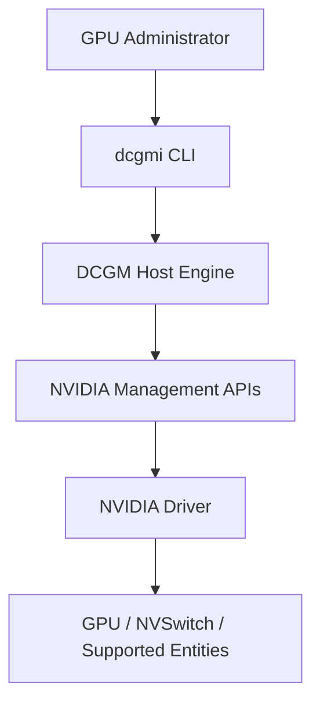
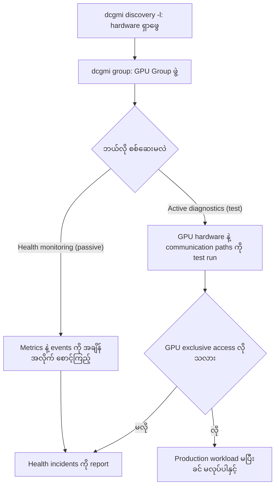
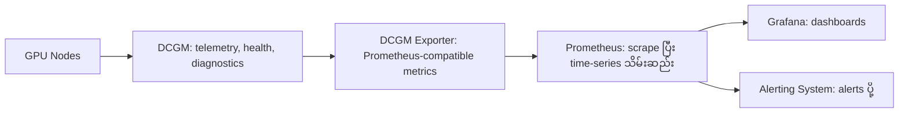
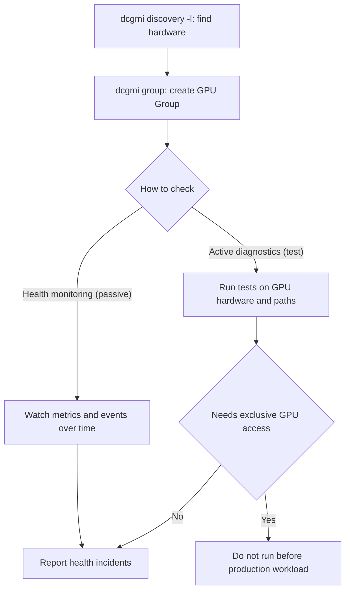
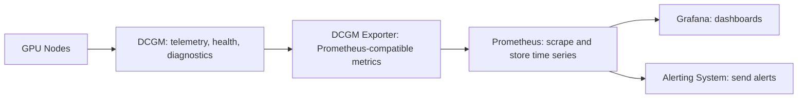

# Module 26 — NVIDIA DCGM: Enterprise GPU Monitoring, Health and Diagnostics

> Part V · NVIDIA Monitoring, Cluster Management and Tool Selection — topic notes

## မြန်မာဘာသာ version

## 1. Learning Objectives

ဒီ Module မှာ NVIDIA Data Center GPU Manager (DCGM) ကို အသုံးပြုပြီး GPU infrastructure ကို ဘယ်လို monitor လုပ်ရမလဲ၊ GPU health ကို ဘယ်လိုစစ်ဆေးရမလဲ၊ diagnostics နဲ့ policy-based monitoring ကို ဘယ်လိုလုပ်ဆောင်ရမလဲဆိုတာ လေ့လာပါမယ်။

သင်ခန်းစာပြီးဆုံးတဲ့အခါ အောက်ပါအချက်တွေကို နားလည်နိုင်ရပါမယ်။

- DCGM ဆိုတာဘာလဲ၊ nvidia-smi နဲ့ ဘာကွာခြားသလဲ။
- dcgmi command-line interface ကို ဘယ်လိုအသုံးပြုရမလဲ။
- GPU discovery နဲ့ GPU Groups ကို ဘယ်လိုစီမံခန့်ခွဲရမလဲ။
- GPU health monitoring, diagnostics နဲ့ policy notifications တို့ ဘယ်လိုအလုပ်လုပ်သလဲ။
- DCGM နဲ့ DCGM Exporter တို့ရဲ့ ကွာခြားချက်ကို နားလည်ခြင်း။
- Prometheus နဲ့ Grafana ကို အသုံးပြုပြီး centralized GPU monitoring တည်ဆောက်ခြင်း။
- DCGM က ဘာတွေကို လုပ်နိုင်ပြီး ဘယ်အရာတွေကို သီးခြား tool တွေနဲ့ လုပ်ဆောင်ရမလဲဆိုတာ ခွဲခြားသိရှိခြင်း။

## 2. DCGM ဆိုတာဘာလဲ။

DCGM = NVIDIA Data Center GPU Manager

DCGM ဟာ NVIDIA data center GPU တွေကို observe, monitor, manage, validate နဲ့ diagnose လုပ်ဖို့ အသုံးပြုတဲ့ software platform ဖြစ်ပါတယ်။

NVIDIA-SMI က GPU status ကို အမြန်စစ်ဆေးဖို့ အလွန်အသုံးဝင်ပါတယ်။ ဒါပေမဲ့ GPU အများအပြားပါတဲ့ server တွေ၊ AI/HPC cluster တွေနဲ့ enterprise infrastructure တွေမှာ GPU metrics တင်မကဘဲ health monitoring, diagnostics, policy management နဲ့ metrics integration တွေကိုပါ လိုအပ်လာပါတယ်။ အဲဒီအတွက် DCGM ကို အသုံးပြုနိုင်ပါတယ်။

Official documentation: https://docs.nvidia.com/datacenter/dcgm/latest/

DCGM က ဘာကြောင့်လိုအပ်သလဲ။ ဥပမာ AI training cluster တစ်ခုမှာ NVIDIA GPU server 20 လုံး ရှိတယ်လို့ ယူဆကြည့်ပါ။ GPU တစ်လုံးချင်းစီမှာ အောက်ပါအခြေအနေတွေ ဖြစ်နိုင်ပါတယ်။

- GPU temperature မြင့်တက်နေခြင်း။
- GPU power consumption က မျှော်မှန်းထားတာထက် မြင့်နေခြင်း။
- PCIe သို့မဟုတ် NVLink communication error ဖြစ်ခြင်း။
- GPU memory နဲ့ hardware health ပြဿနာများ။
- GPU utilization မမှန်ခြင်း။
- Hardware သို့မဟုတ် software configuration မကိုက်ညီခြင်း။

Server တစ်လုံးချင်းစီကို SSH ဝင်ပြီး nvidia-smi run နေတာထက် DCGM နဲ့ health monitoring နဲ့ diagnostics workflow တွေကို စီမံခန့်ခွဲခြင်းက ပိုမိုစနစ်ကျနိုင်ပါတယ်။

သို့သော် DCGM ကိုယ်တိုင်က complete centralized dashboard, long-term metrics database နဲ့ notification delivery အားလုံးကို တစ်ခုတည်းနဲ့ အစားထိုးပေးတယ်လို့ မယူဆသင့်ပါဘူး။ လိုအပ်တဲ့ component တွေကို architecture အလိုက် ပေါင်းစပ်ရပါတယ်။

## 3. DCGM နဲ့ NVIDIA-SMI ဘာကွာခြားသလဲ။

| အချက် | NVIDIA-SMI | DCGM |
|---|---|---|
| အဓိကရည်ရွယ်ချက် | GPU status ကို အမြန်စစ်ဆေးခြင်းနဲ့ basic management | GPU telemetry, health monitoring, diagnostics နဲ့ management workflows |
| အသုံးပြုပုံ | nvidia-smi command | dcgmi CLI, DCGM APIs နဲ့ related services |
| GPU discovery | GPU တွေကို query လုပ်နိုင် | Entity discovery နဲ့ group-based operations ကို support လုပ် |
| Health checks | Basic status နဲ့ supported error information | Health monitoring framework နဲ့ diagnostic tests |
| Policies | Enterprise policy workflow အတွက် အကန့်အသတ်ရှိ | Supported health/policy notifications နဲ့ actions |
| Metrics integration | Script နဲ့ integrate လုပ်နိုင် | DCGM Exporter ကနေ Prometheus-compatible metrics ထုတ်ပေးနိုင် |
| Multi-node environment | Default command က local node ကို အဓိကထား | Host-level monitoring နဲ့ multi-node diagnostic workflows ကို support လုပ်နိုင် |
| Job scheduling | မဟုတ် | မဟုတ် — scheduler သီးခြားလိုအပ် |

မှတ်ရန် — DCGM ဟာ nvidia-smi ကို ဖယ်ရှားဖို့ ရည်ရွယ်ထားတာ မဟုတ်ပါဘူး။ နှစ်ခုစလုံးကို မတူညီတဲ့ ရည်ရွယ်ချက်တွေအတွက် တွဲဖက်အသုံးပြုနိုင်ပါတယ်။ (Monitoring ≠ scheduling — DCGM က workload ကို schedule မလုပ်ပါဘူး။)

## 4. DCGM Architecture

DCGM ကို နားလည်ဖို့ အောက်ပါ conceptual architecture ကို ကြည့်ပါ။

```
             GPU Administrator
                     |
                     v
                  dcgmi CLI
                     |
                     v
              DCGM Host Engine
                     |
                     v
            NVIDIA Management APIs
                     |
                     v
                NVIDIA Driver
                     |
                     v
            GPU / NVSwitch / Other
             Supported Entities
```

အောက်ပါ Mermaid ပုံက ဒီ conceptual architecture ကို ပုံတစ်ပုံအနေနဲ့ ပြပါတယ်။



**ပုံ ၁ (Figure 1) — DCGM conceptual architecture**

ပုံရှင်းလင်းချက် — အပေါ်ကနေ အောက်ကို လိုက်ကြည့်ပါ။ GPU Administrator က command တွေကို dcgmi CLI ကနေ ပေးပါတယ်။ dcgmi က DCGM Host Engine ဆီ လုပ်ဆောင်ချက် ပို့ပေးပြီး Host Engine က NVIDIA Management APIs နဲ့ NVIDIA Driver ကတစ်ဆင့် GPU၊ NVSwitch စတဲ့ supported hardware entities တွေဆီ ရောက်ရှိပါတယ်။ ဆိုလိုတာက command တစ်ခုဟာ အပေါ်ဆုံးက administrator ကနေ အောက်ဆုံးက hardware အထိ ဒီလမ်းကြောင်းအတိုင်းပဲ သွားပါတယ်။

ဒီ architecture မှာ —

- **dcgmi** — DCGM ကို command line ကနေ အသုံးပြုဖို့ interface ဖြစ်ပါတယ်။
- **DCGM Host Engine** — DCGM operations နဲ့ telemetry/health workflows တွေကို စီမံဆောင်ရွက်ပေးတဲ့ component ဖြစ်ပါတယ်။
- **NVIDIA Driver / APIs** — GPU နဲ့ပတ်သက်တဲ့ data နဲ့ supported operations တွေကို ရရှိစေပါတယ်။
- **GPU / NVSwitch / Other Entities** — DCGM က support လုပ်တဲ့ hardware entities တွေဖြစ်ပါတယ်။

DCGM ရဲ့ version နဲ့ deployment mode ပေါ်မူတည်ပြီး Host Engine ကို သီးခြား service အဖြစ် run လုပ်နိုင်သလို DCGM Exporter ထဲမှာ embedded လုပ်ပြီး run လုပ်နိုင်တဲ့ configuration လည်း ရှိပါတယ်။

## 5. DCGM ကို Install လုပ်ခြင်း

DCGM ဟာ NVIDIA driver တပ်ဆင်တိုင်း nvidia-smi လိုပဲ အလိုအလျောက် ရရှိမယ်လို့ မယူဆသင့်ပါဘူး။ များသောအားဖြင့် သက်ဆိုင်ရာ package သို့မဟုတ် supported deployment method နဲ့ သီးခြား install လုပ်ရပါတယ်။

Official installation guide: https://docs.nvidia.com/datacenter/dcgm/latest/installation/

### 5.1 Installation မလုပ်မီ စစ်ဆေးရန်

- GPU model က DCGM version နဲ့ support ဖြစ်၊ မဖြစ်။
- NVIDIA driver version နဲ့ operating system compatibility။
- NVIDIA repository နဲ့ package installation requirements။
- Root သို့မဟုတ် sudo permissions။
- လိုအပ်တဲ့ DCGM Host Engine service နဲ့ related packages။

GPU model အားလုံးမှာ DCGM features အားလုံးကို တူညီစွာ support လုပ်တာ မဟုတ်ပါဘူး။ အထူးသဖြင့် diagnostics, policies နဲ့ profiling capabilities တွေဟာ GPU product နဲ့ software version ပေါ်မူတည်ပြီး ကွာခြားနိုင်ပါတယ်။

### 5.2 DCGM Install လုပ်ပြီး စစ်ဆေးခြင်း

Installation ပြီးတဲ့အခါ —

```
dcgmi --help
dcgmi discovery -l
```

DCGM service ကို systemd service အဖြစ် install လုပ်ထားတဲ့ environment မှာ —

```
systemctl status nvidia-dcgm --no-pager
```

အသုံးပြုနိုင်ပါတယ်။ သို့သော် service name နဲ့ deployment method ဟာ installation ပုံစံပေါ်မူတည်ပြီး ကွာခြားနိုင်ပါတယ်။ Container သို့မဟုတ် Kubernetes deployment မှာ systemd service မရှိနိုင်ပါဘူး။

သတိပြုရန် — Package name, repository setup, version compatibility နဲ့ installation commands တွေက OS နဲ့ DCGM release ပေါ်မူတည်ပြီး ကွာခြားပါတယ်။ အပေါ်က official installation guide ကို အသုံးပြုပြီး မိမိ system နဲ့ကိုက်ညီတဲ့ procedure ကို ရွေးချယ်ပါ။

## 6. DCGM CLI — dcgmi

DCGM ကို command line ကနေ စီမံခန့်ခွဲဖို့ အသုံးပြုတဲ့ utility က dcgmi ဖြစ်ပါတယ်။ ဥပမာ —

```
dcgmi --help
dcgmi discovery -l
dcgmi group --help
dcgmi health --help
dcgmi diag --help
dcgmi config --help
```

ဒီ commands တွေက DCGM ရဲ့ အဓိက functions တွေကို လေ့လာဖို့ အသုံးဝင်ပါတယ်။

- **discovery** — Hardware entities တွေကို ရှာဖွေခြင်း။
- **group** — Entity groups တွေကို ဖန်တီးခြင်းနဲ့ စီမံခန့်ခွဲခြင်း။
- **health** — Health monitoring settings နဲ့ results တွေကို စစ်ဆေးခြင်း။
- **diag** — GPU diagnostics run လုပ်ခြင်း။
- **config** — Supported configuration settings တွေကို ကြည့်ရှုခြင်းနဲ့ စီမံခြင်း။

Subcommand တစ်ခုချင်းစီရဲ့ options တွေကို version-specific help နဲ့ official documentation မှာ စစ်ဆေးပါ။

## 7. GPU Discovery

GPU Discovery ဆိုတာ DCGM က လက်ရှိ system မှာ ဘယ် GPU တွေနဲ့ supported hardware entities တွေကို တွေ့ရှိထားသလဲဆိုတာ စစ်ဆေးခြင်း ဖြစ်ပါတယ်။

```
dcgmi discovery -l
```

ဥပမာ server တစ်လုံးမှာ GPU တစ်လုံးပဲရှိရင် discovery result ထဲမှာ GPU entity တစ်ခုကို တွေ့နိုင်ပါတယ်။

```
DCGM Discovery
  GPU 0: NVIDIA Tesla T4
```

ဒီ output ဟာ ရှင်းပြဖို့ ဖန်တီးထားတဲ့ ဥပမာဖြစ်ပြီး အမှန်တကယ် output format နဲ့ fields တွေက version ပေါ်မူတည်ပြီး ကွာခြားနိုင်ပါတယ်။ GPU server တစ်လုံးမှာ GPU လေးလုံးနဲ့ NVSwitch entities တွေရှိရင် discovery result မှာ သက်ဆိုင်ရာ entities တွေကို ပြနိုင်ပါတယ်။ သို့သော် NVSwitch entities တွေဟာ NVSwitch ပါဝင်ပြီး support လုပ်တဲ့ platform တွေမှာသာ ရရှိနိုင်ပါတယ်။

အဓိကမှတ်ရန် — Discovery က hardware ကို ရှာတွေ့ခြင်းဖြစ်ပြီး GPU health ကောင်းမွန်ကြောင်း အတည်ပြုခြင်း မဟုတ်ပါဘူး။ Health checks နဲ့ diagnostics ကို သီးခြားလုပ်ဆောင်ရပါတယ်။

## 8. DCGM Groups ဆိုတာဘာလဲ။

DCGM မှာ Group ဆိုတာ GPU သို့မဟုတ် အခြား supported entities တွေကို စုစည်းပြီး နောက်ဆက်တွဲ operations တွေအတွက် target အဖြစ် အသုံးပြုနိုင်တဲ့ collection ဖြစ်ပါတယ်။

ဥပမာ —

- GPU အားလုံးကို စုစည်းထားတဲ့ group။
- AI training job တစ်ခုက အသုံးပြုမယ့် GPU နှစ်လုံးကို စုထားတဲ့ group။
- Health monitoring အတွက် သတ်မှတ်ထားတဲ့ GPU group။
- Supported platform မှာ NVSwitch entities တွေကို target လုပ်တဲ့ group။

Group ကို အသုံးပြုခြင်းအားဖြင့် entity တစ်ခုချင်းစီအစား group တစ်ခုလုံးကို ရည်ညွှန်းပြီး supported operations တွေကို လုပ်ဆောင်နိုင်ပါတယ်။

### 8.1 Group တွေကို List လုပ်ခြင်း

```
dcgmi group --list
```

ဒီ command က ရှိပြီးသား groups တွေကို ပြပေးပါတယ်။

### 8.2 GPU Group အသစ်ဖန်တီးခြင်း

GPU 0 နဲ့ GPU 1 ကို group တစ်ခုထဲ ထည့်မယ်ဆိုရင် —

```
dcgmi group --create training-gpus --add gpu:0,gpu:1
```

ဒီ command က training-gpus ဆိုတဲ့ group တစ်ခုကို ဖန်တီးပြီး GPU 0 နဲ့ GPU 1 ကို ထည့်ဖို့ ကြိုးစားပါတယ်။ အဲဒီ GPU IDs တွေက system မှာ တကယ်ရှိရမယ်၊ DCGM က detect လုပ်ထားရမယ်၊ command ကို အသုံးပြုဖို့ လိုအပ်တဲ့ permissions ရှိရပါမယ်။

### 8.3 Group Information ကြည့်ခြင်း

Group ID ကို ရှာပြီး —

```
dcgmi group --group <GROUP_ID> --info
```

`<GROUP_ID>` ကို ကိုယ့် system မှာ ပြထားတဲ့ group ID အမှန်နဲ့ အစားထိုးပါ။

### 8.4 Group ထဲက GPU ကို ဖယ်ရှားခြင်း

```
dcgmi group --group <GROUP_ID> --remove gpu:1
```

ဒီ command က group ထဲက GPU 1 ကို ဖယ်ရှားဖို့ ရည်ရွယ်ပါတယ်။

အရေးကြီးသော ကွာခြားချက် — Group ထဲက GPU ကို ဖယ်ရှားခြင်းဟာ physical GPU ကို server ကနေ ဖယ်ရှားခြင်း မဟုတ်ပါဘူး။ Group membership ကိုပဲ ပြောင်းလဲတာ ဖြစ်ပါတယ်။ ထို့အပြင် group ကို delete လုပ်လိုက်တာနဲ့ အဲဒီ group ကို အသုံးပြုပြီး အရင်က ပြောင်းလဲထားတဲ့ GPU configuration တွေ အလိုအလျောက် မူလအခြေအနေ ပြန်ဖြစ်သွားမယ်လို့ မယူဆသင့်ပါဘူး။ (Group delete က configuration ကို အလိုအလျောက် မပြန်ထားပေးပါဘူး။)

## 9. GPU Health Monitoring

DCGM ရဲ့ အဓိကအသုံးဝင်တဲ့ feature တစ်ခုက GPU health monitoring ဖြစ်ပါတယ်။ Health monitoring က အောက်ပါအချက်တွေကို စစ်ဆေးရာမှာ အထောက်အကူပြုနိုင်ပါတယ်။

- GPU temperature နဲ့ power-related conditions။
- GPU memory-related health information။
- PCIe နဲ့ NVLink-related issues။
- Driver-related conditions။
- Hardware နဲ့ software integration problems။
- Monitoring လုပ်ထားတဲ့ fields နဲ့ events တွေထဲက သတ်မှတ်ထားတဲ့ health conditions။

DCGM health monitoring က underlying measurements နဲ့ events တွေကို အသုံးပြုပြီး သက်ဆိုင်ရာ health incidents တွေကို report လုပ်နိုင်ပါတယ်။

### 9.1 Health Monitoring နဲ့ Active Diagnostics ဘာကွာသလဲ။

- **Health monitoring** ဆိုတာ metrics နဲ့ events တွေကို အချိန်အလိုက် စောင့်ကြည့်ပြီး health status ကို စစ်ဆေးခြင်း ဖြစ်ပါတယ်။ (Passive — ဖြစ်ပေါ်နေသော condition တွေကို စောင့်ကြည့်ခြင်း)
- **Active diagnostics** ဆိုတာ GPU hardware နဲ့ communication paths တွေကို test လုပ်ပြီး ပြဿနာတွေ ရှိ၊ မရှိ စစ်ဆေးခြင်း ဖြစ်ပါတယ််။ (Active test run ခြင်း)

Active diagnostics အချို့ဟာ GPU ကို သီးသန့်အသုံးပြုဖို့ လိုအပ်နိုင်ပါတယ်။ Production training job တစ်ခု run နေချိန်မှာ မစဉ်းစားဘဲ diagnostic test ကို run လုပ်တာက workload ကို ထိခိုက်စေနိုင်ပါတယ်။ (Production diagnostics များအတွက် GPU exclusive access လိုအပ်နိုင်)

Health monitoring နဲ့ active diagnostics ဆိုတဲ့ လမ်းကြောင်းနှစ်ခုကို အောက်ပါပုံမှာ နှိုင်းယှဉ်ကြည့်ပါ။



**ပုံ ၂ (Figure 2) — GPU health-check နဲ့ diagnostics flow**

ပုံရှင်းလင်းချက် — ဘယ်ဘက်ကနေ စကြည့်ပါ။ အရင်ဆုံး discovery နဲ့ hardware ရှာပြီး GPU Group ဖွဲ့ပါတယ်။ ပြီးရင် လမ်းကြောင်းနှစ်ခု ခွဲသွားပါတယ် — health monitoring က metrics နဲ့ events တွေကို အချိန်အလိုက် ငြိမ်ငြိမ် စောင့်ကြည့်ပြီး health incidents တွေကို report လုပ်ပါတယ်။ Active diagnostics ကတော့ test တွေကို တက်တက်ကြွကြွ run ပါတယ်။ ဒါပေမဲ့ အောက်ဘက်က သတိပေးချက်ကို မမေ့ပါနဲ့ — test က GPU exclusive access လိုရင် production workload မပြီးခင် မလုပ်သင့်ပါဘူး။

### 9.2 Health Monitoring Example

GPU group တစ်ခုကို health monitoring လုပ်ဖို့ DCGM health subcommands ကို အသုံးပြုနိုင်ပါတယ်။ ဥပမာ workflow တစ်ခု —

```
dcgmi group --create gpu-health --add gpu:0,gpu:1
dcgmi health --help
```

Health monitoring commands တွေရဲ့ options တွေကို ကိုယ့် DCGM version ရဲ့ `dcgmi health --help` နဲ့ official documentation အတိုင်း ဆက်လက်စစ်ဆေးပါ။

## 10. DCGM နဲ့ DCGM Exporter — Monitoring Pipeline

DCGM က GPU telemetry, health နဲ့ diagnostics ကို ပေးပါတယ်။ ဒါပေမဲ့ historical metrics, centralized dashboards နဲ့ alerting လိုအပ်တဲ့အခါ DCGM ကို monitoring components တွေနဲ့ ပေါင်းစပ်ရပါတယ်။

```
GPU Nodes
    |
    v
DCGM
    |
    v
DCGM Exporter
    |
    v
Prometheus
    |
    +------> Grafana Dashboards
    |
    +------> Alerting System
```

ဒီ monitoring pipeline ကို ပုံအနေနဲ့ ကြည့်ရအောင် —



**ပုံ ၃ (Figure 3) — DCGM Exporter → Prometheus → Grafana monitoring pipeline**

ပုံရှင်းလင်းချက် — ဘယ်ဘက်ကနေ ညာဘက်ကို လိုက်ကြည့်ပါ။ GPU Nodes ကနေ DCGM က GPU telemetry, health နဲ့ diagnostics ကို ပေးပါတယ်။ DCGM Exporter က ဒီ metrics တွေကို Prometheus-compatible format နဲ့ ထုတ်ပေးပြီး Prometheus က scrape လုပ်ပြီး time-series data အဖြစ် သိမ်းဆည်းပါတယ်။ နောက်ဆုံးမှာ Grafana က dashboard တွေ ပြသပြီး Alerting System က သတ်မှတ်ထားတဲ့ condition ပြည့်မီရင် alerts ပို့ပါတယ်။

- **DCGM** — GPU telemetry, health နဲ့ diagnostics။
- **DCGM Exporter** — သတ်မှတ်ထားတဲ့ GPU metrics တွေကို Prometheus-compatible format နဲ့ expose လုပ်ပေးခြင်း။ (Metrics တွေကိုယ်တိုင်ကို ရေရှည်သိမ်းဆည်းတဲ့ time-series database မဟုတ်ပါဘူး)
- **Prometheus** — Metrics တွေကို scrape လုပ်ပြီး time-series data အဖြစ် သိမ်းဆည်းခြင်း။
- **Grafana** — Dashboards နဲ့ visualization။
- **Alerting system** — သတ်မှတ်ထားတဲ့ conditions တွေ ပြည့်မီတဲ့အခါ alerts ပို့ခြင်း။

DCGM ကိုယ်တိုင်က historical database နဲ့ dashboard အားလုံးပါဝင်တဲ့ monitoring platform တစ်ခု မဟုတ်ပါဘူး။ Kubernetes environment မှာ NVIDIA GPU Operator ကဲ့သို့ component တွေနဲ့ ပေါင်းစပ်အသုံးပြုနိုင်ပါတယ်။

## 11. Common Misconceptions

| မှားယွင်းနိုင်တဲ့ အယူအဆ | မှန်ကန်တဲ့ နားလည်မှု |
|---|---|
| DCGM က dashboard တစ်ခုပဲ။ | DCGM က GPU monitoring, management, diagnostics နဲ့ telemetry platform ဖြစ်ပါတယ်။ |
| DCGM က nvidia-smi ကို အစားထိုးဖို့ပဲ။ | နှစ်ခုစလုံးကို မတူညီတဲ့ရည်ရွယ်ချက်နဲ့ တွဲဖက်အသုံးပြုနိုင်ပါတယ်။ |
| Discovery run ရင် GPU health ကောင်းမွန်ကြောင်း သိရတယ်။ | Discovery က hardware ရှာတွေ့ခြင်းသာဖြစ်ပြီး health checks နဲ့ diagnostics ကို သီးခြားလုပ်ရပါတယ်။ |
| Group ကနေ GPU ဖယ်ရင် physical GPU ပျက်သွားမယ်။ | Group membership ပြောင်းခြင်းသာ ဖြစ်ပါတယ်။ |
| DCGM က workload တွေကို schedule လုပ်ပေးတယ်။ | မဟုတ်ပါဘူး — monitoring ≠ scheduling။ Scheduler ကို သီးခြားလိုအပ်ပါတယ်။ |

## 12. Self-check Questions and Answers

1. **မေး** — DCGM ရဲ့ အမည်အပြည့်အစုံက ဘာလဲ။  
   **ဖြေ** — NVIDIA Data Center GPU Manager။
2. **မေး** — Health monitoring နဲ့ active diagnostics ရဲ့ ကွာခြားချက်က ဘာလဲ။  
   **ဖြေ** — Health monitoring က metrics/events တွေကို အချိန်အလိုက် စောင့်ကြည့်ခြင်းဖြစ်ပြီး active diagnostics က GPU hardware နဲ့ communication paths တွေကို test run ခြင်း ဖြစ်ပါတယ်။ Active diagnostics အချို့က GPU exclusive access လိုအပ်နိုင်တာကြောင့် production workload run နေချိန် မလုပ်သင့်ပါဘူး။
3. **မေး** — `dcgmi group --create gpu-health --add gpu:0,gpu:1` က ဘာလုပ်သလဲ။  
   **ဖြေ** — GPU 0 နဲ့ GPU 1 ကို ပါဝင်တဲ့ gpu-health group တစ်ခု ဖန်တီးပါတယ်။
4. **မေး** — GPU metrics တွေကို Prometheus ဆီ ဘယ်လို ရောက်သလဲ။  
   **ဖြေ** — DCGM → DCGM Exporter (Prometheus-compatible metrics expose) → Prometheus (scrape ပြီး time-series သိမ်း) → Grafana (dashboard)။
5. **မေး** — DCGM က workload scheduling လုပ်ပေးသလား။  
   **ဖြေ** — မလုပ်ပါဘူး။ Slurm သို့မဟုတ် Kubernetes ကဲ့သို့ scheduler သီးခြား လိုအပ်ပါတယ်။

## English Version

## 1. Learning Objectives

In this module you will learn how to monitor GPU infrastructure with NVIDIA Data Center GPU Manager (DCGM), how to check GPU health, and how to perform diagnostics and policy-based monitoring.

By the end of this module you should be able to:

- Explain what DCGM is and how it differs from nvidia-smi.
- Use the dcgmi command-line interface.
- Manage GPU discovery and GPU Groups.
- Understand how GPU health monitoring, diagnostics, and policy notifications work.
- Understand the difference between DCGM and DCGM Exporter.
- Build centralized GPU monitoring with Prometheus and Grafana.
- Distinguish what DCGM does from what requires separate tools.

## 2. What Is DCGM?

DCGM = NVIDIA Data Center GPU Manager.

DCGM is a software platform used to observe, monitor, manage, validate, and diagnose NVIDIA data center GPUs.

NVIDIA-SMI is very useful for quick GPU status checks. But on servers with many GPUs, AI/HPC clusters, and enterprise infrastructure, you need more than GPU metrics: health monitoring, diagnostics, policy management, and metrics integration. DCGM can be used for that.

Official documentation: https://docs.nvidia.com/datacenter/dcgm/latest/

Why is DCGM needed? Imagine an AI training cluster with 20 NVIDIA GPU servers. Each GPU can experience conditions such as:

- Rising GPU temperature.
- GPU power consumption higher than expected.
- PCIe or NVLink communication errors.
- GPU memory and hardware health problems.
- Incorrect GPU utilization.
- Hardware or software configuration mismatch.

Managing health monitoring and diagnostics workflows with DCGM is more systematic than SSH-ing into each server and running nvidia-smi.

However, do not assume DCGM itself replaces a complete centralized dashboard, a long-term metrics database, and all notification delivery. The required components must be combined architecturally.

## 3. How Does DCGM Differ from NVIDIA-SMI?

| Aspect | NVIDIA-SMI | DCGM |
|---|---|---|
| Primary purpose | Quick GPU status checks and basic management | GPU telemetry, health monitoring, diagnostics, and management workflows |
| How it is used | nvidia-smi command | dcgmi CLI, DCGM APIs, and related services |
| GPU discovery | Can query GPUs | Supports entity discovery and group-based operations |
| Health checks | Basic status and supported error information | Health monitoring framework and diagnostic tests |
| Policies | Limited for enterprise policy workflows | Supported health/policy notifications and actions |
| Metrics integration | Can integrate with scripts | Exposes Prometheus-compatible metrics through DCGM Exporter |
| Multi-node environment | Default command focuses on the local node | Supports host-level monitoring and multi-node diagnostic workflows |
| Job scheduling | No | No — a scheduler is required separately |

Remember: DCGM is not intended to remove nvidia-smi. Both can be used together for different purposes. Monitoring ≠ scheduling — DCGM does not schedule workloads.

## 4. DCGM Architecture

To understand DCGM, look at this conceptual architecture:

```
             GPU Administrator
                     |
                     v
                  dcgmi CLI
                     |
                     v
              DCGM Host Engine
                     |
                     v
            NVIDIA Management APIs
                     |
                     v
                NVIDIA Driver
                     |
                     v
            GPU / NVSwitch / Other
             Supported Entities
```

The same conceptual architecture shown as a Mermaid figure:


**Figure 1 — DCGM conceptual architecture**

Figure walkthrough — Read the figure from top to bottom. The GPU administrator issues commands through the dcgmi CLI. dcgmi passes the work to the DCGM Host Engine, which reaches the GPU, NVSwitch, and other supported hardware entities through the NVIDIA Management APIs and the NVIDIA Driver. In short, one command travels down this exact path from the administrator to the hardware.

In this architecture:

- **dcgmi** — the interface for using DCGM from the command line.
- **DCGM Host Engine** — the component that carries out DCGM operations and telemetry/health workflows.
- **NVIDIA Driver / APIs** — provide GPU-related data and supported operations.
- **GPU / NVSwitch / Other Entities** — the hardware entities DCGM supports.

Depending on the DCGM version and deployment mode, the Host Engine can run as a separate service or embedded inside DCGM Exporter.

## 5. Installing DCGM

Do not assume DCGM is automatically available with every NVIDIA driver installation the way nvidia-smi usually is. It is normally installed separately via the relevant package or supported deployment method.

Official installation guide: https://docs.nvidia.com/datacenter/dcgm/latest/installation/

### 5.1 What to Check Before Installation

- Whether the GPU model is supported by the DCGM version.
- NVIDIA driver version and operating system compatibility.
- NVIDIA repository and package installation requirements.
- Root or sudo permissions.
- The required DCGM Host Engine service and related packages.

Not all GPU models support every DCGM feature equally. In particular, diagnostics, policies, and profiling capabilities can vary by GPU product and software version.

### 5.2 Verifying After Installation

After installation:

```
dcgmi --help
dcgmi discovery -l
```

Where DCGM is installed as a systemd service:

```
systemctl status nvidia-dcgm --no-pager
```

can be used. However, the service name and deployment method vary with the installation style; container or Kubernetes deployments may have no systemd service.

Note: package names, repository setup, version compatibility, and installation commands differ by OS and DCGM release. Use the official installation guide above and choose the procedure matching your system.

## 6. DCGM CLI — dcgmi

The utility used to manage DCGM from the command line is dcgmi. Example:

```
dcgmi --help
dcgmi discovery -l
dcgmi group --help
dcgmi health --help
dcgmi diag --help
dcgmi config --help
```

These commands are useful for learning DCGM's main functions:

- **discovery** — finding hardware entities.
- **group** — creating and managing entity groups.
- **health** — checking health monitoring settings and results.
- **diag** — running GPU diagnostics.
- **config** — viewing and managing supported configuration settings.

Check each subcommand's options in version-specific help and the official documentation.

## 7. GPU Discovery

GPU Discovery checks which GPUs and supported hardware entities DCGM has found on the current system.

```
dcgmi discovery -l
```

For example, on a server with a single GPU, the discovery result can show one GPU entity:

```
DCGM Discovery
  GPU 0: NVIDIA Tesla T4
```

This output is an example created for explanation; the real output format and fields can vary by version. On a GPU server with four GPUs and NVSwitch entities, the discovery result can show the corresponding entities — but NVSwitch entities are only available on platforms that include NVSwitch and support them.

Key point: discovery finds hardware; it does not confirm GPU health. Health checks and diagnostics must be performed separately.

## 8. What Are DCGM Groups?

A Group in DCGM is a collection that gathers GPUs or other supported entities and can be used as the target of subsequent operations.

Examples:

- A group of all GPUs.
- A group of the two GPUs an AI training job will use.
- A GPU group defined for health monitoring.
- A group targeting NVSwitch entities on supported platforms.

Using a group lets you address the whole group instead of each entity when running supported operations.

### 8.1 Listing Groups

```
dcgmi group --list
```

Shows existing groups.

### 8.2 Creating a New GPU Group

To put GPU 0 and GPU 1 into one group:

```
dcgmi group --create training-gpus --add gpu:0,gpu:1
```

This command attempts to create a group named training-gpus and add GPU 0 and GPU 1. Those GPU IDs must actually exist on the system, be detected by DCGM, and the command requires the necessary permissions.

### 8.3 Viewing Group Information

After finding the Group ID:

```
dcgmi group --group <GROUP_ID> --info
```

Replace `<GROUP_ID>` with the real group ID shown on your system.

### 8.4 Removing a GPU from a Group

```
dcgmi group --group <GROUP_ID> --remove gpu:1
```

This command aims to remove GPU 1 from the group.

Important distinction: removing a GPU from a group does not remove the physical GPU from the server — it only changes group membership. Also, do not assume that deleting a group automatically reverts GPU configuration changes previously made through that group. (A group delete does not auto-revert configuration.)

## 9. GPU Health Monitoring

One of DCGM's most useful features is GPU health monitoring. It helps check:

- GPU temperature and power-related conditions.
- GPU memory-related health information.
- PCIe and NVLink-related issues.
- Driver-related conditions.
- Hardware and software integration problems.
- Defined health conditions from monitored fields and events.

DCGM health monitoring can report relevant health incidents using the underlying measurements and events.

### 9.1 Health Monitoring vs Active Diagnostics

- **Health monitoring** watches metrics and events over time and checks health status. (Passive — observing occurring conditions.)
- **Active diagnostics** tests GPU hardware and communication paths to check for problems. (Running active tests.)

Some active diagnostics may require exclusive use of the GPU. Running a diagnostic test without consideration while a production training job is running can affect the workload. (Production diagnostics may need exclusive GPU access.)

The two paths — health monitoring and active diagnostics — compared in one figure:



**Figure 2 — GPU health-check and diagnostics flow**

Figure walkthrough — Start on the left. First DCGM finds the hardware (discovery) and forms a GPU Group. Then the flow splits into two paths. Health monitoring quietly watches metrics and events over time and reports health incidents. Active diagnostics runs tests actively. Notice the caution branch at the bottom: if a test needs exclusive GPU access, do not run it before the production workload finishes.

### 9.2 Health Monitoring Example

DCGM health subcommands can be used to health-monitor a GPU group. Example workflow:

```
dcgmi group --create gpu-health --add gpu:0,gpu:1
dcgmi health --help
```

Continue checking the options of health monitoring commands per your DCGM version's `dcgmi health --help` and the official documentation.

## 10. DCGM and DCGM Exporter — the Monitoring Pipeline

DCGM provides GPU telemetry, health, and diagnostics. But when historical metrics, centralized dashboards, and alerting are needed, DCGM must be combined with monitoring components:

```
GPU Nodes
    |
    v
DCGM
    |
    v
DCGM Exporter
    |
    v
Prometheus
    |
    +------> Grafana Dashboards
    |
    +------> Alerting System
```

This monitoring pipeline as a figure:



**Figure 3 — DCGM Exporter to Prometheus to Grafana monitoring pipeline**

Figure walkthrough — Follow the figure from left to right. The GPU Nodes are where DCGM collects GPU telemetry, health, and diagnostics. DCGM Exporter exposes those metrics in Prometheus-compatible format, and Prometheus scrapes and stores them as time-series data. At the end, Grafana shows dashboards, and the Alerting System sends alerts when defined conditions are met.

- **DCGM** — GPU telemetry, health, and diagnostics.
- **DCGM Exporter** — exposes defined GPU metrics in Prometheus-compatible format. (It is not itself a long-term time-series database.)
- **Prometheus** — scrapes metrics and stores them as time-series data.
- **Grafana** — dashboards and visualization.
- **Alerting system** — sends alerts when defined conditions are met.

DCGM itself is not a monitoring platform containing every historical database and dashboard. In Kubernetes environments it can be combined with components such as the NVIDIA GPU Operator.

## 11. Common Misconceptions

| Misconception | Correct understanding |
|---|---|
| DCGM is just a dashboard. | DCGM is a GPU monitoring, management, diagnostics, and telemetry platform. |
| DCGM exists only to replace nvidia-smi. | Both can be used together for different purposes. |
| Running discovery confirms GPU health. | Discovery only finds hardware; health checks and diagnostics are separate. |
| Removing a GPU from a group damages the physical GPU. | It only changes group membership. |
| DCGM schedules workloads. | No — monitoring ≠ scheduling; a scheduler is required separately. |

## 12. Self-check Questions and Answers

1. **Q** — What does DCGM stand for?  
   **A** — NVIDIA Data Center GPU Manager.
2. **Q** — What is the difference between health monitoring and active diagnostics?  
   **A** — Health monitoring watches metrics/events over time; active diagnostics runs tests on GPU hardware and communication paths. Some active diagnostics may need exclusive GPU access, so avoid them during production workloads.
3. **Q** — What does `dcgmi group --create gpu-health --add gpu:0,gpu:1` do?  
   **A** — Creates a gpu-health group containing GPU 0 and GPU 1.
4. **Q** — How do GPU metrics reach Prometheus?  
   **A** — DCGM → DCGM Exporter (exposes Prometheus-compatible metrics) → Prometheus (scrapes and stores time series) → Grafana (dashboards).
5. **Q** — Does DCGM schedule workloads?  
   **A** — No. A scheduler such as Slurm or Kubernetes is required separately.

## Technical review notes

- The supplied source for this module (Burmese study notes) ends mid-workflow at section 9.2 (`dcgmi group --create gpu-health ...` / `dcgmi health --help`); the DCGM Exporter pipeline in section 10 was assembled from the same author's supplied monitoring-architecture material, and the misconception/review sections were written to match the course format. The English version is a faithful rendering of the Burmese content.
- Source caveats preserved: DCGM is not a complete monitoring platform by itself; discovery ≠ health confirmation; group removal changes membership only and group deletion does not auto-revert configuration; some active diagnostics require exclusive GPU use and must not run during production training jobs; monitoring ≠ scheduling; DCGM features (diagnostics, policies, profiling) vary by GPU product and software version.
- Example outputs (`DCGM Discovery / GPU 0: NVIDIA Tesla T4`) are illustrative, per the source; actual output format is version-dependent.
- Installation commands and the `nvidia-dcgm` service name depend on OS and deployment style — needs verification against https://docs.nvidia.com/datacenter/dcgm/latest/installation/ for the target system.
- Mermaid figures (Figures 1–3) with figure walkthroughs were added to both the Myanmar and English sections; the figures restate only content already present in this module and add no new technical claims.
