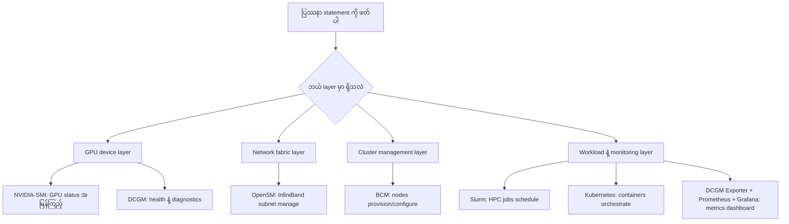
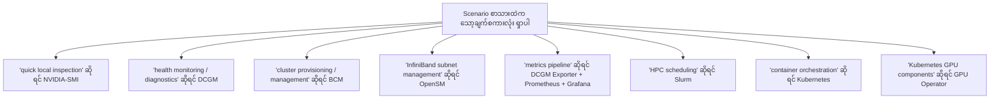
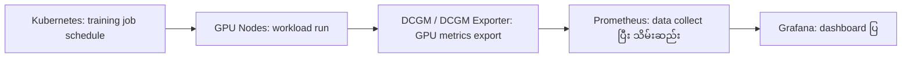
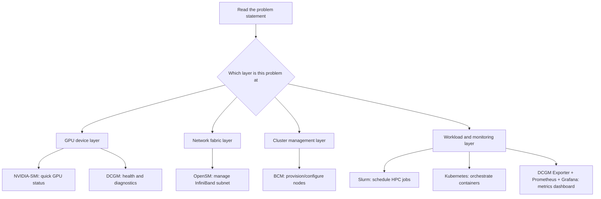
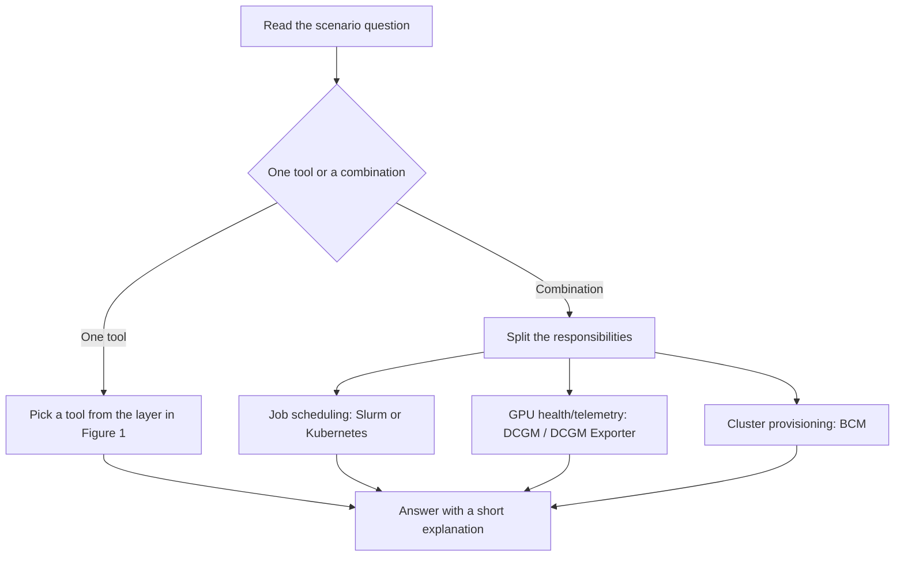
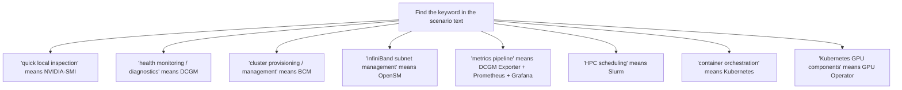
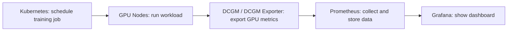

# Module 28 — NVIDIA Infrastructure Tools: Exam Scenarios and Tool Selection

> Part V · NVIDIA Monitoring, Cluster Management and Tool Selection — topic notes

## မြန်မာဘာသာ version

## 1. Learning Objectives

ဒီ Module မှာ NVIDIA infrastructure tools တွေကို ဘယ်လိုတာဝန်နဲ့ ဘယ်နေရာမှာ အသုံးပြုရမလဲဆိုတာကို exam-style scenarios တွေကနေ လေ့လာပါမယ်။ ဒီပိုင်းဟာ စာမေးပွဲမှာ အဖြေရွေးချယ်ရာမှာ အရေးကြီးဆုံးဖြစ်ပါတယ်။

သင်ခန်းစာပြီးဆုံးတဲ့အခါ အောက်ပါအချက်တွေကို နားလည်နိုင်ရပါမယ်။

- ပြဿနာတစ်ခုချင်းစီအတွက် သင့်တော်တဲ့ tool ကို ရွေးချယ်နိုင်ခြင်း။
- NVIDIA-SMI, DCGM, BCM နဲ့ အခြား infrastructure tools တွေရဲ့ scope ကွာခြားချက်ကို နားလည်ခြင်း။
- Exam-style scenarios မှာ tool selection reasoning ကို တိကျစွာ ရှင်းပြနိုင်ခြင်း။

## 2. Exam Strategy — Tool Selection ရဲ့ အခြေခံမူ

စာမေးပွဲမှာ scenario တစ်ခုမှာ ပေးထားတဲ့ problem statement ကို ဖတ်ပြီး ဒီမေးခွန်းမေးပါ — “ဒီပြဿနာက ဘယ် layer မှာ ရှိသလဲ။” ပြီးရင် အောက်ပါ tool map အတိုင်း ရွေးချယ်ပါ။

| ပြဿနာ/လိုအပ်ချက် | ရွေးချယ်ရမယ့် Tool |
|---|---|
| ဒီ node ရဲ့ GPU status ကို အမြန်ကြည့်ချင်တယ် | NVIDIA-SMI |
| GPU hardware fault ကို diagnose လုပ်ချင်တယ် | DCGM (dcgmi diag/health) |
| Cluster ရဲဲ့ nodes တွေကို provision/configure လုပ်ချင်တယ် | Base Command Manager |
| InfiniBand subnet ကို manage လုပ်ချင်တယ် | OpenSM |
| GPU metrics တွေကို dashboard မှာ ကြည့်ချင်တယ် | DCGM Exporter + Prometheus + Grafana |
| HPC jobs တွေကို schedule လုပ်ချင်တယ် | Slurm |
| Containers တွေကို orchestrate လုပ်ချင်တယ် | Kubernetes |
| Kubernetes မှာ GPU components တွေ ထည့်ချင်တယ် | GPU Operator |

ဒီ tool map ကို decision flowchart အနေနဲ့ ကြည့်ရအောင် —

**ပုံ ၁ (Figure 1) — Tool selection decision flowchart**

ပုံရှင်းလင်းချက် — အပေါ်ဆုံးက ပြဿနာ statement ကို ဖတ်ပြီး “ဘယ် layer မှာ ရှိသလဲ” လို့ မေးပါ။ ပြီးရင် layer လေးခုထဲက တစ်ခုကို ရွေးပါ — GPU device layer ဆိုရင် NVIDIA-SMI (အမြန်ကြည့်) သို့မဟုတ် DCGM (health/diagnostics)၊ Network fabric layer ဆိုရင် OpenSM၊ Cluster management layer ဆိုရင် BCM၊ Workload/monitoring layer ဆိုရင် Slurm၊ Kubernetes သို့မဟုတ် DCGM Exporter + Prometheus + Grafana ကို ရွေးပါ။ အောက်ဆုံးက tool တွေကို မရွေးခင် အလယ်က layer မေးခွန်းကို အရင်ဖြေပါ။

## 3. Scenario Questions — Core Tool Selection

**Scenario 1 — GPU Monitoring and Management (Basic)**  
ဥပမာ AI server တစ်လုံးရဲ့ GPU status ကို အမြန်စစ်ဆေးချင်ပါတယ်။ ဘယ် tool ကို သုံးမလဲ။

**ရွေးချယ်မှု** — A. NVIDIA-SMI, B. DCGM, C. Base Command Manager, D. Prometheus  
**အဖြေ** — A. NVIDIA-SMI  
**ရှင်းလင်းချက်** — NVIDIA-SMI ဟာ node တစ်ခုတည်းရဲ့ GPU utilization, memory, temperature, power နဲ့ process information ကို လျင်မြန်စွာ စစ်ဆေးဖို့ အသင့်တော်ဆုံး command-line tool ဖြစ်ပါတယ်။ DCGM က advanced health monitoring, diagnostics နဲ့ policy management အတွက် ဖြစ်ပြီး BCM က cluster provisioning အတွက်ဖြစ်ပါတယ်။

**Scenario 2 — GPU Health and Diagnostics**  
GPU တစ်လုံးက အလုပ်လုပ်နေပေမဲ့ performance နှေးနေပါတယ်။ GPU health ကို deep diagnostic လုပ်ချင်ရင် ဘယ် tool ကို သုံးမလဲ။

**ရွေးချယ်မှု** — A. NVIDIA-SMI, B. DCGM, C. Base Command Manager, D. Kubectl  
**အဖြေ** — B. DCGM  
**ရှင်းလင်းချက်** — DCGM က GPU health monitoring, diagnostic tests, error detection နဲ့ policy-based alerts တွေကို support လုပ်ပါတယ်။ (Health monitoring နဲ့ active diagnostics ကွာခြားချက်ကို Module 26 မှာ လေ့လာခဲ့ပြီး — active diagnostics အချို့က GPU exclusive access လိုအပ်နိုင်ပါတယ်။)

**Scenario 3 — Cluster Provisioning and Management**  
GPU server 20 လုံးပါတဲ့ cluster အသစ်ကို deploy လုပ်ချင်ပါတယ်။ ဘယ် tool ကို သုံးမလဲ။

**ရွေးချယ်မှု** — A. NVIDIA-SMI, B. DCGM, C. Base Command Manager, D. Grafana  
**အဖြေ** — C. Base Command Manager  
**ရှင်းလင်းချက်** — Base Command Manager (BCM) က cluster provisioning, node configuration, storage setup, user management နဲ့ workload integration အတွက် ဖြစ်ပါတယ်။

**Scenario 4 — InfiniBand Network Management**  
InfiniBand subnet မှာ network communication ပြဿနာဖြစ်နေပါတယ်။ ဘယ် tool ကို သုံးမလဲ။

**ရွေးချယ်မှု** — A. OpenSM, B. DCGM, C. NVIDIA-SMI, D. Slurm  
**အဖြေ** — A. OpenSM  
**ရှင်းလင်းချက်** — OpenSM က InfiniBand subnet manager ဖြစ်ပြီး subnet routing, path management နဲ့ fabric configuration ကို စီမံပေးပါတယ်။

**Scenario 5 — GPU Metrics Monitoring Stack**  
Data Center GPU metrics အားလုံးကို centralized dashboard မှာ ကြည့်ချင်ပါတယ်။ ဘယ် tool combination ကို သုံးမလဲ။

**ရွေးချယ်မှု** — A. DCGM Exporter + Prometheus + Grafana, B. NVIDIA-SMI + SSH, C. BCM + Slurm, D. OpenSM + NVIDIA-SMI  
**အဖြေ** — A. DCGM Exporter + Prometheus + Grafana  
**ရှင်းလင်းချက်** — DCGM Exporter က GPU metrics တွေကို Prometheus format နဲ့ ထုတ်ပေးပြီး Prometheus က စုဆောင်းသိမ်းဆည်းပြီး Grafana က visualization လုပ်ပေးပါတယ်။

## 4. Scenario Questions — Multi-Tool Reasoning

**Scenario 6 — Training Job Resource Allocation**  
Training job တစ်ခုက GPU သုံးလုံး allocate လုပ်ချင်ပါတယ်။ ဘယ် tool ကို သုံးမလဲ။

**ရွေးချယ်မှု** — A. Slurm, B. DCGM, C. OpenSM, D. Base Command Manager  
**အဖြေ** — A. Slurm  
**ရှင်းလင်းချက်** — Slurm က job scheduling နဲ့ resource allocation ကို စီမံပါတယ်။ (Monitoring ≠ scheduling)

**Scenario 7 — Kubernetes AI Platform**  
AI workloads တွေကို Kubernetes platform မှာ deploy ချင်ပါတယ်။ ဘယ် tool ကို သုံးမလဲ။

**ရွေးချယ်မှု** — A. Kubernetes, B. DCGM, C. NVIDIA-SMI, D. OpenSM  
**အဖြေ** — A. Kubernetes  
**ရှင်းလင်းချက်** — Kubernetes က containerized AI workloads တွေကို orchestrate လုပ်ပါတယ်။

**Scenario 8 — Multi-Instance GPU Partitioning**  
GPU တစ်လုံးကို အသုံးပြုသူ သုံးဦး အတွက် partition လုပ်ချင်ပါတယ်။ ဘယ် technology ကို သုံးမလဲ။

**ရွေးချယ်မှု** — A. MIG, B. DCGM, C. Slurm, D. OpenSM  
**အဖြေ** — A. MIG  
**ရှင်းလင်းချက်** — MIG (Multi-Instance GPU) က GPU hardware resources ကို isolated instances အဖြစ် ခွဲဝေပေးပါတယ်။ (MIG ကို support လုပ်တဲ့ GPU model နဲ့ configuration လိုအပ်ပါတယ် — ဥပမာ A100၊ T4 မှာ မရနိုင်ပါဘူး။)

**Scenario 9 — GPU Telemetry Integration**  
Enterprise monitoring platform က GPU telemetry ကို collect ချင်ပါတယ်။ ဘယ် component က အဓိကအသုံးပြုမလဲ။

**ရွေးချယ်မှု** — A. DCGM Exporter, B. NVIDIA-SMI, C. OpenSM, D. Kubectl  
**အဖြေ** — A. DCGM Exporter  
**ရှင်းလင်းချက်** — DCGM Exporter က GPU metrics တွေကို Prometheus-compatible format မှာ ထုတ်ပေးပါတယ်။

**Scenario 10 — GPU Fabric Management**  
NVIDIA GPU fabric ရဲ့ subnet routing ပြဿနာကို ဖြေရှင်းချင်ပါတယ်။ ဘယ် tool ကို သုံးမလဲ။

**ရွေးချယ်မှု** — A. OpenSM, B. Base Command Manager, C. DCGM, D. NVIDIA-SMI  
**အဖြေ** — A. OpenSM  
**ရှင်းလင်းချက်** — OpenSM က InfiniBand subnet management အတွက် ဖြစ်ပါတယ်။

**Scenario 11 — GPU Component Deployment**  
Kubernetes cluster မှာ GPU driver နဲ့ device plugin တွေကို automatically deploy ချင်ပါတယ်။ ဘယ် tool ကို သုံးမလဲ။

**ရွေးချယ်မှု** — A. GPU Operator, B. DCGM, C. Base Command Manager, D. Slurm  
**အဖြေ** — A. GPU Operator  
**ရှင်းလင်းချက်** — NVIDIA GPU Operator က Kubernetes cluster မှာ GPU driver, device plugin နဲ့ monitoring components တွေကို automate လုပ်ပေးပါတယ်။

**Scenario 12 — User Quota Management**  
AI cluster မှာ user တွေအတွက် GPU usage quota ကို စီမံချင်ပါတယ်။ ဘယ် tool ကို သုံးမလဲ။

**ရွေးချယ်မှု** — A. Base Command Manager, B. NVIDIA-SMI, C. OpenSM, D. Grafana  
**အဖြေ** — A. Base Command Manager  
**ရှင်းလင်းချက်** — Base Command Manager က user management နဲ့ resource quota configuration ကို ပံ့ပိုးပေးပါတယ်။ (Quota enforcement က integration ပေါ်မူတည်ပြီး Slurm/Kubernetes မှာ တာဝန်ယူထားနိုင်ပါတယ် — Module 27 ကို ကြည့်ပါ။)

**Scenario 13 — End-to-End AI Infrastructure Management**  
AI data center တစ်ခုလုံးကို infrastructure level ကနေ စီမံခန့်ခွဲချင်ပါတယ်။ ဘယ် tool ကို သုံးမလဲ။

**ရွေးချယ်မှု** — A. Base Command Manager, B. DCGM, C. NVIDIA-SMI, D. OpenSM  
**အဖြေ** — A. Base Command Manager  
**ရှင်းလင်းချက်** — Base Command Manager က cluster infrastructure management အတွက် ဖြစ်ပြီး DCGM က GPU health နဲ့ monitoring အတွက်ဖြစ်ပါတယ်။

Multi-tool reasoning လိုတဲ့ scenario တွေအတွက် အောက်ပါ flow အတိုင်း စဉ်းစားနိုင်ပါတယ်။

**ပုံ ၂ (Figure 2) — Multi-tool reasoning flow**

ပုံရှင်းလင်းချက် — မေးခွန်းကို ဖတ်ပြီး ပထမဆုံး မေးရမှာက “tool တစ်ခုတည်းနဲ့ ပြီးသလား၊ ပေါင်းစပ်သုံးရမလား” ဖြစ်ပါတယ်။ တစ်ခုတည်းဆိုရင် Figure 1 က decision flowchart အတိုင်း layer ကနေ tool တစ်ခု ရွေးပါ။ ပေါင်းစပ်ရမယ်ဆိုရင် တာဝန်တွေကို ခွဲပါ — ဘယ်အပိုင်းက job scheduling လဲ၊ ဘယ်အပိုင်းက GPU health/telemetry လဲ၊ ဘယ်အပိုင်းက cluster provisioning လဲဆိုတာ သတ်မှတ်ပြီး တစ်ခုချင်းစီအတွက် tool ရွေးပါ။ နောက်ဆုံးမှာ အားလုံးကို ရှင်းလင်းချက်နဲ့ တွဲပြီး အဖြေပေးပါ။

## 5. Exam Strategy — အမေးမေးလေ့ရှိတဲ့ သော့ချက်များ

- NVIDIA-SMI အမြဲတွေ့ရရင် — “quick local inspection” ဆိုတဲ့ စကားလုံးကို ရှာပါ။
- DCGM အမြဲတွေ့ရရင် — “health monitoring” သို့မဟုတ် “diagnostics” ဆိုတဲ့ စကားလုံးကို ရှာပါ။
- Base Command Manager အမြဲတွေ့ရရင် — “cluster provisioning” သို့မဟုတ် “cluster management” ဆိုတဲ့ စကားလုံးကို ရှာပါ။
- OpenSM အမြဲတွေ့ရရင် — “InfiniBand subnet management” ဆိုတဲ့ စကားလုံးကို ရှာပါ။
- DCGM Exporter + Prometheus + Grafana အမြဲတွေ့ရရင် — “metrics pipeline” ဆိုတဲ့ စကားလုံးကို ရှာပါ။
- Slurm အမြဲတွေ့ရရင် — “HPC scheduling” ဆိုတဲ့ စကားလုံးကို ရှာပါ။
- Kubernetes အမြဲတွေ့ရရင် — “container orchestration” ဆိုတဲ့ စကားလုံးကို ရှာပါ။
- GPU Operator အမြဲတွေ့ရရင် — “Kubernetes GPU components” ဆိုတဲ့ စကားလုံးကို ရှာပါ။

စာမေးပွဲမှာ သော့ချက်စကားလုံးနဲ့ tool ကို ချိတ်မှတ်ဖို့ ဒီပုံကို သုံးပါ —

**ပုံ ၃ (Figure 3) — သော့ချက်စကားလုံး → tool trigger map**

ပုံရှင်းလင်းချက် — အပေါ်ဆုံးက node ကနေ မေးခွန်းစာသားထဲက သော့ချက်စကားလုံးကို ရှာပါ။ တွေ့တဲ့ စကားလုံးပေါ်မူတည်ပြီး အောက်က branch တစ်ခုချင်းစီက tool ကို ချက်ချင်း ရွေးနိုင်ပါတယ်။ ဥပမာ “quick local inspection” တွေ့ရင် NVIDIA-SMI၊ “metrics pipeline” တွေ့ရင် DCGM Exporter + Prometheus + Grafana ဖြစ်ပါတယ်။ ဒီ map ကို မှတ်ထားရင် scenario မေးခွန်းတွေကို မြန်မြန်ဖြေနိုင်ပါလိမ့်မယ်။

## 6. ပေါင်းချုပ် မှတ်စု

ဒီ section က Module 28 မှာ ရှင်းခဲ့တဲ့ tools တွေကို တစ်နေရာတည်းမှာ ပြန်ကြည့်ဖို့ ဖြစ်ပါတယ်။

| Tool | အဓိကအသုံးပြုပုံ |
|---|---|
| NVIDIA-SMI | Node တစ်ခုတည်းရဲ့ GPU status ကို အမြန်စစ်ဆေးခြင်း |
| DCGM | GPU health monitoring, diagnostics, telemetry |
| Base Command Manager | Cluster provisioning, node management |
| OpenSM | InfiniBand subnet management |
| DCGM Exporter + Prometheus + Grafana | GPU metrics pipeline |
| Slurm | HPC job scheduling |
| Kubernetes | Container orchestration |
| GPU Operator | Kubernetes GPU components deployment |
| MIG | GPU partitioning |

## 7. Final Scenario — ဘယ် tool ကို ရွေးမလဲ။

**“Training job တစ်ခုကို Kubernetes cluster မှာ run ချင်ပြီး GPU metrics ကို Grafana dashboard မှာ စောင့်ကြည့်ချင်ပါတယ်။ ဘယ် tool တွေကို ပေါင်းသုံးမလဲ။”**

**အဖြေ** — Kubernetes + DCGM Exporter + Prometheus + Grafana  
**ရှင်းလင်းချက်** — Kubernetes က training job ကို schedule လုပ်ပေးပြီး DCGM Exporter က GPU metrics ကို export လုပ်ပေးပြီး Prometheus က data ကို collect လုပ်ပေးပြီး Grafana က dashboard ကို ပြသပေးပါတယ်။

Final scenario မှာ ပေါင်းသုံးရမယ့် tools တွေ ဘယ်လို အလုပ်လုပ်သလဲဆိုတာ ကြည့်ပါ —

**ပုံ ၄ (Figure 4) — Final scenario — Kubernetes + metrics pipeline**

ပုံရှင်းလင်းချက် — ဘယ်ဘက်ကနေ ညာဘက်ကို လိုက်ကြည့်ပါ။ Kubernetes က training job ကို schedule လုပ်ပေးပြီး GPU Nodes မှာ workload ကို run ပါတယ်။ DCGM / DCGM Exporter က GPU metrics တွေကို export လုပ်ပေးပြီး Prometheus က data ကို collect ပြီး သိမ်းဆည်းပါတယ်။ နောက်ဆုံးမှာ Grafana က dashboard ပြပါတယ်။ ဆိုလိုတာက job တစ်ခုကို run ခြင်းနဲ့ metrics ကို စောင့်ကြည့်ခြင်းဟာ tool မတူညီတဲ့ တာဝန်နှစ်ခုဖြစ်ပြီး ဒီပုံထဲက tools တွေ ပေါင်းမှ ပြီးပြည့်စုံပါတယ်။

**Key Takeaway** — ပြဿနာကို ကြည့်ပါ။ ပြီးရင် ဘယ် layer မှာလဲ မေးပါ။ ဒီလိုတွေးခြင်းဖြင့် scenario မေးခွန်းတိုင်းကို အမှားမရှိ ဖြေဆိုနိုင်ပါလိမ့်မယ်။

## English Version

## 1. Learning Objectives

This module teaches, through exam-style scenarios, which NVIDIA infrastructure tools fit which responsibilities and situations. This part is the most important for answering exam questions.

By the end of this module you should be able to:

- Select the appropriate tool for each problem.
- Understand the scope differences among NVIDIA-SMI, DCGM, BCM, and other infrastructure tools.
- Explain tool selection reasoning precisely in exam-style scenarios.

## 2. Exam Strategy — the Basics of Tool Selection

In an exam, read the problem statement in a scenario and ask: "Which layer is this problem at?" Then select according to this tool map:

| Problem / Need | Tool to choose |
|---|---|
| Quickly check this node's GPU status | NVIDIA-SMI |
| Diagnose GPU hardware faults | DCGM (dcgmi diag/health) |
| Provision/configure cluster nodes | Base Command Manager |
| Manage an InfiniBand subnet | OpenSM |
| View GPU metrics on a dashboard | DCGM Exporter + Prometheus + Grafana |
| Schedule HPC jobs | Slurm |
| Orchestrate containers | Kubernetes |
| Deploy GPU components on Kubernetes | GPU Operator |

This tool map as a decision flowchart:

**Figure 1 — Tool selection decision flowchart**

Figure walkthrough — At the top, read the problem statement and ask "which layer is this problem at?". Then pick one of the four layers. If it is the GPU device layer, choose NVIDIA-SMI (quick look) or DCGM (health/diagnostics); for the network fabric layer choose OpenSM; for the cluster management layer choose BCM; and for the workload/monitoring layer choose Slurm, Kubernetes, or the DCGM Exporter + Prometheus + Grafana stack. Always answer the middle layer question before picking a tool at the bottom.

## 3. Scenario Questions — Core Tool Selection

**Scenario 1 — GPU Monitoring and Management (Basic)**  
You want to quickly check the GPU status of an AI server. Which tool do you use?

**Choices** — A. NVIDIA-SMI, B. DCGM, C. Base Command Manager, D. Prometheus  
**Answer** — A. NVIDIA-SMI  
**Explanation** — NVIDIA-SMI is the most suitable command-line tool for quickly checking a single node's GPU utilization, memory, temperature, power, and process information. DCGM is for advanced health monitoring, diagnostics, and policy management; BCM is for cluster provisioning.

**Scenario 2 — GPU Health and Diagnostics**  
A GPU is running but performance is slow. To run a deep diagnostic of GPU health, which tool do you use?

**Choices** — A. NVIDIA-SMI, B. DCGM, C. Base Command Manager, D. Kubectl  
**Answer** — B. DCGM  
**Explanation** — DCGM supports GPU health monitoring, diagnostic tests, error detection, and policy-based alerts. (The health-monitoring vs active-diagnostics distinction was covered in Module 26 — some active diagnostics may require exclusive GPU access.)

**Scenario 3 — Cluster Provisioning and Management**  
You want to deploy a new cluster of 20 GPU servers. Which tool do you use?

**Choices** — A. NVIDIA-SMI, B. DCGM, C. Base Command Manager, D. Grafana  
**Answer** — C. Base Command Manager  
**Explanation** — Base Command Manager (BCM) is for cluster provisioning, node configuration, storage setup, user management, and workload integration.

**Scenario 4 — InfiniBand Network Management**  
There is a network communication problem in an InfiniBand subnet. Which tool do you use?

**Choices** — A. OpenSM, B. DCGM, C. NVIDIA-SMI, D. Slurm  
**Answer** — A. OpenSM  
**Explanation** — OpenSM is the InfiniBand subnet manager; it manages subnet routing, path management, and fabric configuration.

**Scenario 5 — GPU Metrics Monitoring Stack**  
You want to view all data center GPU metrics in a centralized dashboard. Which tool combination do you use?

**Choices** — A. DCGM Exporter + Prometheus + Grafana, B. NVIDIA-SMI + SSH, C. BCM + Slurm, D. OpenSM + NVIDIA-SMI  
**Answer** — A. DCGM Exporter + Prometheus + Grafana  
**Explanation** — DCGM Exporter exposes GPU metrics in Prometheus format, Prometheus collects and stores them, and Grafana visualizes them.

## 4. Scenario Questions — Multi-Tool Reasoning

**Scenario 6 — Training Job Resource Allocation**  
A training job needs three GPUs allocated. Which tool do you use?

**Choices** — A. Slurm, B. DCGM, C. OpenSM, D. Base Command Manager  
**Answer** — A. Slurm  
**Explanation** — Slurm manages job scheduling and resource allocation. (Monitoring ≠ scheduling.)

**Scenario 7 — Kubernetes AI Platform**  
You want to deploy AI workloads on a Kubernetes platform. Which tool do you use?

**Choices** — A. Kubernetes, B. DCGM, C. NVIDIA-SMI, D. OpenSM  
**Answer** — A. Kubernetes  
**Explanation** — Kubernetes orchestrates containerized AI workloads.

**Scenario 8 — Multi-Instance GPU Partitioning**  
You want to partition one GPU for three users. Which technology do you use?

**Choices** — A. MIG, B. DCGM, C. Slurm, D. OpenSM  
**Answer** — A. MIG  
**Explanation** — MIG (Multi-Instance GPU) partitions GPU hardware resources into isolated instances. (MIG requires supported GPU models and configuration — e.g. A100; not available on T4.)

**Scenario 9 — GPU Telemetry Integration**  
An enterprise monitoring platform needs to collect GPU telemetry. Which component is primarily used?

**Choices** — A. DCGM Exporter, B. NVIDIA-SMI, C. OpenSM, D. Kubectl  
**Answer** — A. DCGM Exporter  
**Explanation** — DCGM Exporter exposes GPU metrics in Prometheus-compatible format.

**Scenario 10 — GPU Fabric Management**  
You need to fix a subnet routing problem in an NVIDIA GPU fabric. Which tool do you use?

**Choices** — A. OpenSM, B. Base Command Manager, C. DCGM, D. NVIDIA-SMI  
**Answer** — A. OpenSM  
**Explanation** — OpenSM is for InfiniBand subnet management.

**Scenario 11 — GPU Component Deployment**  
You want to automatically deploy GPU drivers and device plugins in a Kubernetes cluster. Which tool do you use?

**Choices** — A. GPU Operator, B. DCGM, C. Base Command Manager, D. Slurm  
**Answer** — A. GPU Operator  
**Explanation** — The NVIDIA GPU Operator automates GPU drivers, device plugins, and monitoring components in a Kubernetes cluster.

**Scenario 12 — User Quota Management**  
You want to manage GPU usage quotas for users on an AI cluster. Which tool do you use?

**Choices** — A. Base Command Manager, B. NVIDIA-SMI, C. OpenSM, D. Grafana  
**Answer** — A. Base Command Manager  
**Explanation** — Base Command Manager supports user management and resource quota configuration. (Quota enforcement varies with integration and may be owned by Slurm/Kubernetes — see Module 27.)

**Scenario 13 — End-to-End AI Infrastructure Management**  
You want to manage an entire AI data center at the infrastructure level. Which tool do you use?

**Choices** — A. Base Command Manager, B. DCGM, C. NVIDIA-SMI, D. OpenSM  
**Answer** — A. Base Command Manager  
**Explanation** — Base Command Manager is for cluster infrastructure management, while DCGM is for GPU health and monitoring.

For multi-tool scenarios, reason through this flow:

**Figure 2 — Multi-tool reasoning flow**

Figure walkthrough — After reading the question, first ask: "is one tool enough, or do I need a combination?". If one tool is enough, follow the decision flowchart in Figure 1 and pick the tool by layer. If a combination is needed, split the responsibilities: which part is job scheduling, which part is GPU health/telemetry, and which part is cluster provisioning? Choose a tool for each part, then give the answer together with a short explanation.

## 5. Exam Strategy — Frequently Tested Keywords

- If you see NVIDIA-SMI — look for the words "quick local inspection".
- If you see DCGM — look for the words "health monitoring" or "diagnostics".
- If you see Base Command Manager — look for the words "cluster provisioning" or "cluster management".
- If you see OpenSM — look for the words "InfiniBand subnet management".
- If you see DCGM Exporter + Prometheus + Grafana — look for the words "metrics pipeline".
- If you see Slurm — look for the words "HPC scheduling".
- If you see Kubernetes — look for the words "container orchestration".
- If you see GPU Operator — look for the words "Kubernetes GPU components".

Use this figure to link keywords to tools in the exam:

**Figure 3 — Keyword to tool trigger map**

Figure walkthrough — Start at the top node and look for the keyword in the question text. Whichever branch matches, the tool at the end of that branch is the answer. For example, "quick local inspection" points to NVIDIA-SMI, and "metrics pipeline" points to DCGM Exporter + Prometheus + Grafana. Keep this map in mind and you can answer scenario questions much faster.

## 6. Summary Table

This section lets you review the tools covered in Module 28 in one place.

| Tool | Main use |
|---|---|
| NVIDIA-SMI | Quick GPU status inspection on a single node |
| DCGM | GPU health monitoring, diagnostics, telemetry |
| Base Command Manager | Cluster provisioning, node management |
| OpenSM | InfiniBand subnet management |
| DCGM Exporter + Prometheus + Grafana | GPU metrics pipeline |
| Slurm | HPC job scheduling |
| Kubernetes | Container orchestration |
| GPU Operator | Kubernetes GPU components deployment |
| MIG | GPU partitioning |

## 7. Final Scenario — Which Tools Would You Choose?

**"You want to run a training job on a Kubernetes cluster and monitor GPU metrics on a Grafana dashboard. Which tools do you combine?"**

**Answer** — Kubernetes + DCGM Exporter + Prometheus + Grafana  
**Explanation** — Kubernetes schedules the training job, DCGM Exporter exports GPU metrics, Prometheus collects the data, and Grafana displays the dashboard.

How the combined tools in the final scenario work together:

**Figure 4 — Final scenario: Kubernetes + metrics pipeline**

Figure walkthrough — Follow the figure from left to right. Kubernetes schedules the training job and the GPU nodes run the workload. DCGM / DCGM Exporter exports the GPU metrics, Prometheus collects and stores the data, and Grafana shows the dashboard. In other words, running a job and watching metrics are two different responsibilities, and only the combination of tools in this figure covers both.

**Key Takeaway** — Look at the problem. Then ask which layer it is at. Thinking this way lets you answer every scenario question without mistakes.

## Technical review notes

- Source material: the supplied "Module 28 — NVIDIA Infrastructure Tools: Exam Scenarios and Tool Selection" notes (scenarios 1–13 with answer choices and short explanations) plus the same author's exam-strategy section (keyword triggers, summary table, final multi-tool scenario). The English version is a faithful rendering; scenario answers and keywords are preserved exactly (NVIDIA-SMI = quick local inspection, DCGM = health/diagnostics, BCM = cluster provisioning/management, OpenSM = InfiniBand subnet management, DCGM Exporter+Prometheus+Grafana = metrics pipeline, Slurm = HPC scheduling, Kubernetes = container orchestration, GPU Operator = Kubernetes GPU components, MIG = GPU partitioning).
- Cross-references added to earlier modules (Module 26 for health-vs-diagnostics/exclusive GPU, Module 27 for quota enforcement ownership) match the source caveats kept in those files.
- Source caveats preserved here: monitoring ≠ scheduling (Slurm does allocation, not DCGM/BCM); MIG requires supported GPUs (A100 yes, T4 no).
- The scenarios are study/exam material in the source; exam wording may vary — the keyword-trigger strategy is the source's own heuristic.
- Mermaid figures (Figures 1–4) with figure walkthroughs were added to both the Myanmar and English sections; the figures restate only content already present in this module (tool map, exam keyword triggers, final scenario) and add no new technical claims.
