# Module 29 — NVIDIA AI Applications and Vertical Solutions

> Part VI · Course Module 29 (NVIDIA AI Applications and Domain-Specific Technologies) — topic notes

## မြန်မာဘာသာ version

## 1. Learning Objectives

ဒီ Module မှာ NVIDIA AI software stack ရဲ့ Application and Vertical Solutions layer ကို လေ့လာပါမယ်။

အရင် Module တွေမှာ GPU hardware, CUDA, GPU libraries, networking, monitoring နဲ့ cluster management တို့ကို လေ့လာခဲ့ပါတယ်။ ဒီအပိုင်းမှာတော့ အဲဒီ infrastructure နဲ့ software capabilities တွေကို အသုံးပြုပြီး လက်တွေ့ AI applications တွေကို ဘယ်လို တည်ဆောက်၊ deploy နဲ့ အသုံးပြုနိုင်သလဲဆိုတာကို လေ့လာပါမယ်။

သင်ခန်းစာပြီးဆုံးတဲ့အခါ အောက်ပါအချက်တွေကို နားလည်နိုင်ရပါမယ်။

- Application and Vertical Solutions ဆိုတာဘာလဲ။
- NVIDIA Clara ကို ဘယ်လို healthcare နဲ့ life sciences use cases တွေမှာ အသုံးပြုနိုင်သလဲ။
- NVIDIA Merlin က recommendation systems တွေကို ဘယ်လိုကူညီပေးသလဲ။
- NVIDIA NIM က AI models တွေကို inference services အဖြစ် ဘယ်လို deploy လုပ်ပေးသလဲ။
- Clara, Merlin နဲ့ NIM တို့ရဲ့ အဓိကကွာခြားချက်။
- Scenario-based exam questions တွေမှာ သင့်တော်တဲ့ solution ကို ဘယ်လိုရွေးချယ်မလဲ။

## 2. Where Does This Layer Fit in the NVIDIA AI Stack?

NVIDIA AI stack ကို အလွှာလိုက် စဉ်းစားကြည့်ရအောင်။

```
+--------------------------------------------------+
| Layer 6: Applications and Vertical Solutions     |
|                                                  |
| NVIDIA Clara | NVIDIA Merlin | NVIDIA NIM        |
+--------------------------------------------------+
| AI Frameworks, Models and Inference Software     |
+--------------------------------------------------+
| CUDA, GPU Libraries and Accelerated Software    |
+--------------------------------------------------+
| GPU Drivers and System Software                  |
+--------------------------------------------------+
| GPU, CPU, Memory, Storage and Networking         |
+--------------------------------------------------+
| Physical Data Center Infrastructure              |
+--------------------------------------------------+
```

ဒီ diagram က conceptual view ဖြစ်ပါတယ်။ အမှန်တကယ် software stack မှာ application, framework, libraries နဲ့ deployment components တွေက အပြန်အလှန် ချိတ်ဆက်အသုံးပြုနိုင်ပါတယ်။

**Figure 1 — NVIDIA AI stack အလွှာလိုက် ဖွဲ့စည်းပုံ**

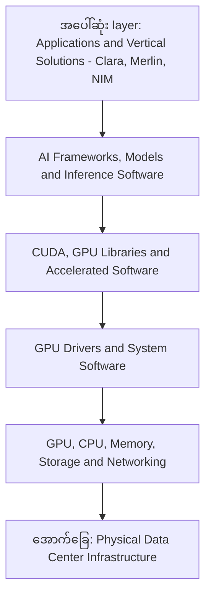

**ပုံရှင်းလင်းချက် (Figure 1):** ဒီပုံကို အောက်ခြေကနေ အပေါ်ကို ဖတ်ပါ။ အောက်ဆုံးက Physical Data Center Infrastructure က GPU, CPU, memory, storage နဲ့ network ကို ပေးပြီး တစ်ဆင့်ချင်း အပေါ်တက်လာတိုင်း driver, CUDA libraries, AI frameworks စတဲ့ software အလွှာတွေ ထပ်ပေါင်းလာပါတယ်။ အပေါ်ဆုံး application layer မှာ Clara, Merlin, NIM တို့က အောက်က အလွှာအားလုံးရဲ့ စွမ်းအားကို အသုံးပြုပြီး လုပ်ငန်းအလိုက် ပြဿနာတွေကို ဖြေရှင်းပေးပါတယ်။

**ဒီ Layer ရဲ့ အဓိကအယူအဆ**

- အောက်ခြေ layers တွေက compute capability နဲ့ infrastructure ကို ပံ့ပိုးပေးပါတယ်။
- အပေါ်ဆုံး application layer ကတော့ အဲဒီ capability တွေကို အသုံးပြုပြီး လုပ်ငန်းအလိုက် သီးခြားပြဿနာတွေကို ဖြေရှင်းပေးပါတယ်။

ဥပမာ —

- ဆေးရုံတစ်ခုမှာ medical imaging ကို AI နဲ့ ခွဲခြမ်းစိတ်ဖြာလိုတယ်။
- E-commerce platform တစ်ခုမှာ customer တစ်ယောက်ချင်းစီအတွက် သင့်တော်တဲ့ product တွေကို recommend လုပ်လိုတယ်။
- Enterprise တစ်ခုမှာ pretrained LLM ကို API endpoint တစ်ခုအဖြစ် deploy လုပ်လိုတယ်။

ဒီလို use cases တွေအတွက် သင့်တော်တဲ့ software solution ကို ရွေးချယ်တာဟာ Application Layer ရဲ့ အရေးကြီးတဲ့အပိုင်း ဖြစ်ပါတယ်။

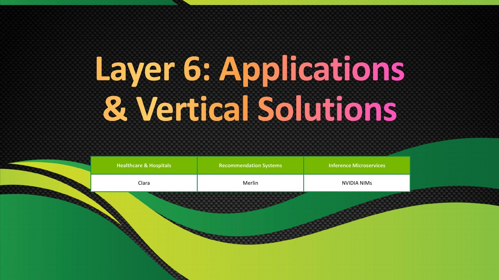

**ပုံရှင်းလင်းချက်** — ဒီသင်တန်းပုံက NVIDIA AI stack ရဲ့ application layer မှာ ရှိတဲ့ solution သုံးခု — Clara, Merlin နဲ့ NIM — ကို မိတ်ဆက်ပေးတဲ့ slide ဖြစ်ပါတယ်။ အပေါ်က ပုံအတိုင်း ဒီသုံးခုက အောက်ခြေ infrastructure အလွှာတွေရဲ့ စွမ်းအားကို အသုံးပြုပြီး လုပ်ငန်းနယ်ပယ်အလိုက် ပြဿနာတွေကို ဖြေရှင်းပေးပါတယ် — Clara က healthcare နဲ့ life sciences၊ Merlin က recommender systems၊ NIM က inference microservices အတွက် ဖြစ်ပါတယ်။ အောက်ပါ section တွေမှာ တစ်ခုချင်းစီကို အသေးစိတ် ဆက်လက် လေ့လာသွားပါမယ်။

*(Source: NVIDIA NCA-AIIO training deck — study material)*

## 3. NVIDIA Clara — Healthcare and Life Sciences AI

Official documentation: https://docs.nvidia.com/clara/

NVIDIA Clara ဟာ healthcare နဲ့ life sciences အတွက် AI applications, accelerated frameworks နဲ့ development technologies တွေကို စုစည်းထားတဲ့ platform family ဖြစ်ပါတယ်။

Clara ကို product တစ်ခုတည်း သို့မဟုတ် ready-to-run application တစ်ခုတည်းလို့ နားလည်တာထက် healthcare AI development အတွက် သက်ဆိုင်ရာ tools နဲ့ technologies အစုအဝေးအဖြစ် နားလည်တာ ပိုမှန်ပါတယ်။

### 3.1 Clara ကို ဘာအတွက် အသုံးပြုသလဲ။

Clara နဲ့ ဆက်စပ်တဲ့ technologies တွေဟာ အောက်ပါ use cases တွေမှာ အသုံးဝင်ပါတယ်။

- Medical imaging AI
- CT နဲ့ MRI image analysis
- Digital pathology
- Genomics analysis
- Medical-device AI
- Smart hospital applications
- Drug discovery နဲ့ life sciences research အချို့

သက်ဆိုင်ရာ use case အတွက် ဘယ် component ကို ရွေးချယ်ရမလဲဆိုတာက project ရဲ့ လိုအပ်ချက်ပေါ် မူတည်ပါတယ်။

**Figure 2 — NVIDIA Clara အသုံးပြုနိုင်တဲ့ healthcare use cases များ**

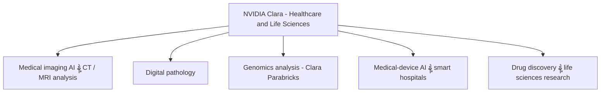

**ပုံရှင်းလင်းချက် (Figure 2):** အလယ်က NVIDIA Clara ဆိုတာ healthcare နဲ့ life sciences အတွက် tools နဲ့ technologies အစုအဝေးဖြစ်ပါတယ်။ ပတ်လည်က အကိုင်းတွေက Clara family အသုံးပြုနိုင်တဲ့ နယ်ပယ်တွေကို ပြထားတာဖြစ်ပြီး genomics အတွက်ဆို Clara Parabricks ကို ရွေးချယ်နိုင်ပါတယ်။ ကိုယ့် project ရဲ့ use case ကို ကြည့်ပြီး သင့်တော်တဲ့ component ကို ရွေးရမှာ ဖြစ်ပါတယ်။

### 3.2 Medical Imaging

Medical imaging မှာ CT, MRI နဲ့ အခြား medical images တွေကို AI models အသုံးပြုပြီး ခွဲခြမ်းစိတ်ဖြာနိုင်ပါတယ်။

ဥပမာ —

- Medical images တွေကို စုဆောင်းခြင်း။
- Image preprocessing လုပ်ခြင်း။
- Trained AI model ကို အသုံးပြုခြင်း။
- Image segmentation, classification သို့မဟုတ် detection လုပ်ခြင်း။
- Results တွေကို ဆရာဝန် သို့မဟုတ် medical workflow အတွက် တင်ပြခြင်း။

ဒီလို system တွေက medical image processing ကို ပိုမိုမြန်ဆန်စေဖို့နဲ့ healthcare research ကို ကူညီဖို့ ရည်ရွယ်ပါတယ်။

သို့သော် AI output ကို ဆေးဘက်ဆိုင်ရာဆုံးဖြတ်ချက်တစ်ခုအဖြစ် တိုက်ရိုက်အသုံးပြုနိုင်တယ်လို့ မဆိုလိုပါဘူး။ Clinical validation, regulatory requirements နဲ့ medical professional oversight တို့ လိုအပ်နိုင်ပါတယ်။

### 3.3 Genomics

Genomics ဆိုတာ organism တစ်ခုရဲ့ genetic information ကို လေ့လာတဲ့ နယ်ပယ်ဖြစ်ပါတယ်။

Genome sequencing နဲ့ analysis workloads တွေမှာ data ပမာဏ အလွန်များနိုင်တာကြောင့် GPU acceleration က အထောက်အကူပြုနိုင်ပါတယ်။

NVIDIA Clara Parabricks က genomics workflows တွေအတွက် GPU-accelerated software suite တစ်ခုဖြစ်ပါတယ်။ ၎င်းကို next-generation sequencing workflows နဲ့ genomic data analysis အချို့မှာ အသုံးပြုနိုင်ပါတယ်။

ဥပမာ —

```
Sequencing Data
       |
       v
Genomic Data Processing
       |
       v
GPU-Accelerated Analysis
       |
       v
Variant Analysis / Results
```

ဒီ workflow က အယူအဆကို ရှင်းပြထားတာဖြစ်ပြီး actual pipeline မှာ sequencing platform, data format နဲ့ analysis requirements ပေါ်မူတည်ပြီး အဆင့်တွေ ကွာခြားနိုင်ပါတယ်။

### 3.4 Smart Hospitals and Medical Devices

Healthcare AI ကို medical images တစ်ခုတည်းမှာသာ မသုံးပါဘူး။ Medical devices တွေကနေ ရရှိတဲ့ streaming sensor data ကို real-time နီးပါး processing လုပ်ဖို့လည်း လိုအပ်နိုင်ပါတယ်။

ဥပမာ —

- Medical imaging devices
- Real-time sensor processing
- Medical video processing
- Edge AI applications

ဒီလို use cases တွေအတွက် NVIDIA ရဲ့ healthcare ecosystem မှာ Holoscan, MONAI နဲ့ အခြား technologies တွေလည်း ပါဝင်ပါတယ်။ ဘယ် product ကို ရွေးချယ်ရမလဲဆိုတာက workload နဲ့ deployment requirements ပေါ်မူတည်ပါတယ်။

### 3.5 Clara မှာ သိထားသင့်တဲ့ အရေးကြီးအချက်

NVIDIA Clara ဆိုတာ healthcare AI နဲ့ life sciences အတွက် platform family ဖြစ်ပါတယ်။ အားလုံးကို တစ်ခါတည်း install လုပ်လိုက်ရုံနဲ့ ဆေးရုံတစ်ခုလုံးရဲ့ AI system ပြီးစီးသွားမယ်လို့ မဆိုလိုပါဘူး။ Actual implementation မှာ data pipelines, AI models, integration, validation, security နဲ့ deployment architecture တွေကို ပြင်ဆင်ရနိုင်ပါတယ်။

**Exam keyword: Healthcare, medical imaging, genomics, smart hospitals → NVIDIA Clara.**

## 4. NVIDIA Merlin — Recommender Systems

Official documentation: https://developer.nvidia.com/nvidia-merlin

NVIDIA Merlin ဟာ GPU-accelerated recommender systems တွေကို တည်ဆောက်ဖို့ အသုံးပြုနိုင်တဲ့ open-source framework နဲ့ tools ecosystem ဖြစ်ပါတယ်။

Recommender system ဆိုတာ user တစ်ယောက်ချင်းစီအတွက် စိတ်ဝင်စားနိုင်မယ့် products, movies, videos သို့မဟုတ် content တွေကို ခန့်မှန်းပြီး အကြံပြုပေးတဲ့ system ဖြစ်ပါတယ်။

### 4.1 Everyday Example

E-commerce website တစ်ခုမှာ laptop တစ်လုံးကို ဝယ်ကြည့်လိုက်တယ်လို့ ယူဆပါ။ Website က အောက်ပါအချက်တွေကို အခြေခံပြီး product recommendations ပေးနိုင်ပါတယ်။

- အရင်က ကြည့်ခဲ့တဲ့ products
- ဝယ်ယူခဲ့တဲ့ products
- Search history
- Similar users တွေရဲ့ preferences
- Product categories
- လက်ရှိ session ထဲက user activity

ဥပမာ —

```
User Views a Laptop
        |
        v
Collect User and Product Features
        |
        v
Recommendation Model
        |
        v
Rank Candidate Products
        |
        v
Recommend Accessories or Similar Laptops
```

Netflix လို content platform တွေမှာလည်း user ရဲ့ viewing history နဲ့ preferences ကို အခြေခံပြီး movies သို့မဟုတ် shows တွေကို recommend လုပ်နိုင်ပါတယ်။

ဒီဥပမာတွေဟာ recommender system ရဲ့ အယူအဆကို ရှင်းပြထားတာဖြစ်ပြီး platform တစ်ခုချင်းစီက အသုံးပြုတဲ့ production architecture နဲ့ model တွေဟာ မတူညီနိုင်ပါတယ်။

### 4.2 Merlin ရဲ့ အဓိကလုပ်ဆောင်ချက်များ

Merlin ecosystem က recommender system development pipeline ရဲ့ အဆင့်အမျိုးမျိုးကို ကူညီပေးနိုင်ပါတယ်။

- Data preprocessing
- Feature engineering
- Model training
- Large-scale recommendation models
- Retrieval နဲ့ ranking workflows
- Session-based recommendations
- Production inference နဲ့ deployment workflows

**Figure 3 — NVIDIA Merlin နဲ့ recommendation pipeline အဆင့်များ**

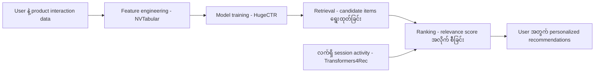

**ပုံရှင်းလင်းချက် (Figure 3):** ဘယ်ဘက်က user ရဲ့ အပြုအမူ data ကစပြီး ညာဘက်ကို စီးဆင်းသွားပါတယ်။ NVTabular က data ကို features အဖြစ် ပြင်ဆင်ပေးပြီး HugeCTR က model ကို train လုပ်ပါတယ်။ ပြီးရင် Retrieval နဲ့ Ranking ဆိုတဲ့ အဆင့်နှစ်ဆင့်နဲ့ candidate products အများကြီးထဲက သင့်တော်တာကို ရွေးပြီး အစီအစဉ်ချပါတယ်။ Transformers4Rec ကတော့ လက်ရှိ session ထဲက အပြုအမူတွေကို အသုံးပြုတဲ့ session-based recommendation အတွက် ဖြစ်ပါတယ်။

### 4.3 Feature Engineering and Preprocessing

Recommendation models တွေဟာ user, item နဲ့ interaction data အများအပြားကို အသုံးပြုတတ်ပါတယ်။

ဥပမာ —

| User ID | Product ID | Interaction |
|---|---|---|
| U101 | Laptop-A | Click |
| U101 | Mouse-B | Purchase |
| U102 | Laptop-A | View |
| U102 | Monitor-C | Purchase |

ဒီ data ကို model အတွက် သင့်တော်တဲ့ features တွေအဖြစ် ပြင်ဆင်ရပါတယ်။

Merlin NVTabular ကဲ့သို့သော component တွေဟာ tabular data preprocessing နဲ့ feature engineering ကို GPU-accelerated workflow နဲ့ လုပ်ဆောင်ရာမှာ ကူညီနိုင်ပါတယ်။

### 4.4 Model Training

Recommendation models တွေဟာ user behavior နဲ့ item features တွေအကြား ဆက်နွယ်မှုကို သင်ယူပါတယ်။

Merlin ecosystem မှာ recommendation model training နဲ့ scaling အတွက် tools တွေ ပါဝင်ပါတယ်။ ဥပမာ HugeCTR ကဲ့သို့သော component တွေဟာ large-scale recommendation models တွေရဲ့ GPU-accelerated training ကို ပံ့ပိုးနိုင်ပါတယ်။

GPU acceleration က data processing နဲ့ model training workloads အချို့ကို မြန်ဆန်စေနိုင်ပေမဲ့ performance က dataset, model architecture, GPU hardware နဲ့ implementation ပေါ်မူတည်ပါတယ်။

### 4.5 Session-Based Recommendation

Session-based recommendation ဆိုတာ user ရဲ့ လက်ရှိ browsing သို့မဟုတ် interaction session ကို အခြေခံပြီး recommendations ထုတ်ပေးခြင်း ဖြစ်ပါတယ်။

ဥပမာ user တစ်ယောက်က website ထဲမှာ —

- Running shoes ကို ကြည့်တယ်။
- Running socks ကို ကြည့်တယ်။
- Sports watch ကို ရှာတယ်။

System က ဒီ session pattern ကို အသုံးပြုပြီး fitness accessories သို့မဟုတ် အခြားဆက်စပ် products တွေကို recommend လုပ်နိုင်ပါတယ်။

Merlin Transformers4Rec ကဲ့သို့သော tools တွေဟာ sequential နဲ့ session-based recommendation workflows တွေကို တည်ဆောက်ရာမှာ အသုံးဝင်ပါတယ်။

### 4.6 Retrieval and Ranking

Large-scale recommendation system တွေမှာ products သန်းပေါင်းများစွာထဲက user အတွက် သင့်တော်တဲ့ products အနည်းငယ်ကို ရွေးထုတ်ရပါတယ်။

Conceptually အဆင့်နှစ်ခုကို ခွဲစဉ်းစားနိုင်ပါတယ်။

- **Retrieval:** Candidate items အများအပြားထဲက ဖြစ်နိုင်ချေရှိတဲ့ items တွေကို ရွေးထုတ်ခြင်း။
- **Ranking:** ရွေးထုတ်ထားတဲ့ items တွေကို relevance score အလိုက် အစီအစဉ်ချခြင်း။

Merlin ecosystem က ဒီလို recommender workflows တွေကို တည်ဆောက်ဖို့ ကူညီပေးနိုင်ပါတယ်။

### 4.7 Merlin မှာ သိထားသင့်တဲ့ အရေးကြီးအချက်

Merlin ဟာ pretrained LLM တစ်ခုကို ရိုးရိုး API endpoint အဖြစ် serve လုပ်ဖို့ ရည်ရွယ်ထားတဲ့ NIM နဲ့ မတူပါဘူး။ Merlin ရဲ့ အဓိကရည်ရွယ်ချက်က recommendation models နဲ့ recommender-system pipelines တွေကို တည်ဆောက်၊ train နဲ့ deploy လုပ်ရာမှာ ကူညီပေးခြင်း ဖြစ်ပါတယ်။

**Exam keyword: Personalized products, content recommendations, ranking, session-based recommendations → NVIDIA Merlin.**

## 5. NVIDIA NIM — NVIDIA Inference Microservices

Official documentation: https://docs.nvidia.com/nim/

NIM = NVIDIA Inference Microservices.

NVIDIA NIM ဟာ AI models တွေကို containerized inference microservices အဖြစ် deploy လုပ်ပြီး application တွေကနေ API နဲ့ အသုံးပြုနိုင်အောင် ရည်ရွယ်ထားတဲ့ software offering ဖြစ်ပါတယ်။

NIM က model serving ကို ပိုမိုလွယ်ကူစေဖို့ prepackaged containers, inference runtimes နဲ့ API interfaces တွေကို ပံ့ပိုးပေးပါတယ်။

### 5.1 What Is Inference?

Inference ဆိုတာ trained AI model ကို အသုံးပြုပြီး input အသစ်တစ်ခုအတွက် output ထုတ်ပေးတဲ့ လုပ်ငန်းစဉ် ဖြစ်ပါတယ်။

ဥပမာ —

- LLM ကို question တစ်ခု မေးပြီး answer ထုတ်ခြင်း။
- Image model ကို image ပေးပြီး object တွေ detect လုပ်ခြင်း။
- Speech model ကို audio ပေးပြီး transcription ထုတ်ခြင်း။
- Text embedding model ကို စာသားပေးပြီး vector ထုတ်ခြင်း။

Training က model ကို သင်ယူစေတဲ့အပိုင်းဖြစ်ပြီး inference က trained model ကို အသုံးပြုတဲ့အပိုင်း ဖြစ်ပါတယ်။

### 5.2 Why Use NIM?

AI model ကို ကိုယ်တိုင် deploy လုပ်မယ်ဆိုရင် အောက်ပါအချက်တွေကို စီမံရနိုင်ပါတယ်။

- Model artifacts နဲ့ weights
- Inference runtime
- GPU compatibility
- CUDA နဲ့ software dependencies
- API server
- Model loading နဲ့ caching
- Health checks
- Performance tuning
- Deployment နဲ့ scaling

NIM က supported models နဲ့ configurations အတွက် ဒီလုပ်ငန်းစဉ်တွေကို ရိုးရှင်းစေဖို့ ရည်ရွယ်ပါတယ်။

သို့သော် NIM က infrastructure setup အားလုံးကို အလိုအလျောက် ဖယ်ရှားပေးတာ မဟုတ်ပါဘူး။ GPU compatibility, memory requirements, credentials, model licensing, networking နဲ့ deployment configuration တို့ကို စစ်ဆေးရနိုင်ပါတယ်။

### 5.3 NIM Architecture

```
        AI Application
               |
               | HTTP / API Request
               v
       NVIDIA NIM Service
      +--------------------+
      | API Endpoint       |
      | Model Serving      |
      | Inference Runtime  |
      | Model Configuration|
      +--------------------+
               |
               v
         NVIDIA GPU
               |
               v
        Inference Output
               |
               v
        AI Application
```

ဒီပုံဟာ conceptual architecture ဖြစ်ပါတယ်။ NIM ရဲ့ internal components တွေဟာ model family နဲ့ NIM version ပေါ်မူတည်ပြီး ကွာခြားနိုင်ပါတယ်။

**Figure 4 — NIM inference request ရဲ့ အဆင့်လိုက် စီးဆင်းမှု**

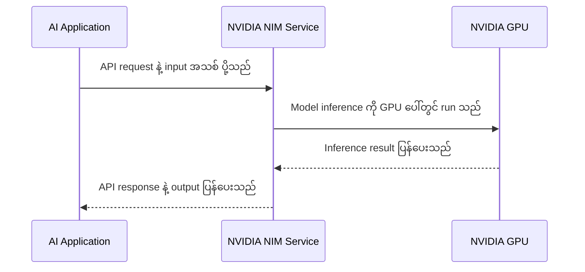

**ပုံရှင်းလင်းချက် (Figure 4):** ဘယ်ဘက်က AI Application က input ကို API ကတစ်ဆင့် NIM service ဆီ ပို့ပါတယ်။ NIM က model ကို NVIDIA GPU ပေါ်မှာ inference run ပြီး result ရလာရင် application ဆီကို API response အဖြစ် ပြန်ပို့ပါတယ်။ Application ဘက်က model ကို ကိုယ်တိုင် serve စရာ မလိုဘဲ endpoint တစ်ခုကို ခေါ်ရုံနဲ့ ရပါတယ်။

### 5.4 Example — Deploying an LLM

Enterprise တစ်ခုမှာ Llama family ထဲက supported model တစ်ခုကို အသုံးပြုပြီး internal chatbot တစ်ခု တည်ဆောက်ချင်တယ်လို့ ယူဆပါ။ Conceptual workflow က —

- လိုအပ်တဲ့ model နဲ့ NIM version ကို ရွေးချယ်ပါ။
- Hardware နဲ့ software requirements ကို စစ်ဆေးပါ။
- လိုအပ်တဲ့ access, credentials နဲ့ license terms တွေကို ပြင်ဆင်ပါ။
- NIM container ကို deploy လုပ်ပါ။
- API endpoint ကို စမ်းသပ်ပါ။
- Application ကနေ endpoint ကို ခေါ်သုံးပါ။
- Health monitoring, authentication, network security နဲ့ scaling ကို ပြင်ဆင်ပါ။

Example API interaction ရဲ့ concept ကို အောက်ပါအတိုင်း စဉ်းစားနိုင်ပါတယ်။

```
Chatbot Application
        |
        | POST /v1/chat/completions
        v
NIM API Endpoint
        |
        v
LLM Inference on GPU
        |
        v
Generated Response
```

Endpoint path နဲ့ request format က သက်ဆိုင်ရာ NIM service နဲ့ version ပေါ်မူတည်ပါတယ်။ NIM for LLMs မှာ OpenAI-compatible APIs ကို ပံ့ပိုးတဲ့ configurations တွေ ရှိပါတယ်။

### 5.5 NIM Use Cases

NIM catalog ထဲမှာ supported service ပေါ်မူတည်ပြီး အောက်ပါ AI domains တွေအတွက် microservices တွေ ရှိနိုင်ပါတယ်။

- Large Language Models (LLMs)
- Vision Language Models (VLMs)
- Image generation
- Text embedding
- Text reranking
- Speech recognition
- Text-to-speech
- Translation
- Computer vision
- Biology-related AI models အချို့

NIM က LLM တစ်မျိုးတည်းအတွက်သာ မဟုတ်ပါဘူး။

### 5.6 Cloud, Data Center, and Edge

NIM microservices တွေကို supported NVIDIA-accelerated infrastructure ပေါ်မှာ deployment လုပ်နိုင်ပါတယ်။ ဥပမာ —

- On-premises data center
- Cloud infrastructure
- GPU workstation
- Supported edge environments

ဒီ portability က organization တွေအတွက် မိမိတို့ရဲ့ security, data governance နဲ့ infrastructure requirements အလိုက် model serving ကို စီစဉ်နိုင်စေပါတယ်။

သို့သော် "any cloud or any hardware" လို့ အကန့်အသတ်မရှိ မယူဆသင့်ပါဘူး။ သက်ဆိုင်ရာ NIM model ရဲ့ hardware support matrix နဲ့ software requirements ကို စစ်ဆေးရပါတယ်။

### 5.7 NIM နဲ့ Kubernetes

NIM ကို Docker နဲ့ standalone container အဖြစ် run လုပ်နိုင်သလို supported deployment တွေမှာ Kubernetes နဲ့လည်း ပေါင်းစပ်အသုံးပြုနိုင်ပါတယ်။

Kubernetes environment မှာ NIM Operator ကဲ့သို့သော tooling တွေကို အသုံးပြုပြီး NIM microservices တွေရဲ့ deployment နဲ့ lifecycle management ကို ပံ့ပိုးနိုင်ပါတယ်။

### 5.8 NIM မှာ သိထားသင့်တဲ့ အရေးကြီးအချက်

NIM က model training framework မဟုတ်ပါဘူး။ ၎င်းရဲ့ အဓိကရည်ရွယ်ချက်က supported AI models တွေကို inference services အဖြစ် deploy လုပ်ဖို့ ဖြစ်ပါတယ်။

NIM က model တစ်ခုကို serve လုပ်ရာမှာ အကူအညီပေးပေမဲ့ production application တစ်ခုလုံးရဲ့ business logic, authentication, authorization, data access နဲ့ user interface တို့ကို အလိုအလျောက် တည်ဆောက်ပေးတာ မဟုတ်ပါဘူး။

**Exam keyword: Deploy a supported AI model, containerized inference, standard API endpoint → NVIDIA NIM.**

## 6. Clara vs Merlin vs NIM

ဒီသုံးခုရဲ့ ကွာခြားချက်ကို ရှင်းလင်းစွာ ခွဲခြားထားဖို့ လိုပါတယ်။

| Feature | NVIDIA Clara | NVIDIA Merlin | NVIDIA NIM |
|---|---|---|---|
| Primary domain | Healthcare and life sciences | Recommender systems | AI model inference deployment |
| Main purpose | Healthcare AI development and accelerated workflows | Build and optimize recommendation pipelines | Serve supported models through inference microservices |
| Example | Genomics analysis, medical imaging | Product or movie recommendations | Deploy an LLM behind an API |
| Main users | Healthcare developers, researchers, medical-device teams | Data scientists, ML engineers, recommendation teams | AI engineers, developers, platform and operations teams |
| Main focus | Domain-specific healthcare AI | Recommendation model pipelines | Model serving and integration |
| Exam keyword | Healthcare | Recommendations | Inference API |

**Quick Memory Aid**

- **Clara = Care** — Healthcare AI။
- **Merlin = Match** — User နဲ့ content/products ကို match လုပ်ပေးတဲ့ recommendation systems။
- **NIM = Inference** — AI model ကို API service အဖြစ် deploy လုပ်ခြင်း။

ဒီ mnemonic က exam preparation အတွက်သာ အသုံးပြုတဲ့ မှတ်မိလွယ်စေမယ့် နည်းလမ်းဖြစ်ပါတယ်။

**Figure 5 — Clara, Merlin, NIM ကို use case အလိုက် ရွေးချယ်ပုံ**

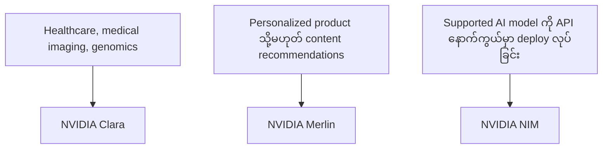

**ပုံရှင်းလင်းချက် (Figure 5):** ဘယ်ဘက်က ကိုယ့် use case ကို ရှာပါ။ Healthcare / genomics ဆိုရင် Clara၊ personalized recommendations ဆိုရင် Merlin၊ pretrained model တစ်ခုကို inference API အဖြစ် ထုတ်ပေးချင်ရင် NIM ကို ရွေးပါ။ ဒီသုံးခုဟာ တာဝန်မတူတဲ့ tools တွေဖြစ်လို့ တစ်ခုနဲ့တစ်ခု အစားထိုး မသုံးနိုင်ပါဘူး။

## 7. Practical Scenarios

**Scenario A — Smart Hospital**

A hospital wants to accelerate medical image processing and develop AI-assisted healthcare workflows.

Best choice: NVIDIA Clara ecosystem.

အကြောင်းရင်းက healthcare နဲ့ life sciences AI ကို အဓိကထားတဲ့ platform family ဖြစ်တာကြောင့်ပါ။

**Scenario B — E-commerce Recommendations**

An online store wants to recommend relevant products based on user behavior and product features.

Best choice: NVIDIA Merlin.

အကြောင်းရင်းက recommendation model training, feature engineering နဲ့ recommender pipelines တွေကို တည်ဆောက်ရာမှာ ကူညီပေးနိုင်တာကြောင့်ပါ။

**Scenario C — Enterprise LLM API**

An enterprise wants to deploy a supported pretrained LLM as a containerized service that applications can call through an API.

Best choice: NVIDIA NIM.

အကြောင်းရင်းက supported models တွေကို inference microservices အဖြစ် deploy လုပ်ဖို့ ရည်ရွယ်ထားတာကြောင့်ပါ။

**Scenario D — Medical Genomics**

A research organization wants to accelerate supported genome analysis workflows.

Best choice: NVIDIA Clara Parabricks, where the required workflow is supported.

**Scenario E — Speech Recognition Service**

An enterprise wants to deploy a supported speech-recognition model behind an inference API.

Best choice: An appropriate NVIDIA NIM speech microservice, if the required model and deployment environment are supported.

## 8. Common Misconceptions

| မှားယွင်းနိုင်တဲ့ အယူအဆ | မှန်ကန်တဲ့ နားလည်မှု |
|---|---|
| Clara is one ready-to-use hospital application. | မမှန်ပါဘူး။ Clara ဟာ healthcare နဲ့ life sciences အတွက် tools, frameworks နဲ့ applications အစုအဝေးဖြစ်ပါတယ်။ Actual solution တစ်ခုတည်ဆောက်ဖို့ integration နဲ့ validation လိုအပ်နိုင်ပါတယ်။ |
| Merlin is a general-purpose LLM deployment platform. | မမှန်ပါဘူး။ Merlin ရဲ့ အဓိကရည်ရွယ်ချက်က recommender systems တွေကို တည်ဆောက်၊ train နဲ့ deploy လုပ်ဖို့ ဖြစ်ပါတယ်။ |
| NIM trains the AI model. | မမှန်ပါဘူး။ NIM ရဲ့ အဓိကရည်ရွယ်ချက်က supported models တွေကို inference services အဖြစ် serve လုပ်ဖို့ ဖြစ်ပါတယ်။ |
| NIM eliminates all deployment work. | မမှန်ပါဘူး။ NIM က model serving ကို ရိုးရှင်းစေပါတယ်။ Hardware compatibility, configuration, credentials, licensing, networking, security နဲ့ scaling တို့ကို ဆက်လက်စီမံဖို့ လိုအပ်နိုင်ပါတယ်။ |
| All three tools do the same thing. | မမှန်ပါဘူး။ Clara — Healthcare and life sciences။ Merlin — Recommendation systems။ NIM — Inference microservices။ |

## 9. Practice Exam

**Question 1**

A medical research team wants to accelerate supported genomic analysis pipelines.

A. NVIDIA Merlin
B. NVIDIA Clara Parabricks
C. NVIDIA NIM only
D. OpenSM

**Question 2**

An e-commerce company wants to develop a GPU-accelerated personalized product recommendation pipeline.

A. NVIDIA Clara
B. OpenSM
C. NVIDIA Merlin
D. NVIDIA-SMI

**Question 3**

A developer wants to deploy a supported pretrained LLM as a containerized inference endpoint.

A. NVIDIA Merlin
B. NVIDIA NIM
C. NVIDIA Clara Parabricks
D. Base Command Manager only

**Question 4**

A hospital wants to develop AI workflows for medical imaging.

A. NVIDIA Clara ecosystem
B. NVIDIA Merlin only
C. OpenSM
D. Slurm only

**Question 5**

An application needs to call an AI model through an inference API without implementing the entire model-serving stack from scratch.

A. NVIDIA NIM, if the model and environment are supported
B. NVIDIA Merlin in every case
C. OpenSM
D. NVIDIA-SMI only

**Question 6**

A recommendation team wants to process large feature datasets and train recommendation models.

A. NVIDIA Clara
B. NVIDIA Merlin
C. OpenSM
D. NVIDIA NIM only

**Answer Key**

- B — NVIDIA Clara Parabricks. GPU-accelerated genomics workflows.
- C — NVIDIA Merlin. Recommender-system development.
- B — NVIDIA NIM. Containerized inference service.
- A — NVIDIA Clara ecosystem. Healthcare AI.
- A — NVIDIA NIM. Supported models can be exposed through inference APIs.
- B — NVIDIA Merlin. Feature engineering and recommender model workflows.

## 10. Module Summary

ဒီ Module မှာ NVIDIA AI stack ရဲ့ Application and Vertical Solutions layer ကို လေ့လာခဲ့ပါတယ်။

- NVIDIA Clara က healthcare နဲ့ life sciences AI use cases တွေကို ပံ့ပိုးပေးပါတယ်။ Genomics, medical imaging နဲ့ အခြား healthcare applications တွေမှာ သက်ဆိုင်ရာ Clara ecosystem components တွေကို အသုံးပြုနိုင်ပါတယ်။
- NVIDIA Merlin က recommendation systems တွေကို တည်ဆောက်၊ train နဲ့ deploy လုပ်ရာမှာ အထောက်အကူပြုပါတယ်။ Personalized product recommendations, content recommendations နဲ့ session-based recommendation workflows တွေဟာ ၎င်းရဲ့ အဓိက use cases တွေ ဖြစ်ပါတယ်။
- NVIDIA NIM က supported AI models တွေကို containerized inference microservices အဖြစ် deploy လုပ်ပြီး application တွေကနေ API နဲ့ အသုံးပြုနိုင်အောင် ကူညီပေးပါတယ်။

**Final exam takeaway (exam keyword mapping):**

- Healthcare / genomics / medical imaging → **Clara**
- Personalized recommendations / recommender models → **Merlin**
- Deploy a supported AI model as an inference API → **NIM**

## English Version

## 1. Learning Objectives

In this module we study the Application and Vertical Solutions layer of the NVIDIA AI software stack.

Previous modules covered GPU hardware, CUDA, GPU libraries, networking, monitoring, and cluster management. Here we look at how those infrastructure and software capabilities are used to build, deploy, and operate real AI applications.

By the end of the lesson you should understand:

- What Application and Vertical Solutions are.
- How NVIDIA Clara is used in healthcare and life sciences use cases.
- How NVIDIA Merlin helps build recommendation systems.
- How NVIDIA NIM deploys AI models as inference services.
- The key differences between Clara, Merlin, and NIM.
- How to choose the right solution in scenario-based exam questions.

## 2. Where Does This Layer Fit in the NVIDIA AI Stack?

Think of the NVIDIA AI stack layer by layer.

```
+--------------------------------------------------+
| Layer 6: Applications and Vertical Solutions     |
|                                                  |
| NVIDIA Clara | NVIDIA Merlin | NVIDIA NIM        |
+--------------------------------------------------+
| AI Frameworks, Models and Inference Software     |
+--------------------------------------------------+
| CUDA, GPU Libraries and Accelerated Software    |
+--------------------------------------------------+
| GPU Drivers and System Software                  |
+--------------------------------------------------+
| GPU, CPU, Memory, Storage and Networking         |
+--------------------------------------------------+
| Physical Data Center Infrastructure              |
+--------------------------------------------------+
```

This diagram is a conceptual view. In a real software stack, applications, frameworks, libraries, and deployment components are interconnected and used together.

**Figure 1 — The NVIDIA AI stack layers**

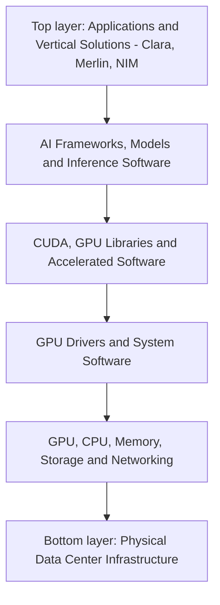

**Figure 1 walkthrough:** Read the figure from the bottom up. The bottom layer provides the physical data center infrastructure — GPU, CPU, memory, storage, and networking. Each layer going up adds a software capability: drivers, then CUDA libraries, then AI frameworks. At the top, Clara, Merlin, and NIM use everything below them to solve industry-specific problems.

**Key idea of this layer**

- The lower layers provide compute capability and infrastructure.
- The top application layer uses those capabilities to solve industry-specific problems.

For example—

- A hospital wants to analyze medical imaging with AI.
- An e-commerce platform wants to recommend suitable products to each individual customer.
- An enterprise wants to deploy a pretrained LLM as an API endpoint.

Choosing the right software solution for these use cases is an important part of the Application Layer.


**Figure walkthrough** — This training slide introduces the three solutions at the application layer of the NVIDIA AI stack: Clara, Merlin, and NIM. As the stack figure above shows, they use everything beneath them to solve industry-specific problems — Clara for healthcare and life sciences, Merlin for recommender systems, and NIM for inference microservices. The following sections look at each one in detail.

*(Source: NVIDIA NCA-AIIO training deck — study material)*

## 3. NVIDIA Clara — Healthcare and Life Sciences AI

Official documentation: https://docs.nvidia.com/clara/

NVIDIA Clara is a family of platforms that brings together AI applications, accelerated frameworks, and development technologies for healthcare and life sciences.

It is more accurate to understand Clara as a collection of related tools and technologies for healthcare AI development than as a single product or a single ready-to-run application.

### 3.1 What Is Clara Used For?

Technologies in the Clara family are useful in use cases such as:

- Medical imaging AI
- CT and MRI image analysis
- Digital pathology
- Genomics analysis
- Medical-device AI
- Smart hospital applications
- Some drug discovery and life sciences research

Which component to choose for a given use case depends on the project's requirements.

**Figure 2 — Healthcare use cases supported by NVIDIA Clara**

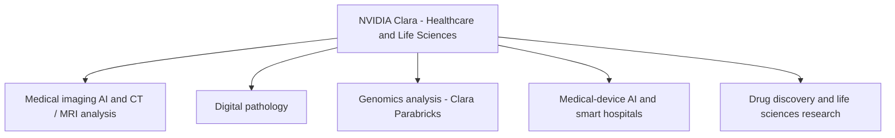

**Figure 2 walkthrough:** NVIDIA Clara in the center is a collection of tools and technologies for healthcare and life sciences. The branches show the fields where the Clara family can be used; for genomics, for example, Clara Parabricks is the relevant component. Look at your own project's use case first, then choose the matching component.

### 3.2 Medical Imaging

In medical imaging, CT, MRI, and other medical images can be analyzed with AI models.

For example—

- Collecting medical images.
- Performing image preprocessing.
- Applying a trained AI model.
- Performing image segmentation, classification, or detection.
- Presenting results to a physician or a medical workflow.

Such systems aim to speed up medical image processing and assist healthcare research.

However, this does not mean AI output can be used directly as a medical decision. Clinical validation, regulatory requirements, and medical professional oversight may be required.

### 3.3 Genomics

Genomics is the field that studies the genetic information of an organism.

Because genome sequencing and analysis workloads can involve very large amounts of data, GPU acceleration can help.

NVIDIA Clara Parabricks is a GPU-accelerated software suite for genomics workflows. It can be used in next-generation sequencing workflows and some genomic data analysis.

For example—

```
Sequencing Data
       |
       v
Genomic Data Processing
       |
       v
GPU-Accelerated Analysis
       |
       v
Variant Analysis / Results
```

This workflow illustrates the concept; actual pipelines can differ in their steps depending on the sequencing platform, data format, and analysis requirements.

### 3.4 Smart Hospitals and Medical Devices

Healthcare AI is not used only on medical images alone. Streaming sensor data from medical devices may also need near-real-time processing.

For example—

- Medical imaging devices
- Real-time sensor processing
- Medical video processing
- Edge AI applications

For such use cases, NVIDIA's healthcare ecosystem also includes technologies such as Holoscan, MONAI, and others. Which product to choose depends on the workload and deployment requirements.

### 3.5 Key Points to Know About Clara

NVIDIA Clara is a platform family for healthcare AI and life sciences. It does not mean that installing everything at once completes a hospital's entire AI system. Actual implementations may require data pipelines, AI models, integration, validation, security, and deployment architecture to be prepared.

**Exam keyword: Healthcare, medical imaging, genomics, smart hospitals → NVIDIA Clara.**

## 4. NVIDIA Merlin — Recommender Systems

Official documentation: https://developer.nvidia.com/nvidia-merlin

NVIDIA Merlin is an open-source framework and ecosystem of tools for building GPU-accelerated recommender systems.

A recommender system predicts and suggests products, movies, videos, or content that an individual user may be interested in.

### 4.1 Everyday Example

Suppose you buy a laptop on an e-commerce website. The website can give product recommendations based on:

- Products you viewed before
- Products you purchased
- Search history
- Preferences of similar users
- Product categories
- User activity in the current session

For example—

```
User Views a Laptop
        |
        v
Collect User and Product Features
        |
        v
Recommendation Model
        |
        v
Rank Candidate Products
        |
        v
Recommend Accessories or Similar Laptops
```

Content platforms like Netflix can also recommend movies or shows based on a user's viewing history and preferences.

These examples explain the concept of a recommender system; the production architecture and models used by each platform can differ.

### 4.2 Main Functions of Merlin

The Merlin ecosystem can help with the various stages of a recommender system development pipeline.

- Data preprocessing
- Feature engineering
- Model training
- Large-scale recommendation models
- Retrieval and ranking workflows
- Session-based recommendations
- Production inference and deployment workflows

**Figure 3 — Recommendation pipeline stages with NVIDIA Merlin**

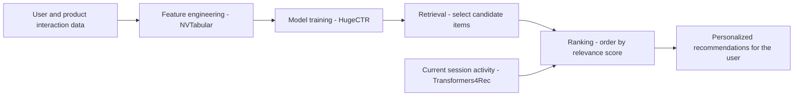

**Figure 3 walkthrough:** The flow starts on the left with user behavior data and moves to the right. NVTabular prepares the data as features and HugeCTR trains the model. Retrieval and ranking are two separate stages: first select likely candidate products out of millions, then order them by relevance. Transformers4Rec covers session-based recommendations that use the current session's activity.

### 4.3 Feature Engineering and Preprocessing

Recommendation models tend to use large amounts of user, item, and interaction data.

For example—

| User ID | Product ID | Interaction |
|---|---|---|
| U101 | Laptop-A | Click |
| U101 | Mouse-B | Purchase |
| U102 | Laptop-A | View |
| U102 | Monitor-C | Purchase |

This data must be prepared as features suitable for the model.

Components such as Merlin NVTabular can help perform tabular data preprocessing and feature engineering with GPU-accelerated workflows.

### 4.4 Model Training

Recommendation models learn the relationships between user behavior and item features.

The Merlin ecosystem includes tools for recommendation model training and scaling. Components such as HugeCTR can support GPU-accelerated training of large-scale recommendation models.

GPU acceleration can speed up some data processing and model training workloads, but performance depends on the dataset, model architecture, GPU hardware, and implementation.

### 4.5 Session-Based Recommendation

Session-based recommendation produces recommendations based on the user's current browsing or interaction session.

For example, a user on a website—

- Looks at running shoes.
- Looks at running socks.
- Searches for a sports watch.

The system can use this session pattern to recommend fitness accessories or other related products.

Tools such as Merlin Transformers4Rec are useful for building sequential and session-based recommendation workflows.

### 4.6 Retrieval and Ranking

In large-scale recommendation systems, a few suitable products must be selected for a user out of millions of products.

Conceptually, this can be split into two stages.

- **Retrieval:** Selecting likely candidate items from a large set of candidate items.
- **Ranking:** Ordering the selected items by relevance score.

The Merlin ecosystem helps build such recommender workflows.

### 4.7 Key Points to Know About Merlin

Merlin is not the same as NIM, which is intended to serve a pretrained LLM as a plain API endpoint. Merlin's main purpose is to help build, train, and deploy recommendation models and recommender-system pipelines.

**Exam keyword: Personalized products, content recommendations, ranking, session-based recommendations → NVIDIA Merlin.**

## 5. NVIDIA NIM — NVIDIA Inference Microservices

Official documentation: https://docs.nvidia.com/nim/

NIM = NVIDIA Inference Microservices.

NVIDIA NIM is a software offering intended to deploy AI models as containerized inference microservices that applications can use through APIs.

NIM provides prepackaged containers, inference runtimes, and API interfaces to make model serving easier.

### 5.1 What Is Inference?

Inference is the process of using a trained AI model to produce output for new input.

For example—

- Asking an LLM a question and getting an answer.
- Giving an image to an image model to detect objects.
- Giving audio to a speech model to produce a transcription.
- Giving text to a text embedding model to produce a vector.

Training is the part that teaches the model; inference is the part that uses the trained model.

### 5.2 Why Use NIM?

If you deploy an AI model yourself, you may need to manage the following.

- Model artifacts and weights
- Inference runtime
- GPU compatibility
- CUDA and software dependencies
- API server
- Model loading and caching
- Health checks
- Performance tuning
- Deployment and scaling

NIM aims to simplify these processes for supported models and configurations.

However, NIM does not automatically eliminate all infrastructure setup. You may still need to check GPU compatibility, memory requirements, credentials, model licensing, networking, and deployment configuration.

### 5.3 NIM Architecture

```
        AI Application
               |
               | HTTP / API Request
               v
       NVIDIA NIM Service
      +--------------------+
      | API Endpoint       |
      | Model Serving      |
      | Inference Runtime  |
      | Model Configuration|
      +--------------------+
               |
               v
         NVIDIA GPU
               |
               v
        Inference Output
               |
               v
        AI Application
```

This picture is a conceptual architecture. NIM's internal components can differ depending on the model family and NIM version.

**Figure 4 — Step-by-step flow of a NIM inference request**

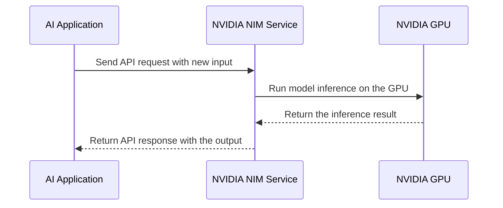

**Figure 4 walkthrough:** The AI application on the left sends its input (a question, an image, audio) to the NIM service through an API. NIM runs model inference on the NVIDIA GPU and sends the result back as an API response. The application does not serve the model itself — it just calls an endpoint.

### 5.4 Example — Deploying an LLM

Suppose an enterprise wants to build an internal chatbot using a supported model from the Llama family. The conceptual workflow is—

- Choose the required model and NIM version.
- Check hardware and software requirements.
- Prepare the required access, credentials, and license terms.
- Deploy the NIM container.
- Test the API endpoint.
- Call the endpoint from the application.
- Prepare health monitoring, authentication, network security, and scaling.

The concept of an example API interaction can be thought of as follows.

```
Chatbot Application
        |
        | POST /v1/chat/completions
        v
NIM API Endpoint
        |
        v
LLM Inference on GPU
        |
        v
Generated Response
```

The endpoint path and request format depend on the relevant NIM service and version. NIM for LLMs has configurations that support OpenAI-compatible APIs.

### 5.5 NIM Use Cases

Depending on the supported service in the NIM catalog, microservices can exist for the following AI domains.

- Large Language Models (LLMs)
- Vision Language Models (VLMs)
- Image generation
- Text embedding
- Text reranking
- Speech recognition
- Text-to-speech
- Translation
- Computer vision
- Some biology-related AI models

NIM is not only for one kind of LLM.

### 5.6 Cloud, Data Center, and Edge

NIM microservices can be deployed on supported NVIDIA-accelerated infrastructure. For example—

- On-premises data center
- Cloud infrastructure
- GPU workstation
- Supported edge environments

This portability lets organizations arrange model serving according to their security, data governance, and infrastructure requirements.

However, do not assume "any cloud or any hardware" without limits. Check the relevant NIM model's hardware support matrix and software requirements.

### 5.7 NIM and Kubernetes

NIM can be run as a standalone container with Docker, and it can also be combined with Kubernetes in supported deployments.

In a Kubernetes environment, tooling such as the NIM Operator can support deployment and lifecycle management of NIM microservices.

### 5.8 Key Points to Know About NIM

NIM is not a model training framework. Its main purpose is to deploy supported AI models as inference services.

NIM helps serve a model, but it does not automatically build the business logic, authentication, authorization, data access, and user interface of an entire production application.

**Exam keyword: Deploy a supported AI model, containerized inference, standard API endpoint → NVIDIA NIM.**

## 6. Clara vs Merlin vs NIM

The differences between these three must be clearly separated.

| Feature | NVIDIA Clara | NVIDIA Merlin | NVIDIA NIM |
|---|---|---|---|
| Primary domain | Healthcare and life sciences | Recommender systems | AI model inference deployment |
| Main purpose | Healthcare AI development and accelerated workflows | Build and optimize recommendation pipelines | Serve supported models through inference microservices |
| Example | Genomics analysis, medical imaging | Product or movie recommendations | Deploy an LLM behind an API |
| Main users | Healthcare developers, researchers, medical-device teams | Data scientists, ML engineers, recommendation teams | AI engineers, developers, platform and operations teams |
| Main focus | Domain-specific healthcare AI | Recommendation model pipelines | Model serving and integration |
| Exam keyword | Healthcare | Recommendations | Inference API |

**Quick Memory Aid**

- **Clara = Care** — Healthcare AI.
- **Merlin = Match** — Recommendation systems that match users with content/products.
- **NIM = Inference** — Deploying an AI model as an API service.

This mnemonic is only an easy-to-remember device for exam preparation.

**Figure 5 — Choosing between Clara, Merlin, and NIM by use case**

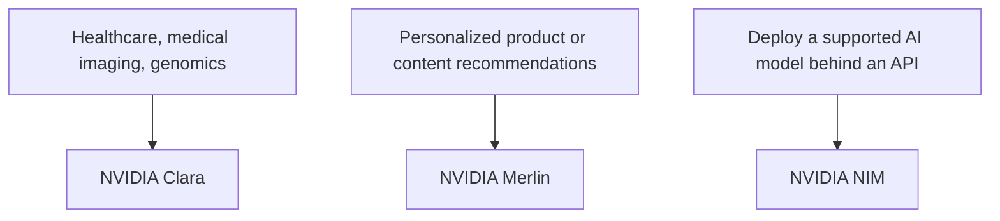

**Figure 5 walkthrough:** Find your use case on the left. Healthcare or genomics points to Clara; personalized recommendations point to Merlin; exposing a pretrained model as an inference API points to NIM. The three tools have different jobs and do not replace each other.

## 7. Practical Scenarios

**Scenario A — Smart Hospital**

A hospital wants to accelerate medical image processing and develop AI-assisted healthcare workflows.

Best choice: NVIDIA Clara ecosystem.

Because it is a platform family focused on healthcare and life sciences AI.

**Scenario B — E-commerce Recommendations**

An online store wants to recommend relevant products based on user behavior and product features.

Best choice: NVIDIA Merlin.

Because it helps build recommendation model training, feature engineering, and recommender pipelines.

**Scenario C — Enterprise LLM API**

An enterprise wants to deploy a supported pretrained LLM as a containerized service that applications can call through an API.

Best choice: NVIDIA NIM.

Because it is intended to deploy supported models as inference microservices.

**Scenario D — Medical Genomics**

A research organization wants to accelerate supported genome analysis workflows.

Best choice: NVIDIA Clara Parabricks, where the required workflow is supported.

**Scenario E — Speech Recognition Service**

An enterprise wants to deploy a supported speech-recognition model behind an inference API.

Best choice: An appropriate NVIDIA NIM speech microservice, if the required model and deployment environment are supported.

## 8. Common Misconceptions

| Misconception | Correct understanding |
|---|---|
| Clara is one ready-to-use hospital application. | No. Clara is a collection of tools, frameworks, and applications for healthcare and life sciences. Building an actual solution may require integration and validation. |
| Merlin is a general-purpose LLM deployment platform. | No. Merlin's main purpose is to build, train, and deploy recommender systems. |
| NIM trains the AI model. | No. NIM's main purpose is to serve supported models as inference services. |
| NIM eliminates all deployment work. | No. NIM simplifies model serving. Hardware compatibility, configuration, credentials, licensing, networking, security, and scaling may still need to be managed. |
| All three tools do the same thing. | No. Clara — Healthcare and life sciences. Merlin — Recommendation systems. NIM — Inference microservices. |

## 9. Practice Exam

**Question 1**

A medical research team wants to accelerate supported genomic analysis pipelines.

A. NVIDIA Merlin
B. NVIDIA Clara Parabricks
C. NVIDIA NIM only
D. OpenSM

**Question 2**

An e-commerce company wants to develop a GPU-accelerated personalized product recommendation pipeline.

A. NVIDIA Clara
B. OpenSM
C. NVIDIA Merlin
D. NVIDIA-SMI

**Question 3**

A developer wants to deploy a supported pretrained LLM as a containerized inference endpoint.

A. NVIDIA Merlin
B. NVIDIA NIM
C. NVIDIA Clara Parabricks
D. Base Command Manager only

**Question 4**

A hospital wants to develop AI workflows for medical imaging.

A. NVIDIA Clara ecosystem
B. NVIDIA Merlin only
C. OpenSM
D. Slurm only

**Question 5**

An application needs to call an AI model through an inference API without implementing the entire model-serving stack from scratch.

A. NVIDIA NIM, if the model and environment are supported
B. NVIDIA Merlin in every case
C. OpenSM
D. NVIDIA-SMI only

**Question 6**

A recommendation team wants to process large feature datasets and train recommendation models.

A. NVIDIA Clara
B. NVIDIA Merlin
C. OpenSM
D. NVIDIA NIM only

**Answer Key**

- B — NVIDIA Clara Parabricks. GPU-accelerated genomics workflows.
- C — NVIDIA Merlin. Recommender-system development.
- B — NVIDIA NIM. Containerized inference service.
- A — NVIDIA Clara ecosystem. Healthcare AI.
- A — NVIDIA NIM. Supported models can be exposed through inference APIs.
- B — NVIDIA Merlin. Feature engineering and recommender model workflows.

## 10. Module Summary

This module covered the Application and Vertical Solutions layer of the NVIDIA AI stack.

- NVIDIA Clara supports healthcare and life sciences AI use cases. Relevant Clara ecosystem components can be used in genomics, medical imaging, and other healthcare applications.
- NVIDIA Merlin helps build, train, and deploy recommendation systems. Personalized product recommendations, content recommendations, and session-based recommendation workflows are its main use cases.
- NVIDIA NIM helps deploy supported AI models as containerized inference microservices that applications can use through APIs.

**Final exam takeaway (exam keyword mapping):**

- Healthcare / genomics / medical imaging → **Clara**
- Personalized recommendations / recommender models → **Merlin**
- Deploy a supported AI model as an inference API → **NIM**

## Technical review notes

- The source transcript for this module was split across two messages (sections 1–5.1 in one message, sections 5.2–10 at the start of the next). The content was merged as-is; nothing from the module was dropped. The trailing NCCL material in the first message's file belongs to a different module and was not included here.
- Claims kept as "needs verification": exact NIM endpoint paths and request formats (e.g. `POST /v1/chat/completions`) depend on the NIM service and version per the source; OpenAI-compatible API configurations and the NIM Operator on Kubernetes should be checked against https://docs.nvidia.com/nim/ before relying on them.
- All workflow diagrams in this module are conceptual, as stated in the source; no commands, benchmark numbers, or product specifications were added.
- Beginner-friendly Mermaid figures (Figure 1–5) with figure walkthroughs (ပုံရှင်းလင်းချက်) were added inline in both the Myanmar and English sections; all existing text and ASCII diagrams are unchanged.
