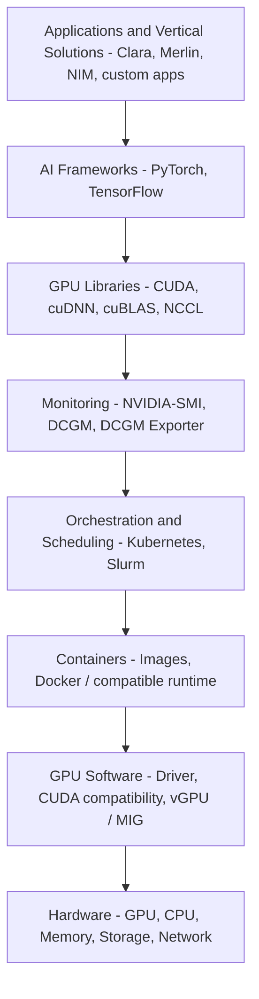
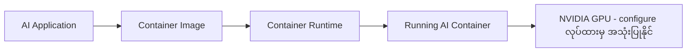
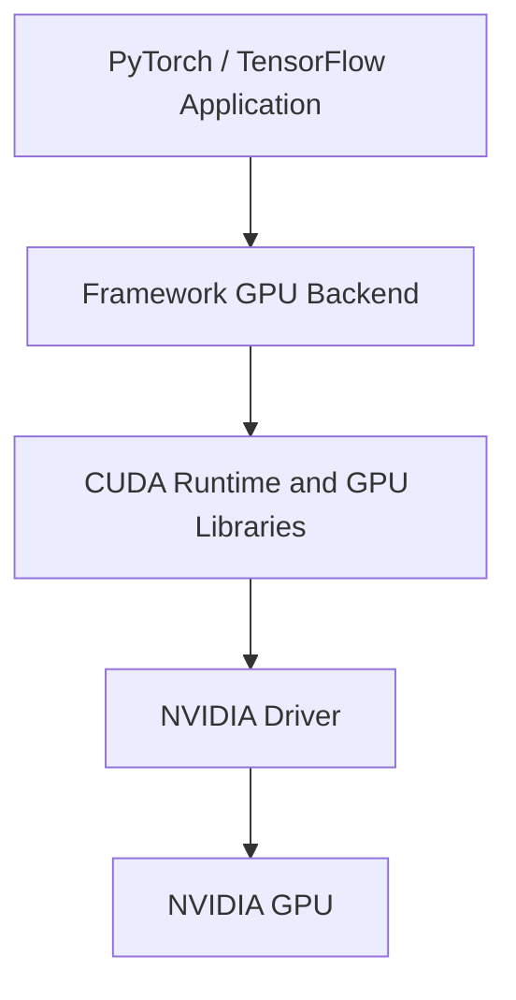
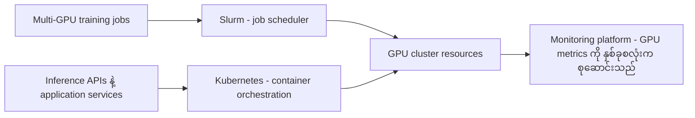
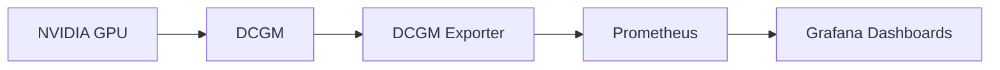
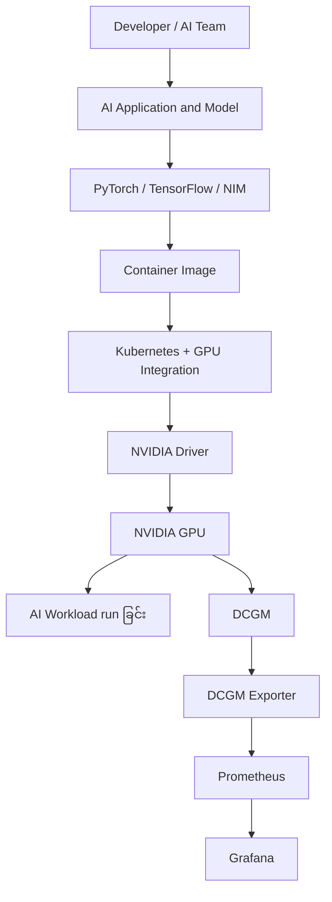
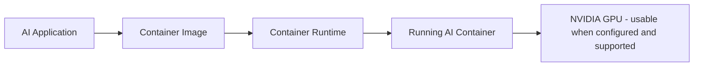
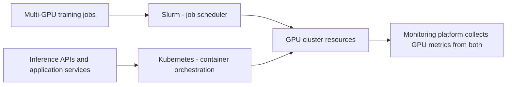
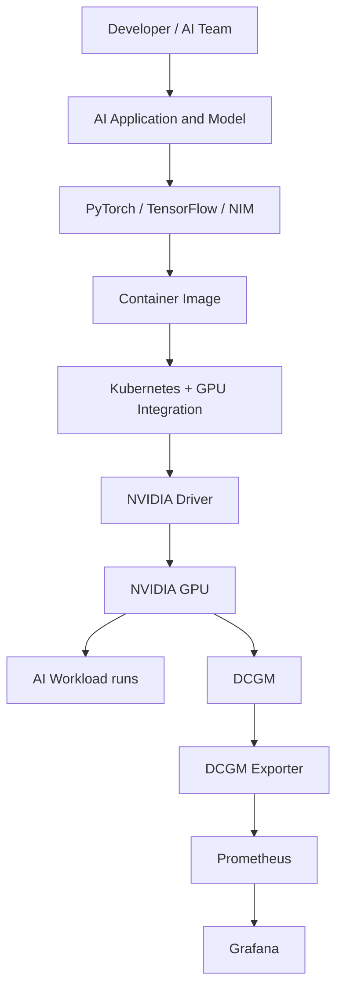

# Module 30 — NVIDIA AI Stack Integration

> Part VI · Course Module 30 (NVIDIA AI Software Stack and Component Integration) — topic notes

## မြန်မာဘာသာ version

## 1. Learning Objectives

ဒီ Module ဟာ NVIDIA AI Infrastructure course မှာ လေ့လာခဲ့တဲ့ အဓိက layers တွေကို ပြန်လည်ချိတ်ဆက်ပြီး AI workload တစ်ခုကို လက်တွေ့ infrastructure ပေါ်မှာ ဘယ်လို run လုပ်မလဲဆိုတာကို ရှင်းပြတဲ့ Module ဖြစ်ပါတယ်။

သင်ခန်းစာပြီးဆုံးတဲ့အခါ အောက်ပါအချက်တွေကို နားလည်နိုင်ရပါမယ်။

- NVIDIA AI stack ရဲ့ အဓိက layers တွေနဲ့ တစ်ခုချင်းစီရဲ့ ရည်ရွယ်ချက်။
- Docker နဲ့ container runtime ရဲ့ အခန်းကဏ္ဍ။
- Kubernetes နဲ့ NVIDIA GPU Operator က GPU workloads တွေကို ဘယ်လိုစီမံပေးသလဲ။
- PyTorch နဲ့ TensorFlow က CUDA ကို ဘယ်လိုအသုံးပြုနိုင်သလဲ။
- Slurm နဲ့ Kubernetes တို့ရဲ့ workload-management ကွာခြားချက်။
- DCGM Exporter, Prometheus နဲ့ Grafana တို့ရဲ့ ဆက်နွယ်မှု။
- AI workload တစ်ခုရဲ့ end-to-end integration flow။

## 2. Reviewing the NVIDIA AI Stack

NVIDIA AI solution stack မှာ physical hardware ကနေ application အထိ အလွှာအမျိုးမျိုး ပါဝင်ပါတယ်။

```
+-----------------------------------------------------+
| Layer 6: Applications and Vertical Solutions        |
| Clara | Merlin | NIM | Custom AI Applications       |
+-----------------------------------------------------+
| AI Frameworks and Model Development                 |
| PyTorch | TensorFlow | Other Frameworks             |
+-----------------------------------------------------+
| GPU Libraries and Computing                         |
| CUDA | cuDNN | cuBLAS | NCCL                        |
+-----------------------------------------------------+
| Monitoring and Management                           |
| NVIDIA-SMI | DCGM | DCGM Exporter                   |
+-----------------------------------------------------+
| Workload Orchestration and Scheduling               |
| Kubernetes | Slurm                                  |
+-----------------------------------------------------+
| Containers and Container Runtime                    |
| Container Images | Docker / Compatible Runtime      |
+-----------------------------------------------------+
| GPU Software and Virtualization                     |
| NVIDIA Driver | CUDA Compatibility | vGPU / MIG     |
+-----------------------------------------------------+
| Hardware and Infrastructure                         |
| GPU | CPU | Memory | Storage | Network              |
+-----------------------------------------------------+
```

ဒီ diagram က conceptual view ဖြစ်ပါတယ်။ အမှန်တကယ်မှာ monitoring, orchestration, drivers နဲ့ libraries တို့ဟာ သီးခြား layers အဖြစ်သာ အလုပ်လုပ်တာမဟုတ်ဘဲ တစ်ခုနဲ့တစ်ခု ပေါင်းစပ်အလုပ်လုပ်ကြပါတယ်။

**Figure 1 — NVIDIA AI software stack ရဲ့ အလွှာများ**



**ပုံရှင်းလင်းချက် (Figure 1):** ဒီပုံမှာ အပေါ်ဆုံး application layer ကနေ အောက်ဆုံး hardware အထိ အလွှာရှစ်ခုကို အစီအစဉ်တကျ ပြထားပါတယ်။ အပေါ်က layer တစ်ခုချင်းစီဟာ အောက်က layer ပေါ်မှာ မှီခို အလုပ်လုပ်ပါတယ် — ဥပမာ PyTorch application က container ထဲမှာ run ပြီး CUDA libraries နဲ့ GPU driver ကတစ်ဆင့် GPU ကို အသုံးပြုပါတယ်။ Monitoring နဲ့ orchestration ကတော့ workload တွေကို စီမံဖို့ ကြားခံ layer တွေ ဖြစ်ပါတယ်။ အလွှာတွေဟာ သီးခြား အလုပ်လုပ်တာ မဟုတ်ဘဲ တစ်ခုနဲ့တစ်ခု ပေါင်းစပ်မှ AI workload တစ်ခု ထိရောက်စွာ run နိုင်ပါတယ်။

ဥပမာ DCGM Exporter ကို Kubernetes ပေါ်မှာ run လုပ်နိုင်သလို NVIDIA GPU Operator ကလည်း GPU-related components အချို့ကို Kubernetes environment ထဲမှာ စီမံပေးနိုင်ပါတယ်။

အဓိကအယူအဆက GPU hardware တစ်ခုတည်းမဟုတ်ဘဲ software နဲ့ management components တွေ အတူတကွ အလုပ်လုပ်မှ AI workload တစ်ခုကို ထိရောက်စွာ run နိုင်တာ ဖြစ်ပါတယ်။

## 3. Containers and Docker

### 3.1 Why Do We Need Containers?

AI application တစ်ခုကို server တစ်ခုမှာ run လုပ်တဲ့အခါ Python version, libraries, application dependencies နဲ့ runtime configuration တွေ လိုအပ်ပါတယ်။ ဥပမာ —

- Python 3.x
- PyTorch
- CUDA-compatible libraries
- Model weights
- Application code
- Supporting packages

ဒီ dependencies တွေကို server တစ်ခုချင်းစီမှာ သီးခြား install လုပ်ထားမယ်ဆိုရင် environment မတူညီမှုကြောင့် application တစ်ခုက server တစ်ခုမှာ အလုပ်လုပ်ပြီး အခြား server တစ်ခုမှာ မအောင်မြင်တာမျိုး ဖြစ်နိုင်ပါတယ်။

Container က application နဲ့ ၎င်းရဲ့ user-space dependencies တွေကို package လုပ်ပေးတဲ့ နည်းလမ်းတစ်ခု ဖြစ်ပါတယ်။

### 3.2 Docker ရဲ့ အခန်းကဏ္ဍ

Docker ecosystem က container images တွေ build လုပ်ခြင်း၊ distribute လုပ်ခြင်းနဲ့ containers တွေ run လုပ်ခြင်းအတွက် tools တွေ ပံ့ပိုးပေးပါတယ်။

အခြေခံ concept တွေက —

- **Container image:** Application နဲ့ လိုအပ်တဲ့ files/dependencies တွေ ပါဝင်တဲ့ package။
- **Container:** Image ကို အသုံးပြုပြီး run လုပ်နေတဲ့ instance။
- **Container runtime:** Container ကို တကယ် run လုပ်ပေးတဲ့ software။
- **Container registry:** Images တွေကို သိမ်းဆည်းပြီး distribute လုပ်ပေးတဲ့ service။

ဥပမာ —

```
AI Application
      |
      v
Container Image
      |
      v
Container Runtime
      |
      v
Running AI Container
      |
      v
NVIDIA GPU (when configured and supported)
```

**Figure 2 — Container image ကနေ GPU အသုံးပြုမှုအထိ**



**ပုံရှင်းလင်းချက် (Figure 2):** AI application ကို အရင် container image အဖြစ် package လုပ်ပါတယ်။ Container runtime က image ကို run ပြီး running container ဖြစ်လာပါတယ်။ နောက်ဆုံးအဆင့်မှာတော့ compatible driver, NVIDIA Container Toolkit နဲ့ GPU device access တွေ ပြင်ဆင်ထားမှသာ container ထဲက application က GPU ကို အသုံးပြုနိုင်မှာ ဖြစ်ပါတယ်။ Container image ရှိရုံနဲ့ မလုံလောက်ပါဘူး။

အရေးကြီးချက်: Container က virtual machine တစ်ခုနဲ့ မတူပါဘူး။ Container တွေဟာ ပုံမှန်အားဖြင့် host operating system ရဲ့ kernel ကို share လုပ်ကြပါတယ်။ VM မှာတော့ guest operating system တစ်ခုစီ ပါဝင်နိုင်ပါတယ်။

### 3.3 Docker and DGX OS

NVIDIA DGX systems တွေမှာ DGX OS နဲ့ သက်ဆိုင်ရာ software stack ကို အသုံးပြုနိုင်ပါတယ်။ Docker နဲ့ container tooling availability က DGX OS release နဲ့ configuration ပေါ်မူတည်နိုင်ပါတယ်။

မူရင်းသင်ခန်းစာက Docker ကို DGX OS နဲ့ ပေါင်းစပ်အသုံးပြုတဲ့ model ကို အဓိကထား ရှင်းပြထားပါတယ်။

သို့သော် production မှာ "DGX OS ဆိုရင် Docker version တစ်ခုကို အမြဲ preinstalled ပါတယ်" လို့ မယူဆသင့်ပါဘူး။ သက်ဆိုင်ရာ DGX OS release ရဲ့ installation guide နဲ့ system configuration ကို စစ်ဆေးသင့်ပါတယ်။

### 3.4 Containers and NVIDIA GPUs

GPU ကို container ထဲက application က အသုံးပြုနိုင်ဖို့ container image ရှိရုံနဲ့ မလုံလောက်ပါဘူး။ အောက်ပါအချက်တွေကိုလည်း ကိုက်ညီအောင် ပြင်ဆင်ထားဖို့ လိုအပ်နိုင်ပါတယ်။

- Compatible NVIDIA GPU driver
- NVIDIA Container Toolkit သို့မဟုတ် သက်ဆိုင်ရာ GPU runtime integration
- GPU device access
- Container ထဲက CUDA libraries နဲ့ host driver တို့ရဲ့ compatibility
- သင့်တော်တဲ့ runtime configuration

ဒီ components တွေ အဆင်ပြေမှ container ထဲက AI application က GPU ကို အသုံးပြုနိုင်မှာ ဖြစ်ပါတယ်။

## 4. Kubernetes — Container Orchestration

### 4.1 Why Do We Need Kubernetes?

Docker သို့မဟုတ် အခြား container runtime တစ်ခုက container တစ်ခုကို run လုပ်ပေးနိုင်ပါတယ်။ ဒါပေမဲ့ GPU server အများအပြားရှိတဲ့ cluster တစ်ခုမှာ containers အများအပြားကို run လုပ်ရမယ်ဆိုရင် အောက်ပါအလုပ်တွေကို စီမံဖို့ လိုအပ်ပါတယ်။

- ဘယ် node ပေါ်မှာ workload ကို run လုပ်မလဲ။
- Container ပျက်သွားရင် ဘယ်လိုပြန်စမလဲ။
- Replica ဘယ်နှခု run လုပ်မလဲ။
- Network access ကို ဘယ်လိုပေးမလဲ။
- Persistent storage ကို ဘယ်လိုချိတ်ဆက်မလဲ။
- GPU resources ကို ဘယ်လို request လုပ်မလဲ။
- Application ကို ဘယ်လို update လုပ်မလဲ။

Kubernetes က ဒီလို containerized workloads တွေကို cluster တစ်ခုလုံးမှာ orchestrate လုပ်ဖို့ အသုံးပြုတဲ့ platform ဖြစ်ပါတယ်။

### 4.2 Kubernetes and NVIDIA GPUs

Kubernetes မှာ GPU ကို request လုပ်ဖို့ NVIDIA device plugin နဲ့ သက်ဆိုင်ရာ GPU software components တွေကို configure လုပ်ထားဖို့ လိုအပ်ပါတယ်။

ဥပမာ GPU တစ်လုံး လိုအပ်တဲ့ workload တစ်ခုမှာ —

```yaml
apiVersion: v1
kind: Pod
metadata:
  name: gpu-workload
spec:
  restartPolicy: Never
  containers:
    - name: ai-container
      image: nvcr.io/nvidia/pytorch:25.01-py3
      resources:
        limits:
          nvidia.com/gpu: 1
```

ဒီ YAML ဟာ GPU request ရဲ့ concept ကို ပြထားတဲ့ ဥပမာဖြစ်ပါတယ်။ အဲဒီ image tag ဟာ example ဖြစ်ပြီး လက်ရှိ production အတွက် အကြံပြုထားတဲ့ version လို့ မဆိုလိုပါဘူး။ အမှန်တကယ် deploy လုပ်မယ်ဆိုရင် သင့် environment နဲ့ ကိုက်ညီတဲ့ supported image ကို ရွေးချယ်ပါ။

`nvidia.com/gpu: 1` ဆိုတာ Kubernetes က workload အတွက် GPU resource တစ်ခု လိုအပ်ကြောင်း ဖော်ပြတာ ဖြစ်ပါတယ်။ GPU device plugin နဲ့ node configuration မရှိရင် Kubernetes က GPU resource ကို မှန်ကန်စွာ expose လုပ်ပေးနိုင်မှာ မဟုတ်ပါဘူး။

### 4.3 What Is NVIDIA GPU Operator?

NVIDIA GPU Operator က Kubernetes cluster တွေမှာ GPU-related software components တွေကို install လုပ်ခြင်းနဲ့ lifecycle management ကို အလိုအလျောက်လုပ်ဆောင်ရာမှာ ကူညီပေးပါတယ်။ Configuration နဲ့ platform support ပေါ်မူတည်ပြီး စီမံပေးနိုင်တဲ့ components တွေမှာ —

- NVIDIA GPU drivers
- NVIDIA Container Toolkit
- Kubernetes device plugin
- GPU feature discovery
- DCGM နဲ့ DCGM Exporter
- MIG-related configuration အချို့

ပါဝင်နိုင်ပါတယ်။

ဒီလို operator အသုံးပြုခြင်းက GPU node တွေကို တစ်ခုချင်းစီ manual configure လုပ်ရတဲ့ အလုပ်ကို လျှော့ချပေးနိုင်ပါတယ်။

သို့သော် GPU Operator က Kubernetes cluster တစ်ခုလုံးကို တစ်ခုတည်းနဲ့ အစားထိုးတာ မဟုတ်ပါဘူး။ ၎င်းဟာ Kubernetes ရဲ့ အပေါ်မှာ GPU software integration ကို စီမံပေးတဲ့ component ဖြစ်ပါတယ်။

> ⚠️ GPU Operator က full CUDA Toolkit ကို install လုပ်ပေးတာ မဟုတ်ပါဘူး။ GPU Operator က စီမံပေးတဲ့ component စာရင်းမှာ driver, NVIDIA Container Toolkit, device plugin, GPU feature discovery, DCGM / DCGM Exporter နဲ့ MIG configuration အချိုု့သာ ပါဝင်ပါတယ်။ CUDA Toolkit (compiler, development libraries, tools) လိုအပ်ရင် သီးခြား install လုပ်ရနိုင်ပါတယ်။

### 4.4 Kubernetes Operators

Kubernetes Operator ဆိုတာ application သို့မဟုတ် infrastructure component တစ်ခုကို install, configure နဲ့ manage လုပ်ရာမှာ Kubernetes API နဲ့ controllers တွေကို အသုံးပြုတဲ့ software pattern ဖြစ်ပါတယ်။

GPU Operator က GPU-specific components တွေကို စီမံပေးပါတယ်။ အခြား operator တွေက database, observability platform သို့မဟုတ် AI application တွေကို စီမံပေးနိုင်ပါတယ်။

**Exam keyword: Container orchestration, Pods, Deployments, GPU resource requests → Kubernetes.**

## 5. PyTorch, TensorFlow, and CUDA

### 5.1 What Are PyTorch and TensorFlow?

PyTorch နဲ့ TensorFlow တို့ဟာ machine learning နဲ့ deep learning application တွေကို တည်ဆောက်၊ train နဲ့ run လုပ်ဖို့ အသုံးပြုတဲ့ frameworks တွေ ဖြစ်ပါတယ်။

Developer တွေက GPU အတွက် low-level code အားလုံးကို ကိုယ်တိုင်ရေးစရာမလိုဘဲ framework ရဲ့ APIs တွေကို အသုံးပြုနိုင်ပါတယ်။ ဥပမာ —

- Tensor operations
- Neural network layers
- Loss functions
- Gradient computation
- Model training
- Model inference

### 5.2 How Does CUDA Fit In?

CUDA ဟာ NVIDIA GPU တွေအတွက် parallel computing platform နဲ့ programming model ဖြစ်ပါတယ်။

PyTorch သို့မဟုတ် TensorFlow ရဲ့ supported GPU operations တွေကို NVIDIA GPU ပေါ်မှာ run လုပ်တဲ့အခါ framework က သင့်တော်တဲ့ GPU backend နဲ့ CUDA-related libraries တွေကို အသုံးပြုနိုင်ပါတယ်။

Conceptually —

```
PyTorch / TensorFlow Application
               |
               v
Framework GPU Backend
               |
               v
CUDA Runtime and GPU Libraries
               |
               v
NVIDIA Driver
               |
               v
NVIDIA GPU
```

ဒီ diagram က conceptual view ဖြစ်ပါတယ်။ အမှန်တကယ် call path မှာ CUDA Runtime, cuDNN, cuBLAS နဲ့ အခြား libraries တွေကို operation အမျိုးအစားပေါ်မူတည်ပြီး အသုံးပြုနိုင်ပါတယ်။

**Figure 3 — Framework ကနေ GPU အထိ call path**



**ပုံရှင်းလင်းချက် (Figure 3):** Developer က PyTorch သို့မဟုတ် TensorFlow API ကို သုံးရုံပါပဲ။ Framework ရဲ့ GPU backend က operation ကို CUDA runtime နဲ့ GPU libraries ဆီ ပို့ပေးပြီး NVIDIA driver ကတစ်ဆင့် GPU ပေါ်မှာ အမှန်တကယ် run ပါတယ်။ ဒါကြောင့် framework တစ်ခုတည်းနဲ့ မပြီးဘဲ driver, CUDA libraries နဲ့ GPU တို့ အားလုံး ကိုက်ညီမှ အလုပ်လုပ်ပါတယ်။

### 5.3 Example: PyTorch GPU Selection

```python
import torch

if torch.cuda.is_available():
    device = torch.device("cuda")
    print("GPU is available:", torch.cuda.get_device_name(0))
else:
    device = torch.device("cpu")
    print("GPU is not available; using CPU")
```

ဒီ code က PyTorch environment မှာ CUDA-compatible GPU ကို အသုံးပြုနိုင်ခြင်း ရှိ၊ မရှိ စစ်ဆေးပေးပါတယ်။

GPU ကို အသုံးပြုနိုင်တယ်ဆိုတာက အောက်ပါအရာအားလုံး အဆင်ပြေကြောင်း အာမခံတာ မဟုတ်ပါဘူး။

- Model အားလုံး GPU ပေါ်မှာ အလိုအလျောက် run လုပ်မယ်။
- Framework operation အားလုံး CUDA-supported ဖြစ်မယ်။
- GPU memory လုံလောက်မယ်။
- Performance က CPU ထက် အမြဲမြန်မယ်။

Application က supported operations တွေကို GPU ပေါ်သို့ ပို့ပေးရပြီး သင့်တော်တဲ့ driver, runtime နဲ့ library versions တွေ လိုအပ်ပါတယ်။

### 5.4 CUDA Is Not the Same as a GPU

ဒီအချက်ကို မှတ်ထားပါ။

- **GPU:** Physical computing device။
- **CUDA:** NVIDIA GPU programming platform နဲ့ programming model။
- **CUDA Toolkit:** CUDA development အတွက် compiler, libraries နဲ့ tools တွေ ပါဝင်တဲ့ toolkit။
- **NVIDIA Driver:** Operating system နဲ့ NVIDIA GPU ကြား ဆက်သွယ်ပေးတဲ့ software။
- **PyTorch / TensorFlow:** AI models နဲ့ machine learning workloads တွေကို တည်ဆောက်ဖို့ frameworks။

**Exam keyword: Deep learning framework, model training, tensor operations, GPU backend → PyTorch / TensorFlow, typically using supported CUDA capabilities on NVIDIA GPUs.**

## 6. Kubernetes vs Slurm — Workload Management

ဒီအပိုင်းက နောက် Module တွေမှာ ပိုမိုအသေးစိတ်လေ့လာမယ့် အရေးကြီးတဲ့ အကြောင်းအရာဖြစ်ပါတယ်။

Kubernetes နဲ့ Slurm တို့ကို တူညီတဲ့ tool နှစ်ခုလို့ မယူဆသင့်ပါဘူး။ နှစ်ခုစလုံး workload placement နဲ့ resource allocation ကို ကူညီနိုင်ပေမဲ့ အဓိကရည်ရွယ်ချက်နဲ့ operating model ကွာခြားပါတယ်။

### 6.1 Kubernetes

Kubernetes က containerized applications တွေကို orchestrate လုပ်ဖို့ အဓိကထားပါတယ်။ အသုံးများတဲ့ workloads တွေမှာ —

- AI inference services
- Web applications
- APIs and microservices
- Long-running application services
- Containerized AI platforms
- Batch workloads အချို့

### 6.2 Slurm

Slurm ဟာ HPC နဲ့ AI/ML computing cluster တွေမှာ အသုံးပြုတဲ့ workload manager နဲ့ job scheduler ဖြစ်ပါတယ်။ အဓိကလုပ်ဆောင်ချက်တွေက —

- Job submission
- Job scheduling
- Compute resource allocation
- Job queues နဲ့ priorities
- Job execution management
- Cluster resource utilization စီမံခြင်း

ဥပမာ Slurm မှာ GPU တစ်လုံးတောင်းပြီး Python training script တစ်ခု run လုပ်ဖို့ conceptually အောက်ပါ command ကို အသုံးပြုနိုင်ပါတယ်။

```
srun --gres=gpu:1 python train.py
```

ဒီ command က Slurm configuration မှာ gpu resource ကို မှန်ကန်စွာ configure လုပ်ထားတဲ့ environment အတွက် ဥပမာဖြစ်ပါတယ်။ Cluster အချို့မှာ `--gpus=1` ကဲ့သို့သော syntax ကို အသုံးပြုနိုင်ပါတယ်။

### 6.3 Comparison

| Feature | Kubernetes | Slurm |
|---|---|---|
| Primary purpose | Container orchestration | HPC/AI job scheduling |
| Typical workload | Long-running services and containers | Batch jobs, training jobs, HPC applications |
| Workload interface | Pods, Deployments, Jobs | Jobs, job steps, partitions |
| Resource allocation | Kubernetes resource requests and limits | Scheduler allocations and job resource requests |
| Common example | Deploy an inference API | Schedule a multi-GPU training job |

### 6.4 Can They Be Used Together?

ဟုတ်ပါတယ်။ Organization တစ်ခုမှာ Kubernetes နဲ့ Slurm နှစ်ခုစလုံးကို အသုံးပြုနိုင်ပါတယ်။ ဥပမာ —

- Slurm က multi-GPU training jobs တွေကို schedule လုပ်တယ်။
- Kubernetes က model-serving APIs နဲ့ application services တွေကို run လုပ်တယ်။
- Monitoring platform က environment နှစ်ခုလုံးရဲ့ GPU metrics တွေကို စုဆောင်းတယ်။

အချို့ architecture တွေမှာ integration သို့မဟုတ် shared infrastructure ကို အသုံးပြုနိုင်ပေမဲ့ integration method က platform design ပေါ်မူတည်ပါတယ်။

**Figure 4 — Kubernetes နဲ့ Slurm ကို အတူတကွ အသုံးပြုပုံ**



**ပုံရှင်းလင်းချက် (Figure 4):** ဘယ်ဘက်အပေါ်က training jobs တွေက Slurm ကတစ်ဆင့် schedule ဖြစ်ပြီး အောက်က inference services တွေကတော့ Kubernetes ပေါ်မှာ run ပါတယ်။ နှစ်ခုစလုံးက GPU cluster resources တွေကို အသုံးပြုပြီး monitoring platform တစ်ခုက environment နှစ်ခုစလုံးက GPU metrics တွေကို စုဆောင်းနိုင်ပါတယ်။ Slurm နဲ့ Kubernetes ဟာ တစ်ခုနဲ့တစ်ခု အစားထိုး မဟုတ်ဘဲ တာဝန်ခွဲပြီး အတူသုံးနိုင်တာကို ပြပါတယ်။

**Exam keyword: Containerized application orchestration → Kubernetes။ HPC batch jobs and job queues → Slurm။**

## 7. GPU Monitoring: DCGM Exporter, Prometheus, and Grafana

AI workload ကို run လုပ်နိုင်ရုံနဲ့ မလုံလောက်ပါဘူး။ GPU utilization, memory usage, temperature, power consumption နဲ့ hardware health တို့ကိုလည်း စောင့်ကြည့်ဖို့ လိုပါတယ်။

### 7.1 NVIDIA-SMI

`nvidia-smi` က GPU status ကို အမြန်စစ်ဆေးဖို့ အသုံးဝင်ပါတယ်။

```
nvidia-smi
```

ဒီ command က supported GPU နဲ့ driver configuration ပေါ်မူတည်ပြီး GPU utilization, memory usage, temperature, power usage နဲ့ running processes စတဲ့ information တွေကို ပြသပေးနိုင်ပါတယ်။

### 7.2 DCGM

DCGM ဆိုတာ Data Center GPU Manager ဖြစ်ပါတယ်။ DCGM က data center environment တွေမှာ GPU monitoring, health checks နဲ့ diagnostics တို့အတွက် အသုံးပြုနိုင်တဲ့ NVIDIA software ဖြစ်ပါတယ်။

### 7.3 DCGM Exporter

DCGM Exporter က DCGM နဲ့ ချိတ်ဆက်ပြီး GPU metrics တွေကို Prometheus-compatible format နဲ့ expose လုပ်ပေးပါတယ်။

ဒီ exporter က metrics တွေကို ကိုယ်တိုင် ရေရှည်သိမ်းဆည်းထားတဲ့ time-series database မဟုတ်ပါဘူး။

### 7.4 Prometheus

Prometheus က metrics တွေကို scrape လုပ်ပြီး time-series data အဖြစ် သိမ်းဆည်းနိုင်ပါတယ်။ ဥပမာ —

- GPU utilization over time
- GPU memory usage over time
- Power consumption trends
- Temperature trends

Prometheus က configured rules တွေအပေါ်မူတည်ပြီး alert conditions တွေကိုလည်း evaluate လုပ်နိုင်ပါတယ်။

### 7.5 Grafana

Grafana က Prometheus ကဲ့သို့ data sources တွေကို အသုံးပြုပြီး dashboards နဲ့ visualizations တွေကို ပြသပေးပါတယ်။

Conceptual monitoring pipeline က —

```
NVIDIA GPU
    |
    v
DCGM
    |
    v
DCGM Exporter
    |
    v
Prometheus
    |
    v
Grafana Dashboards
```

**Figure 5 — GPU monitoring pipeline**



**ပုံရှင်းလင်းချက် (Figure 5):** GPU က ထွက်လာတဲ့ metrics တွေကို အရင် DCGM က စုဆောင်းပါတယ်။ DCGM Exporter က အဲဒီ metrics တွေကို Prometheus-compatible format နဲ့ ထုတ်ပေးပြီး Prometheus က scrape လုပ်ပြီး time-series data အဖြစ် သိမ်းဆည်းပါတယ်။ နောက်ဆုံးမှာ Grafana က အဲဒီ data ကို dashboard တွေအဖြစ် ပြသပေးပါတယ်။ မှတ်ထားရမှာက DCGM Exporter က metrics တွေကို ရေရှည် မသိမ်းဆည်းပါဘူး — သိမ်းဆည်းတာက Prometheus ဖြစ်ပါတယ်။

Alerting ကိုလည်း configure လုပ်နိုင်ပေမဲ့ alert notification အတွက် alert rules နဲ့ Alertmanager သို့မဟုတ် သက်ဆိုင်ရာ notification integration တွေကို ပြင်ဆင်ထားဖို့ လိုအပ်နိုင်ပါတယ်။

### 7.6 Why Is This Important?

ဥပမာ GPU server တစ်ခုမှာ model training job တစ်ခု run လုပ်နေတယ်ဆိုပါစို့။ Monitoring က အောက်ပါမေးခွန်းတွေကို ဖြေရှင်းဖို့ ကူညီပေးနိုင်ပါတယ်။

- GPU utilization နိမ့်နေသလား။
- GPU memory ပြည့်နေသလား။
- Power usage များနေသလား။
- Temperature တက်လာသလား။
- Workload က GPU ကို မသုံးဘဲ CPU ပေါ်မှာပဲ run နေသလား။
- Node တစ်ခုမှာ GPU-related error ဖြစ်နေသလား။

ဒီ metrics တွေက troubleshooting နဲ့ capacity planning အတွက် အသုံးဝင်ပါတယ်။

**Exam keyword: GPU metrics collection → DCGM Exporter။ Historical metrics → Prometheus။ Dashboards → Grafana။**

## 8. End-to-End Integration Example

GPU server တွေပါတဲ့ Kubernetes cluster တစ်ခုမှာ AI inference application တစ်ခု deploy လုပ်မယ်လို့ ယူဆပါ။

**Step 1 — Infrastructure**

GPU server မှာ NVIDIA GPU, CPU, RAM, storage နဲ့ network တို့ ရှိပါတယ်။

**Step 2 — Driver and GPU Software**

Compatible NVIDIA driver နဲ့ သက်ဆိုင်ရာ container/GPU integration ကို configure လုပ်ထားရပါတယ်။

**Step 3 — Container Image**

AI application နဲ့ လိုအပ်တဲ့ user-space dependencies တွေကို container image ထဲမှာ package လုပ်ထားပါတယ်။

**Step 4 — Kubernetes Scheduling**

Kubernetes က GPU resource request နဲ့ အခြား scheduling constraints တွေအပေါ်မူတည်ပြီး workload ကို သင့်တော်တဲ့ node ပေါ်မှာ run လုပ်ပေးပါတယ်။

**Step 5 — AI Framework**

Application က PyTorch သို့မဟုတ် TensorFlow ကို အသုံးပြုပြီး supported operations တွေကို GPU ပေါ်မှာ run လုပ်နိုင်ပါတယ်။

**Step 6 — Inference Service**

Model ကို API သို့မဟုတ် application interface ကနေ အသုံးပြုနိုင်အောင် expose လုပ်ထားပါတယ်။ NIM ကို ရွေးချယ်အသုံးပြုနိုင်တဲ့ use case တွေလည်း ရှိပါတယ်။

**Step 7 — Monitoring**

DCGM Exporter က GPU metrics တွေကို expose လုပ်ပြီး Prometheus က စုဆောင်းပါတယ်။ Grafana က dashboard တွေမှာ ပြသပေးပါတယ်။

```
Developer / AI Team
        |
        v
AI Application and Model
        |
        v
PyTorch / TensorFlow / NIM
        |
        v
Container Image
        |
        v
Kubernetes + GPU Integration
        |
        v
NVIDIA Driver
        |
        v
NVIDIA GPU
        |
        +-------------------------+
        |                         |
        v                         v
      DCGM                 AI Workload
        |
        v
 DCGM Exporter
        |
        v
   Prometheus
        |
        v
     Grafana
```

ဒီ diagram က conceptual architecture ဖြစ်ပါတယ်။ DCGM monitoring path နဲ့ AI workload execution path တို့ဟာ တစ်ခုနဲ့တစ်ခု ဆက်စပ်ပေမဲ့ monitoring က inference execution ရဲ့ အစိတ်အပိုင်းတစ်ခု မဟုတ်ပါဘူး။

**Figure 6 — AI workload တစ်ခုရဲ့ end-to-end integration flow**



**ပုံရှင်းလင်းချက် (Figure 6):** ဘယ်ဘက်အပေါ်က developer ကနေ စပြီး အောက်ကို တစ်ဆင့်ချင်း လိုက်ကြည့်ပါ — application နဲ့ model ကို framework သို့မဟုတ် NIM နဲ့ ချိတ်၊ container image ထဲ ထည့်၊ Kubernetes က GPU resource request နဲ့ သင့်တော်တဲ့ node ပေါ် တင်ပေး၊ NVIDIA driver ကတစ်ဆင့် GPU ပေါ်မှာ workload run ပါတယ်။ ညာဘက်ခွဲကတော့ monitoring path ဖြစ်ပြီး GPU ကနေ DCGM, DCGM Exporter, Prometheus ကတစ်ဆင့် Grafana အထိ metrics ရောက်ပါတယ်။ Monitoring path က inference execution ရဲ့ အစိတ်အပိုင်း မဟုတ်ဘဲ သီးခြား စောင့်ကြည့်ရေး လမ်းကြောင်းသာ ဖြစ်ပါတယ်။

## 9. How to Choose the Right Tool

| Requirement | Main tool or component |
|---|---|
| Build and package a container image | Docker tooling |
| Run containers on a host | Container runtime |
| Orchestrate containerized applications | Kubernetes |
| Integrate NVIDIA GPUs with Kubernetes | NVIDIA GPU Operator and related components |
| Develop deep learning models | PyTorch or TensorFlow |
| Execute supported operations on NVIDIA GPUs | CUDA and GPU libraries through supported frameworks |
| Schedule HPC batch jobs | Slurm |
| Inspect GPU status quickly | NVIDIA-SMI |
| Monitor GPU health and collect telemetry | DCGM |
| Expose GPU metrics to Prometheus | DCGM Exporter |
| Store and query historical metrics | Prometheus |
| Visualize metrics in dashboards | Grafana |
| Serve a supported model through an inference microservice | NVIDIA NIM |

ဒီ tools တွေဟာ အားလုံးကို တစ်ပြိုင်နက် မဖြစ်မနေ အသုံးပြုရမယ်လို့ မဆိုလိုပါဘူး။ Architecture နဲ့ use case ပေါ်မူတည်ပြီး လိုအပ်တဲ့ components တွေကို ရွေးချယ်ရပါတယ်။

## 10. Common Misconceptions and Operational Cautions

| မှားယွင်းနိုင်တဲ့ အယူအဆ | မှန်ကန်တဲ့ နားလည်မှု |
|---|---|
| Docker and Kubernetes are the same. | မတူပါဘူး။ Docker ecosystem က container build နဲ့ run လုပ်ဖို့ tools တွေ ပံ့ပိုးပေးပါတယ်။ Kubernetes က containerized workloads တွေကို cluster အနှံ့ orchestrate လုပ်ပါတယ်။ |
| PyTorch automatically runs every operation on the GPU. | မမှန်ပါဘူး။ Application က supported GPU operations တွေကို အသုံးပြုပြီး model, tensors နဲ့ runtime ကို သင့်တော်အောင် configure လုပ်ထားဖို့ လိုအပ်ပါတယ်။ |
| Kubernetes replaces Slurm in every AI environment. | မမှန်ပါဘူး။ Kubernetes က container orchestration ကို အဓိကထားပြီး Slurm က HPC/AI job scheduling ကို အဓိကထားပါတယ်။ Environment အချို့မှာ နှစ်ခုစလုံးကို အသုံးပြုနိုင်ပါတယ်။ |
| DCGM Exporter stores historical metrics. | မမှန်ပါဘူး။ DCGM Exporter က metrics တွေကို expose လုပ်ပေးပါတယ်။ Prometheus က configured metrics တွေကို scrape လုပ်ပြီး သိမ်းဆည်းနိုင်ပါတယ်။ |
| Installing a GPU Operator completes the entire AI platform. | မမှန်ပါဘူး။ GPU Operator က Kubernetes environment ထဲက NVIDIA GPU-related software components တွေကို စီမံပေးပါတယ်။ AI application, data pipeline, security, scheduling policy နဲ့ monitoring backend အားလုံးကို တစ်ခုတည်းနဲ့ အစားမထိုးနိုင်ပါဘူး။ |

**Operational cautions (လုပ်ငန်းသုံး သတိပြုရန်အချက်များ)**

- **Monitoring ≠ Scheduling** — DCGM, DCGM Exporter နဲ့ nvidia-smi တို့က GPU ကို စောင့်ကြည့်တာ (monitoring) ဖြစ်ပြီး workload ကို ဘယ် GPU ပေါ် ဘယ်အချိန် run မလဲ ဆုံးဖြတ်ပေးတဲ့ scheduling မဟုတ်ပါဘူး။ Scheduling ကို Slurm သို့မဟုတ် Kubernetes scheduler တို့က လုပ်ဆောင်ပါတယ်။ Monitoring tool က GPU ကို workload အတွက် မခွဲပေးပါဘူး။
- **Traffic load balancing ≠ GPU compute load balancing** — Network traffic သို့မဟုတ် service request တွေကို replica တွေကြား ခွဲဝေပေးတဲ့ load balancing က GPU compute load ကို GPU တွေ/node တွေကြား အလိုအလျောက် ချိန်ညှိပေးတာ မဟုတ်ပါဘူး။ GPU workload တွေကို ဘယ် GPU မှာ run မလဲဆိုတာက scheduler နဲ့ resource request policy ပေါ် မူတည်ပါတယ်။
- **GPU Operator က full CUDA Toolkit ကို install မလုပ်ပေးပါဘူး** — GPU Operator က GPU driver, NVIDIA Container Toolkit, device plugin, GPU feature discovery, DCGM / DCGM Exporter နဲ့ MIG configuration အချိုု့လို GPU-related components တွေကို စီမံပေးတာဖြစ်ပါတယ်။ CUDA Toolkit ကို development/compiler tools အပြည့်အစုံနဲ့ လိုအပ်ရင် သီးခြား install လုပ်ရနိုင်ပါတယ်။
- **Default အနေနဲ့ automatic GPU load balancing / live migration မရှိပါဘူး** — Slurm နဲ့ Kubernetes ဟာ GPU workload တွေကို GPU တွေကြား အလိုအလျောက် ပြန်လည်ချိန်ညှိပေးခြင်း (automatic GPU load balancing) နဲ့ run နေတဲ့ GPU workload ကို ရပ်စရာမလိုဘဲ node တစ်ခုကနေ တစ်ခုကို ရွှေ့ပေးခြင်း (live migration) ကို default အနေနဲ့ မလုပ်ဆောင်ပေးပါဘူး။ Placement, rebalancing နဲ့ node maintenance အတွက် ကိုယ်တိုင် policy နဲ့ procedure တွေ စီမံရနိုင်ပါတယ်။

## 11. Practice Exam

**Question 1**

You need to orchestrate containerized AI inference services across multiple Kubernetes nodes.

A. Grafana
B. Kubernetes
C. DCGM Exporter
D. CUDA Toolkit

**Question 2**

You need to schedule an HPC batch job that requests four GPUs.

A. Slurm
B. Grafana
C. DCGM Exporter
D. Docker image registry

**Question 3**

You want to expose NVIDIA GPU metrics in a format that Prometheus can scrape.

A. PyTorch
B. NVIDIA Merlin
C. DCGM Exporter
D. Slurm

**Question 4**

You need dashboards that visualize GPU utilization and memory usage over time.

A. Grafana with an appropriate metrics data source
B. NVIDIA GPU Operator only
C. CUDA Toolkit only
D. Container image

**Question 5**

A developer wants to build a deep learning model using a high-level framework and supported NVIDIA GPU operations.

A. PyTorch or TensorFlow with compatible GPU software
B. OpenSM only
C. Grafana only
D. Docker registry only

**Question 6**

You want to manage NVIDIA GPU-related software components in a Kubernetes cluster.

A. NVIDIA GPU Operator
B. Grafana
C. Merlin
D. Slurm only

**Question 7**

You want to inspect GPU utilization, temperature, and memory usage on a single server.

A. nvidia-smi
B. kubectl get ingress
C. srun
D. docker build

**Question 8**

Which component primarily exposes GPU telemetry, while a separate monitoring system can store historical metrics?

A. DCGM Exporter
B. Prometheus
C. Grafana
D. PyTorch

**Answer Key**

- B — Kubernetes. Orchestrates containerized workloads.
- A — Slurm. Schedules HPC and AI batch jobs.
- C — DCGM Exporter. Exposes GPU metrics in a Prometheus-compatible format.
- A — Grafana with a metrics data source. Visualizes metrics in dashboards.
- A — PyTorch or TensorFlow with compatible GPU software. Supports deep learning development and GPU execution.
- A — NVIDIA GPU Operator. Manages GPU-related components in supported Kubernetes environments.
- A — nvidia-smi. Provides quick local GPU status information.
- A — DCGM Exporter. Exposes telemetry; Prometheus can scrape and store the metrics.

## 12. Module Summary

ဒီ Module မှာ NVIDIA AI infrastructure ရဲ့ အဓိက components တွေကို ပြန်လည်ချိတ်ဆက်လေ့လာခဲ့ပါတယ်။

- **Docker and container tooling** — Application နဲ့ dependencies တွေကို container image အဖြစ် package လုပ်ပြီး containers တွေ run လုပ်ဖို့ ကူညီပေးပါတယ်။
- **Kubernetes** — Containerized applications တွေကို cluster ပေါ်မှာ orchestrate လုပ်ပါတယ်။
- **NVIDIA GPU Operator** — Kubernetes မှာ NVIDIA GPU-related software components တွေကို စီမံပေးပါတယ်။
- **PyTorch and TensorFlow** — AI models တွေကို တည်ဆောက်၊ train နဲ့ run လုပ်ဖို့ frameworks တွေ ဖြစ်ပါတယ်။
- **CUDA** — NVIDIA GPU programming နဲ့ supported GPU computing operations တွေအတွက် platform ဖြစ်ပါတယ်။
- **Slurm** — HPC နဲ့ AI cluster တွေမှာ jobs တွေကို schedule လုပ်ပေးပါတယ်။
- **DCGM and DCGM Exporter** — GPU health နဲ့ telemetry ကို စောင့်ကြည့်ပြီး metrics တွေကို expose လုပ်ပေးပါတယ်။
- **Prometheus** — Metrics တွေကို scrape လုပ်ပြီး historical time-series data အဖြစ် သိမ်းဆည်းနိုင်ပါတယ်။
- **Grafana** — Metrics dashboards နဲ့ visualizations တွေကို ပြသပေးပါတယ်။
- **NVIDIA NIM** — Supported AI models တွေကို inference microservices အဖြစ် deploy လုပ်ဖို့ ကူညီပေးပါတယ်။

**Final takeaway:** AI infrastructure တစ်ခုမှာ hardware, drivers, containers, frameworks, workload management နဲ့ monitoring တို့ဟာ တစ်ခုနဲ့တစ်ခု ဆက်စပ်နေပါတယ်။ သင့်တော်တဲ့ components တွေကို ပေါင်းစပ်အသုံးပြုနိုင်ခြင်းက AI workload ကို deploy, operate, troubleshoot နဲ့ scale လုပ်ရာမှာ အရေးကြီးပါတယ်။

## English Version

## 1. Learning Objectives

This module reconnects the main layers studied in the NVIDIA AI Infrastructure course and explains how an AI workload is actually run on real infrastructure.

By the end of the lesson you should understand:

- The main layers of the NVIDIA AI stack and the purpose of each.
- The role of Docker and container runtimes.
- How Kubernetes and the NVIDIA GPU Operator manage GPU workloads.
- How PyTorch and TensorFlow use CUDA.
- The workload-management differences between Slurm and Kubernetes.
- How DCGM Exporter, Prometheus, and Grafana relate to each other.
- The end-to-end integration flow of an AI workload.

## 2. Reviewing the NVIDIA AI Stack

The NVIDIA AI solution stack contains many layers, from physical hardware up to applications.

```
+-----------------------------------------------------+
| Layer 6: Applications and Vertical Solutions        |
| Clara | Merlin | NIM | Custom AI Applications       |
+-----------------------------------------------------+
| AI Frameworks and Model Development                 |
| PyTorch | TensorFlow | Other Frameworks             |
+-----------------------------------------------------+
| GPU Libraries and Computing                         |
| CUDA | cuDNN | cuBLAS | NCCL                        |
+-----------------------------------------------------+
| Monitoring and Management                           |
| NVIDIA-SMI | DCGM | DCGM Exporter                   |
+-----------------------------------------------------+
| Workload Orchestration and Scheduling               |
| Kubernetes | Slurm                                  |
+-----------------------------------------------------+
| Containers and Container Runtime                    |
| Container Images | Docker / Compatible Runtime      |
+-----------------------------------------------------+
| GPU Software and Virtualization                     |
| NVIDIA Driver | CUDA Compatibility | vGPU / MIG     |
+-----------------------------------------------------+
| Hardware and Infrastructure                         |
| GPU | CPU | Memory | Storage | Network              |
+-----------------------------------------------------+
```

This diagram is a conceptual view. In reality, monitoring, orchestration, drivers, and libraries do not work as isolated layers — they work together.

**Figure 1 — Layers of the NVIDIA AI software stack**


**Figure 1 walkthrough:** The figure shows eight layers, from the application layer at the top down to hardware at the bottom. Each upper layer sits on top of and depends on the layer below it — for example, a PyTorch application runs inside a container and reaches the GPU through CUDA libraries and the GPU driver. Monitoring and orchestration are the middle layers that manage the workloads. These layers do not work in isolation; an AI workload runs effectively only when they work together.

For example, DCGM Exporter can run on Kubernetes, and the NVIDIA GPU Operator can manage some GPU-related components inside a Kubernetes environment.

The key idea is that an AI workload runs effectively only when GPU hardware plus the software and management components work together — not with GPU hardware alone.

## 3. Containers and Docker

### 3.1 Why Do We Need Containers?

When running an AI application on a server you need Python versions, libraries, application dependencies, and runtime configuration. For example—

- Python 3.x
- PyTorch
- CUDA-compatible libraries
- Model weights
- Application code
- Supporting packages

If these dependencies are installed separately on each server, environment differences can make an application work on one server and fail on another.

A container is a way to package an application together with its user-space dependencies.

### 3.2 The Role of Docker

The Docker ecosystem provides tools to build, distribute, and run container images.

The basic concepts are—

- **Container image:** A package containing the application and the files/dependencies it needs.
- **Container:** A running instance created from an image.
- **Container runtime:** The software that actually runs containers.
- **Container registry:** A service that stores and distributes images.

For example—

```
AI Application
      |
      v
Container Image
      |
      v
Container Runtime
      |
      v
Running AI Container
      |
      v
NVIDIA GPU (when configured and supported)
```

**Figure 2 — From container image to GPU usage**



**Figure 2 walkthrough:** First the AI application is packaged as a container image. The container runtime runs the image, producing a running container. Only at the last step — with a compatible driver, the NVIDIA Container Toolkit, and GPU device access in place — can the application inside the container use the GPU. Having a container image alone is not enough.

Important: A container is not the same as a virtual machine. Containers typically share the host operating system's kernel. A VM can include its own guest operating system.

### 3.3 Docker and DGX OS

NVIDIA DGX systems can use DGX OS and its associated software stack. Docker and container tooling availability can depend on the DGX OS release and configuration.

The original lesson mainly explains the model of using Docker together with DGX OS.

However, in production you should not assume "DGX OS always comes with a Docker version preinstalled." Check the relevant DGX OS release's installation guide and system configuration.

### 3.4 Containers and NVIDIA GPUs

Having a container image alone is not enough for an application inside a container to use the GPU. The following may also need to be in place.

- A compatible NVIDIA GPU driver
- The NVIDIA Container Toolkit or the relevant GPU runtime integration
- GPU device access
- Compatibility between the CUDA libraries in the container and the host driver
- Suitable runtime configuration

Only when these components are in place can an AI application inside a container use the GPU.

## 4. Kubernetes — Container Orchestration

### 4.1 Why Do We Need Kubernetes?

Docker or another container runtime can run a single container. But if many containers must run in a cluster with many GPU servers, the following must be managed.

- Which node the workload runs on.
- How to restart a failed container.
- How many replicas to run.
- How to provide network access.
- How to attach persistent storage.
- How to request GPU resources.
- How to update the application.

Kubernetes is a platform for orchestrating such containerized workloads across a whole cluster.

### 4.2 Kubernetes and NVIDIA GPUs

To request a GPU in Kubernetes, the NVIDIA device plugin and related GPU software components must be configured.

For example, for a workload that needs one GPU—

```yaml
apiVersion: v1
kind: Pod
metadata:
  name: gpu-workload
spec:
  restartPolicy: Never
  containers:
    - name: ai-container
      image: nvcr.io/nvidia/pytorch:25.01-py3
      resources:
        limits:
          nvidia.com/gpu: 1
```

This YAML illustrates the concept of a GPU request. The image tag is an example and does not mean it is the recommended version for current production. For real deployments, choose a supported image that matches your environment.

`nvidia.com/gpu: 1` declares that the workload needs one GPU resource. Without the GPU device plugin and node configuration, Kubernetes cannot expose GPU resources properly.

### 4.3 What Is NVIDIA GPU Operator?

The NVIDIA GPU Operator helps automate the installation and lifecycle management of GPU-related software components in Kubernetes clusters. Depending on configuration and platform support, the components it can manage include—

- NVIDIA GPU drivers
- The NVIDIA Container Toolkit
- The Kubernetes device plugin
- GPU feature discovery
- DCGM and DCGM Exporter
- Some MIG-related configuration

Using such an operator reduces the work of manually configuring each GPU node.

However, the GPU Operator does not replace an entire Kubernetes cluster with a single thing. It is a component that manages GPU software integration on top of Kubernetes.

> ⚠️ The GPU Operator does not install the full CUDA Toolkit. The components it manages are the driver, the NVIDIA Container Toolkit, the device plugin, GPU feature discovery, DCGM / DCGM Exporter, and some MIG configuration. If you need the CUDA Toolkit (compiler, development libraries, tools), it may need to be installed separately.

### 4.4 Kubernetes Operators

A Kubernetes Operator is a software pattern that uses the Kubernetes API and controllers to install, configure, and manage an application or infrastructure component.

The GPU Operator manages GPU-specific components. Other operators can manage databases, observability platforms, or AI applications.

**Exam keyword: Container orchestration, Pods, Deployments, GPU resource requests → Kubernetes.**

## 5. PyTorch, TensorFlow, and CUDA

### 5.1 What Are PyTorch and TensorFlow?

PyTorch and TensorFlow are frameworks for building, training, and running machine learning and deep learning applications.

Developers can use the framework's APIs without writing all the low-level code for the GPU themselves. For example—

- Tensor operations
- Neural network layers
- Loss functions
- Gradient computation
- Model training
- Model inference

### 5.2 How Does CUDA Fit In?

CUDA is a parallel computing platform and programming model for NVIDIA GPUs.

When supported GPU operations of PyTorch or TensorFlow run on an NVIDIA GPU, the framework can use a suitable GPU backend and CUDA-related libraries.

Conceptually—

```
PyTorch / TensorFlow Application
               |
               v
Framework GPU Backend
               |
               v
CUDA Runtime and GPU Libraries
               |
               v
NVIDIA Driver
               |
               v
NVIDIA GPU
```

This diagram is a conceptual view. In the actual call path, CUDA Runtime, cuDNN, cuBLAS, and other libraries can be used depending on the type of operation.

**Figure 3 — The call path from framework to GPU**


**Figure 3 walkthrough:** The developer only uses the PyTorch or TensorFlow API. The framework's GPU backend passes the operation to the CUDA runtime and GPU libraries, and the NVIDIA driver runs it on the GPU. That is why the framework alone is not enough — the driver, CUDA libraries, and GPU all have to line up.

### 5.3 Example: PyTorch GPU Selection

```python
import torch

if torch.cuda.is_available():
    device = torch.device("cuda")
    print("GPU is available:", torch.cuda.get_device_name(0))
else:
    device = torch.device("cpu")
    print("GPU is not available; using CPU")
```

This code checks whether a CUDA-compatible GPU can be used in the PyTorch environment.

Being able to use the GPU does not guarantee all of the following.

- Every model runs on the GPU automatically.
- Every framework operation is CUDA-supported.
- GPU memory is sufficient.
- Performance is always faster than the CPU.

The application must place supported operations on the GPU, and suitable driver, runtime, and library versions are required.

### 5.4 CUDA Is Not the Same as a GPU

Remember this point.

- **GPU:** A physical computing device.
- **CUDA:** The NVIDIA GPU programming platform and programming model.
- **CUDA Toolkit:** The toolkit containing compilers, libraries, and tools for CUDA development.
- **NVIDIA Driver:** The software that connects the operating system and the NVIDIA GPU.
- **PyTorch / TensorFlow:** Frameworks for building AI models and machine learning workloads.

**Exam keyword: Deep learning framework, model training, tensor operations, GPU backend → PyTorch / TensorFlow, typically using supported CUDA capabilities on NVIDIA GPUs.**

## 6. Kubernetes vs Slurm — Workload Management

This section covers an important topic that later modules study in more detail.

Kubernetes and Slurm should not be treated as two identical tools. Both help with workload placement and resource allocation, but their main purpose and operating model differ.

### 6.1 Kubernetes

Kubernetes focuses on orchestrating containerized applications. Common workloads include—

- AI inference services
- Web applications
- APIs and microservices
- Long-running application services
- Containerized AI platforms
- Some batch workloads

### 6.2 Slurm

Slurm is a workload manager and job scheduler used in HPC and AI/ML computing clusters. Its main functions are—

- Job submission
- Job scheduling
- Compute resource allocation
- Job queues and priorities
- Job execution management
- Managing cluster resource utilization

For example, to request one GPU in Slurm and run a Python training script, you can conceptually use a command like—

```
srun --gres=gpu:1 python train.py
```

This command is an example for an environment where the gpu resource is configured correctly in the Slurm configuration. Some clusters may use syntax such as `--gpus=1`.

### 6.3 Comparison

| Feature | Kubernetes | Slurm |
|---|---|---|
| Primary purpose | Container orchestration | HPC/AI job scheduling |
| Typical workload | Long-running services and containers | Batch jobs, training jobs, HPC applications |
| Workload interface | Pods, Deployments, Jobs | Jobs, job steps, partitions |
| Resource allocation | Kubernetes resource requests and limits | Scheduler allocations and job resource requests |
| Common example | Deploy an inference API | Schedule a multi-GPU training job |

### 6.4 Can They Be Used Together?

Yes. An organization can use both Kubernetes and Slurm. For example—

- Slurm schedules multi-GPU training jobs.
- Kubernetes runs model-serving APIs and application services.
- A monitoring platform collects GPU metrics from both environments.

Some architectures can use integration or shared infrastructure, but the integration method depends on the platform design.

**Figure 4 — Using Kubernetes and Slurm together**



**Figure 4 walkthrough:** Training jobs at the top left are scheduled through Slurm, while the inference services below run on Kubernetes. Both use GPU cluster resources, and a single monitoring platform can collect GPU metrics from both environments. The figure shows that Slurm and Kubernetes divide the work — one does not replace the other.

**Exam keyword: Containerized application orchestration → Kubernetes. HPC batch jobs and job queues → Slurm.**

## 7. GPU Monitoring: DCGM Exporter, Prometheus, and Grafana

Just being able to run an AI workload is not enough. GPU utilization, memory usage, temperature, power consumption, and hardware health must also be monitored.

### 7.1 NVIDIA-SMI

`nvidia-smi` is useful for quickly checking GPU status.

```
nvidia-smi
```

Depending on the supported GPU and driver configuration, this command can show information such as GPU utilization, memory usage, temperature, power usage, and running processes.

### 7.2 DCGM

DCGM stands for Data Center GPU Manager. DCGM is NVIDIA software that can be used for GPU monitoring, health checks, and diagnostics in data center environments.

### 7.3 DCGM Exporter

DCGM Exporter connects to DCGM and exposes GPU metrics in a Prometheus-compatible format.

This exporter is not a time-series database that stores metrics long-term by itself.

### 7.4 Prometheus

Prometheus can scrape metrics and store them as time-series data. For example—

- GPU utilization over time
- GPU memory usage over time
- Power consumption trends
- Temperature trends

Prometheus can also evaluate alert conditions based on configured rules.

### 7.5 Grafana

Grafana uses data sources like Prometheus to display dashboards and visualizations.

The conceptual monitoring pipeline is—

```
NVIDIA GPU
    |
    v
DCGM
    |
    v
DCGM Exporter
    |
    v
Prometheus
    |
    v
Grafana Dashboards
```

**Figure 5 — GPU monitoring pipeline**


**Figure 5 walkthrough:** DCGM first collects the metrics coming from the GPU. DCGM Exporter exposes those metrics in a Prometheus-compatible format, and Prometheus scrapes and stores them as time-series data. Finally, Grafana displays the data as dashboards. Note that the exporter does not store metrics long-term — Prometheus does the storing.

Alerting can also be configured, but alert notifications may require alert rules and Alertmanager or the relevant notification integration to be set up.

### 7.6 Why Is This Important?

Suppose a model training job is running on a GPU server. Monitoring can help answer questions such as—

- Is GPU utilization low?
- Is GPU memory full?
- Is power usage high?
- Is temperature rising?
- Is the workload running on the CPU without using the GPU?
- Is there a GPU-related error on a node?

These metrics are useful for troubleshooting and capacity planning.

**Exam keyword: GPU metrics collection → DCGM Exporter. Historical metrics → Prometheus. Dashboards → Grafana.**

## 8. End-to-End Integration Example

Suppose you deploy an AI inference application in a Kubernetes cluster with GPU servers.

**Step 1 — Infrastructure**

The GPU server has an NVIDIA GPU, CPU, RAM, storage, and network.

**Step 2 — Driver and GPU Software**

A compatible NVIDIA driver and the relevant container/GPU integration are configured.

**Step 3 — Container Image**

The AI application and its user-space dependencies are packaged in a container image.

**Step 4 — Kubernetes Scheduling**

Kubernetes runs the workload on a suitable node based on the GPU resource request and other scheduling constraints.

**Step 5 — AI Framework**

The application can use PyTorch or TensorFlow to run supported operations on the GPU.

**Step 6 — Inference Service**

The model is exposed so it can be used through an API or application interface. There are also use cases where NIM can be chosen.

**Step 7 — Monitoring**

DCGM Exporter exposes GPU metrics and Prometheus collects them. Grafana displays them in dashboards.

```
Developer / AI Team
        |
        v
AI Application and Model
        |
        v
PyTorch / TensorFlow / NIM
        |
        v
Container Image
        |
        v
Kubernetes + GPU Integration
        |
        v
NVIDIA Driver
        |
        v
NVIDIA GPU
        |
        +-------------------------+
        |                         |
        v                         v
      DCGM                 AI Workload
        |
        v
 DCGM Exporter
        |
        v
   Prometheus
        |
        v
     Grafana
```

This diagram is a conceptual architecture. The DCGM monitoring path and the AI workload execution path are related, but monitoring is not a part of inference execution.

**Figure 6 — End-to-end integration flow of an AI workload**



**Figure 6 walkthrough:** Start at the top left and follow the flow down: the application and model connect to a framework or NIM, get packaged into a container image, and Kubernetes places the workload on a suitable node based on the GPU resource request; the NVIDIA driver runs it on the GPU. The right branch is the monitoring path — GPU metrics travel through DCGM, DCGM Exporter, and Prometheus to Grafana. The monitoring path is not part of inference execution; it is a separate observation path.

## 9. How to Choose the Right Tool

| Requirement | Main tool or component |
|---|---|
| Build and package a container image | Docker tooling |
| Run containers on a host | Container runtime |
| Orchestrate containerized applications | Kubernetes |
| Integrate NVIDIA GPUs with Kubernetes | NVIDIA GPU Operator and related components |
| Develop deep learning models | PyTorch or TensorFlow |
| Execute supported operations on NVIDIA GPUs | CUDA and GPU libraries through supported frameworks |
| Schedule HPC batch jobs | Slurm |
| Inspect GPU status quickly | NVIDIA-SMI |
| Monitor GPU health and collect telemetry | DCGM |
| Expose GPU metrics to Prometheus | DCGM Exporter |
| Store and query historical metrics | Prometheus |
| Visualize metrics in dashboards | Grafana |
| Serve a supported model through an inference microservice | NVIDIA NIM |

These tools do not all have to be used at the same time. Choose the components you need based on the architecture and use case.

## 10. Common Misconceptions and Operational Cautions

| Misconception | Correct understanding |
|---|---|
| Docker and Kubernetes are the same. | No. The Docker ecosystem provides tools to build and run containers. Kubernetes orchestrates containerized workloads across a cluster. |
| PyTorch automatically runs every operation on the GPU. | No. The application must use supported GPU operations and configure the model, tensors, and runtime appropriately. |
| Kubernetes replaces Slurm in every AI environment. | No. Kubernetes focuses on container orchestration and Slurm focuses on HPC/AI job scheduling. Some environments use both. |
| DCGM Exporter stores historical metrics. | No. DCGM Exporter exposes metrics. Prometheus can scrape and store the configured metrics. |
| Installing a GPU Operator completes the entire AI platform. | No. The GPU Operator manages NVIDIA GPU-related software components in a Kubernetes environment. It does not replace the AI application, data pipeline, security, scheduling policy, and monitoring backend all at once. |

**Operational cautions**

- **Monitoring ≠ Scheduling** — DCGM, DCGM Exporter, and nvidia-smi monitor GPUs; they do not decide which workload runs on which GPU and when. Scheduling is done by Slurm or the Kubernetes scheduler. A monitoring tool does not allocate GPUs to workloads.
- **Traffic load balancing ≠ GPU compute load balancing** — Load balancing that splits network traffic or service requests across replicas does not automatically balance GPU compute load across GPUs or nodes. Which GPU a workload runs on depends on the scheduler and resource request policy.
- **The GPU Operator does not install the full CUDA Toolkit** — The GPU Operator manages GPU-related components such as the GPU driver, the NVIDIA Container Toolkit, the device plugin, GPU feature discovery, DCGM / DCGM Exporter, and some MIG configuration. If the full CUDA Toolkit (development/compiler tools) is needed, it may need to be installed separately.
- **No default automatic GPU load balancing / live migration** — By default, Slurm and Kubernetes do not automatically rebalance GPU workloads across GPUs (automatic GPU load balancing), nor do they move a running GPU workload from one node to another without stopping it (live migration). Placement, rebalancing, and node maintenance may require your own policies and procedures.

## 11. Practice Exam

**Question 1**

You need to orchestrate containerized AI inference services across multiple Kubernetes nodes.

A. Grafana
B. Kubernetes
C. DCGM Exporter
D. CUDA Toolkit

**Question 2**

You need to schedule an HPC batch job that requests four GPUs.

A. Slurm
B. Grafana
C. DCGM Exporter
D. Docker image registry

**Question 3**

You want to expose NVIDIA GPU metrics in a format that Prometheus can scrape.

A. PyTorch
B. NVIDIA Merlin
C. DCGM Exporter
D. Slurm

**Question 4**

You need dashboards that visualize GPU utilization and memory usage over time.

A. Grafana with an appropriate metrics data source
B. NVIDIA GPU Operator only
C. CUDA Toolkit only
D. Container image

**Question 5**

A developer wants to build a deep learning model using a high-level framework and supported NVIDIA GPU operations.

A. PyTorch or TensorFlow with compatible GPU software
B. OpenSM only
C. Grafana only
D. Docker registry only

**Question 6**

You want to manage NVIDIA GPU-related software components in a Kubernetes cluster.

A. NVIDIA GPU Operator
B. Grafana
C. Merlin
D. Slurm only

**Question 7**

You want to inspect GPU utilization, temperature, and memory usage on a single server.

A. nvidia-smi
B. kubectl get ingress
C. srun
D. docker build

**Question 8**

Which component primarily exposes GPU telemetry, while a separate monitoring system can store historical metrics?

A. DCGM Exporter
B. Prometheus
C. Grafana
D. PyTorch

**Answer Key**

- B — Kubernetes. Orchestrates containerized workloads.
- A — Slurm. Schedules HPC and AI batch jobs.
- C — DCGM Exporter. Exposes GPU metrics in a Prometheus-compatible format.
- A — Grafana with a metrics data source. Visualizes metrics in dashboards.
- A — PyTorch or TensorFlow with compatible GPU software. Supports deep learning development and GPU execution.
- A — NVIDIA GPU Operator. Manages GPU-related components in supported Kubernetes environments.
- A — nvidia-smi. Provides quick local GPU status information.
- A — DCGM Exporter. Exposes telemetry; Prometheus can scrape and store the metrics.

## 12. Module Summary

This module connected the main components of NVIDIA AI infrastructure.

- **Docker and container tooling** — Packages applications and dependencies as container images and helps run containers.
- **Kubernetes** — Orchestrates containerized applications on a cluster.
- **NVIDIA GPU Operator** — Manages NVIDIA GPU-related software components in Kubernetes.
- **PyTorch and TensorFlow** — Frameworks for building, training, and running AI models.
- **CUDA** — The platform for NVIDIA GPU programming and supported GPU computing operations.
- **Slurm** — Schedules jobs in HPC and AI clusters.
- **DCGM and DCGM Exporter** — Monitor GPU health and telemetry and expose metrics.
- **Prometheus** — Scrapes metrics and stores them as historical time-series data.
- **Grafana** — Displays metric dashboards and visualizations.
- **NVIDIA NIM** — Helps deploy supported AI models as inference microservices.

**Final takeaway:** In AI infrastructure, hardware, drivers, containers, frameworks, workload management, and monitoring are all interconnected. Being able to combine the right components is important for deploying, operating, troubleshooting, and scaling AI workloads.

## Technical review notes

- The source transcript for this module began mid-message with the practice-exam answer key split across two messages; the fragments were merged into one complete answer key (Questions 1–8). No answer-key content from unrelated exams was included.
- The YAML example (`nvcr.io/nvidia/pytorch:25.01-py3`) and the Slurm example (`srun --gres=gpu:1 python train.py`) are illustrative, per the source's own caveats — the image tag is not a recommended production version, and some clusters use `--gpus=1` instead of `--gres=gpu:1`.
- Operational cautions retained per course rules: monitoring ≠ scheduling; traffic load balancing ≠ GPU compute load balancing; the GPU Operator does not install the full CUDA Toolkit; there is no default automatic GPU load balancing or live migration. The GPU Operator component list matches the source; the CUDA Toolkit statement is a course-level caveat and should be checked against the current GPU Operator documentation for version-specific behavior (needs verification).
- Beginner-friendly Mermaid figures (Figure 1–6) with figure walkthroughs (ပုံရှင်းလင်းချက်) were added inline in both the Myanmar and English sections; all existing text and ASCII diagrams are unchanged.
