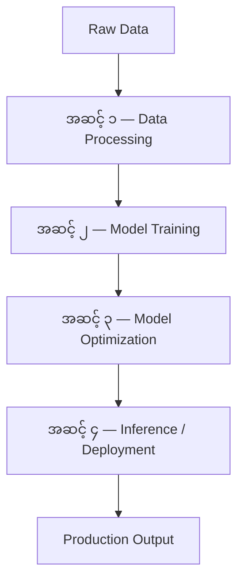
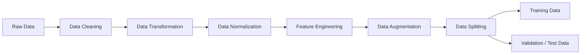
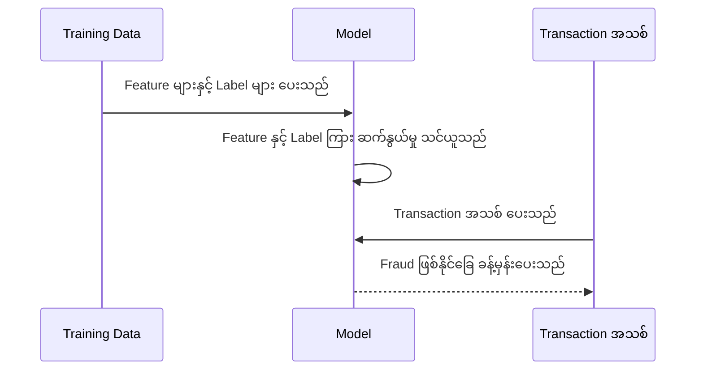
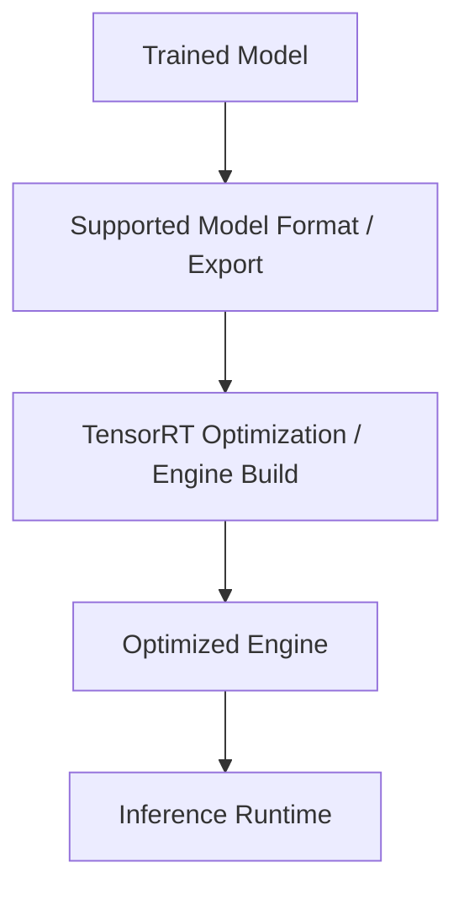
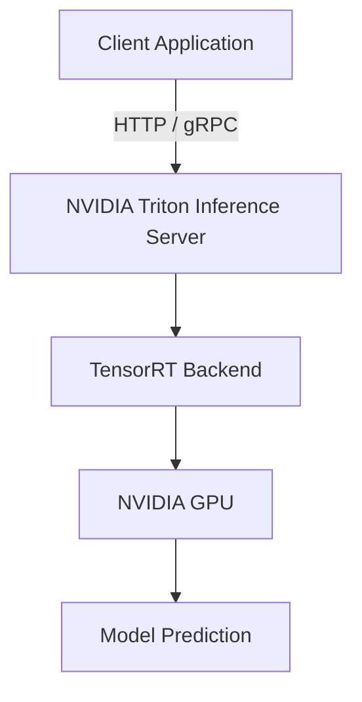
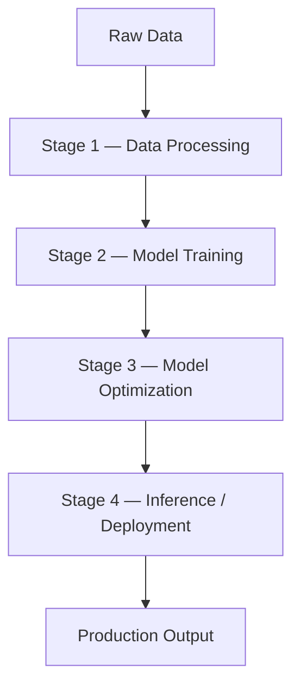
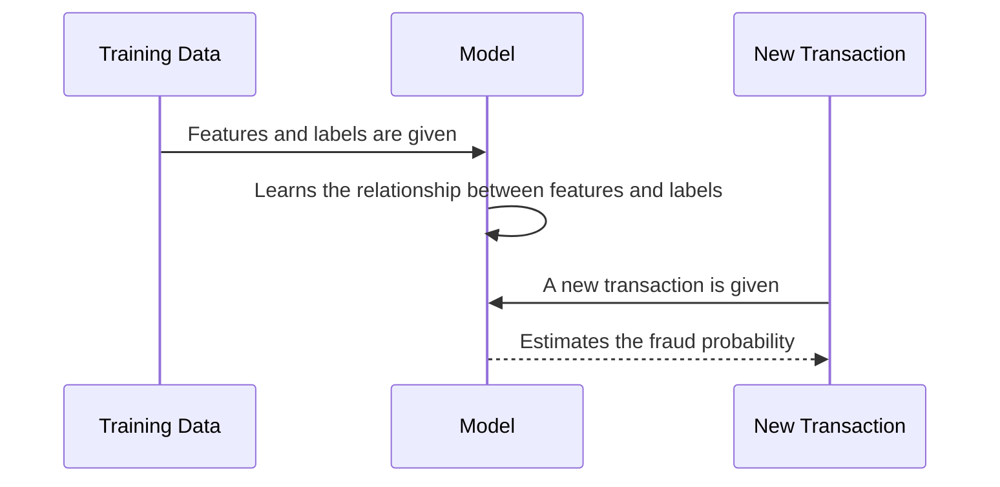

# Module 32 — NVIDIA AI Workflow: Data Processing to Production Inference

> Part VI · Course Module 32 — topic notes

## မြန်မာဘာသာ version

## 1. Learning Objectives

ဤ Module ကို လေ့လာပြီးနောက် အောက်ပါအချက်များကို နားလည်နိုင်ရမည်။

- AI Workflow ၏ အဓိကအဆင့် ၄ ဆင့်ကို အစဉ်လိုက် ရှင်းပြနိုင်ခြင်း။
- Data Processing, Model Training, Model Optimization နှင့် Inference တို့၏ ကွာခြားချက်ကို နားလည်ခြင်း။
- NVIDIA RAPIDS, PyTorch, TensorFlow, TensorRT နှင့် Triton Inference Server တို့၏ အခန်းကဏ္ဍကို ခွဲခြားသိရှိခြင်း။
- Trained Model တစ်ခုကို production environment သို့ ပို့ဆောင်ပုံကို အကြမ်းဖျင်းနားလည်ခြင်း။
- TensorRT နှင့် Triton Inference Server သည် ဘာကြောင့် အရေးကြီးသလဲဆိုသည်ကို ရှင်းပြနိုင်ခြင်း။

## 2. AI Workflow ဆိုတာဘာလဲ?

AI Workflow ဆိုသည်မှာ raw data မှစတင်ပြီး AI Model တစ်ခုကို တည်ဆောက်၊ စမ်းသပ်၊ optimize လုပ်ကာ production environment တွင် အသုံးပြုနိုင်သည်အထိ ဆောင်ရွက်ရသည့် အဆင့်လိုက်လုပ်ငန်းစဉ် ဖြစ်သည်။

High-performance infrastructure တစ်ခုရှိရုံနှင့် AI application တစ်ခု အလိုအလျောက် အောင်မြင်လာမည် မဟုတ်ပါ။ Infrastructure က compute, storage, networking နှင့် security အခြေခံများကို ပံ့ပိုးပေးသော်လည်း၊ AI workload ကို ထိရောက်စွာ အသုံးပြုရန် data နှင့် model ကို စနစ်တကျ ပြင်ဆင်ရသည်။

ဤသင်ခန်းစာတွင် AI Workflow ကို အဆင့် ၄ ဆင့်ဖြင့် လေ့လာမည်။

- **Data Processing** — Data ကို သန့်စင်ပြီး အသုံးပြုရန် ပြင်ဆင်ခြင်း။
- **Model Training** — Data မှ pattern များကို Model က သင်ယူစေခြင်း။
- **Model Optimization** — Model ၏ performance နှင့် resource usage ကို လိုအပ်ချက်အလိုက် ချိန်ညှိခြင်း။
- **Inference / Deployment** — Model ကို အသုံးပြုသူများ သို့မဟုတ် application များက တကယ့် input များဖြင့် အသုံးပြုနိုင်အောင် တင်ပို့ခြင်း။

**AI Workflow Diagram**

```
             RAW DATA
                 |
                 v
      +----------------------+
      | 1. Data Processing   |
      | Clean / Transform    |
      | Prepare / Augment    |
      +----------------------+
                 |
                 v
      +----------------------+
      | 2. Model Training    |
      | Learn from data      |
      | Evaluate the model   |
      +----------------------+
                 |
                 v
      +----------------------+
      | 3. Model Optimization|
      | Precision / Latency  |
      | Throughput / Memory  |
      +----------------------+
                 |
                 v
      +----------------------+
      | 4. Inference /       |
      |    Deployment        |
      | Serve predictions    |
      +----------------------+
                 |
                 v
        PRODUCTION OUTPUT
```

ဤပုံသည် သင်ခန်းစာအတွက် high-level model ဖြစ်သည်။ လက်တွေ့လုပ်ငန်းတွင် evaluation, validation, monitoring, retraining နှင့် feedback loop များကိုလည်း ထည့်သွင်းရတတ်သည်။

**ပုံ ၁ (Figure 1) — AI Workflow အဆင့် ၄ ဆင့် (Data Processing မှ Production Inference အထိ)**



**ပုံရှင်းလင်းချက်** — အပေါ်ဆုံးက Raw Data ကနေ စတင်ပြီး မြားချောင်းတွေကို အောက်သို့ တစ်ဆင့်ချင်း လိုက်ကြည့်ပါ။ အဆင့် ၁ တွင် data ကို သန့်စင်ပြင်ဆင်၊ အဆင့် ၂ တွင် model က data ထဲမှ pattern များ သင်ယူ၊ အဆင့် ၃ တွင် performance နှင့် resource usage ကို ချိန်ညှိပြီး၊ အဆင့် ၄ တွင် production environment တွင် အသုံးပြုနိုင်အောင် serve လုပ်ပါသည်။ အဆင့်တစ်ခုစီ၏ output သည် နောက်အဆင့်အတွက် input ဖြစ်သွားပါသည်။


## 3. အဆင့် ၁ — Data Processing

**3.1 Data Processing ဘာကြောင့်လိုအပ်သလဲ?**

AI Model တစ်ခု၏ အရည်အသွေးသည် အသုံးပြုသည့် data ၏ အရည်အသွေးနှင့် သက်ဆိုင်သည်။ လက်တွေ့ရရှိလာသော data သည် အမြဲတမ်း ပြည့်စုံမှန်ကန်နေမည် မဟုတ်ပါ။ ဥပမာ—

- **Missing values** — အချို့ column များတွင် တန်ဖိုးမရှိခြင်း။
- **Duplicate records** — Record တစ်ခုတည်း အကြိမ်များစွာ ပါဝင်နေခြင်း။
- **Incorrect values** — အသက် ၃၀၀ ဟု မှားယွင်းစွာ မှတ်တမ်းတင်ထားခြင်း။
- **Inconsistent formats** — Date ကို 2026-10-11, 11/10/2026 စသည့် format အမျိုးမျိုးဖြင့် သိမ်းထားခြင်း။
- **Noisy data** — မှားယွင်းသော measurement သို့မဟုတ် irrelevant information များ ပါဝင်ခြင်း။
- **Label errors** — Fraud transaction ကို legitimate transaction ဟု မှားယွင်းစွာ label လုပ်ထားခြင်း။

Data Processing တွင် ထိုပြဿနာများကို စစ်ဆေးပြင်ဆင်ပြီး Model အတွက် သင့်လျော်သည့် input များအဖြစ် ပြောင်းလဲပေးသည်။

**3.2 Data Processing ၏ အဓိကလုပ်ဆောင်ချက်များ**

| လုပ်ဆောင်ချက် | ရှင်းလင်းချက် | ဥပမာ |
|---|---|---|
| Data Cleaning | မှားယွင်းမှု၊ duplicate နှင့် missing values များကို ကိုင်တွယ်ခြင်း | Duplicate transaction များကို ဖယ်ရှားခြင်း |
| Data Transformation | Data format နှင့် representation ကို ပြောင်းလဲခြင်း | Category များကို numeric feature များအဖြစ် ပြောင်းခြင်း |
| Data Normalization | Feature များ၏ scale ကို သတ်မှတ်ထားသော range သို့မဟုတ် distribution အလိုက် ချိန်ညှိခြင်း | Image pixel value များကို 0–1 range သို့ ပြောင်းခြင်း |
| Feature Engineering | Model အတွက် အသုံးဝင်သော feature များ ဖန်တီးခြင်း | Transaction amount နှင့် ပုံမှန်အသုံးစရိတ်ကွာခြားချက်ကို တွက်ချက်ခြင်း |
| Data Augmentation | ရှိပြီးသား data မှ သင့်လျော်သော variation များ ဖန်တီးခြင်း | Image ကို အနည်းငယ်လှည့်ခြင်း၊ crop လုပ်ခြင်း |
| Data Splitting | Training, validation နှင့် test data ခွဲခြားခြင်း | 80% training, 10% validation, 10% test |

**ပုံ ၂ (Figure 2) — Data Processing လုပ်ဆောင်ချက်များ အစဉ်လိုက်**



**ပုံရှင်းလင်းချက်** — ဘယ်ဘက်က Raw Data ကနေ စတင်ပြီး ညာဘက်သို့ လိုက်ကြည့်ပါ။ ပထမ data ကို သန့်စင်ခြင်း (Data Cleaning)၊ format ပြောင်းခြင်း (Data Transformation)၊ scale ချိန်ညှိခြင်း (Data Normalization)၊ feature အသစ် ဖန်တီးခြင်း (Feature Engineering)၊ variation များ ဖန်တီးခြင်း (Data Augmentation) တို့ကို အစဉ်လိုက် လုပ်ဆောင်ပါသည်။ နောက်ဆုံး Data Splitting တွင် training data နှင့် validation/test data ဟု ခွဲထွက်သွားပြီး အောက်ပါ သတိပြုချက်များအတိုင်း label နှင့် အဓိပ္ပာယ် မပျက်စေဘဲ ခွဲရမည် ဖြစ်ပါသည်။


သတိပြုရန် — Data Augmentation သည် data အရေအတွက်ကို အတုအယောင် တိုးပေးခြင်းတစ်ခုတည်း မဟုတ်ပါ။ Label နှင့် အဓိပ္ပာယ်ကို ထိန်းသိမ်းထားသည့် သင့်လျော်သော variation များ ဖြစ်ရမည်။ ဥပမာအားဖြင့် စာသားပုံတစ်ပုံကို လှည့်ခြင်းကြောင့် စာသားဖတ်မရတော့ပါက ထို augmentation သည် အသုံးမဝင်နိုင်ပါ။

ထို့အပြင် data leakage မဖြစ်စေရန် train/test data ခွဲခြားမှုကို မှန်ကန်စွာ ပြုလုပ်ရမည်။ Test data ကို training သို့မဟုတ် model selection အတွင်း မတော်တဆ အသုံးပြုမိပါက evaluation result သည် အမှန်တကယ် production performance ကို မဖော်ပြနိုင်တော့ပါ။

**3.3 NVIDIA RAPIDS ၏ အခန်းကဏ္ဍ**

RAPIDS သည် NVIDIA GPU များကို အသုံးပြု၍ data science နှင့် data processing workload များကို accelerate လုပ်နိုင်သော software libraries များ၏ အစုဖြစ်သည်။

ဥပမာ အသုံးပြုနိုင်သည့်လုပ်ငန်းများ—

- Large dataset များကို filter လုပ်ခြင်း။
- Data table များကို join နှင့် aggregate လုပ်ခြင်း။
- Feature engineering ပြုလုပ်ခြင်း။
- Data analysis နှင့် သက်ဆိုင်ရာ machine learning workflow များကို accelerate လုပ်ခြင်း။

CPU ပေါ်တွင် data processing လုပ်သည့် pipeline တစ်ခုကို GPU acceleration အသုံးပြုသည့် pipeline သို့ ပြောင်းနိုင်သည့် အခြေအနေများရှိသည်။ သို့သော် performance improvement သည် dataset size, algorithm, memory transfer နှင့် implementation ပေါ်မူတည်သည်။ GPU အသုံးပြုတိုင်း အလိုအလျောက် ပိုမြန်မည်ဟု မဆိုနိုင်ပါ။

NVIDIA ၏ လက်ရှိ documentation တွင် RAPIDS အမည်နှင့် သက်ဆိုင်သော data science library ecosystem ကို CUDA-X Data Science အမည်အောက်သို့ ပြောင်းလဲတင်ပြလာသည့် အခြေအနေရှိသည်။ သင်ခန်းစာထဲတွင် အသုံးပြုထားသော RAPIDS အမည်ကို နားလည်ထားရန် လိုအပ်ပြီး documentation အသစ်များကို ဖတ်သည့်အခါ အမည်အသစ်ကိုလည်း သတိပြုပါ။

Reference: NVIDIA RAPIDS Documentation (https://docs.nvidia.com/rapids/index.html)

## 4. အဆင့် ၂ — Model Training

**4.1 Model Training ဆိုတာဘာလဲ?**

Model Training ဆိုသည်မှာ ပြင်ဆင်ပြီးသား training data ကို အသုံးပြု၍ Machine Learning Model က pattern များ၊ ဆက်နွယ်မှုများနှင့် data မှ ခန့်မှန်းနိုင်သည့် behavior များကို သင်ယူစေခြင်း ဖြစ်သည်။

ဥပမာ — Credit Card Fraud Detection

Bank တစ်ခုတွင် ယခင် transaction များရှိသည်ဟု ယူဆပါစို့။

| Transaction | Amount | Location | Label |
|---|---|---|---|
| A | $25 | Singapore | Legitimate |
| B | $4,000 | Unknown location | Fraud |
| C | $18 | Singapore | Legitimate |
| D | $3,500 | Unusual location | Fraud |

ဤဥပမာတွင် Label သည် supervised learning အတွက် အဖြေမှန်အဖြစ် အသုံးပြုမည့် target ဖြစ်သည်။ Training လုပ်စဉ် Model သည် transaction feature များနှင့် label များအကြား ဆက်နွယ်မှုကို သင်ယူရန် ကြိုးစားမည်။

Training ပြီးသွားသောအခါ Model သည် မမြင်ဖူးသေးသော transaction အသစ်တစ်ခုကို လက်ခံရရှိပြီး fraud ဖြစ်နိုင်ခြေကို ခန့်မှန်းပေးနိုင်သည်။

**ပုံ ၃ (Figure 3) — Training နှင့် Prediction လုပ်ဆောင်ပုံ (Fraud Detection ဥပမာ)**



**ပုံရှင်းလင်းချက်** — အပေါ်ပိုင်း မျဉ်းနှစ်ကြောင်းက Training အဆင့် ဖြစ်ပြီး Training Data မှ feature နှင့် label များ ပေးရာက Model က ဆက်နွယ်မှုကို သင်ယူပါသည်။ အောက်ပိုင်း မျဉ်းနှစ်ကြောင်းက Inference အဆင့် ဖြစ်ပြီး မမြင်ဖူးသေးသော transaction အသစ် ပေးလိုက်လျှင် Model က fraud ဖြစ်နိုင်ခြေကို ခန့်မှန်းပြန်ပေးပါသည်။


လက်တွေ့တွင် fraud detection သည် feature များစွာ၊ imbalance ဖြစ်နေသော class များ၊ data privacy နှင့် false positive/false negative ကုန်ကျစရိတ်တို့ကို ထည့်သွင်းစဉ်းစားရသော ပြဿနာဖြစ်သည်။ အထက်ပါဇယားသည် အယူအဆနားလည်ရန်သာ ဖြစ်သည်။

**4.2 Training Framework များ**

- **PyTorch** — PyTorch သည် neural network များ တည်ဆောက်ခြင်း၊ training လုပ်ခြင်းနှင့် experimentation ပြုလုပ်ခြင်းတို့အတွက် အသုံးပြုသော deep learning framework ဖြစ်သည်။
- **TensorFlow** — TensorFlow သည် machine learning နှင့် deep learning model များကို တည်ဆောက်၊ train နှင့် deploy လုပ်ရန် အသုံးပြုနိုင်သော framework ဖြစ်သည်။

ဤ framework နှစ်ခုစလုံးသည် NVIDIA GPU များပေါ်တွင် supported GPU acceleration ကို အသုံးပြုနိုင်သည်။ သို့သော် model architecture, operator support, software version နှင့် configuration တို့အပေါ် မူတည်သည်။

အရေးကြီးသော ကွာခြားချက် — PyTorch နှင့် TensorFlow သည် training အတွက်သာ သီးသန့်မဟုတ်ပါ။ ၎င်းတို့ကို inference အတွက်လည်း အသုံးပြုနိုင်သည်။ သင်ခန်းစာတွင် ၎င်းတို့ကို Model Training အဆင့်နှင့် ဆက်စပ်ဖော်ပြထားခြင်းဖြစ်သည်။

**4.3 Training ပြီးလျှင် ဘာတွေစစ်ဆေးရမလဲ?**

Training loss လျော့ကျသွားခြင်းတစ်ခုတည်းဖြင့် Model ကောင်းမွန်ကြောင်း မသတ်မှတ်နိုင်ပါ။ အောက်ပါတို့ကို စစ်ဆေးသင့်သည်။

- **Accuracy** — ခန့်မှန်းချက်မှန်ကန်မှု။
- **Precision / Recall** — အထူးသဖြင့် fraud detection ကဲ့သို့ class imbalance ရှိသော ပြဿနာများတွင် အရေးကြီးသည်။
- **Generalization** — Training data မဟုတ်သော data အသစ်များတွင်လည်း ကောင်းစွာ အလုပ်လုပ်နိုင်မှု။
- **Overfitting** — Training data ကို အလွန်အကျွံလိုက်လျောညီထွေဖြစ်ပြီး data အသစ်များတွင် စွမ်းဆောင်ရည်ကျဆင်းမှု။
- **Resource usage** — Training အတွက် GPU memory, compute နှင့် အချိန် မည်မျှလိုအပ်သလဲ။

## 5. အဆင့် ၃ — Model Optimization

Training ပြီးသော Model သည် အလုပ်လုပ်နိုင်သော်လည်း production workload အတွက် လိုအပ်သော latency, throughput, memory footprint သို့မဟုတ် cost ကို မပြည့်မီသေးနိုင်ပါ။

Model Optimization သည် deployment လုပ်မည့် hardware နှင့် workload အတွက် Model ကို ပိုမိုထိရောက်စေရန် ပြင်ဆင်ခြင်းဖြစ်သည်။

**5.1 Optimization တွင် အဓိကကြည့်ရှုရမည့်အချက်များ**

| Metric | အဓိပ္ပာယ် |
|---|---|
| Accuracy | Model ၏ ခန့်မှန်းချက် အရည်အသွေး |
| Latency | Request တစ်ခုအတွက် အဖြေပြန်ပေးရန် ကြာချိန် |
| Throughput | သတ်မှတ်ထားသောအချိန်အတွင်း ဆောင်ရွက်နိုင်သော request သို့မဟုတ် sample အရေအတွက် |
| Memory Footprint | Model နှင့် inference workload အတွက် လိုအပ်သော memory |
| Cost Efficiency | သတ်မှတ်ထားသော workload ကို ဆောင်ရွက်ရာတွင် ကုန်ကျစရိတ် |

Optimization လုပ်ရာတွင် အားလုံးကို တစ်ပြိုင်နက်တည်း အမြင့်ဆုံးရရှိရန် မဖြစ်နိုင်သည့်အခြေအနေများရှိသည်။ ဥပမာ quantization ကြောင့် memory usage လျော့ကျပြီး inference ပိုမြန်လာနိုင်သော်လည်း အချို့ model များတွင် accuracy အနည်းငယ်ပြောင်းလဲနိုင်သည်။

**5.2 Quantization**

Quantization ဆိုသည်မှာ Model weight သို့မဟုတ် activation များကို ကိုယ်စားပြုသည့် numeric precision ကို လျှော့ချသည့် နည်းလမ်းဖြစ်သည်။

ဥပမာအားဖြင့် FP32 မှ FP16 သို့မဟုတ် INT8 ကဲ့သို့ precision များသို့ ပြောင်းလဲအသုံးပြုခြင်း ဖြစ်နိုင်သည်။ ရရှိမည့် အကျိုးကျေးဇူးများမှာ—

- Model သို့မဟုတ် intermediate data အတွက် memory လိုအပ်ချက် လျော့နည်းနိုင်ခြင်း။
- Hardware နှင့် workload ကိုက်ညီပါက inference throughput တိုးလာနိုင်ခြင်း။
- Memory bandwidth အသုံးပြုမှု လျော့နည်းနိုင်ခြင်း။

သို့သော် precision လျှော့ချခြင်းသည် accuracy ကို ထိခိုက်နိုင်သောကြောင့် representative data များဖြင့် စမ်းသပ်တိုင်းတာရန် လိုအပ်သည်။ Quantization နည်းလမ်းနှင့် hardware support အပေါ်မူတည်၍ ရလဒ်ကွာခြားနိုင်သည်။

**5.3 Pruning**

Pruning ဆိုသည်မှာ Model ထဲရှိ အချို့ weight သို့မဟုတ် structure များကို ဖယ်ရှားခြင်း သို့မဟုတ် zero ဖြစ်စေခြင်းဖြင့် Model ကို ပိုမိုသေးငယ်၊ ပိုမိုထိရောက်စေရန် ကြိုးစားသည့် နည်းလမ်းဖြစ်သည်။

သို့သော် pruning လုပ်ထားသည့် Model တိုင်းသည် အလိုအလျောက် ပိုမြန်လာမည်မဟုတ်ပါ။ Hardware နှင့် inference engine က ထို sparsity သို့မဟုတ် structure ကို အကျိုးရှိစွာ အသုံးချနိုင်မှ performance အကျိုးကျေးဇူး ရရှိနိုင်သည်။

**5.4 NVIDIA TensorRT**

TensorRT သည် NVIDIA GPU များပေါ်တွင် deep learning inference ကို optimize လုပ်ရန် အသုံးပြုသည့် SDK ဖြစ်သည်။ ၎င်းသည် Model ကို train လုပ်ရန် အဓိကအသုံးပြုသည့် framework မဟုတ်ပါ။

TensorRT သည် supported model နှင့် operator များအတွက် အောက်ပါ optimization များကို အသုံးချနိုင်သည်—

- **Layer fusion** — အချို့ operation များကို ပေါင်းစည်းခြင်း။
- **Precision optimization** — Supported FP16, BF16, FP8, INT8 စသည့် precision များကို သင့်လျော်စွာ အသုံးပြုခြင်း။
- **Kernel/tactic selection** — Target hardware အတွက် သင့်လျော်သော implementation များ ရွေးချယ်ခြင်း။
- **Memory နှင့် execution optimization**။
- **Batching** နှင့် အခြား inference performance နည်းလမ်းများကို အသုံးချခြင်း။

အကြမ်းဖျင်းအားဖြင့်—

```
Trained Model
     |
     v
Supported Model Format / Export
     |
     v
TensorRT Optimization / Engine Build
     |
     v
Optimized Engine
     |
     v
Inference Runtime
```

**ပုံ ၄ (Figure 4) — TensorRT Engine Build လုပ်ဆောင်ပုံ**



**ပုံရှင်းလင်းချက်** — Trained Model ကနေ စတင်ပြီး အောက်သို့ လိုက်ကြည့်ပါ။ ပထမ model ကို supported format အဖြစ် export လုပ်၊ ထို့နောက် TensorRT က optimization လုပ်ပြီး engine တည်ဆောက်၊ ရရှိလာသော Optimized Engine ကို inference runtime တွင် အသုံးပြုပါသည်။ ဤအဆင့်များသည် model ကို production inference အတွက် ပြင်ဆင်သည့် အဆင့်များ ဖြစ်ပါသည်။

TensorRT သည် Model ကို အလိုအလျောက် အမြဲတမ်းပိုမြန်စေမည်ဟု အာမမခံပါ။ Performance ကို target GPU, model architecture, input shape, precision, batch size နှင့် latency/throughput requirement များအပေါ် အခြေခံ၍ benchmark လုပ်ရမည်။

Reference: NVIDIA TensorRT Documentation (https://docs.nvidia.com/deeplearning/tensorrt/latest/)

## 6. အဆင့် ၄ — Inference / Deployment

**6.1 Inference ဆိုတာဘာလဲ?**

Inference ဆိုသည်မှာ Training ပြီးသား Model ကို input အသစ်များပေး၍ prediction သို့မဟုတ် output ရယူခြင်း ဖြစ်သည်။

ဥပမာ—

- **Fraud detection** — Transaction အသစ်တစ်ခု fraud ဖြစ်နိုင်ခြေကို ခန့်မှန်းခြင်း။
- **Image classification** — ပုံတစ်ပုံထဲတွင် ကား၊ လူ သို့မဟုတ် တိရစ္ဆာန် ရှိမရှိ ခန့်မှန်းခြင်း။
- **Text classification** — စာသားတစ်ခု၏ category သို့မဟုတ် sentiment ကို ခန့်မှန်းခြင်း။
- **LLM inference** — User ၏ prompt အပေါ်မူတည်၍ စာသားတုံ့ပြန်မှု ထုတ်ပေးခြင်း။

**6.2 Deployment နှင့် Inference တို့၏ ကွာခြားချက်**

ဤစကားလုံးနှစ်ခုကို အနီးကပ်အသုံးပြုလေ့ရှိသော်လည်း အဓိပ္ပာယ်တူညီခြင်း မရှိပါ။

- **Inference** — Model က input ကို process လုပ်ပြီး output ထုတ်ပေးသည့် လုပ်ငန်းစဉ်။
- **Deployment** — Model ကို production environment တွင် တင်သွင်း၊ configure လုပ်၊ serve လုပ်ပြီး အသုံးပြုနိုင်အောင် ပြင်ဆင်သည့် လုပ်ငန်းစဉ်။

ထို့ကြောင့် Deployment သည် inference ကို production တွင် လုပ်ဆောင်နိုင်စေရန် ပါဝင်သည့် ပိုကျယ်ပြန့်သော လုပ်ငန်းစဉ်ဖြစ်သည်။

**6.3 NVIDIA Triton Inference Server**

Triton Inference Server သည် Model များကို production environment တွင် serving လုပ်ပေးသည့် inference serving software ဖြစ်သည်။

Client application များသည် Triton သို့ request ပို့ပြီး Model ၏ output ကို ရယူနိုင်သည်။ Triton သည် HTTP/REST နှင့် gRPC ကဲ့သို့ protocol များကို ပံ့ပိုးသည်။

အဓိကလုပ်ဆောင်ချက်များ—

- Model များကို load လုပ်ပြီး inference request များကို လက်ခံခြင်း။
- Supported framework/backend များမှ Model များကို serve လုပ်ခြင်း။
- Configuration အပေါ်မူတည်၍ dynamic batching ကို အသုံးပြုခြင်း။
- Model တစ်ခုချင်းစီအတွက် request scheduling ပြုလုပ်ခြင်း။
- Performance နှင့် latency metrics များကို စောင့်ကြည့်နိုင်စေခြင်း။

Reference: NVIDIA Triton Inference Server Documentation (https://docs.nvidia.com/triton-inference-server/index.html)

**6.4 TensorRT နှင့် Triton ကို အတူအသုံးပြုပုံ**

TensorRT နှင့် Triton သည် အစားထိုးသုံးရမည့် tool နှစ်ခု မဟုတ်ပါ။ ၎င်းတို့သည် အခန်းကဏ္ဍ မတူညီသော်လည်း အတူတကွ အသုံးပြုနိုင်သည်။

```
              CLIENT APPLICATION
                      |
                HTTP / gRPC
                      |
                      v
          +-------------------------+
          | NVIDIA Triton Server    |
          | Model Serving           |
          | Request Scheduling      |
          | Optional Batching       |
          +-------------------------+
                      |
                      v
          +-------------------------+
          | TensorRT Backend        |
          | Optimized Engine        |
          +-------------------------+
                      |
                      v
                 NVIDIA GPU
                      |
                      v
               MODEL PREDICTION
```

**ပုံ ၅ (Figure 5) — Triton နှင့် TensorRT အတူအသုံးပြုပုံ**



**ပုံရှင်းလင်းချက်** — အပေါ်ဆုံးက Client Application က HTTP သို့မဟုတ် gRPC ဖြင့် request ပို့ပါသည်။ Triton က request ကို စီမံပြီး TensorRT Backend က optimized engine ဖြင့် NVIDIA GPU ပေါ်တွင် inference လုပ်ကာ နောက်ဆုံးတွင် model prediction ပြန်ပေးပါသည်။ Triton သည် TensorRT ကိုသာ အသုံးပြုရမည်ဟု မဆိုလိုပါ။

ဤ diagram သည် TensorRT backend ကို အသုံးပြုသည့် deployment ဥပမာဖြစ်သည်။ Triton သည် TensorRT ကိုသာ အသုံးပြုရမည် မဟုတ်ပါ။ Triton သည် PyTorch, ONNX Runtime, TensorRT နှင့် အခြား supported backend များကိုလည်း အသုံးပြုနိုင်သည်။

## 7. NVIDIA AI Workflow Tools — အကျဉ်းချုပ်ဇယား

| Workflow အဆင့် | အဓိကရည်ရွယ်ချက် | ဆက်စပ် NVIDIA / AI Tools |
|---|---|---|
| Data Processing | Data ကို clean, transform, prepare လုပ်ခြင်း | RAPIDS / CUDA-X Data Science libraries |
| Model Training | Data မှ model parameters များကို သင်ယူစေခြင်း | PyTorch, TensorFlow |
| Model Optimization | Inference performance နှင့် resource usage ကို ချိန်ညှိခြင်း | TensorRT; LLM အတွက် TensorRT-LLM ကဲ့သို့ specialized tools |
| Inference / Deployment | Model ကို production workload များအတွက် serve လုပ်ခြင်း | Triton Inference Server နှင့် သင့်လျော်သော runtime များ |

ဤဇယားသည် အဆင့်တစ်ခုစီနှင့် tool တစ်ခုစီ၏ အဓိကဆက်နွယ်မှုကို ဖော်ပြခြင်းသာဖြစ်သည်။ Tool တစ်ခုကို အဆင့်တစ်ခုတည်းတွင်သာ အသုံးပြုနိုင်သည်ဟု မဆိုလိုပါ။ ဥပမာ PyTorch ကို inference တွင်လည်း အသုံးပြုနိုင်ပြီး Triton သည် model အမျိုးမျိုးကို serve လုပ်နိုင်သည်။

## 8. လက်တွေ့ဥပမာ — Credit Card Fraud Detection

Bank တစ်ခုသည် credit card transaction များကို စစ်ဆေးပေးမည့် AI service တစ်ခု တည်ဆောက်နေသည်ဟု ယူဆပါစို့။

- **Data Processing** — ယခင် transaction များမှ duplicate နှင့် invalid record များကို စစ်ဆေး၊ feature များပြင်ဆင်ပြီး training dataset တည်ဆောက်မည်။
- **Model Training** — PyTorch, TensorFlow သို့မဟုတ် သင့်လျော်သော ML framework တစ်ခုဖြင့် fraud detection model ကို train လုပ်မည်။
- **Model Optimization** — Model ၏ accuracy ကို ထိန်းသိမ်းနိုင်သည့်အခြေအနေတွင် TensorRT သို့မဟုတ် သင့်လျော်သော နည်းလမ်းများဖြင့် inference performance ကို benchmark လုပ်ပြီး optimize လုပ်မည်။
- **Inference / Deployment** — Model ကို Triton ကဲ့သို့ inference server မှတစ်ဆင့် application များထံ service ပေးနိုင်အောင် deploy လုပ်မည်။
- **Production Monitoring** — Latency, throughput, error rate နှင့် model quality ကို စောင့်ကြည့်ပြီး data သို့မဟုတ် model ပြောင်းလဲမှုလိုအပ်ပါက ပြန်လည်ပြင်ဆင်မည်။

ဤနေရာတွင် အဆင့် ၅ ကို အခြေခံ AI workflow diagram တွင် သီးခြားမဖော်ပြထားသော်လည်း production AI system တစ်ခုအတွက် အလွန်အရေးကြီးသည်။

## 9. စာမေးပွဲအတွက် မှတ်သားရန် (Exam Notes)

- **RAPIDS** — GPU-accelerated data science နှင့် data processing။
- **PyTorch / TensorFlow** — Model development နှင့် training အတွက် framework များ; supported configuration များတွင် inference အတွက်လည်း အသုံးပြုနိုင်သည်။
- **TensorRT** — NVIDIA GPU inference optimization SDK။
- **Triton Inference Server** — Model serving နှင့် inference request များကို စီမံပေးသည့် server။
- **Quantization** — Numeric precision လျှော့ချခြင်းဖြင့် memory နှင့် performance ကို optimize လုပ်နိုင်သော်လည်း accuracy ကို စစ်ဆေးရမည်။
- **Pruning** — Model ၏ အချို့ weight သို့မဟုတ် structure များကို ဖယ်ရှားခြင်း; အမြဲတမ်း speedup ရမည်ဟု မဆိုနိုင်။
- **Inference** — Training ပြီးသား Model ဖြင့် input အသစ်များအတွက် output ထုတ်ပေးခြင်း။
- **Deployment** — Model ကို production environment တွင် အသုံးပြုနိုင်အောင် တင်သွင်း၊ configure နှင့် serve လုပ်ခြင်း။
- **TensorRT ≠ Triton** — TensorRT သည် optimization/runtime technology ဖြစ်ပြီး Triton သည် model-serving software ဖြစ်သည်။

## 10. ကိုယ်တိုင်စစ်ဆေးရန် မေးခွန်းများ (Self-Check Questions)

**မေးခွန်း ၁ — AI Workflow ၏ အဓိကအဆင့် ၄ ဆင့်ကို အစဉ်လိုက် ရေးပါ။**

အဖြေ — Data Processing → Model Training → Model Optimization → Inference / Deployment။

**မေးခွန်း ၂ — Model Training ပြီးသွားသည်နှင့် Model ကို production သို့ ချက်ချင်း deploy လုပ်သင့်ပါသလား? ဘာကြောင့်လဲ?**

အဖြေ — မသင့်သေးပါ။ Training ပြီးရုံနှင့် production အတွက် လိုအပ်သော latency, throughput, memory footprint နှင့် cost ပြည့်မီမည် မဟုတ်သောကြောင့် Model Optimization အဆင့်ကို ဖြတ်သန်းပြီး accuracy ကို ထိခိုက်မှုမရှိစေဘဲ benchmark လုပ် စစ်ဆေးပြီးမှ deploy လုပ်သင့်ပါသည်။

**မေးခွန်း ၃ — Quantization ဆိုတာဘာလဲ? ၎င်း၏ ဖြစ်နိုင်သော အကျိုးကျေးဇူးနှင့် trade-off တစ်ခုစီကို ဖော်ပြပါ။**

အဖြေ — Quantization သည် model weight သို့မဟုတ် activation များ၏ numeric precision ကို လျှော့ချခြင်း (ဥပမာ FP32 → FP16/INT8) ဖြစ်သည်။ အကျိုးကျေးဇူး — memory လိုအပ်ချက် လျော့နည်းခြင်း၊ hardware နှင့် ကိုက်ညီပါက inference throughput တိုးခြင်း၊ memory bandwidth အသုံးပြုမှု လျော့ခြင်း။ Trade-off — precision လျှော့ချခြင်းကြောင့် accuracy အနည်းငယ် ပြောင်းလဲနိုင်သောကြောင့် representative data ဖြင့် စမ်းသပ်တိုင်းတာရန် လိုအပ်သည်။

**မေးခွန်း ၄ — TensorRT ၏ အဓိကတာဝန်နှင့် Triton Inference Server ၏ အဓိကတာဝန် မည်သို့ကွာသနည်း? ၎င်းတို့ကို production system တစ်ခုတွင် မည်သို့အတူအသုံးပြုနိုင်သနည်း?**

အဖြေ — TensorRT သည် NVIDIA GPU ပေါ်တွင် deep learning inference ကို optimize လုပ်သည့် SDK (layer fusion, precision optimization, kernel selection စသည်) ဖြစ်ပြီး Triton သည် model များကို production တွင် serve လုပ်ပေးသည့် inference serving software ဖြစ်သည်။ Client application က Triton သို့ HTTP/gRPC ဖြင့် request ပို့ပြီး Triton က TensorRT backend ပေါ်တွင် optimized engine ဖြင့် inference လုပ်ပေးနိုင်သည်။ Triton သည် TensorRT တစ်ခုတည်းကိုသာ အသုံးပြုရမည် မဟုတ်ပါ။

**မေးခွန်း ၅ — Deployment နှင့် Inference တို့ ဘာကွာသလဲ?**

အဖြေ — Inference သည် trained model က input အသစ်ကို process လုပ်ပြီး output ထုတ်ပေးသည့် လုပ်ငန်းစဉ်ဖြစ်သည်။ Deployment သည် model ကို production environment တွင် တင်သွင်း၊ configure လုပ်၊ serve လုပ်ပြီး အသုံးပြုနိုင်အောင် ပြင်ဆင်သည့် ပိုကျယ်ပြန့်သော လုပ်ငန်းစဉ်ဖြစ်သည်။ Deployment က inference ကို production တွင် ဖြစ်နိုင်စေရန် ပါဝင်သည်။

## 11. Module Summary

AI Workflow ကို high-level အနေဖြင့် အောက်ပါအတိုင်း မှတ်သားနိုင်သည်။

**Data Processing → Model Training → Model Optimization → Inference / Deployment**

- Data Processing သည် data ကို model အတွက် အသုံးပြုနိုင်အောင် ပြင်ဆင်ပေးသည်။
- Model Training သည် data မှ pattern များကို သင်ယူစေသည်။
- Model Optimization သည် accuracy, latency, throughput နှင့် memory ကဲ့သို့ လိုအပ်ချက်များအတွက် model ကို ချိန်ညှိသည်။
- Inference / Deployment သည် model ကို production application များတွင် အသုံးပြုနိုင်စေသည်။

NVIDIA tool များ၏ အခန်းကဏ္ဍကို အလွယ်မှတ်ရန်—

**RAPIDS = Data Processing; PyTorch/TensorFlow = Model Development and Training; TensorRT = Inference Optimization; Triton = Model Serving.**

## English Version

## 1. Learning Objectives

After studying this module you should be able to —

- Explain the four main stages of the AI workflow in order.
- Understand the differences between Data Processing, Model Training, Model Optimization, and Inference.
- Distinguish the roles of NVIDIA RAPIDS, PyTorch, TensorFlow, TensorRT, and Triton Inference Server.
- Understand at a high level how a trained model is carried into a production environment.
- Explain why TensorRT and Triton Inference Server matter.

## 2. What Is an AI Workflow?

An AI workflow is the staged process that starts from raw data and builds, tests, and optimizes an AI model until it can be used in a production environment.

Having high-performance infrastructure alone does not make an AI application successful automatically. Infrastructure provides the compute, storage, networking, and security foundations, but the data and the model must be prepared systematically for the AI workload to be used efficiently.

In this lesson the AI workflow has four stages.

- **Data Processing** — clean the data and prepare it for use.
- **Model Training** — let the model learn patterns from the data.
- **Model Optimization** — tune the model's performance and resource usage to the requirements.
- **Inference / Deployment** — deliver the model so users or applications can use it with real inputs.

**AI Workflow Diagram**

```
             RAW DATA
                 |
                 v
      +----------------------+
      | 1. Data Processing   |
      | Clean / Transform    |
      | Prepare / Augment    |
      +----------------------+
                 |
                 v
      +----------------------+
      | 2. Model Training    |
      | Learn from data      |
      | Evaluate the model   |
      +----------------------+
                 |
                 v
      +----------------------+
      | 3. Model Optimization|
      | Precision / Latency  |
      | Throughput / Memory  |
      +----------------------+
                 |
                 v
      +----------------------+
      | 4. Inference /       |
      |    Deployment        |
      | Serve predictions    |
      +----------------------+
                 |
                 v
        PRODUCTION OUTPUT
```

This diagram is a high-level model for the lesson. In real work, evaluation, validation, monitoring, retraining, and feedback loops may also be added.

**Figure 1 — The Four Stages of the AI Workflow (Data Processing to Production Inference)**



**Figure walkthrough** — Start at Raw Data at the top and follow the arrows downward. Stage 1 cleans and prepares the data, Stage 2 lets the model learn patterns from the data, Stage 3 tunes performance and resource usage, and Stage 4 serves the model in a production environment. The output of each stage becomes the input of the next stage.


## 3. Stage 1 — Data Processing

**3.1 Why Is Data Processing Needed?**

The quality of an AI model is tied to the quality of the data used. Data obtained in practice is not always complete and correct. For example —

- **Missing values** — some columns have no value.
- **Duplicate records** — the same record appears many times.
- **Incorrect values** — an age recorded incorrectly as 300.
- **Inconsistent formats** — a date stored in different formats such as 2026-10-11 and 11/10/2026.
- **Noisy data** — wrong measurements or irrelevant information included.
- **Label errors** — a fraud transaction mislabeled as a legitimate transaction.

Data Processing checks and fixes these problems and converts the data into inputs suitable for the model.

**3.2 Main Data Processing Operations**

| Operation | Description | Example |
|---|---|---|
| Data Cleaning | Handle errors, duplicates, and missing values | Removing duplicate transactions |
| Data Transformation | Change data format and representation | Converting categories into numeric features |
| Data Normalization | Adjust feature scales to a defined range or distribution | Converting image pixel values to the 0–1 range |
| Feature Engineering | Create useful features for the model | Computing the difference between a transaction amount and typical spending |
| Data Augmentation | Create suitable variations from existing data | Slightly rotating or cropping an image |
| Data Splitting | Split training, validation, and test data | 80% training, 10% validation, 10% test |

**Figure 2 — Data Processing Operations in Order**


**Figure walkthrough** — Start at Raw Data on the left and move to the right. First the data is cleaned (Data Cleaning), its format is changed (Data Transformation), feature scales are adjusted (Data Normalization), new features are created (Feature Engineering), and suitable variations are made (Data Augmentation). Finally Data Splitting branches into training data and validation/test data, which must be split without breaking labels and meaning as the notes below explain.


Note — Data Augmentation is not simply about artificially inflating the data count. The variations must preserve labels and meaning. For example, if rotating a text image makes the text unreadable, that augmentation may be useless.

Also, the train/test split must be done correctly to avoid data leakage. If test data is accidentally used during training or model selection, the evaluation results can no longer reflect real production performance.

**3.3 The Role of NVIDIA RAPIDS**

RAPIDS is a set of software libraries that uses NVIDIA GPUs to accelerate data science and data processing workloads.

Example tasks —

- Filtering large datasets.
- Joining and aggregating data tables.
- Performing feature engineering.
- Accelerating data analysis and related machine learning workflows.

There are situations where a data-processing pipeline running on CPU can be moved to a GPU-accelerated pipeline. However, the performance improvement depends on dataset size, the algorithm, memory transfer, and the implementation. Using a GPU does not automatically mean faster.

In NVIDIA's current documentation, the data science library ecosystem associated with the RAPIDS name is being presented under the name CUDA-X Data Science. Understand the RAPIDS name used in this lesson, but also watch for the new name when reading new documentation.

Reference: NVIDIA RAPIDS Documentation (https://docs.nvidia.com/rapids/index.html)

## 4. Stage 2 — Model Training

**4.1 What Is Model Training?**

Model Training is the process of using prepared training data to make a machine learning model learn patterns, relationships, and predictable behavior from the data.

Example — Credit Card Fraud Detection

Assume a bank has past transactions.

| Transaction | Amount | Location | Label |
|---|---|---|---|
| A | $25 | Singapore | Legitimate |
| B | $4,000 | Unknown location | Fraud |
| C | $18 | Singapore | Legitimate |
| D | $3,500 | Unusual location | Fraud |

In this example, the Label is the target used as the correct answer for supervised learning. During training the model tries to learn the relationship between transaction features and labels.

When training is finished, the model can receive a new, unseen transaction and estimate the probability that it is fraud.

**Figure 3 — How Training and Prediction Work (Fraud Detection Example)**



**Figure walkthrough** — The top two arrows are the training stage: training data provides features and labels, and the model learns the relationship between them. The bottom two arrows are the inference stage: when a new, unseen transaction is given, the model returns its estimated fraud probability.


In practice, fraud detection is a problem that must account for many features, imbalanced classes, data privacy, and the cost of false positives/false negatives. The table above is only for understanding the concept.

**4.2 Training Frameworks**

- **PyTorch** — a deep learning framework for building, training, and experimenting with neural networks.
- **TensorFlow** — a framework for building, training, and deploying machine learning and deep learning models.

Both frameworks can use supported GPU acceleration on NVIDIA GPUs. However, this depends on the model architecture, operator support, software version, and configuration.

An important distinction — PyTorch and TensorFlow are not limited to training. They can also be used for inference. In this lesson they are associated with the Model Training stage.

**4.3 What Should Be Checked After Training?**

A falling training loss alone does not prove the model is good. You should check —

- **Accuracy** — correctness of predictions.
- **Precision / Recall** — especially important for problems with class imbalance such as fraud detection.
- **Generalization** — whether the model works well on new data that is not training data.
- **Overfitting** — when the model fits the training data too closely and degrades on new data.
- **Resource usage** — how much GPU memory, compute, and time training requires.

## 5. Stage 3 — Model Optimization

A trained model works, but it may not yet meet the latency, throughput, memory footprint, or cost required for a production workload.

Model Optimization prepares the model to be more efficient for the hardware and workload it will be deployed on.

**5.1 Key Optimization Metrics**

| Metric | Meaning |
|---|---|
| Accuracy | Quality of the model's predictions |
| Latency | Time to return an answer for one request |
| Throughput | Number of requests or samples handled in a given time |
| Memory Footprint | Memory required for the model and the inference workload |
| Cost Efficiency | Cost of serving the given workload |

In optimization, it is not always possible to maximize everything at once. For example, quantization can reduce memory usage and speed up inference, but for some models accuracy can change slightly.

**5.2 Quantization**

Quantization is a method that reduces the numeric precision used to represent model weights or activations.

For example, it can mean moving from FP32 to precisions such as FP16 or INT8. Benefits include —

- Lower memory requirements for the model or intermediate data.
- Higher inference throughput when the hardware and workload are a good fit.
- Lower memory bandwidth usage.

However, reducing precision can affect accuracy, so it must be measured with representative data. Results can vary depending on the quantization method and hardware support.

**5.3 Pruning**

Pruning is a method that tries to make a model smaller and more efficient by removing or zeroing out some weights or structures in the model.

However, a pruned model is not automatically faster. A performance benefit is only obtained when the hardware and the inference engine can make effective use of that sparsity or structure.

**5.4 NVIDIA TensorRT**

TensorRT is an SDK for optimizing deep learning inference on NVIDIA GPUs. It is not the main framework used to train models.

For supported models and operators, TensorRT can apply optimizations such as —

- **Layer fusion** — combining some operations.
- **Precision optimization** — using supported precisions such as FP16, BF16, FP8, INT8 appropriately.
- **Kernel/tactic selection** — choosing suitable implementations for the target hardware.
- **Memory and execution optimization.**
- **Batching** and other inference performance techniques.

Roughly —

```
Trained Model
     |
     v
Supported Model Format / Export
     |
     v
TensorRT Optimization / Engine Build
     |
     v
Optimized Engine
     |
     v
Inference Runtime
```

**Figure 4 — TensorRT Engine Build Flow**


**Figure walkthrough** — Start with the Trained Model at the top and follow the arrows downward. First the model is exported to a supported format, then TensorRT applies optimizations and builds an engine, and the resulting Optimized Engine is used by the inference runtime. These stages prepare the model for production inference.

TensorRT does not guarantee that a model will always become faster automatically. Performance must be benchmarked against the target GPU, model architecture, input shape, precision, batch size, and latency/throughput requirements.

Reference: NVIDIA TensorRT Documentation (https://docs.nvidia.com/deeplearning/tensorrt/latest/)

## 6. Stage 4 — Inference / Deployment

**6.1 What Is Inference?**

Inference is giving new inputs to a trained model and obtaining a prediction or output.

For example —

- **Fraud detection** — estimating the probability that a new transaction is fraud.
- **Image classification** — predicting whether an image contains a car, a person, or an animal.
- **Text classification** — predicting a text's category or sentiment.
- **LLM inference** — generating a text response based on a user's prompt.

**6.2 The Difference Between Deployment and Inference**

These two words are used closely together, but they do not mean the same thing.

- **Inference** — the process where the model processes an input and produces an output.
- **Deployment** — the process of putting the model into a production environment, configuring it, serving it, and making it usable.

Therefore, deployment is the broader process that includes making inference happen in production.

**6.3 NVIDIA Triton Inference Server**

Triton Inference Server is inference serving software that serves models in a production environment.

Client applications send requests to Triton and obtain the model's output. Triton supports protocols such as HTTP/REST and gRPC.

Main functions —

- Loading models and accepting inference requests.
- Serving models from supported frameworks/backends.
- Using dynamic batching depending on the configuration.
- Performing request scheduling for each model.
- Enabling performance and latency metrics to be monitored.

Reference: NVIDIA Triton Inference Server Documentation (https://docs.nvidia.com/triton-inference-server/index.html)

**6.4 Using TensorRT and Triton Together**

TensorRT and Triton are not two interchangeable tools. They have different roles but can be used together.

```
              CLIENT APPLICATION
                      |
                HTTP / gRPC
                      |
                      v
          +-------------------------+
          | NVIDIA Triton Server    |
          | Model Serving           |
          | Request Scheduling      |
          | Optional Batching       |
          +-------------------------+
                      |
                      v
          +-------------------------+
          | TensorRT Backend        |
          | Optimized Engine        |
          +-------------------------+
                      |
                      v
                 NVIDIA GPU
                      |
                      v
               MODEL PREDICTION
```

**Figure 5 — Using Triton and Triton's TensorRT Backend Together**


**Figure walkthrough** — At the top, the client application sends a request over HTTP or gRPC. Triton manages the request, the TensorRT backend runs inference with an optimized engine on the NVIDIA GPU, and the model prediction is returned at the bottom. Triton is not limited to the TensorRT backend.

This diagram is an example of a deployment that uses the TensorRT backend. Triton does not have to use TensorRT only. Triton can also use PyTorch, ONNX Runtime, TensorRT, and other supported backends.

## 7. NVIDIA AI Workflow Tools — Summary Table

| Workflow Stage | Main Purpose | Related NVIDIA / AI Tools |
|---|---|---|
| Data Processing | Clean, transform, and prepare data | RAPIDS / CUDA-X Data Science libraries |
| Model Training | Learn model parameters from data | PyTorch, TensorFlow |
| Model Optimization | Tune inference performance and resource usage | TensorRT; specialized tools such as TensorRT-LLM for LLMs |
| Inference / Deployment | Serve the model for production workloads | Triton Inference Server and suitable runtimes |

This table only shows the main association between each stage and each tool. It does not mean a tool can only be used in one stage. For example, PyTorch can also be used for inference, and Triton can serve many kinds of models.

## 8. Practical Example — Credit Card Fraud Detection

Assume a bank is building an AI service that checks credit card transactions.

- **Data Processing** — check past transactions for duplicates and invalid records, prepare features, and build the training dataset.
- **Model Training** — train a fraud detection model with PyTorch, TensorFlow, or a suitable ML framework.
- **Model Optimization** — benchmark and optimize inference performance with TensorRT or suitable methods while maintaining the model's accuracy.
- **Inference / Deployment** — deploy the model through an inference server such as Triton so applications can consume the service.
- **Production Monitoring** — monitor latency, throughput, error rate, and model quality, and re-adjust if data or the model needs to change.

Stage 5 is not shown separately in the basic AI workflow diagram, but it is very important for a production AI system.

## 9. Exam Notes

- **RAPIDS** — GPU-accelerated data science and data processing.
- **PyTorch / TensorFlow** — frameworks for model development and training; they can also be used for inference in supported configurations.
- **TensorRT** — NVIDIA GPU inference optimization SDK.
- **Triton Inference Server** — a server that manages model serving and inference requests.
- **Quantization** — reducing numeric precision can optimize memory and performance, but accuracy must be checked.
- **Pruning** — removing some weights or structures from a model; a speedup is not guaranteed.
- **Inference** — producing outputs for new inputs with a trained model.
- **Deployment** — introducing, configuring, and serving a model so it can be used in a production environment.
- **TensorRT ≠ Triton** — TensorRT is an optimization/runtime technology; Triton is model-serving software.

## 10. Self-Check Questions

**Question 1 — Write the four main stages of the AI workflow in order.**

Answer — Data Processing → Model Training → Model Optimization → Inference / Deployment.

**Question 2 — Should a model be deployed to production immediately after training? Why?**

Answer — No. Training alone does not meet the latency, throughput, memory footprint, and cost needed in production. The model should go through the Model Optimization stage, be benchmarked, and be checked so accuracy is not harmed before deployment.

**Question 3 — What is quantization? Give one possible benefit and one trade-off.**

Answer — Quantization reduces the numeric precision of model weights or activations (for example FP32 → FP16/INT8). Benefit — lower memory requirements, and higher inference throughput when the hardware fits; lower memory bandwidth use. Trade-off — reducing precision can slightly change accuracy, so it must be measured with representative data.

**Question 4 — How do the main duties of TensorRT and Triton Inference Server differ, and how can they be used together in a production system?**

Answer — TensorRT is an SDK that optimizes deep learning inference on NVIDIA GPUs (layer fusion, precision optimization, kernel selection, and so on); Triton is inference serving software that serves models in production. A client application sends requests to Triton over HTTP/gRPC, and Triton can run inference with an optimized engine on a TensorRT backend. Triton is not limited to TensorRT.

**Question 5 — What is the difference between deployment and inference?**

Answer — Inference is the process where a trained model processes new inputs and produces outputs. Deployment is the broader process of putting the model into a production environment, configuring it, and serving it so it can be used. Deployment includes making inference possible in production.

## 11. Module Summary

The AI workflow can be remembered at a high level as —

**Data Processing → Model Training → Model Optimization → Inference / Deployment**

- Data Processing prepares the data so the model can use it.
- Model Training makes the model learn patterns from the data.
- Model Optimization tunes the model for requirements such as accuracy, latency, throughput, and memory.
- Inference / Deployment makes the model usable in production applications.

To remember the roles of the NVIDIA tools easily —

**RAPIDS = Data Processing; PyTorch/TensorFlow = Model Development and Training; TensorRT = Inference Optimization; Triton = Model Serving.**

## Technical review notes

- Source caveats preserved: quantization may change accuracy and must be measured on representative data; pruning does not automatically produce speedup (the hardware/inference engine must exploit the sparsity); TensorRT does not guarantee faster models — benchmark against target GPU, model, input shape, precision, and batch size; GPU use in RAPIDS pipelines does not guarantee improvement; test data must not leak into training/model selection.
- TensorRT ≠ Triton and deployment ≠ inference distinctions are preserved explicitly, per the source.
- The RAPIDS → CUDA-X Data Science naming note is preserved as a source caveat (needs verification against current NVIDIA docs when reading newer material).
- The source's self-check questions (7, unanswered) were consolidated into 5 questions with concise answers to match the course rule of 3–5 self-check questions; all source topics remain covered (stages order, training readiness, quantization, TensorRT vs Triton, deployment vs inference).
- The source transcript for this module is labeled "Part 1 — Burmese"; the English Version here is a faithful technical translation of the same content, with all diagrams and tables preserved.
- Mermaid figures (Figure 1–5 in each language section, same numbering) with figure walkthroughs were added inline; all existing text, ASCII diagrams and section numbering are unchanged.
