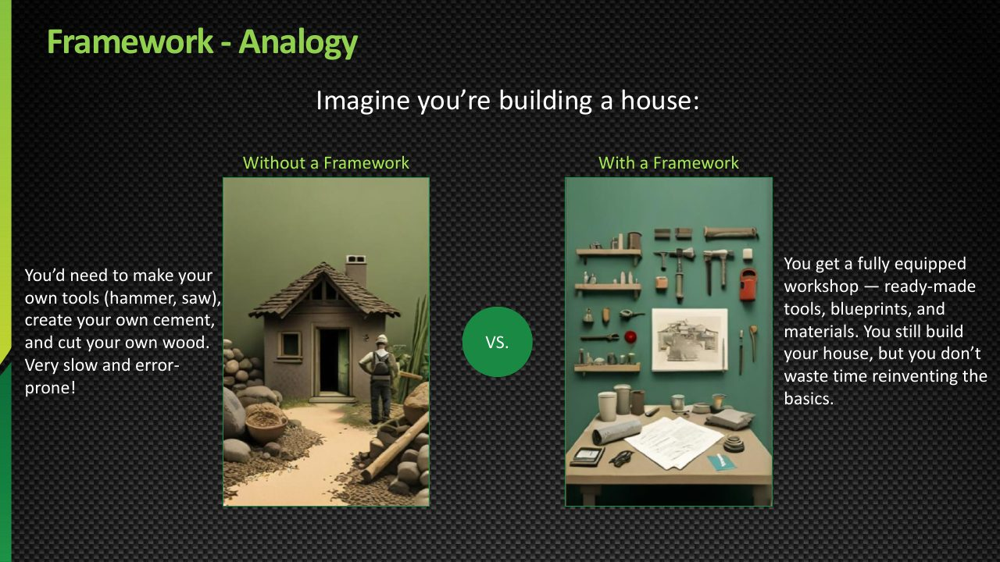
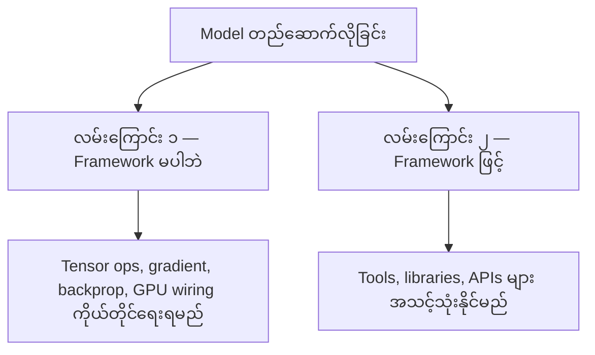
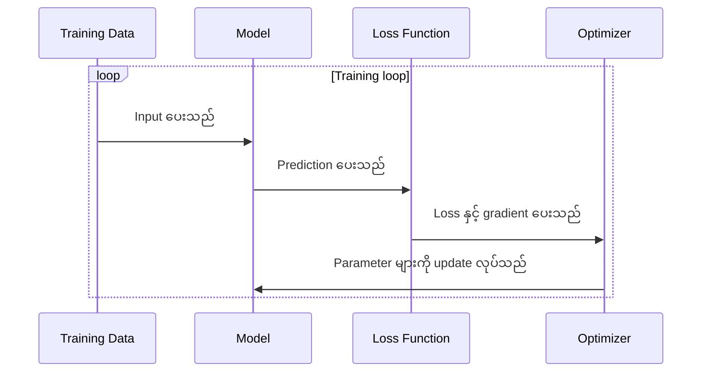
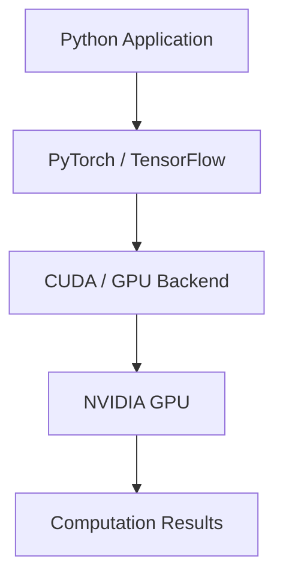
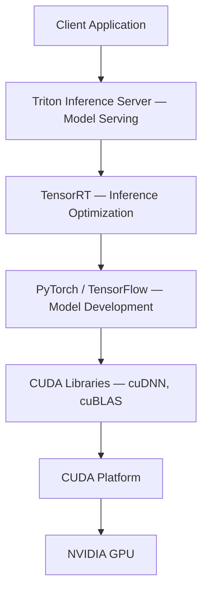
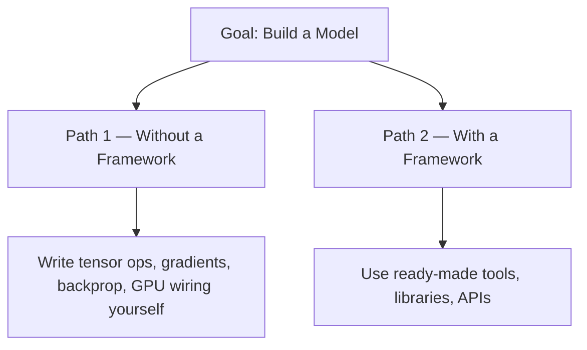
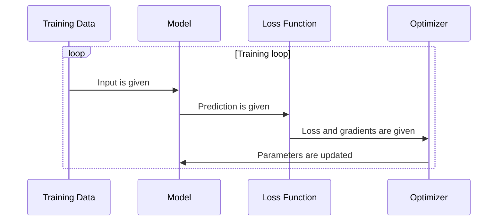

# Module 33 — Machine Learning Frameworks: PyTorch, TensorFlow, Scikit-learn and XGBoost

> Part VI · Course Module 33 — topic notes

## မြန်မာဘာသာ version

## 1. Learning Objectives

ဤ Module ကို လေ့လာပြီးနောက် အောက်ပါအချက်များကို နားလည်နိုင်ရမည်။

- Machine Learning Framework ဆိုတာ ဘာလဲ။
- Framework မရှိဘဲ Model တစ်ခုတည်ဆောက်ရခြင်းနှင့် Framework ကို အသုံးပြုခြင်းတို့၏ ကွာခြားချက်။
- PyTorch နှင့် TensorFlow တို့က ဘယ်လိုကူညီပေးသလဲ။
- Layer, Loss Function နှင့် Optimizer တို့၏ အခန်းကဏ္ဍ။
- Framework တစ်ခုက NVIDIA GPU ကို ဘယ်လိုအသုံးပြုနိုင်သလဲ။
- PyTorch, TensorFlow, Scikit-learn နှင့် XGBoost တို့ကို ဘယ်အချိန်တွင် အသုံးပြုသင့်သလဲ။

## 2. Framework ဆိုတာဘာလဲ?

Machine Learning Framework ဆိုသည်မှာ Machine Learning Model များကို တည်ဆောက်ခြင်း၊ Training လုပ်ခြင်း၊ Testing လုပ်ခြင်းနှင့် အချို့အခြေအနေများတွင် Deploy လုပ်ခြင်းတို့ကို ပိုမိုလွယ်ကူစေရန် အသင့်ပြင်ဆင်ပေးထားသော Software Tools, Libraries, APIs နှင့် Programming Components များ၏ အစုဖြစ်သည်။

Framework များကို အသုံးပြုခြင်းဖြင့် အခြေခံလုပ်ဆောင်ချက်အားလုံးကို ကိုယ်တိုင် အစမှအဆုံး ရေးသားစရာမလိုတော့ပါ။

**2.1 အိမ်ဆောက်ခြင်းနှင့် နှိုင်းယှဉ်ကြည့်မယ်**

အိမ်တစ်လုံး ဆောက်နေတယ်လို့ စိတ်ကူးကြည့်ပါ။

- သံတူ၊ လွှနှင့် အခြားကိရိယာများကို ကိုယ်တိုင်ပြင်ဆင်ရမယ်။ အုတ်စီနည်း၊ သစ်သားဖြတ်နည်းနဲ့ အခြေခံတည်ဆောက်ပုံတွေကိုလည်း ကိုယ်တိုင် လေ့လာရမယ်။ အချိန်ပိုကုန်ပြီး အမှားများနိုင်တယ်။
- လိုအပ်တဲ့ကိရိယာတွေ၊ အသုံးပြုနိုင်တဲ့ ပစ္စည်းတွေ၊ ဒီဇိုင်းပုံစံတွေနဲ့ လုပ်ငန်းစဉ်အချို့ကို ကြိုတင်ပြင်ဆင်ထားတဲ့ workshop တစ်ခု ရှိနေသလိုပါပဲ။ အခြေခံအရာတွေကို ပြန်တည်ဆောက်နေစရာမလိုဘဲ ကိုယ့်အိမ်ရဲ့ ဒီဇိုင်းနဲ့ လိုအပ်ချက်တွေကို အာရုံစိုက်နိုင်တယ်။

Machine Learning Framework တွေကလည်း အလားတူပဲ ဖြစ်ပါတယ်။



**ပုံရှင်းလင်းချက်** — ဒီသင်တန်းပုံက ML Framework ကို အိမ်ဆောက်ခြင်းနဲ့ နှိုင်းယှဉ်ပြထားတဲ့ analogy slide ဖြစ်ပါတယ်။ ကိရိယာတွေ ကိုယ်တိုင်ပြင်ပြီး အုတ်စီနည်း၊ သစ်သားဖြတ်နည်း စတဲ့ အခြေခံတည်ဆောက်ပုံတွေ ကိုယ်တိုင် လေ့လာရသလို framework မပါဘဲ model ကို အစကနေ ရေးရရင် အချိန်ပိုကုန်ပြီး အမှားများနိုင်ပါတယ်။ ကိရိယာ၊ ပစ္စည်းနဲ့ ဒီဇိုင်းပုံစံတွေ ကြိုတင် ပြင်ဆင်ထားတဲ့ workshop ရှိသလို framework က tools, libraries နဲ့ APIs တွေ အသင့် ပေးထားတဲ့အတွက် ကိုယ့် model ဒီဇိုင်းအပေါ်သာ အာရုံစိုက်နိုင်ပါတယ်။ ဒါပေမဲ့ အိမ်ဒီဇိုင်းကို ပိုင်ရှင်က ဆုံးဖြတ်ရသလို model architecture နဲ့ training configuration ကိုတော့ developer သို့မဟုတ် data scientist ကပဲ ဆုံးဖြတ်ရတုန်း ဖြစ်ပါတယ်။

*(Source: NVIDIA NCA-AIIO training deck — study material)*

ဥပမာ Neural Network တစ်ခု တည်ဆောက်ချင်တယ်ဆိုရင် Tensor တွေကို ကိုယ်တိုင်စီမံခြင်း၊ Gradient တွေတွက်ချက်ခြင်း၊ Backpropagation ရေးသားခြင်းနဲ့ GPU operation တွေကို ကိုယ်တိုင်ချိတ်ဆက်ခြင်းတို့ကို အစမှရေးနိုင်ပေမဲ့ အလွန်ရှုပ်ထွေးပါတယ်။

PyTorch သို့မဟုတ် TensorFlow ကို အသုံးပြုရင် ဒီလိုလုပ်ဆောင်ချက်များအတွက် အသင့်သုံးနိုင်တဲ့ APIs နဲ့ libraries တွေ ရရှိပါတယ်။

မှတ်ထားရန် — Framework က အလုပ်အားလုံးကို ကိုယ့်အစား အလိုအလျောက်ပြီးစီးပေးတဲ့ အရာမဟုတ်ပါဘူး။ Model architecture ရွေးချယ်ခြင်း၊ Data ပြင်ဆင်ခြင်း၊ Training configuration ချမှတ်ခြင်းနဲ့ Result စစ်ဆေးခြင်းတို့ကို Developer သို့မဟုတ် Data Scientist က ဆုံးဖြတ်လုပ်ဆောင်ရတုန်းပါပဲ။

**ပုံ ၁ (Figure 1) — Framework မပါဘဲ တည်ဆောက်ခြင်းနှင့် Framework ဖြင့် တည်ဆောက်ခြင်း**



**ပုံရှင်းလင်းချက်** — အပေါ်ဆုံးက Model တည်ဆောက်လိုသည့် ရည်ရွယ်ချက်ကနေ လမ်းကြောင်းနှစ်ခု ခွဲသွားပါသည်။ ဘယ်ဘက်လမ်းကြောင်းတွင် tensor operation, gradient တွက်ချက်ခြင်း၊ backpropagation နှင့် GPU operation ချိတ်ဆက်ခြင်း အားလုံးကို ကိုယ်တိုင်ရေးရမည်ဖြစ်၍ အချိန်ပိုကုန်ပြီး အမှားများနိုင်ပါသည်။ ညာဘက်လမ်းကြောင်းတွင် Framework က tools, libraries နှင့် APIs များ အသင့်ပေးထားသောကြောင့် ကိုယ့် model ဒီဇိုင်းအပေါ် အာရုံစိုက်နိုင်ပါသည်။


## 3. Framework က ဘာတွေ ပံ့ပိုးပေးသလဲ?

Machine Learning Framework တစ်ခုမှာ အောက်ပါအရာများ ပါဝင်နိုင်ပါတယ်။

| Component | အဓိပ္ပာယ် | ဥပမာအသုံးပြုပုံ |
|---|---|---|
| Tensor Operations | Multi-dimensional data တွေကို တွက်ချက်ခြင်း | Matrix multiplication |
| Model Layers | Neural Network အစိတ်အပိုင်းများ | Linear layer, convolution layer |
| Loss Functions | ခန့်မှန်းချက်နဲ့ အဖြေမှန် ဘယ်လောက်ကွာသလဲ တိုင်းတာခြင်း | Cross-entropy loss |
| Optimizers | Training အတွင်း Model parameters တွေကို update လုပ်ခြင်း | SGD, Adam |
| Automatic Differentiation | Gradient တွေကို အလိုအလျောက်တွက်ချက်ပေးခြင်း | Backpropagation အတွက် gradient ရယူခြင်း |
| Hardware Support | Supported GPU သို့မဟုတ် အခြား accelerator တွေမှာ operation များလုပ်ဆောင်ခြင်း | NVIDIA GPU ပေါ်မှာ tensor computation လုပ်ခြင်း |
| Model Utilities | Model save/load နှင့် training workflow အချို့ကို ပံ့ပိုးခြင်း | Checkpoint သိမ်းခြင်း၊ Model ပြန်ဖွင့်ခြင်း |

Data Cleaning, Data Versioning, Experiment Tracking နှင့် Production Monitoring တို့ကို Framework တစ်ခုတည်းက အားလုံးပံ့ပိုးပေးမည်ဟု မယူဆသင့်ပါ။ ထိုလုပ်ငန်းများအတွက် သီးခြား Libraries, Platforms သို့မဟုတ် Tools များ လိုအပ်နိုင်ပါတယ်။

**ပုံ ၂ (Figure 2) — Training Loop တွင် Layer, Loss Function နှင့် Optimizer ပါဝင်ပုံ**



**ပုံရှင်းလင်းချက်** — Training Data က input ပေးပြီး Model ရဲ့ layer တွေက prediction ကို တွက်ပေးပါသည်။ Loss Function က prediction နဲ့ အဖြေမှန် ဘယ်လောက်ကွာလဲဆိုတာကို loss အဖြစ် တိုင်းတာပြီး Automatic Differentiation ကနေ ရလာတဲ့ gradient နဲ့အတူ Optimizer ကို ပေးပါသည်။ Optimizer က model parameter တွေကို update လုပ်ပြီး loop က နောက် batch နဲ့ ဆက်လက် လည်ပတ်ပါသည်။


## 4. PyTorch ဆိုတာဘာလဲ?

PyTorch သည် Python ကို အခြေခံပြီး Deep Learning Model များကို တည်ဆောက်ခြင်း၊ Training လုပ်ခြင်းနှင့် Experimentation ပြုလုပ်ခြင်းတို့အတွက် အသုံးပြုသော Machine Learning Framework ဖြစ်ပါတယ်။

အဓိကအသုံးဝင်တဲ့ အချက်တွေကတော့—

- Tensor တွေကို ဖန်တီးပြီး တွက်ချက်နိုင်တယ်။
- Neural Network Layers တွေကို တည်ဆောက်နိုင်တယ်။
- Automatic Differentiation နဲ့ Gradient တွေတွက်ချက်နိုင်တယ်။
- Optimizer တွေကို အသုံးပြုပြီး Model parameters တွေကို update လုပ်နိုင်တယ်။
- Supported configuration များတွင် NVIDIA GPU ကို အသုံးပြုနိုင်တယ်။
- Training လုပ်နေစဉ် Model checkpoint များကို သိမ်းဆည်းပြီး ပြန်လည်အသုံးပြုနိုင်တယ်။

PyTorch ကို Research, Prototyping, Computer Vision, Natural Language Processing နဲ့ Large Language Model development တို့မှာ အသုံးပြုကြပါတယ်။

**ရိုးရှင်းသော PyTorch ဥပမာ**

```python
import torch
from torch import nn

# Create a simple neural network layer
model = nn.Linear(3, 1)

# Create one input sample with 3 features
x = torch.tensor([[1.0, 2.0, 3.0]])

# Run the model
prediction = model(x)

print(prediction)
```

ဤဥပမာမှာ—

- `torch` က Tensor နဲ့ အခြေခံ computation များကို ပံ့ပိုးပေးတယ်။
- `nn.Linear(3, 1)` က input feature ၃ ခုကို output တန်ဖိုးတစ်ခုအဖြစ် ပြောင်းပေးနိုင်တဲ့ Linear Layer တစ်ခု ဖန်တီးတယ်။
- `x` က input data ဖြစ်တယ်။
- `model(x)` က Model ကို input ပေးပြီး output တွက်ချက်တယ်။

ဤ code သည် Training မလုပ်သေးပါ။ Model ရဲ့ initial parameters တွေကို အသုံးပြုပြီး forward computation သာ လုပ်ထားတာဖြစ်ပါတယ်။

## 5. TensorFlow ဆိုတာဘာလဲ?

TensorFlow သည် Machine Learning နဲ့ Deep Learning Model များကို တည်ဆောက်ခြင်း၊ Training လုပ်ခြင်းနှင့် Deploy လုပ်ခြင်းတို့အတွက် အသုံးပြုနိုင်သော Framework ဖြစ်ပါတယ်။

TensorFlow ecosystem တွင် `tf.keras` ကဲ့သို့ APIs များမှတစ်ဆင့် Neural Network Model များကို တည်ဆောက်နိုင်ပါတယ်။

အဓိကလုပ်ဆောင်ချက်များမှာ—

- Tensor computation။
- Neural Network Layer များတည်ဆောက်ခြင်း။
- Gradient တွက်ချက်ခြင်းနှင့် Model Training။
- Supported hardware ပေါ်တွင် accelerated computation။
- Model export နှင့် deployment workflow အချို့ကို ပံ့ပိုးခြင်း။

PyTorch နှင့် TensorFlow တို့သည် ရည်ရွယ်ချက်များစွာ တူညီကြသော်လည်း API design, ecosystem, development workflow နှင့် deployment options များ ကွာခြားနိုင်ပါတယ်။

**ရိုးရှင်းသော TensorFlow ဥပမာ**

```python
import tensorflow as tf

# Create a simple neural network layer
model = tf.keras.Sequential([
    tf.keras.layers.Dense(1, input_shape=(3,))
])

# Create one input sample with 3 features
x = tf.constant([[1.0, 2.0, 3.0]])

# Run the model
prediction = model(x)

print(prediction)
```

ဤဥပမာသည် Input feature ၃ ခုမှ output တန်ဖိုးတစ်ခု ထုတ်ပေးမည့် Dense Layer ကို တည်ဆောက်ထားတာဖြစ်ပါတယ်။ PyTorch ဥပမာကဲ့သို့ပင် Model ကို Training မလုပ်ရသေးပါ။

## 6. PyTorch နှင့် TensorFlow နှိုင်းယှဉ်ခြင်း

| အချက် | PyTorch | TensorFlow |
|---|---|---|
| အဓိကရည်ရွယ်ချက် | Deep Learning development နှင့် training | Machine Learning development, training နှင့် deployment |
| Model တည်ဆောက်ခြင်း | `torch.nn` စသည်တို့ | `tf.keras` စသည်တို့ |
| Automatic Differentiation | Autograd | GradientTape နှင့် ဆက်စပ် APIs |
| NVIDIA GPU Acceleration | Supported CUDA configurations | Supported GPU configurations |
| Model Training | ပံ့ပိုးသည် | ပံ့ပိုးသည် |
| Inference | ပံ့ပိုးသည် | ပံ့ပိုးသည် |
| ရွေးချယ်သင့်သည့် Framework | Project, Team နှင့် Ecosystem ပေါ်မူတည် | Project, Team နှင့် Ecosystem ပေါ်မူတည် |

Framework တစ်ခုသည် အမြဲတမ်း နောက်တစ်ခုထက် ပိုကောင်းသည်ဟု မဆိုနိုင်ပါ။ လက်ရှိ project ၏ requirements, model architecture, team experience, library compatibility နဲ့ deployment environment တို့ကို ကြည့်ပြီး ရွေးချယ်သင့်ပါတယ်။

## 7. NVIDIA GPU နဲ့ Framework တွေ ဘယ်လိုအလုပ်လုပ်သလဲ?

Machine Learning Framework သည် NVIDIA GPU ကို အသုံးပြုနိုင်သည့်အခါ Model ၏ သင့်လျော်သော computation များကို GPU ပေါ်တွင် လုပ်ဆောင်စေနိုင်ပါတယ်။

ရိုးရှင်းသော conceptual flow ကတော့—

```
       Python Application
                |
                v
    +------------------------+
    | PyTorch / TensorFlow   |
    | Model + Tensor Ops     |
    +------------------------+
                |
                v
    +------------------------+
    | CUDA / GPU Backend     |
    | Supported Operations   |
    +------------------------+
                |
                v
    +------------------------+
    | NVIDIA GPU             |
    | Parallel Computation   |
    +------------------------+
                |
                v
       Computation Results
```

Python code က framework API မှတစ်ဆင့် model နှင့် tensor operation များကို ဖော်ပြပြီး၊ framework က ထောက်ပံ့ထားသော operation များကို CUDA / GPU backend မှတစ်ဆင့် NVIDIA GPU ပေါ်တွင် parallel computation အဖြစ် ဆောင်ရွက်ပေးပါတယ်။ အားလုံးသော operation များ သို့မဟုတ် အမြဲတမ်း GPU ပေါ်တွင် အလိုအလျောက် မသွားပါ — model architecture, operator support, software version နှင့် configuration ပေါ် မူတည်ပါတယ်။

ဤပုံသည် နားလည်ရလွယ်စေရန် ရေးဆွဲထားသော conceptual diagram ဖြစ်ပါတယ်။ တကယ့် software stack တွင် Framework, CUDA runtime, libraries, driver နှင့် အခြား component များ၏ ဆက်နွယ်မှုသည် framework version နှင့် installation method ပေါ်မူတည်နိုင်ပါတယ်။

**ပုံ ၃ (Figure 3) — Python မှ Framework၊ CUDA ဖြင့် GPU သို့ သွားပုံ**



**ပုံရှင်းလင်းချက်** — Python application က framework API ကတစ်ဆင့် model နဲ့ tensor operation တွေကို ဖော်ပြပါသည်။ Framework က ထောက်ပံ့ထားသော operation တွေကို CUDA / GPU backend ကတစ်ဆင့် NVIDIA GPU ပေါ်မှာ parallel computation အဖြစ် ဆောင်ရွက်ပြီး ရလဒ်တွေ ပြန်ပေးပါသည်။ Operation အားလုံး အလိုအလျောက် GPU ပေါ် မရောက်နိုင်ဘူးဆိုတာကိုလည်း မှတ်ထားပါ။


**CPU နဲ့ GPU အခန်းကဏ္ဍ**

CPU သည် Program logic, data preparation, orchestration နဲ့ အခြားအလုပ်များကို လုပ်ဆောင်နိုင်ပါတယ်။ GPU သည် သင့်လျော်သော parallel numerical operations များကို အရှိန်မြှင့်နိုင်ပါတယ်။

ဥပမာ Neural Network Training တွင် Matrix Multiplication ကဲ့သို့ computation များသည် GPU acceleration မှ အကျိုးကျေးဇူးရနိုင်ပါတယ်။

သို့သော် Framework အသုံးပြုထားရုံဖြင့် Python code အားလုံးသည် GPU ပေါ်တွင် အလိုအလျောက် အလုပ်လုပ်မည် မဟုတ်ပါ။ Operation support, tensor placement, software installation နဲ့ device configuration တို့ မှန်ကန်ဖို့ လိုအပ်ပါတယ်။

## 8. အခြား Framework များ — Scikit-learn နှင့် XGBoost

PyTorch နဲ့ TensorFlow တို့သည် Deep Learning အတွက် လူသိများသော Framework များဖြစ်သော်လည်း Machine Learning အတွက် အခြားရွေးချယ်စရာများလည်း ရှိပါတယ်။

**8.1 Scikit-learn**

Scikit-learn သည် Classical Machine Learning အတွက် အသုံးများသော Python library ဖြစ်ပါတယ်။

ဥပမာ—

- Logistic Regression။
- Decision Trees။
- Random Forests။
- Clustering။
- Data preprocessing နှင့် model evaluation utilities။

Tabular data များနှင့် classical ML problems များအတွက် အသုံးဝင်ပါတယ်။ သို့သော် Scikit-learn ၏ ပုံမှန် estimators အများစုသည် NVIDIA CUDA GPU acceleration ကို native အနေဖြင့် အလိုအလျောက် မသုံးပါ။ GPU acceleration လိုအပ်ပါက သက်ဆိုင်ရာ GPU-enabled library သို့မဟုတ် အခြား implementation တစ်ခု လိုအပ်နိုင်ပါတယ်။

**8.2 XGBoost**

XGBoost သည် Gradient Boosted Decision Trees ကို အခြေခံသော Machine Learning library ဖြစ်ပါတယ်။ Tabular data, classification, regression နှင့် ranking tasks များတွင် အသုံးများပါတယ်။

သက်ဆိုင်ရာ version နှင့် supported configuration များတွင် XGBoost သည် NVIDIA GPU acceleration ကို အသုံးပြုနိုင်ပါတယ်။ ဥပမာ version အသစ်များတွင် `device="cuda"` ကဲ့သို့ setting ကို အသုံးပြုနိုင်သော်လည်း ကိုယ့် version ၏ documentation ကို စစ်ဆေးသင့်ပါတယ်။

**8.3 ဘယ် Framework ကို ရွေးချယ်သင့်သလဲ?**

| Use case | စတင်စဉ်းစားနိုင်သည့် Tool |
|---|---|
| Neural Network နှင့် Deep Learning | PyTorch သို့မဟုတ် TensorFlow |
| LLM နှင့် Computer Vision development | PyTorch နှင့် သက်ဆိုင်ရာ model ecosystem |
| Classical ML နှင့် tabular data | Scikit-learn |
| Gradient-boosted trees | XGBoost |
| NVIDIA GPU inference optimization | TensorRT |
| Model serving | Triton Inference Server |

ဤဇယားသည် စတင်ရွေးချယ်ရန် လမ်းညွှန်သာဖြစ်ပါတယ်။ Tool ရွေးချယ်မှုသည် model, data, compatibility, performance requirements နှင့် deployment architecture တို့အပေါ် မူတည်ပါတယ်။

## 9. Framework, CUDA, TensorRT နှင့် Triton တို့၏ ကွာခြားချက်

AI Infrastructure ကို လေ့လာရာတွင် ဤနာမည်များကို တစ်ခုတည်းလို မမှတ်ယူသင့်ပါ။

| Technology | အဓိကတာဝန် |
|---|---|
| PyTorch / TensorFlow | Model development, training နှင့် inference APIs |
| CUDA | NVIDIA GPU programming platform နှင့် programming model |
| CUDA Libraries | GPU computation အတွက် optimized functions များ |
| TensorRT | Supported NVIDIA GPU inference workload များကို optimize လုပ်ခြင်း |
| Triton Inference Server | Model များကို client application များထံ serving လုပ်ခြင်း |

ဥပမာအားဖြင့် PyTorch ဖြင့် Model တစ်ခုကို Train လုပ်ပြီးနောက် လိုအပ်ပါက TensorRT အတွက် သင့်လျော်သော format သို့ export/convert လုပ်ကာ Triton Inference Server မှတစ်ဆင့် serving လုပ်နိုင်ပါတယ်။ သို့သော် model နှင့် backend အားလုံးအတွက် workflow တစ်ပုံစံတည်း မဟုတ်ပါ။

**ပုံ ၄ (Figure 4) — Framework, CUDA, TensorRT နှင့် Triton တို့၏ အဆင့်လိုက် နေရာ**



**ပုံရှင်းလင်းချက်** — အပေါ်ဆုံးက Client Application ကနေ အောက်ကို လိုက်ကြည့်ပါ။ Triton က model ကို client တွေဆီ serve လုပ်ပေးပြီး TensorRT က inference performance ကို optimize လုပ်ပေးပါသည်။ PyTorch / TensorFlow က model development နှင့် training အတွက် အလုပ်လုပ်ပြီး အောက်ဆုံးမှာ CUDA platform နဲ့ NVIDIA GPU က တကယ့် computation ကို လုပ်ဆောင်ပါသည်။ တစ်ခုချင်းစီရဲ့ တာဝန် မတူညီတာကို ဤပုံတွင် မြင်နိုင်ပါသည်။


## 10. Exam Notes

- **Framework** — Model development နှင့် training ကို လွယ်ကူစေသော tools, libraries နှင့် APIs များ။
- **PyTorch** — Deep Learning framework။
- **TensorFlow** — Machine Learning နှင့် Deep Learning framework။
- **Layer** — Neural Network ၏ computation အစိတ်အပိုင်း။
- **Loss Function** — Model prediction နှင့် expected answer တို့၏ ကွာခြားချက်ကို တိုင်းတာခြင်း။
- **Optimizer** — Training အတွင်း model parameters များကို update လုပ်ရန် အသုံးပြုခြင်း။
- **GPU Acceleration** — Supported operations များကို GPU ပေါ်တွင် အရှိန်မြှင့်လုပ်ဆောင်ခြင်း။
- **Scikit-learn** — Classical Machine Learning library; ပုံမှန် estimators အများစုသည် CUDA GPU ကို native အနေဖြင့် မသုံးပါ။
- **XGBoost** — Gradient-boosted trees library; supported configuration များတွင် GPU acceleration ရနိုင်သည်။
- **Framework ≠ CUDA** — Framework က model development ကို ကူညီပေးပြီး CUDA က NVIDIA GPU programming ecosystem ၏ အစိတ်အပိုင်းဖြစ်သည်။

## 11. ကိုယ်တိုင်စစ်ဆေးရန် မေးခွန်းများ (Review Questions)

**မေးခွန်း ၁ — Machine Learning Framework ဆိုတာ ဘာလဲ? Framework မရှိဘဲ model တည်ဆောက်ရင် ဘာဖြစ်နိုင်သလဲ?**

အဖြေ — Framework ဆိုသည်မှာ ML model များ တည်ဆောက်၊ training, testing နှင့် အချို့အခြေအနေတွင် deploy လုပ်ရာတွင် အသုံးပြုနိုင်သော software tools, libraries, APIs များ၏ အစုဖြစ်သည်။ Framework မရှိဘဲ tensor operation, gradient တွက်ချက်ခြင်း၊ backpropagation နှင့် GPU operation ချိတ်ဆက်ခြင်း အားလုံးကို ကိုယ်တိုင်ရေးရမည်ဖြစ်၍ အချိန်ပိုကုန်ပြီး အမှားများနိုင်သည်။

**မေးခွန်း ၂ — Framework တစ်ခုက ဘာတွေ ပံ့ပိုးပေးသလဲ? ဘာတွေကို ပံ့ပိုးပေးမည် မဟုတ်ဘူးလဲ?**

အဖြေ — Tensor operations, model layers, loss functions, optimizers, automatic differentiation, hardware (GPU) support နှင့် model save/load ကဲ့သို့ utilities များ ပံ့ပိုးပေးသည်။ Data cleaning, data versioning, experiment tracking နှင့် production monitoring ကဲ့သို့ လုပ်ငန်းများကို framework တစ်ခုတည်းက အားလုံး ပံ့ပိုးပေးမည်ဟု မယူဆရ — သီးခြား tools များ လိုအပ်နိုင်သည်။

**မေးခွန်း ၃ — အောက်ပါ PyTorch code က training လုပ်ထားခြင်း ဟုတ်/မဟုတ်?**

```python
model = nn.Linear(3, 1)
x = torch.tensor([[1.0, 2.0, 3.0]])
prediction = model(x)
```

အဖြေ — မဟုတ်ပါ။ ဤ code သည် initial parameters များဖြင့် forward computation သာ ပြုလုပ်ခြင်းဖြစ်ပြီး training မလုပ်ရသေးပါ (loss, optimizer နှင့် update loop မပါဝင်ပါ)။

**မေးခွန်း ၄ — PyTorch နှင့် TensorFlow အနက် မည်သည့် framework ကို ရွေးချယ်သင့်သနည်း?**

အဖြေ — တစ်ခုက အမြဲတမ်း ပိုကောင်းသည်ဟု မဆိုနိုင်ပါ။ project requirements, model architecture, team experience, library compatibility နှင့် deployment environment ပေါ်မူတည်၍ ရွေးချယ်သင့်ပါသည်။ နှစ်ခုစလုံးက training နှင့် inference နှစ်မျိုးလုံးကို ပံ့ပိုးနိုင်သည်။

**မေးခွန်း ၅ — Framework တစ်ခုက NVIDIA GPU ကို ဘယ်လိုအသုံးပြုသလဲ? GPU အသုံးပြုရုံနှင့် အားလုံး အမြန်ဆုံးဖြစ်မည်လား?**

အဖြေ — Python application က framework API မှတစ်ဆင့် model နှင့် tensor ops ကို ဖော်ပြပြီး framework က ၎င်းကို CUDA / GPU backend မှတစ်ဆင့် NVIDIA GPU ပေါ်တွင် parallel computation အဖြစ် ဆောင်ရွက်ပေးသည်။ သို့သော် operator support, model architecture, software version နှင့် configuration ပေါ်မူတည်၍ အားလုံး GPU ပေါ် အလိုအလျောက် မသွားနိုင်ဘဲ performance လည်း အလိုအလျောက် အကောင်းဆုံး မဖြစ်နိုင်ပါ။

**မေးခွန်း ၆ — Framework ကို အိမ်ဆောက်ခြင်းနှင့် နှိုင်းယှဉ်ခြင်းက ဘယ်လို နားလည်ရလွယ်စေသလဲ?**

အဖြေ — Framework သည် ကိရိယာ၊ ပစ္စည်းနှင့် လုပ်ငန်းစဉ်အချို့ ကြိုတင်ပြင်ဆင်ပြီးသား workshop ကဲ့သို့ ဖြစ်ပြီး model သည် ကိုယ့်အိမ်ဒီဇိုင်းကဲ့သို့ ဖြစ်သည်။ အခြေခံအရာများကို ပြန်တည်ဆောက်စရာ မလိုသော်လည်း ဒီဇိုင်းနှင့် ဆုံးဖြတ်ချက်များကို ကိုယ်တိုင် ချမှတ်ရသေးသည်။

**မေးခွန်း ၇ — PyTorch နှင့် TensorFlow တို့၏ အဓိကရည်ရွယ်ချက်က ဘာလဲ?**

အဖြေ — PyTorch သည် deep learning model များ တည်ဆောက်၊ training နှင့် experiment လုပ်ရန် framework ဖြစ်ပြီး၊ TensorFlow သည် machine learning နှင့် deep learning model များ တည်ဆောက်၊ training နှင့် deploy လုပ်ရန် framework ဖြစ်သည်။ နှစ်ခုစလုံးသည် model development နှင့် training ကို အဓိက ပံ့ပိုးသည်။

**မေးခွန်း ၈ — Layer, Loss Function နှင့် Optimizer တို့၏ အခန်းကဏ္ဍကို ရှင်းပြပါ။**

အဖြေ — Layer သည် Neural Network ၏ computation အစိတ်အပိုင်းဖြစ်သည်။ Loss Function သည် model prediction နှင့် မျှော်လင့်ထားသော အဖြေတို့၏ ကွာခြားချက်ကို တိုင်းတာသည်။ Optimizer သည် training အတွင်း gradient များကို အသုံးပြုပြီး model parameters များကို update လုပ်ပေးသည်။

**မေးခွန်း ၉ — Scikit-learn နှင့် XGBoost တို့သည် ဘယ်လိုကွာခြားသလဲ?**

အဖြေ — Scikit-learn သည် classical machine learning library ဖြစ်ပြီး logistic regression, decision trees, random forests, clustering နှင့် preprocessing/evaluation utilities များ ပါဝင်သည်။ ၎င်း၏ ပုံမှန် estimators အများစုက CUDA GPU acceleration ကို native အနေဖြင့် မသုံးပါ။ XGBoost သည် gradient boosted decision trees library ဖြစ်ပြီး tabular data, classification, regression နှင့် ranking အတွက် အသုံးများပြီး သင့်လျော်သော version နှင့် supported configuration များတွင် GPU acceleration ရနိုင်သည် (ဥပမာ version အသစ်များတွင် `device="cuda"` — ကိုယ့် version ၏ documentation ကို စစ်ဆေးပါ)။

**မေးခွန်း ၁၀ — Framework, CUDA, TensorRT နှင့် Triton Inference Server တို့၏ အဓိကတာဝန်များကို ခွဲခြားဖော်ပြပါ။**

အဖြေ — PyTorch/TensorFlow က model development, training နှင့် inference APIs များ ပေးသည်။ CUDA က NVIDIA GPU programming platform နှင့် programming model ဖြစ်သည်။ CUDA libraries များက GPU computation အတွက် optimized functions များ ပေးသည်။ TensorRT က supported NVIDIA GPU inference workload များကို optimize လုပ်ပေးသည်။ Triton Inference Server က model များကို client application များထံ serving လုပ်ပေးသည်။

## 12. Module Summary

- **Machine Learning Framework** သည် model တည်ဆောက်ခြင်း၊ training, testing နှင့် အချို့အခြေအနေတွင် deployment ကို လွယ်ကူစေသော tools, libraries နှင့် APIs များ၏ အစုဖြစ်သည်။
- Framework က tensor operations, model layers, loss functions, optimizers, automatic differentiation နှင့် hardware support ကို ပံ့ပိုးပေးသည်။
- **PyTorch** သည် Python အခြေခံ deep learning framework ဖြစ်ပြီး research, prototyping, CV, NLP နှင့် LLM development တွင် အသုံးများသည်။
- **TensorFlow** သည် ML/DL model တည်ဆောက်၊ training နှင့် deployment အတွက် framework ဖြစ်ပြီး `tf.keras` ကဲ့သို့ APIs များ အသုံးပြုနိုင်သည်။
- Framework ရွေးချယ်မှုသည် project, team နှင့် ecosystem ပေါ် မူတည်သည် — တစ်ခုက အမြဲ ပိုကောင်းသည်ဟု မဆိုနိုင်ပါ။
- Framework က NVIDIA GPU ကို CUDA / GPU backend မှတစ်ဆင့် အသုံးပြု၍ supported computation များကို GPU ပေါ်တွင် parallel ဆောင်ရွက်နိုင်သည်။
- **Scikit-learn** သည် classical ML အတွက် ဖြစ်ပြီး ၎င်း၏ ပုံမှန် estimators အများစုက CUDA GPU ကို native အနေဖြင့် မသုံးပါ။ **XGBoost** သည် gradient-boosted trees အတွက် ဖြစ်ပြီး သင့်လျော်သော version နှင့် configuration များတွင် GPU acceleration ရနိုင်သည်။
- Framework မရှိဘဲ အရာအားလုံးကို အစမှရေးသားနိုင်သော်လည်း အချိန်ပိုကုန်ပြီး ရှုပ်ထွေးနိုင်သည်။

**အဓိက မှတ်သားရန်**

- PyTorch / TensorFlow = Model Development and Training
- CUDA = NVIDIA GPU Programming Platform
- TensorRT = Inference Optimization
- Triton = Model Serving

NVIDIA GPU acceleration ရရှိနိုင်မှုသည် tool, version, operation နှင့် configuration ပေါ်မူတည်ကြောင်းလည်း မှတ်သားထားရပါမယ်။

**Memory trick** — Framework = workshop ၊ model = ကိုယ့်အိမ်ဒီဇိုင်း။ ကိရိယာတွေ အသင့်ရှိပေမဲ့ ဒီဇိုင်းနှင့် ဆုံးဖြတ်ချက်များကို ကိုယ်တိုင် ချမှတ်ရသေးသည်။

## English Version

## 1. Learning Objectives

After studying this module you should be able to —

- Explain what a machine learning framework is.
- Describe the difference between building a model without a framework and using one.
- Explain how PyTorch and TensorFlow help.
- Describe the roles of layers, loss functions, and optimizers.
- Explain how a framework can use an NVIDIA GPU.
- Know when to use PyTorch, TensorFlow, Scikit-learn, and XGBoost.

## 2. What Is a Framework?

A machine learning framework is a set of software tools, libraries, APIs, and programming components prepared to make it easier to build, train, test, and — in some cases — deploy machine learning models.

By using a framework you no longer have to write every fundamental operation yourself from start to finish.

**2.1 Compare It with Building a House**

Imagine you are building a house.

- You would have to prepare the hammer, saw, and other tools yourself, and learn basic construction techniques such as laying bricks and cutting timber yourself. It takes more time and is prone to mistakes.
- It is like having a workshop where the needed tools, usable materials, design patterns, and some processes are prepared in advance. You can focus on your house's design and requirements without rebuilding the basics.

Machine learning frameworks work the same way.


**Figure walkthrough** — This training slide shows the house-building analogy for ML frameworks. Preparing the hammer, saw, and construction techniques yourself is like writing tensor operations, gradients, and GPU wiring from scratch — slow and error-prone. A workshop where the tools, materials, and design patterns are prepared in advance is like a framework that provides ready-made tools, libraries, and APIs, so you can focus on your model's design. But just as the homeowner still decides the house design, the developer or data scientist still decides the model architecture and training configuration.

*(Source: NVIDIA NCA-AIIO training deck — study material)*

For example, if you want to build a neural network, you could manage tensors yourself, compute gradients, write backpropagation, and wire up GPU operations from scratch — but it is extremely complicated.

With PyTorch or TensorFlow, ready-to-use APIs and libraries exist for these operations.

Remember — a framework is not something that does all the work for you automatically. The developer or data scientist still decides the model architecture, prepares the data, sets the training configuration, and checks the results.

**Figure 1 — Building without a Framework versus Building with a Framework**



**Figure walkthrough** — At the top, the goal is to build a model, and two paths branch from it. On the left path you must write tensor operations, gradient computation, backpropagation, and GPU wiring yourself — slower and error-prone. On the right path the framework provides tools, libraries, and APIs, so you can focus on your model's design.


## 3. What Does a Framework Provide?

A machine learning framework can include the following.

| Component | Meaning | Example Use |
|---|---|---|
| Tensor Operations | Computing on multi-dimensional data | Matrix multiplication |
| Model Layers | Neural network building blocks | Linear layer, convolution layer |
| Loss Functions | Measuring how far predictions are from the answers | Cross-entropy loss |
| Optimizers | Updating model parameters during training | SGD, Adam |
| Automatic Differentiation | Computing gradients automatically | Obtaining gradients for backpropagation |
| Hardware Support | Running operations on supported GPUs or other accelerators | Tensor computation on an NVIDIA GPU |
| Model Utilities | Supporting model save/load and some training workflows | Saving checkpoints, restoring a model |

Do not assume a single framework provides everything — data cleaning, data versioning, experiment tracking, and production monitoring. Those tasks may require separate libraries, platforms, or tools.

**Figure 2 — How Layers, the Loss Function, and the Optimizer Take Part in the Training Loop**



**Figure walkthrough** — Training data provides the input, and the model's layers compute the prediction. The loss function measures how far the prediction is from the expected answer and passes the loss, together with the gradients from automatic differentiation, to the optimizer. The optimizer updates the model parameters, and the loop continues with the next batch.


## 4. What Is PyTorch?

PyTorch is a machine learning framework based on Python, used for building, training, and experimenting with deep learning models.

Its main useful capabilities are —

- Creating and computing with tensors.
- Building neural network layers.
- Computing gradients with automatic differentiation.
- Using optimizers to update model parameters.
- Using NVIDIA GPUs in supported configurations.
- Saving model checkpoints during training and reusing them.

PyTorch is used in research, prototyping, computer vision, natural language processing, and large language model development.

**A Simple PyTorch Example**

```python
import torch
from torch import nn

# Create a simple neural network layer
model = nn.Linear(3, 1)

# Create one input sample with 3 features
x = torch.tensor([[1.0, 2.0, 3.0]])

# Run the model
prediction = model(x)

print(prediction)
```

In this example —

- `torch` provides tensors and basic computation.
- `nn.Linear(3, 1)` creates a Linear Layer that can turn 3 input features into one output value.
- `x` is the input data.
- `model(x)` gives input to the model and computes the output.

This code does not perform training. It only performs a forward computation using the model's initial parameters.

## 5. What Is TensorFlow?

TensorFlow is a framework for building, training, and deploying machine learning and deep learning models.

In the TensorFlow ecosystem you can build neural network models through APIs such as `tf.keras`.

Its main functions are —

- Tensor computation.
- Building neural network layers.
- Gradient computation and model training.
- Accelerated computation on supported hardware.
- Supporting some model export and deployment workflows.

PyTorch and TensorFlow share many goals, but their API design, ecosystem, development workflow, and deployment options can differ.

**A Simple TensorFlow Example**

```python
import tensorflow as tf

# Create a simple neural network layer
model = tf.keras.Sequential([
    tf.keras.layers.Dense(1, input_shape=(3,))
])

# Create one input sample with 3 features
x = tf.constant([[1.0, 2.0, 3.0]])

# Run the model
prediction = model(x)

print(prediction)
```

This example builds a Dense Layer that will produce one output value from 3 input features. Like the PyTorch example, the model has not been trained yet.

## 6. PyTorch vs TensorFlow

| Point | PyTorch | TensorFlow |
|---|---|---|
| Main Purpose | Deep learning development and training | Machine learning development, training and deployment |
| Building Models | `torch.nn` and related APIs | `tf.keras` and related APIs |
| Automatic Differentiation | Autograd | GradientTape and related APIs |
| NVIDIA GPU Acceleration | Supported CUDA configurations | Supported GPU configurations |
| Model Training | Supported | Supported |
| Inference | Supported | Supported |
| Which Framework to Choose | Depends on the project, team, and ecosystem | Depends on the project, team, and ecosystem |

One framework is not always better than another. Choose based on the current project's requirements, model architecture, team experience, library compatibility, and deployment environment.

## 7. How Do Frameworks Work with an NVIDIA GPU?

When a machine learning framework can use an NVIDIA GPU, it can run the model's suitable computations on the GPU.

The simple conceptual flow is —

```
       Python Application
                |
                v
    +------------------------+
    | PyTorch / TensorFlow   |
    | Model + Tensor Ops     |
    +------------------------+
                |
                v
    +------------------------+
    | CUDA / GPU Backend     |
    | Supported Operations   |
    +------------------------+
                |
                v
    +------------------------+
    | NVIDIA GPU             |
    | Parallel Computation   |
    +------------------------+
                |
                v
       Computation Results
```

The Python code describes the model and tensor operations through framework APIs, and the framework executes its supported operations on the NVIDIA GPU as parallel computation through the CUDA / GPU backend. Not every operation automatically runs on the GPU — it depends on the model architecture, operator support, software version, and configuration.

This figure is a conceptual diagram drawn to make the idea easy to understand. In a real software stack, how the framework, CUDA runtime, libraries, driver, and other components relate to one another can depend on the framework version and the installation method.

**Figure 3 — From Python through the Framework and CUDA to the GPU**


**Figure walkthrough** — The Python application describes the model and tensor operations through framework APIs. The framework runs its supported operations on the NVIDIA GPU as parallel computation through the CUDA / GPU backend and returns the results. Remember that not every operation automatically runs on the GPU.


**CPU and GPU Roles**

The CPU can handle program logic, data preparation, orchestration, and other work. The GPU can accelerate suitable parallel numerical operations.

For example, in neural network training, computations such as matrix multiplication can benefit from GPU acceleration.

However, using a framework alone does not make all Python code run automatically on the GPU. Operation support, tensor placement, software installation, and device configuration all need to be correct.

## 8. Other Frameworks — Scikit-learn and XGBoost

PyTorch and TensorFlow are well-known frameworks for deep learning, but other options also exist for machine learning.

**8.1 Scikit-learn**

Scikit-learn is a Python library commonly used for classical machine learning.

Examples —

- Logistic Regression.
- Decision Trees.
- Random Forests.
- Clustering.
- Data preprocessing and model evaluation utilities.

It is useful for tabular data and classical ML problems. However, most regular Scikit-learn estimators do not use NVIDIA CUDA GPU acceleration natively by default. If GPU acceleration is needed, a suitable GPU-enabled library or another implementation may be required.

**8.2 XGBoost**

XGBoost is a machine learning library based on gradient boosted decision trees. It is commonly used for tabular data, classification, regression, and ranking tasks.

In suitable versions and supported configurations, XGBoost can use NVIDIA GPU acceleration. For example, newer versions may support a setting such as `device="cuda"`, but you should check the documentation for your version.

**8.3 Which Framework Should You Choose?**

| Use case | Tool to start considering |
|---|---|
| Neural networks and deep learning | PyTorch or TensorFlow |
| LLM and computer vision development | PyTorch and its related model ecosystem |
| Classical ML and tabular data | Scikit-learn |
| Gradient-boosted trees | XGBoost |
| NVIDIA GPU inference optimization | TensorRT |
| Model serving | Triton Inference Server |

This table is only a starting guide. Tool choice depends on the model, data, compatibility, performance requirements, and deployment architecture.

## 9. Differences between Framework, CUDA, TensorRT, and Triton

When studying AI infrastructure, these names should not be treated as one single thing.

| Technology | Main Responsibility |
|---|---|
| PyTorch / TensorFlow | Model development, training, and inference APIs |
| CUDA | NVIDIA GPU programming platform and programming model |
| CUDA Libraries | Optimized functions for GPU computation |
| TensorRT | Optimizing supported NVIDIA GPU inference workloads |
| Triton Inference Server | Serving models to client applications |

For example, after training a model with PyTorch, you can export/convert it to a suitable format for TensorRT if needed and serve it through Triton Inference Server. However, this is not one single workflow for every model and backend.

**Figure 4 — Where Framework, CUDA, TensorRT, and Triton Sit in the Stack**


**Figure walkthrough** — Start at the Client Application at the top and move downward. Triton serves the model to clients, and TensorRT optimizes inference performance. PyTorch / TensorFlow handle model development and training, and at the bottom the CUDA platform and the NVIDIA GPU perform the actual computation. The figure shows that each component has a different responsibility.


## 10. Exam Notes

- **Framework** — tools, libraries, and APIs that make model development and training easier.
- **PyTorch** — deep learning framework.
- **TensorFlow** — machine learning and deep learning framework.
- **Layer** — a computation building block of a neural network.
- **Loss Function** — measures the difference between the model's prediction and the expected answer.
- **Optimizer** — used to update model parameters during training.
- **GPU Acceleration** — running supported operations faster on the GPU.
- **Scikit-learn** — classical machine learning library; most regular estimators do not use CUDA GPUs natively.
- **XGBoost** — gradient-boosted trees library; GPU acceleration can be available in supported configurations.
- **Framework ≠ CUDA** — a framework helps with model development, while CUDA is part of the NVIDIA GPU programming ecosystem.

## 11. Review Questions (Self-Check)

**Question 1 — What is a machine learning framework? What can happen if you build a model without one?**

Answer — A framework is a set of software tools, libraries, and APIs for building, training, testing, and in some cases deploying ML models. Without one, you would have to write tensor operations, gradient computation, backpropagation, and GPU wiring yourself — slower and error-prone.

**Question 2 — What does a framework provide? What does it not provide?**

Answer — It provides tensor operations, model layers, loss functions, optimizers, automatic differentiation, hardware (GPU) support, and utilities such as model save/load. Do not assume one framework covers everything — data cleaning, data versioning, experiment tracking, and production monitoring may need separate tools.

**Question 3 — Does the following PyTorch code train the model?**

```python
model = nn.Linear(3, 1)
x = torch.tensor([[1.0, 2.0, 3.0]])
prediction = model(x)
```

Answer — No. It only performs a forward computation with initial parameters; training has not happened (no loss, optimizer, or update loop).

**Question 4 — Which framework should you choose, PyTorch or TensorFlow?**

Answer — Neither is always better. Choose based on project requirements, model architecture, team experience, library compatibility, and the deployment environment. Both support training and inference.

**Question 5 — How does a framework use an NVIDIA GPU? Does using a GPU make everything fastest automatically?**

Answer — The Python application describes the model and tensor ops through framework APIs, and the framework runs them on the NVIDIA GPU as parallel computation through the CUDA / GPU backend. However, depending on operator support, model architecture, software version, and configuration, not everything automatically runs on the GPU, and performance is not automatically optimal.

**Question 6 — How does the house-building analogy help you understand a framework?**

Answer — A framework is like a workshop where tools, materials, and some processes are prepared in advance, while the model is your own house design. You do not rebuild the basics, but the design and the decisions are still yours.

**Question 7 — What are the main purposes of PyTorch and TensorFlow?**

Answer — PyTorch is a deep learning framework for building, training, and experimenting with models. TensorFlow is a framework for building, training, and deploying machine learning and deep learning models. Both mainly support model development and training.

**Question 8 — Explain the roles of Layer, Loss Function, and Optimizer.**

Answer — A Layer is a computation building block of a neural network. A Loss Function measures the difference between the model's prediction and the expected answer. An Optimizer uses the gradients to update model parameters during training.

**Question 9 — How do Scikit-learn and XGBoost differ?**

Answer — Scikit-learn is a classical machine learning library (logistic regression, decision trees, random forests, clustering, preprocessing and evaluation utilities), and most of its regular estimators do not use CUDA GPU acceleration natively. XGBoost is a gradient boosted decision trees library commonly used for tabular data, classification, regression, and ranking; in suitable versions and supported configurations it can use NVIDIA GPU acceleration (for example `device="cuda"` in newer versions — check the documentation for your version).

**Question 10 — Distinguish the main responsibilities of Framework, CUDA, TensorRT, and Triton Inference Server.**

Answer — PyTorch/TensorFlow provide model development, training, and inference APIs. CUDA is the NVIDIA GPU programming platform and programming model. CUDA libraries provide optimized functions for GPU computation. TensorRT optimizes supported NVIDIA GPU inference workloads. Triton Inference Server serves models to client applications.

## 12. Module Summary

- A **machine learning framework** is a set of tools, libraries, and APIs that make building, training, testing, and in some cases deploying models easier.
- A framework provides tensor operations, model layers, loss functions, optimizers, automatic differentiation, and hardware support.
- **PyTorch** is a Python-based deep learning framework commonly used for research, prototyping, CV, NLP, and LLM development.
- **TensorFlow** is a framework for building, training, and deploying ML/DL models, with APIs such as `tf.keras`.
- Framework choice depends on the project, team, and ecosystem — one is not always better.
- A framework can use an NVIDIA GPU through the CUDA / GPU backend to run supported computations in parallel on the GPU.
- **Scikit-learn** is for classical ML, and most of its regular estimators do not use CUDA GPUs natively. **XGBoost** is for gradient-boosted trees, and GPU acceleration can be available in suitable versions and configurations.
- Everything can be written from scratch without a framework, but it takes more time and becomes complicated.

**Key points to remember**

- PyTorch / TensorFlow = Model Development and Training
- CUDA = NVIDIA GPU Programming Platform
- TensorRT = Inference Optimization
- Triton = Model Serving

NVIDIA GPU acceleration availability also depends on the tool, version, operation, and configuration.

**Memory trick** — Framework = workshop, model = your house design. The tools are ready, but the design and decisions are still yours.

## Technical review notes

- The PyTorch and TensorFlow code examples are preserved verbatim from the source transcript, including the comments; both examples perform forward computation only (no training), as the source notes.
- The module tail — the conceptual-diagram disclaimer, CPU/GPU roles (§7), the other-frameworks section (§8: 8.1 Scikit-learn, 8.2 XGBoost, 8.3 framework choice table), the Framework vs CUDA vs TensorRT vs Triton differences (§9), Exam Notes (§10), review questions (§11) and summary (§12) — is taken from the supplied source transcript (msg_2792.txt). The source cut point is the line "Module 34 — NVIDIA's Differentiator: CUDA, cuDNN and GPU-Accelerated Frameworks", where the next module begins.
- Seam note: the tail opens with a disclaimer about a conceptual diagram whose antecedent figure sits before the cut point; the disclaimer is placed at the end of section 7 beside the module's GPU execution flow diagram. Its wording — the real software stack relates the framework, CUDA runtime, libraries, driver, and other components, depending on framework version and installation method — is preserved.
- The former section 8 "needs verification" stub is replaced with the real source content. Source caveats preserved: most regular Scikit-learn estimators do not use NVIDIA CUDA GPU acceleration natively; XGBoost GPU support depends on version and supported configuration (`device="cuda"` in newer versions — check your version's documentation).
- The 8.3 tool choice table is preserved with its source caveat: it is only a starting guide, and tool choice depends on the model, data, compatibility, performance requirements, and deployment architecture. The "framework use alone does not automatically run all Python code on GPU" caution is preserved in section 7.
- The source tail numbers these sections 8–12 and the file now follows that numbering; the previously editor-added self-check questions and module summary were renumbered to 11 and 12 and merged with the source's review questions and summary. Source review questions 1 and 5 are already covered by existing questions 1 and 5; the remaining source questions are added as 6–10 with concise answers per the course writing rules.
- The comparison claims (Autograd vs GradientTape, `torch.nn` vs `tf.keras`) follow the source table; "which framework to choose depends on project, team, and ecosystem" is preserved as the conclusion — no framework is claimed to be universally superior.
- Stray `</box>` markup artifacts in the source house-building analogy were removed; the analogy's meaning is unchanged.
- The claim that a framework does not replace data cleaning, data versioning, experiment tracking, or production monitoring is preserved as an operational caution.
- Mermaid figures (Figure 1–4 in each language section, same numbering) with figure walkthroughs were added inline; all existing text, code examples, ASCII diagrams and section numbering are unchanged.
