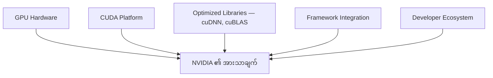
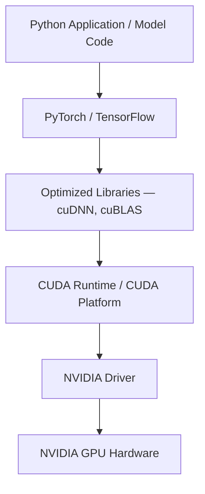
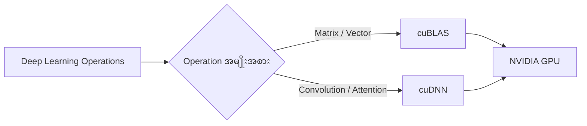
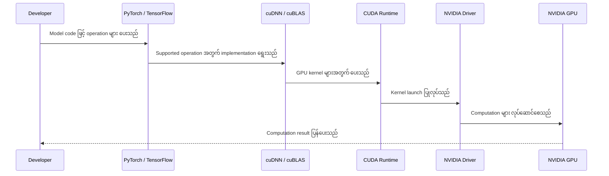
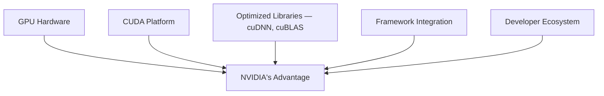
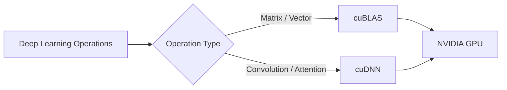
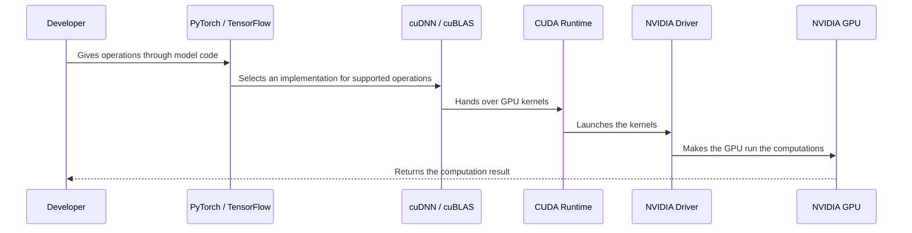

# Module 34 — NVIDIA's Differentiator: CUDA, cuDNN and GPU-Accelerated Frameworks

> Part VI · Course Module 34 — topic notes

## မြန်မာဘာသာ version

## 1. သင်ခန်းစာ၏ ရည်ရွယ်ချက်

ဤ Module သည် NVIDIA GPU တွင် AI Model များကို မြန်ဆန်ထိရောက်စွာ လုပ်ဆောင်နိုင်စေသည့် Software Ecosystem ကို နားလည်ရန် ရည်ရွယ်သည်။

လေ့လာပြီးနောက်—

- PyTorch နှင့် TensorFlow တို့က NVIDIA GPU ကို ဘယ်လိုအသုံးပြုနိုင်သလဲ။
- NVIDIA ၏ CUDA နှင့် cuDNN တို့ ဘာကွာသလဲ။
- Framework က Developer အတွက် ဘာတွေကို abstraction လုပ်ပေးသလဲ။
- NVIDIA ၏ differentiator သည် GPU hardware တစ်ခုတည်းမဟုတ်ဘဲ software stack တစ်ခုလုံးဖြစ်ရခြင်းကို နားလည်နိုင်မည်။
- cuBLAS, cuDNN, CUDA Runtime နှင့် NVIDIA Driver တို့၏ အခန်းကဏ္ဍကို ခွဲခြားနိုင်မည်။

## 2. NVIDIA က PyTorch နဲ့ TensorFlow ရှိပြီးသားအချိန်မှာ ဘာကြောင့် အရေးကြီးသလဲ?

PyTorch နဲ့ TensorFlow တို့သည် AI Model များကို တည်ဆောက်၊ Train နှင့် Evaluate လုပ်ရန် Developer များကို ကူညီပေးသော Framework များဖြစ်သည်။

ဒါပေမဲ့ Framework ရှိရုံဖြင့် GPU တစ်ခုက အမြင့်ဆုံးစွမ်းဆောင်ရည်ဖြင့် အလိုအလျောက် အလုပ်လုပ်မည်မဟုတ်ပါ။ Model က လုပ်ဆောင်နေသော operation များကို GPU ပေါ်တွင် ဘယ်လို execute လုပ်မလဲ၊ ဘယ် algorithm ကိုရွေးမလဲ၊ memory ကို ဘယ်လိုအသုံးပြုမလဲ၊ hardware capability ကို ဘယ်လိုအကျိုးရှိစွာ အသုံးချမလဲဆိုတာလည်း အရေးကြီးသည်။

ဤနေရာတွင် NVIDIA ၏ software ecosystem က အရေးပါလာသည်။

NVIDIA ၏ အားသာချက်ကို အောက်ပါအချက်များဖြင့် နားလည်နိုင်သည်။

- **GPU Hardware** — Parallel computation အတွက် ဒီဇိုင်းထုတ်ထားသော GPU များ။
- **CUDA Platform** — NVIDIA GPU ပေါ်တွင် computation များလုပ်ဆောင်နိုင်ရန် programming platform နှင့် model။
- **Optimized Libraries** — cuDNN, cuBLAS ကဲ့သို့ operation အမျိုးအစားအလိုက် optimize လုပ်ထားသော libraries။
- **Framework Integration** — PyTorch နှင့် TensorFlow ကဲ့သို့ Framework များက supported NVIDIA GPU acceleration ကို အသုံးပြုနိုင်ခြင်း။
- **Developer Ecosystem** — Libraries, profiling tools, debugging tools, documentation နှင့် deployment technologies များ။

အဓိကအယူအဆက NVIDIA က GPU chip တစ်ခုတည်းကိုသာ မပေးဘဲ GPU ကို အကျိုးရှိစွာ အသုံးပြုနိုင်စေသော software ecosystem ကိုပါ ပံ့ပိုးပေးသည် ဆိုတာဖြစ်သည်။

**ပုံ ၁ (Figure 1) — NVIDIA ၏ အားသာချက်ကို ဖွဲ့စည်းထားသော အစိတ်အပိုင်း ၅ ခု**



**ပုံရှင်းလင်းချက်** — ဘယ်ဘက်က အစိတ်အပိုင်း ၅ ခုစလုံးက ညာဘက်က "NVIDIA ၏ အားသာချက်" ဆီကို မြားချောင်းတွေနဲ့ ဆက်နေပါသည်။ GPU hardware တစ်ခုတည်း မဟုတ်ဘဲ CUDA platform၊ optimized libraries၊ framework integration နှင့် developer ecosystem အားလုံး အတူတကွ အလုပ်လုပ်မှ ဤအားသာချက် ဖြစ်လာတာ ဖြစ်ပါသည်။


## 3. Python Code မှ GPU အထိ ဘယ်လိုသွားသလဲ?

Developer တစ်ဦးက Python ဖြင့် Neural Network တစ်ခု တည်ဆောက်ထားသည်ဟု ယူဆပါစို့။

```python
import torch
from torch import nn

model = nn.Linear(1024, 512).cuda()
x = torch.randn(32, 1024, device="cuda")

output = model(x)
```

ဤဥပမာတွင် model နှင့် x ကို CUDA device ပေါ်တွင် အသုံးပြုရန် သတ်မှတ်ထားသည်။ လက်တွေ့အသုံးပြုရာတွင် သင့်တော်သော NVIDIA Driver၊ CUDA-enabled PyTorch build နှင့် လိုအပ်သော dependencies များ ရှိရမည်။

Developer သည် GPU instruction တစ်ခုချင်းစီကို ကိုယ်တိုင်ရေးရန် မလိုအပ်ပါ။ Framework က tensor operation များကို စီမံပေးပြီး သက်ဆိုင်ရာ backend နှင့် optimized libraries များကို အသုံးပြုနိုင်သည်။

Conceptual software flow

```
+----------------------------------+
| Python Application / Model Code  |
+----------------------------------+
                  |
                  v
+----------------------------------+
| PyTorch / TensorFlow              |
| High-Level Framework APIs         |
+----------------------------------+
                  |
                  v
+----------------------------------+
| Optimized Libraries               |
| cuDNN / cuBLAS / Other Libraries  |
+----------------------------------+
                  |
                  v
+----------------------------------+
| CUDA Runtime / CUDA Platform      |
+----------------------------------+
                  |
                  v
+----------------------------------+
| NVIDIA Driver                     |
+----------------------------------+
                  |
                  v
+----------------------------------+
| NVIDIA GPU Hardware               |
+----------------------------------+
```

ဤပုံသည် နားလည်ရလွယ်စေရန် ဖော်ပြထားသော conceptual diagram ဖြစ်သည်။ တကယ့် execution path သည် Framework, operation, software version နှင့် configuration ပေါ်မူတည်သည်။ Operation အားလုံးက cuDNN ကို ဖြတ်သန်းရမည်ဟု မဆိုလိုပါ။ ဥပမာ general matrix multiplication အတွက် cuBLAS ကဲ့သို့ library ကို အသုံးပြုနိုင်သည်။

**ပုံ ၂ (Figure 2) — Python Code မှ NVIDIA GPU အထိ ဆင်းသက်ပုံ**



**ပုံရှင်းလင်းချက်** — အပေါ်ဆုံးက Python code ကနေ အောက်သို့ တစ်ဆင့်ချင်း လိုက်ကြည့်ပါ။ Framework က operation တွေကို စီမံပြီး optimized libraries (cuDNN, cuBLAS) ကို အသုံးပြုနိုင်ပါသည်။ အောက်တွင် CUDA Runtime နှင့် NVIDIA Driver က ဖြတ်သန်းပြီး နောက်ဆုံးမှာ NVIDIA GPU hardware က computation ကို လုပ်ဆောင်ပါသည်။ အလယ်က software layer တွေကို developer က ကိုယ်တိုင်ရေးစရာ မလိုပါ။


## 4. CUDA ဆိုတာဘာလဲ?

CUDA သည် NVIDIA မှ တီထွင်ထားသော parallel computing platform နှင့် programming model ဖြစ်သည်။

CUDA သည် Framework မဟုတ်ပါ။ GPU computation ကို ရေးသား၊ စီမံ၊ execute လုပ်နိုင်ရန် software ecosystem ကို ပံ့ပိုးပေးသည်။

CUDA ecosystem တွင် အောက်ပါ component များ ပါဝင်နိုင်သည်။

- CUDA programming model။
- CUDA Runtime API နှင့် Driver API။
- CUDA Toolkit ထဲရှိ compiler နှင့် developer tools။
- cuBLAS, cuFFT နှင့် အခြား GPU-accelerated libraries။
- Debugging နှင့် profiling tools။

CUDA ကို အသုံးပြုရန် Developer တစ်ဦးသည် CUDA C++ ဖြင့် ကိုယ်တိုင် GPU kernel ရေးနိုင်သလို PyTorch ကဲ့သို့ high-level Framework ကို အသုံးပြုပြီး CUDA-compatible operation များကိုလည်း လုပ်ဆောင်နိုင်သည်။

Official reference: NVIDIA CUDA Programming Guide (https://docs.nvidia.com/cuda/cuda-programming-guide/index.html)

## 5. cuDNN ဆိုတာဘာလဲ?

cuDNN ၏ အမည်အပြည့်အစုံမှာ CUDA Deep Neural Network Library ဖြစ်သည်။

cuDNN သည် Deep Learning တွင် မကြာခဏအသုံးပြုသော operation များအတွက် NVIDIA GPU-accelerated, highly optimized implementations များ ပံ့ပိုးပေးသော library ဖြစ်သည်။

ဥပမာ—

- Convolution — Computer Vision model များတွင် အရေးကြီးသည်။
- Attention — Transformer architecture များတွင် အသုံးပြုသည်။
- Matrix multiplication နှင့် သက်ဆိုင်သော operation များ။
- Pooling။
- Normalization။
- Softmax။
- Activation နှင့် အခြား pointwise operations။
- Operation အချို့ကို ပေါင်းစပ်လုပ်ဆောင်သည့် fusion techniques များ။

cuDNN သည် operation တစ်ခုချင်းစီအတွက် optimized implementation များ ပေးရုံသာမက သင့်လျော်သော အခြေအနေများတွင် operation များစွာကို ပေါင်းစည်းပြီး execution overhead ကို လျှော့ချနိုင်သည်။

ဥပမာ Convolutional Neural Network တစ်ခုသည် convolution, activation နှင့် normalization ကဲ့သို့ operation များကို အဆင့်ဆင့် အသုံးပြုနိုင်သည်။ cuDNN သည် supported patterns များအတွက် ထိရောက်သော implementation များကို ပံ့ပိုးပေးနိုင်သည်။

Official reference: NVIDIA cuDNN Documentation (https://docs.nvidia.com/deeplearning/cudnn/latest/index.html)

## 6. cuBLAS နဲ့ cuDNN ဘာကွာသလဲ?

NVIDIA software stack တွင် library တစ်ခုချင်းစီက မတူညီသော computation အမျိုးအစားများအတွက် အထူးပြုထားသည်။

| Component | အဓိကတာဝန် |
|---|---|
| CUDA | NVIDIA GPU programming platform |
| cuBLAS | GPU-accelerated Basic Linear Algebra Subprograms; matrix နှင့် vector operations များ |
| cuDNN | Deep Learning အတွက် optimized primitives နှင့် operations များ |
| NVIDIA Driver | Operating system နှင့် NVIDIA GPU ကြား အခြေခံ software interface |
| CUDA Runtime | GPU memory, kernel launch နှင့် runtime operations များကို ပံ့ပိုးပေးသော API |
| PyTorch / TensorFlow | Model development နှင့် training အတွက် high-level framework များ |

cuBLAS နှင့် cuDNN တို့သည် အချို့ computation အမျိုးအစားများတွင် ဆက်နွယ်နိုင်သော်လည်း အခန်းကဏ္ဍ မတူညီကြပါ။

မှတ်သားရန် — cuDNN သည် "CUDA Distributed Neural Network" မဟုတ်ပါ။ ၎င်း၏အမည်အပြည့်အစုံမှာ CUDA Deep Neural Network Library ဖြစ်သည်။

**ပုံ ၃ (Figure 3) — Operation အမျိုးအစားအလိုက် cuBLAS နှင့် cuDNN သို့ ရောက်ရှိပုံ**



**ပုံရှင်းလင်းချက်** — Operation တွေက ဘယ်ဘက်ကနေ အလယ်က ဆုံးဖြတ်ချက်ချတဲ့ နေရာကို ရောက်လာပါသည်။ Matrix/vector operation တွေကတော့ cuBLAS ဘက်ကို သွားပြီး convolution၊ attention ကဲ့သို့ deep learning operation တွေကတော့ cuDNN ဘက်ကို သွားပါသည်။ နှစ်ခုစလုံးက နောက်ဆုံးမှာ NVIDIA GPU ပေါ်တွင် အလုပ်လုပ်ပါသည်။


## 7. Framework က ဒီအရာတွေကို ဘယ်လိုအသုံးပြုသလဲ?

Developer က PyTorch သို့မဟုတ် TensorFlow API ကို အသုံးပြုသောအခါ Framework သည် သက်ဆိုင်ရာ operation များကို စီမံပေးသည်။ Supported GPU operation များအတွက် CUDA နဲ့ optimized libraries များကို အသုံးပြုနိုင်သည်။

အကြမ်းဖျင်းအားဖြင့်—

- Developer က Model ကို Framework ဖြင့် တည်ဆောက်သည်။
- Input data နှင့် Model parameters များကို သက်ဆိုင်ရာ device ပေါ်တွင် ထားသည်။
- Framework က computation များကို execute လုပ်ရန် backend ကို အသုံးပြုသည်။
- Supported operation များအတွက် optimized library implementation များကို ရွေးချယ်အသုံးပြုနိုင်သည်။
- CUDA platform နှင့် NVIDIA Driver တို့က GPU execution အတွက် လိုအပ်သော software support ကို ပံ့ပိုးပေးသည်။
- GPU က သက်ဆိုင်ရာ computation များကို လုပ်ဆောင်သည်။

လက်တွေ့တွင် Framework သည် operation တစ်ခုချင်းစီအတွက် cuDNN ကို အမြဲခေါ်မည်မဟုတ်ပါ။ Operation အမျိုးအစားနှင့် supported backend ပေါ်မူတည်ပြီး cuBLAS သို့မဟုတ် အခြား implementation များကို အသုံးပြုနိုင်သည်။

**ပုံ ၄ (Figure 4) — Framework က Component များကို အသုံးပြုပုံ**



**ပုံရှင်းလင်းချက်** — Developer က model code နဲ့ operation တွေကို framework ကို ပေးပါသည်။ Framework က operation အမျိုးအစားပေါ် မူတည်ပြီး cuDNN သို့မဟုတ် cuBLAS ကဲ့သို့ implementation ကို ရွေးချယ်၊ CUDA Runtime နှင့် NVIDIA Driver ကတစ်ဆင့် GPU ပေါ်တွင် computation လုပ်ဆောင်ပြီး ရလဒ် ပြန်ပေးပါသည်။


## 8. NVIDIA ၏ Differentiator ကို အနှစ်ချုပ်ကြည့်မယ်

NVIDIA ၏ အားသာချက်ကို အောက်ပါနည်းလမ်းဖြင့် မှတ်သားနိုင်သည်။

**GPU Hardware + CUDA Platform + Optimized Libraries + Framework Integration + Developer Ecosystem**

ဤအချက်များ အတူတကွ အလုပ်လုပ်ခြင်းကြောင့် Developer များသည် GPU programming အဆင့်နိမ့်အသေးစိတ်များအားလုံးကို ကိုယ်တိုင်ရေးသားစရာမလိုဘဲ AI workload များကို တည်ဆောက်နိုင်သည်။

သို့သော် Performance တိုးတက်မှုသည် အလိုအလျောက် အာမခံထားခြင်း မဟုတ်ပါ။ Model architecture, input size, precision, batch size, GPU model, memory usage နှင့် software compatibility တို့ကလည်း အရေးကြီးသည်။

## 9. Exam Notes

- **CUDA** — NVIDIA parallel computing platform နှင့် programming model။
- **cuDNN** — CUDA Deep Neural Network Library; Deep Learning operation များအတွက် optimized implementations။
- **cuBLAS** — GPU-accelerated linear algebra library။
- **Framework** — PyTorch နှင့် TensorFlow ကဲ့သို့ Model development နှင့် training APIs များ။
- **NVIDIA Driver** — Operating system မှ GPU ကို အသုံးပြုနိုင်ရန် အခြေခံ software component။
- **CUDA Runtime** — GPU memory management, kernel launch နှင့် runtime APIs များ။
- **NVIDIA Differentiator** — GPU hardware တစ်ခုတည်းမဟုတ်ဘဲ CUDA, optimized libraries, framework integration နှင့် developer ecosystem တို့ပါဝင်ခြင်း။

အရေးကြီးသော သတိပြုရန်: Framework operation အားလုံးသည် cuDNN ကို အသုံးပြုသည်ဟု မယူဆရ။

## 10. Review Questions

**မေးခွန်း ၁ — NVIDIA ၏ differentiator ကို GPU hardware တစ်ခုတည်းနှင့် ဘာကြောင့် မသတ်မှတ်နိုင်သလဲ?**

အဖြေ — NVIDIA ၏ အားသာချက်သည် GPU hardware သာမက CUDA platform, optimized libraries (cuDNN, cuBLAS), framework integration နှင့် developer ecosystem တို့ ပေါင်းစပ်ပါဝင်သော software stack တစ်ခုလုံးကြောင့် ဖြစ်သည်။

**မေးခွန်း ၂ — CUDA ဆိုတာဘာလဲ? Framework နဲ့ ဘယ်လိုကွာသလဲ?**

အဖြေ — CUDA သည် NVIDIA ၏ parallel computing platform နှင့် programming model ဖြစ်ပြီး GPU computation ရေးသား၊ စီမံ၊ execute လုပ်ရန် software ecosystem ပေးသည်။ Framework (PyTorch, TensorFlow) များကမူ model တည်ဆောက်၊ training လုပ်ရန် high-level APIs ပေးပြီး အောက်ခြေတွင် CUDA ကို အသုံးပြုနိုင်သည်။

**မေးခွန်း ၃ — cuDNN ၏ အမည်အပြည့်အစုံနှင့် အဓိကလုပ်ဆောင်ချက်ကို ရှင်းပြပါ။**

အဖြေ — cuDNN = CUDA Deep Neural Network Library ("CUDA Distributed Neural Network" မဟုတ်ပါ)။ Deep Learning တွင် အသုံးများသော convolution, attention, pooling, normalization, softmax ကဲ့သို့ operation များအတွက် NVIDIA GPU-accelerated, highly optimized implementations များ ပေးသည်။

**မေးခွန်း ၄ — cuBLAS နှင့် cuDNN တို့၏ အဓိကကွာခြားချက်က ဘာလဲ?**

အဖြေ — cuBLAS သည် GPU-accelerated Basic Linear Algebra Subprograms ဖြစ်ပြီး matrix နှင့် vector operations များအတွက် အထူးပြုထားသည်။ cuDNN ကမူ Deep Learning အတွက် optimized primitives နှင့် operations များ ပေးသည်။ နှစ်ခုစလုံးက NVIDIA software stack ထဲရှိ အခန်းကဏ္ဍ မတူညီသော libraries များ ဖြစ်သည်။

**မေးခွန်း ၅ — PyTorch က NVIDIA GPU ကို အသုံးပြုသည့်အခါ CUDA နဲ့ optimized libraries တွေ ဘယ်လိုပါဝင်နိုင်သလဲ? Python code ရေးထားရုံဖြင့် GPU acceleration အမြဲရနိုင်သလား?**

အဖြေ — Framework က tensor operation များကို စီမံပြီး supported operation များအတွက် CUDA platform, cuBLAS သို့မဟုတ် cuDNN ကဲ့သို့ optimized library implementations များကို ရွေးချယ်အသုံးပြုနိုင်သည်။ သို့သော် code ရေးရုံဖြင့် GPU acceleration အမြဲ အလိုအလျောက် မရနိုပါ — driver, CUDA-enabled build, dependencies လိုအပ်ပြီး model architecture, operation support, software version နှင့် configuration ပေါ်လည်း မူတည်သည်။

## 11. Module Summary

NVIDIA ၏ AI computing ecosystem သည် GPU hardware နှင့် software တို့ ပေါင်းစပ်ထားခြင်းဖြစ်သည်။ PyTorch နှင့် TensorFlow ကဲ့သို့ Framework များက Developer များကို high-level APIs ပေးသည်။ CUDA က NVIDIA GPU programming platform ကို ပံ့ပိုးပေးပြီး cuDNN နှင့် cuBLAS ကဲ့သို့ libraries များက သက်ဆိုင်ရာ computation များအတွက် optimized implementations ပေးသည်။

အဓိက မှတ်သားရန် —

- CUDA = GPU programming platform။
- cuDNN = Deep Learning operations အတွက် optimized library။
- cuBLAS = Linear algebra operations အတွက် optimized library။
- PyTorch / TensorFlow = Model development နှင့် training frameworks။

ဤ software ecosystem တစ်ခုလုံးသည် NVIDIA ၏ GPU acceleration အားသာချက်ကို နားလည်ရန် အဓိကသော့ချက်ဖြစ်သည်။

## English Version

## 1. Learning Objectives

This module explains the software ecosystem that lets AI models run fast and efficiently on NVIDIA GPUs.

After studying this module you should be able to —

- Explain how PyTorch and TensorFlow use NVIDIA GPUs.
- Describe the difference between NVIDIA's CUDA and cuDNN.
- Explain what a framework abstracts away for the developer.
- Understand that NVIDIA's differentiator is not a single GPU chip but the whole software stack.
- Distinguish the roles of cuBLAS, cuDNN, CUDA Runtime and the NVIDIA Driver.

## 2. Why Does NVIDIA Matter When PyTorch and TensorFlow Already Exist?

PyTorch and TensorFlow are frameworks that help developers build, train and evaluate AI models.

But having a framework alone does not make a GPU run at peak performance automatically. How the model's operations are executed on the GPU, which algorithm is chosen, how memory is used, and how hardware capabilities are exploited effectively all matter too.

This is where NVIDIA's software ecosystem becomes important.

NVIDIA's advantage can be understood through the following elements:

- **GPU Hardware** — GPUs designed for parallel computation.
- **CUDA Platform** — the programming platform and model for running computations on NVIDIA GPUs.
- **Optimized Libraries** — libraries optimized per operation type, such as cuDNN and cuBLAS.
- **Framework Integration** — frameworks such as PyTorch and TensorFlow can use supported NVIDIA GPU acceleration.
- **Developer Ecosystem** — libraries, profiling tools, debugging tools, documentation and deployment technologies.

The key idea is that NVIDIA provides not just a GPU chip, but also the software ecosystem that lets you use that GPU effectively.

**Figure 1 — The Five Elements That Make Up NVIDIA's Advantage**



**Figure walkthrough** — All five elements on the left connect with arrows to "NVIDIA's Advantage" on the right. It is not a single GPU hardware chip: the CUDA platform, optimized libraries, framework integration, and the developer ecosystem all work together to create the advantage.


## 3. How Does Code Go from Python to the GPU?

Suppose a developer builds a neural network in Python.

```python
import torch
from torch import nn

model = nn.Linear(1024, 512).cuda()
x = torch.randn(32, 1024, device="cuda")

output = model(x)
```

In this example, `model` and `x` are designated to run on a CUDA device. In practice you need a suitable NVIDIA Driver, a CUDA-enabled PyTorch build and the required dependencies.

The developer does not have to write each GPU instruction by hand. The framework handles tensor operations and can use the relevant backend and optimized libraries.

Conceptual software flow

```
+----------------------------------+
| Python Application / Model Code  |
+----------------------------------+
                  |
                  v
+----------------------------------+
| PyTorch / TensorFlow              |
| High-Level Framework APIs         |
+----------------------------------+
                  |
                  v
+----------------------------------+
| Optimized Libraries               |
| cuDNN / cuBLAS / Other Libraries  |
+----------------------------------+
                  |
                  v
+----------------------------------+
| CUDA Runtime / CUDA Platform      |
+----------------------------------+
                  |
                  v
+----------------------------------+
| NVIDIA Driver                     |
+----------------------------------+
                  |
                  v
+----------------------------------+
| NVIDIA GPU Hardware               |
+----------------------------------+
```

This diagram is conceptual, for easier understanding. The real execution path depends on the framework, the operation, software versions and configuration. Not every operation passes through cuDNN — for example, general matrix multiplication may use a library such as cuBLAS.

**Figure 2 — How Python Code Reaches the NVIDIA GPU**


**Figure walkthrough** — Start with the Python code at the top and move down one layer at a time. The framework manages the operations and can use optimized libraries (cuDNN, cuBLAS). Below that, the CUDA Runtime and the NVIDIA Driver carry the work down, and finally the NVIDIA GPU hardware performs the computation. The developer does not have to write these middle software layers by hand.


## 4. What Is CUDA?

CUDA is a parallel computing platform and programming model invented by NVIDIA.

CUDA is not a framework. It provides the software ecosystem for writing, managing and executing GPU computation.

A CUDA ecosystem can include the following components:

- CUDA programming model.
- CUDA Runtime API and Driver API.
- Compilers and developer tools in the CUDA Toolkit.
- cuBLAS, cuFFT and other GPU-accelerated libraries.
- Debugging and profiling tools.

To use CUDA, a developer can write GPU kernels directly in CUDA C++, or use a high-level framework such as PyTorch to run CUDA-compatible operations.

Official reference: NVIDIA CUDA Programming Guide (https://docs.nvidia.com/cuda/cuda-programming-guide/index.html)

## 5. What Is cuDNN?

cuDNN stands for CUDA Deep Neural Network Library.

cuDNN is a library that provides NVIDIA GPU-accelerated, highly optimized implementations for operations frequently used in deep learning.

For example —

- Convolution — important in computer vision models.
- Attention — used in Transformer architectures.
- Matrix multiplication and related operations.
- Pooling.
- Normalization.
- Softmax.
- Activation and other pointwise operations.
- Fusion techniques that combine several operations.

cuDNN not only provides optimized implementations for individual operations; where appropriate it can combine many operations and reduce execution overhead.

For example, a convolutional neural network may apply operations such as convolution, activation and normalization in sequence. cuDNN can provide efficient implementations for supported patterns.

Official reference: NVIDIA cuDNN Documentation (https://docs.nvidia.com/deeplearning/cudnn/latest/index.html)

## 6. How Do cuBLAS and cuDNN Differ?

In the NVIDIA software stack each library specializes in different kinds of computation.

| Component | Main responsibility |
|---|---|
| CUDA | NVIDIA GPU programming platform |
| cuBLAS | GPU-accelerated Basic Linear Algebra Subprograms; matrix and vector operations |
| cuDNN | Optimized primitives and operations for deep learning |
| NVIDIA Driver | The basic software interface between the operating system and the NVIDIA GPU |
| CUDA Runtime | The API supporting GPU memory, kernel launch and runtime operations |
| PyTorch / TensorFlow | High-level frameworks for model development and training |

cuBLAS and cuDNN can relate to each other for some kinds of computation, but their roles are different.

Note — cuDNN is **not** "CUDA Distributed Neural Network". Its full name is CUDA Deep Neural Network Library.

**Figure 3 — How Operation Types Reach cuBLAS and cuDNN**



**Figure walkthrough** — Operations arrive from the left at the decision point in the middle. Matrix and vector operations go to cuBLAS, while deep learning operations such as convolution and attention go to cuDNN. Both ultimately run on the NVIDIA GPU.


## 7. How Do Frameworks Use These Components?

When a developer uses a PyTorch or TensorFlow API, the framework handles the relevant operations. For supported GPU operations it can use CUDA and the optimized libraries.

Roughly —

- The developer builds the model with the framework.
- Input data and model parameters are placed on the relevant device.
- The framework uses a backend to execute the computations.
- For supported operations it can select optimized library implementations.
- The CUDA platform and the NVIDIA Driver provide the software support needed for GPU execution.
- The GPU performs the computations.

In practice the framework will not call cuDNN for every single operation. Depending on the operation type and supported backend, it may use cuBLAS or other implementations.

**Figure 4 — How a Framework Uses the Components**



**Figure walkthrough** — The developer gives the model code and its operations to the framework. Depending on the operation type, the framework selects an implementation such as cuDNN or cuBLAS, and through the CUDA Runtime and the NVIDIA Driver the computation runs on the GPU and the result comes back.


## 8. Summarizing NVIDIA's Differentiator

NVIDIA's advantage can be memorized this way:

**GPU Hardware + CUDA Platform + Optimized Libraries + Framework Integration + Developer Ecosystem**

Because these work together, developers can build AI workloads without writing all the low-level GPU programming details themselves.

However, performance improvement is not guaranteed automatically. Model architecture, input size, precision, batch size, GPU model, memory usage and software compatibility also matter.

## 9. Exam Notes

- **CUDA** — NVIDIA's parallel computing platform and programming model.
- **cuDNN** — CUDA Deep Neural Network Library; optimized implementations for deep learning operations.
- **cuBLAS** — a GPU-accelerated linear algebra library.
- **Framework** — model development and training APIs such as PyTorch and TensorFlow.
- **NVIDIA Driver** — the basic software component that lets the operating system use the GPU.
- **CUDA Runtime** — GPU memory management, kernel launch and runtime APIs.
- **NVIDIA Differentiator** — not GPU hardware alone, but CUDA, optimized libraries, framework integration and the developer ecosystem together.

Important caution: do not assume that every framework operation uses cuDNN.

## 10. Review Questions

**Question 1 — Why can't NVIDIA's differentiator be defined as GPU hardware alone?**

Answer — NVIDIA's advantage comes from the whole software stack combining GPU hardware with the CUDA platform, optimized libraries (cuDNN, cuBLAS), framework integration and the developer ecosystem.

**Question 2 — What is CUDA? How does it differ from a framework?**

Answer — CUDA is NVIDIA's parallel computing platform and programming model; it provides the software ecosystem for writing, managing and executing GPU computation. Frameworks (PyTorch, TensorFlow) provide high-level APIs for building and training models, and can sit on top of CUDA.

**Question 3 — Explain cuDNN's full name and its main function.**

Answer — cuDNN = CUDA Deep Neural Network Library (not "CUDA Distributed Neural Network"). It provides NVIDIA GPU-accelerated, highly optimized implementations for operations commonly used in deep learning, such as convolution, attention, pooling, normalization and softmax.

**Question 4 — What is the main difference between cuBLAS and cuDNN?**

Answer — cuBLAS is the GPU-accelerated Basic Linear Algebra Subprograms library, specialized for matrix and vector operations. cuDNN provides optimized primitives and operations for deep learning. Both are libraries in the NVIDIA software stack with different roles.

**Question 5 — When PyTorch uses an NVIDIA GPU, how do CUDA and the optimized libraries get involved? Does writing Python code always give you GPU acceleration?**

Answer — The framework handles tensor operations and, for supported operations, can select implementations from the CUDA platform, cuBLAS or cuDNN. But writing code alone does not automatically give GPU acceleration — you need the right driver, a CUDA-enabled build and dependencies, and results also depend on model architecture, operation support, software versions and configuration.

## 11. Module Summary

NVIDIA's AI computing ecosystem combines GPU hardware with software. Frameworks such as PyTorch and TensorFlow give developers high-level APIs. CUDA supports the NVIDIA GPU programming platform, and libraries such as cuDNN and cuBLAS provide optimized implementations for the relevant computations.

Key takeaways —

- CUDA = GPU programming platform.
- cuDNN = optimized library for deep learning operations.
- cuBLAS = optimized library for linear algebra operations.
- PyTorch / TensorFlow = model development and training frameworks.

Understanding this whole software ecosystem is the key to understanding NVIDIA's GPU acceleration advantage.

## Technical review notes

- The supplied source transcript for Module 34 contains only Part 1 ("အပိုင်း ၁ — မြန်မာဘာသာဖြင့် အသေးစိတ်ရှင်းလင်းချက်") in Myanmar; no English part is present. The "## English Version" section is therefore a faithful technical translation of the Myanmar source, not source text, and both versions carry identical content, numbering, code, table and diagram.
- The source's section-6 component table arrived flattened into plain lines (header row "Component / အဓိကတာဝန်" followed by cell text); it is restored as a Markdown table with every cell preserved verbatim. The conceptual software flow diagram is preserved verbatim in a code block, including its original box borders.
- Source cut/seam points: the Module 34 body runs from its heading to the line before "Module 35 — Model Training vs. Model Inference" with no internal gaps; the "အပိုင်း ၁" label implies further parts may exist in other messages, but none were supplied. The Python example and both official documentation URLs are reproduced exactly as given in the source (no commands, specs or benchmarks were invented).
- The source lists 6 review questions without answers; per WRITING_RULES they are reduced to 5 self-check questions with concise answers — questions 5 and 6 (how PyTorch involves CUDA/libraries, and whether Python code alone guarantees GPU acceleration) are merged into one question, so all six original topics remain covered.
- Preserved source claims: cuDNN is not "CUDA Distributed Neural Network"; not every framework operation passes through cuDNN (general matrix multiplication may use cuBLAS); performance is not automatically guaranteed and depends on model architecture, input size, precision, batch size, GPU model, memory usage and software compatibility. The PyTorch snippet requires a suitable NVIDIA Driver and CUDA-enabled build, as the source states — version-specific compatibility is not asserted here (needs verification per environment).
- Mermaid figures (Figure 1–4 in each language section, same numbering) with figure walkthroughs were added inline; all existing text, code examples, ASCII diagrams and section numbering are unchanged.
