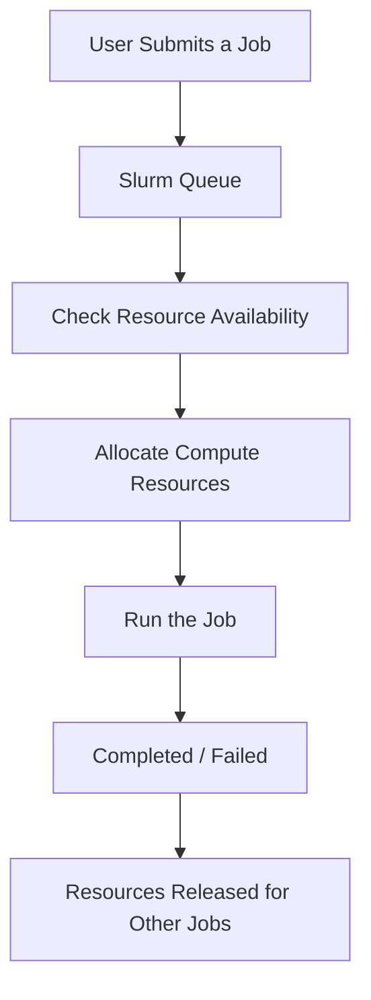
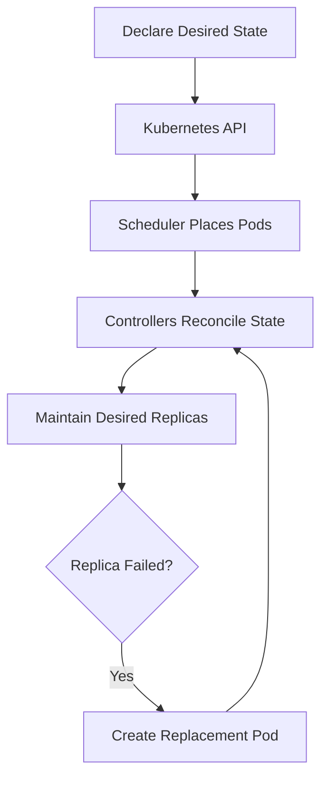
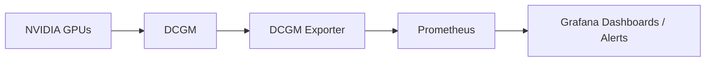
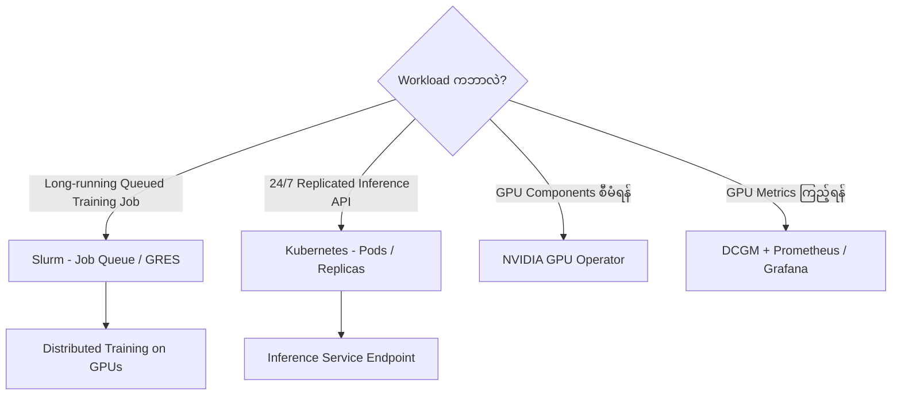
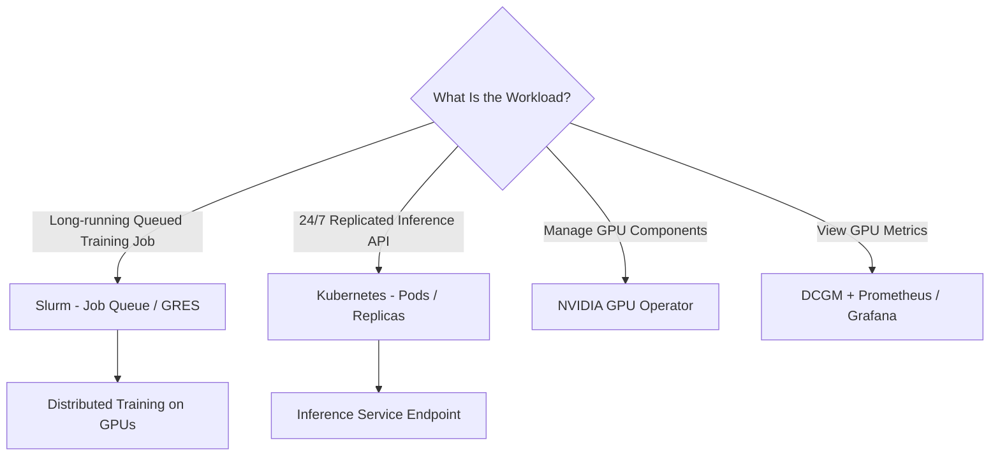

# Module 37 — Slurm vs. Kubernetes for AI Workloads

> Part VII · AI Workload Operations and Orchestration — Course Module 37 — topic notes

## မြန်မာဘာသာ version

## 1. Learning Objectives

ဤ Module မှာ အောက်ပါအကြောင်းအရာများကို လေ့လာပါမယ်။

- Slurm နဲ့ Kubernetes တို့ရဲ့ အဓိကကွာခြားချက်။
- Batch Job Execution နဲ့ Long-running Service Execution တို့ ဘာကွာသလဲ။
- Slurm ရဲ့ Queue, Priority, Resource Allocation နဲ့ Job Completion Model။
- Kubernetes ရဲ့ Pods, Replicas, Health Checks နဲ့ Autoscaling။
- NVIDIA GPU များကို Slurm နဲ့ Kubernetes တို့က ဘယ်လိုအသုံးပြုနိုင်သလဲ။
- NVIDIA GPU Operator, DCGM နဲ့ GPU Scheduling တို့ရဲ့ ဆက်စပ်မှု။
- sbatch, srun, kubectl နဲ့ Helm တို့ကို ဘယ်အခြေအနေမှာ အသုံးပြုသင့်သလဲ။
- AI Infrastructure Scenario များအတွက် သင့်တော်တဲ့ Management Platform ကို ရွေးချယ်ခြင်း။

## 2. Slurm နဲ့ Kubernetes ကို ဘာကြောင့် နှိုင်းယှဉ်ရသလဲ?

AI Infrastructure တစ်ခုမှာ Training နဲ့ Inference Workloads တွေကို စီမံဖို့ လိုအပ်ပါတယ်။ Slurm နဲ့ Kubernetes တို့ဟာ Compute Resources တွေကို အသုံးပြုနိုင်အောင် စီမံပေးတဲ့ Software Systems တွေဖြစ်ပေမဲ့ အဓိက ရည်ရွယ်ချက်က မတူပါဘူး။

- Slurm က HPC နဲ့ Batch Computing Workloads တွေအတွက် Job Scheduling နဲ့ Resource Management ကို အဓိကထားပါတယ်။
- Kubernetes က Containerized Applications တွေကို Deploy လုပ်ခြင်း၊ Run လုပ်ခြင်း၊ Scale လုပ်ခြင်းနဲ့ Desired State ကို ထိန်းသိမ်းခြင်းတို့ကို အဓိကထားပါတယ်။

ဥပမာ—

- AI Research Team က GPU 8 ခုအသုံးပြုပြီး 12 နာရီကြာ Training Job တစ်ခု Run လုပ်ချင်တယ်။ Slurm ကဲ့သို့ Job Scheduler က သင့်တော်နိုင်ပါတယ်။
- Customer-facing AI Inference API တစ်ခုကို 24/7 Run လုပ်ပြီး Request များလာတဲ့အခါ Replica တွေ ထပ်တိုးချင်တယ်။ Kubernetes ကဲ့သို့ Container Orchestration Platform က သင့်တော်နိုင်ပါတယ်။

ဤဥပမာတွေက ပုံမှန်အသုံးပြုပုံကို ပြတာသာဖြစ်ပြီး မဖြစ်မနေ လိုက်နာရမယ့် ကန့်သတ်ချက်မဟုတ်ပါဘူး။

## 3. Primary Focus — အဓိကတာဝန်များ

| အချက် | Slurm | Kubernetes |
|---|---|---|
| အဓိကရည်ရွယ်ချက် | Compute Jobs နဲ့ Batch Workloads များကို Schedule လုပ်ခြင်း | Containerized Workloads များ၏ Lifecycle ကို စီမံခြင်း |
| Resource Management | Job အတွက် CPU, GPU, Memory, Node များ ခွဲဝေခြင်း | Pod Resource Requests, Limits နဲ့ Node Placement ကို စီမံခြင်း |
| Queue Management | Job Queue, Priority နဲ့ Scheduling Policy များ | Pod Scheduling နဲ့ Workload Controllers |
| Typical Workload | AI Training, HPC Simulation, Batch Data Processing | Inference APIs, Microservices, Web Applications, Data Services |
| Completion Model | Job ပြီးဆုံးသွားလျှင် အဆုံးသတ်နိုင်ခြင်း | Long-running Services များ၏ Desired State ကို ဆက်လက်ထိန်းသိမ်းခြင်း |
| Scaling | Compute Job များအတွက် Resource/Node Capacity တိုးချဲ့ခြင်း | Replicas နဲ့ Cluster Capacity ကို လိုအပ်သလို တိုးချဲ့နိုင်ခြင်း |
| Common Interface | sbatch, srun, squeue | kubectl, Kubernetes API, YAML, Helm |

အဓိကကွာခြားချက်က Slurm သည် Job-centric ဖြစ်ပြီး Kubernetes သည် Application/workload-centric ဖြစ်တာပါ။

သတိပြုရန် — Kubernetes မှာလည်း Scheduler နဲ့ Job Resource ရှိပါတယ်။ Slurm ကသာ Scheduling လုပ်နိုင်ပြီး Kubernetes က Scheduling မလုပ်နိုင်ဘူးဆိုတာ မမှန်ပါဘူး။

## 4. Workload Types — ဘယ်လို Workload တွေကို အသုံးပြုသလဲ?

### 4.1 Slurm: HPC, Training နဲ့ Batch Jobs

Slurm ကို အောက်ပါ Workloads တွေအတွက် မကြာခဏ အသုံးပြုပါတယ်။

- Large AI Model Training
- Multi-GPU Training
- Multi-Node Distributed Training
- HPC Scientific Simulation
- Batch Data Processing
- အချိန်ကြာကြာ Run လုပ်ပြီး နောက်ဆုံးမှာ ပြီးဆုံးသွားမယ့် Compute Jobs

ဥပမာ Distributed Training Job တစ်ခုက Compute Nodes 4 ခုမှာ GPU တစ်ခုစီမဟုတ်ဘဲ Node တစ်ခုစီမှာ GPU 8 ခုစီ အသုံးပြုဖို့ လိုအပ်နိုင်ပါတယ်။ ဒီလို Job အတွက် GPU 32 ခုနဲ့ Node 4 ခု လိုအပ်တယ်ဆိုရင် Scheduler က Resource Availability နဲ့ Cluster Policy ကို စစ်ဆေးပြီး Job ကို Schedule လုပ်ပေးနိုင်ပါတယ်။

### 4.2 Kubernetes: Inference နဲ့ Long-running Services

Kubernetes ကို အောက်ပါ Workloads တွေအတွက် မကြာခဏ အသုံးပြုပါတယ်။

- AI Inference API
- LLM Serving
- Recommendation Service
- Fraud Detection API
- Microservices
- Data Ingestion Services
- Containerized Applications များ

ဥပမာ Model တစ်ခုကို Inference Server အဖြစ် Deploy လုပ်ထားတယ်ဆိုပါစို့။ User Request တွေကို Replica 3 ခုက တစ်ပြိုင်နက် ကိုင်တွယ်နိုင်ပါတယ်။ Demand တိုးလာတဲ့အခါ သတ်မှတ်ထားတဲ့ Scaling Policy အရ Replica အရေအတွက်ကို တိုးနိုင်ပါတယ်။

Kubernetes မှာ Autoscaling ကို အလိုအလျောက် လုပ်ဖို့ HPA, သက်ဆိုင်ရာ Metrics နဲ့ လိုအပ်ပါက Cluster Autoscaler သို့မဟုတ် အခြား Capacity Management Tools တွေကို Configure လုပ်ရပါတယ်။

## 5. Architectural Style — Queued Jobs vs. Desired-State Services

### 5.1 Slurm ရဲ့ Job Execution Model

Slurm မှာ User က Job တစ်ခု Submit လုပ်တယ်။ လိုအပ်တဲ့ Resources တွေ ရရှိပြီး Scheduling Policy နဲ့ ကိုက်ညီတဲ့အခါ Job ကို Run လုပ်ပေးပါတယ်။

```text
User submits a job
        |
        v
    Slurm Queue
        |
        v
Check resource availability
        |
        v
Allocate compute resources
        |
        v
    Run the job
        |
        v
Completed / Failed
```

**Figure 1 — Slurm Job Execution Model**



**ပုံရှင်းလင်းချက်** — အပေါ်က User က Job Submit လုပ်တာကစပြီး Slurm Queue ထဲ ဝင်ပါတယ်။ Resource ရရှိမှု စစ်ဆေးပြီး Compute Resources ခွဲဝေကာ Job ကို Run လုပ်ပါတယ်။ Job က Completed သို့မဟုတ် Failed ဖြစ်ပြီးနောက် ခွဲဝေထားတဲ့ Resources တွေ ပြန်လွတ်ကာ အခြား Jobs တွေ အသုံးပြုနိုင်ပါတယ် — ဒါက Batch Job ရဲ့ ပုံမှန်သဘောပါ။

ဥပမာ Training Job တစ်ခုက 10 နာရီကြာ Run လုပ်ပြီး Model Checkpoint ကို သိမ်းဆည်းကာ ပြီးဆုံးသွားနိုင်ပါတယ်။ Job ပြီးသွားရင် သတ်မှတ်ထားတဲ့ Resources တွေကို အခြား Jobs များအတွက် ပြန်လည်အသုံးပြုနိုင်ပါတယ်။

Slurm မှာ Job တစ်ခု ပြီးဆုံးရင် အဆုံးသတ်နိုင်တာက ပုံမှန် Batch Job Execution Model ဖြစ်ပါတယ်။

### 5.2 Kubernetes ရဲ့ Desired-State Model

Kubernetes မှာ Operator က Application ရဲ့ Desired State ကို သတ်မှတ်ပေးပါတယ်။ ဥပမာ Inference Service ကို Replica 3 ခုနဲ့ ဆက်လက် Run ထားဖို့ သတ်မှတ်နိုင်ပါတယ်။

```text
Declare desired state
        |
        v
 Kubernetes API
        |
        v
 Scheduler places Pods
        |
        v
 Controllers reconcile state
        |
        v
 Maintain desired replicas
        |
        v
Scale / replace failed Pods
```

**Figure 2 — Kubernetes Desired-State Model**



**ပုံရှင်းလင်းချက်** — အပေါ်မှာ Desired State (ဥပမာ Replica ၃ ခု) ကြေညာတာကစပြီး Kubernetes API ကတစ်ဆင့် Scheduler က Pod တွေကို Node ပေါ် နေရာချပါတယ်။ Controllers က လက်ရှိအခြေအနေကို Desired State နဲ့ အမြဲ နှိုင်းယှဉ်ညှိနှိုင်းပါတယ်။ Replica တစ်ခု ပျက်သွားရင် Pod အသစ် ဖန်တီးပြီး Desired State ဆီ ပြန်ရောက်အောင် လုပ်ပါတယ်။

Replica တစ်ခု Failure ဖြစ်သွားရင် Kubernetes Controllers က Desired State ကို ပြန်ရောက်အောင် Pod အသစ် ဖန်တီးနိုင်ပါတယ်။ Service Demand တိုးလာတဲ့အခါ Autoscaling Policy ရှိပါက Replica တွေကိုလည်း တိုးနိုင်ပါတယ်။

အဓိကကွာခြားချက်က Kubernetes မှာ Application ကို တစ်ကြိမ် Run လုပ်ပြီး ပြီးဆုံးသွားဖို့ထက် သတ်မှတ်ထားတဲ့ Desired State အတိုင်း ဆက်လက်လည်ပတ်စေဖို့ အဓိကထားတာ ဖြစ်ပါတယ်။

သို့သော် Kubernetes မှာလည်း Job နဲ့ CronJob လို Completion-oriented Workloads တွေကို အသုံးပြုနိုင်ပါတယ်။

## 6. Execution Model — Job Completion vs. Continuous Service

| အချက် | Slurm Job | Kubernetes Service |
|---|---|---|
| ရည်ရွယ်ချက် | သတ်မှတ်ထားတဲ့ Compute Task ကို ပြီးဆုံးအောင် လုပ်ဆောင်ခြင်း | Application ကို အသုံးပြုနိုင်တဲ့အခြေအနေမှာ ဆက်လက်ထားရှိခြင်း |
| ဥပမာ | Model Training 10 နာရီ | Inference API 24/7 |
| Job/Replica ပြီးဆုံးခြင်း | Job အောင်မြင်စွာ ပြီးဆုံးနိုင်သည် | Service Replica များကို Desired State အတိုင်း ထိန်းသိမ်းနိုင်သည် |
| Resource ပြန်လည်အသုံးပြုခြင်း | Job ပြီးနောက် Resource များ ပြန်လွတ်နိုင်သည် | Service ဆက် Run နေသရွေ့ သတ်မှတ်ထားသော Resources များ အသုံးပြုနေသည် |
| Scaling | Job Resource Requirements နဲ့ Cluster Capacity | Replica အရေအတွက်နဲ့ Capacity Management |

မှတ်သားရန် — Kubernetes မှာ Service ဆိုတဲ့စကားလုံးဟာ Network Endpoint အတွက် သီးခြား Resource Type တစ်ခုလည်း ဖြစ်ပါတယ်။ အထက်ပါဇယားမှာတော့ "Service" ကို အထွေထွေ Long-running Application အဓိပ္ပာယ်နဲ့ အသုံးပြုထားပါတယ်။

## 7. Scheduling Logic

### Slurm

Slurm Scheduling မှာ အောက်ပါအချက်တွေက အရေးကြီးပါတယ်။

- Job Priority
- Queue/Partition Configuration
- CPU, GPU နဲ့ Memory Requirements
- Resource Availability
- User/Account Limits
- Job Scheduling Policy

ဥပမာ GPU 8 ခု လိုအပ်တဲ့ Job တစ်ခုကို GPU 4 ခုသာ လွတ်နေချိန်မှာ ချက်ချင်း Run လုပ်လို့ မရနိုင်ပါဘူး။ Cluster Configuration နဲ့ Scheduling Policy အပေါ်မူတည်ပြီး Job ကို Pending အဖြစ် စောင့်ဆိုင်းစေနိုင်ပါတယ်။

### Kubernetes

Kubernetes Scheduler က Pod တစ်ခုကို ဘယ် Node မှာ Run လုပ်မလဲဆိုတာ ဆုံးဖြတ်ရာမှာ—

- CPU နဲ့ Memory Resource Requests
- GPU Resource Requests
- Node Labels နဲ့ Node Affinity
- Taints နဲ့ Tolerations
- Pod Affinity/Anti-affinity
- Topology နဲ့ အခြား Scheduling Constraints

တို့ကို ထည့်သွင်းစဉ်းစားနိုင်ပါတယ်။ အခြေခံအားဖြင့် Scheduler က သင့်တော်တဲ့ Nodes တွေကို စစ်ထုတ်ပြီး ကျန်ရှိတဲ့ Nodes တွေထဲက သင့်လျော်တဲ့ Node ကို ရွေးချယ်ပေးပါတယ်။

အရေးကြီးတဲ့ကွာခြားချက်တစ်ခုက Kubernetes Scheduler က GPU Utilization နဲ့ GPU Memory အသုံးပြုမှုကို ကြည့်ပြီး အချိန်တိုင်း အလိုအလျောက် အကောင်းဆုံး Node ကို ရွေးပေးမယ်လို့ မယူဆသင့်ပါဘူး။ ပုံမှန် Scheduling က သတ်မှတ်ထားတဲ့ Resource Requests, Allocatable Resources နဲ့ Scheduling Constraints တွေအပေါ် အခြေခံပါတယ်။ Live GPU Metrics အပေါ်မူတည်တဲ့ Placement ကို လိုချင်ရင် သက်ဆိုင်ရာ Custom Scheduler, Metrics Integration သို့မဟုတ် အခြား Scheduling Logic လိုအပ်နိုင်ပါတယ်။

## 8. NVIDIA GPU Integration

AI Workload တွေမှာ GPU Resources တွေကို မှန်ကန်စွာ Allocate လုပ်နိုင်ဖို့ Hardware တစ်ခုတည်းရှိရုံနဲ့ မလုံလောက်ပါဘူး။ GPU Driver, Runtime Integration, Device Discovery နဲ့ Resource Management Configuration တို့လည်း လိုအပ်ပါတယ်။

### 8.1 Slurm နဲ့ NVIDIA GPU

Slurm Cluster မှာ GPU Resources တွေကို စီမံဖို့ Generic Resource (GRES) Configuration နဲ့ GPU Resource Tracking တို့ကို အသုံးပြုနိုင်ပါတယ်။

ဥပမာ—

```bash
#SBATCH --gres=gpu:2
```

ဤ Directive က Cluster ရဲ့ Slurm Configuration က အဆိုပါ GPU Resource Syntax ကို ပံ့ပိုးထားပါက GPU 2 ခု တောင်းဆိုတာ ဖြစ်ပါတယ်။

Slurm က NVIDIA CUDA ကို အသုံးပြုတဲ့ Workload တွေကို Schedule လုပ်နိုင်ပေမဲ့ Slurm ဟာ CUDA Runtime ကို အစားထိုးတဲ့ Software မဟုတ်ပါဘူး။ GPU Application အလုပ်လုပ်ဖို့ Compatible Driver, CUDA Libraries နဲ့ Application Environment တို့လည်း လိုအပ်နိုင်ပါတယ်။

GPU Model သို့မဟုတ် GPU Architecture အလိုက် Scheduling လုပ်လိုပါက Node Labels, GRES Configuration နဲ့ သက်ဆိုင်ရာ Scheduling Constraints များကို စနစ်တကျ သတ်မှတ်ထားဖို့ လိုအပ်ပါတယ်။

### 8.2 Kubernetes နဲ့ NVIDIA GPU Operator

Kubernetes မှာ NVIDIA GPU ကို အသုံးပြုဖို့ NVIDIA GPU Operator က GPU-related Software Components တွေကို Provision နဲ့ Manage လုပ်ရာမှာ ကူညီပေးနိုင်ပါတယ်။

GPU Operator ရဲ့ Configuration ပေါ်မူတည်ပြီး အောက်ပါ Components တွေကို စီမံနိုင်ပါတယ်။

- NVIDIA GPU Driver
- NVIDIA Container Toolkit
- Kubernetes Device Plugin
- GPU Node Discovery/Labels
- DCGM Exporter
- MIG Manager နှင့် သက်ဆိုင်ရာ GPU Management Components

အသေးစိတ်ကတော့ Platform, Operator Version နဲ့ Installation Options အပေါ်မူတည်ပါတယ်။

GPU Node တွေကို Kubernetes က မှန်ကန်စွာ အသိအမှတ်ပြုထားမထား စစ်ဆေးဖို့—

```bash
kubectl get nodes
```

Node တစ်ခုမှာ NVIDIA GPU Resource ကို Kubernetes က Register လုပ်ထားပါက Allocatable Resources ထဲမှာ nvidia.com/gpu လို Resource Name ကို တွေ့နိုင်ပါတယ်။

```bash
kubectl get node <GPU_NODE_NAME> -o yaml
```

ဤ Command မှာ <GPU_NODE_NAME> ကို အမှန်တကယ် GPU Node Name နဲ့ အစားထိုးရပါမယ်။

### 8.3 DCGM ရဲ့ အခန်းကဏ္ဍ

DCGM (NVIDIA Data Center GPU Manager) သည် NVIDIA Data Center GPU များကို Monitor လုပ်ခြင်း၊ Health စစ်ဆေးခြင်း၊ Diagnostics နဲ့ Telemetry ရယူခြင်းတို့အတွက် အသုံးပြုတဲ့ Tool Suite ဖြစ်ပါတယ်။

Kubernetes Environment မှာ DCGM Exporter က GPU Metrics တွေကို Prometheus-compatible Endpoint မှတစ်ဆင့် Expose လုပ်နိုင်ပြီး Monitoring Stack တွေနဲ့ ပေါင်းစပ်အသုံးပြုနိုင်ပါတယ်။

ဥပမာ Monitoring Architecture—

```text
NVIDIA GPUs
     |
     v
    DCGM
     |
     v
 DCGM Exporter
     |
     v
 Prometheus
     |
     v
 Grafana Dashboards / Alerts
```

**Figure 3 — GPU Monitoring Chain (DCGM မှ Grafana အထိ)**



**ပုံရှင်းလင်းချက်** — ဘယ်ဘက်က NVIDIA GPUs ကနေ GPU Data တွေ စတင်ပြီး DCGM က စုဆောင်းပါတယ်။ DCGM Exporter က GPU Metrics တွေကို Prometheus-compatible Endpoint မှတစ်ဆင့် Prometheus ဆီ ပို့ပေးပြီး နောက်ဆုံးမှာ Grafana Dashboards / Alerts မှာ ကြည့်ရှုနိုင်ပါတယ်။ Monitoring နဲ့ Scheduling မတူသလို ဒီကွင်းဆက်က Scheduling Decision မချပေးပါဘူး။

အရေးကြီးတာက DCGM နဲ့ DCGM Exporter ဟာ GPU Monitoring အတွက် ဖြစ်ပြီး Kubernetes Scheduler ကို တိုက်ရိုက်အစားထိုးတာ မဟုတ်ပါဘူး။ GPU Metrics တွေကို Schedule ဆုံးဖြတ်ချက်တွေအတွက် အသုံးပြုလိုရင် သက်ဆိုင်ရာ Integration နဲ့ Policy တွေ ထပ်မံလိုအပ်နိုင်ပါတယ်။

တစ်နည်းပြောရရင် Monitoring နဲ့ Scheduling ဟာ မတူပါဘူး — DCGM နဲ့ DCGM Exporter က Scheduling Decision တွေ မချပေးပါဘူး။

## 9. Scalability — ဘယ်လိုတိုးချဲ့နိုင်သလဲ?

### Slurm Scalability

Slurm ကို Multi-Node HPC Cluster များမှာ အသုံးပြုပြီး ကြီးမားတဲ့ Compute Workloads တွေကို စီမံနိုင်ပါတယ်။ Cluster အရွယ်အစားနဲ့ Scaling Capability က Hardware, Network, Configuration, Scheduler Policy နဲ့ Operational Design တို့အပေါ် မူတည်ပါတယ်။

### Kubernetes Scalability

Kubernetes မှာ Workload Scaling ကို အဓိကအားဖြင့်—

- Horizontal Scaling: Pod/Replica အရေအတွက် တိုးခြင်း။
- Vertical Scaling: Pod တစ်ခုအတွက် CPU/Memory Resource ကို ပြောင်းလဲခြင်း။
- Cluster Scaling: လိုအပ်ပါက Worker Nodes များ တိုးခြင်း သို့မဟုတ် လျှော့ခြင်း။

တို့နဲ့ စီမံနိုင်ပါတယ်။

Multi-Cluster Environment တစ်ခုမှာ Kubernetes Workloads တွေကို Cluster များစွာအနှံ့ စီမံနိုင်ပေမဲ့ Kubernetes Cluster တစ်ခုတည်းက အခြား Cluster များအနှံ့ Workloads တွေကို အလိုအလျောက် Scale လုပ်ပေးတာ မဟုတ်ပါဘူး။ Multi-Cluster Management သို့မဟုတ် Federation လို သီးခြား Architecture/Tooling လိုအပ်နိုင်ပါတယ်။

## 10. User Interfaces and Commands

### Slurm Commands

| Command | ရည်ရွယ်ချက် |
|---|---|
| sbatch | Batch Job Script တစ်ခု Submit လုပ်ခြင်း |
| srun | Job Step သို့မဟုတ် Parallel Task များကို Run လုပ်ခြင်း |
| squeue | Queue ထဲရှိ Jobs များကို ကြည့်ခြင်း |
| sinfo | Cluster Nodes/Partitions အခြေအနေ ကြည့်ခြင်း |
| scancel | Job တစ်ခု Cancel လုပ်ခြင်း |

### Kubernetes Commands

| Command | ရည်ရွယ်ချက် |
|---|---|
| kubectl get pods | Pods များ၏ အခြေအနေ ကြည့်ခြင်း |
| kubectl get nodes | Cluster Nodes များ ကြည့်ခြင်း |
| kubectl describe pod <POD_NAME> | Pod Configuration နဲ့ Events ကြည့်ခြင်း |
| kubectl logs <POD_NAME> | Container Logs ကြည့်ခြင်း |
| kubectl apply -f app.yaml | YAML Manifest ကို Apply လုပ်ခြင်း |
| kubectl scale deployment/<NAME> --replicas=5 | Deployment Replica အရေအတွက် ပြောင်းခြင်း |
| helm install | Helm Chart ကို အသုံးပြုပြီး Application Deploy လုပ်ခြင်း |

Slurm က Command-Line Job Submission နဲ့ HPC Workflow များအတွက် အဆင်ပြေပါတယ်။ Kubernetes က API-driven Platform ဖြစ်ပြီး kubectl, YAML Manifest, Helm နဲ့ အခြား Automation Tools များကို ပံ့ပိုးပါတယ်။

## 11. Typical Users

| Role | Slurm အသုံးပြုမှု | Kubernetes အသုံးပြုမှု |
|---|---|---|
| AI Researcher | Training Job Submit လုပ်ခြင်း | Model Service Deploy လုပ်ခြင်း |
| Data Scientist | Training နဲ့ Batch Processing | Inference Endpoint နဲ့ Data Services |
| HPC Administrator | Cluster Resource နဲ့ Queue Management | Kubernetes Platform ရှိပါက Cluster Operations |
| DevOps Engineer | HPC Cluster Integration | Container Deployment, CI/CD, Operations |
| MLOps Engineer | Training Workflow Integration | Model Serving, Deployment, Monitoring |
| AI Platform Engineer | Training Compute Platform | Training/Inference Platform Integration |

ဤဇယားက ပုံမှန်တာဝန်ခွဲဝေမှုကို ပြတာသာ ဖြစ်ပါတယ်။ အဖွဲ့အစည်းအလိုက် Role တစ်ခုတည်းက Slurm နဲ့ Kubernetes နှစ်မျိုးစလုံးကို စီမံနိုင်ပါတယ်။

## 12. Exam Scenarios

**Figure 4 — Slurm နှင့် Kubernetes ရွေးချယ်မှု ဆုံးဖြတ်ချက်ပုံ**

အောက်ပါပုံက အောက်ပါ Scenario များအတွက် ရွေးချယ်မှုလမ်းကြောင်းကို အကျဉ်းချုပ် ဖော်ပြထားခြင်း ဖြစ်ပါတယ်။



**ပုံရှင်းလင်းချက်** — အပေါ်က မေးခွန်းကနေ စပြီး ကိုယ့် Workload နဲ့ ကိုက်တဲ့ လမ်းကြောင်းကို ရွေးပါ။ Queue နဲ့ ကြာချိန်ရှည် Training Job ဆိုရင် ဘယ်ဘက်အပေါ်လမ်းကြောင်းအတိုင်း Slurm ကို သွားပြီး GPU ပေါ်မှာ Distributed Training လုပ်ပါတယ်။ ၂၄/၇ Replicated Inference API ဆိုရင် ညာဘက်လမ်းကြောင်းအတိုင်း Kubernetes ကို သွားပြီး Inference Service Endpoint ဖြစ်လာပါတယ်။ GPU Components စီမံချင်ရင် NVIDIA GPU Operator၊ GPU Metrics ကြည့်ချင်ရင် DCGM နဲ့ Prometheus / Grafana ကို ရွေးချယ်ပါ။

**Scenario A:** Research Team တစ်ခုက GPU 32 ခုအသုံးပြုပြီး Distributed Training Job တစ်ခု Run လုပ်မယ်။ Job က 20 နာရီကြာနိုင်ပြီး Queue, Priority နဲ့ Resource Allocation လိုအပ်တယ်။

အကောင်းဆုံးရွေးချယ်မှု — Slurm ကဲ့သို့ HPC Job Scheduler။

**Scenario B:** AI Inference API တစ်ခုကို Replica အများအပြားနဲ့ Run လုပ်ထားပြီး Application Instance Failure ဖြစ်ရင် ပြန်လည်အစားထိုးဖို့၊ Demand တိုးလာရင် Replica တိုးဖို့ လိုအပ်တယ်။

အကောင်းဆုံးရွေးချယ်မှု — Kubernetes ကဲ့သို့ Container Orchestration Platform။

**Scenario C:** Kubernetes Cluster တစ်ခုမှာ NVIDIA GPU Nodes များရှိပြီး GPU Driver, Device Plugin နဲ့ GPU Telemetry ကို စနစ်တကျ စီမံလိုတယ်။

သင့်တော်သော Component — NVIDIA GPU Operator နဲ့ သက်ဆိုင်ရာ GPU Management/Monitoring Components။

**Scenario D:** GPU Temperature, Memory Usage နဲ့ Utilization ကို Monitoring Dashboard မှာ ပြသလိုတယ်။

သင့်တော်သော Approach — DCGM/DCGM Exporter နဲ့ Prometheus/Grafana ကဲ့သို့ Monitoring Stack။

## 13. Review Questions

1. Slurm ရဲ့ Primary Focus က ဘာလဲ?

   အဖြေ — HPC နဲ့ Batch Computing Workloads တွေအတွက် Job Scheduling နဲ့ Resource Management။ Queue, Priority, Resource Allocation နဲ့ Job Execution ကို စီမံပါတယ်။

2. Kubernetes ရဲ့ Primary Focus က ဘာလဲ?

   အဖြေ — Containerized Applications တွေကို Deploy, Run, Scale လုပ်ခြင်းနဲ့ Desired State ကို ထိန်းသိမ်းခြင်း။

3. Job Scheduling နဲ့ Container Orchestration တို့ ဘာကြောင့် တူညီတဲ့အရာ မဟုတ်သလဲ?

   အဖြေ — Job Scheduling က Compute Job တစ်ခုကို Resource ခွဲဝေပြီး ပြီးဆုံးအောင် လုပ်ဆောင်ခြင်းဖြစ်ပြီး Container Orchestration က Long-running Service တွေရဲ့ Lifecycle, Replica, Health Check နဲ့ Scaling ကို စီမံခြင်း ဖြစ်ပါတယ်။ နှစ်ခုစလုံးမှာ Scheduler ရှိပေမဲ့ အဓိကရည်ရွယ်ချက် မတူပါဘူး။

4. Slurm မှာ sbatch နဲ့ squeue ကို ဘယ်အချိန်မှာ အသုံးပြုသလဲ?

   အဖြေ — sbatch က Batch Job Script ကို Submit လုပ်ရာတွင် အသုံးပြုပြီး squeue က Queue ထဲရှိ Jobs များကို ကြည့်ရာတွင် အသုံးပြုပါတယ်။

5. Kubernetes မှာ Deployment နဲ့ HPA တို့ ဘာကွာသလဲ?

   အဖြေ — Deployment က Application ရဲ့ Pod/Replica အရေအတွက်ကို Desired State အတိုင်း စီမံပြီး HPA က Metrics နဲ့ Policy အပေါ်မူတည်ပြီး Replica အရေအတွက်ကို အလိုအလျောက် ညှိပေးပါတယ်။

6. NVIDIA GPU Operator က ဘယ်လိုကူညီပေးသလဲ?

   အဖြေ — Kubernetes Environment မှာ GPU Driver, NVIDIA Container Toolkit, Device Plugin, GPU Node Discovery/Labels, DCGM Exporter, MIG Manager စသည့် GPU-related Software Components တွေကို Provision နဲ့ Manage လုပ်ရာမှာ ကူညီပေးပါတယ်။

7. DCGM Exporter ရဲ့ အခန်းကဏ္ဍက ဘာလဲ?

   အဖြေ — GPU Metrics တွေကို Prometheus-compatible Endpoint မှတစ်ဆင့် Expose လုပ်ပြီး Monitoring Stack တွေအတွက် ပံ့ပိုးပေးခြင်းဖြစ်ပါတယ်။ Monitoring အတွက်သာဖြစ်ပြီး Scheduling Decision တွေ မချပေးပါဘူး။

8. Kubernetes Scheduler က GPU Utilization နဲ့ Memory ကို အမြဲကြည့်ပြီး အကောင်းဆုံး Node ကို အလိုအလျောက် ရွေးပေးသလား?

   အဖြေ — မဟုတ်ပါ။ ပုံမှန် Scheduling က Resource Requests, Allocatable Resources နဲ့ Scheduling Constraints တွေအပေါ် အခြေခံပါတယ်။ Live GPU Metrics အပေါ် မူတည်တဲ့ Placement အတွက် Custom Scheduler သို့မဟုတ် Metrics Integration လိုအပ်နိုင်ပါတယ်။

9. Kubernetes Cluster တစ်ခုတည်းက Multi-Cluster Workloads တွေကို အလိုအလျောက် စီမံနိုင်သလား?

   အဖြေ — မနိုင်ပါ။ Multi-Cluster Management သို့မဟုတ် Federation လို သီးခြား Architecture/Tooling လိုအပ်ပါတယ်။

10. AI Training နဲ့ Inference နှစ်မျိုးစလုံးအတွက် Slurm နဲ့ Kubernetes ကို ပေါင်းစပ်အသုံးပြုနိုင်သလား?

    အဖြေ — ရပါတယ်။ Queue နဲ့ ကြာချိန်ရှည် Training Jobs အတွက် Slurm၊ Containerized Production Inference Services အတွက် Kubernetes ကို အသုံးပြုပြီး လက်တွေ့ Architecture တွေမှာ နှစ်မျိုးစလုံးကို ပေါင်းစပ်အသုံးပြုလေ့ ရှိပါတယ်။

## 14. Module Summary

- Slurm နဲ့ Kubernetes တို့ဟာ AI Infrastructure Management အတွက် အသုံးဝင်ပေမဲ့ သူတို့ရဲ့ အဓိကရည်ရွယ်ချက်တွေ မတူပါဘူး။
- **Slurm:** HPC နဲ့ Batch Jobs များအတွက် Queue, Priority, Resource Allocation နဲ့ Job Execution ကို စီမံတယ်။
- **Kubernetes:** Containerized Applications များအတွက် Deployment, Pod Scheduling, Desired-State Management နဲ့ Scaling ကို စီမံတယ်။
- **NVIDIA GPU Operator:** Kubernetes Environment မှာ GPU Software Components များကို စီမံဖို့ ကူညီပေးတယ်။
- **DCGM/DCGM Exporter:** GPU Health, Telemetry နဲ့ Monitoring ကို ပံ့ပိုးတယ်။

စာမေးပွဲအတွက် အဓိကမှတ်သားရန် — Training Scenario မှာ Job Queue နဲ့ Compute Resource Allocation ကို အလေးထားရင် Slurm ကို စဉ်းစားပါ။ Production Inference Scenario မှာ Container Lifecycle, Replica Management, Health Checks နဲ့ Autoscaling ကို အလေးထားရင် Kubernetes ကို စဉ်းစားပါ။ လက်တွေ့ Architecture မှာတော့ နှစ်မျိုးစလုံးကို ပေါင်းစပ်အသုံးပြုနိုင်ပါတယ်။

## English Version

## 1. Learning Objectives

In this module you will study —

- The key differences between Slurm and Kubernetes.
- How batch job execution differs from long-running service execution.
- Slurm's queue, priority, resource allocation, and job completion model.
- Kubernetes' Pods, replicas, health checks, and autoscaling.
- How Slurm and Kubernetes can use NVIDIA GPUs.
- How NVIDIA GPU Operator, DCGM, and GPU scheduling relate to each other.
- When to use sbatch, srun, kubectl, and Helm.
- Choosing a suitable management platform for AI infrastructure scenarios.

## 2. Why Compare Slurm and Kubernetes?

An AI infrastructure needs to manage both training and inference workloads. Slurm and Kubernetes are both software systems that manage compute resources so they can be used effectively, but their main purposes are different.

- Slurm focuses on job scheduling and resource management for HPC and batch computing workloads.
- Kubernetes focuses on deploying, running, and scaling containerized applications and maintaining their desired state.

For example —

- An AI research team wants to run a 12-hour training job using 8 GPUs. A job scheduler like Slurm may be a suitable fit.
- A customer-facing AI inference API must run 24/7 and add replicas when requests increase. A container orchestration platform like Kubernetes may be a suitable fit.

These examples show typical usage only; they are not hard rules that must always be followed.

## 3. Primary Focus — Main Responsibilities

| Aspect | Slurm | Kubernetes |
|---|---|---|
| Main purpose | Scheduling compute jobs and batch workloads | Managing the lifecycle of containerized workloads |
| Resource Management | Allocating CPU, GPU, memory, and nodes for jobs | Managing Pod resource requests, limits, and node placement |
| Queue Management | Job queue, priority, and scheduling policies | Pod scheduling and workload controllers |
| Typical Workload | AI training, HPC simulation, batch data processing | Inference APIs, microservices, web applications, data services |
| Completion Model | Can end when the job completes | Keeps long-running services at their desired state |
| Scaling | Expanding resource/node capacity for compute jobs | Scaling replicas and cluster capacity as needed |
| Common Interface | sbatch, srun, squeue | kubectl, Kubernetes API, YAML, Helm |

The key difference is that Slurm is job-centric, while Kubernetes is application/workload-centric.

Caution — Kubernetes also has a scheduler and job resources. It is not true that only Slurm can schedule and Kubernetes cannot.

## 4. Workload Types — What Workloads Run Where?

### 4.1 Slurm: HPC, Training, and Batch Jobs

Slurm is frequently used for the following workloads:

- Large AI model training
- Multi-GPU training
- Multi-node distributed training
- HPC scientific simulation
- Batch data processing
- Long-running compute jobs that eventually finish

For example, a distributed training job may need not just one GPU per compute node but 8 GPUs on each node. If such a job needs 4 nodes and 32 GPUs in total, the scheduler can check resource availability and cluster policy and then schedule the job.

### 4.2 Kubernetes: Inference and Long-running Services

Kubernetes is frequently used for the following workloads:

- AI inference APIs
- LLM serving
- Recommendation services
- Fraud detection APIs
- Microservices
- Data ingestion services
- Containerized applications

For example, suppose a model is deployed as an inference server. Three replicas can handle user requests concurrently. When demand grows, the replica count can be increased according to the configured scaling policy.

To make autoscaling automatic in Kubernetes you must configure HPA, the relevant metrics, and, if needed, Cluster Autoscaler or other capacity management tools.

## 5. Architectural Style — Queued Jobs vs. Desired-State Services

### 5.1 Slurm's Job Execution Model

In Slurm, a user submits a job. When the required resources become available and the job matches the scheduling policy, Slurm runs it.

```text
User submits a job
        |
        v
    Slurm Queue
        |
        v
Check resource availability
        |
        v
Allocate compute resources
        |
        v
    Run the job
        |
        v
Completed / Failed
```

**Figure 1 — Slurm Job Execution Model**


**Figure walkthrough** — Start at the top: the User submits a Job and it enters the Slurm Queue. Resource Availability is checked, Compute Resources are allocated, and the Job runs. When the Job is Completed or Failed, the allocated Resources are released so other Jobs can use them — this is the normal batch job behavior.

For example, a training job may run for 10 hours, save model checkpoints, and finish. When the job completes, the allocated resources can be reused by other jobs.

In Slurm, a job ending when it completes is the normal batch job execution model.

### 5.2 Kubernetes' Desired-State Model

In Kubernetes, an operator defines the application's desired state. For example, you can declare that an inference service should keep running with 3 replicas.

```text
Declare desired state
        |
        v
 Kubernetes API
        |
        v
 Scheduler places Pods
        |
        v
 Controllers reconcile state
        |
        v
 Maintain desired replicas
        |
        v
Scale / replace failed Pods
```

**Figure 2 — Kubernetes Desired-State Model**


**Figure walkthrough** — Start at the top by declaring the Desired State (for example, 3 replicas). Through the Kubernetes API, the Scheduler places Pods on Nodes, and Controllers keep reconciling the current state with the Desired State. If a Replica fails, a Replacement Pod is created and the system returns to the Desired State.

If a replica fails, Kubernetes controllers can create a new Pod to return to the desired state. When service demand grows and an autoscaling policy exists, replicas can also be increased.

The key difference is that Kubernetes focuses on keeping the application running according to the declared desired state, rather than running it once to completion.

However, Kubernetes can also run completion-oriented workloads such as Job and CronJob.

## 6. Execution Model — Job Completion vs. Continuous Service

| Aspect | Slurm Job | Kubernetes Service |
|---|---|---|
| Purpose | Carry out a defined compute task to completion | Keep the application in a usable state |
| Example | Model training for 10 hours | Inference API 24/7 |
| Job/Replica completion | The job can finish successfully | Service replicas are maintained at the desired state |
| Resource reuse | Resources are released after the job finishes | Allocated resources are used as long as the service keeps running |
| Scaling | Job resource requirements and cluster capacity | Replica count and capacity management |

Note — In Kubernetes, the word "Service" is also a separate resource type for a network endpoint. In the table above, "Service" is used in the general sense of a long-running application.

## 7. Scheduling Logic

### Slurm

The following factors matter in Slurm scheduling:

- Job priority
- Queue/partition configuration
- CPU, GPU, and memory requirements
- Resource availability
- User/account limits
- Job scheduling policy

For example, a job that needs 8 GPUs cannot start immediately while only 4 GPUs are free. Depending on the cluster configuration and scheduling policy, the job may wait in the Pending state.

### Kubernetes

When the Kubernetes Scheduler decides which node to run a Pod on, it can take the following into account:

- CPU and memory resource requests
- GPU resource requests
- Node labels and node affinity
- Taints and tolerations
- Pod affinity/anti-affinity
- Topology and other scheduling constraints

Basically, the scheduler filters suitable nodes and then selects an appropriate node from the remaining ones.

One important caveat: you should not assume the Kubernetes Scheduler looks at GPU utilization and GPU memory usage and automatically picks the optimal node every time. Normal scheduling is based on configured resource requests, allocatable resources, and scheduling constraints. If you want placement based on live GPU metrics, you may need the relevant custom scheduler, metrics integration, or other scheduling logic.

## 8. NVIDIA GPU Integration

To allocate GPU resources correctly in AI workloads, having the hardware alone is not enough. GPU drivers, runtime integration, device discovery, and resource management configuration are also required.

### 8.1 Slurm and NVIDIA GPUs

In a Slurm cluster you can manage GPU resources with Generic Resource (GRES) configuration and GPU resource tracking.

For example —

```bash
#SBATCH --gres=gpu:2
```

This directive requests 2 GPUs if the cluster's Slurm configuration supports this GPU resource syntax.

Slurm can schedule workloads that use NVIDIA CUDA, but Slurm is not software that replaces the CUDA runtime. GPU applications may also need compatible drivers, CUDA libraries, and an application environment.

To schedule by GPU model or GPU architecture, you must systematically define node labels, GRES configuration, and the relevant scheduling constraints.

### 8.2 Kubernetes and the NVIDIA GPU Operator

In Kubernetes, the NVIDIA GPU Operator helps provision and manage GPU-related software components.

Depending on the GPU Operator's configuration, it can manage the following components:

- NVIDIA GPU Driver
- NVIDIA Container Toolkit
- Kubernetes Device Plugin
- GPU node discovery/labels
- DCGM Exporter
- MIG Manager and related GPU management components

The details depend on the platform, operator version, and installation options.

To check whether Kubernetes has properly recognized the GPU nodes —

```bash
kubectl get nodes
```

If Kubernetes has registered the NVIDIA GPU resource on a node, you will see a resource name such as `nvidia.com/gpu` in its allocatable resources.

```bash
kubectl get node <GPU_NODE_NAME> -o yaml
```

In this command, replace `<GPU_NODE_NAME>` with the actual GPU node name.

### 8.3 The Role of DCGM

DCGM (NVIDIA Data Center GPU Manager) is a tool suite used for monitoring NVIDIA data center GPUs, checking their health, and collecting diagnostics and telemetry.

In Kubernetes environments, DCGM Exporter can expose GPU metrics through a Prometheus-compatible endpoint and integrate them with monitoring stacks.

Example monitoring architecture —

```text
NVIDIA GPUs
     |
     v
    DCGM
     |
     v
 DCGM Exporter
     |
     v
 Prometheus
     |
     v
 Grafana Dashboards / Alerts
```

**Figure 3 — GPU Monitoring Chain (DCGM to Grafana)**


**Figure walkthrough** — GPU data starts at the NVIDIA GPUs on the left and is collected by DCGM. DCGM Exporter sends the GPU Metrics to Prometheus through a Prometheus-compatible endpoint, and finally you view them in Grafana Dashboards / Alerts. Monitoring is not scheduling — this chain does not make scheduling decisions.

The important point is that DCGM and DCGM Exporter are for GPU monitoring — they do not directly replace the Kubernetes Scheduler. If you want to use GPU metrics for scheduling decisions, you need the corresponding integration and policies.

In other words, monitoring ≠ scheduling: DCGM and DCGM Exporter do not make scheduling decisions.

## 9. Scalability — How Do They Scale?

### Slurm Scalability

Slurm is used in multi-node HPC clusters and can manage large compute workloads. Cluster size and scaling capability depend on hardware, network, configuration, scheduler policy, and operational design.

### Kubernetes Scalability

In Kubernetes, workload scaling is managed mainly through —

- Horizontal scaling: increasing the number of Pods/replicas.
- Vertical scaling: changing the CPU/memory resources of a Pod.
- Cluster scaling: adding or removing worker nodes when needed.

In a multi-cluster environment, Kubernetes workloads can be managed across many clusters, but a single Kubernetes cluster does not automatically scale workloads across other clusters. Separate architecture/tooling such as multi-cluster management or federation may be required.

## 10. User Interfaces and Commands

### Slurm Commands

| Command | Purpose |
|---|---|
| sbatch | Submit a batch job script |
| srun | Run a job step or parallel tasks |
| squeue | View jobs in the queue |
| sinfo | View cluster nodes/partitions status |
| scancel | Cancel a job |

### Kubernetes Commands

| Command | Purpose |
|---|---|
| kubectl get pods | View the status of Pods |
| kubectl get nodes | View cluster nodes |
| kubectl describe pod <POD_NAME> | View Pod configuration and events |
| kubectl logs <POD_NAME> | View container logs |
| kubectl apply -f app.yaml | Apply a YAML manifest |
| kubectl scale deployment/<NAME> --replicas=5 | Change the number of Deployment replicas |
| helm install | Deploy an application using a Helm chart |

Slurm is convenient for command-line job submission and HPC workflows. Kubernetes is an API-driven platform and supports kubectl, YAML manifests, Helm, and other automation tools.

## 11. Typical Users

| Role | Slurm usage | Kubernetes usage |
|---|---|---|
| AI Researcher | Submitting training jobs | Deploying model services |
| Data Scientist | Training and batch processing | Inference endpoints and data services |
| HPC Administrator | Cluster resource and queue management | Cluster operations, if a Kubernetes platform exists |
| DevOps Engineer | HPC cluster integration | Container deployment, CI/CD, operations |
| MLOps Engineer | Training workflow integration | Model serving, deployment, monitoring |
| AI Platform Engineer | Training compute platform | Training/inference platform integration |

This table shows typical responsibility splits only. Depending on the organization, a single role may manage both Slurm and Kubernetes.

## 12. Exam Scenarios

**Figure 4 — Slurm vs. Kubernetes Decision Diagram**

The figure below summarizes the decision path for the scenarios that follow.



**Figure walkthrough** — Start at the top question and pick the path that matches your workload. A long-running queued Training Job takes the upper-left path to Slurm and runs Distributed Training on GPUs. A 24/7 Replicated Inference API takes the right path to Kubernetes and becomes an Inference Service Endpoint. To manage GPU Components, choose the NVIDIA GPU Operator; to view GPU Metrics, choose DCGM with Prometheus / Grafana.

**Scenario A:** A research team will run a distributed training job using 32 GPUs. The job may take 20 hours and needs queueing, priority, and resource allocation.

Best choice — an HPC job scheduler like Slurm.

**Scenario B:** An AI inference API runs with many replicas and needs replacement when an application instance fails and more replicas when demand grows.

Best choice — a container orchestration platform like Kubernetes.

**Scenario C:** A Kubernetes cluster has NVIDIA GPU nodes and you want to manage GPU drivers, the device plugin, and GPU telemetry systematically.

Suitable component — the NVIDIA GPU Operator and related GPU management/monitoring components.

**Scenario D:** You want to display GPU temperature, memory usage, and utilization on a monitoring dashboard.

Suitable approach — DCGM/DCGM Exporter with a monitoring stack such as Prometheus/Grafana.

## 13. Review Questions

1. What is Slurm's primary focus?

   Answer — Job scheduling and resource management for HPC and batch computing workloads: queue, priority, resource allocation, and job execution.

2. What is Kubernetes' primary focus?

   Answer — Deploying, running, and scaling containerized applications and maintaining their desired state.

3. Why is job scheduling not the same thing as container orchestration?

   Answer — Job scheduling allocates resources and runs a defined compute job to completion; container orchestration manages the lifecycle of long-running services, including replicas, health checks, and scaling. Both have a scheduler, but their main purposes differ.

4. When do you use sbatch and squeue in Slurm?

   Answer — sbatch submits a batch job script; squeue views the jobs currently in the queue.

5. What is the difference between Deployment and HPA in Kubernetes?

   Answer — A Deployment manages an application's Pods/replicas at the desired state; HPA automatically adjusts the replica count based on metrics and policy.

6. How does the NVIDIA GPU Operator help?

   Answer — It helps provision and manage GPU-related software components in Kubernetes environments, such as the GPU driver, NVIDIA Container Toolkit, Device Plugin, GPU node discovery/labels, DCGM Exporter, and MIG Manager.

7. What is the role of DCGM Exporter?

   Answer — It exposes GPU metrics through a Prometheus-compatible endpoint for monitoring stacks. It supports monitoring only — it does not make scheduling decisions.

8. Does the Kubernetes Scheduler always look at GPU utilization and memory and automatically pick the best node?

   Answer — No. Normal scheduling is based on resource requests, allocatable resources, and scheduling constraints. Placement based on live GPU metrics may need a custom scheduler or metrics integration.

9. Can a single Kubernetes cluster automatically manage multi-cluster workloads?

   Answer — No. Multi-cluster management or federation architecture/tooling is required.

10. Can Slurm and Kubernetes be combined for both AI training and inference?

    Answer — Yes. Slurm suits queued, long-running training jobs, while Kubernetes suits containerized production inference services. Practical architectures commonly combine both.

## 14. Module Summary

- Slurm and Kubernetes are both useful for AI infrastructure management, but their main purposes differ.
- **Slurm:** manages queue, priority, resource allocation, and job execution for HPC and batch jobs.
- **Kubernetes:** manages deployment, Pod scheduling, desired-state management, and scaling for containerized applications.
- **NVIDIA GPU Operator:** helps manage GPU software components in Kubernetes environments.
- **DCGM/DCGM Exporter:** supports GPU health, telemetry, and monitoring.

Key points for the exam — For training scenarios where job queues and compute resource allocation matter, consider Slurm. For production inference scenarios where container lifecycle, replica management, health checks, and autoscaling matter, consider Kubernetes. In practical architectures, the two can be combined.

## Technical review notes

- The supplied source fragments for this module are Myanmar-only ("အပိုင်း ၁ — မြန်မာဘာသာဖြင့် အသေးစိတ်ရှင်းလင်းချက်"). The "English Version" section is a faithful translation of the Myanmar content, not a separate source; both versions carry identical content.
- The two source fragments were merged at the seam inside §8.3: fragment 1 ends at the monitoring-architecture diagram (`Grafana Dashboards / Alerts`), and fragment 2 opens with the DCGM/DCGM-Exporter-vs-Kubernetes-Scheduler clarification. The seam was smoothed into one continuous §8.3, and the source's clarification is preserved verbatim in meaning: DCGM/DCGM Exporter are for GPU monitoring and do not replace the Kubernetes Scheduler (monitoring ≠ scheduling); using GPU metrics for scheduling decisions requires additional integration and policies.
- Key caveats preserved from the source: a single Kubernetes cluster does not automatically scale workloads across clusters (multi-cluster management or federation tooling is required); the Kubernetes Scheduler should not be assumed to optimize placement on live GPU utilization/GPU memory; Slurm suits queued long-running training jobs while Kubernetes suits containerized production inference services; the `#SBATCH --gres=gpu:2` directive is illustrative and only requests GPUs if the cluster's Slurm configuration supports that GRES syntax.
- Stray `<Cite refs={[...]} />` markup artifacts in the source transcript were removed; they carried no retrievable citation content and no claims were added to replace them.
- The source's flattened transcript tables (§3, §6, §10, §11) were reflowed into Markdown tables with cell text unchanged; the three ASCII diagrams (§5.1, §5.2, §8.3) are reproduced verbatim in code blocks.
- The 10 review questions are preserved from the source; concise answers were added in the same question/answer style used elsewhere in the course, drawn only from the module's own content.
- The source's "အပိုင်း ၁" part label was folded into the standard `## မြန်မာဘာသာ version` / `## English Version` file structure required by WRITING_RULES.md.
- Beginner-friendly Mermaid figures (Figure 1–4) with figure walkthroughs (ပုံရှင်းလင်းချက်) were added inline in both the Myanmar and English sections, with matching figure numbering; all existing text, tables, and ASCII diagrams are unchanged.
