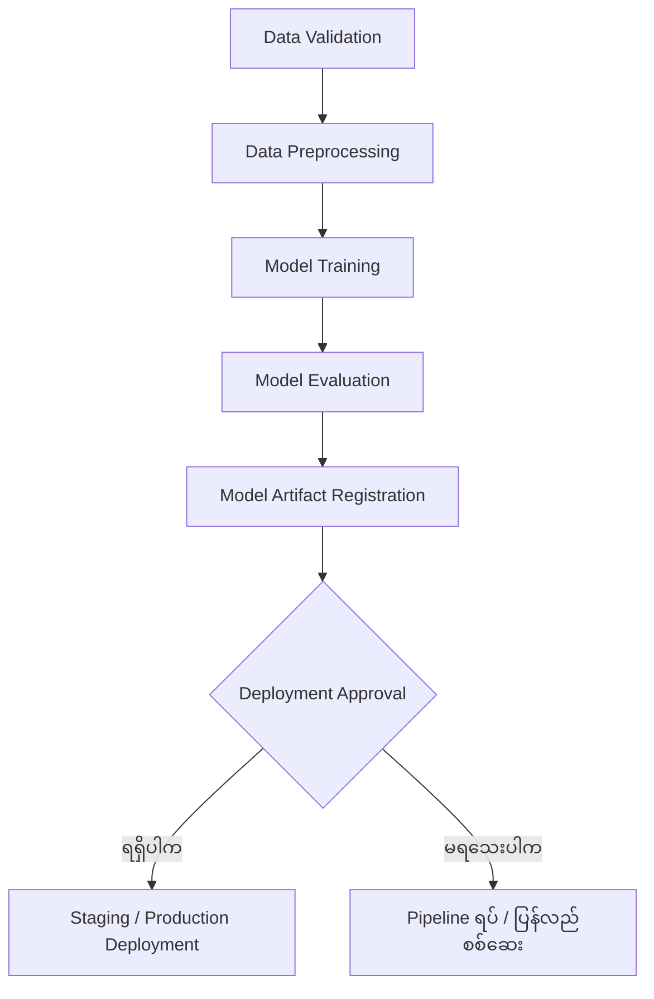
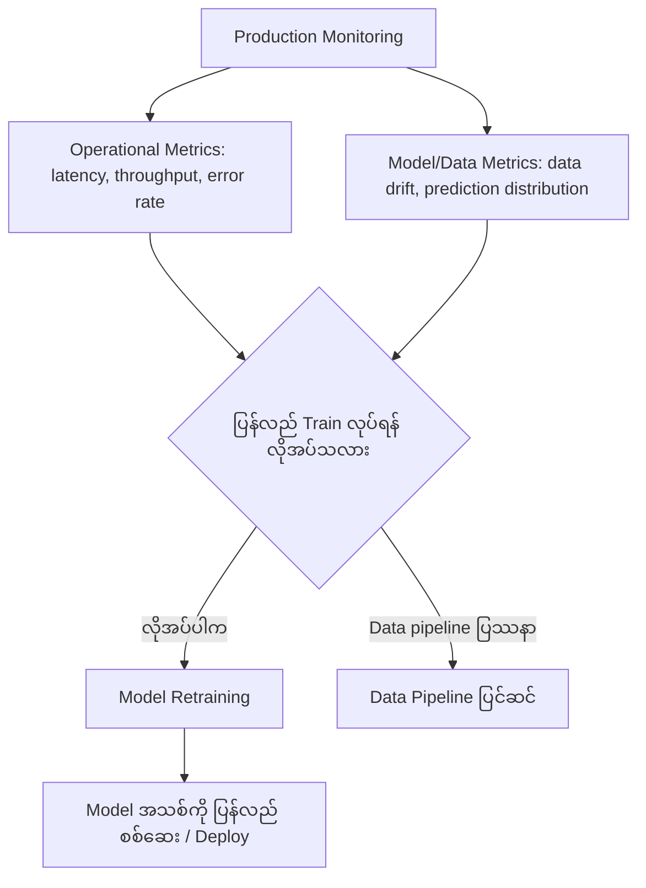
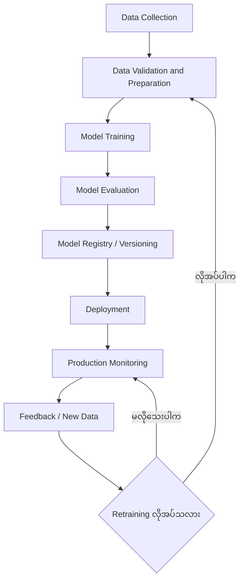
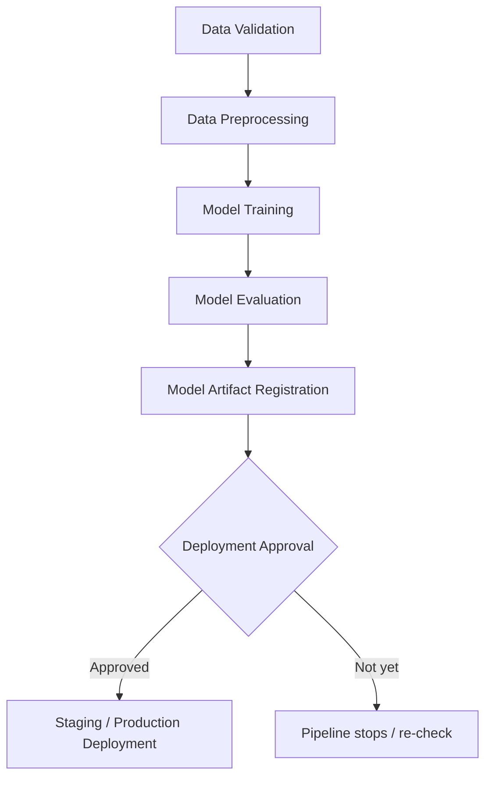
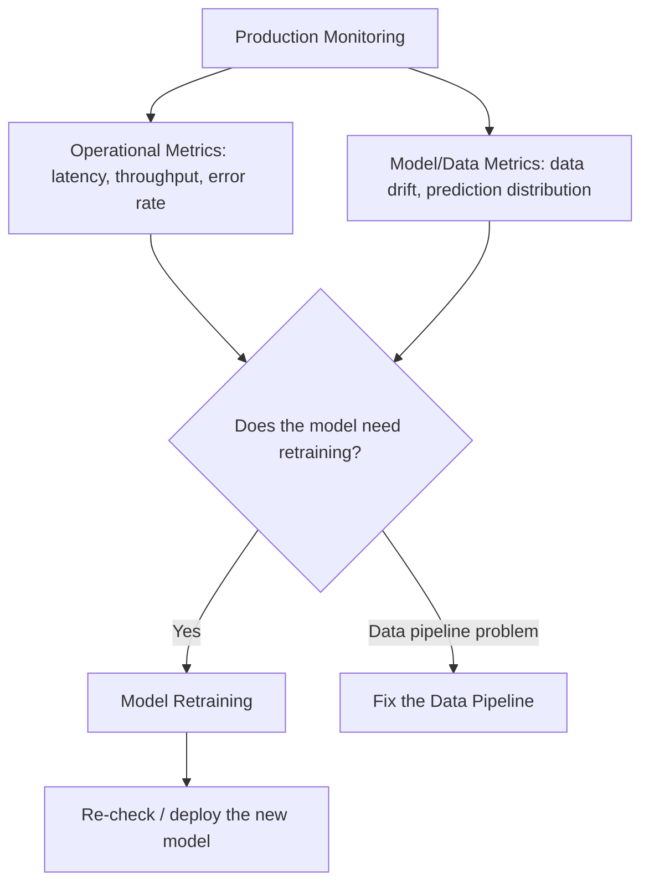
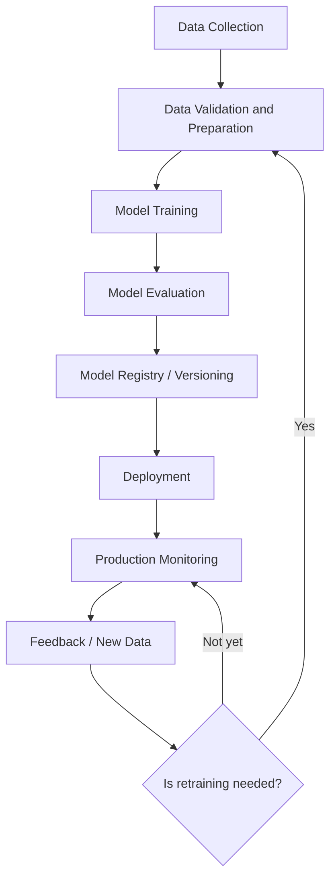

# Module 39 — Introduction to MLOps

> Part VIII · MLOps and End-to-End Production AI — topic notes

## မြန်မာဘာသာ version

### 1. Learning Objectives

ဤ Module မှာ အောက်ပါအကြောင်းအရာတွေကို လေ့လာပါမယ်—

- MLOps ဆိုတာ ဘာလဲ။
- DevOps နဲ့ MLOps တို့ ဘယ်လိုဆက်စပ်သလဲ။
- Machine Learning Model တစ်ခုကို တည်ဆောက်ရုံနဲ့ ဘာကြောင့် မလုံလောက်သလဲ။
- Versioning, Data Tracking, Model Deployment နဲ့ Monitoring တို့ ဘာကြောင့် အရေးကြီးသလဲ။
- Repeatable နဲ့ Automated ML Pipelines တွေကို ဘာကြောင့် လိုအပ်သလဲ။
- Model Quality နဲ့ Prediction Reliability ကို Production မှာ ဘယ်လိုထိန်းသိမ်းသလဲ။
- MLOps က AI Lifecycle တစ်ခုလုံးကို Operationalize လုပ်ရာမှာ ဘယ်လိုကူညီပေးသလဲ။

### 2. MLOps ဆိုတာ ဘာလဲ?

MLOps = Machine Learning Operations

MLOps ဆိုတာ Machine Learning Model တွေကို တည်ဆောက်ခြင်း၊ Train လုပ်ခြင်း၊ Test လုပ်ခြင်း၊ Deploy လုပ်ခြင်းနဲ့ Production မှာ Monitor လုပ်ခြင်းတို့ကို စနစ်တကျ စီမံဖို့ အသုံးပြုတဲ့ Practices, Processes နဲ့ Tools တွေကို ပေါင်းစပ်ထားတဲ့ နည်းလမ်းဖြစ်ပါတယ်။

MLOps ဟာ DevOps ရဲ့ Automation, Version Control, Continuous Integration နဲ့ Continuous Delivery စတဲ့ အယူအဆတွေကို Machine Learning Lifecycle အတွက် အသုံးချထားတာ ဖြစ်ပါတယ်။

DevOps မှာ Software Code ကို Build, Test, Deploy လုပ်တဲ့ Process တွေကို အလိုအလျောက်ဖြစ်အောင် စီမံပါတယ်။ MLOps မှာတော့ Code အပြင် Training Data, Model Artifacts, Model Evaluation Results နဲ့ Model Deployment Configuration တို့ကိုပါ ထည့်သွင်းစဉ်းစားရပါတယ်။

ဘာကြောင့်လဲဆိုတော့ Machine Learning System တစ်ခုရဲ့ Result ဟာ Code တစ်ခုတည်းပေါ်မှာ မမူတည်ဘဲ Data, Model Parameters, Training Process နဲ့ Runtime Environment တို့အပေါ်မှာလည်း မူတည်နေလို့ပါ။

### 3. Kitchen Analogy — MLOps ကို မီးဖိုချောင်နဲ့ နားလည်ခြင်း

MLOps ကို နားလည်ဖို့ Restaurant Kitchen တစ်ခုနဲ့ နှိုင်းယှဉ်ကြည့်ပါမယ်။

#### 3.1 MLOps မရှိတဲ့ Kitchen

Chef တစ်ယောက်က အရသာကောင်းတဲ့ ဟင်းတစ်မျိုးကို ဖန်တီးနိုင်တယ်ဆိုပါစို့။ ဒါပေမဲ့ Kitchen Operations စနစ်တကျ မရှိဘူးဆိုရင်—

- Recipe ကို စာရွက်စာတမ်းအဖြစ် မသိမ်းထားဘူး။
- Ingredients တွေ ဘယ်ကလာတယ်၊ ဘယ်လောက်ကျန်တယ်ဆိုတာ မသိဘူး။
- တစ်ကြိမ်နဲ့တစ်ကြိမ် Ingredients Quality မတူနိုင်ဘူး။
- Chef တစ်ယောက်နဲ့တစ်ယောက် ချက်ပြုတ်ပုံ မတူနိုင်ဘူး။
- Cooking Temperature နဲ့ Cooking Time ကို မထိန်းချုပ်ဘူး။
- Quality Check မရှိဘူး။

အဲဒီအခါ Customer တစ်ယောက်က အရသာကောင်းတဲ့ ဟင်းရနိုင်ပေမဲ့ နောက်တစ်ကြိမ်မှာ အရသာမတူတဲ့ ဟင်းရနိုင်ပါတယ်။

ပြဿနာက Chef မှာ ကျွမ်းကျင်မှုမရှိတာ မဟုတ်ပါဘူး။ အဲဒီ Chef ရဲ့ အရည်အချင်းကို အမြဲတမ်း တူညီတဲ့ Quality နဲ့ ထုတ်လုပ်နိုင်ဖို့ လိုအပ်တဲ့ Operational Process မရှိတာ ဖြစ်ပါတယ်။

#### 3.2 MLOps ရှိတဲ့ Kitchen

Kitchen Operations ကို စနစ်တကျ တည်ဆောက်ထားရင်—

- Recipe ကို Document လုပ်ထားတယ်။
- Ingredients တွေရဲ့ Source, Quantity နဲ့ Quality ကို Track လုပ်တယ်။
- Cooking Steps တွေကို Standardize လုပ်ထားတယ်။
- Temperature နဲ့ Cooking Time ကို သတ်မှတ်ထားတယ်။
- Quality Checks တွေကို ပုံမှန်လုပ်တယ်။
- Chef တစ်ယောက်ကနေ တစ်ယောက်ဆီ လွှဲပြောင်းလုပ်ကိုင်ရင်လည်း Process တူညီတယ်။

ဒါကြောင့် ဟင်းတစ်ပွဲကို ဘယ်သူချက်ချက်၊ ဘယ်အချိန်မှာ ချက်ချက် သတ်မှတ်ထားတဲ့ Quality ကို ပိုမိုတည်ငြိမ်စွာ ရရှိနိုင်ပါတယ်။

ဒီဥပမာမှာ—

| Kitchen Operations | MLOps Equivalent |
|---|---|
| Recipe | Model Training Code နဲ့ Configuration |
| Ingredients | Training Data |
| Ingredient Source နဲ့ Quality Records | Data Lineage နဲ့ Data Quality Checks |
| Recipe Version | Code/Model/Configuration Version |
| Cooking Process | Model Training Pipeline |
| Taste Test | Model Evaluation |
| Kitchen Standard Operating Procedure | Standardized Training/Deployment Pipeline |
| Food Quality Monitoring | Model Performance Monitoring |
| Recipe ပြန်ပြင်ခြင်း | Model Update သို့မဟုတ် Retraining |

အဓိကသဘောတရားက တစ်ကြိမ်ကောင်းမွန်တဲ့ Result ရရှိခြင်းထက် အကြိမ်ကြိမ် ယုံကြည်စိတ်ချရတဲ့ Result ရရှိနိုင်ဖို့ Process ကို စနစ်တကျ တည်ဆောက်ထားခြင်း ဖြစ်ပါတယ်။

### 4. Machine Learning မှာ MLOps မရှိရင် ဘာပြဿနာတွေ ဖြစ်နိုင်သလဲ?

Data Scientist တစ်ယောက်က Machine Learning Model တစ်ခုကို အောင်မြင်စွာ Train လုပ်ပြီးပြီလို့ ယူဆကြည့်ပါ။ ဥပမာ E-commerce Company တစ်ခုအတွက် Product Recommendation Model တစ်ခု တည်ဆောက်ထားတယ်ဆိုပါစို့။

Model က Development Environment မှာ ကောင်းကောင်းအလုပ်လုပ်နိုင်ပေမဲ့ Production ကို Deploy လုပ်တဲ့အခါ အောက်ပါပြဿနာတွေ ဖြစ်လာနိုင်ပါတယ်။

#### 4.1 Model Versioning မရှိခြင်း

Model File အများအပြား ရှိနေပေမဲ့ ဘယ် Model က Production မှာ အသုံးပြုနေတဲ့ Version ဖြစ်တယ်ဆိုတာ မသိနိုင်ပါဘူး။ ဥပမာ—

```
model_final.pkl
model_final_v2.pkl
model_latest.pkl
model_latest_new.pkl
```

ဒီလို File Names တွေရှိနေပေမဲ့ Model တစ်ခုချင်းစီရဲ့ Training Data, Code Version, Evaluation Results နဲ့ Deployment History မသိရင် ပြဿနာဖြစ်နိုင်ပါတယ်။ MLOps မှာ Model Version နဲ့ သက်ဆိုင်ရာ Metadata တွေကို စနစ်တကျ ထိန်းသိမ်းဖို့ လိုအပ်ပါတယ်။

#### 4.2 Training Data ကို Track မလုပ်ထားခြင်း

Machine Learning Model တစ်ခုရဲ့ Result ဟာ Training Data အပေါ်မှာ မူတည်ပါတယ်။ Training Data ပြောင်းလဲသွားရင် Model Result လည်း ပြောင်းလဲနိုင်ပါတယ်။ Data Version နဲ့ Lineage မရှိရင်—

- ဘယ် Data နဲ့ Model ကို Train လုပ်ထားသလဲ။
- ဘယ် Data Cleaning Process ကို အသုံးပြုခဲ့သလဲ။
- Training Dataset Version ဘယ်ဟာလဲ။
- Model Performance ဘာကြောင့် ပြောင်းလဲသွားသလဲ။

ဆိုတဲ့ မေးခွန်းတွေကို ဖြေဖို့ ခက်ခဲလာနိုင်ပါတယ်။

#### 4.3 Deployment Process မတူညီခြင်း

Engineer တစ်ယောက်က Model ကို Docker Container ထဲမှာ Deploy လုပ်တယ်။ နောက် Engineer တစ်ယောက်က Dependencies မတူတဲ့ Environment မှာ Deploy လုပ်တယ်ဆိုပါစို့။ အဲဒီအခါ Model ရဲ့ Runtime Behavior, Latency နဲ့ Result တွေ ကွာခြားနိုင်ပါတယ်။

MLOps က Deployment Configuration, Dependencies, Model Artifacts နဲ့ Release Process တွေကို Standardize လုပ်ပြီး Repeatable ဖြစ်အောင် ကူညီပေးပါတယ်။

#### 4.4 Production Monitoring မရှိခြင်း

Model ကို Deploy လုပ်ပြီးနောက်မှာလည်း စောင့်ကြည့်ဖို့ လိုအပ်ပါတယ်။ ဥပမာ Recommendation Model တစ်ခုက အရင်က ကောင်းမွန်တဲ့ Recommendation တွေ ပေးနိုင်ပေမဲ့ Customer Behavior ပြောင်းလဲလာတဲ့အခါ Prediction Quality ကျဆင်းသွားနိုင်ပါတယ်။ Monitoring မရှိရင် ဒီပြဿနာကို User Complaint များလာမှ သတိပြုမိနိုင်ပါတယ်။

MLOps မှာ Application Health, Latency, Error Rate, Input Data Quality နဲ့ ရရှိနိုင်တဲ့အခါ Model Quality Metrics တွေကို စောင့်ကြည့်နိုင်ပါတယ်။

သတိပြုရန် — Model ကို Deploy လုပ်ပြီးနောက် Prediction Accuracy ကို အမြဲတမ်း တိုက်ရိုက်တွက်လို့ရတာ မဟုတ်ပါဘူး။ အမှန်တကယ် Outcome Labels တွေက နောက်မှ ရောက်လာနိုင်ပါတယ်။ ထို့ကြောင့် Operational Monitoring နဲ့ Model Quality Monitoring ကို သီးခြားစဉ်းစားရပါတယ်။

### 5. MLOps ရဲ့ အဓိက Components များ

#### 5.1 Documentation

Model တစ်ခုနဲ့ပတ်သက်ပြီး အရေးကြီးတဲ့ အချက်အလက်တွေကို Document လုပ်ထားရပါတယ်။ ဥပမာ—

- Model ရဲ့ ရည်ရွယ်ချက်။
- အသုံးပြုထားတဲ့ Training Data။
- Model Architecture နဲ့ Parameters။
- Training Code Version။
- Evaluation Metrics။
- Known Limitations။
- Deployment Requirements။

Documentation က Model ကို တခြား Engineer တွေ နားလည်ပြီး ဆက်လက်ထိန်းသိမ်းနိုင်ဖို့ ကူညီပေးပါတယ်။

#### 5.2 Versioning

Versioning ဆိုတာ Code, Data, Model Artifacts နဲ့ Configuration တွေကို ဘယ် Version က ဘယ် Result ကို ထုတ်ပေးခဲ့တယ်ဆိုတာ Trace လုပ်နိုင်အောင် စီမံခြင်း ဖြစ်ပါတယ်။ Versioning က အောက်ပါမေးခွန်းတွေကို ဖြေဆိုနိုင်ဖို့ ကူညီပေးပါတယ်—

- Production မှာ ဘယ် Model Version ကို အသုံးပြုနေသလဲ။
- ဘယ် Dataset Version နဲ့ Train လုပ်ခဲ့သလဲ။
- Model Version အသစ်က အရင် Version ထက် ဘာကွာသလဲ။
- Model အသစ်မှာ ပြဿနာဖြစ်ရင် ဘယ် Version ဆီ ပြန်သွားနိုင်သလဲ။

#### 5.3 Data Tracking

Data Tracking က Dataset တွေ ဘယ်ကလာတယ်၊ ဘယ်လို ပြောင်းလဲခဲ့တယ်၊ ဘယ် Model Training Run မှာ အသုံးပြုခဲ့တယ်ဆိုတာ Trace လုပ်နိုင်စေပါတယ်။ Dataset အသစ်ရလာတဲ့အခါ အရင် Data နဲ့ ကွာခြားချက်တွေကို စစ်ဆေးနိုင်ပြီး Data Quality ပြဿနာတွေကိုလည်း ရှာဖွေနိုင်ပါတယ်။

#### 5.4 Automated Training Pipeline

Training Pipeline ကို စနစ်တကျ တည်ဆောက်ထားရင် သတ်မှတ်ထားတဲ့ Input Data နဲ့ Configuration ကို အသုံးပြုပြီး Training Process ကို ပြန်လည် Run လုပ်နိုင်ပါတယ်။ ဥပမာ Pipeline တစ်ခုမှာ—

- Data Validation
- Data Preprocessing
- Model Training
- Model Evaluation
- Model Artifact Registration
- Deployment Approval

တို့ ပါဝင်နိုင်ပါတယ်။ အဆင့်အားလုံးကို မဖြစ်မနေ အလိုအလျောက်လုပ်ရမယ်လို့ မဆိုလိုပါဘူး။ Production Environment မှာ အချို့အဆင့်တွေမှာ Human Approval လိုအပ်နိုင်ပါတယ်။

Pipeline အဆင့်တွေကို ပုံဖြင့် ကြည့်ရအောင်—

**Figure 1 — Automated Training Pipeline အဆင့်များ**



**ပုံရှင်းလင်းချက်** — အပေါ်ကနေ အောက်ကို ဖတ်ပါ။ Data Validation ကနေ စပြီး Data Preprocessing၊ Model Training၊ Model Evaluation ကို ဖြတ်သန်းပြီး Model Artifact Registration မှာ မှတ်တမ်းတင်ပါတယ်။ နောက်ဆုံး Deployment Approval ဆိုတဲ့ ဆုံးဖြတ်ချက်အမှတ်မှာ approval ရမှ deployment ဆက်သွားနိုင်ပြီး မရသေးရင် pipeline ကို ရပ်ပြီး ပြန်လည်စစ်ဆေးရပါမယ်။ အဆင့်အားလုံး အလိုအလျောက် မဟုတ်ဘဲ human approval လိုအပ်နိုင်တာကိုလည်း ဒီပုံက ပြပါတယ်။

#### 5.5 Automated Deployment

Model Evaluation က သတ်မှတ်ထားတဲ့ Quality Criteria ကို ဖြည့်ဆည်းနိုင်တဲ့အခါ Model ကို Deployment Pipeline မှတစ်ဆင့် Staging သို့မဟုတ် Production Environment ကို ပို့နိုင်ပါတယ်။ Deployment နည်းလမ်းတွေမှာ—

- Canary Deployment
- Blue-Green Deployment
- Shadow Deployment
- Controlled Rollout

တို့ ပါဝင်နိုင်ပါတယ်။ Deployment Automation က Manual Errors ကို လျှော့ချနိုင်ပေမဲ့ Validation နဲ့ Approval လုပ်ငန်းစဉ်တွေကို အစားထိုးဖို့ မဟုတ်ပါဘူး။

#### 5.6 Monitoring and Feedback

Production Monitoring က Model နဲ့ Service ရဲ့ အခြေအနေကို စောင့်ကြည့်ပေးပါတယ်။

Operational Metrics ဥပမာ—

- Request Latency
- Throughput
- Error Rate
- GPU Utilization
- Memory Usage

Model/Data Metrics ဥပမာ—

- Prediction Distribution
- Input Data Quality
- Data Drift
- Model Quality Metrics
- Delayed Ground-Truth Outcomes

Monitoring ရလဒ်တွေက Model ကို ပြန်လည် Train လုပ်ဖို့ လိုအပ်သလား၊ Data Pipeline ကို ပြင်ဆင်ဖို့ လိုအပ်သလားဆိုတာ ဆုံးဖြတ်ရာမှာ ကူညီပေးနိုင်ပါတယ်။

Monitoring နဲ့ Feedback လမ်းကြောင်းကို ပုံဖြင့် ကြည့်ရအောင်—

**Figure 2 — Monitoring နှင့် Feedback လမ်းကြောင်း**



**ပုံရှင်းလင်းချက်** — Production Monitoring ကနေ operational metrics နဲ့ model/data metrics နှစ်မျိုး စုဆောင်းပြီး ဆုံးဖြတ်ချက်အမှတ်ကို ရောက်ပါတယ်။ Model performance ကျဆင်းလာရင် retraining လုပ်နိုင်သလို၊ data drift က data pipeline ပြဿနာကြောင့် ဖြစ်ရင် data pipeline ကို ပြင်ဆင်ရပါမယ်။ Monitoring ရလဒ်တွေက retraining လုပ်၊ မလုပ် ဆုံးဖြတ်ရာမှာ အခြေခံအချက် ဖြစ်တာကို ပုံက ပြပါတယ်။

### 6. MLOps Lifecycle ကို နားလည်ခြင်း

အောက်ပါပုံက MLOps ရဲ့ အဓိက Workflow ကို ဖော်ပြထားပါတယ်။

```
Data Collection
      |
      v
Data Validation and Preparation
      |
      v
Model Training
      |
      v
Model Evaluation
      |
      v
Model Registry / Versioning
      |
      v
Deployment
      |
      v
Production Monitoring
      |
      v
Feedback / New Data
      |
      v
Retraining when needed
```

ဒီ Workflow က Linear Process တစ်ခုတည်း မဟုတ်ပါဘူး။ Production Monitoring ကနေ ရရှိလာတဲ့ Feedback ကို အသုံးပြုပြီး Data Preparation, Training, Evaluation နဲ့ Deployment အဆင့်တွေကို ပြန်လည်လုပ်ဆောင်နိုင်ပါတယ်။

ဒီ loop ကို ပုံဖြင့် ကြည့်ရအောင်—

**Figure 3 — MLOps Lifecycle Loop**



**ပုံရှင်းလင်းချက်** — အပေါ်က Data Collection ကနေ စပြီး အဆင့်တစ်ဆင့်ချင်းစီ အောက်ကို ဆင်းသွားပါတယ် — Data Validation and Preparation၊ Model Training၊ Model Evaluation၊ Model Registry / Versioning၊ Deployment၊ Production Monitoring ပြီးရင် Feedback / New Data ရောက်ပါတယ်။ အောက်ဆုံးက ဆုံးဖြတ်ချက်အမှတ်က retraining လိုအပ်ရင် Data Validation and Preparation ဆီ ပြန်တက်သွားတာကြောင့် ဒီ workflow ဟာ linear တစ်ကြောင်းတည်း မဟုတ်ဘဲ loop ဖြစ်ကြောင်း မြင်ရပါမယ်။ မလိုသေးရင်တော့ production monitoring ကို ဆက်လက် စောင့်ကြည့်နေပါမယ်။

Model ကို အချိန်တိုင်း Retrain လုပ်ဖို့ မလိုအပ်ပါဘူး။ Retraining က Model Performance, Data Drift, Business Requirements နဲ့ သတ်မှတ်ထားတဲ့ Policy တွေအပေါ် မူတည်သင့်ပါတယ်။

### 7. DevOps vs. MLOps

| အချက် | DevOps | MLOps |
|---|---|---|
| အဓိကရည်ရွယ်ချက် | Software Delivery နဲ့ Operations ကို ပိုမိုယုံကြည်စိတ်ချရစေခြင်း | ML Lifecycle ကို စနစ်တကျ စီမံခြင်း |
| အဓိက Artifact | Source Code, Binary, Container Image | Code, Data References, Model Artifacts, Configuration |
| Versioning | Code, Dependencies, Build Artifacts | Code အပြင် Dataset, Model နဲ့ Training Configuration |
| Testing | Unit, Integration, Security, Performance Tests | Software Tests အပြင် Data Validation နဲ့ Model Evaluation |
| Deployment | Application Release | Model နဲ့ Serving Application Release |
| Monitoring | Availability, Latency, Errors, Resource Usage | Operational Metrics အပြင် Data/Model Quality Metrics |
| Feedback | Software Changes နဲ့ Incident Response | Data/Model Updates, Retraining, Model Rollback |

MLOps ဟာ DevOps ကို ဖယ်ရှားတာ မဟုတ်ပါဘူး။ MLOps မှာ DevOps Principles တွေကို အသုံးပြုပြီး Machine Learning အတွက် သီးခြားလိုအပ်ချက်တွေကို ထပ်မံစီမံရတာ ဖြစ်ပါတယ်။

### 8. MLOps က AI Infrastructure နဲ့ ဘယ်လိုဆက်စပ်သလဲ?

GPU Infrastructure တစ်ခုမှာ GPU Servers, CUDA Libraries, Training Frameworks, Storage နဲ့ Networking ရှိနေရုံနဲ့ Production ML System တစ်ခုလုံး ပြည့်စုံသွားတာ မဟုတ်ပါဘူး။ MLOps က အဲဒီ Infrastructure ပေါ်မှာ Model Lifecycle ကို စနစ်တကျ လည်ပတ်နိုင်အောင် ကူညီပေးပါတယ်။ ဥပမာ—

- Training Jobs ကို Slurm သို့မဟုတ် အခြား Compute Platform မှာ Run လုပ်နိုင်တယ်။
- Model Artifacts တွေကို Versioned Storage သို့မဟုတ် Model Registry မှာ သိမ်းနိုင်တယ်။
- Containerized Inference Services တွေကို Kubernetes မှာ Deploy လုပ်နိုင်တယ်။
- DCGM နဲ့ Monitoring Stack ကို အသုံးပြုပြီး GPU Infrastructure ကို စောင့်ကြည့်နိုင်တယ်။
- CI/CD Pipeline နဲ့ Model Deployment Process ကို Automate လုပ်နိုင်တယ်။

ဒီနေရာမှာ သတိပြုရမှာက Slurm, Kubernetes, DCGM နဲ့ Model Registry တို့ဟာ MLOps Platform တစ်ခုတည်း မဟုတ်ပါဘူး။ ၎င်းတို့ဟာ MLOps Architecture ထဲမှာ ပေါင်းစပ်အသုံးပြုနိုင်တဲ့ Components တွေ ဖြစ်ပါတယ်။

### 9. Practical Example — Product Recommendation Model

E-commerce Company တစ်ခုမှာ Customer တွေအတွက် Product Recommendation Model တစ်ခု တည်ဆောက်နေတယ်ဆိုပါစို့။

**MLOps မရှိတဲ့အခြေအနေ**

- Data Scientist က Model ကို ကိုယ်တိုင် Train လုပ်တယ်။
- Model File ကို Server ပေါ်မှာ Manual Copy လုပ်တယ်။
- Engineer တစ်ယောက်စီ Deployment နည်းလမ်း မတူနိုင်ဘူး။
- Production မှာ Model Quality ကျဆင်းနေလားဆိုတာ စနစ်တကျ မစောင့်ကြည့်ဘူး။
- Model အသစ်မှာ ပြဿနာဖြစ်ရင် ဘယ် Version ဆီ Rollback လုပ်ရမလဲဆိုတာ မသေချာဘူး။

**MLOps ရှိတဲ့အခြေအနေ**

- Data Pipeline က Data ကို စုဆောင်းပြီး Validate လုပ်တယ်။
- Training Pipeline က သတ်မှတ်ထားတဲ့ Code နဲ့ Data Version ကို အသုံးပြုတယ်။
- Evaluation က Model အသစ်ရဲ့ Quality ကို သတ်မှတ်ထားတဲ့ Metrics နဲ့ စစ်ဆေးတယ်။
- အောင်မြင်တဲ့ Model ကို Version နဲ့ Metadata တွေအတူ Registry မှာ မှတ်တမ်းတင်တယ်။
- Deployment Pipeline က Model ကို Staging မှာ စမ်းသပ်ပြီး သတ်မှတ်ထားတဲ့ Approval ရမှ Production ကို ဖြန့်ချိတယ်။
- Production Monitoring က Service Health နဲ့ Model/Data Metrics တွေကို စောင့်ကြည့်တယ်။
- Model Quality ကျဆင်းလာရင် Investigation, Rollback သို့မဟုတ် Retraining လုပ်ဖို့ သတ်မှတ်ထားတဲ့ Process ကို အသုံးပြုတယ်။

ဒီလိုစနစ်တကျ စီမံထားခြင်းက Manual Work ကို လျှော့ချပြီး Model Release တွေကို ပိုမို Repeatable နဲ့ Traceable ဖြစ်စေပါတယ်။

### 10. Review Questions

1. MLOps ဆိုတာ ဘာလဲ?
2. DevOps နဲ့ MLOps တို့ ဘယ်လိုဆက်စပ်သလဲ?
3. Kitchen Recipe နဲ့ Training Dataset တို့ ဘယ်လိုဆက်စပ်သလဲ?
4. Model Versioning မရှိရင် ဘယ်လိုပြဿနာတွေ ဖြစ်နိုင်သလဲ?
5. Data Lineage က ဘာကြောင့် အရေးကြီးသလဲ?
6. Model Evaluation နဲ့ Production Monitoring တို့ ဘာကွာသလဲ?
7. MLOps Pipeline မှာ Model Registry က ဘာအတွက် အသုံးဝင်သလဲ?
8. Production Model ကို အချိန်တိုင်း Retrain လုပ်ဖို့ လိုအပ်သလား?
9. GPU Monitoring နဲ့ Model Quality Monitoring တို့ ဘာကွာသလဲ?
10. Slurm နဲ့ Kubernetes တို့က MLOps Architecture ထဲမှာ ဘယ်လိုပါဝင်နိုင်သလဲ?

**အဖြေများ (အကျဉ်း)**

1. ML Model တွေကို တည်ဆောက်၊ Train၊ Test၊ Deploy နဲ့ Production မှာ Monitor လုပ်ခြင်းတို့ကို စနစ်တကျ စီမံဖို့ Practices, Processes နဲ့ Tools ပေါင်းစပ်မှု ဖြစ်ပါတယ်။
2. MLOps က DevOps ရဲ့ Automation, Version Control, CI/CD အယူအဆတွေကို ML Lifecycle အတွက် အသုံးချပြီး Data, Model Artifacts နဲ့ Model Quality လိုအပ်ချက်တွေကို ထပ်မံစီမံပါတယ်။ DevOps ကို အစားထိုးတာ မဟုတ်ပါဘူး။
3. Recipe က Model Training Code နဲ့ Configuration နဲ့ ဆင်တူပြီး Ingredients က Training Data နဲ့ ဆင်တူပါတယ်။ နှစ်ခုလုံးကို Document/Track လုပ်မှ ထပ်ခါတလဲလဲ ယုံကြည်စိတ်ချရတဲ့ Result ရနိုင်ပါတယ်။
4. Production မှာ ဘယ် Version အသုံးပြုနေမှန်းမသိခြင်း၊ Rollback လုပ်ရနေရာမသိခြင်း၊ Training Data နဲ့ Result ဆက်စပ်မှု ပျက်ခြင်း စတဲ့ ပြဿနာတွေ ဖြစ်နိုင်ပါတယ်။
5. ဘယ် Data နဲ့ Process က Model ကို ထုတ်လုပ်ခဲ့သလဲဆိုတာ ခြေရာခံနိုင်မှ ပြဿနာဖြစ်ရင် အကြောင်းရင်းရှာဖွေပြီး ပြန်လည်ထုတ်လုပ်နိုင်ပါတယ်။
6. Model Evaluation က Deploy မလုပ်မီ Quality ကို စစ်ဆေးခြင်းဖြစ်ပြီး Production Monitoring က Deploy ပြီးနောက် Service နဲ့ Model/Data အခြေအနေကို စောင့်ကြည့်ခြင်း ဖြစ်ပါတယ်။
7. Model Versions, Metadata, Evaluation Results နဲ့ Status တွေကို မှတ်တမ်းတင် စီမံပေးပြီး Deployment History ကို Trace နိုင်စေလို့ ဖြစ်ပါတယ်။
8. မလိုအပ်ပါဘူး။ Model Performance, Data Drift, Business Requirements နဲ့ Policy တွေအပေါ် မူတည်ပြီး ဆုံးဖြတ်သင့်ပါတယ်။
9. GPU Monitoring က Infrastructure Health (utilization, memory, temperature) ကို ကြည့်ခြင်းဖြစ်ပြီး Model Quality Monitoring က Prediction Quality, Data Drift စတာတွေကို ကြည့်ခြင်းဖြစ်ပါတယ်။
10. Slurm က Training Jobs အတွက် Resource Allocation/Scheduling လုပ်ပေးနိုင်ပြီး Kubernetes က Containerized Inference Services တွေကို Deploy/Manage လုပ်ပေးနိုင်ပါတယ်။

### 11. Module Summary

MLOps က Machine Learning Model တစ်ခုကို Train လုပ်ပြီးတာနဲ့ ရပ်မသွားဘဲ Production မှာ စနစ်တကျ Deploy လုပ်ခြင်း၊ Version ထိန်းသိမ်းခြင်း၊ Monitor လုပ်ခြင်းနဲ့ လိုအပ်သလို Update လုပ်ခြင်းတို့ကို စီမံပေးပါတယ်။

အဓိကမှတ်သားရန်—

- **Documentation**: Model နဲ့ Process တွေကို နားလည်နိုင်အောင် မှတ်တမ်းတင်ခြင်း။
- **Versioning**: Code, Data, Model နဲ့ Configuration တွေကို Trace လုပ်နိုင်ခြင်း။
- **Automation**: Training, Evaluation နဲ့ Deployment Process တွေကို Repeatable ဖြစ်စေခြင်း။
- **Monitoring**: Service Health, Data Quality နဲ့ Model Performance ကို စောင့်ကြည့်ခြင်း။
- **Feedback**: Production ရလဒ်တွေကို အသုံးပြုပြီး Investigation, Update သို့မဟုတ် Retraining လုပ်ရန် ဆုံးဖြတ်ခြင်း။

Kitchen Analogy ကို ပြန်သတိရပါ။ Chef က ဟင်းကောင်းတစ်ပွဲ ချက်နိုင်တာဟာ အစပဲဖြစ်ပါတယ်။ အဲဒီဟင်းကို Customer တိုင်းအတွက် တည်ငြိမ်တဲ့ Quality နဲ့ ထုတ်လုပ်နိုင်ဖို့ Recipe, Ingredients, Process နဲ့ Quality Control တို့ လိုအပ်ပါတယ်။ Machine Learning မှာလည်း Model ကောင်းတစ်ခုတည်ဆောက်နိုင်တာဟာ အစပဲဖြစ်ပြီး၊ အဲဒီ Model ကို ယုံကြည်စိတ်ချရစွာ ဆက်လက်လည်ပတ်နိုင်ဖို့ MLOps လိုအပ်ပါတယ်။

## English Version

### 1. Learning Objectives

This module covers the following topics—

- What is MLOps?
- How are DevOps and MLOps related?
- Why is building a machine learning model not enough?
- Why do versioning, data tracking, model deployment and monitoring matter?
- Why are repeatable and automated ML pipelines needed?
- How are model quality and prediction reliability maintained in production?
- How does MLOps help operationalize the whole AI lifecycle?

### 2. What Is MLOps?

MLOps = Machine Learning Operations.

MLOps is an approach that combines the practices, processes and tools used to systematically manage building, training, testing, deploying and monitoring machine learning models in production.

MLOps applies DevOps concepts — automation, version control, continuous integration and continuous delivery — to the machine learning lifecycle.

DevOps automates the processes of building, testing and deploying software code. MLOps must additionally account for training data, model artifacts, model evaluation results and model deployment configuration.

The reason is that the result of a machine learning system does not depend on code alone — it also depends on data, model parameters, the training process and the runtime environment.

### 3. Kitchen Analogy — Understanding MLOps Through a Kitchen

To understand MLOps, compare it with a restaurant kitchen.

#### 3.1 A Kitchen Without MLOps

Suppose a chef can create a delicious dish. But if kitchen operations are not systematic—

- The recipe is not documented.
- Nobody knows where the ingredients came from or how many are left.
- Ingredient quality can vary from one occasion to the next.
- Each chef may cook differently.
- Cooking temperature and cooking time are not controlled.
- There is no quality check.

Then a customer may get a good dish once, but a different-tasting dish the next time.

The problem is not that the chef lacks skill. The problem is that there is no operational process to reproduce that skill at a consistent quality every time.

#### 3.2 A Kitchen With MLOps

When kitchen operations are built systematically—

- The recipe is documented.
- Ingredient source, quantity and quality are tracked.
- Cooking steps are standardized.
- Temperature and cooking time are defined.
- Quality checks are performed regularly.
- The process stays the same when one chef hands over to another.

As a result, the defined quality can be reproduced more consistently — no matter who cooks the dish, or when.

In this example—

| Kitchen Operations | MLOps Equivalent |
|---|---|
| Recipe | Model training code and configuration |
| Ingredients | Training data |
| Ingredient source and quality records | Data lineage and data quality checks |
| Recipe version | Code/model/configuration version |
| Cooking process | Model training pipeline |
| Taste test | Model evaluation |
| Kitchen standard operating procedure | Standardized training/deployment pipeline |
| Food quality monitoring | Model performance monitoring |
| Revising the recipe | Model update or retraining |

The key idea is to build the process systematically so that results are reliably reproducible — not just good once.

### 4. What Problems Occur Without MLOps in Machine Learning?

Assume a data scientist has successfully trained a machine learning model. For example, a product recommendation model built for an e-commerce company.

The model works well in the development environment, but deploying it to production can raise the following problems.

#### 4.1 No Model Versioning

There may be many model files, yet nobody can tell which model version is actually used in production. For example—

```
model_final.pkl
model_final_v2.pkl
model_latest.pkl
model_latest_new.pkl
```

With filenames like these, if the training data, code version, evaluation results and deployment history of each model are unknown, problems follow. MLOps requires model versions and their metadata to be maintained systematically.

#### 4.2 Training Data Is Not Tracked

A machine learning model's results depend on its training data. If the training data changes, model results may change too. Without data versioning and lineage, questions like these become hard to answer—

- Which data trained the model?
- Which data cleaning process was used?
- Which training dataset version was it?
- Why did model performance change?

#### 4.3 Inconsistent Deployment Processes

Suppose one engineer deploys the model in a Docker container, while another engineer deploys it in an environment with different dependencies. The model's runtime behavior, latency and results may then differ.

MLOps helps standardize deployment configuration, dependencies, model artifacts and release processes so that they are repeatable.

#### 4.4 No Production Monitoring

Even after deployment, the model must be watched. A recommendation model that used to give good recommendations may see prediction quality drop when customer behavior changes. Without monitoring, the problem may only be noticed once user complaints pile up.

MLOps can monitor application health, latency, error rate, input data quality and — where available — model quality metrics.

Note that prediction accuracy cannot always be measured directly after deployment. Real outcome labels may arrive later. Operational monitoring and model quality monitoring must therefore be considered separately.

### 5. Core Components of MLOps

#### 5.1 Documentation

Important information about a model must be documented. For example—

- The model's purpose.
- The training data used.
- Model architecture and parameters.
- Training code version.
- Evaluation metrics.
- Known limitations.
- Deployment requirements.

Documentation helps other engineers understand and continue maintaining the model.

#### 5.2 Versioning

Versioning means managing code, data, model artifacts and configuration so that which version produced which result can be traced. Versioning helps answer—

- Which model version is in production?
- Which dataset version trained it?
- What is different about the new model version?
- If the new model has problems, which version can be rolled back to?

#### 5.3 Data Tracking

Data tracking lets you trace where datasets came from, how they changed and which model training runs used them. When a new dataset arrives, differences from earlier data can be checked and data quality problems can be found.

#### 5.4 Automated Training Pipeline

With a systematically built training pipeline, the training process can be re-run using defined input data and configuration. A pipeline may include—

- Data validation
- Data preprocessing
- Model training
- Model evaluation
- Model artifact registration
- Deployment approval

Not every step must be automated. In production, some steps may require human approval.

The pipeline stages can be seen as a figure—

**Figure 1 — Automated Training Pipeline Stages**



**Figure walkthrough** — Read from top to bottom. From data validation through preprocessing, model training and model evaluation, the model is then recorded at model artifact registration. At the final deployment-approval decision point, the pipeline continues to deployment only when approval is given; otherwise it stops and the work is re-checked. The figure also shows that not every stage is automatic — human approval can be required.

#### 5.5 Automated Deployment

When model evaluation meets the defined quality criteria, the model can be sent through a deployment pipeline to a staging or production environment. Deployment methods include—

- Canary deployment
- Blue-green deployment
- Shadow deployment
- Controlled rollout

Deployment automation can reduce manual errors, but it does not replace validation and approval processes.

#### 5.6 Monitoring and Feedback

Production monitoring watches the state of the model and the service.

Example operational metrics—

- Request latency
- Throughput
- Error rate
- GPU utilization
- Memory usage

Example model/data metrics—

- Prediction distribution
- Input data quality
- Data drift
- Model quality metrics
- Delayed ground-truth outcomes

Monitoring results help decide whether the model needs retraining or the data pipeline needs fixing.

The monitoring and feedback flow can be seen as a figure—

**Figure 2 — Monitoring and Feedback Flow**



**Figure walkthrough** — Production monitoring collects two kinds of signals — operational metrics and model/data metrics — and both feed the decision point. When model performance drops, retraining may follow; when data drift points to a data pipeline problem, the data pipeline is fixed instead. The figure shows that monitoring results are the basis for deciding whether to retrain.

### 6. Understanding the MLOps Lifecycle

The following diagram shows the main MLOps workflow.

```
Data Collection
      |
      v
Data Validation and Preparation
      |
      v
Model Training
      |
      v
Model Evaluation
      |
      v
Model Registry / Versioning
      |
      v
Deployment
      |
      v
Production Monitoring
      |
      v
Feedback / New Data
      |
      v
Retraining when needed
```

This workflow is not a single linear process. Feedback from production monitoring can be used to repeat the data preparation, training, evaluation and deployment stages.

This loop can be seen as a figure—

**Figure 3 — MLOps Lifecycle Loop**



**Figure walkthrough** — Starting at the top with data collection, the stages flow downward — data validation and preparation, model training, model evaluation, model registry / versioning, deployment, production monitoring, and then feedback / new data. At the bottom decision point, when retraining is needed the path returns to data validation and preparation, so the workflow is a loop, not a single straight line. When it is not needed yet, production monitoring simply continues.

A model does not need constant retraining. Retraining should depend on model performance, data drift, business requirements and defined policies.

### 7. DevOps vs. MLOps

| Aspect | DevOps | MLOps |
|---|---|---|
| Primary purpose | Make software delivery and operations more reliable | Systematically manage the ML lifecycle |
| Primary artifacts | Source code, binary, container image | Code, data references, model artifacts, configuration |
| Versioning | Code, dependencies, build artifacts | Code plus dataset, model and training configuration |
| Testing | Unit, integration, security, performance tests | Software tests plus data validation and model evaluation |
| Deployment | Application release | Model and serving application release |
| Monitoring | Availability, latency, errors, resource usage | Operational metrics plus data/model quality metrics |
| Feedback | Software changes and incident response | Data/model updates, retraining, model rollback |

MLOps does not replace DevOps. MLOps uses DevOps principles and additionally addresses the specific needs of machine learning.

### 8. How Does MLOps Relate to AI Infrastructure?

Having GPU servers, CUDA libraries, training frameworks, storage and networking in a GPU infrastructure does not by itself complete a production ML system. MLOps helps run the model lifecycle systematically on top of that infrastructure. For example—

- Training jobs can run on Slurm or another compute platform.
- Model artifacts can be stored in versioned storage or a model registry.
- Containerized inference services can be deployed on Kubernetes.
- GPU infrastructure can be monitored with DCGM and a monitoring stack.
- The CI/CD pipeline and model deployment process can be automated.

Note that Slurm, Kubernetes, DCGM and a model registry are not one single MLOps platform. They are components that can be combined within an MLOps architecture.

### 9. Practical Example — Product Recommendation Model

Suppose an e-commerce company is building a product recommendation model for its customers.

**Without MLOps**

- The data scientist trains the model manually.
- The model file is copied to a server by hand.
- Each engineer may deploy differently.
- Nobody systematically watches whether model quality is degrading in production.
- If the new model has problems, it is unclear which version to roll back to.

**With MLOps**

- The data pipeline collects and validates data.
- The training pipeline uses defined code and data versions.
- Evaluation checks the new model's quality against defined metrics.
- A successful model is recorded in the registry with its version and metadata.
- The deployment pipeline tests the model in staging and releases to production only after the defined approval.
- Production monitoring watches service health and model/data metrics.
- If model quality drops, a defined process is used for investigation, rollback or retraining.

This systematic management reduces manual work and makes model releases more repeatable and traceable.

### 10. Review Questions

1. What is MLOps?
2. How are DevOps and MLOps related?
3. How does a kitchen recipe relate to a training dataset?
4. What problems can arise without model versioning?
5. Why does data lineage matter?
6. What is the difference between model evaluation and production monitoring?
7. What is a Model Registry useful for in an MLOps pipeline?
8. Does a production model always need retraining?
9. What is the difference between GPU monitoring and model quality monitoring?
10. How can Slurm and Kubernetes participate in an MLOps architecture?

**Concise answers**

1. A combination of practices, processes and tools for systematically managing building, training, testing, deploying and monitoring ML models in production.
2. MLOps applies DevOps' automation, version control and CI/CD concepts to the ML lifecycle and additionally manages data, model artifacts and model quality needs. It does not replace DevOps.
3. A recipe corresponds to model training code and configuration; ingredients correspond to training data. Both must be documented/tracked for reliably reproducible results.
4. Not knowing which version is in production, not knowing what to roll back to, and broken links between training data and results.
5. So you can trace which data and process produced a model, find root causes and reproduce it.
6. Model evaluation checks quality before deployment; production monitoring watches the service and model/data state after deployment.
7. It records model versions, metadata, evaluation results and status so deployment history can be traced.
8. No. It should depend on model performance, data drift, business requirements and policy.
9. GPU monitoring covers infrastructure health (utilization, memory, temperature); model quality monitoring covers prediction quality and data drift.
10. Slurm can allocate resources and schedule training jobs; Kubernetes can deploy and manage containerized inference services.

### 11. Module Summary

MLOps ensures that a machine learning model does not stop at being trained — it is systematically deployed to production, versioned, monitored and updated as needed.

Key takeaways—

- **Documentation**: recording model and process information so it can be understood.
- **Versioning**: tracing code, data, models and configuration.
- **Automation**: making training, evaluation and deployment processes repeatable.
- **Monitoring**: watching service health, data quality and model performance.
- **Feedback**: using production results to decide on investigation, updates or retraining.

Remember the kitchen analogy. A chef producing one good dish is only the beginning. Reproducing that dish at a stable quality for every customer requires a recipe, ingredients, process and quality control. Likewise in machine learning, building a good model is only the beginning — MLOps is needed to keep that model running reliably.

## Technical review notes

- Source material for this module is in Burmese (msg_2682.txt, module section); the English version is a faithful translation, not a word-for-word gloss. No technical claims were added beyond the source.
- Source caveats preserved: retraining is not always automatic or necessary; deployment automation does not replace validation/approval; prediction accuracy cannot always be measured directly in production (delayed ground truth); Slurm, Kubernetes, DCGM and a Model Registry are complementary components, not a single platform.
- The kitchen-analogy mapping and DevOps-vs-MLOps comparison were reflowed from the source transcript into Markdown tables; content is unchanged.
- Beginner-friendly Mermaid figures (flowchart TD/LR) with captions and figure walkthroughs (ပုံရှင်းလင်းချက်) were added inline in both language sections with matching figure numbering; existing text and ASCII diagrams are unchanged.
