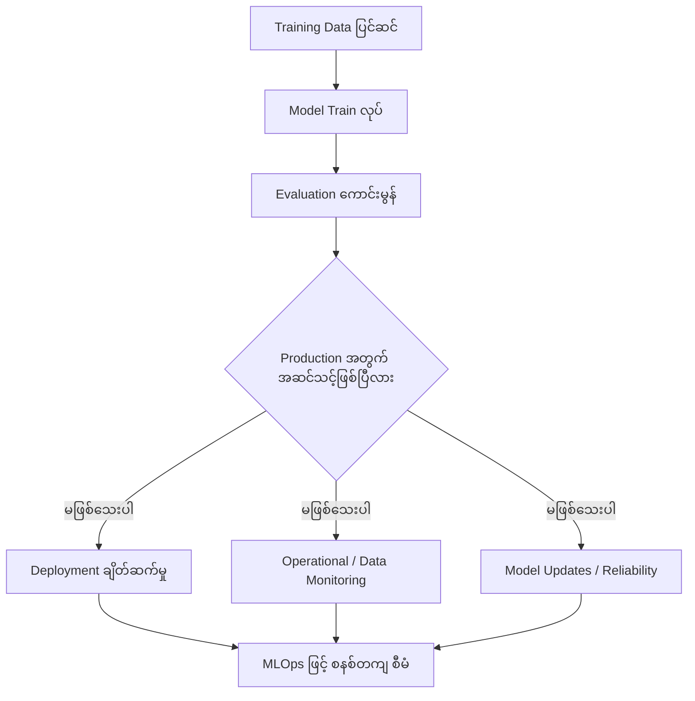
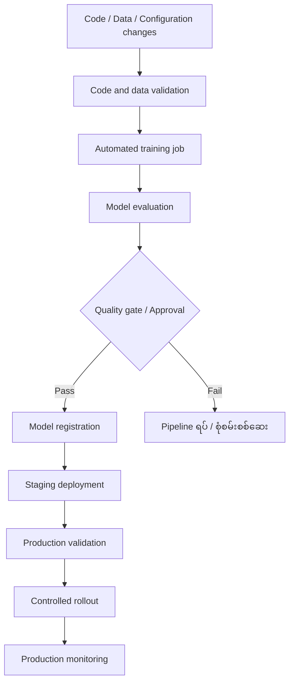
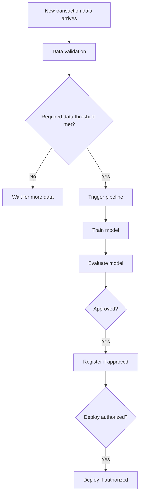
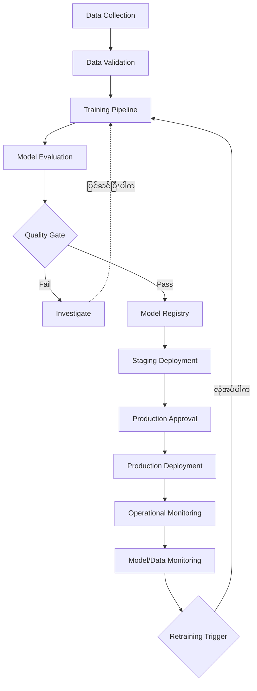
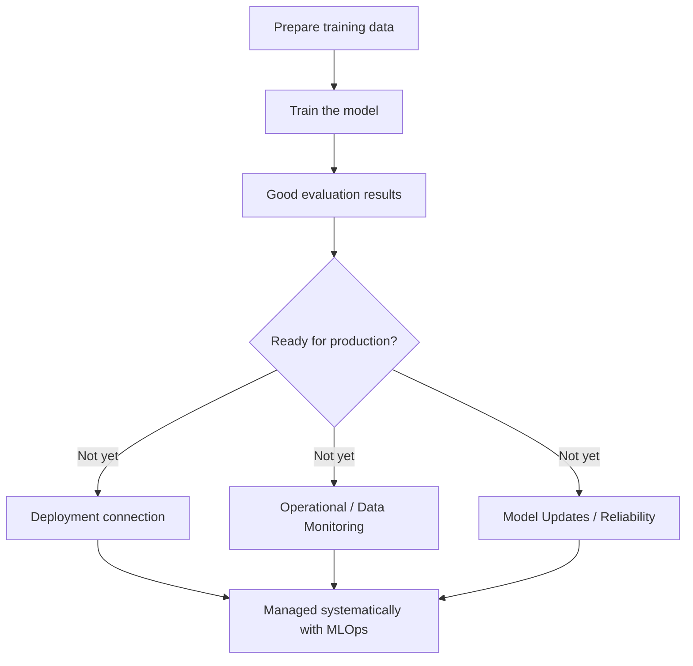
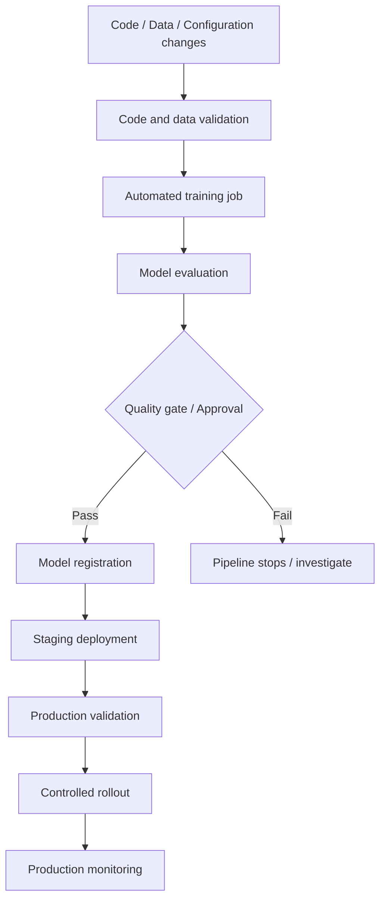
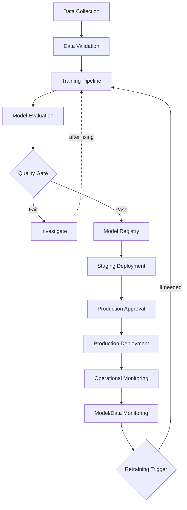

# Module 40 — Why We Need MLOps?

> Part VIII · MLOps and End-to-End Production AI — topic notes

## မြန်မာဘာသာ version

Machine Learning Operations: From Model Development to Production

### 1. Learning Objectives

ဤ Module ကို လေ့လာပြီးနောက် အောက်ပါအချက်များကို နားလည်လာရမည်—

- ဘာကြောင့် ML model တစ်ခုကို တည်ဆောက်ရုံဖြင့် မလုံလောက်သလဲ။
- Production environment ထဲသို့ ML model ကို ဘယ်လိုတင်ပို့ပြီး အသုံးပြုစေသလဲ။
- MLOps က deployment, monitoring, model updates နှင့် reliability ကို ဘယ်လိုစီမံပေးသလဲ။
- CI/CD pipeline ကို Machine Learning workflow မှာ ဘယ်လိုအသုံးပြုသလဲ။
- Event-driven scheduling နဲ့ automated retraining ဘယ်လိုအလုပ်လုပ်သလဲ။
- Model Registry ဆိုတာဘာလဲ၊ ဘာကြောင့်လိုအပ်သလဲ။
- MLOps ကို AI infrastructure, GPU, Kubernetes နဲ့ Slurm တို့နှင့် ဘယ်လိုပေါင်းစပ်အသုံးပြုနိုင်သလဲ။

### 2. Why Do We Need MLOps?

#### 2.1 Building an ML Model Is Only the First Step

Machine Learning project တစ်ခုကို စတင်တဲ့အခါ data scientist သို့မဟုတ် ML engineer က training data ကို ပြင်ဆင်ပြီး model တစ်ခုကို train လုပ်နိုင်ပါတယ်။ Training ပြီးတဲ့အခါ evaluation လုပ်ပြီး accuracy သို့မဟုတ် အခြား evaluation metrics တွေကောင်းမွန်တယ်ဆိုရင် model က အဆင်သင့်ဖြစ်ပြီလို့ ထင်နိုင်ပါတယ်။

ဒါပေမဲ့ model တစ်ခု train လုပ်ပြီးတာနဲ့ real-world application မှာ အသုံးပြုနိုင်ပြီလို့ မဆိုနိုင်ပါဘူး။

ဥပမာ — Bank တစ်ခုက fraudulent transaction တွေကို ရှာဖွေဖို့ ML model တစ်ခု train လုပ်ထားတယ်ဆိုပါစို့။ Development environment မှာ model က test data ပေါ်တွင် ကောင်းမွန်စွာ အလုပ်လုပ်နိုင်ပါတယ်။ သို့သော် production ထဲမှာ အသုံးပြုတဲ့အခါ အောက်ပါပြဿနာတွေကို ဖြေရှင်းရပါမယ်—

- **Deployment**: Model ကို production application နဲ့ ဘယ်လိုချိတ်ဆက်မလဲ။
- **Resource management**: CPU, GPU, RAM နဲ့ storage လုံလောက်မှု ရှိသလား။
- **Operational monitoring**: Model service က အလုပ်လုပ်နေသလား။ Request တွေကို အချိန်မီ တုံ့ပြန်နိုင်သလား။
- **Data monitoring**: Production data ရဲ့ ပုံစံနဲ့ အရည်အသွေး ပြောင်းလဲနေသလား။
- **Model accuracy**: Model ရဲ့ prediction quality က အချိန်ကြာလာတဲ့အခါ ကျဆင်းနေသလား။
- **Model updates**: Model version အသစ်ကို ထုတ်တဲ့အခါ service မပြတ်တောက်ဘဲ update လုပ်နိုင်သလား။
- **Reliability and security**: Failure ဖြစ်တဲ့အခါ ဘယ်လိုပြန်လည်ထိန်းချုပ်မလဲ။ Model နဲ့ data access ကို ဘယ်လိုကာကွယ်မလဲ။

Model တစ်ခု train ပြီးရုံနဲ့ မလုံလောက်တာကို အောက်ပါပုံတွင် ကြည့်နိုင်ပါတယ်—

**Figure 1 — Model Train ပြီးရုံနှင့် မလုံလောက်ခြင်း**



**ပုံရှင်းလင်းချက်** — အပေါ်က အဆင့်သုံးဆင့် (training data ပြင်ဆင်ခြင်း၊ model train လုပ်ခြင်း၊ evaluation ကောင်းမွန်ခြင်း) က development အဆင့် ဖြစ်ပါတယ်။ ဒါပေမဲ့ ဆုံးဖြတ်ချက်အမှတ်မှာ production အတွက် ထပ်ဖြေရှင်းရန် ကျန်သေးတဲ့ အချက်သုံးချက် — deployment ချိတ်ဆက်မှု၊ operational/data monitoring၊ model updates နဲ့ reliability — ကို တွေ့ရပါမယ်။ အဲဒီအချက်တွေကို MLOps ဖြင့် စနစ်တကျ စီမံရတာဖြစ်ကြောင်း ပုံက ပြပါတယ်။

ဒီပြဿနာတွေဟာ model development တစ်ခုတည်းနဲ့ ဖြေရှင်းလို့မရပါဘူး။ Development နဲ့ Operations ကို ပေါင်းစပ်စီမံနိုင်ဖို့ MLOps လိုအပ်လာတာ ဖြစ်ပါတယ်။

#### 2.2 What Happens Without MLOps?

MLOps မရှိဘဲ Machine Learning ကို စီမံခန့်ခွဲမယ်ဆိုရင် လူကိုယ်တိုင်လုပ်ဆောင်ရတဲ့ အဆင့်တွေ များလာနိုင်ပါတယ်။ ဥပမာ—

- Engineer က training data ကို manually ပြင်ဆင်တယ်။
- Training script ကို ကိုယ်တိုင် run လုပ်တယ်။
- Model အသစ်ကို ကိုယ်တိုင် evaluate လုပ်တယ်။
- Model file ကို server တစ်ခုဆီ ကိုယ်တိုင် copy လုပ်တယ်။
- Production service ကို ကိုယ်တိုင် update လုပ်တယ်။
- ပြဿနာဖြစ်လာရင် ဘယ် model version ကို deploy လုပ်ထားသလဲဆိုတာ ပြန်ရှာရတယ်။

ဒီနည်းလမ်းက စမ်းသပ်မှုအသေးစားတွေအတွက် လက်ခံနိုင်ပေမဲ့ production system အများအပြား၊ model အများအပြားနဲ့ team အများအပြားကို စီမံခန့်ခွဲတဲ့အခါ အခက်အခဲဖြစ်လာနိုင်ပါတယ်။ ဖြစ်နိုင်တဲ့ပြဿနာတွေက—

- Manual errors များလာခြင်း
- Training result များကို ထပ်မံပြန်လည်ထုတ်လုပ်ရန် ခက်ခဲခြင်း
- Model version မှားယွင်းစွာ deploy လုပ်မိခြင်း
- Data နဲ့ model ဆက်စပ်မှုကို ခြေရာခံမရခြင်း
- Model performance ကျဆင်းမှုကို နောက်ကျမှ သိရှိခြင်း
- Deployment အတွင်း service downtime ဖြစ်နိုင်ခြင်း

MLOps ရဲ့ အဓိကရည်ရွယ်ချက်က ဒီလုပ်ငန်းစဉ်တွေကို စနစ်တကျ၊ ထပ်ခါတလဲလဲ လုပ်ဆောင်နိုင်ပြီး စောင့်ကြည့်ထိန်းချုပ်နိုင်အောင် ပြုလုပ်ပေးဖို့ ဖြစ်ပါတယ်။

### 3. Real-World Analogy: McDonald's and Standardized Operations

MLOps ကို နားလည်ဖို့ McDonald's လို restaurant chain တစ်ခုကို ဥပမာယူကြည့်ရအောင်။

McDonald's ဆိုင်တစ်ဆိုင်ကနေ နောက်တစ်ဆိုင်ကို သွားစားတဲ့အခါ အစားအစာအရသာ၊ ပြင်ဆင်ပုံနဲ့ ဝန်ဆောင်မှုတွေ တတ်နိုင်သမျှ တူညီနေဖို့ မျှော်လင့်ကြပါတယ်။ ဒီလိုဖြစ်ရခြင်းမှာ လုပ်ငန်းစဉ်တွေကို စံသတ်မှတ်ထားပြီး ထိန်းချုပ်ထားခြင်းက အရေးကြီးတဲ့ အကြောင်းရင်းတစ်ခု ဖြစ်ပါတယ်။ ဥပမာ—

- အစားအစာကို ဘယ်လိုပြင်ဆင်ရမလဲ။
- ဘယ်အပူချိန်နဲ့ ဘယ်လောက်ကြာကြာ ချက်ပြုတ်ရမလဲ။
- အစားအစာအရည်အသွေးကို ဘယ်လိုစစ်ဆေးရမလဲ။
- ပစ္စည်းတွေကို ဘယ်လိုသိမ်းဆည်းရမလဲ။
- အရည်အသွေးမပြည့်မီရင် ဘယ်လိုဆောင်ရွက်ရမလဲ။

Machine Learning မှာလည်း ဒီသဘောတရားကို အသုံးချနိုင်ပါတယ်။

| Restaurant Operations | MLOps Equivalent |
|---|---|
| Recipe | Training code နဲ့ configuration |
| Ingredients | Training data |
| Ingredient quality checks | Data validation |
| Standard cooking process | Automated training pipeline |
| Taste and quality test | Model evaluation |
| Recipe version | Model version |
| Standardized preparation | Repeatable deployment workflow |
| Food quality monitoring | Model performance monitoring |
| Updated recipe | New model version |
| Food safety procedure | Security, validation နဲ့ approval controls |

ဥပမာ — Model တစ်ခုကို engineer တစ်ယောက်က training လုပ်တာပဲဖြစ်ဖြစ်၊ အခြား engineer တစ်ယောက်က training လုပ်တာပဲဖြစ်ဖြစ် သတ်မှတ်ထားတဲ့ data, code, configuration နဲ့ pipeline ကို အသုံးပြုထားရင် result တွေကို ပိုမိုစနစ်တကျ နှိုင်းယှဉ်နိုင်ပါတယ်။

သတိပြုရန် — ML training result တွေဟာ random initialization, nondeterministic operations, hardware နဲ့ software environment စတဲ့အချက်တွေကြောင့် အမြဲတမ်း အတိအကျတူညီမယ်လို့ မဆိုနိုင်ပါဘူး။ MLOps က လုပ်ငန်းစဉ်ကို repeatable ဖြစ်အောင် ကူညီပေးတာဖြစ်ပြီး result အားလုံးကို အလိုအလျောက် identical ဖြစ်စေတာ မဟုတ်ပါဘူး။

### 4. What Is MLOps?

MLOps stands for Machine Learning Operations.

MLOps ဆိုတာ Machine Learning system တွေကို development ကနေ production operations အထိ တည်ဆောက်ခြင်း၊ စမ်းသပ်ခြင်း၊ deploy လုပ်ခြင်း၊ စောင့်ကြည့်ခြင်းနဲ့ ထိန်းသိမ်းခြင်းတို့အတွက် အသုံးပြုတဲ့ tools, processes နဲ့ best practices တွေ ဖြစ်ပါတယ်။

MLOps မှာ DevOps ရဲ့ automation, version control, CI/CD နဲ့ monitoring အယူအဆတွေကို အသုံးပြုပြီး Machine Learning ရဲ့ ထူးခြားတဲ့ လိုအပ်ချက်တွေကို ထပ်မံထည့်သွင်းထားပါတယ်။ ဥပမာ—

- Data versioning နဲ့ data quality checks
- Training pipeline automation
- Model evaluation နဲ့ validation
- Model registry
- Model deployment
- Production monitoring
- Data drift နဲ့ model quality monitoring
- လိုအပ်တဲ့အခါ retraining နဲ့ model replacement

MLOps ရဲ့ အဓိကရည်မှန်းချက်များ—

1. **Repeatability** — သတ်မှတ်ထားတဲ့ workflow ကို တစ်ကြိမ်ပြီးတစ်ကြိမ် စနစ်တကျ ပြန်လည်လုပ်ဆောင်နိုင်ဖို့။
2. **Reliability** — Training နဲ့ deployment process တွေမှာ ဖြစ်နိုင်တဲ့ error တွေကို လျှော့ချပြီး production service ကို ယုံကြည်စိတ်ချစွာ လည်ပတ်နိုင်ဖို့။
3. **Automation** — လူကိုယ်တိုင် လုပ်ဆောင်ရတဲ့ အလုပ်တွေကို သင့်လျော်သလို automate လုပ်ပြီး manual mistakes နဲ့ operational overhead ကို လျှော့ချဖို့။
4. **Traceability** — ဘယ် data, code, configuration နဲ့ training run က ဘယ် model version ကို ထုတ်ပေးခဲ့သလဲဆိုတာ ခြေရာခံနိုင်ဖို့။
5. **Controlled deployment** — Model အသစ်တွေကို validation, approval နဲ့ deployment strategy တွေအပေါ် အခြေခံပြီး စနစ်တကျ production ထဲသို့ ထုတ်လွှင့်နိုင်ဖို့။
6. **Continuous monitoring** — Production system နဲ့ model behavior ကို စောင့်ကြည့်ပြီး ပြဿနာတွေကို အချိန်မီ သိရှိနိုင်ဖို့။

### 5. MLOps and CI/CD Pipelines

#### 5.1 What Is CI/CD?

CI/CD ဆိုတာ Software Engineering မှာ အသုံးများတဲ့ automation practices ဖြစ်ပါတယ်။

- **CI — Continuous Integration**: Developer တွေက code changes တွေကို ပေါင်းစည်းပြီး automated checks နဲ့ tests တွေကို လုပ်ဆောင်ခြင်း။
- **CD — Continuous Delivery / Continuous Deployment**: စမ်းသပ်ပြီးသား changes တွေကို release လုပ်ဖို့ အဆင်သင့်ဖြစ်အောင် ပြင်ဆင်ခြင်း၊ သို့မဟုတ် သတ်မှတ်ထားတဲ့ controls အောက်မှာ production သို့ အလိုအလျောက် deploy လုပ်ခြင်း။

Continuous Delivery နဲ့ Continuous Deployment က အဓိပ္ပာယ်ကွာခြားမှု ရှိပါတယ်။ Continuous Delivery မှာ production release မတိုင်မီ လူက approval ပေးရနိုင်ပါတယ်။ Continuous Deployment မှာ သတ်မှတ်ထားတဲ့ automated checks တွေ အောင်မြင်ပါက production သို့ အလိုအလျောက် deploy လုပ်နိုင်ပါတယ်။

#### 5.2 Traditional Software CI/CD

ပုံမှန် software application တစ်ခုအတွက် pipeline တစ်ခုက ဒီလိုဖြစ်နိုင်ပါတယ်။

```
Developer commits code
        |
        v
Automated code checks
        |
        v
Unit tests
        |
        v
Integration tests
        |
        v
Build and package
        |
        v
Deploy to test environment
        |
        v
Validation / approval
        |
        v
Production deployment
```

ဒီ pipeline က code changes တွေကို စနစ်တကျ စစ်ဆေးပြီး deploy လုပ်ဖို့ ကူညီပေးပါတယ်။

#### 5.3 How CI/CD Is Extended for MLOps

ML system တွေမှာ application code တစ်ခုတည်းကို စစ်ဆေးရုံနဲ့ မလုံလောက်ပါဘူး။ Training data, model artifacts, training configuration နဲ့ evaluation results တွေကိုပါ စစ်ဆေးရပါတယ်။ ဥပမာ—

```
Code / Data / Configuration changes
                 |
                 v
       Code and data validation
                 |
                 v
        Automated training job
                 |
                 v
          Model evaluation
                 |
                 v
       Quality gate / Approval
                 |
                 v
         Model registration
                 |
                 v
       Staging deployment
                 |
                 v
       Production validation
                 |
                 v
        Controlled rollout
                 |
                 v
        Production monitoring
```

        Production monitoring
```

ပုံမှန် software CI/CD ကို MLOps အတွက် ဘယ်လိုချဲ့ထွင်သလဲဆိုတာ အောက်ပါပုံတွင် ကြည့်နိုင်ပါတယ်—

**Figure 2 — MLOps အတွက် ချဲ့ထွင်ထားသော CI/CD Pipeline**



**ပုံရှင်းလင်းချက်** — Code သာမက data နဲ့ configuration ပြောင်းလဲမှုကနေ စပါတယ်။ Validation ပြီးမှ automated training job နဲ့ model evaluation လုပ်ပြီး quality gate မှာ စစ်ဆေးပါတယ်။ Pass ဖြစ်ရင် model ကို register လုပ်ပြီး staging deployment၊ production validation၊ controlled rollout ကတစ်ဆင့် production monitoring အထိ ဆက်သွားပါတယ်။ Fail ဖြစ်ရင်တော့ pipeline ကို ရပ်ပြီး စုံစမ်းစစ်ဆေးရပါမယ်။ Code တစ်ခုတည်း မဟုတ်ဘဲ data, model artifacts နဲ့ evaluation results တွေပါ စစ်ဆေးရတာက ဒီ pipeline ရဲ့ ထူးခြားချက် ဖြစ်ပါတယ်။

Quality gate ဆိုတာ model ကို နောက်တစ်ဆင့်သို့ ဆက်လက်တင်ပို့သင့်၊ မသင့် ဆုံးဖြတ်ပေးတဲ့ စည်းမျဉ်း သို့မဟုတ် checkpoint ဖြစ်ပါတယ်။ ဥပမာ—

- Accuracy သို့မဟုတ် F1 score သတ်မှတ်ချက်ပြည့်မီသလား။
- Inference latency က လက်ခံနိုင်တဲ့အတိုင်းအတာထဲမှာ ရှိသလား။
- Model size နဲ့ memory requirement က deployment environment နဲ့ ကိုက်ညီသလား။
- Security နဲ့ data validation checks တွေ အောင်မြင်သလား။
- Model အသစ်က လက်ရှိ production model ထက် အရေးကြီးတဲ့ metric တစ်ခုခုမှာ ဆိုးရွားသွားသလား။

သတ်မှတ်ချက်တွေ မပြည့်မီရင် model ကို production သို့ မတင်ဘဲ pipeline ကို ရပ်တန့်နိုင်ပါတယ်။

အရေးကြီးချက်: CI/CD automation ရှိတယ်ဆိုတာ validation နဲ့ approval အားလုံးကို ဖယ်ရှားလိုက်ရမယ်လို့ မဆိုလိုပါဘူး။ Risk မြင့်တဲ့ application တွေမှာ human approval ကို ထည့်သွင်းထားနိုင်ပါတယ်။

### 6. Event-Driven Scheduling and Automated Retraining

#### 6.1 What Is Event-Driven Scheduling?

Event-driven scheduling ဆိုတာ သတ်မှတ်ထားတဲ့ event တစ်ခု ဖြစ်ပေါ်လာတဲ့အခါ workflow သို့မဟုတ် job တစ်ခုကို trigger လုပ်ပေးတဲ့ ပုံစံ ဖြစ်ပါတယ်။

MLOps မှာ event တွေဟာ အောက်ပါအခြေအနေတွေ ဖြစ်နိုင်ပါတယ်—

- Training data အသစ် ရောက်လာခြင်း
- သတ်မှတ်ထားတဲ့ data records အရေအတွက် ပြည့်မီခြင်း
- Data validation job အောင်မြင်ခြင်း
- Model quality ကျဆင်းလာကြောင်း သတိပေးချက်ရရှိခြင်း
- သတ်မှတ်ထားတဲ့ အချိန်ရောက်ရှိခြင်း
- Engineer က model training အသစ်ကို စတင်ရန် request လုပ်ခြင်း

ဥပမာ — Bank တစ်ခုမှာ fraud detection model ကို train လုပ်ဖို့ transaction data အသစ် 20,000 ခု စုဆောင်းပြီးတိုင်း retraining workflow ကို စတင်လိုတယ်ဆိုပါစို့။ အဲဒီအခါ data collection system က event တစ်ခု ထုတ်ပေးပြီး orchestration system က သတ်မှတ်ထားတဲ့ conditions တွေ ပြည့်မီပါက training pipeline ကို စတင်ပေးနိုင်ပါတယ်။

```
New transaction data arrives
             |
             v
      Data validation
             |
             v
  Required data threshold met?
         /           \
       No             Yes
       |               |
       v               v
 Wait for more     Trigger pipeline
                       |
                       v
                  Train model
                       |
                       v
                 Evaluate model
                       |
                       v
              Register if approved
                       |
                       v
              Deploy if authorized
```

              Deploy if authorized
```

Event ကနေ retraining workflow စတင်ပုံကို ပုံဖြင့် ကြည့်ရအောင်—

**Figure 3 — Event-Driven Retraining Flow**



**ပုံရှင်းလင်းချက်** — Data အသစ် ရောက်လာရင် ပထမ data validation လုပ်ပါတယ်။ ပြီးရင် threshold ပြည့်၊ မပြည့် စစ်ပါတယ် — မပြည့်သေးရင် data ထပ်စောင့်ပြီး၊ ပြည့်ရင် pipeline ကို trigger လုပ်ပါတယ်။ ထို့နောက် model train လုပ်၊ evaluate လုပ်၊ approved ဖြစ်မှ register လုပ်ပြီး deploy လုပ်ခွင့် ရှိမှ deploy လုပ်ပါတယ်။ Training ကို အလိုအလျောက် လုပ်နိုင်ပေမဲ့ approval အဆင့်တွေ ဆက်လက် လိုအပ်သေးတာကို ပုံက ပြပါတယ်။

#### 6.2 Scheduled Retraining

Retraining ကို event တစ်ခုကြောင့်သာမက သတ်မှတ်ထားတဲ့ အချိန်ဇယားအတိုင်းလည်း စတင်နိုင်ပါတယ်။ ဥပမာ—

- နေ့စဉ် training
- အပတ်စဉ် training
- လစဉ် training
- သုံးလတစ်ကြိမ် training

ဘယ် schedule ကို အသုံးပြုမလဲဆိုတာ data ပြောင်းလဲမှုနှုန်း၊ model ရဲ့ အသုံးချမှု၊ compute cost နဲ့ performance requirements တွေပေါ် မူတည်ပါတယ်။

#### 6.3 Does New Data Always Mean Retraining?

မဟုတ်ပါဘူး။ Data အသစ်ရောက်လာတိုင်း model ကို ချက်ချင်း retrain လုပ်ဖို့ မလိုအပ်ပါဘူး။

ဥပမာ — Data အသစ်က အရည်အသွေးမပြည့်မီဘူး၊ duplicate တွေများနေတယ်၊ label မရှိဘူး၊ သို့မဟုတ် မသက်ဆိုင်တဲ့ data ဖြစ်နေတယ်ဆိုရင် အဲဒီ data ကို အသုံးပြုပြီး retraining လုပ်တာက model quality ကို ပိုမိုဆိုးရွားစေနိုင်ပါတယ်။

ဒါကြောင့် သင့်လျော်တဲ့ pipeline တစ်ခုမှာ—

- Data အသစ်ကို စစ်ဆေးခြင်း
- Data quality နဲ့ schema ကို validate လုပ်ခြင်း
- Retraining လုပ်သင့်၊ မသင့် ဆုံးဖြတ်ခြင်း
- Training နဲ့ evaluation လုပ်ခြင်း
- Model အသစ်ကို အဟောင်းနဲ့ နှိုင်းယှဉ်ခြင်း
- သတ်မှတ်ချက်ပြည့်မီမှ register သို့မဟုတ် deploy လုပ်ခြင်း

ဆိုတဲ့ အဆင့်တွေ ပါဝင်သင့်ပါတယ်။

မှတ်သားရန်: Automated retraining နဲ့ automated production deployment ဟာ မတူညီတဲ့ အရာတွေ ဖြစ်ပါတယ်။ Training ကို အလိုအလျောက် လုပ်နိုင်ပေမဲ့ production deployment အတွက် validation သို့မဟုတ် approval ကို ဆက်လက်လိုအပ်နိုင်ပါတယ်။

### 7. Model Registry and Model Versioning

#### 7.1 What Is a Model Registry?

Model Registry ဆိုတာ Machine Learning model versions တွေကို မှတ်တမ်းတင်၊ စုစည်း၊ စီမံခန့်ခွဲပြီး deployment lifecycle တစ်လျှောက် ခြေရာခံနိုင်အောင် ကူညီပေးတဲ့ system သို့မဟုတ် service ဖြစ်ပါတယ်။

ဒီအယူအဆကို Docker Registry နဲ့ နှိုင်းယှဉ်နိုင်ပါတယ်။ Docker Registry မှာ container images တွေကို သိမ်းဆည်းပြီး version သို့မဟုတ် tag တွေနဲ့ ခွဲခြားနိုင်သလို Model Registry မှာလည်း model artifacts တွေကို version နဲ့ metadata တွေဖြင့် စီမံနိုင်ပါတယ်။

ဥပမာ—

| Model version | Training data | F1 score | Status |
|---|---|---|---|
| fraud-model-v1 | Dataset A | 0.87 | Archived |
| fraud-model-v2 | Dataset B | 0.91 | Production |
| fraud-model-v3 | Dataset C | 0.93 | Staging |

ဤဇယားက နားလည်လွယ်စေရန် ဖန်တီးထားတဲ့ ဥပမာဖြစ်ပြီး အမှန်တကယ် model တစ်ခုရဲ့ result မဟုတ်ပါဘူး။

#### 7.2 What Information Should Be Tracked?

Model Registry နဲ့ ဆက်စပ်တဲ့ tracking system တွေမှာ အောက်ပါ metadata တွေကို သိမ်းဆည်းနိုင်ပါတယ်—

- Model name နဲ့ version
- Model artifact location
- Training code version သို့မဟုတ် Git commit
- Training data version သို့မဟုတ် dataset reference
- Training parameters နဲ့ configuration
- Evaluation metrics
- Training run ID
- Model creation timestamp
- Approval status
- Deployment environment
- Model lineage — model ကို ဘယ် data နဲ့ ဘယ် process က ထုတ်လုပ်ခဲ့သလဲဆိုတဲ့ ဆက်စပ်မှု

ဒီအချက်တွေကြောင့် team တစ်ခုက ဘယ် model version ကို အသုံးပြုနေသလဲ၊ ဘာကြောင့် အဲဒီ version ကို ရွေးချယ်ခဲ့သလဲ၊ လိုအပ်ရင် ဘယ် version ကို ပြန်သုံးသင့်သလဲဆိုတာ ပိုမိုရှင်းလင်းစွာ သိရှိနိုင်ပါတယ်။

#### 7.3 Model Registry vs Model Artifact Storage

ဒီနှစ်ခုကို သီးခြားခွဲခြားနားလည်ဖို့ အရေးကြီးပါတယ်။

- **Model artifact storage** က model file တွေ၊ weights တွေ၊ checkpoint တွေကို သိမ်းဆည်းပေးပါတယ်။
- **Model Registry** က model version, metadata, evaluation result, status နဲ့ artifact တွေကို ချိတ်ဆက်ထားတဲ့ management layer ဖြစ်ပါတယ်။

အချို့ platform တွေမှာ ဒီလုပ်ဆောင်ချက်တွေကို တစ်နေရာတည်းမှာ ပေါင်းစပ်ပေးထားနိုင်ပေမဲ့ concept အရ မတူညီပါဘူး။

#### 7.4 Why Versioning Matters During Deployment

ဥပမာ — Production မှာ fraud-model-v2 ကို အသုံးပြုနေပြီး engineer တစ်ယောက်က fraud-model-v3 ကို train လုပ်ထားတယ်ဆိုပါစို့။ Version 3 က validation အောင်မြင်ပြီး production သို့ deploy လုပ်လိုက်တယ်။ နောက်ပိုင်းမှာ false positives များလာပြီး customer transactions တွေကို မှားယွင်းစွာ ပိတ်ဆို့နေတယ်ဆိုပါစို့။

Model versioning နဲ့ deployment tracking ရှိထားရင်—

- ဘယ် version က ပြဿနာဖြစ်စေသလဲ သိနိုင်တယ်။
- Version 3 ရဲ့ evaluation results နဲ့ training metadata ကို ပြန်စစ်နိုင်တယ်။
- သတ်မှတ်ထားတဲ့ rollback procedure ကို အသုံးပြုပြီး version 2 သို့ ပြန်ပြောင်းနိုင်တယ်။
- ပြဿနာရဲ့ အကြောင်းရင်းကို စုံစမ်းပြီး နောက်တစ်ကြိမ် deployment ကို ပိုမိုလုံခြုံစွာ ပြုလုပ်နိုင်တယ်။

Model Registry တစ်ခုတည်းက rollback ကို အလိုအလျောက် လုပ်ပေးမယ်လို့ မဆိုလိုပါဘူး။ Rollback လုပ်ဆောင်ချက်အတွက် deployment platform နဲ့ release procedures တွေကိုလည်း သေချာပြင်ဆင်ထားဖို့ လိုအပ်ပါတယ်။

### 8. Production Deployment Without Breaking the Service

Model အသစ်တစ်ခုကို production သို့ deploy လုပ်တဲ့အခါ service ကို ရပ်တန့်ပြီး model အသစ်ကို တစ်ခါတည်း အစားထိုးတာဟာ အန္တရာယ်ရှိနိုင်ပါတယ်။ MLOps workflow တွေမှာ risk ကို လျှော့ချဖို့ deployment strategy အမျိုးမျိုးကို အသုံးပြုနိုင်ပါတယ်။

Common deployment strategies—

- **Blue-green deployment** — Production environment နှစ်ခုကို အသုံးပြုပြီး traffic ကို အဟောင်း environment ကနေ အသစ် environment ဆီ ပြောင်းပေးတဲ့ နည်းလမ်းဖြစ်ပါတယ်။ အဆင်မပြေရင် traffic ကို ပြန်ပြောင်းနိုင်ပါတယ်။
- **Canary deployment** — Model အသစ်ကို user သို့မဟုတ် traffic အနည်းငယ်အပေါ် စတင်အသုံးပြုပြီး result ကောင်းမွန်မှ တဖြည်းဖြည်း ပိုမိုကျယ်ပြန့်စွာ အသုံးပြုစေတဲ့ နည်းလမ်းဖြစ်ပါတယ်။
- **Shadow deployment** — Model အသစ်ကို production input တွေနဲ့ စမ်းသပ်လုပ်ဆောင်စေပြီး ပုံမှန်အားဖြင့် user ဆီသို့ တိုက်ရိုက် response မပေးစေဘဲ ရလဒ်တွေကို လက်ရှိ model နဲ့ နှိုင်းယှဉ်တဲ့ နည်းလမ်းဖြစ်ပါတယ်။

ဒီနည်းလမ်းတွေက deployment risk ကို လျှော့ချနိုင်ပေမဲ့ system architecture, traffic routing, resource availability နဲ့ rollback readiness တို့ကိုပါ ထည့်သွင်းစဉ်းစားရပါတယ်။

### 9. MLOps Monitoring: Is the Model Still Performing Well?

Model ကို deploy လုပ်ပြီးတာနဲ့ အလုပ်ပြီးသွားပြီ မဟုတ်ပါဘူး။ Production environment မှာ model နဲ့ infrastructure ကို ဆက်လက်စောင့်ကြည့်ဖို့ လိုအပ်ပါတယ်။

#### 9.1 Infrastructure and Operational Metrics

ဒီ metrics တွေက system က ဘယ်လိုအလုပ်လုပ်နေသလဲဆိုတာကို ပြပေးပါတယ်—

- Request latency
- Throughput
- Error rate
- CPU/GPU utilization
- Memory usage
- Service availability
- Queue length
- Inference request failures

ဥပမာ — GPU utilization က အမြဲတမ်း 100% ဖြစ်နေပြီး inference latency တက်လာတယ်ဆိုရင် capacity သို့မဟုတ် workload bottleneck ကို စုံစမ်းဖို့ လိုအပ်နိုင်ပါတယ်။

#### 9.2 Data and Model Metrics

Model နဲ့ data behavior ကိုလည်း စောင့်ကြည့်ဖို့ လိုပါတယ်—

- Input data quality
- Prediction distribution
- Data drift
- Model performance metrics
- False positive / false negative rates
- Business outcome metrics

Data drift ဆိုတာ production data ရဲ့ statistical distribution က training data နဲ့ ကွာခြားလာခြင်းကို ဆိုလိုပါတယ်။ ဥပမာ — Fraud detection model ကို training လုပ်ခဲ့တဲ့အချိန်က customer transaction pattern နဲ့ လက်ရှိ transaction pattern က မတူတော့တာမျိုး ဖြစ်နိုင်ပါတယ်။

Data drift ဖြစ်တိုင်း model accuracy ကျသွားမယ်လို့ မဆိုနိုင်ပေမဲ့ စစ်ဆေးသင့်တဲ့ signal တစ်ခု ဖြစ်ပါတယ်။

ထို့အပြင် production မှာ ground-truth labels မရရှိသေးရင် accuracy ကို ချက်ချင်းတိုင်းတာနိုင်မှာ မဟုတ်ပါဘူး။ Labels တွေကို နောက်ပိုင်းမှ ရရှိလာတဲ့အခါ model quality ကို အကဲဖြတ်နိုင်ပါတယ်။

### 10. How MLOps Fits into AI Infrastructure

MLOps က software tool တစ်ခုတည်း မဟုတ်ပါဘူး။ Model development, data management, compute scheduling, deployment နဲ့ monitoring တို့ကို ပေါင်းစပ်ထားတဲ့ operational approach ဖြစ်ပါတယ်။

Enterprise AI infrastructure မှာ အောက်ပါ components တွေကို ပေါင်းစပ်အသုံးပြုနိုင်ပါတယ်—

| Component | Role |
|---|---|
| Git / Source control | Training code နဲ့ configuration versioning |
| Data storage | Training data နဲ့ dataset artifacts သိမ်းဆည်းခြင်း |
| CI/CD platform | Validation, build နဲ့ deployment workflow automation |
| Slurm | HPC/AI training jobs အတွက် resource allocation နဲ့ job scheduling |
| Kubernetes | Containerized inference services နဲ့ application lifecycle management |
| Model Registry | Model versions, metadata နဲ့ approval status စီမံခန့်ခွဲခြင်း |
| Object storage / Artifact storage | Model weights, checkpoints နဲ့ artifacts သိမ်းဆည်းခြင်း |
| Prometheus / Grafana | Infrastructure metrics နဲ့ dashboarding |
| DCGM | NVIDIA GPU health နဲ့ telemetry |
| Alerting system | သတ်မှတ်ထားတဲ့ conditions တွေ ဖြစ်လာတဲ့အခါ သတိပေးခြင်း |

ဥပမာ architecture တစ်ခုမှာ Slurm ကို GPU training jobs တွေအတွက် အသုံးပြုပြီး trained model ကို versioned artifact storage ထဲသို့ သိမ်းဆည်းနိုင်ပါတယ်။ Validation အောင်မြင်ပြီး approval ရရှိတဲ့ model ကို Kubernetes ပေါ်က inference service မှာ deploy လုပ်နိုင်ပါတယ်။

သို့သော် ဒီ architecture က ရွေးချယ်စရာတစ်ခုသာ ဖြစ်ပါတယ်။ Training နဲ့ inference နှစ်ခုလုံးကို Kubernetes သို့မဟုတ် အခြား platform တွေပေါ်မှာ လုပ်ဆောင်နိုင်တဲ့ architecture တွေလည်း ရှိပါတယ်။

### 11. End-to-End MLOps Workflow

အောက်ပါ diagram က MLOps workflow တစ်ခုရဲ့ အခြေခံပုံစံကို ဖော်ပြထားပါတယ်။

```
Data Collection
              |
              v
       Data Validation
              |
              v
      Training Pipeline
              |
              v
       Model Evaluation
              |
              v
       Quality Gate
        /         \
     Fail          Pass
      |              |
      v              v
 Investigate     Model Registry
                     |
                     v
              Staging Deployment
                     |
                     v
             Production Approval
                     |
                     v
             Production Deployment
                     |
                     v
             Operational Monitoring
                     |
                     v
             Model/Data Monitoring
                     |
                     v
           Retraining Trigger (if needed)
                     |
                     +------> Training Pipeline
```

                     +------> Training Pipeline
```

End-to-end workflow loop ကို ပုံဖြင့် ကြည့်ရအောင်—

**Figure 4 — End-to-End MLOps Workflow Loop**



**ပုံရှင်းလင်းချက်** — Data Collection ကနေ စပြီး Data Validation၊ Training Pipeline၊ Model Evaluation ကို ဖြတ်ပြီး Quality Gate မှာ ဆုံးဖြတ်ပါတယ်။ Pass ဖြစ်ရင် Model Registry ကတစ်ဆင့် Staging Deployment၊ Production Approval၊ Production Deployment ဆီ ဆက်သွားပြီး operational နဲ့ model/data monitoring နှစ်မျိုး လုပ်ပါတယ်။ Fail ဖြစ်ရင် Investigate လုပ်ပြီး ပြင်ဆင်ပြီးမှ (dashed မြှား) Training Pipeline ဆီ ပြန်သွားနိုင်ပါတယ်။ နောက်ဆုံး Retraining Trigger က retraining လိုအပ်မှသာ Training Pipeline ဆီ ပြန်ချိတ်တာကြောင့် retraining က အမြဲတမ်း အလိုအလျောက် မဟုတ်ကြောင်း ပြပါတယ်။

ဒီ workflow မှာ retraining က အမြဲတမ်း အလိုအလျောက် ဖြစ်ရမယ်လို့ မဆိုလိုပါဘူး။ Monitoring result, data availability, model requirements နဲ့ approval policies တွေပေါ် မူတည်ပြီး retraining လုပ်သင့်၊ မသင့် ဆုံးဖြတ်နိုင်ပါတယ်။

### 12. Key Takeaways

- **Building a model is only the beginning.** Production မှာ model ကို deploy လုပ်ခြင်း၊ စောင့်ကြည့်ခြင်းနဲ့ ထိန်းသိမ်းခြင်းတွေကလည်း အရေးကြီးပါတယ်။
- **MLOps operationalizes Machine Learning.** Development, training, validation, deployment နဲ့ monitoring တို့ကို စနစ်တကျ ချိတ်ဆက်ပေးပါတယ်။
- **CI/CD automates workflows.** Code နဲ့ model-related changes တွေကို validation ပြုလုပ်ပြီး သင့်လျော်တဲ့ controls အောက်မှာ deploy လုပ်နိုင်ပါတယ်။
- **Event-driven scheduling reduces manual work.** သတ်မှတ်ထားတဲ့ events သို့မဟုတ် schedules တွေကြောင့် training workflow ကို စတင်နိုင်ပါတယ်။
- **Retraining is not always automatic or necessary.** Data အသစ်ရောက်လာတာနဲ့ model အသစ်ကို production သို့ တန်းတင်သင့်တယ်လို့ မဆိုနိုင်ပါဘူး။
- **Model Registry provides traceability.** Model versions, metadata, evaluation results နဲ့ deployment status တွေကို စီမံခန့်ခွဲနိုင်ပါတယ်။
- **Monitoring is essential after deployment.** Infrastructure metrics နဲ့ model/data quality metrics နှစ်မျိုးစလုံးကို ထည့်သွင်းစောင့်ကြည့်သင့်ပါတယ်။
- **MLOps is a system of practices and components.** CI/CD, Slurm, Kubernetes, model registries နဲ့ monitoring tools တွေကို လိုအပ်ချက်အလိုက် ပေါင်းစပ်အသုံးပြုနိုင်ပါတယ်။

### 13. Review Questions

1. Why is building an ML model only the first step?
2. What is MLOps, and what are its primary objectives?
3. How does MLOps extend traditional DevOps and CI/CD practices?
4. What is the difference between event-driven scheduling and scheduled retraining?
5. Why should newly collected data be validated before retraining?
6. What is a Model Registry, and how is it different from artifact storage?
7. How can model versioning help recover from a problematic production deployment?
8. What is the difference between infrastructure monitoring and model monitoring?
9. Does data drift always mean model accuracy has decreased? Explain.
10. How can Slurm, Kubernetes, DCGM and a Model Registry contribute to an enterprise MLOps architecture?

**Concise answers**

1. Because production use also requires deployment, resource management, operational and data monitoring, controlled updates, reliability and security — problems that model development alone cannot solve.
2. MLOps (Machine Learning Operations) is the tools, processes and best practices for building, testing, deploying, monitoring and maintaining ML systems. Its objectives are repeatability, reliability, automation, traceability, controlled deployment and continuous monitoring.
3. It adds data versioning and validation, training pipeline automation, model evaluation, a model registry, deployment strategies and data/model quality monitoring on top of DevOps automation, version control and CI/CD.
4. Event-driven scheduling triggers a workflow when a defined event occurs (new data, threshold met, alert); scheduled retraining runs on a time schedule (daily, weekly, monthly). Both are valid and can be combined.
5. New data may be low quality, duplicated, unlabeled or irrelevant; retraining on it can make model quality worse. Validation and a retrain-or-not decision must come first.
6. A Model Registry records, organizes and tracks model versions with metadata and deployment status. Artifact storage only stores model files, weights and checkpoints. The registry is the management layer linking versions to artifacts.
7. With versioning and deployment tracking you can identify the problematic version, review its evaluation and training metadata, roll back to a previous version using a defined procedure, and investigate the root cause.
8. Infrastructure monitoring covers latency, throughput, error rate, CPU/GPU utilization and availability; model monitoring covers input data quality, prediction distribution, data drift, model quality metrics and business outcomes.
9. No. Data drift means the statistical distribution of production data differs from training data. It is a signal to investigate, not proof that accuracy has dropped; ground truth may also arrive later.
10. Slurm schedules and allocates resources for training jobs; Kubernetes manages containerized inference services; DCGM provides GPU health and telemetry; a Model Registry manages versions, metadata and approval status. Together they form one optional enterprise architecture.

**Final concept** — MLOps goes far beyond being able to train an ML model. It is an operational framework that helps release models to production reliably, trace versions, monitor performance and update systematically when needed.

## English Version

Machine Learning Operations: From Model Development to Production

### 1. Learning Objectives

After completing this module, you should understand—

- Why building an ML model is not enough.
- How ML models are delivered to and used in production environments.
- How MLOps manages deployment, monitoring, model updates and reliability.
- How CI/CD pipelines are used in machine learning workflows.
- How event-driven scheduling and automated retraining work.
- What a Model Registry is and why it is needed.
- How MLOps combines with AI infrastructure, GPU, Kubernetes and Slurm.

### 2. Why Do We Need MLOps?

#### 2.1 Building an ML Model Is Only the First Step

When a machine learning project starts, a data scientist or ML engineer prepares training data and trains a model. After training, evaluation is performed, and when accuracy or other evaluation metrics look good, the model may seem ready.

But a trained model is not automatically usable in a real-world application.

For example — suppose a bank trains an ML model to detect fraudulent transactions. The model works well on test data in the development environment. But when it is used in production, the following problems must be solved—

- **Deployment**: how is the model connected to the production application?
- **Resource management**: are CPU, GPU, RAM and storage sufficient?
- **Operational monitoring**: is the model service working? Does it respond to requests on time?
- **Data monitoring**: is the pattern and quality of production data changing?
- **Model accuracy**: is prediction quality declining over time?
- **Model updates**: can a new model version be released without service interruption?
- **Reliability and security**: how is control restored on failure? How are model and data access protected?

The gap between "trained" and "production-ready" can be seen in the following figure—

**Figure 1 — Training Alone Is Not Enough**



**Figure walkthrough** — The three steps at the top (prepare training data, train the model, good evaluation) are the development stage. But at the decision point, three problems still have to be solved for production — the deployment connection, operational/data monitoring, and model updates with reliability. The figure shows that these are handled systematically with MLOps.

These problems cannot be solved by model development alone. MLOps is needed to manage development and operations together.

#### 2.2 What Happens Without MLOps?

Managing machine learning without MLOps multiplies manual steps. For example—

- An engineer prepares training data manually.
- The training script is run by hand.
- The new model is evaluated by hand.
- The model file is copied to a server by hand.
- The production service is updated by hand.
- When something goes wrong, someone must find which model version was deployed.

This approach is acceptable for small experiments, but becomes difficult when managing many production systems, many models and many teams. Possible problems include—

- More manual errors
- Training results are hard to reproduce
- The wrong model version gets deployed
- The data-to-model link cannot be traced
- Model performance degradation is discovered late
- Service downtime during deployment

The main purpose of MLOps is to make these processes systematic, repeatable and monitorable.

### 3. Real-World Analogy: McDonald's and Standardized Operations

To understand MLOps, take a restaurant chain like McDonald's as an example.

When you eat at one McDonald's and then another, you expect the food taste, preparation and service to be as similar as possible. A key reason this works is that the processes are standardized and controlled. For example—

- How the food is prepared.
- At what temperature and for how long it is cooked.
- How food quality is checked.
- How supplies are stored.
- What to do when quality falls short.

The same principle applies in machine learning.

| Restaurant Operations | MLOps Equivalent |
|---|---|
| Recipe | Training code and configuration |
| Ingredients | Training data |
| Ingredient quality checks | Data validation |
| Standard cooking process | Automated training pipeline |
| Taste and quality test | Model evaluation |
| Recipe version | Model version |
| Standardized preparation | Repeatable deployment workflow |
| Food quality monitoring | Model performance monitoring |
| Updated recipe | New model version |
| Food safety procedure | Security, validation and approval controls |

For example — whether one engineer or another trains a model, using the defined data, code, configuration and pipeline makes the results much more comparable.

Note — ML training results are not always bit-identical because of random initialization, nondeterministic operations, and hardware/software environment differences. MLOps helps make the process repeatable; it does not make every result automatically identical.

### 4. What Is MLOps?

MLOps stands for Machine Learning Operations.

MLOps is the tools, processes and best practices used to build, test, deploy, monitor and maintain machine learning systems from development through production operations.

MLOps uses DevOps concepts — automation, version control, CI/CD and monitoring — and adds the unique requirements of machine learning, such as—

- Data versioning and data quality checks
- Training pipeline automation
- Model evaluation and validation
- Model registry
- Model deployment
- Production monitoring
- Data drift and model quality monitoring
- Retraining and model replacement when needed

Primary objectives of MLOps—

1. **Repeatability** — a defined workflow can be re-executed systematically again and again.
2. **Reliability** — reducing errors in training and deployment so the production service runs dependably.
3. **Automation** — automating manual work where appropriate to reduce manual mistakes and operational overhead.
4. **Traceability** — tracing which data, code, configuration and training run produced which model version.
5. **Controlled deployment** — releasing new models systematically based on validation, approval and deployment strategy.
6. **Continuous monitoring** — watching the production system and model behavior so problems are found in time.

### 5. MLOps and CI/CD Pipelines

#### 5.1 What Is CI/CD?

CI/CD is a set of automation practices widely used in software engineering.

- **CI — Continuous Integration**: developers merge code changes and run automated checks and tests.
- **CD — Continuous Delivery / Continuous Deployment**: preparing tested changes for release — or automatically deploying them to production under defined controls.

Continuous Delivery and Continuous Deployment differ in meaning. With Continuous Delivery, a human may approve before the production release. With Continuous Deployment, passing the defined automated checks can deploy to production automatically.

#### 5.2 Traditional Software CI/CD

A pipeline for a typical software application can look like this.

```
Developer commits code
        |
        v
Automated code checks
        |
        v
Unit tests
        |
        v
Integration tests
        |
        v
Build and package
        |
        v
Deploy to test environment
        |
        v
Validation / approval
        |
        v
Production deployment
```

This pipeline helps check and deploy code changes systematically.

#### 5.3 How CI/CD Is Extended for MLOps

In ML systems, checking application code alone is not enough. Training data, model artifacts, training configuration and evaluation results must also be checked. For example—

```
Code / Data / Configuration changes
                 |
                 v
       Code and data validation
                 |
                 v
        Automated training job
                 |
                 v
          Model evaluation
                 |
                 v
       Quality gate / Approval
                 |
                 v
         Model registration
                 |
                 v
       Staging deployment
                 |
                 v
       Production validation
                 |
                 v
        Controlled rollout
                 |
                 v
        Production monitoring
```

        Production monitoring
```

How the traditional software CI/CD pipeline is extended for MLOps can be seen in the following figure—

**Figure 2 — CI/CD Pipeline Extended for MLOps**



**Figure walkthrough** — The flow starts from code, data and configuration changes. After validation come the automated training job and model evaluation, and then the quality gate checks the result. On a pass, the model is registered and the flow continues through staging deployment, production validation and controlled rollout to production monitoring. On a fail, the pipeline stops and the cause is investigated. What makes this pipeline different from ordinary software CI/CD is that data, model artifacts and evaluation results are checked too, not just code.

A quality gate is a rule or checkpoint that decides whether the model should proceed to the next stage. For example—

- Does accuracy or F1 score meet the threshold?
- Is inference latency within acceptable bounds?
- Do model size and memory requirements fit the deployment environment?
- Do security and data validation checks pass?
- Does the new model regress on any important metric compared to the current production model?

If the criteria are not met, the pipeline can stop without putting the model into production.

Important: having CI/CD automation does not mean removing all validation and approval. Human approval can be included for high-risk applications.

### 6. Event-Driven Scheduling and Automated Retraining

#### 6.1 What Is Event-Driven Scheduling?

Event-driven scheduling is a pattern where a defined event triggers a workflow or job.

In MLOps, events can be—

- New training data arriving
- A defined number of data records being reached
- A data validation job succeeding
- An alert that model quality is declining
- A defined time being reached
- An engineer requesting a new model training

For example — suppose a bank wants to start a retraining workflow every time 20,000 new transaction records are collected for its fraud detection model. The data collection system emits an event, and the orchestration system starts the training pipeline when the defined conditions are met.

```
New transaction data arrives
             |
             v
      Data validation
             |
             v
  Required data threshold met?
         /           \
       No             Yes
       |               |
       v               v
 Wait for more     Trigger pipeline
                       |
                       v
                  Train model
                       |
                       v
                 Evaluate model
                       |
                       v
              Register if approved
                       |
                       v
              Deploy if authorized
```

              Deploy if authorized
```

How an event starts a retraining workflow can be seen as a figure—

**Figure 3 — Event-Driven Retraining Flow**


**Figure walkthrough** — When new data arrives, it is validated first. Then the threshold is checked — if not met, more data is awaited; if met, the pipeline is triggered. Next the model is trained and evaluated, it is registered only when approved, and it is deployed only when deployment is authorized. The figure shows that while training can be automated, the approval stages are still required.

#### 6.2 Scheduled Retraining

Retraining can also be started on a defined schedule, not only by an event. For example—

- Daily training
- Weekly training
- Monthly training
- Quarterly training

Which schedule to use depends on the data change rate, the model's use, compute cost and performance requirements.

#### 6.3 Does New Data Always Mean Retraining?

No. New data does not always require immediate retraining.

For example — if the new data is low quality, full of duplicates, unlabeled or irrelevant, retraining on it can make model quality worse.

Therefore a suitable pipeline should include—

- Checking the new data
- Validating data quality and schema
- Deciding whether to retrain
- Training and evaluation
- Comparing the new model against the old one
- Registering or deploying only when criteria are met

Note: automated retraining and automated production deployment are different things. Training can be automated while production deployment still requires validation or approval.

### 7. Model Registry and Model Versioning

#### 7.1 What Is a Model Registry?

A Model Registry is a system or service that records, organizes and manages machine learning model versions and helps track them through the deployment lifecycle.

The concept can be compared to a Docker Registry. Just as a Docker Registry stores container images and distinguishes them with versions or tags, a Model Registry manages model artifacts with versions and metadata.

For example—

| Model version | Training data | F1 score | Status |
|---|---|---|---|
| fraud-model-v1 | Dataset A | 0.87 | Archived |
| fraud-model-v2 | Dataset B | 0.91 | Production |
| fraud-model-v3 | Dataset C | 0.93 | Staging |

This table is an illustrative example, not results from a real model.

#### 7.2 What Information Should Be Tracked?

Tracking systems related to a Model Registry can store the following metadata—

- Model name and version
- Model artifact location
- Training code version or Git commit
- Training data version or dataset reference
- Training parameters and configuration
- Evaluation metrics
- Training run ID
- Model creation timestamp
- Approval status
- Deployment environment
- Model lineage — which data and process produced the model

With this information, a team can see more clearly which model version is in use, why it was chosen and which version should be used again if needed.

#### 7.3 Model Registry vs Model Artifact Storage

It is important to distinguish these two.

- **Model artifact storage** stores model files, weights and checkpoints.
- **Model Registry** is the management layer that links model versions, metadata, evaluation results and status to the artifacts.

Some platforms combine these functions in one place, but conceptually they are different.

#### 7.4 Why Versioning Matters During Deployment

For example — production uses fraud-model-v2 while an engineer trains fraud-model-v3. Version 3 passes validation and is deployed to production. Later, false positives increase and customer transactions are wrongly blocked.

With model versioning and deployment tracking, you can—

- Know which version caused the problem.
- Review version 3's evaluation results and training metadata.
- Return to version 2 using a defined rollback procedure.
- Investigate the root cause and make the next deployment safer.

A Model Registry by itself does not automatically perform rollback. Rollback also requires proper deployment platforms and release procedures.

### 8. Production Deployment Without Breaking the Service

Stopping the service and replacing the model all at once when deploying a new model to production can be risky. MLOps workflows can use various deployment strategies to reduce risk.

Common deployment strategies—

- **Blue-green deployment** — uses two production environments and switches traffic from the old environment to the new one. If problems arise, traffic can be switched back.
- **Canary deployment** — starts using the new model for a small number of users or traffic and expands gradually when results are good.
- **Shadow deployment** — runs the new model on production inputs without normally sending responses directly to users, and compares results with the current model.

These methods reduce deployment risk, but system architecture, traffic routing, resource availability and rollback readiness must also be considered.

### 9. MLOps Monitoring: Is the Model Still Performing Well?

Deploying a model is not the end of the work. In production, the model and infrastructure must be continuously watched.

#### 9.1 Infrastructure and Operational Metrics

These metrics show how the system is running—

- Request latency
- Throughput
- Error rate
- CPU/GPU utilization
- Memory usage
- Service availability
- Queue length
- Inference request failures

For example — if GPU utilization is constantly at 100% and inference latency is rising, a capacity or workload bottleneck may need investigating.

#### 9.2 Data and Model Metrics

Model and data behavior must also be watched—

- Input data quality
- Prediction distribution
- Data drift
- Model performance metrics
- False positive / false negative rates
- Business outcome metrics

Data drift means the statistical distribution of production data has come to differ from the training data. For example — the customer transaction pattern when the fraud detection model was trained may no longer match the current transaction pattern.

Data drift does not always mean model accuracy has dropped, but it is a signal worth checking.

Also, if ground-truth labels are not yet available in production, accuracy cannot be measured immediately. Model quality can be assessed once labels arrive later.

### 10. How MLOps Fits into AI Infrastructure

MLOps is not a single software tool. It is an operational approach that combines model development, data management, compute scheduling, deployment and monitoring.

Enterprise AI infrastructure can combine the following components—

| Component | Role |
|---|---|
| Git / source control | Training code and configuration versioning |
| Data storage | Storing training data and dataset artifacts |
| CI/CD platform | Validation, build and deployment workflow automation |
| Slurm | Resource allocation and job scheduling for HPC/AI training jobs |
| Kubernetes | Containerized inference services and application lifecycle management |
| Model Registry | Managing model versions, metadata and approval status |
| Object storage / artifact storage | Storing model weights, checkpoints and artifacts |
| Prometheus / Grafana | Infrastructure metrics and dashboarding |
| DCGM | NVIDIA GPU health and telemetry |
| Alerting system | Alerting when defined conditions occur |

In one example architecture, Slurm runs GPU training jobs and the trained model is stored in versioned artifact storage. A model that passes validation and receives approval is deployed to an inference service on Kubernetes.

However, this architecture is only one option. Architectures that run both training and inference on Kubernetes or other platforms also exist.

### 11. End-to-End MLOps Workflow

The following diagram shows the basic shape of an MLOps workflow.

```
Data Collection
              |
              v
       Data Validation
              |
              v
      Training Pipeline
              |
              v
       Model Evaluation
              |
              v
       Quality Gate
        /         \
     Fail          Pass
      |              |
      v              v
 Investigate     Model Registry
                     |
                     v
              Staging Deployment
                     |
                     v
             Production Approval
                     |
                     v
             Production Deployment
                     |
                     v
             Operational Monitoring
                     |
                     v
             Model/Data Monitoring
                     |
                     v
           Retraining Trigger (if needed)
                     |
                     +------> Training Pipeline
```

                     +------> Training Pipeline
```

The end-to-end workflow loop can be seen as a figure—

**Figure 4 — End-to-End MLOps Workflow Loop**



**Figure walkthrough** — From data collection the flow passes data validation, the training pipeline and model evaluation to the quality gate. On a pass it continues through the model registry, staging deployment, production approval and production deployment, then both operational and model/data monitoring. On a fail, the cause is investigated and, once fixed (dashed arrow), the training pipeline runs again. Finally the retraining trigger connects back to the training pipeline only when retraining is needed — showing that retraining is not always automatic.

In this workflow, retraining is not always automatic. Whether to retrain can be decided based on monitoring results, data availability, model requirements and approval policies.

### 12. Key Takeaways

- **Building a model is only the beginning.** Deploying, monitoring and maintaining the model in production also matter.
- **MLOps operationalizes machine learning.** It systematically connects development, training, validation, deployment and monitoring.
- **CI/CD automates workflows.** Code and model-related changes can be validated and deployed under appropriate controls.
- **Event-driven scheduling reduces manual work.** Training workflows can be started by defined events or schedules.
- **Retraining is not always automatic or necessary.** New data does not automatically mean a new model should go straight to production.
- **Model Registry provides traceability.** Model versions, metadata, evaluation results and deployment status can be managed.
- **Monitoring is essential after deployment.** Both infrastructure metrics and model/data quality metrics should be monitored.
- **MLOps is a system of practices and components.** CI/CD, Slurm, Kubernetes, model registries and monitoring tools can be combined as needed.

### 13. Review Questions

1. Why is building an ML model only the first step?
2. What is MLOps, and what are its primary objectives?
3. How does MLOps extend traditional DevOps and CI/CD practices?
4. What is the difference between event-driven scheduling and scheduled retraining?
5. Why should newly collected data be validated before retraining?
6. What is a Model Registry, and how is it different from artifact storage?
7. How can model versioning help recover from a problematic production deployment?
8. What is the difference between infrastructure monitoring and model monitoring?
9. Does data drift always mean model accuracy has decreased? Explain.
10. How can Slurm, Kubernetes, DCGM and a Model Registry contribute to an enterprise MLOps architecture?

**Concise answers**

1. Because production use also requires deployment, resource management, operational and data monitoring, controlled updates, reliability and security — problems that model development alone cannot solve.
2. MLOps (Machine Learning Operations) is the tools, processes and best practices for building, testing, deploying, monitoring and maintaining ML systems. Its objectives are repeatability, reliability, automation, traceability, controlled deployment and continuous monitoring.
3. It adds data versioning and validation, training pipeline automation, model evaluation, a model registry, deployment strategies and data/model quality monitoring on top of DevOps automation, version control and CI/CD.
4. Event-driven scheduling triggers a workflow when a defined event occurs (new data, threshold met, alert); scheduled retraining runs on a time schedule (daily, weekly, monthly). Both are valid and can be combined.
5. New data may be low quality, duplicated, unlabeled or irrelevant; retraining on it can make model quality worse. Validation and a retrain-or-not decision must come first.
6. A Model Registry records, organizes and tracks model versions with metadata and deployment status. Artifact storage only stores model files, weights and checkpoints. The registry is the management layer linking versions to artifacts.
7. With versioning and deployment tracking you can identify the problematic version, review its evaluation and training metadata, roll back to a previous version using a defined procedure, and investigate the root cause.
8. Infrastructure monitoring covers latency, throughput, error rate, CPU/GPU utilization and availability; model monitoring covers input data quality, prediction distribution, data drift, model quality metrics and business outcomes.
9. No. Data drift means the statistical distribution of production data differs from training data. It is a signal to investigate, not proof that accuracy has dropped; ground truth may also arrive later.
10. Slurm schedules and allocates resources for training jobs; Kubernetes manages containerized inference services; DCGM provides GPU health and telemetry; a Model Registry manages versions, metadata and approval status. Together they form one optional enterprise architecture.

**Final concept** — MLOps goes far beyond being able to train an ML model. It is an operational framework that helps release models to production reliably, trace versions, monitor performance and update systematically when needed.

## Technical review notes

- Source material for this module is in Burmese (msg_2682.txt); the English version is a faithful translation. Review questions were already supplied in English in the source and are kept verbatim, with concise answers added; the same questions and answers appear in both language sections.
- Source caveats preserved: ML training results are not always bit-identical (random initialization, nondeterministic operations); automated retraining ≠ automated production deployment; new data does not always justify retraining; data drift does not always mean accuracy decreased; ground-truth labels may arrive late so accuracy cannot always be measured immediately; a Model Registry does not by itself perform rollback; CI/CD automation does not remove validation/approval; Continuous Delivery and Continuous Deployment differ; the shown architecture (Slurm training + Kubernetes inference) is one option only.
- The model-version example table (fraud-model-v1/v2/v3) is illustrative, as stated in the source.
- Beginner-friendly Mermaid figures (flowchart TD/LR) with captions and figure walkthroughs (ပုံရှင်းလင်းချက်) were added inline in both language sections with matching figure numbering; existing text and ASCII diagrams are unchanged.
