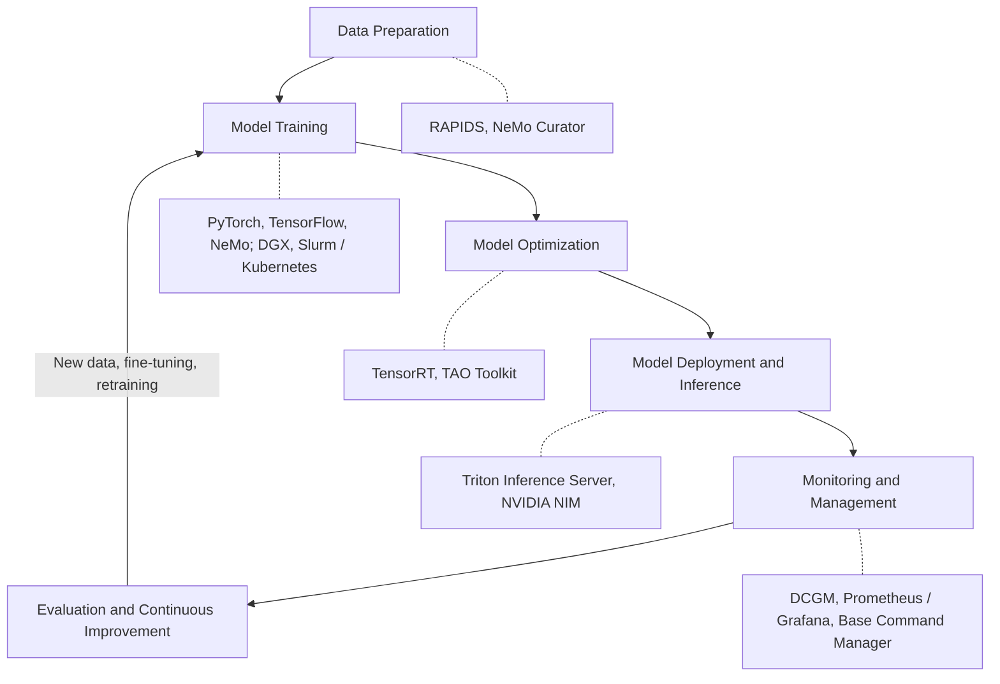
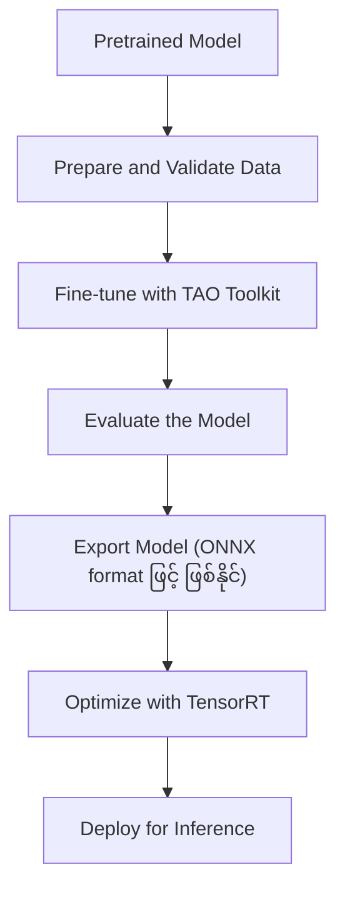
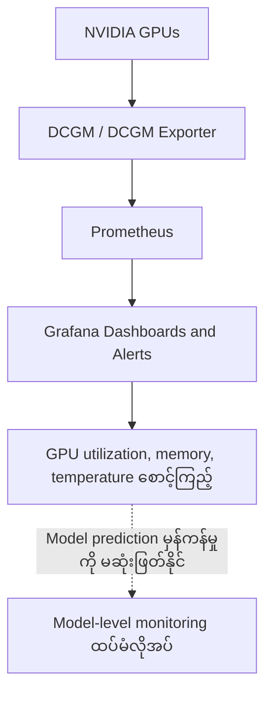
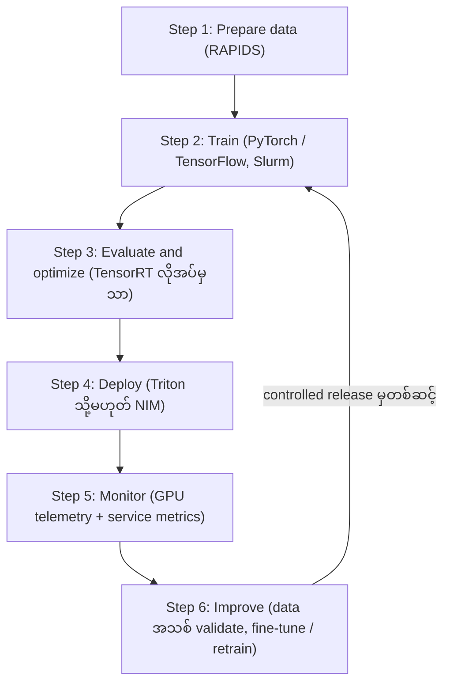
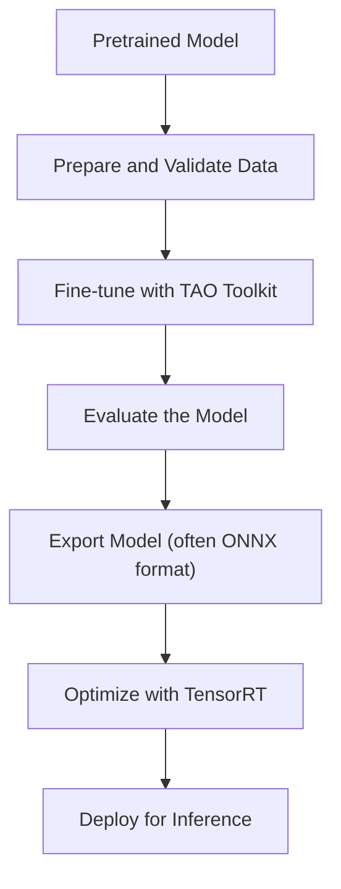
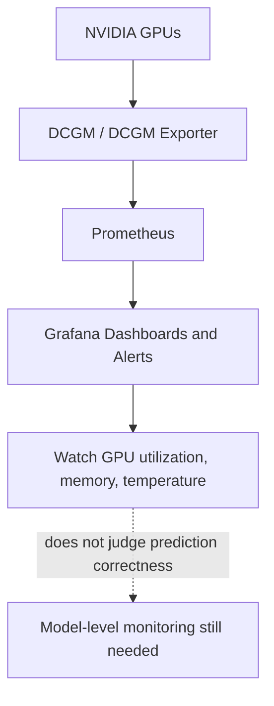
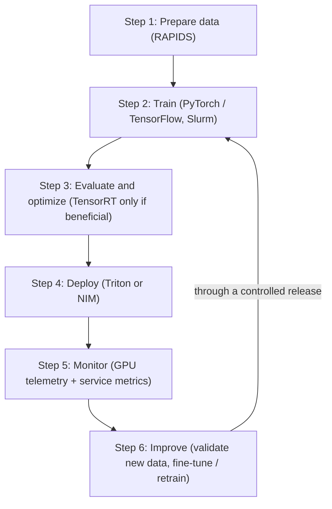

# Module 41 — NVIDIA Tools for MLOps

> Part VIII · MLOps and End-to-End Production AI — topic notes

## မြန်မာဘာသာ version

Mapping NVIDIA Technologies to the Machine Learning Lifecycle

### 1. Learning Objectives

ဤ Module ကို ပြီးဆုံးသောအခါ အောက်ပါအချက်များကို လုပ်ဆောင်နိုင်ရမည်—

- MLOps ရဲ့ အဓိကအဆင့်တွေကို ပံ့ပိုးပေးတဲ့ NVIDIA technologies တွေကို ခွဲခြားဖော်ထုတ်ခြင်း
- RAPIDS နဲ့ NeMo Curator တို့က data preparation ကို ဘယ်လိုပံ့ပိုးသလဲ ရှင်းပြခြင်း
- PyTorch, TensorFlow, NVIDIA NeMo, DGX infrastructure နဲ့ scheduling systems တို့က model training ကို ဘယ်လိုပံ့ပိုးသလဲ နားလည်ခြင်း
- TensorRT နဲ့ TAO Toolkit တို့ရဲ့ model optimization အခန်းကဏ္ဍကို ရှင်းပြခြင်း
- Triton Inference Server နဲ့ NVIDIA NIM တို့ရဲ့ inference deployment အခန်းကဏ္ဍကို နားလည်ခြင်း
- NGC Registry နဲ့ ပြည့်စုံသော Model Registry တို့ကို ခွဲခြားခြင်း
- NVIDIA infrastructure management နဲ့ monitoring tools တို့က production AI operations ကို ဘယ်လိုပံ့ပိုးသလဲ ရှင်းပြခြင်း
- ဘယ် capabilities တွေက ထပ်မံ orchestration, monitoring သို့မဟုတ် model lifecycle management tools တွေ လိုအပ်သလဲ သိရှိခြင်း

### 2. Overview: NVIDIA Tools Across the ML Lifecycle

Machine Learning system တစ်ခုဟာ ယုံကြည်စိတ်ချရသော production service တစ်ခု ဖြစ်လာမီ အဆင်းများစွာ ဖြတ်သန်းရပါတယ်။ အဓိကအဆင့်များက—

- Data preparation နဲ့ feature engineering
- Model training
- Model optimization
- Model deployment နဲ့ inference
- Monitoring နဲ့ infrastructure management
- Continuous improvement, fine-tuning နဲ့ retraining

ဤအဆင့်အများအပြားကို ပံ့ပိုးပေးသော NVIDIA tools များ ရှိပါတယ်။ သို့သော် MLOps တာဝန်အားလုံးကို အလိုအလျောက် ဆောင်ရွက်ပေးသော NVIDIA product တစ်ခုတည်း မရှိပါဘူး။ အမှန်တကယ် implementation တစ်ခုမှာ သင့်လျော်သော tools များကို data storage, source control, workflow orchestration, model tracking, security နဲ့ deployment policies တို့နှင့် ပေါင်းစပ်အသုံးပြုရပါတယ်။

High-level lifecycle—

```
Data Preparation
       |
       | RAPIDS, NeMo Curator
       v
Model Training
       |
       | PyTorch, TensorFlow, NeMo
       | GPU infrastructure, Slurm/Kubernetes
       v
Model Optimization
       |
       | TensorRT, TAO Toolkit
       v
Model Deployment and Inference
       |
       | Triton Inference Server, NVIDIA NIM
       v
Monitoring and Management
       |
       | DCGM, Prometheus/Grafana,
       | Base Command Manager, platform tools
       v
Evaluation and Continuous Improvement
       |
       | New data, fine-tuning, retraining
       +-----------------------> Training
```

ဤပုံက conceptual map ဖြစ်ပါတယ်။ Product တစ်ခုချင်းစီက အဆင့်တစ်ခုထက်ပို၍ ပံ့ပိုးနိုင်ပြီး အမှန်တကယ် workflow က model အမျိုးအစား၊ infrastructure နဲ့ deployment requirements အပေါ် မူတည်ပါတယ်။

Lifecycle အဆင့်များနှင့် သက်ဆိုင်ရာ NVIDIA tools များကို အောက်ပါပုံတွင် စုစည်းကြည့်နိုင်ပါတယ်—

**Figure 1 — NVIDIA MLOps Tool Map (Lifecycle အဆင့်များအလိုက်)**



**ပုံရှင်းလင်းချက်** — အလယ်က မြှားကြီးချောင်းက lifecycle အဆင့်ခြောက်ဆင့်ကို အပေါ်ကနေ အောက်ကို ပြပါတယ်။ ညာဘက် (dotted ချိတ်ဆက်မှု) က အဆင့်တစ်ဆင့်ချင်းစီအတွက် အဓိက NVIDIA tools တွေ ဖြစ်ပါတယ် — data preparation အတွက် RAPIDS နှင့် NeMo Curator၊ model training အတွက် PyTorch/TensorFlow/NeMo နှင့် DGX/Slurm/Kubernetes၊ model optimization အတွက် TensorRT နှင့် TAO Toolkit၊ deployment/inference အတွက် Triton Inference Server နှင့် NVIDIA NIM၊ monitoring အတွက် DCGM၊ Prometheus/Grafana နှင့် Base Command Manager တို့ ဖြစ်ပါတယ်။ အောက်ဆုံးက မြှားကတော့ evaluation ရလဒ်ကနေ new data, fine-tuning, retraining အတွက် training ဆီ ပြန်ချိတ်ပေးတာ ဖြစ်ပါတယ်။

### 3. Stage One — Data Preparation and Feature Engineering

#### 3.1 Why Is Data Preparation Important?

ML model ရဲ့ အရည်အသွေးဟာ ၎င်းရဲ့ data အရည်အသွေးနှင့် သင့်လျောမှုအပေါ် အလွန်မူတည်ပါတယ်။

**Garbage In, Garbage Out (GIGO)** ဆိုသော နိယာမအရ မမှန်ကန်၊ မပြည့်စုံ သို့မဟုတ် မသင့်လျော်သော input data က ဆိုးရွားသော model results ကို ဖြစ်စေနိုင်ပါတယ်။

Training မလုပ်မီ data ကို အောက်ပါအတိုင်း ပြင်ဆင်ရနိုင်ပါတယ်—

- မမှန်ကန်သော records များကို ဖယ်ရှားခြင်း သို့မဟုတ် ပြင်ဆင်ခြင်း (cleaning)
- သင့်လျော်သော format သို့ ပြောင်းလဲခြင်း (transformation)
- Missing values နဲ့ inconsistent schemas များကို စစ်ဆေးခြင်း
- Deduplication ပြုလုပ်ခြင်း
- လိုအပ်သောနေရာများတွင် labeling သို့မဟုတ် annotation ပြုလုပ်ခြင်း
- Sensitive information အတွက် စစ်ဆေးခြင်း
- Sampling bias နဲ့ representation ကို အကဲဖြတ်ခြင်း
- Training, validation နဲ့ test datasets များအဖြစ် သင့်လျောစွာ ခွဲဝေခြင်း
- အလုပ်အတွက် သင့်လျောပါက augmentation ပြုလုပ်ခြင်း

Feature engineering ဆိုတာ model ကို အသုံးဝင်သော patterns များ လေ့လာစေရန် input variables များကို ရွေးချယ်ခြင်း၊ ပြောင်းလဲခြင်း သို့မဟုတ် ဖန်တီးခြင်း ဖြစ်ပါတယ်။ Tabular data အသုံးပြုသော ရိုးရာ ML workflows အများအပြားအတွက် အထူးအရေးကြီးပါတယ်။

LLM သို့မဟုတ် အခြား generative model အတွက် data preparation က မတူနိုင်ပါဘူး။ Document extraction, filtering, deduplication, language identification နဲ့ text quality အပေါ် ပိုမိုအာရုံစိုက်နိုင်ပါတယ်။

#### 3.2 NVIDIA RAPIDS

NVIDIA RAPIDS က data science, data processing, machine learning နဲ့ graph analytics အတွက် GPU-accelerated libraries အစုအဝေး ဖြစ်ပါတယ်။ သက်ဆိုင်ရာ components များ—

- **cuDF**: GPU-accelerated DataFrame operations — pandas workflows အများစုနှင့် ရည်ရွယ်ချက်ဆင်တူပါတယ်။
- **cuML**: GPU-accelerated machine learning algorithms များ။
- **cuGraph**: GPU-accelerated graph analytics။

RAPIDS က NVIDIA GPUs ကို အသုံးပြုပြီး supported data processing နဲ့ analytics operations များကို accelerate လုပ်ပေးနိုင်ပါတယ်။

ဥပမာ — Organization တစ်ခုမှာ transaction records သန်းပေါင်းများစွာ ရှိပါစို့။ Data engineer က GPU-accelerated DataFrame operations ကို အသုံးပြုပြီး columns များ ပြောင်းလဲခြင်း၊ records များ filter လုပ်ခြင်း၊ datasets များ join လုပ်ခြင်းနှင့် downstream ML training အတွက် features များ ပြင်ဆင်နိုင်ပါတယ်။

သို့သော် GPU acceleration က operation တိုင်းအတွက် အလိုအလျောက် ပိုမြန်တာ မဟုတ်ပါဘူး။ Dataset size, data transfer overhead, memory requirements, algorithm support နဲ့ CPU performance အားလုံး အရေးပါပါတယ်။

#### 3.3 NVIDIA NeMo Curator

NeMo Curator က generative AI နဲ့ multimodal model training အတွက် large-scale data curation ကို ပံ့ပိုးပေးပါတယ်။ ၎င်းရဲ့ workflows များ—

- Text extraction နဲ့ normalization
- Quality filtering
- Exact နဲ့ semantic deduplication
- Image နဲ့ text data curation
- Video နဲ့ audio dataset preparation
- Sensitive-information handling
- Training အတွက် dataset preparation

ဥပမာ — LLM တစ်ခု train လုပ်မီ organization တစ်ခုက documents အများအပြားကို process လုပ်ပြီး duplicates ဖယ်ရှားခြင်း၊ low-quality content filter လုပ်ခြင်းနှင့် ရလဒ် dataset ကို standardize လုပ်ရနိုင်ပါတယ်။ NeMo Curator က ဤ workflow ကို ပံ့ပိုးပေးနိုင်ပါတယ်။

သို့သော် dataset တစ်ခု unbiased ဖြစ်ခြင်း၊ ဥပဒေအရ အသုံးပြုခွင့်ရှိခြင်း သို့မဟုတ် သတ်မှတ်ထားသော business objective အတွက် သင့်လျောခြင်းကို ၎င်းတစ်ခုတည်းက အာမခံပေးတာ မဟုတ်ပါဘူး။ ထိုရလဒ်များအတွက် သင့်လျောသော data governance, evaluation နဲ့ human review လိုအပ်ပါတယ်။

#### 3.4 RAPIDS vs. NeMo Curator

| Technology | Main focus | Example |
|---|---|---|
| RAPIDS | GPU-accelerated data science နဲ့ analytics | Tabular transaction data processing |
| NeMo Curator | Generative AI အတွက် large datasets curation | LLM training အတွက် documents filter နဲ့ dedup |

ဤ technologies များက အပြန်အလှန် ဖြည့်စွက်နိုင်ပေမဲ့ အစားထိုး၍ မရပါဘူး။

### 4. Stage Two — Model Training

Data ပြင်ဆင်ပြီးပါက နောက်အဆင့်က model ကို train သို့မဟုတ် fine-tune လုပ်ခြင်း ဖြစ်ပါတယ်။

#### 4.1 PyTorch and TensorFlow

PyTorch နဲ့ TensorFlow က ML နဲ့ deep-learning models များ တည်ဆောက်ခြင်း၊ training လုပ်ခြင်းနှင့် evaluation လုပ်ခြင်းအတွက် frameworks များ ပေးပါတယ်။ ထောက်ပံ့နိုင်သော capabilities များ—

- Model architectures သတ်မှတ်ခြင်း
- Forward နဲ့ backward passes များ လုပ်ဆောင်ခြင်း
- Losses နဲ့ gradients တွက်ချက်ခြင်း
- Optimizers အသုံးပြုခြင်း
- Data batches များ load နှင့် process လုပ်ခြင်း
- Checkpoints သိမ်းခြင်း
- GPU acceleration အသုံးပြုခြင်း
- Distributed training workflows များ ပံ့ပိုးခြင်း

NVIDIA က supported framework versions နဲ့ GPU platforms များအတွက် optimized software builds နဲ့ containers များ ပေးပါတယ်။ Framework က model-development logic အများစု နေရာယူပြီး NVIDIA ၏ GPU libraries နဲ့ software stack က supported workloads များကို ထိရောက်စွာ execute လုပ်ရာတွင် ကူညီပါတယ်။

#### 4.2 NVIDIA NeMo Framework

NVIDIA NeMo က LLMs နဲ့ multimodal models အပါအဝင် generative AI models များ တည်ဆောက်ခြင်း၊ customize လုပ်ခြင်းနှင့် training လုပ်ခြင်းအတွက် tools များ ပေးပါတယ်။ Workflow နဲ့ version ပေါ် မူတည်၍ အောက်ပါတို့ကို ပံ့ပိုးနိုင်ပါတယ်—

- Model customization နဲ့ fine-tuning
- Distributed training
- Training workflow configuration
- Checkpointing နဲ့ experiment workflows
- NVIDIA GPU software နဲ့ infrastructure နှင့် integration

NeMo က generative AI အတွက် အထူးသက်ဆိုင်ပါတယ်။ ML workload တိုင်းအတွက် မလိုအပ်ပါဘူး — ရိုးရာ classification model တစ်ခုက ပိုမိုရိုးရှင်းသော framework နဲ့ pipeline ကို အသုံးပြုနိုင်ပါတယ်။

#### 4.3 NVIDIA AI Enterprise

NVIDIA AI Enterprise က training tool တစ်ခုတည်း မဟုတ်ဘဲ ပိုမိုကျယ်ပြန့်သော enterprise AI software platform ဖြစ်ပါတယ်။ AI development, deployment နဲ့ infrastructure management အတွက် supported software များကို စုစည်းပေးပါတယ်။ ရွေးချယ်ထားသော release နဲ့ entitlement ပေါ် မူတည်၍ frameworks, inference software, NVIDIA NeMo, NIM, GPU-related components နဲ့ cluster-management integrations များ ပါဝင်နိုင်ပါတယ်။

အဓိကကွာခြားချက်—

- PyTorch နဲ့ TensorFlow က model-development frameworks များ ဖြစ်ပါတယ်။
- NeMo က generative AI development နဲ့ customization workflows များကို ပံ့ပိုးပါတယ်။
- NVIDIA AI Enterprise က ဤ components များကို ပါဝင်ပံ့ပိုးနိုင်သော ပိုမိုကျယ်ပြန့်သော enterprise software platform ဖြစ်ပါတယ်။

Deployment သို့မဟုတ် license တိုင်းတွင် component အားလုံး အလိုအလျောက် မပါဝင်ပါဘူး။

#### 4.4 GPU Infrastructure and Scheduling

Model ကြီးများ training လုပ်ရန် GPUs အများအပြား သို့မဟုတ် servers အများအပြား လိုအပ်နိုင်ပါတယ်။ Training framework တစ်ခုတည်းက infrastructure တာဝန်အားလုံးကို မစီမံပါဘူး။ ပုံမှန် ဖြည့်စွက် components များ—

- **NVIDIA DGX systems**: ပေါင်းစပ်ထားသော AI compute infrastructure။
- **DGX Cloud**: NVIDIA ၏ cloud-based AI compute offerings — ရရှိနိုင်သော service အတိအကျက လက်ရှိ offering အပေါ် မူတည်ပါတယ်။
- **Slurm**: HPC နဲ့ AI batch jobs များအတွက် resources များ schedule နှင့် allocate လုပ်ပေးပါတယ်။
- **Kubernetes**: Containerized workloads နဲ့ services များကို orchestrate လုပ်ပါတယ်။
- **NVIDIA Base Command Manager (BCM)**: Supported GPU နဲ့ HPC environments အပါအဝင် cluster infrastructure ကို provision နှင့် manage လုပ်ပါတယ်။
- **NVIDIA Base Command Platform**: AI training operations နှင့် ဆက်စပ်သော သီးခြား NVIDIA workload-management offering ဖြစ်ပြီး Base Command Manager ရဲ့ အခြားအမည် မဟုတ်ပါဘူး။

ဤ components များတွင် တာဝန်များ မတူပါဘူး။ Slurm က jobs များ schedule လုပ်ပြီး Kubernetes က containerized application lifecycles များ စီမံပြီး BCM က cluster infrastructure management ကို အာရုံစိုက်ပါတယ်။ သင့်လျောသော ပေါင်းစပ်မှုက deployment architecture အပေါ် မူတည်ပါတယ်။

### 5. Stage Three — Model Optimization

Train လုပ်ပြီးသော model ကို production သို့ deploy မလုပ်မီ ထပ်မံ optimize လုပ်ရနိုင်ပါတယ်။ ရည်ရွယ်ချက်များ—

- Inference latency လျှော့ချခြင်း
- Throughput တိုးခြင်း
- Memory consumption လျှော့ချခြင်း
- GPU utilization တိုးတက်စေခြင်း
- ကန့်သတ်ထားသော hardware ပေါ်တွင် deployment ပံ့ပိုးခြင်း
- Performance နှင့် prediction quality ကို ချိန်ညှိခြင်း

Optimization ကို တိုင်းတာရပါမယ်။ Accuracy သို့မဟုတ် အခြားအရေးကြီး quality metrics များ လက်ခံနိုင်သော အနိမ့်ဆုံးအောက် ကျဆင်းသွားပါက ပိုမြန်သော model က မဖြစ်နိုင်သလောက် ပိုကောင်းတာ မဟုတ်ပါဘူး။

#### 5.1 NVIDIA TensorRT

TensorRT က supported neural-network workloads များအတွက် SDK နှင့် inference optimization/runtime technology ဖြစ်ပါတယ်။ အောက်ပါနည်းလမ်းများဖြင့် supported models များကို optimize လုပ်နိုင်ပါတယ်—

- Layer နှင့် operation fusion
- Precision selection နှင့် quantization
- Kernel selection နှင့် tuning
- Batching နှင့် အခြား inference execution optimizations
- Hardware-aware engine generation

Model, hardware နှင့် workflow ပေါ် မူတည်၍ FP16 သို့မဟုတ် INT8 ကဲ့သို့ reduced-precision execution က performance တိုးတက်စေပြီး memory usage လျှော့ချနိုင်ပါတယ်။

သို့သော် quantization နှင့် အခြား optimization techniques များက accuracy ကို သက်ရောက်နိုင်ပါတယ်။ Optimized model သို့မဟုတ် engine ကို production မအသုံးမီ benchmark နှင့် evaluate လုပ်သင့်ပါတယ်။

#### 5.2 NVIDIA TAO Toolkit

TAO Toolkit က supported AI models များ — အထူးသဖြင့် computer-vision workloads များ — training, fine-tuning နှင့် optimizing ကို ပံ့ပိုးပါတယ်။ Developers များကို ၎င်းတို့၏ ကိုယ်ပိုင် datasets နှင့် supported workflows များဖြင့် pretrained models များ customize လုပ်ရာတွင် ကူညီပါတယ်။ TAO workflows များက models များကို မကြာခဏ ONNX format ဖြင့် export လုပ်ပြီး supported ဖြစ်ပါက TensorRT ဖြင့် optimized inference engines များ ထုတ်လုပ်နိုင်ပါတယ်။

ရိုးရှင်းသော workflow—

```
Pretrained Model
       |
       v
Prepare and Validate Data
       |
       v
Fine-tune with TAO
       |
       v
Evaluate the Model
       |
       v
Export Model
       |
       v
Optimize with TensorRT
       |
       v
Deploy for Inference
```

ဤ workflow ကို Mermaid ပုံဖြင့်လည်း ကြည့်နိုင်ပါတယ်—

**Figure 2 — TAO Toolkit နှင့် TensorRT ဖြင့် Model ပြင်ဆင်၍ Deploy လုပ်ခြင်း**



**ပုံရှင်းလင်းချက်** — Pretrained Model ကနေ စပြီး data ပြင်ဆင်/validate လုပ်၊ TAO Toolkit ဖြင့် fine-tune လုပ်၊ model ကို evaluate လုပ်ပါတယ်။ ပြီးရင် model ကို export လုပ် (ONNX format ဖြင့် ဖြစ်နိုင်) ပြီး TensorRT ဖြင့် optimize လုပ်ကာ inference အတွက် deploy လုပ်ပါတယ်။ TAO က model ကို adapt/train လုပ်တဲ့ အဆင့်တွေမှာ ပါဝင်ပြီး TensorRT က inference အတွက် optimize/execute လုပ်တဲ့ အဆင့်မှာ ပါဝင်တာကို ပုံက ခွဲပြထားပါတယ်။

TAO နှင့် TensorRT တို့တွင် ဆက်စပ်သော်လည်း မတူညီသော တာဝန်များ ရှိပါတယ်— ဆက်စပ်သော်လည်း မတူညီသော တာဝန်များ ရှိပါတယ်—

- **TAO Toolkit**: Supported models များ adapt နှင့် train လုပ်ရာတွင် ကူညီပါတယ်။
- **TensorRT**: Supported models များကို inference အတွက် optimize နှင့် execute လုပ်ပါတယ်။

TAO က PyTorch, TensorFlow သို့မဟုတ် NeMo အတွက် universal replacement မဟုတ်သလို TensorRT က compatibility နှင့် configuration စဉ်းစားဆောင်ရွက်မှုမပါဘဲ model တိုင်းကို အလိုအလျောက် optimize လုပ်ပေးတာ မဟုတ်ပါဘူး။

### 6. Stage Four — Model Deployment and Inference

Model ကို train, evaluate နှင့် optimize လုပ်ပြီးပါက application သို့မဟုတ် end user ဆီ ရရှိစေရန် လိုအပ်ပါတယ်။ အရေးကြီးသော NVIDIA technologies နှစ်ခုမှာ Triton Inference Server နှင့် NVIDIA NIM တို့ ဖြစ်ပါတယ်။

#### 6.1 NVIDIA Triton Inference Server

Triton Inference Server က supported models များ deploy လုပ်ခြင်းနှင့် inference interfaces များ expose လုပ်ခြင်းအတွက် inference-serving platform ဖြစ်ပါတယ်။ Server version နှင့် configuration ပေါ် မူတည်၍ model frameworks နှင့် backends အမျိုးမျိုးကို ပံ့ပိုးပါတယ်။ ၎င်းရဲ့ capabilities များ—

- HTTP/REST သို့မဟုတ် gRPC မှတစ်ဆင့် models များ serve လုပ်ခြင်း
- Model repositories များ စီမံခြင်း
- Supported models များ load နှင့် unload လုပ်ခြင်း
- Concurrent inference requests များ ပံ့ပိုးခြင်း
- သင့်လျောသောနေရာတွင် dynamic batching
- Models နှင့် model versions အများအပြား စီမံခြင်း
- Serving-related metrics များ expose လုပ်ခြင်း

ဥပမာ — Computer-vision application တစ်ခုက Triton endpoint သို့ image requests များ ပို့နိုင်ပါတယ်။ Triton က configured model ကို load လုပ်ပြီး supported backend ဖြင့် inference execute လုပ်ပါတယ်။

Triton က အဓိကအားဖြင့် inference-serving technology ဖြစ်ပါတယ်။ Organization တစ်ခုလုံးရဲ့ data governance, model approval, retraining နှင့် release-management process အားလုံးကို အလိုအလျောက် မပေးပါဘူး။

#### 6.2 NVIDIA NIM

NVIDIA NIM ဆိုတာ NVIDIA Inference Microservices ကို ဆိုလိုပါတယ်။ NIM က supported models များအတွက် packaged inference microservices များ ပေးပြီး APIs မှတစ်ဆင့် model deployment နှင့် serving ကို ရိုးရှင်းစေရန် ဒီဇိုင်းပြုလုပ်ထားပါတယ်။

ရွေးချယ်ထားသော NIM နှင့် deployment environment ပေါ် မူတည်၍ optimized inference software နှင့် predefined service interfaces များဖြင့် supported models များ deploy လုပ်ရာတွင် အဖွဲ့များကို ကူညီနိုင်ပါတယ်။ ဥပမာ — Application တစ်ခုက low-level model-serving logic ကို တိုက်ရိုက် implement မလုပ်ဘဲ deployed NIM endpoint တစ်ခုကို ခေါ်ဆိုနိုင်ပါတယ်။

NIM နှင့် Triton တို့က NVIDIA ၏ inference ecosystem အတွင်း ဆက်စပ်သော်လည်း တူညီတာ မဟုတ်ပါဘူး—

- **Triton**: Configurable model-serving workflows များပါသော general inference-serving platform။
- **NIM**: API-oriented deployment experience ဖြင့် supported models များအတွက် packaged inference microservices များ။

NIM တစ်ခုရဲ့ နောက်ကွယ် implementation အတိအကျက သက်ဆိုင်ရာ microservice နှင့် release အပေါ် မူတည်ပါတယ်။

#### 6.3 NVIDIA Fleet Command

Lesson မှာ edge environments အပါအဝင် နေရာအမျိုးမျိုးတွင် deployments များ စီမံရန် NVIDIA Fleet Command ကို ဖော်ပြထားပါတယ်။ အရေးကြီးသော conceptual requirement က distributed AI workloads များကို centralized deployment နှင့် management လုပ်ခြင်း ဖြစ်ပါတယ်။

သို့သော် product availability, lifecycle နှင့် supported features များ ပြောင်းလဲနိုင်ပါတယ်။ ပရောဂျက်အသစ်အတွက် Fleet Command ကို ရွေးချယ်မီ ရည်ရွယ်ထားသော environment အတွက် လက်ရှိ NVIDIA documentation နှင့် support status ကို အတည်ပြုပါ။ On-premises သို့မဟုတ် cloud inference deployment တိုင်းအတွက် Fleet Command လိုအပ်သည်ဟု မယူဆပါနှင့်။ Kubernetes, managed cloud platform သို့မဟုတ် အခြား supported management solution က ပိုမိုသင့်လျောနိုင်ပါတယ်။

### 7. Stage Five — Model Registry, Monitoring and Infrastructure Management

Deployment ပြီးနောက် model versions, infrastructure health နှင့် inference performance ကို ဆက်လက် စီမံရပါမယ်။

#### 7.1 NVIDIA NGC Catalog and Registry

NVIDIA NGC က NVIDIA AI software, models, containers နှင့် ဆက်စပ် assets များအတွက် catalog နှင့် registry ecosystem ပေးပါတယ်။ Asset ပေါ် မူတည်၍ NGC က အောက်ပါကဲ့သို့ supported resources များ ရှာဖွေရယူရာတွင် ကူညီနိုင်ပါတယ်—

- GPU-optimized containers
- Framework containers
- Pretrained models
- Model artifacts နှင့် ဆက်စပ် software
- Deployment နှင့် development resources

**အရေးကြီးသော ကွာခြားချက်** — NGC Registry က organization တစ်ခုရဲ့ production lifecycle တစ်ခုလုံးအတွက် ပြည့်စုံသော Model Registry အဖြစ် အလိုအလျောက် မရှိပါဘူး။ Enterprise တစ်ခုက အောက်ပါတို့ကိုလည်း trace လုပ်ရနိုင်ပါတယ်—

- ဘယ် dataset က model ကို ထုတ်လုပ်ခဲ့သလဲ
- ဘယ် Git commit နှင့် training configuration ကို အသုံးပြုခဲ့သလဲ
- Evaluation results နှင့် approval status
- ဘယ် version ကို ဘယ် environment တွင် deploy လုပ်ထားသလဲ
- Deployment history နှင့် rollback decisions
- Model lineage နှင့် ownership

ဤတာဝန်များအတွက် ထပ်မံ model lifecycle management platform, experiment tracker, metadata store သို့မဟုတ် custom workflow လိုအပ်နိုင်ပါတယ်။

#### 7.2 NVIDIA Base Command Manager

Base Command Manager (BCM) က အဓိကအားဖြင့် supported AI နှင့် HPC environments များအတွက် cluster infrastructure management solution ဖြစ်ပါတယ်။ အောက်ပါတို့တွင် ကူညီနိုင်ပါတယ်—

- Compute nodes များ automated provisioning
- Configuration management
- Centralized cluster administration
- Infrastructure operations
- Supported GPU နှင့် HPC systems များ စီမံခြင်း

BCM က Model Registry နှင့် တူညီတာ မဟုတ်သလို NVIDIA Base Command Platform နှင့်လည်း တူညီသော product မဟုတ်ပါဘူး။

#### 7.3 NVIDIA DCGM

NVIDIA Data Center GPU Manager (DCGM) က GPU monitoring, health checks နှင့် diagnostics များကို ပံ့ပိုးပါတယ်။ Supported GPU telemetry နှင့် health information များကို visibility ပေးနိုင်ပါတယ်။ DCGM Exporter က Prometheus-compatible monitoring systems များ စုဆောင်းနိုင်ရန် ရွေးချယ်ထားသော GPU metrics များ expose လုပ်နိုင်ပါတယ်။

ပုံမှန် monitoring architecture—

```
NVIDIA GPUs
     |
     v
DCGM / DCGM Exporter
     |
     v
Prometheus
     |
     v
Grafana Dashboards and Alerts
```

ဤ architecture က GPU utilization, memory usage, temperature နှင့် supported health information ကဲ့သို့ infrastructure-level signals များကို စောင့်ကြည့်ပါတယ်။

Monitoring architecture ကို ပုံဖြင့် ကြည့်ရအောင်—

**Figure 3 — GPU Monitoring Architecture (DCGM)**



**ပုံရှင်းလင်းချက်** — NVIDIA GPUs ကနေ DCGM / DCGM Exporter က GPU metrics တွေ ထုတ်ပေးပြီး Prometheus က စုဆောင်းကာ Grafana က dashboards နှင့် alerts အဖြစ် ပြပါတယ်။ ဒီလမ်းကြောင်းက GPU utilization, memory usage, temperature စတဲ့ infrastructure-level signals တွေကိုသာ စောင့်ကြည့်တာ ဖြစ်ပါတယ်။ အောက်က dashed မြှားကတော့ ML model ရဲ့ predictions တွေ မှန်ကန်မှုကို ဒီတစ်ခုတည်းနဲ့ မဆုံးဖြတ်နိုင်ဘဲ model-level monitoring အတွက် ထပ်မံ လိုအပ်ကြောင်း သတိပေးပါတယ်။

ML model ၏ predictions များ မှန်ကန်ခြင်း ရှိ/မရှိကို ၎င်းတစ်ခုတည်းက မဆုံးဖြတ်ပါဘူး။ Model-level monitoring အတွက် ထပ်မံ application metrics, data-quality checks နှင့် ဖြစ်နိုင်ပါက ground-truth evaluation လိုအပ်ပါတယ်။

#### 7.4 Triton နှင့် Inference Monitoring

Triton က configuration နှင့် enabled backends အပေါ် မူတည်၍ serving-related statistics နှင့် metrics များ ပေးပါတယ်။ ၎င်းတို့ကို infrastructure metrics များနှင့် ပေါင်းစပ်ပြီး serving system ကို ပိုမိုပြည့်စုံစွာ နားလည်နိုင်ပါတယ်။ ဥပမာ—

- GPU utilization မြင့်နေသည်။
- Inference latency တက်နေသည်။
- Request queue length ကြီးလာနေသည်။
- Error rates မြင့်တက်နေသည်။

ဤ signals များ ပေါင်းစပ်ပါက capacity pressure သို့မဟုတ် serving bottleneck ကို ညွှန်းဆိုနိုင်ပါတယ်။ Root cause ရှာဖွေရန် ထပ်မံ စုံစမ်းမှု လိုအပ်ပါသေးတယ်။

### 8. Stage Six — Continuous Improvement, Fine-Tuning နှင့် Retraining

Data, user needs နှင့် production conditions များ ပြောင်းလဲသောအခါ machine learning systems များ တိုးတက်ပြောင်းလဲရနိုင်ပါတယ်။ ဖြစ်နိုင်သော လုပ်ဆောင်ချက်များ—

- Training data အသစ် စုဆောင်းခြင်း
- အသစ်စုဆောင်းထားသော data ကို validate လုပ်ခြင်း
- Supported model ကို fine-tune လုပ်ခြင်း
- ကိုက်ညီမှုရှိပါက model ကို retrain လုပ်ခြင်း
- အသစ် model ကို baseline နှင့် နှိုင်းယှဉ်အကဲဖြတ်ခြင်း
- Candidate model ကို register လုပ်ခြင်း
- Controlled release process မှတစ်ဆင့် deploy လုပ်ခြင်း

**NVIDIA NeMo** — generative AI model development နှင့် customization အပါအဝင် သင့်လျောသော fine-tuning workflows များကို ပံ့ပိုးပါတယ်။

**NVIDIA TAO Toolkit** — supported models များ — အထူးသဖြင့် computer-vision models များ — customization နှင့် fine-tuning ကို ပံ့ပိုးပါတယ်။

**NVIDIA TensorRT** — inference optimization ကို ပံ့ပိုးပါတယ်။ ၎င်းကို general-purpose retraining orchestrator အဖြစ် ဖော်ပြခြင်း မပြုသင့်ပါဘူး။

**NVIDIA NGC** — supported assets နှင့် software များ ရယူခွင့် ပေးပါတယ်။ NGC မှ artifact တစ်ခု ရယူခြင်းက organization ၏ ပြည့်စုံသော retraining နှင့် approval workflow ကို ၎င်းတစ်ခုတည်းက implement လုပ်ပေးတာ မဟုတ်ပါဘူး။

**အရေးကြီးသော MLOps ကွာခြားချက်** — Fine-tuning, retraining, optimization နှင့် deployment တို့က မတူညီသော လုပ်ဆောင်ချက်များ ဖြစ်ပါတယ်—

- **Fine-tuning** က pretrained model ကို task-specific data ဖြင့် ပြောင်းလဲခြင်း ဖြစ်ပါတယ်။
- **Retraining** က defined training workflow နှင့် dataset ဖြင့် model ကို ပြန်လည် train လုပ်ခြင်း ဖြစ်ပါတယ်။
- **Optimization** က inference အတွက် model မည်သို့ execute ဖြစ်ခြင်း သို့မဟုတ် ကိုယ်စားပြုခြင်းကို ပြောင်းလဲခြင်း ဖြစ်ပါတယ်။
- **Deployment** က ရွေးချယ်ထားသော model ကို serving application တစ်ခုအတွက် ရရှိစေခြင်း ဖြစ်ပါတယ်။

Production workflow တစ်ခုက ဤလုပ်ဆောင်ချက်များကို ပေါင်းစပ်နိုင်သော်လည်း data batch အသစ်တိုင်းက ၎င်းအားလုံး လိုအပ်သည်ဟု မယူဆသင့်ပါဘူး။

### 9. Consolidated Tool Selection Table

| MLOps stage | NVIDIA technology | Primary role |
|---|---|---|
| Data preparation | RAPIDS | GPU-accelerated data science နှင့် analytics |
| Generative AI data curation | NeMo Curator | Text, image, video နှင့် audio datasets curation |
| Model training | PyTorch / TensorFlow | Supported ML models များ တည်ဆောက်ခြင်းနှင့် training |
| Generative AI development | NeMo | Generative AI models များ တည်ဆောက်ခြင်းနှင့် customize လုပ်ခြင်း |
| Training infrastructure | DGX systems / DGX Cloud offerings | AI compute resources များ ပေးခြင်း |
| Cluster management | Base Command Manager | Supported AI/HPC infrastructure provision နှင့် စီမံခြင်း |
| Model customization | TAO Toolkit | Supported models များ training နှင့် fine-tuning |
| Inference optimization | TensorRT | Supported model inference optimize လုပ်ခြင်း |
| Inference serving | Triton Inference Server | Supported interfaces မှတစ်ဆင့် models များ serve လုပ်ခြင်း |
| Packaged inference APIs | NVIDIA NIM | Supported inference microservices များ deploy လုပ်ခြင်း |
| Software နှင့် model catalog | NGC Catalog / Registry | Supported assets များ ရှာဖွေရယူခြင်း |
| GPU health နှင့် telemetry | DCGM | GPU monitoring နှင့် diagnostics |
| Monitoring dashboards | Prometheus / Grafana integration | Metrics များ စုဆောင်းခြင်းနှင့် visualize လုပ်ခြင်း |
| Distributed workload management | Slurm / Kubernetes integrations | Jobs များ scheduling နှင့် containerized workloads များ စီမံခြင်း |

ဤဇယားက technologies များကို ၎င်းတို့၏ အဓိကတာဝန်များနှင့် ချိတ်ဆက်ပြထားပါတယ်။ Tools အချို့က အဆင့်များစွာ ဖြတ်သန်းပြီး lifecycle လိုအပ်ချက်အချို့က non-NVIDIA software သို့မဟုတ် organization-specific processes များ လိုအပ်ပါတယ်။

### 10. Example: An Enterprise Fraud Detection Pipeline

Bank တစ်ခုက transaction fraud detection system တစ်ခု တည်ဆောက်နေသည်ဟု စိတ်ကူးကြည့်ပါ။

**Step 1 — Prepare data** — Supported RAPIDS workflows များဖြင့် tabular transaction datasets ကြီးများ process လုပ်ခြင်း၊ fields များ ပြောင်းလဲခြင်းနှင့် features များ ပြင်ဆင်ခြင်း။ Data validation, privacy controls နှင့် bias analysis ကို အသုံးချပါ။

**Step 2 — Train the model** — PyTorch, TensorFlow သို့မဟုတ် သင့်လျောသော ML framework ကို အသုံးပြုပါ။ Workload နှင့် infrastructure လိုအပ်ပါက GPU jobs များကို Slurm မှတစ်ဆင့် schedule လုပ်ပါ။ ရိုးရာ tabular model တစ်ခုက GPU cluster ကြီး လုံးဝ မလိုအပ်နိုင်ပါဘူး။

**Step 3 — Evaluate and optimize** — Candidate ကို precision, recall နှင့် false-positive behavior အပါအဝင် သက်ဆိုင်ရာ fraud detection metrics များဖြင့် အကဲဖြတ်ပါ။ ရွေးချယ်ထားသော model, backend နှင့် deployment workflow တို့ supported ဖြစ်ပြီး inference optimization အကျိုးရှိမှသာ TensorRT ကို အသုံးပြုပါ။ Tabular ML model တိုင်းအတွက် မဖြစ်မနေ မဟုတ်ပါဘူး။

**Step 4 — Deploy** — Supported model ကို သင့်လျောသော inference service မှတစ်ဆင့် serve လုပ်ပါ။ Supported model formats နှင့် backends များအတွက် Triton သင့်လျောနိုင်ပြီး ကိုက်ညီသော supported microservice ရှိပါက NIM သင့်လျောပါတယ်။

**Step 5 — Monitor** — GPUs အသုံးပြုသောနေရာများတွင် service-level metrics များကို GPU telemetry နှင့် ပေါင်းစပ်ပါ။ ယုံကြည်ရသော labels နှင့် business metrics များ ရရှိလာသောအခါ model quality ကို track လုပ်ပါ။

**Step 6 — Improve** — Monitoring က တိုးတက်မှု လိုအပ်ကြောင်း ညွှန်းဆိုသောအခါ data အသစ် validate လုပ်ခြင်း၊ candidate ကို train သို့မဟုတ် fine-tune လုပ်ခြင်း၊ လက်ရှိ production version နှင့် နှိုင်းယှဉ်ခြင်းနှင့် လိုအပ်သော checks များ ပြီးမှသာ release လုပ်ခြင်း ပြုလုပ်ပါ။

ဤဥပမာက NVIDIA technologies များက workload တိုင်းအတွက် NVIDIA product အားလုံး လိုအပ်သည်ဟု ဆိုလိုခြင်းမပါဘဲ MLOps architecture တစ်ခုကို မည်သို့ ပံ့ပိုးနိုင်ကြောင်း ပြသပါတယ်။

ဥပမာ pipeline တစ်ခုလုံးကို ပုံဖြင့် ကြည့်ရအောင်—

**Figure 4 — Enterprise Fraud Detection Pipeline ဥပမာ**



**ပုံရှင်းလင်းချက်** — အဆင့်ခြောက်ဆင့်ကို အပေါ်ကနေ အောက်ကို ဖတ်ပါ။ Data ပြင်ဆင်ခြင်း (RAPIDS) ကနေ စပြီး model train လုပ်ခြင်း (PyTorch/TensorFlow၊ လိုအပ်ရင် Slurm)၊ evaluate/optimize လုပ်ခြင်း (TensorRT ကို လိုအပ်မှသာ သုံး)၊ deploy လုပ်ခြင်း (Triton သို့မဟုတ် NIM)၊ monitor လုပ်ခြင်းတို့ကို ဖြတ်သွားပါတယ်။ နောက်ဆုံး improve အဆင့်ကနေ မြှားက data အသစ် validate လုပ်ပြီး controlled release မှတစ်ဆင့် training ဆီ ပြန်ချိတ်ပါတယ်။ အဆင့်တိုင်းမှာ NVIDIA product အားလုံး မလိုအပ်ကြောင်းလည်း ပုံက ပြပါတယ်။

### 11. Key Takeaways

- RAPIDS က GPU-accelerated data processing နှင့် analytics ကို ပံ့ပိုးပါတယ်။
- NeMo Curator က generative AI အတွက် large-scale dataset curation ကို ပံ့ပိုးပါတယ်။
- PyTorch, TensorFlow နှင့် NeMo တို့က မတူညီသော model development နှင့် training workflows များကို ပံ့ပိုးပါတယ်။
- TAO Toolkit က supported models များ customize လုပ်ရာတွင် ကူညီပြီး TensorRT က supported inference execution ကို optimize လုပ်ပါတယ်။
- Triton Inference Server နှင့် NVIDIA NIM တို့က model serving အတွက် မတူညီသော ချဉ်းကပ်မှုများ ပေးပါတယ်။
- NGC Registry က software နှင့် model assets များ ရယူခွင့်ပေးသော်လည်း ပြည့်စုံသော enterprise Model Registry အဖြစ် အလိုအလျောက် မရှိပါဘူး။
- Base Command Manager က infrastructure ကို စီမံပြီး DCGM က GPU health နှင့် telemetry capabilities များ ပေးပါတယ်။
- Slurm နှင့် Kubernetes တို့က မတူညီသော workload-management လိုအပ်ချက်များကို ဖြေရှင်းပြီး အတူတွဲ အသုံးပြုနိုင်ပါတယ်။
- NVIDIA technologies များက MLOps အဆင့်များစွာကို ပံ့ပိုးသော်လည်း data governance, workflow orchestration, model lineage, quality gates နှင့် release policies များအတွက် ထပ်မံ components များ လိုအပ်နိုင်ပါတယ်။
- Tools များကို workload requirements, compatibility, support status, licensing နှင့် ဖြေရှင်းရမည့် လက်တွေ့ operational problem အပေါ် အခြေခံ၍ ရွေးချယ်ပါ။

### 12. Review Questions

1. RAPIDS နှင့် NeMo Curator တို့၏ ကွာခြားချက်က ဘာလဲ။
2. Generative AI model တစ်ခု training လုပ်ရန် ဘယ် technologies တွေကို အသုံးပြုနိုင်သလဲ။
3. TAO Toolkit နှင့် TensorRT တို့၏ ကွာခြားချက်က ဘာလဲ။
4. Triton နှင့် NVIDIA NIM တို့ ဘယ်လိုကွာသလဲ။
5. NGC Registry က ဘာကြောင့် ပြည့်စုံသော enterprise Model Registry မဖြစ်နိုင်တာလဲ။
6. Base Command Manager ၏ အဓိကတာဝန်များက ဘာတွေလဲ။
7. DCGM က GPU monitoring ကို ဘယ်လိုပံ့ပိုးသလဲ။
8. ML workflow တစ်ခုမှာ model framework အပြင် Slurm သို့မဟုတ် Kubernetes ဘာကြောင့် လိုအပ်နိုင်သလဲ။
9. Model တိုင်းအတွက် TensorRT သို့မဟုတ် GPU cluster လိုအပ်သလား။ ဘာကြောင့်လဲ။
10. Model version အသစ်တစ်ခုကို retrain, evaluate နှင့် deploy လုပ်ရန် controlled workflow တစ်ခုကို ဘယ်လိုဒီဇိုင်းလုပ်မလဲ။

**အဖြေများ (အကျဉ်း)**

1. RAPIDS က GPU-accelerated data science နှင့် analytics အတွက်ဖြစ်ပြီး (ဥပမာ tabular transaction data) NeMo Curator က generative AI အတွက် large datasets — text, image, video, audio — curation အတွက် ဖြစ်ပါတယ်။ ဖြည့်စွက်နိုင်သော်လည်း အစားထိုး၍ မရပါဘူး။
2. PyTorch သို့မဟုတ် TensorFlow ဖြင့် training လုပ်ခြင်း၊ generative AI workflow များအတွက် NeMo ဖြင့် customization/fine-tuning လုပ်ခြင်း၊ GPU infrastructure ပေါ် Slurm သို့မဟုတ် Kubernetes ဖြင့် scheduling လုပ်ခြင်း ပါဝင်နိုင်ပါတယ်။
3. TAO Toolkit က supported models များ adapt နှင့် train လုပ်ရာတွင် ကူညီပြီး TensorRT က supported models များကို inference အတွက် optimize နှင့် execute လုပ်ပါတယ်။
4. Triton က configurable model-serving workflows များပါသော general inference-serving platform ဖြစ်ပြီး NIM က API-oriented deployment experience ဖြင့် supported models အတွက် packaged inference microservices များ ဖြစ်ပါတယ်။
5. NGC က software နှင့် model assets များ ရယူခွင့်ပေးပေမဲ့ dataset provenance, Git commit, evaluation results, approval status, deployment history နှင့် lineage ကဲ့သို့ တာဝန်များကို မစီမံပါဘူး။
6. Compute nodes များ automated provisioning, configuration management, centralized cluster administration နှင့် supported GPU/HPC systems များ စီမံခြင်း ဖြစ်ပါတယ်။ Model Registry မဟုတ်ပါဘူး။
7. GPU monitoring, health checks နှင့် diagnostics ပေးပြီး DCGM Exporter မှတစ်ဆင့် Prometheus-compatible monitoring အတွက် GPU metrics များ expose လုပ်ပါတယ်။
8. Training jobs များအတွက် resource allocation/scheduling (Slurm) နှင့် containerized inference services များ lifecycle management (Kubernetes) လိုအပ်ခြင်းကြောင့် ဖြစ်ပါတယ်။ Framework က model logic ကိုသာ စီမံပါတယ်။
9. မလိုအပ်ပါဘူး။ Model အမျိုးအစား၊ hardware support, compatibility, performance အကျိုးရှိမှုနှင့် deployment requirements အပေါ် မူတည်ပါတယ်။
10. Data validation → automated training → evaluation → quality gate/approval → model registration → staging deployment → production approval → controlled rollout → monitoring → retraining trigger (လိုအပ်ပါက) ဆိုတဲ့ pipeline ကို အဆင့်တိုင်းတွင် checks နှင့် approvals ထားရှိပြီး ဒီဇိုင်းလုပ်နိုင်ပါတယ်။

**Final concept** — NVIDIA က data preparation, training, optimization, inference နှင့် infrastructure monitoring အတွက် technologies များ ပေးပါတယ်။ MLOps က ဤ capabilities များကို controlled lifecycle တစ်ခုအဖြစ် ချိတ်ဆက်ပေးပြီး models များ train လုပ်ရုံမျှမက validate, deploy, observe နှင့် responsible ဖြစ်စွာ update ပြုလုပ်ကြောင်း သေချာစေပါတယ်။

## English Version

Mapping NVIDIA Technologies to the Machine Learning Lifecycle

### 1. Learning Objectives

After completing this module, you should be able to—

- Identify NVIDIA technologies that support the major stages of MLOps.
- Explain how RAPIDS and NeMo Curator support data preparation.
- Understand how PyTorch, TensorFlow, NVIDIA NeMo, DGX infrastructure and scheduling systems support model training.
- Explain how TensorRT and TAO Toolkit support model optimization.
- Understand the roles of Triton Inference Server and NVIDIA NIM in inference deployment.
- Distinguish NGC Registry from a complete Model Registry.
- Explain how NVIDIA infrastructure management and monitoring tools support production AI operations.
- Recognize which capabilities require additional orchestration, monitoring or model lifecycle management tools.

### 2. Overview: NVIDIA Tools Across the ML Lifecycle

A machine learning system passes through several stages before it becomes a reliable production service. The main stages are—

- Data preparation and feature engineering
- Model training
- Model optimization
- Model deployment and inference
- Monitoring and infrastructure management
- Continuous improvement, fine-tuning and retraining

NVIDIA provides tools that support many of these stages. However, there is no single NVIDIA product that automatically performs every MLOps responsibility. An actual implementation combines the appropriate tools with data storage, source control, workflow orchestration, model tracking, security and deployment policies.

High-level lifecycle—

```
Data Preparation
       |
       | RAPIDS, NeMo Curator
       v
Model Training
       |
       | PyTorch, TensorFlow, NeMo
       | GPU infrastructure, Slurm/Kubernetes
       v
Model Optimization
       |
       | TensorRT, TAO Toolkit
       v
Model Deployment and Inference
       |
       | Triton Inference Server, NVIDIA NIM
       v
Monitoring and Management
       |
       | DCGM, Prometheus/Grafana,
       | Base Command Manager, platform tools
       v
Evaluation and Continuous Improvement
       |
       | New data, fine-tuning, retraining
       +-----------------------> Training
```

This is a conceptual map. Individual products may support more than one stage, and the exact workflow depends on the model type, infrastructure and deployment requirements.

The lifecycle stages and the relevant NVIDIA tools are gathered in the following figure—

**Figure 1 — NVIDIA MLOps Tool Map Across Lifecycle Stages**


**Figure walkthrough** — The central arrows show the six lifecycle stages from top to bottom. The dotted links on the side name the main NVIDIA tools for each stage — RAPIDS and NeMo Curator for data preparation; PyTorch/TensorFlow/NeMo and DGX/Slurm/Kubernetes for model training; TensorRT and TAO Toolkit for model optimization; Triton Inference Server and NVIDIA NIM for deployment and inference; DCGM, Prometheus/Grafana and Base Command Manager for monitoring. The bottom arrow feeds evaluation results — new data, fine-tuning, retraining — back to training.

### 3. Stage One — Data Preparation and Feature Engineering

#### 3.1 Why Is Data Preparation Important?

The quality of an ML model depends heavily on the quality and suitability of its data.

The principle *Garbage In, Garbage Out* (GIGO) means that incorrect, incomplete or unsuitable input data can lead to poor model results.

Before training, data may need to be—

- Cleaned to remove or correct invalid records
- Transformed into a suitable format
- Checked for missing values and inconsistent schemas
- Deduplicated
- Labeled or annotated where required
- Checked for sensitive information
- Evaluated for sampling bias and representation
- Split appropriately into training, validation and test datasets
- Augmented when suitable for the task

Feature engineering is the process of selecting, transforming or creating input variables that help a model learn useful patterns. It is particularly important for many traditional ML workflows using tabular data.

Data preparation for an LLM or other generative model can look different. It may focus more on document extraction, filtering, deduplication, language identification and text quality.

#### 3.2 NVIDIA RAPIDS

NVIDIA RAPIDS is a collection of GPU-accelerated libraries for data science, data processing, machine learning and graph analytics. Relevant components include—

- **cuDF**: GPU-accelerated DataFrame operations, similar in purpose to many pandas workflows.
- **cuML**: GPU-accelerated machine learning algorithms.
- **cuGraph**: GPU-accelerated graph analytics.

RAPIDS can accelerate supported data processing and analytics operations by using NVIDIA GPUs.

Example: an organization has millions of transaction records. A data engineer can use GPU-accelerated DataFrame operations to transform columns, filter records, join datasets and prepare features for downstream ML training.

However, GPU acceleration is not automatically faster for every operation. Dataset size, data transfer overhead, memory requirements, algorithm support and CPU performance all matter.

#### 3.3 NVIDIA NeMo Curator

NeMo Curator supports large-scale data curation for generative AI and multimodal model training. Its workflows can include—

- Text extraction and normalization
- Quality filtering
- Exact and semantic deduplication
- Image and text data curation
- Video and audio dataset preparation
- Sensitive-information handling
- Dataset preparation for training

For example, before training an LLM, an organization may need to process a large collection of documents, remove duplicates, filter low-quality content and standardize the resulting dataset. NeMo Curator can support this workflow.

It does not, by itself, guarantee that a dataset is unbiased, legally usable or suitable for a particular business objective. Those outcomes require appropriate data governance, evaluation and human review.

#### 3.4 RAPIDS vs. NeMo Curator

| Technology | Main focus | Example |
|---|---|---|
| RAPIDS | GPU-accelerated data science and analytics | Processing tabular transaction data |
| NeMo Curator | Curating large datasets for generative AI | Filtering and deduplicating documents for LLM training |

These technologies can complement one another, but they are not interchangeable.

### 4. Stage Two — Model Training

After the data has been prepared, the next step is to train or fine-tune a model.

#### 4.1 PyTorch and TensorFlow

PyTorch and TensorFlow provide frameworks for building, training and evaluating ML and deep-learning models. They support capabilities such as—

- Defining model architectures
- Running forward and backward passes
- Computing losses and gradients
- Applying optimizers
- Loading and processing batches of data
- Saving checkpoints
- Using GPU acceleration
- Supporting distributed training workflows

NVIDIA provides optimized software builds and containers for supported framework versions and GPU platforms. The framework is where much of the model-development logic lives. NVIDIA's GPU libraries and software stack help execute supported workloads efficiently.

#### 4.2 NVIDIA NeMo Framework

NVIDIA NeMo provides tools for building, customizing and training generative AI models, including LLMs and multimodal models. Depending on the workflow and version, it can support—

- Model customization and fine-tuning
- Distributed training
- Training workflow configuration
- Checkpointing and experiment workflows
- Integration with NVIDIA GPU software and infrastructure

NeMo is especially relevant to generative AI. It is not necessary for every ML workload; a traditional classification model may use a simpler framework and pipeline.

#### 4.3 NVIDIA AI Enterprise

NVIDIA AI Enterprise is a broader enterprise AI software platform, rather than a single training tool. It brings together supported software for AI development, deployment and infrastructure management. Depending on the selected release and entitlement, this can include frameworks, inference software, NVIDIA NeMo, NIM, GPU-related components and cluster-management integrations.

The key distinction is—

- PyTorch and TensorFlow are model-development frameworks.
- NeMo supports generative AI development and customization workflows.
- NVIDIA AI Enterprise is a broader enterprise software platform that can include and support these components.

Not every component is automatically included in every deployment or license.

#### 4.4 GPU Infrastructure and Scheduling

Training large models can require multiple GPUs or multiple servers. The training framework alone does not manage every infrastructure responsibility. Common complementary components include—

- **NVIDIA DGX systems**: integrated AI compute infrastructure.
- **DGX Cloud**: NVIDIA's cloud-based AI compute offerings; the exact available service depends on the current offering.
- **Slurm**: schedules and allocates resources for HPC and AI batch jobs.
- **Kubernetes**: orchestrates containerized workloads and services.
- **NVIDIA Base Command Manager (BCM)**: provisions and manages cluster infrastructure, including supported GPU and HPC environments.
- **NVIDIA Base Command Platform**: a separate NVIDIA workload-management offering associated with AI training operations; it should not be treated as another name for Base Command Manager.

These components have different responsibilities. Slurm schedules jobs, Kubernetes manages containerized application lifecycles, and BCM focuses on cluster infrastructure management. The appropriate combination depends on the deployment architecture.

### 5. Stage Three — Model Optimization

A trained model may need further optimization before it is deployed to production. The objectives can include—

- Reducing inference latency
- Increasing throughput
- Reducing memory consumption
- Improving GPU utilization
- Supporting deployment on constrained hardware
- Balancing performance with prediction quality

Optimization must be measured. A faster model is not necessarily better if its accuracy or other critical quality metrics fall below acceptable limits.

#### 5.1 NVIDIA TensorRT

TensorRT is an SDK and inference optimization/runtime technology for supported neural-network workloads. It can optimize supported models through techniques such as—

- Layer and operation fusion
- Precision selection and quantization
- Kernel selection and tuning
- Batching and other inference execution optimizations
- Hardware-aware engine generation

Depending on the model, hardware and workflow, reduced-precision execution such as FP16 or INT8 can improve performance and reduce memory use.

However, quantization and other optimization techniques can affect accuracy. The optimized model or engine should be benchmarked and evaluated before production use.

#### 5.2 NVIDIA TAO Toolkit

TAO Toolkit supports training, fine-tuning and optimizing supported AI models, particularly computer-vision workloads. It helps developers customize pretrained models using their own datasets and supported workflows. TAO workflows can export models, often in ONNX format, and use TensorRT to generate optimized inference engines where supported.

A simplified workflow is—

```
Pretrained Model
       |
       v
Prepare and Validate Data
       |
       v
Fine-tune with TAO
       |
       v
Evaluate the Model
       |
       v
Export Model
       |
       v
Optimize with TensorRT
       |
       v
Deploy for Inference
```

This workflow can also be seen as a Mermaid figure—

**Figure 2 — Preparing and Deploying a Model with TAO Toolkit and TensorRT**



**Figure walkthrough** — Starting from the pretrained model, the data is prepared and validated, the model is fine-tuned with TAO Toolkit, and then evaluated. The model is then exported (often in ONNX format), optimized with TensorRT, and deployed for inference. The figure separates the stages where TAO takes part (adapt/train the model) from the stage where TensorRT takes part (optimize/execute the model for inference).

TAO and TensorRT have related but distinct responsibilities—

- **TAO Toolkit**: helps adapt and train supported models.
- **TensorRT**: optimizes and executes supported models for inference.

TAO is not a universal replacement for PyTorch, TensorFlow or NeMo, and TensorRT does not automatically optimize every arbitrary model without compatibility and configuration considerations.

### 6. Stage Four — Model Deployment and Inference

Once a model has been trained, evaluated and optimized, it needs to be made available to an application or end user. Two important NVIDIA technologies are Triton Inference Server and NVIDIA NIM.

#### 6.1 NVIDIA Triton Inference Server

Triton Inference Server is an inference-serving platform for deploying supported models and exposing inference interfaces. It supports multiple model frameworks and backends, depending on the server version and configuration. Its capabilities can include—

- Serving models through HTTP/REST or gRPC
- Managing model repositories
- Loading and unloading supported models
- Supporting concurrent inference requests
- Dynamic batching where applicable
- Managing multiple models and model versions
- Exposing serving-related metrics

For example, a computer-vision application may send image requests to a Triton endpoint. Triton loads the configured model and executes inference using a supported backend.

Triton is primarily an inference-serving technology. It does not automatically provide the entire organization's data governance, model approval, retraining and release-management process.

#### 6.2 NVIDIA NIM

NVIDIA NIM stands for NVIDIA Inference Microservices. NIM provides packaged inference microservices for supported models, designed to simplify model deployment and serving through APIs. Depending on the selected NIM and deployment environment, it can help teams deploy supported models using optimized inference software and predefined service interfaces.

For example, an application may call a deployed NIM endpoint rather than directly implementing the low-level model-serving logic.

NIM and Triton are related within NVIDIA's inference ecosystem, but they are not identical—

- **Triton**: a general inference-serving platform with configurable model-serving workflows.
- **NIM**: packaged inference microservices for supported models, with an API-oriented deployment experience.

The exact implementation behind a NIM depends on the particular microservice and release.

#### 6.3 NVIDIA Fleet Command

The lesson mentions NVIDIA Fleet Command for managing deployments across multiple locations, including edge environments. The important conceptual requirement is centralized deployment and management of distributed AI workloads.

However, product availability, lifecycle and supported features can change. Before selecting Fleet Command for a new project, verify the current NVIDIA documentation and support status for the intended environment. Do not assume that Fleet Command is required for every on-premises or cloud inference deployment. Kubernetes, a managed cloud platform or another supported management solution may be more appropriate.

### 7. Stage Five — Model Registry, Monitoring and Infrastructure Management

After deployment, model versions, infrastructure health and inference performance must be managed continuously.

#### 7.1 NVIDIA NGC Catalog and Registry

NVIDIA NGC provides a catalog and registry ecosystem for NVIDIA AI software, models, containers and related assets. Depending on the asset, NGC can help users discover and obtain supported resources such as—

- GPU-optimized containers
- Framework containers
- Pretrained models
- Model artifacts and related software
- Deployment and development resources

A crucial distinction: NGC Registry is not automatically a complete Model Registry for an organization's entire production lifecycle. An enterprise may also need to track—

- Which dataset produced a model
- Which Git commit and training configuration were used
- Evaluation results and approval status
- Which version is deployed to each environment
- Deployment history and rollback decisions
- Model lineage and ownership

These responsibilities may require an additional model lifecycle management platform, experiment tracker, metadata store or custom workflow.

#### 7.2 NVIDIA Base Command Manager

Base Command Manager (BCM) is primarily a cluster infrastructure management solution for supported AI and HPC environments. It can help with—

- Automated provisioning of compute nodes
- Configuration management
- Centralized cluster administration
- Infrastructure operations
- Management of supported GPU and HPC systems

BCM is not synonymous with a Model Registry, and it is not the same product as NVIDIA Base Command Platform.

#### 7.3 NVIDIA DCGM

NVIDIA Data Center GPU Manager (DCGM) supports GPU monitoring, health checks and diagnostics. It can provide visibility into supported GPU telemetry and health information. DCGM Exporter can expose selected GPU metrics for collection by Prometheus-compatible monitoring systems.

A common monitoring architecture is—

```
NVIDIA GPUs
     |
     v
DCGM / DCGM Exporter
     |
     v
Prometheus
     |
     v
Grafana Dashboards and Alerts
```

This architecture monitors infrastructure-level signals such as GPU utilization, memory usage, temperature and supported health information.

The monitoring architecture can be seen as a figure—

**Figure 3 — GPU Monitoring Architecture (DCGM)**



**Figure walkthrough** — From the NVIDIA GPUs, DCGM / DCGM Exporter exposes GPU metrics, Prometheus collects them, and Grafana shows dashboards and alerts. This path watches infrastructure-level signals only — GPU utilization, memory usage and temperature. The dashed arrow at the bottom warns that this stack alone cannot tell whether the ML model's predictions are correct; model-level monitoring is still needed.

It does not, by itself, determine whether an ML model's predictions are correct. Model-level monitoring requires additional application metrics, data-quality checks and, where possible, ground-truth evaluation.

#### 7.4 Triton and Inference Monitoring

Triton provides serving-related statistics and metrics, depending on its configuration and enabled backends. These can be combined with infrastructure metrics to understand the serving system more completely. For example—

- GPU utilization is high.
- Inference latency is increasing.
- Request queue length is growing.
- Error rates are rising.

Together, these signals may indicate capacity pressure or a serving bottleneck. Further investigation is still needed to identify the root cause.

### 8. Stage Six — Continuous Improvement, Fine-Tuning and Retraining

Machine learning systems may need to evolve as data, user needs and production conditions change. Potential actions include—

- Collecting new training data
- Validating newly collected data
- Fine-tuning a supported model
- Retraining a model when justified
- Evaluating the new model against a baseline
- Registering the candidate model
- Deploying it through a controlled release process

**NVIDIA NeMo** — NeMo supports generative AI model development and customization, including appropriate fine-tuning workflows.

**NVIDIA TAO Toolkit** — TAO supports customization and fine-tuning of supported models, particularly computer-vision models.

**NVIDIA TensorRT** — TensorRT supports inference optimization. It should not be described as a general-purpose retraining orchestrator.

**NVIDIA NGC** — NGC provides access to supported assets and software. Accessing an artifact from NGC does not, by itself, implement an organization's complete retraining and approval workflow.

An important MLOps distinction: fine-tuning, retraining, optimization and deployment are different activities.

- **Fine-tuning** changes a pretrained model using task-specific data.
- **Retraining** trains a model again using a defined training workflow and dataset.
- **Optimization** changes how a model executes or is represented for inference.
- **Deployment** makes a selected model available to a serving application.

A production workflow may combine these activities, but it should not assume that every new data batch requires all of them.

### 9. Consolidated Tool Selection Table

| MLOps stage | NVIDIA technology | Primary role |
|---|---|---|
| Data preparation | RAPIDS | GPU-accelerated data science and analytics |
| Generative AI data curation | NeMo Curator | Curating text, image, video and audio datasets |
| Model training | PyTorch / TensorFlow | Building and training supported ML models |
| Generative AI development | NeMo | Building and customizing generative AI models |
| Training infrastructure | DGX systems / DGX Cloud offerings | Providing AI compute resources |
| Cluster management | Base Command Manager | Provisioning and managing supported AI/HPC infrastructure |
| Model customization | TAO Toolkit | Training and fine-tuning supported models |
| Inference optimization | TensorRT | Optimizing supported model inference |
| Inference serving | Triton Inference Server | Serving models through supported interfaces |
| Packaged inference APIs | NVIDIA NIM | Deploying supported inference microservices |
| Software and model catalog | NGC Catalog / Registry | Discovering and obtaining supported assets |
| GPU health and telemetry | DCGM | GPU monitoring and diagnostics |
| Monitoring dashboards | Prometheus / Grafana integration | Collecting and visualizing metrics |
| Distributed workload management | Slurm / Kubernetes integrations | Scheduling jobs and managing containerized workloads |

This table maps technologies to their primary responsibilities. Some tools span multiple stages, and some lifecycle requirements need non-NVIDIA software or organization-specific processes.

### 10. Example: An Enterprise Fraud Detection Pipeline

Imagine a bank building a transaction fraud detection system.

**Step 1 — Prepare data.** Use supported RAPIDS workflows to process large tabular transaction datasets, transform fields and prepare features. Apply data validation, privacy controls and bias analysis.

**Step 2 — Train the model.** Use PyTorch, TensorFlow or an appropriate ML framework. Schedule GPU jobs through Slurm if the workload and infrastructure call for it. A traditional tabular model may not need a large GPU cluster at all.

**Step 3 — Evaluate and optimize.** Evaluate the candidate against relevant fraud detection metrics, including precision, recall and false-positive behavior. Use TensorRT only if the selected model, backend and deployment workflow are supported and inference optimization is beneficial. It is not mandatory for every tabular ML model.

**Step 4 — Deploy.** Serve the supported model through an appropriate inference service. Triton may be suitable for supported model formats and backends; NIM is appropriate when a matching supported microservice exists.

**Step 5 — Monitor.** Combine service-level metrics with GPU telemetry where GPUs are used. Track model quality using reliable labels and business metrics as they become available.

**Step 6 — Improve.** When monitoring indicates that improvement may be necessary, validate new data, train or fine-tune a candidate, compare it with the current production version and release it only after required checks.

This example demonstrates how NVIDIA technologies can support an MLOps architecture without implying that every workload needs every NVIDIA product.

The example pipeline can be seen as a figure—

**Figure 4 — Enterprise Fraud Detection Pipeline Example**



**Figure walkthrough** — Read the six steps from top to bottom. Data preparation (RAPIDS) leads to training (PyTorch/TensorFlow, Slurm when needed), then evaluation and optimization (TensorRT is used only when it is beneficial), deployment (Triton or NIM) and monitoring (GPU telemetry plus service metrics). From the improve step, the arrow returns to training through a controlled release after new data is validated. The figure also shows that not every stage needs every NVIDIA product.

### 11. Key Takeaways

- RAPIDS supports GPU-accelerated data processing and analytics.
- NeMo Curator supports large-scale dataset curation for generative AI.
- PyTorch, TensorFlow and NeMo support different model development and training workflows.
- TAO Toolkit helps customize supported models; TensorRT optimizes supported inference execution.
- Triton Inference Server and NVIDIA NIM provide different approaches to model serving.
- NGC Registry provides access to software and model assets, but is not automatically a complete enterprise Model Registry.
- Base Command Manager manages infrastructure, while DCGM provides GPU health and telemetry capabilities.
- Slurm and Kubernetes address different workload-management needs and may be used together.
- NVIDIA technologies support many MLOps stages, but data governance, workflow orchestration, model lineage, quality gates and release policies may require additional components.
- Select tools based on workload requirements, compatibility, support status, licensing and the actual operational problem to be solved.

### 12. Review Questions

1. What is the difference between RAPIDS and NeMo Curator?
2. Which technologies could be used for training a generative AI model?
3. What is the difference between TAO Toolkit and TensorRT?
4. How does Triton differ from NVIDIA NIM?
5. Why is NGC Registry not necessarily a complete enterprise Model Registry?
6. What are the main responsibilities of Base Command Manager?
7. How does DCGM contribute to GPU monitoring?
8. Why might an ML workflow need Slurm or Kubernetes in addition to a model framework?
9. Does every model require TensorRT or a GPU cluster? Why or why not?
10. How would you design a controlled workflow for retraining, evaluating and deploying a new model version?

**Concise answers**

1. RAPIDS targets GPU-accelerated data science and analytics (e.g., tabular transaction data); NeMo Curator targets large dataset curation for generative AI — text, image, video, audio. They complement but do not replace each other.
2. Training with PyTorch or TensorFlow; customization/fine-tuning with NeMo for generative AI workflows; scheduling on GPU infrastructure with Slurm or Kubernetes.
3. TAO Toolkit helps adapt and train supported models; TensorRT optimizes and executes supported models for inference.
4. Triton is a general inference-serving platform with configurable serving workflows; NIM provides packaged inference microservices for supported models with an API-oriented deployment experience.
5. NGC gives access to software and model assets but does not manage dataset provenance, Git commits, evaluation results, approval status, deployment history and lineage.
6. Automated provisioning of compute nodes, configuration management, centralized cluster administration, and management of supported GPU/HPC systems. It is not a Model Registry.
7. It provides GPU monitoring, health checks and diagnostics and, via DCGM Exporter, exposes GPU metrics for Prometheus-compatible monitoring.
8. Because training jobs need resource allocation and scheduling (Slurm) and containerized inference services need lifecycle management (Kubernetes). A framework only manages model logic.
9. No. It depends on model type, hardware support, compatibility, performance benefit and deployment requirements.
10. Data validation → automated training → evaluation → quality gate/approval → model registration → staging deployment → production approval → controlled rollout → monitoring → retraining trigger (if needed), with checks and approvals at each stage.

**Final concept** — NVIDIA provides technologies for data preparation, training, optimization, inference and infrastructure monitoring. MLOps connects these capabilities into a controlled lifecycle, ensuring that models are not merely trained, but also validated, deployed, observed and updated responsibly.

## Technical review notes

- Source material for this module is in English (msg_2682.txt); the Burmese version is a faithful translation with technical terms (RAPIDS, NeMo Curator, cuDF, cuML, cuGraph, PyTorch, TensorFlow, NeMo, TAO Toolkit, TensorRT, Triton Inference Server, NIM, NGC, Base Command Manager, DCGM, MLOps, fine-tuning, retraining, deployment) kept in English per course convention.
- Review questions were supplied in the source and are kept; concise answers were added in both language sections, derived from module content.
- Source caveats preserved: no single NVIDIA product performs every MLOps responsibility; GPU acceleration is not faster for every operation; NeMo Curator does not guarantee unbiased/legal data; quantization can affect accuracy and must be benchmarked; TAO is not a universal replacement for PyTorch/TensorFlow/NeMo; TensorRT does not auto-optimize every model; Triton does not provide governance/approval/retraining; NGC Registry ≠ complete enterprise Model Registry; BCM ≠ Model Registry and ≠ Base Command Platform; DCGM monitoring does not determine prediction correctness; Fleet Command product availability/lifecycle must be verified and is not required for every deployment; fine-tuning/retraining/optimization/deployment are distinct activities.
- All diagrams and the tool selection table are reproduced from the source (tables reflowed into Markdown); no commands or specifications were added.
- Beginner-friendly Mermaid figures (flowchart TD/LR) with captions and figure walkthroughs (ပုံရှင်းလင်းချက်) were added inline in both language sections with matching figure numbering; existing text and ASCII diagrams are unchanged.
