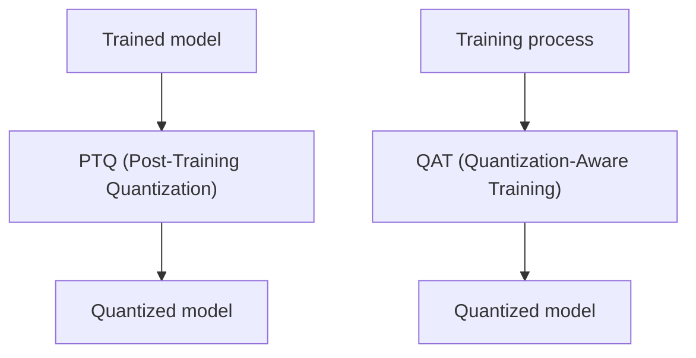
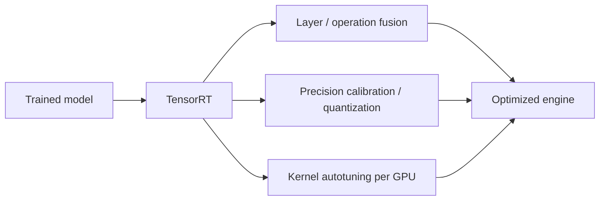
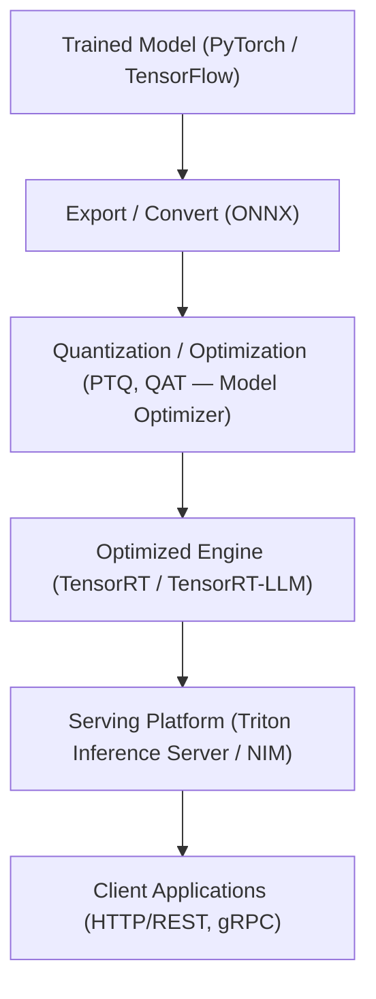
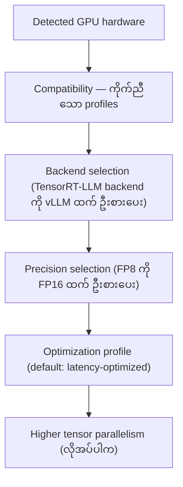
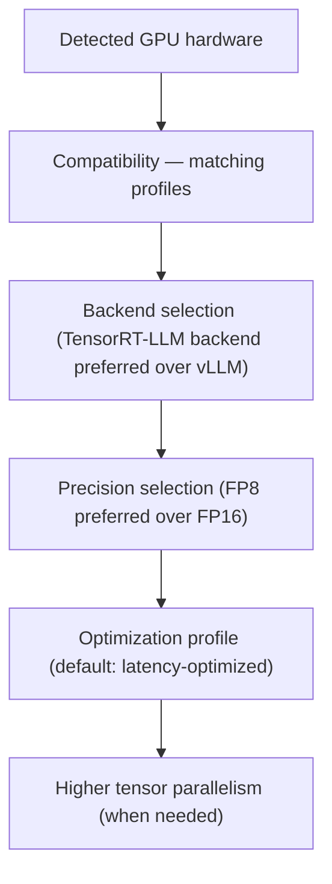

# Module 42 — AI Model Optimization and Inference Serving (Supplemental)

> Part VI · NVIDIA AI Software, Workloads and Enterprise Platform — Supplemental Course Module 42 (AI Model Optimization and Inference Serving) — topic notes

## မြန်မာဘာသာ version

### 1. Learning Objectives

ဤ Module ကို လေ့လာပြီးနောက် အောက်ပါအချက်များကို နားလည်နိုင်ရမည်။

- Production inference တွင် latency, throughput နှင့် cost target များ ဘာကြောင့် အရေးကြီးသလဲ။
- Quantization (PTQ နှင့် QAT) က ဘယ်လိုအလုပ်လုပ်သလဲ၊ precision types များနှင့် granularity များက ဘာတွဲလဲ။
- TensorRT, TensorRT-LLM, Triton Inference Server, NIM နှင့် Model Optimizer တို့၏ ကွာခြားချက်က ဘာလဲ။
- Trained model တစ်ခုကနေ optimized engine နှင့် served endpoint တစ်ခုအထိ workflow က ဘယ်လိုသွားသလဲ။
- NIM model profile ရွေးချယ်မှုက latency-oriented နှင့် throughput-oriented deployment တွေကို ဘယ်လိုသက်ရောက်သလဲ။
- TTFT, TPOT, tokens/sec ကဲ့သို့ serving metrics များကို ဘယ်လိုဖတ်ရမလဲ။

> အကြောင်းအရာ ချိတ်ဆက်မှု — Module 33 (§9) တွင် Framework, CUDA, TensorRT နှင့် Triton တို့၏ တာဝန်ခွဲခြားချက်ကို အကျဉ်းချုပ် ဖော်ပြထားပြီး၊ Module 41 (Stage Three နှင့် Stage Four) တွင် MLOps lifecycle အတွင်းက optimization နှင့် deployment အဆင့်များကို မိတ်ဆက်ထားပါတယ်။ ဤ Module 42 က ၎င်းအကြောင်းအရာများကို ထပ်မဖော်ပြဘဲ model optimization နှင့် inference serving ကို အထူးပြု အသေးစိတ် ရှင်းလင်းပါမည်။

### 2. Problem — Production Performance Targets

Train လုပ်ပြီးသော model တစ်ခုဟာ accuracy ကောင်းရုံနဲ့ production မှာ အဆင်ပြေတာ မဟုတ်ပါဘူး။ Production inference system တစ်ခုမှာ အောက်ပါ target များ ပြည့်မီရပါတယ်—

- **Latency** — user request တစ်ခုကို response ပြန်ရန် အချိန်ကန့်သတ်ချက် (ဥပမာ — chat application တွင် ပထမဆုံး token မြန်မြန်ပြန်ရန်)
- **Throughput** — တစ်စက္ကန့်အတွင်း ကိုင်တွယ်နိုင်သော requests သို့မဟုတ် tokens အရေအတွက်
- **Cost** — GPU resource အသုံးပြုမှုနှင့် ကိုက်ညီသော inference cost (cost per token ကဲ့သို့)

Framework (PyTorch, TensorFlow) ကနေ တိုက်ရိုက်ထုတ်လိုက်သော raw model များက NVIDIA GPU ရဲ့ performance အပြည့်အဝ မသုံးနိုင်ပါဘူး။ Framework-level execution မှာ layer/operation များ သီးခြား run ခြင်း၊ precision မလျှော့ချရသေးခြင်း၊ GPU-specific kernel tuning မပါရှိခြင်း စတဲ့ အကြောင်းရင်းများကြောင့် performance အများကြီး ကျန်ခဲ့နိုင်ပါတယ်။ ဒါကြောင့် production မတိုင်မီ model ကို optimize လုပ်ပြီး optimized engine ဖြင့် serve လုပ်ခြင်းက မဖြစ်မနေ လုပ်ဆောင်ရမည့် အဆင့် ဖြစ်ပါတယ်။

### 3. Optimization Concepts

#### 3.1 Quantization — PTQ နှင့် QAT

Quantization ဆိုတာ model weights နှင့် computation များကို နည်းပါးသော bit-width (precision) ဖြင့် ကိုယ်စားပြုခြင်း ဖြစ်ပြီး memory usage လျှော့ချခြင်းနှင့် computation မြန်ဆန်စေခြင်း ရည်ရွယ်ပါတယ်။ TensorRT documentation အရ workflow နှစ်မျိုး ရှိပါတယ်—

- **PTQ (Post-Training Quantization)** — train လုပ်ပြီးသော model ကို ထပ်မ retrain မလုပ်ဘဲ quantize လုပ်ခြင်း။ Calibration data ဖြင့် scale များ သတ်မှတ်ခြင်း ပါဝင်နိုင်ပါတယ်။
- **QAT (Quantization-Aware Training)** — training process အတွင်း quantization effect များကို ထည့်သွင်းစဉ်းစား၍ train လုပ်ခြင်း။ Accuracy ကို ပိုမိုထိန်းသိမ်းနိုင်လေ့ ရှိပါတယ်။

NVIDIA TensorRT Model Optimizer toolkit က QAT models များ ဖန်တီးခြင်းနှင့် PTQ recipes များ (PyTorch/ONNX) ပြုလုပ်ခြင်းကို ပံ့ပိုးပါတယ်။

**ပုံ ၁ (Figure 1) — PTQ နှင့် QAT workflow နှစ်မျိုး နှိုင်းယှဉ်ချက်**



**ပုံရှင်းလင်းချက်** — ပုံမှာ quantization workflow နှစ်မျိုးကို ယှဉ်ပြထားပါတယ် — PTQ က train ပြီးသား model ကို retrain မလုပ်ဘဲ calibration data ဖြင့် scale သတ်မှတ်ပြီး quantize လုပ်တာ ဖြစ်ပြီး၊ QAT က training process အတွင်းမှာ quantization effect တွေကို ထည့်သွင်းစဉ်းစားပြီး train လုပ်တာ ဖြစ်ပါတယ်။ QAT က accuracy ကို ပိုမိုထိန်းသိမ်းနိုင်လေ့ ရှိပါတယ်။

#### 3.2 Precision Types — INT8, FP8, INT4, FP4

TensorRT quantization workflows မှာ ပံ့ပိုးထားသော quantized types များတွင် **INT8, FP8, INT4, FP4** တို့ ပါဝင်ပါတယ်။

- **INT8** — integer 8-bit representation။ Quantization အသုံးများဆုံး precision ဖြစ်ပြီး calibration လိုအပ်လေ့ရှိပါတယ်။
- **FP8** — floating-point 8-bit representation။ LLM workloads များတွင် အသုံးပြုလာကြပါတယ်။
- **INT4 / FP4** — 4-bit representations များ။ ပိုမိုကျစ်လစ်သော representation ဖြစ်သော်လည်း accuracy သက်ရောက်မှုကို သတိထားရပါမယ်။

Dynamic quantization မှာ scale များကို inference အချိန်တွင် တွက်ချက်ပြီး block granularity ဖြင့် ဆောင်ရွက်ပါတယ်။ ၎င်းနှင့် ဆက်စပ်သော variants များအဖြစ် MXFP8 နှင့် NVFP4 တို့ ရှိပါတယ်။

#### 3.3 Q/DQ Layers နှင့် Granularity

Explicitly quantized networks များမှာ **Quantize/Dequantize (Q/DQ) layers** များကို သုံး၍ quantized operations များ ကိုယ်စားပြုပါတယ်။ Quantization granularity အမျိုးအစားများ—

| Granularity | ရှင်းလင်းချက် |
|---|---|
| Per-tensor | Tensor တစ်ခုလုံးအတွက် scale တစ်ခုတည်း |
| Per-channel | Channel တစ်ခုချင်းစီအတွက် scale သီးခြား |
| Block | Block အလိုက် scale များ (dynamic quantization တွင် အသုံးပြု) |

#### 3.4 Kernel Fusion နှင့် Engine Optimization

TensorRT က trained model ကို လက်ခံပြီး optimized engine တစ်ခု ထုတ်လုပ်ပေးပါတယ်။ ၎င်းလုပ်ငန်းစဉ်မှာ—

- **Layer/operation fusion** — operation များစွာကို kernel တစ်ခုအဖြစ် ပေါင်းစပ်ခြင်း (memory traffic လျှော့ချခြင်း)
- **Precision calibration/quantization** — အပေါ်ပါ precision/quantization techniques များ အသုံးပြုခြင်း
- **Kernel autotuning per GPU** — ပန်းတိုင် GPU အတွက် kernel များ ရွေးချယ် tune လုပ်ခြင်း

ရလဒ် engine က GPU model နှင့် TensorRT version ပေါ် မူတည်၍ သီးခြားဖြစ်ပါတယ်။

**ပုံ ၂ (Figure 2) — TensorRT က optimized engine ထုတ်လုပ်ပုံ**



**ပုံရှင်းလင်းချက်** — TensorRT က trained model ကို လက်ခံပြီး layer/operation တွေကို kernel တစ်ခုအဖြစ် ပေါင်းစပ်ခြင်း (layer/operation fusion)၊ precision calibration/quantization လုပ်ခြင်း၊ ပန်းတိုင် GPU အတွက် kernel ရွေးချယ် tune လုပ်ခြင်းတို့ ပြုလုပ်ပြီး optimized engine ကို ထုတ်ပေးပါတယ်။ ရလဒ် engine က GPU model နဲ့ TensorRT version ပေါ် မူတည်ပြီး သီးခြားဖြစ်ပါတယ်။

#### 3.5 Batching နှင့် KV Cache Reuse

LLM inference မှာ စွမ်းဆောင်ရည်ကို သက်ရောက်စေသော အချက်များ—

- **Dynamic batching** — Triton ကဲ့သို့ serving platform များက incoming requests များကို batch အဖြစ် ပေါင်းစပ်ကိုင်တွယ်ခြင်း
- **Continuous (in-flight) batching** — TensorRT-LLM တွင် generation requests များကို အဆက်မပြတ် ပေါင်းထည့်ကိုင်တွယ်ခြင်း
- **KV cache နှင့် KV cache reuse** — ယခင် token များ၏ key/value states များကို cache ပြုလုပ်၍ ထပ်တွက်ခြင်း ရှောင်ရှားခြင်း
- **Chunked context** — context input များကို chunk များအဖြစ် ခွဲ၍ လုပ်ဆောင်ခြင်း

#### 3.6 Tensor Parallelism

Model တစ်ခုလုံးကို GPU တစ်ခုတည်းတွင် မဆံ့ပါက weights/computation များကို GPU များစွာအကြား ခွဲဝေခြင်းကို **tensor parallelism** ဟု ခေါ်ပါတယ်။ TensorRT-LLM က parallelism မျိုးစုံကို ပံ့ပိုးပြီး LLM deployment များတွင် tensor parallelism ကို အသုံးများပါတယ်။ သို့သော် GPU အရေအတွက် တိုးလာခြင်းက communication overhead ကို သယ်ဆောင်လာနိုင်ပါတယ်။

#### 3.7 Pruning နှင့် Distillation (အကျဉ်း)

အခြား optimization technique များအဖြစ် **pruning** (မလိုအပ်သော weights/structures ဖယ်ရှားခြင်း) နှင့် **distillation** (ကြီးမားသော teacher model မှ သေးငယ်သော student model သို့ အသိပညာ လွှဲပြောင်းခြင်း) တို့ ရှိပါသေးတယ်။ ၎င်းတို့ကို ဤနေရာတွင် အမည်ဖြင်းသာ ဖော်ပြထားပြီး လက်တွေ့ workflow များကို သီးခြား လေ့လာရန် လိုအပ်ပါတယ်။

### 4. Tool Comparison — Optimization နှင့် Serving Stack

Module 33 §9 တွင် Framework, CUDA, TensorRT နှင့် Triton တို့၏ တာဝန်များကို ခွဲခြားဖော်ပြထားပြီး ဖြစ်ပါတယ်။ အောက်ပါ table က optimization နှင့် inference serving stack အတွက် ရွေးချယ်ရာတွင် အသုံးပြုနိုင်ပါတယ်—

| Tool | ဘာလဲ | အဓိက တာဝန် |
|---|---|---|
| TensorRT | NVIDIA GPU inference optimization အတွက် SDK | Trained model မှ optimized engine ထုတ်လုပ်ခြင်း (fusion, quantization, kernel tuning) |
| TensorRT-LLM | PyTorch ပေါ်တည်ဆောက်ထားသော open-source LLM inference library | LLM inference အတွက် KV cache, batching, quantization, tensor parallelism |
| Triton Inference Server | Open-source model serving platform | Model repository မှ frameworks/backends အမျိုးမျိုးကို client များထံ serve လုပ်ခြင်း |
| NIM | Packaged optimized inference microservices (containers) | Optimized engines နှင့် APIs ပါသော deployable microservices ပေးခြင်း |
| Model Optimizer | Quantization toolkit | QAT models ဖန်တီးခြင်းနှင့် PTQ recipes (PyTorch/ONNX) ပြုလုပ်ခြင်း |

မှတ်ထားရန် — TensorRT က optimization SDK ဖြစ်ပြီး Triton က serving platform ဖြစ်ပါတယ်။ NIM က ၎င်းနှစ်ခု၏ ရလဒ်များကို packaged microservice အဖြစ် ပေါင်းစပ်ထားခြင်း ဖြစ်ပါတယ်။

### 5. How It Works — Trained Model မှ Serving အထိ

#### 5.1 End-to-End Workflow

```
Trained Model (PyTorch / TensorFlow / ...)
       |
       v
Export / Convert (ဥပမာ — ONNX export)
       |
       v
Quantization / Optimization (PTQ, QAT — Model Optimizer)
       |
       v
Optimized Inference Engine (TensorRT engine / TensorRT-LLM engine)
       |
       v
Serving Platform (Triton Inference Server / NIM)
       |
       v
Client Applications (HTTP/REST, gRPC)
```

Model တစ်ခုကို train လုပ်ပြီးနောက် သင့်လျောသော format (ဥပမာ — ONNX) သို့ export/convert လုပ်ကာ quantization နှင့် optimization ပြုလုပ်ပြီး optimized engine ထုတ်လုပ်ပါတယ်။ ၎င်း engine ကို Triton Inference Server သို့မဟုတ် NIM ကဲ့သို့ serving platform မှတစ်ဆင့် client များထံ တင်ပို့ပါတယ်။ သို့သော် model နှင့် backend အားလုံးအတွက် workflow တစ်ပုံစံတည်း မဟုတ်ပါဘူး။

LLM အတွက်ဆိုပါက အဓိက engine က TensorRT-LLM ဖြစ်ပြီး KV cache, continuous batching နှင့် tensor parallelism များ ပါဝင်ပါတယ်။ Triton က TensorRT-LLM backend ကို ပံ့ပိုးပါတယ်။

**ပုံ ၃ (Figure 3) — Trained model မှ optimized engine နှင့် served endpoint အထိ workflow**



**ပုံရှင်းလင်းချက်** — ပုံအတိုင်း အဆင့်လိုက် လိုက်ကြည့်ရင် framework က ထွက်လာတဲ့ trained model ကို အရင် export/convert လုပ်ပြီး၊ Model Optimizer ဖြင့် quantization/optimization ပြုလုပ်ကာ optimized engine (TensorRT သို့မဟုတ် TensorRT-LLM) ထုတ်ပါတယ်။ ၎င်း engine ကို Triton Inference Server သို့မဟုတ် NIM ကဲ့သို့ serving platform မှတစ်ဆင့် client applications တွေဆီ HTTP/REST သို့မဟုတ် gRPC ဖြင့် တင်ပို့ပါတယ်။ LLM အတွက် အဓိက engine က TensorRT-LLM ဖြစ်ပါတယ်။

Triton Inference Server ရဲ့ အတွင်းပိုင်း architecture ကို NVIDIA ရဲ့ ရုပ်ပုံမှာ အောက်ပါအတိုင်း ကြည့်ရှုနိုင်ပါတယ်—

#### 5.2 NIM Model Profile Selection

NIM က model profiles များကို **'latency'** နှင့် **'throughput'** ဟု tag ပြုလုပ်ထားပြီး ကိုယ်တိုင် hardware ကို ရှာဖွေတွေ့ရှိ၍ profile ကို အလိုအလျောက် ရွေးချယ်ပေးပါတယ်။ ရွေးချယ်မှု အဆင့်လိုက် အစဉ်—

```
Detected GPU hardware
       |
       v
Compatibility — ကိုက်ညီသော profiles များ
       |
       v
Backend selection (ရရှိနိုင်ပါက TensorRT-LLM accelerated backend ကို vLLM ထက် ဦးစားပေး)
       |
       v
Precision selection (FP16 ထက် FP8 ကို ဦးစားပေး)
       |
       v
Optimization profile (default မှာ latency-optimized)
       |
       v
Higher tensor parallelism (လိုအပ်ပါက)
```

ရွေးချယ်ထားသော profile ကို ပြောင်းလဲချင်ပါက `NIM_MODEL_PROFILE` environment variable ဖြင့် override လုပ်နိုင်ပြီး ရရှိနိုင်သော profiles များကို `list-model-profiles` command ဖြင့် စစ်ဆေးနိုင်ပါတယ်။ Fine-tuned model များကို local engine build (NIM_FT_MODEL) ဖြင့် ပံ့ပိုးပါတယ်။

**ပုံ ၄ (Figure 4) — NIM model profile ရွေးချယ်မှု အဆင့်လိုက် အစဉ်**



**ပုံရှင်းလင်းချက်** — NIM က GPU hardware ကို ကိုယ်တိုင် ရှာဖွေတွေ့ရှိပြီး ကိုက်ညီတဲ့ profiles ထဲကနေ backend (ရရှိနိုင်ရင် TensorRT-LLM accelerated backend)၊ precision (FP16 ထက် FP8)၊ optimization profile (default က latency-optimized) တို့ကို အစဉ်လိုက် ရွေးချယ်ပြီး လိုအပ်ရင် tensor parallelism ကို ပိုမြှင့်ပေးပါတယ်။ ရွေးချယ်ထားသော profile ကို `NIM_MODEL_PROFILE` environment variable ဖြင့် override လုပ်နိုင်ပါတယ်။

### 6. Serving Metrics နှင့် Tradeoffs

| Metric | တိုင်းတာမှု |
|---|---|
| TTFT (Time to First Token) | ပထမဆုံး output token မတိုင်မီ စောင့်ဆိုင်ချိန် (user-perceived responsiveness) |
| TPOT (Time Per Output Token) | ပထမ token ပြီးနောက် output token တစ်ခုချင်းစီအတွက် ပျမ်းမျှအချိန် |
| Tokens/sec | Generation throughput |
| Requests/sec | Request throughput |
| Cost per token | Cost efficiency (GPU resource အသုံးပြုမှုနှင့် ကိုက်ညီမှု) |

**Tradeoffs များ**—

- **Latency vs throughput** — latency-optimized profile က single-request responsiveness ကို ဦးစားပေးပြီး throughput-optimized profile က batch ကြီးများဖြင့် စုစုပေါင်း output ကို ဦးစားပေးပါတယ်။
- **Batch size** — batch ကြီးလေ throughput ကောင်းလေ ဖြစ်သော်လည်း တစ်ခုချင်းစီ request latency မြင့်လာနိုင်ပါတယ်။
- **Precision** — precision လျှော့ချခြင်းက memory နှင့် speed အတွက် ကောင်းမွန်သော်လည်း accuracy ကျဆင်းနိုင်ပါတယ်။
- **Tensor parallelism** — GPU တိုးခြင်းက capacity တိုးစေသော်လည်း GPU အရေအတွက်နှင့် communication overhead တိုးလာပါတယ်။

Optimization ကို တိုင်းတာရပါမယ် — accuracy သို့မဟုတ် အရေးကြီး quality metric များ လက်ခံနိုင်သော အနိမ့်ဆုံးအောက် ကျဆင်းသွားပါက ပိုမြန်သော model က အကျိုးမရှိနိုင်ပါဘူး။

### 7. Cautions နှင့် သတိပြုရန် အချက်များ

- **Speedup ဂဏန်းများကို ကတိမပေးပါနှင့်** — optimization ရလဒ်များက model, GPU generation, TensorRT version နှင့် workload ပေါ် မူတည်ပါတယ်။ အမြဲတမ်း ကိုယ်တိုင် benchmark လုပ်ပါ။
- **Feature support က version/hardware ပေါ် မူတည်ပါတယ်** — precision type, backend သို့မဟုတ် feature တစ်ခု ပံ့ပိုးမပံ့ပိုးက သင့် hardware နှင့် software version ပေါ် မူတည်ပြီး လက်ရှိ documentation တွင် အတည်ပြုပါ။
- **Quantization က accuracy ကို လျှော့ချနိုင်ပါတယ်** — optimized engine ကို production မသုံးမီ accuracy ကို validate လုပ်ပြီး လက်ခံနိုင်သော အဆင့်အောက် ကျမကျ စစ်ဆေးပါ။
- **NIM details များ ပြောင်းလဲနိုင်ပါတယ်** — profile selection အသေးစိတ်များက release အလိုက် ပြောင်းလဲနိုင်ပြီး NIM optimization documentation တွင် အမြဲစစ်ဆေးပါ။
- **မှားယွင်းစွာ နားလည်လေ့ရှိမှု** — "TensorRT က training framework ဖြစ်တယ်" ဟူသော အယူအဆ မှားပါတယ်။ TensorRT က inference optimization SDK ဖြစ်ပြီး Triton က model ကို serve လုပ်ပေးပါတယ်။ NIM က Triton ရဲ့ replacement မဟုတ်ဘဲ ပိုမို packaged ဖြစ်သော deployment experience ဖြစ်ပါတယ်။

### 8. Self-Check Questions နှင့် အဖြေများ

**မေးခွန်း ၁ — PTQ နှင့် QAT တို့၏ ကွာခြားချက်က ဘာလဲ။**

အဖြေ — PTQ က train လုပ်ပြီးသော model ကို retrain မလုပ်ဘဲ quantize လုပ်ခြင်း ဖြစ်ပြီး QAT က quantization effect များကို training အတွင်း ထည့်သွင်းစဉ်းစား၍ train လုပ်ခြင်း ဖြစ်ပါတယ်။

**မေးခွန်း ၂ — TensorRT, Triton Inference Server နှင့် NIM တို့၏ တာဝန်များကို ခွဲခြားဖော်ပြပါ။**

အဖြေ — TensorRT က trained model မှ optimized inference engine ထုတ်လုပ်ပေးသော SDK ဖြစ်ပါတယ်။ Triton Inference Server က model repository မှ models များကို client များထံ serve လုပ်ပေးသော serving platform ဖြစ်ပါတယ်။ NIM က optimized engines နှင့် APIs ပါဝင်သော packaged inference microservices များ ဖြစ်ပါတယ်။

**မေးခွန်း ၃ — NIM model profile တစ်ခုကို ဘယ်လို override လုပ်နိုင်သလဲ။**

အဖြေ — `NIM_MODEL_PROFILE` environment variable ဖြင့် override လုပ်နိုင်ပြီး ရရှိနိုင်သော profiles များကို `list-model-profiles` command ဖြင့် ကြည့်ရှုနိုင်ပါတယ်။

**မေးခွန်း ၄ — TTFT နှင့် TPOT တို့က ဘာကို တိုင်းတာသလဲ။**

အဖြေ — TTFT က ပထမဆုံး output token မတိုင်မီ latency ကို တိုင်းတာပြီး TPOT က ပထမ token ပြီးနောက် output token တစ်ခုချင်းစီအတွက် ပျမ်းမျှအချိန်ကို တိုင်းတာပါတယ်။

**မေးခွန်း ၅ — Quantized model တစ်ခုကို production မသုံးမီ ဘာကြောင့် validate လုပ်ရသလဲ။**

အဖြေ — Quantization က accuracy ကို ကျဆင်းစေနိုင်သောကြောင့် optimized model/engine ၏ accuracy ကို အမြဲတမ်း တိုင်းတာပြီး လက်ခံနိုင်သော အနိမ့်ဆုံးအဆင့် ပြည့်မီကြောင်း အတည်ပြုရပါမယ်။

## English Version

### 1. Learning Objectives

After studying this module, you should be able to—

- Explain why latency, throughput and cost targets matter for production inference.
- Describe how quantization (PTQ and QAT) works and how precision types and granularities differ.
- Distinguish TensorRT, TensorRT-LLM, Triton Inference Server, NIM and Model Optimizer.
- Trace the workflow from a trained model to an optimized engine and a served endpoint.
- Explain how NIM model profile selection affects latency-oriented and throughput-oriented deployments.
- Read serving metrics such as TTFT, TPOT and tokens/sec.

> Cross-references — Module 33 (§9) summarizes the division of responsibilities between Framework, CUDA, TensorRT and Triton, and Module 41 (Stage Three and Stage Four) introduces optimization and deployment stages within the MLOps lifecycle. This Module 42 does not repeat that material; it is the dedicated, detailed treatment of model optimization and inference serving.

### 2. Problem — Production Performance Targets

A trained model with good accuracy is not automatically ready for production. A production inference system must meet targets such as—

- **Latency** — the time budget for responding to a user request (for example, returning the first token quickly in a chat application)
- **Throughput** — the number of requests or tokens handled per second
- **Cost** — inference cost matched to GPU resource usage (for example, cost per token)

Raw models taken straight from a framework (PyTorch, TensorFlow) do not use the full performance of an NVIDIA GPU. At framework level, layers and operations run individually, precision is not reduced, and GPU-specific kernel tuning is absent — leaving significant performance unused. Optimizing the model before production and serving it as an optimized engine is therefore a required step.

### 3. Optimization Concepts

#### 3.1 Quantization — PTQ and QAT

Quantization represents model weights and computations with fewer bits (lower precision), aiming to reduce memory usage and speed up computation. Per TensorRT documentation there are two workflows—

- **PTQ (Post-Training Quantization)** — quantizing a trained model without retraining it. This may include calibrating scales from calibration data.
- **QAT (Quantization-Aware Training)** — training with quantization effects taken into account during the training process. This tends to preserve accuracy better.

The NVIDIA TensorRT Model Optimizer toolkit supports creating QAT models and building PTQ recipes (PyTorch/ONNX).

**Figure 1 — Comparing the two quantization workflows, PTQ and QAT**


**Figure walkthrough** — The figure compares the two workflows: PTQ quantizes an already-trained model without retraining it, setting scales from calibration data, while QAT trains with quantization effects taken into account during the training process itself. QAT tends to preserve accuracy better.

#### 3.2 Precision Types — INT8, FP8, INT4, FP4

Quantized types supported in TensorRT quantization workflows include **INT8, FP8, INT4 and FP4**.

- **INT8** — 8-bit integer representation. The most common quantization precision; usually requires calibration.
- **FP8** — 8-bit floating-point representation. Increasingly used for LLM workloads.
- **INT4 / FP4** — 4-bit representations. More compact, but accuracy impact must be watched carefully.

With dynamic quantization, scales are computed at inference time using block granularity. Related variants include MXFP8 and NVFP4.

#### 3.3 Q/DQ Layers and Granularity

Explicitly quantized networks use **Quantize/Dequantize (Q/DQ) layers** to represent quantized operations. Quantization granularity types—

| Granularity | Description |
|---|---|
| Per-tensor | One scale for an entire tensor |
| Per-channel | A separate scale per channel |
| Block | Scales per block (used with dynamic quantization) |

#### 3.4 Kernel Fusion and Engine Optimization

TensorRT takes a trained model and produces an optimized engine. This process includes—

- **Layer/operation fusion** — combining multiple operations into one kernel (reducing memory traffic)
- **Precision calibration/quantization** — applying the precision and quantization techniques above
- **Kernel autotuning per GPU** — selecting and tuning kernels for the target GPU

The resulting engine is specific to the GPU model and TensorRT version.

**Figure 2 — How TensorRT produces an optimized engine**


**Figure walkthrough** — TensorRT takes the trained model and combines layers/operations into single kernels (layer/operation fusion), applies precision calibration and quantization, and selects and tunes kernels for the target GPU to produce the optimized engine. The resulting engine is specific to the GPU model and TensorRT version.

#### 3.5 Batching and KV Cache Reuse

Factors that affect LLM inference performance—

- **Dynamic batching** — serving platforms such as Triton combine incoming requests into batches
- **Continuous (in-flight) batching** — TensorRT-LLM keeps adding generation requests to batches in flight
- **KV cache and KV cache reuse** — caching key/value states of previous tokens to avoid recomputation
- **Chunked context** — splitting context inputs into chunks for processing

#### 3.6 Tensor Parallelism

When a model does not fit on a single GPU, weights and computations are split across multiple GPUs — this is **tensor parallelism**. TensorRT-LLM supports multiple parallelism strategies, and tensor parallelism is common in LLM deployments. However, more GPUs introduce communication overhead.

#### 3.7 Pruning and Distillation (brief)

Other optimization techniques include **pruning** (removing unnecessary weights/structures) and **distillation** (transferring knowledge from a large teacher model to a smaller student model). They are only named here; their workflows require separate study.

### 4. Tool Comparison — The Optimization and Serving Stack

Module 33 §9 already distinguishes the responsibilities of Framework, CUDA, TensorRT and Triton. The table below helps you choose within the optimization and inference serving stack—

| Tool | What it is | Primary role |
|---|---|---|
| TensorRT | SDK for optimizing deep learning inference on NVIDIA GPUs | Produces optimized engines from trained models (fusion, quantization, kernel tuning) |
| TensorRT-LLM | Open-source LLM inference library built on PyTorch | KV cache, batching, quantization, tensor parallelism for LLM inference |
| Triton Inference Server | Open-source model serving platform | Serves models from a model repository across frameworks/backends to clients |
| NIM | Packaged optimized inference microservices (containers) | Deployable microservices with optimized engines and APIs |
| Model Optimizer | Quantization toolkit | Creates QAT models and builds PTQ recipes (PyTorch/ONNX) |

Note — TensorRT is an optimization SDK while Triton is a serving platform. NIM packages the results of both into a deployable microservice.

### 5. How It Works — From Trained Model to Serving

#### 5.1 End-to-End Workflow

```
Trained Model (PyTorch / TensorFlow / ...)
       |
       v
Export / Convert (e.g. ONNX export)
       |
       v
Quantization / Optimization (PTQ, QAT — Model Optimizer)
       |
       v
Optimized Inference Engine (TensorRT engine / TensorRT-LLM engine)
       |
       v
Serving Platform (Triton Inference Server / NIM)
       |
       v
Client Applications (HTTP/REST, gRPC)
```

After training, a model is exported/converted to a suitable format (e.g. ONNX), quantized and optimized to produce an optimized engine. That engine is then served to clients through a serving platform such as Triton Inference Server or NIM. However, this is not one single workflow for every model and backend.

For LLMs the main engine is TensorRT-LLM, with KV cache, continuous batching and tensor parallelism. Triton supports a TensorRT-LLM backend.

**Figure 3 — The workflow from a trained model to a served endpoint**


**Figure walkthrough** — Following the figure step by step, the trained model from a framework is exported/converted (e.g. ONNX), then quantized and optimized (PTQ, QAT with Model Optimizer) to produce an optimized engine (TensorRT or TensorRT-LLM). That engine is served to client applications over HTTP/REST or gRPC through a serving platform such as Triton Inference Server or NIM. For LLMs, the main engine is TensorRT-LLM.

The internal architecture of the Triton Inference Server can be seen in NVIDIA's diagram below—

#### 5.2 NIM Model Profile Selection

NIM tags its model profiles as **'latency'** and **'throughput'**, and selects a profile automatically based on the detected hardware. The selection order—

```
Detected GPU hardware
       |
       v
Compatibility — matching profiles
       |
       v
Backend selection (TensorRT-LLM accelerated backend preferred over vLLM when available)
       |
       v
Precision selection (FP8 preferred over FP16)
       |
       v
Optimization profile (latency-optimized is the default)
       |
       v
Higher tensor parallelism (when needed)
```

To override the selected profile, use the `NIM_MODEL_PROFILE` environment variable, and list available profiles with the `list-model-profiles` command. Fine-tuned models are supported via local engine build (NIM_FT_MODEL).

**Figure 4 — The NIM model profile selection order**



**Figure walkthrough** — NIM detects the GPU hardware itself and, among the matching profiles, selects in order: the backend (preferring the TensorRT-LLM accelerated backend over vLLM when available), the precision (preferring FP8 over FP16), and the optimization profile (latency-optimized by default), raising tensor parallelism when needed. The selected profile can be overridden with the `NIM_MODEL_PROFILE` environment variable.

### 6. Serving Metrics and Tradeoffs

| Metric | What it measures |
|---|---|
| TTFT (Time to First Token) | Wait time before the first output token (user-perceived responsiveness) |
| TPOT (Time Per Output Token) | Average time per output token after the first |
| Tokens/sec | Generation throughput |
| Requests/sec | Request throughput |
| Cost per token | Cost efficiency (matched to GPU resource usage) |

**Tradeoffs**—

- **Latency vs throughput** — latency-optimized profiles prioritize single-request responsiveness; throughput-optimized profiles prioritize total output with large batches.
- **Batch size** — larger batches improve throughput but can raise per-request latency.
- **Precision** — lowering precision helps memory and speed but can reduce accuracy.
- **Tensor parallelism** — more GPUs add capacity but also add GPU count and communication overhead.

Optimization must be measured: if accuracy or other critical quality metrics fall below an acceptable floor, a faster model is not actually better.

### 7. Cautions and Common Misconceptions

- **Never promise speedup numbers** — optimization results depend on the model, GPU generation, TensorRT version and workload. Always benchmark yourself.
- **Feature support is version/hardware dependent** — whether a precision type, backend or feature is supported depends on your hardware and software versions; confirm against current documentation.
- **Quantization can reduce accuracy** — validate accuracy before using an optimized engine in production and check it stays above the acceptable floor.
- **NIM details change across releases** — profile selection details can change per release; always check the NIM optimization documentation.
- **Common misconception** — "TensorRT is a training framework" is wrong. TensorRT is an inference optimization SDK, and Triton serves models. NIM is not a replacement for Triton but a more packaged deployment experience.

### 8. Self-Check Questions and Answers

**Question 1 — What is the difference between PTQ and QAT?**

Answer — PTQ quantizes a trained model without retraining it, while QAT trains the model with quantization effects taken into account during training.

**Question 2 — Distinguish the roles of TensorRT, Triton Inference Server and NIM.**

Answer — TensorRT is an SDK that produces optimized inference engines from trained models. Triton Inference Server is a serving platform that serves models from a model repository to clients. NIM provides packaged inference microservices with optimized engines and APIs.

**Question 3 — How do you override a NIM model profile?**

Answer — Override it with the `NIM_MODEL_PROFILE` environment variable, and view available profiles with the `list-model-profiles` command.

**Question 4 — What do TTFT and TPOT measure?**

Answer — TTFT measures latency before the first output token; TPOT measures the average time per output token after the first.

**Question 5 — Why must a quantized model be validated before production use?**

Answer — Because quantization can reduce accuracy, you must always measure the optimized model/engine accuracy and confirm it stays above the acceptable minimum.

## Official references

- TensorRT documentation — https://docs.nvidia.com/deeplearning/tensorrt/latest/
- TensorRT Quantization Workflows — https://docs.nvidia.com/deeplearning/tensorrt/latest/inference-library/quantized-types-workflows.html
- Triton Inference Server user guide — https://docs.nvidia.com/deeplearning/triton-inference-server/user-guide/docs/
- Triton Model Navigator (optimize) — https://docs.nvidia.com/deeplearning/triton-inference-server/user-guide/docs/model_navigator/docs/models_optimize/optimize/optimize.html
- TensorRT-LLM User Guide (Triton) — https://docs.nvidia.com/deeplearning/triton-inference-server/user-guide/docs/getting_started/trtllm_user_guide.html
- NIM optimization profiles — https://docs.nvidia.com/nim/large-language-models/1.0.0/optimization.html
- NIM documentation — https://docs.nvidia.com/nim/

## Technical review notes

- Content is based on verified facts from official NVIDIA documentation (TensorRT, quantization workflows, Triton Inference Server, Model Navigator, TensorRT-LLM, NIM) as recorded in the research notes for this module; source URLs are listed in Official references above.
- No benchmark or speedup numbers are given, by design — optimization results are version-, hardware- and workload-dependent.
- NIM profile selection details (priority order, backend preference, precision preference) are documented per release and can change; learners should confirm against the current NIM optimization page. The NIM selection flow in §5.2 reflects the documented behavior at the time of research and should be re-checked against the latest release (needs verification for future releases).
- Only documented environment variables and commands are named (`NIM_MODEL_PROFILE`, `list-model-profiles`, `NIM_FT_MODEL`); no additional CLI examples are reproduced.
- The Burmese version is written in the course convention: technical terms (TensorRT, TensorRT-LLM, Triton, NIM, quantization, PTQ, QAT, KV cache, batching, latency, throughput, TTFT, TPOT, engine, backend) remain in English.

- Mermaid figures (Figures 1–4) with figure walkthroughs (ပုံရှင်းလင်းချက်) were added inline to both language sections; all existing text, ASCII diagrams, and review notes are unchanged.
